# 【实战】上班族用 AI 做小程序：0 代码上线 3 款产品，1.5 万用户，跑通内容 x 产品 x 服务闭环

260901 副业 SC 精华

整理：公众号懒人搜索，懒人专属群 精选

懒人微信：lazyhelper1

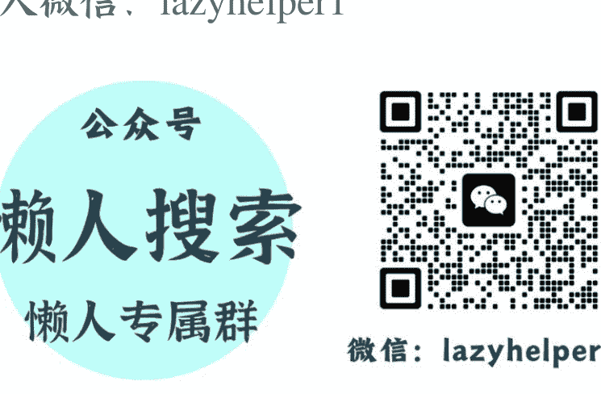

> 小懒判断 | 适合有审美、会提需求的上班族想低成本做产品的细读；指望抄个模板就躺赚的别看。最有颗粒度的是验证路径：Excel 表格自用半年→AI 做成网页→小红书挂 9.9 元链接真有人付钱→才动手做小程序，825 元启动 3 个月 1.5 万用户。最值得偷的是"沟通记忆"系统：每晚收工让 AI 总结进展存成 MD，第二天读取接着干，碎片时间不重讲故事。坑在微信第三方平台审核提交 3 次才过、Vercel 动态 IP 还得加钱买固定 IP 服务器。

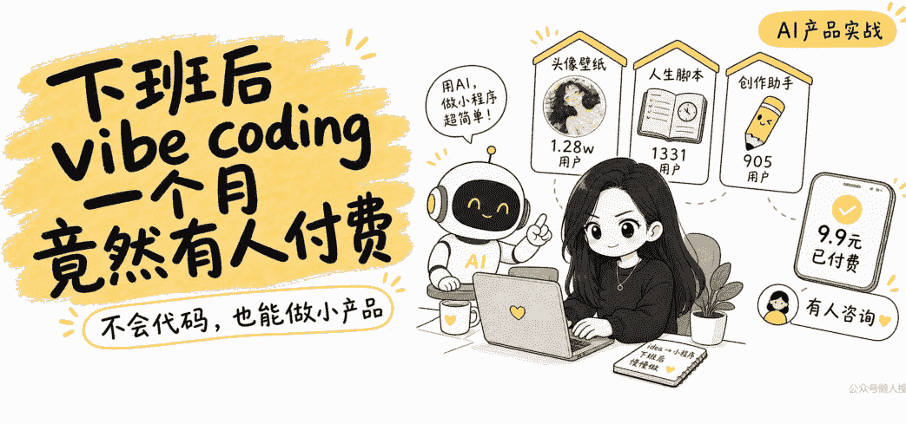

# 自我介绍

圈友们好，我是周小白，一个白天上班、晚上写作和做产品的艺术文科生。

我不会写代码，英语也不太行。之前在生财写过一篇 AI 治愈系插画的完整复盘：2025 年副业收入超 20 万，全网涨粉 13 万。

上一篇精华帖：

https://scys.com/articleDetail/xq\_topic/82811215288584452

这一次，我想分享的是：一个完全不会代码的上班族，怎么用 AI 把自己的需求做成产品。

先说结果：

从 3 月到 5 月，我陆续上线了 3 款小程序，累计用户约 1.5 万，其中原创治愈头像壁纸小程序用户突破 1 万。7 月到 8 月，我又把 3 款产品进一步整合成了「周小白工作台」。目前工作台已经成功上线，昨天上架立马成交了 2 单，还有一单 3999 的工作台陪跑服务小程序目前已经跑通了广告、会员付费、图片授权和工具服务几种变现方式。所有开发，基本都在下班后 20:00—23:00 的碎片时间完成。

这篇不是一篇单纯的 AI 编程教程。我更想复盘的是：普通人如何从自己的真实需求出发，先验证，再开发，最后用内容把产品送到用户面前。

本篇主要解决以下问题：

- 完全不会代码，怎么借助 AI 做出并上线小程序？
- 开发之前，怎么用最低成本验证需求，避免自嗨？
- 我做的 3 款小程序，分别解决了什么问题？
- 如何用内容获客，让产品被看见、被使用、被付费？
- 广告、会员、图片授权和工具服务，分别怎么跑通？
- 开发过程中踩过哪些坑，新手怎么少走弯路？
- 上班族如何利用碎片时间，让多个 Agent 协同推进产品？

# 先说结果

- **启动成本：** 825 元（域名 85 + 小程序认证 600 + Claude Code 月费 140，服务器是平台送的）
- **产品进度：** 3–5 月陆续上线 3 款小程序，7–8 月进一步整合为「周小白工作台」
- **用户规模：** 3 款小程序累计用户约 1.5 万；其中原创治愈头像壁纸累计用户突破 1 万
- **变现结构：** 广告 → 会员付费 → 图片授权与工具服务；先用访问和使用验证需求，再逐步增加付费层
- **我的状态：** 白天打工人，加班出差是常态，周末带娃，**所有开发都在下班后 20:00-23:00 的碎片时间完成**

先说大家可能最关心的数字。

**人生脚本时间管理** —— 这款产品收入目前以会员为主。早期广告收入不错，但因为用户反馈体验不好，我主动把广告去掉了，收入就降下来了。但这款产品现在已经成为我数字工作台的核心一环，打通了手机端、电脑端和 AI 工作台。后续它的价值可能不在月收入多少，而在于它是一个高频使用场景里的流量入口，未来能承载更高客单价的产品。

**原创治愈头像壁纸**——这款是小程序里变现能力最强的，高峰期单月收入到过 5000 元。收入由四部分构成：

- **广告收入**：两千多元，来自用户点击广告才能下载图片。
- **会员收入**：开通会员可以免广告直接下载高清图，这块占比很大。
- **创作者分成**：一千多元，图库里有一部分是其他创作者的作品，有分成收入。
- **后端服务收入**：这部分其实才是真正的大头。从这个入口导到私域，499 元的产品成交了 10 单，还有 999 元的其他订单。私域用户来这里下载壁纸，顺便看到我的课程和陪跑服务，自然就转化了。

**周小白创作助手**——这款工具的收入主要靠后端，而不是小程序本身。它的用户来源很特殊：我之前在做治愈头像、治愈图文赛道的时候积累了 100 多家学员，这款工具帮他们提升制作效率，是给学员的附加价值。所以它的变现路径是：学员用工具 → 效率提升 → 续费陪跑服务。版权收入这一块也有贡献，但这个收入是记在壁纸那个产品里的。

## 三个小程序的流量从哪来？

- 人生脚本：主要靠朋友圈和小红书（更新频率不高，所以没有爆发式增长，但一直在稳定获客）。
- 治愈头像壁纸：多个公众号 + 小红书，双渠道引流。
- 周小白创作助手：纯私域，靠的是之前的学员积累。

总结一句话：小程序是承接入口，真正值钱的不只是广告收入，而是它背后能不能把人导入私域、能不能和其他产品形成闭环。

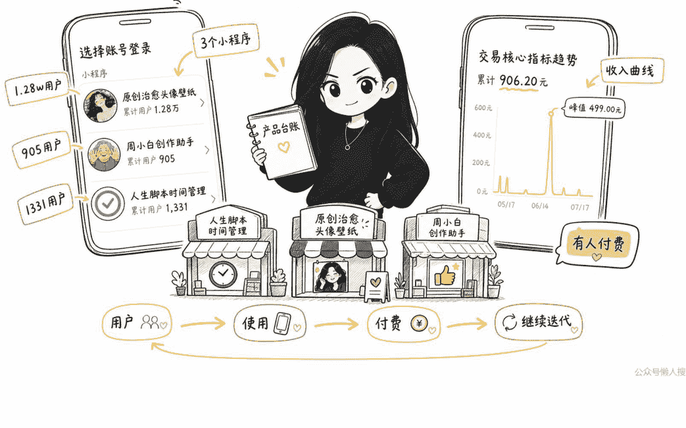

先说一个很多人不信的事：我是学文学的，在音乐学院读书，不用上数学和英语课。代码能力、英语能力，简直一塌糊涂。

没有 AI，我肯定做不出这样的产品。

有时候也感慨，这真的是文科生的时代啊。特别是我这种斜杠跨多领域的艺术文科生——审美是核心资产，创意是底层能力，AI 是放大器。代码只是执行层，这一层可以外包给 AI。

核心结论：你不需要会写代码，但你需要有“把自己需求做成产品”的意识。

# 一、我是谁，为什么做小程序

## 1.1 我的背景

2025 年，我用豆包 AI 做治愈系插画，副业收入超 20 万，全网涨粉 13 万，还孵化了「治愈系李奶奶」「花婆婆与雪球」（56 万粉）等一批账号。之前写过精华帖，可能有小伙伴还记得我

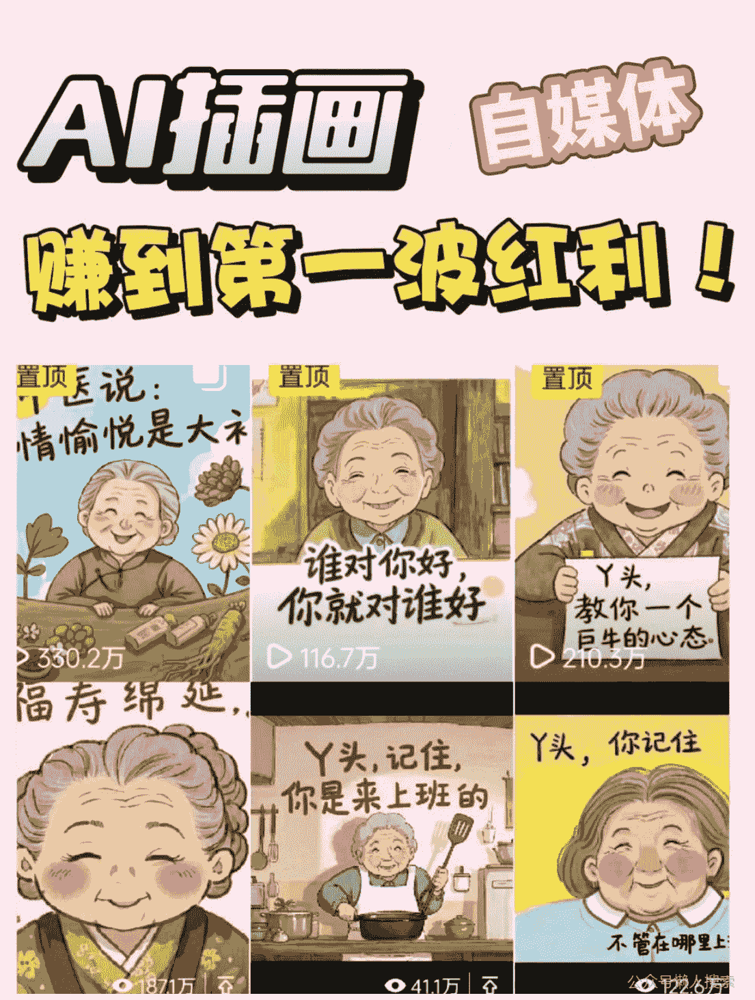

我的本职是集团公司员工，加班出差是常态，周末还要带娃。所有副业内容，基本都是一个手机追剧、一台手机用豆包生图，然后发布，就这样。

没有接触 AI 之前，我一边上班，一边做过摄影师，拍摄过地铁广告；做过儿童编剧，写过文章；还自学了插画好几年。接触 AI 之后更一发不可收拾——因为 AI 让我的创作更加简单，而且更加容易变现了。

这一年挺神奇的。我利用豆包做了治愈系插画这个赛道，带着一群人实现了从普通小白到 AI 插画在自媒体赚钱的经历。最新的插画系列变成了文创系列，上架没有几天基本都售罄了。目前文创市场对 AI 作品的包容度也开始放宽，店家说之后跨境的图都要我的了。

> 关于 AI 治愈系插画副业的完整拆解，可以看我之前的精华帖：【实战】普通上班族的 AI 副业：靠 AI 治愈系插画，2025 年副业收入超 20W（附完整 SOP）
> https://scys.com/articleDetail/xq_topic/82811215288584452

## 1.2 为什么做小程序

做了一年 AI 插画之后，我遇到了两个具体的痛点，逼着我去做小程序。

**痛点一：市面上没有一款时间管理工具适合我。** 我是典型的 P 人，又想做时间管理，但不想在“管理时间”这件事上花太多时间——这听起来很矛盾，但确实是真实需求。

市面上的工具要么太重，比如滴答清单、Notion，功能强大但每次打开都要想半天怎么用；要么不支持“周-日”视角的直观展示，我想一眼看到这一周每个时间块安排了什么，大多数工具做不到。

我用 Excel 表格自己做了一个时间管理表，用了半年，真的有效。但 Excel 不方便在手机上操作，每次更新要开电脑，碎片时间根本用不了。

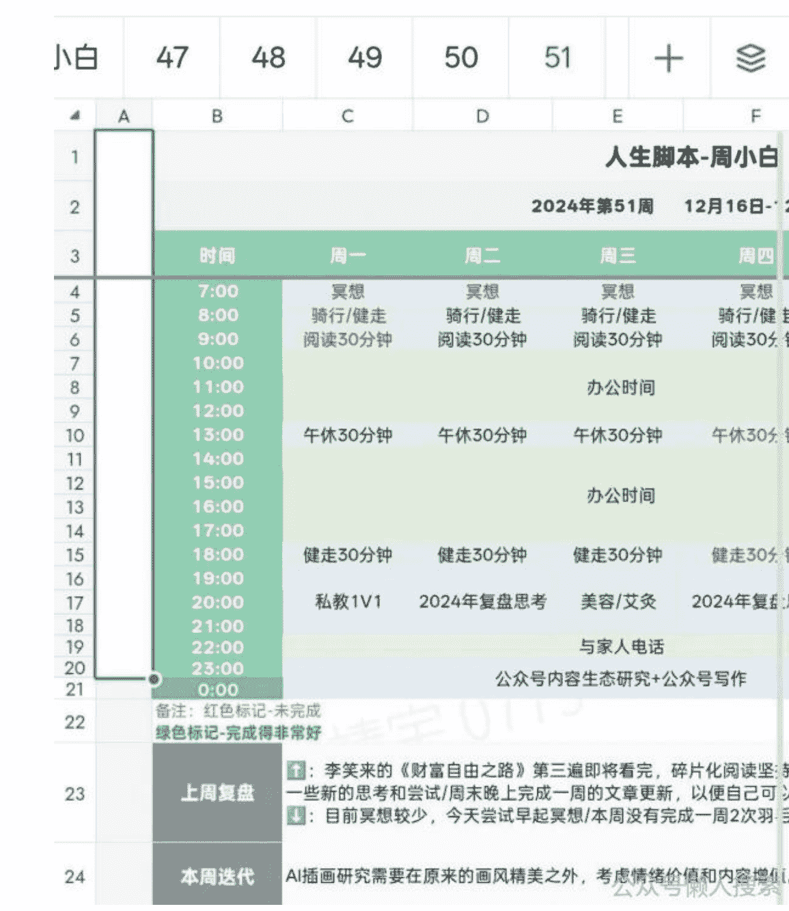

于是我就想：能不能做一个刚好够用的？只需要点点点就可以完成时间管理，不要界面太复杂，不要功能太多，就是简单的时间块记录和周复盘。

**痛点二：粉丝每天来找我要图，我被烦死了。**

做了一年 AI 插画，我的账号积累了几千张图，分散在各个公众号文章、小红书笔记、本地硬盘里。每天都有粉丝来找我要图——"小姐姐，能不能发我那张绿衣服的女孩""能不能把上周那组图发我"...... 我不太喜欢沟通，更不喜欢翻几千张图找那一张。最开始我还会认真翻，后来实在翻不过来，

就开始用一个方法：

问：小姐姐，求图
回答：你去找小程序自己找。

我既要上班，又要带娃，还要更新公众号，还要开发小程序，还要坚持运动……只能这样节约时间。

这两个痛点，就是我做出小程序最直接的起点。不是为了赚钱，是因为真的需要这个工具。

而我后来发现，自己需要的东西，往往别人也需要。这是做产品最重要的一课。

## 1.3 真正难的不是复刻，而是跑通商业闭环

到了8月22日线下完整讲完这套实践，我才把这件事说得更准确：

复刻一个小程序并不难，难的是让它被看见、被信任、被使用、被付费。代码只解决“产品能不能做出来”。一门小生意还要经过五个环节：

- 需求 → 产品 → 分发 → 交易 → 复购

内容和产品也不是互相替代的。内容更像今天发、今天被看见；产品则是今天做，明天还会被使用。前者负责获客与信任，后者负责承接与成交。没有内容，产品很容易无人知晓；没有产品，内容的价值又很难沉淀。

做产品解决“交付什么”，做内容解决“谁会看见并相信”，做系统解决“能不能稳定重复”。

# 二、需求验证：先用最小成本试错

这一章我想多写一些，因为这个思路我觉得比技术本身更重要。

## 2.1 我为什么没有一上来就做小程序

很多人问我：你怎么想到做小程序的？

我的回答是：**我不是"想到"做小程序，我是被需求推着走到小程序这一步的。** 这两件事听起来差不多，但背后的逻辑完全不同。

第一种逻辑是：我要做一个小程序，然后找一个需求来填满它。

第二种逻辑是：我有一个真实需求，我用最简单的方式先解决它，解决过程中发现别人也有这个需求，然后一步一步做成了小程序。

我走的是第二条路。以"人生脚本"为例，完整的路径是这样的：

**第一步：自己用 Excel 表格管理时间，用了半年，觉得有效。** 这一步没有任何"做产品"的意图，就是纯粹为了解决自己的问题。我做了一个表格，每天记录时间块，周末做复盘。用了半年之后，我确认这个方法对我有效，而且我离不开它了。

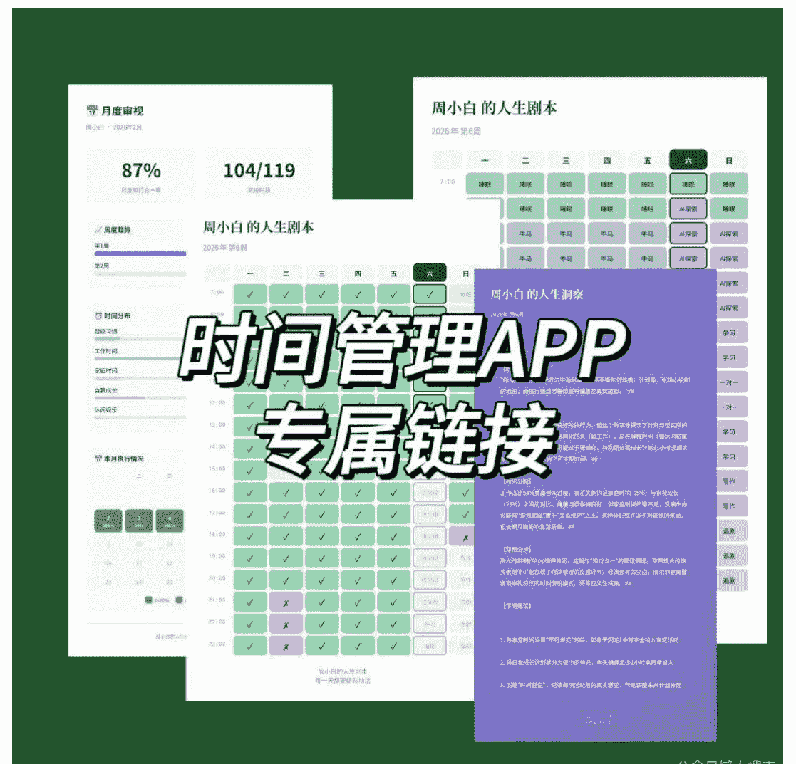

**第二步：想着能不能做成网页版，用 AI 帮我部署到 Vercel，自己用。** 表格的问题是不方便在手机上用，每次要开电脑。于是我用 AI 把表格的逻辑做成了网页版，部署到 Vercel 上，可以在手机浏览器里打开用。

这一步也没有"给别人用"的想法，还是纯粹为了自己方便。

**第三步：在小红书发了一篇分享，挂了个 9.9 的付费链接，结果真的有人咨询和付费。**

APP，支持7天无理由退货哦，快来下单吧～

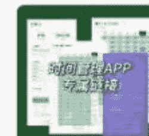

人生脚本 时间管理A... 
7天无理由退货 | 晚发必赔 
¥9.9 × 1

已读

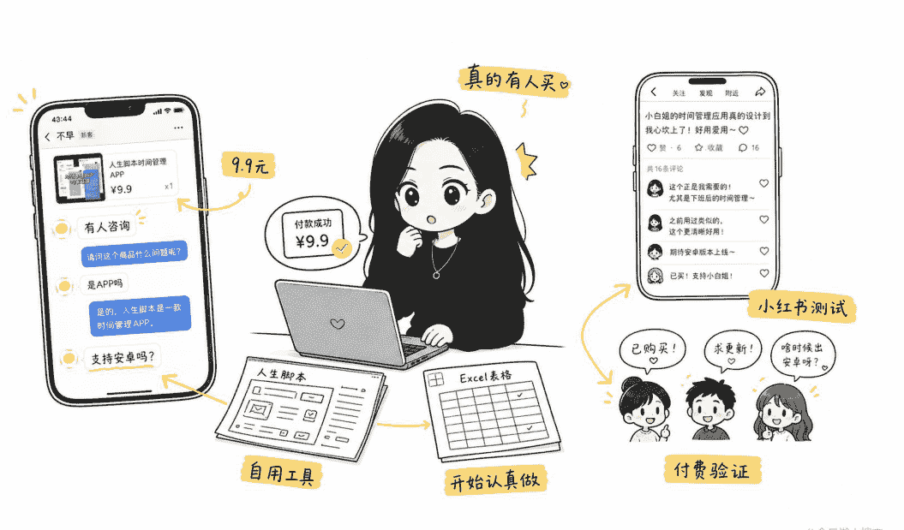

人生脚本 时间管理 APP 
七天无理由 
¥9.9

周小白补习班接入会话

薯宝，请问您想咨询这个商品什么问题呢？

已读

是APP吗

是的，人生脚本是一款时间管理APP。

已读 
AI 辅助生成

支持安卓吗？

发消息...

公众号懒人搜索

这一步是一个意外。我分享了自己用这个工具做时间管理的心得，顺带提了一句“我做了个网页版，感兴趣的可以 9.9 元体验”，没想到真的有人付款了。

这个时候我才意识到：这个需求不只是我有，别人也有。 而且最重要的是：有人愿意为它付钱。

**第四步：有了付费用户，才决定认真做——先迁移到国内服务器，后来才做小程序。**

有了第一笔付款，我才认真对待这件事。先把服务器迁到国内（Vercel 是境外服务，国内访问不稳定），然后做了小程序版本。

整个过程的关键是：我在投入大量时间做小程序之前，已经用"表格→网页→小红书测试"验证了需求是真实存在的。这个验证过程几乎零成本——表格是现成的，网页是 AI 帮忙做的，小红书发帖不花钱。我没有在一个没有经过验证的想法上押注大量时间。我还记得第一单也在生财晒过，哈哈

https://scys.com/articleDetail/xq_topic/14588481582841852

## 2.2 最小成本试错的方法论

这个逻辑其实可以套用到任何产品上：

- 第一步：先自用，验证对自己有效
- 第二步：用最简单的方式给别人用（哪怕是粗糙的）
- 第三步：看有没有人愿意付钱
- 第四步：有了付费验证，再认真做

很多人跳过了前三步，直接做第四步，然后发现没人用，白白浪费了时间和钱。

我的产品思路一直是：**先自用，验证有效，再做成产品。不赌，不all in，最小成本试错。**

## 2.3 写一张“需求卡”，再决定要不要开发

线下课下半场，我让大家先写需求卡，而不是先打开 AI 写代码。因为“AI 能做”不等于“市场需要”。

**需求卡至少写清楚四件事：**

- **目标用户：** 谁会反复遇到这个问题？
- **发生场景：** 他在什么时间、什么动作里卡住？
- **现有替代：** 他现在靠什么笨办法解决？
- **最小结果：** 产品替他省下什么、减少什么、完成什么？

然后用四个维度做判断：**需求强度 × 出现频次 × 可触达人数 × 付费增量价值**。这不是一道精确数学题，而是一张防止自嗨的检查表。

| 判断维度 | 要问自己的问题 |
| :--- | :--- |
| 需求强度 | 不解决会不会持续难受，还是只是“有更好”？ |
| 出现频次 | 每天、每周发生，还是一年只遇到一次？ |
| 可触达人数 | 我能不能通过已有账号、社群或搜索触达这群人？ |
| 付费增量 | 付费后，用户是否明显更省时间、更少出错、更低门槛或拿到更稳定的结果？ |

普通人的产品机会，往往就藏在四类具体场景里： **重复劳动、分散信息、行动门槛和情绪需求。我的三个小程序都是这样子的，第一个小程序人生脚本减少时间管理的操作成本，第二个小程序头像壁纸把散落图片变成可搜索资产，第三个小程序创作助手把反复制作变成一键生成。** 产品卖的从来不是代码，而是结果。

## 2.4 为什么选小程序而不是 App/网页

**微信生态自带流量入口。** 我的用户都在微信里，小程序不需要下载，扫码或者搜索就能用，分享给朋友的门槛极低。独立App 需要下载，这一步会损失大量用户。

**审核比 App Store 宽松得多，上线快。** App Store 的审核周期长，规则复杂，个人开发者很容易卡在审核环节。小程序审核通常 1-3 天，驳回了修改一下再提，效率高很多。

**有流量主广告，过了门槛就能直接变现。** 这是小程序独有的优势——累计 500 个独立访客就可以开通流量主广告，有了用户就有了被动收入，不需要依赖单一的付费模式。

**开发成本低，个人开发者可以独立完成。** 结合 AI 编程工具，一个完全不会写代码的人也可以做出来。这在以前是不可能的。

# 三、三个产品的完整过程

### 3.1 人生脚本（时间管理小程序）

类型：工具类·上线：2026年3月·变现：订阅制+广告

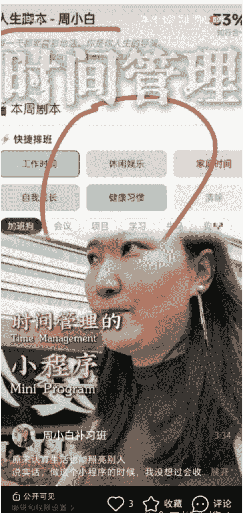

▲这个是用户自己拍的视频，来推荐我的时间管理小程序

#### 产品逻辑

这个产品的核心设计哲学只有一句话：**让懒人也能做时间管理**。不需要每天花很多时间来“管理时间”，**就是点点点**，完成整个时间记录，然后复盘的时候用语音转文字记录，AI自动生成洞察。记录的时间越长，洞察就会越准确越有感觉。

#### 核心功能：

- 可视化周规划：一眼看到这一周每个时间块的安排
- 日程拖拽：时间块可以拖动调整，操作直觉化
- AI 生成一周分析：基于打卡数据自动生成复盘洞察
- 历史复盘：可以回看过去每周的执行情况

技术栈：微信原生小程序 + Supabase（云数据库）+ Vercel（AI 服务代理）

#### 版本迭代的故事

从 v1.0 到现在的 v1.3.1，共经历了 10 个版本。

v1.0 只有 3 个页面——周规划、今日打卡、我的。功能极简，但能用。我自己用了一周，然后开始推广。

推广之后，用户的反馈开始来了：

> “能不能加一个提醒功能？”——于是有了 v1.1 的日程提醒。

> “打卡界面可不可以更简单一点，现在要点太多下才能记录一个时间块。"——于是v1.2重新设计了打卡交互。

> "我想看到整个月的完成率。"——于是v1.3加了月度审视功能。

每一个版本都是在解决真实用户的真实问题。这比我自己坐在那里想功能有效多了。

#### 一个让我很感动的用户反馈

因为是成长类工具，收到的精神正反馈比较多。

有一个用户跟我说，用了小程序之后她的作息变规律了，最大的变化是——去年10月份开始压力大，出现了耳鸣的问题，一直休息不好。用了小程序之后，因为事情做完了就开始休息，精神状态放松下来，耳鸣的问题居然被缓解了。

她说："没有耳鸣困扰的人可能感受不到，用了这个打卡以后感觉都变了。"这让我觉得，做产品最好的回报，不是钱，是真的改变了某个人的生活状态。

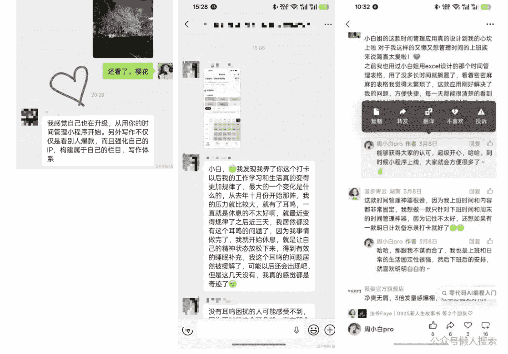

#### 关键数据

- 上线 3 周接入微信流量主
- 目前累计用户 1417 人
- 99 元付费会员 5 人，9.9 元会员 10 多人
- 会员与广告累计收入已超过 1000 元；金额不算夸张，但验证了用户愿意为持续使用和增量功能付费

#### 踩坑记录

坑 1：小程序不能直连 Supabase。 微信小程序的网络请求有白名单限制，只能请求已备案的域名。Supabase 是境外服务，无法直接请求。

解决方案：通过 Vercel 做代理转发。小程序请求 Vercel，Vercel 再请求 Supabase，绕过了白名单限制。

坑 2：Token 过期导致用户频繁掉登录。 早期版本 Token 有效期设得太短，用户过几天就发现数据不同步了，以为是 bug。实际上是登录状态过期了。

解决方案：加了 Token 自动续期的逻辑，用户无感刷新。

坑 3：自定义标签内存不记忆问题。 用户设置了自定义时间块标签，下次打开又消失了。这个问题被好几个用户反馈了才发现是本地缓存没有持久化。

#### 付费转化的逻辑

目前主要收入是付费会员。逻辑很简单： 免费体验多了，数据都在你这里了，自然

就会慢慢有更多需求。比如云同步、去广告、AI 洞察、数据分析，这些功能免费用户用不了，但用了一段时间之后就会想要。这时候付费转化是自然发生的，不需要推销。

而且这是一个长期复利的产品。作为一个自我管理工具，只要我日日分享时间管理方法，就会持续有人发现这个产品，持续有人成为用户，持续有人付费。

赚到钱，是意外之喜。我最开始做这个产品，真的没打算赚钱，就是自己需要一个工具。

而且后来他又在我的工作台还有 Obsidian 插件上面发挥了更加重要的功能：时间可视化的功能

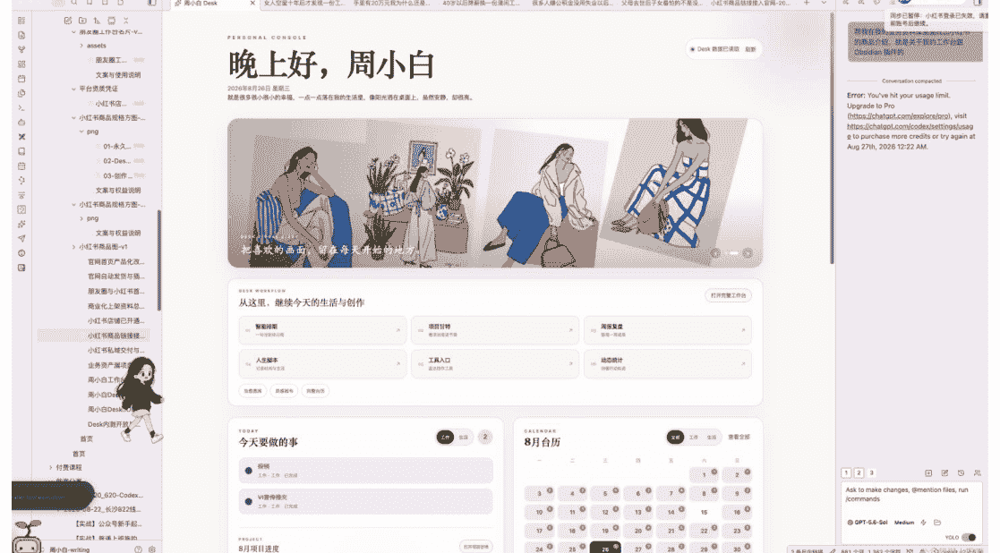

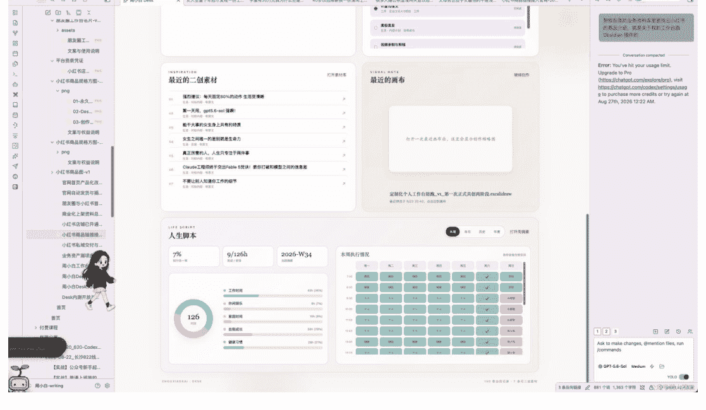

这个就是我的 Obsidian 的主页和皮肤，你可以看到人生脚本就是其中的一部分

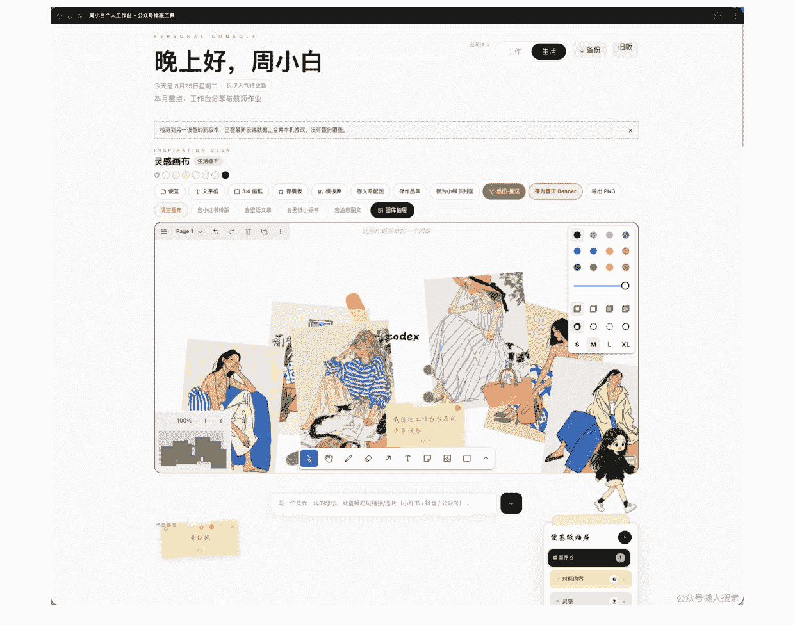

#### 哦，这个是我的工作台

这些工作台又跟我的小红书排版壁纸、文章壁纸、小绿书和周小白创作助手小程序全面打通，形成了一个多分发平台、一键创作和发送平台以及一键视频平台---

### 3.2 原创治愈头像壁纸（原“周小白审美实验室”）

类型：内容型 · 上线：2026 年 4 月 · 变现：图片下载授权付费+广告+创作者分成

#### 产品起点：我懒，所以做了这个

去年，我在做治愈系爷爷奶奶赛道的同时，给自己开了个小号，叫"周小白审美实验室"，发一些我自己喜欢的原创 AI 插画——不是老爷爷老奶奶那种，是更个人化的美学风格，治愈系女孩、油画感、日系氛围……慢慢地，有粉丝来找我要图。

刚开始我还会认真找，后来发现翻图这件事太消耗时间和心情了。我喜欢艺术、安静、思考、创造，不太喜欢商务、沟通，还有回复一些信息。于是就萌生了一个想法：

**做一个小程序，让粉丝自己来找图，自己选自己下载，不需要找我。** 还有一个原因是：以前商务合作、文创商家授权图片，都是微信转账。过程是：对方发来需求，我找图，截图发给对方，对方确认，然后转账。每次都要来回沟通好几轮，效率极低。

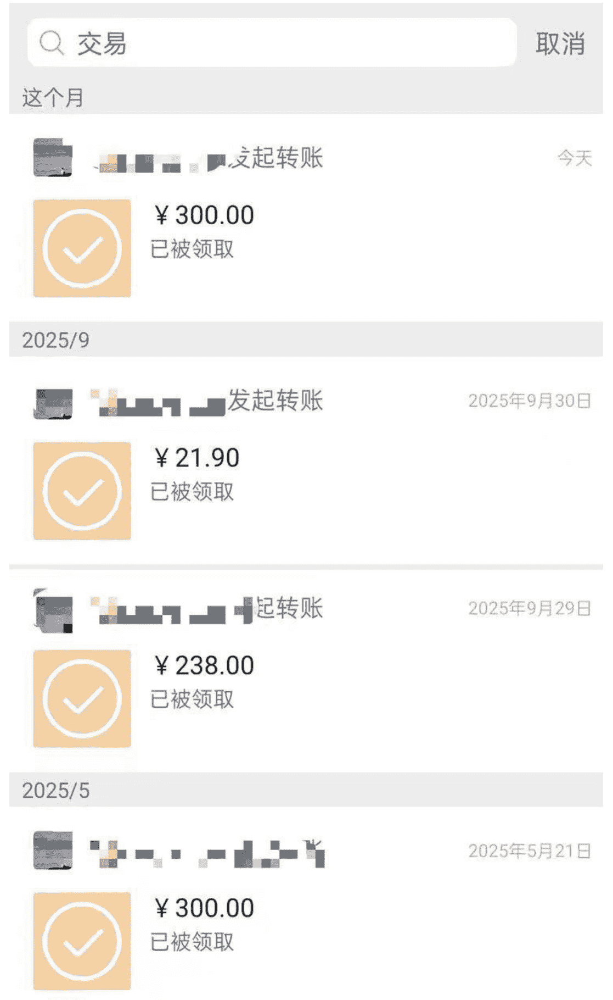

有了小程序之后，逻辑变了：我发链接给对方，你去看，用哪张就下载哪张，需要商用授权就付商用授权的价格，不需要找我。

这大大减少了我处理“求图”这件事的时间成本。

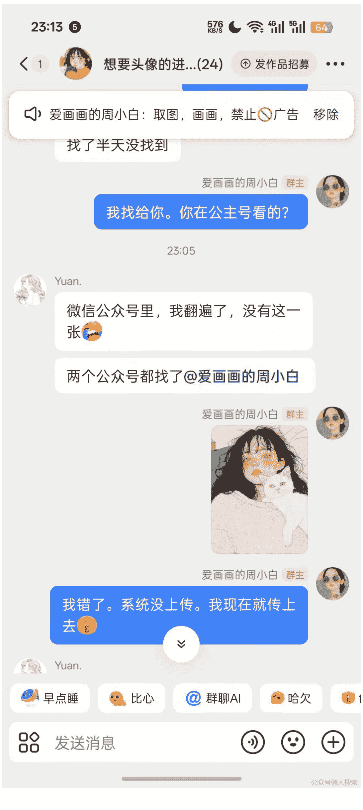

#### 核心功能

- 精选插画图库：按分类浏览（女生头像、治愈风景、油画感等）
- 分类浏览：多维度筛选，快速找到想要的风格
- 解锁下载：免费图可直接下载，付费图需购买或开通会员
- 商业授权：区分个人使用和商业使用，授权价格不同

技术栈：微信原生小程序 + Supabase（图片存储）

最大的设计决策：把图片 URL 存 Supabase，小程序做纯展示，零存储成本。图片本身托管在 Supabase 的 Storage Bucket，支持公开 CDN 访问，小程序直接引用 URL 显示图片，不需要把图片存到小程序本地，完全免费。

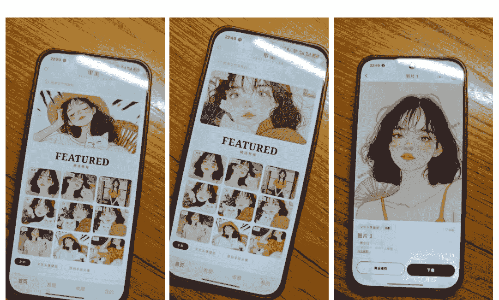

#### 踩坑记录

setData 顺序 bug，导致扣费逻辑失效。这是让我调试了很久的一个 bug。用户点击下载按钮，应该先判断余额够不够，扣费，然后标记这张图已解锁。

我当时的代码顺序是：先 setData 标记图片状态，再读取状态判断逻辑。结果 setData 是同步的，调用完立刻生效，后面读到的是新值，导致逻辑判断出错，扣费失效。

正确做法：先读旧值判断逻辑，做完所有业务处理，最后再 setData 标记状态。顺序很重要，这个坑踩了之后印象非常深。

#### 小程序活跃概况

周一 2026/05/25

| 指标 | 数值 | 变化 |
| :--- | :--- | :--- |
| 累计用户数 | 1.00万 | +3.18% |
| 日访问人数 | 381 | +88.61% |
| 日打开次数 | 582 | +96.62% |
| 日访问页面数 | 1,194 | +65.83% |

#### 新增用户概况

周一 2026/05/25

| 指标 | 数值 | 变化 |
| :--- | :--- | :--- |
| 日新增用户 | 310 | +96.20% |
| 新用户当日打开次数 | 403 | +99.50% |
| 添加至"我的小程序"，总添加人数 | 28 | +3.70% |

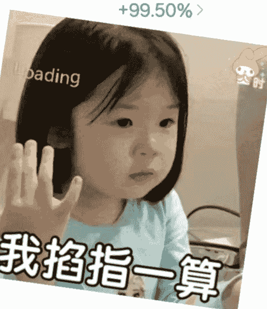

#### 产品上线后的反应

上线之后，后台一直很热闹。

有做跨境电商的来说"你的图是我首选，你不要的我全都可以要"，有文创商家来谈授权循环胶带，有用户悄悄把图换成了头像……

> 太感谢你了。

> 嘿嘿，真的超级好看，超喜欢的。

> 我把我情侣头像都扔了，就换你的。

> 我一般会被推送一些头像，然后没事的时候我就会去翻一翻你的，真的很惊艳。

> 不急的，慢慢找，别着急，你空了给我就行，别耽误你其他的行程。

> 好，期待期待

最让我觉得有意思的是：我最近都没更新了，懒嘛，但是后台的请求一直都在来。

这让我意识到：好的内容有自己的生命力，不需要每天维护也能持续产生价值。不过这个事情也有一个小插曲。后面因为分享了以后，就有人直接复制了我的作品，除了复制作品以外，还抄袭了我整个小程序的逻辑，彻彻底底被抄袭了。

所以这个事情最开始可能有一点点难过吧，后面就觉得这可能也是一种常态吧。

我大胆猜测应该是生财有术的小伙伴，哈哈哈不过，后面我也想通了，被抄袭也是一种能力嘛，就自愈了。而且，其实我不担心，因为我是热爱画画的，所以我会持续做下去。而且，我相信自己的审美，是可以增值的

#### 周小白补习班

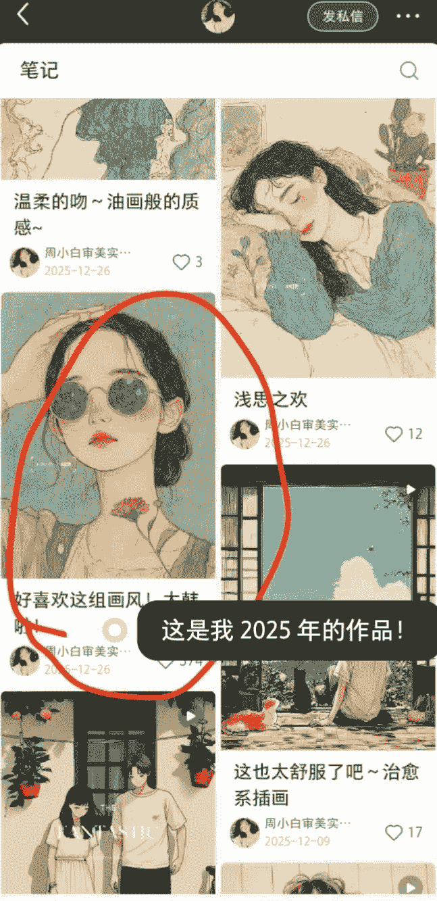

#### AI 时代，我被彻彻底底地抄袭了💔

从图片壁纸头像，到小程序的每一页设计，我被人彻彻底底地抄袭了💔

昨天早上我刷到一个小红书，发现她的图跟我的一模一样，但是又有点不同。
大概率是把我的图投喂给AI了。o(┬_┬)
这是我去年12月份发的图，说实在的有点难过。

接着我看他的简介，出现了一个小程序，内心有种不好的预感。想不会那么巧吧。

果然，点开，全部都是复制了我的排版设计逻辑。我的天😱太可怕了

我都不知道这样的时代，怎么去维权了。
就是AI时代好像要复制粘贴一个类似和一模一样的东西太容易了。

#### 商业模式升级：从创作者到平台运营者

这是审美实验室最有含金量的部分，也是我觉得最有想象力的地方。

目前很多 AI 插画博主不会做小程序，做起来也复杂，学起来也慢。但她们有内容———有高质量的 AI 插画，有粉丝群体，缺的是一个能帮她们变现的基础设施。

我的计划是：把自己的小程序变成创作平台和变现平台。逻辑是：

创作者入驻审美实验室→把自己的 AI 插画上传到图库→用户付费下载/购买商业授权→创作者拿 70%，平台拿 30%→邀请更多创作者入驻→形成网络效应从「一个人做内容」到「帮一群人变现」。

目前第一批创作者 20 人已入驻。入驻费 99 元一次性，包含排版工具使用权+图库上传资格，审核通过后永久有效。这不是课程不是培训，本质是“工具使用费+创作者身份”。如果发现做不下去，工具随时不用就行，没有后续费用。

结合我目前教的 AI 治愈系插画课程，这个平台可以做到：

从教生图，到培养学员，到帮学员实现小程序和公众号流量主的双收益。主要是过程不痛苦，工具比较容易操作，一人运营几个、几十个账号都很简单。

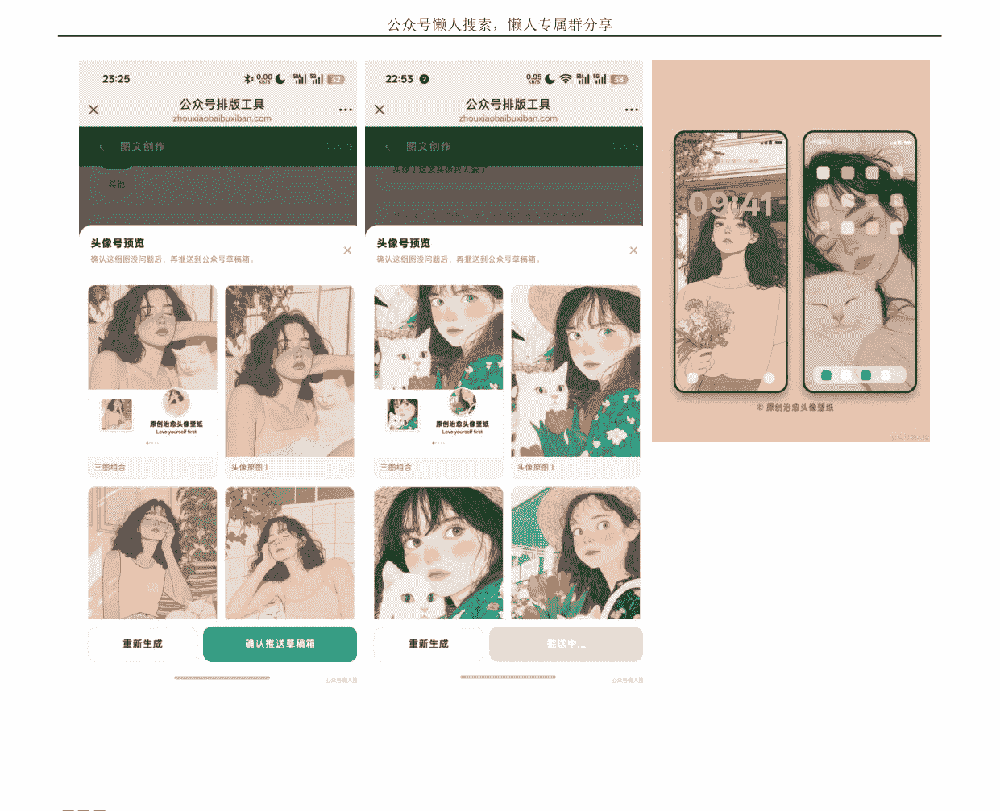

### 3.3 周小白创作助手（内容生产与分发工具）

**类型：内容生产与分发工具；核心价值：选文案、选图片，一键生成治愈图文和视频 它不是一个泛泛的“公众号排版工具”，而是从我自己的“治愈系汤婆婆”账号长出来的自动化生产工具。这个账号有 3 万多粉丝，我每天真正重复的动作不是写一篇普通文章，而是从文案、IP、图片风格一路生成可直接发布的治愈图文和视频。**

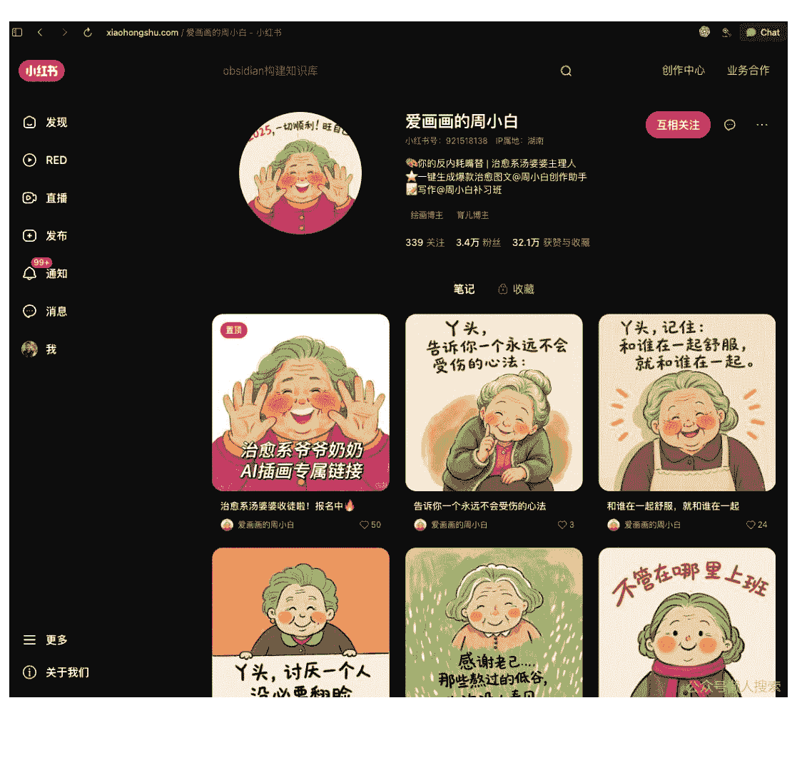

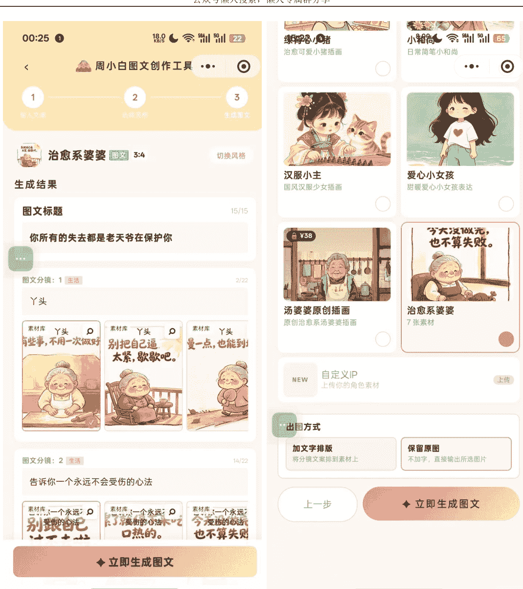

#### 这个工具是怎么出现的

做了审美实验室之后，我遇到了一个新问题：流量从哪里来？喜欢我的图的用户，在我的小红书和公众号里。所以我需要持续更新公众号，把公众号的读者引导到小程序。

但我有 7 个公众号。

传统的更新流程是：打开电脑 → 登录公众号后台 → 上传图片 → 手动排版 → 写标题 → 保存草稿 → 打开下一个公众号，重复一遍。

7 个号更新一遍，一下午就没了。

而且还有一个问题：我不想两头维护——文章里有的图，小程序里可能没有，用户点击跳不过去，又来烦我要图。

于是我有了一个大胆的想法：能不能做一个工具，只要点点点，就可以排版发送到所有公众号草稿箱，同时还能把图片同步到小程序图库？就是这个需求，推动我开发了第三个产品。

#### 核心功能

- 一键排版公众号文章（图文模式+文章模式）
- 内置 90+爆款标题库，一键"换一批"
- 图片自动裁切成正方形，版式统一
- 推送草稿到多个授权账号
- 图片自动绑定小程序跳转链接
- 上传图片到审美实验室图库

技术栈：Next.js 16 + TypeScript + Tailwind CSS + Supabase + Vercel + 微信第三方平台

#### 微信第三方平台是什么，为什么复杂

这里要解释一个很多人不了解的概念：微信第三方平台。

普通的公众号工具，只能操作自己的账号。要实现"帮其他人的公众号推草稿"，需要申请微信第三方平台资质——这相当于拿到了一个"代理权"，用户授权之后，工具可以代为操作他们的公众号。

这个资质只有企业才能申请。我注册了一个企业营业执照，审核流程比较复杂，我提交了 3 次才过。

但这个企业资质同时解决了另一个大问题：

打通了安卓和苹果的支付。个人认证的小程序，iOS 端的虚拟商品支付有很多限制。企业认证之后，走合规的支付路径，安卓和苹果都可以正常付款。这是企业认证最重要的隐形价值。

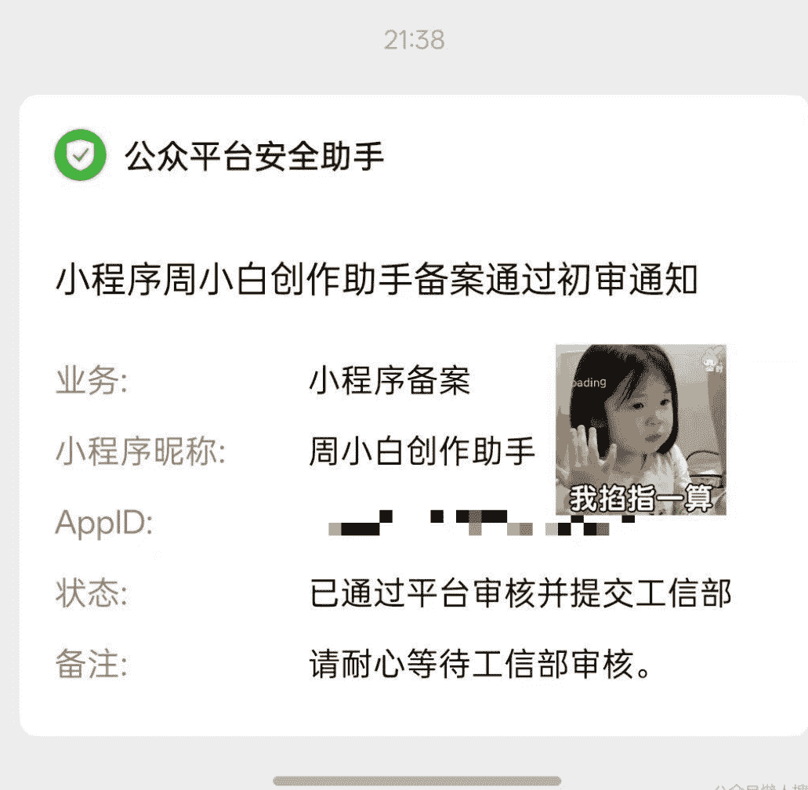

#### 我现在的工作流

以前更新 7 个公众号，一下午。

现在的流程：

手机打开排版工具→选张图片（从审美实验室图库选，或者上传）→点"换一批"选一个标题→选择排版模板→图片自动裁切，自动绑定小程序链接→点"推送到草稿箱"→切换下一个账号，重复一次 全程不需要写任何字。标题，"换一批"；文案，"换一批"；图片，从图库里点选。 整个过程 10-15 分钟，7 个号全部推完。

#### 踩坑记录（这个产品坑最多）

**坑 1：微信 API 需要固定 IP 白名单，Vercel 是动态 IP。** Vercel 的 Serverless Functions 每次请求的 IP 是动态的，微信 API 要求固定 IP 白名单。

解决方案：买了腾讯云服务器做中转——请求先打到固定 IP 的腾讯云服务器，再转发到微信 API。多一层中转，但解决了问题。

**坑 2：wx.showModal 按钮文字超过 4 个字，iOS 静默失败。** 安卓完全正常，iOS 完全没反应，没有任何报错。排查了很久才发现是这个问题。

解决方案：所有 showModal 的按钮文字严格控制在 4 个字以内。

**坑 3：微信邮件 HTML 会过滤 position: absolute。** 做了一个叠层效果，本地预览完全正常，推到公众号之后叠层消失了。

解决方案：改用负 margin 实现叠层效果，绕过微信的 HTML 过滤。

这三个坑都是"做到那里才发现"的，事先完全不知道。但每次遇到，把问题描述给 AI，基本上都能快速找到解法。

#### 整体商业闭环

创作者授权公众号给排版工具→ 用排版工具一键更新所有账号→ 文章里的图片自动绑定审美实验室链接→ 读者看文章，点图进小程序→ 在小程序里浏览、下载、付费→ 广告收益和授权收益按比例分成→ 全程自动化，零人工干预 **这就是我想做的事：从"一个人做内容"到"一套系统自动跑"。**

### 3.4 从三款小程序到周小白工作台

3 月做第一款产品时，我没有想过会做三款；4、5 月只是沿着新问题继续做；到 7、8 月，三个小程序、内容生产、Obsidian 知识库和多平台分发才逐渐被接成“周小白工作台”。

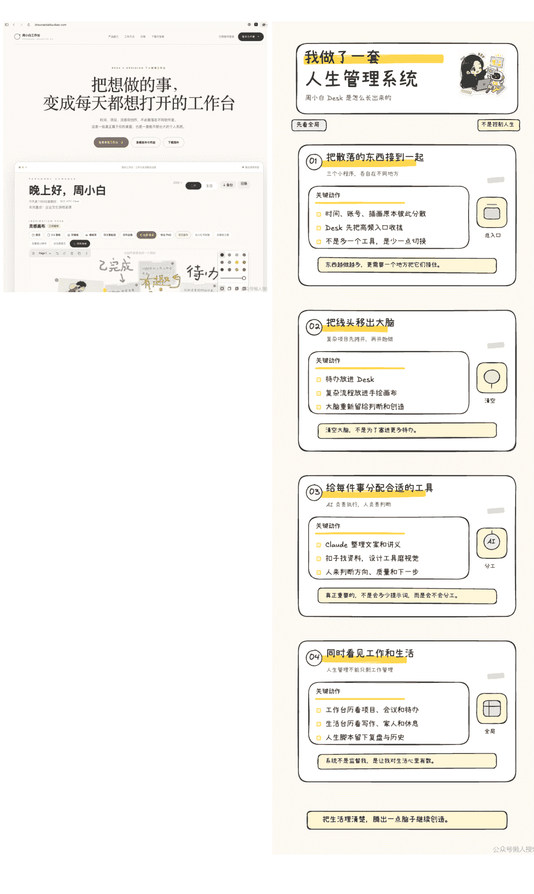

越做越厚，不是页面越来越多，而是连接越来越完整：内容可以进入产品，用户反馈可以回到知识库，任务可以交给不同 Agent，成品又能回到平台分发。

后面也陆续带来了客单价 3999+ 的工作台成交，也是粉丝们推着我进入了变现闭环。

这个部分的故事，下次再写出来分享。敬请期待。主要是结合了第二大脑，工作台，还有 Obsidian，跟这次航海学习相关。

---

## 四、壁纸号+小程序：上班族最省力的变现组合

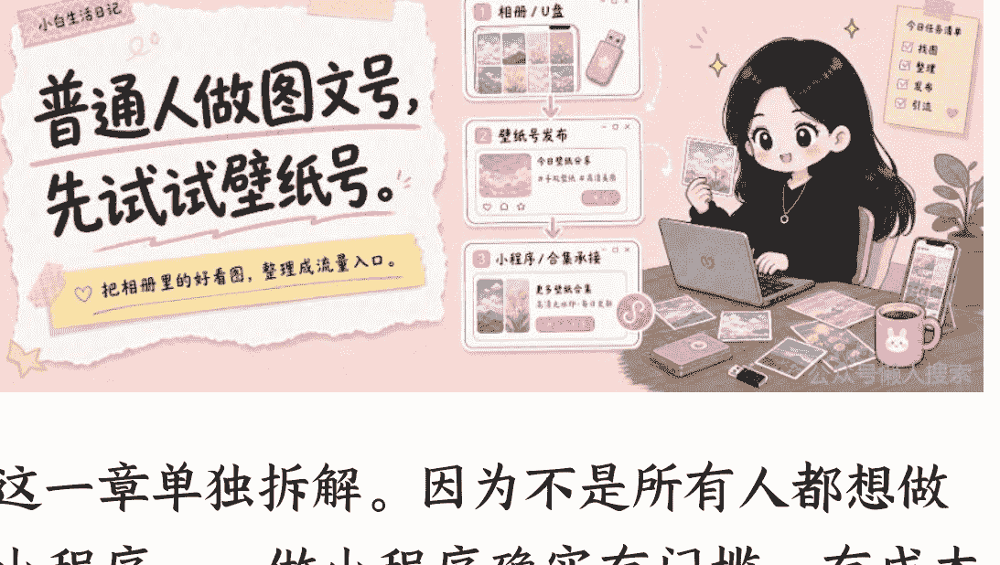

这一章单独拆解。因为不是所有人都想做小程序——做小程序确实有门槛，有成本，有学习曲线。

但如果你只是想要做一个能稳定产出收入的副业，**壁纸号+小程序**是我目前见过的上班族最容易跑通的组合，没有之一。

而且这两件事不需要同时做，可以先做壁纸号，等壁纸号跑起来了，再考虑要不要入驻图库或者自己做小程序。

### 4.1 为什么壁纸号特别适合上班族

先把逻辑讲清楚。公众号流量主=阅读量换钱。

壁纸号的特别之处是：**用户会在图片间来回翻动，停留时间长 -> 广告曝光充分 -> eCPM 高。** 根据公开资料，壁纸号平均 CPM 在 20 元左右，做得好的账号单篇 5000 阅读收益可达数百元。

#### 和文章号相比：

| 维度 | 文章号 | 壁纸号 |
| :--- | :--- | :--- |
| 创作成本 | 高（需要写作能力） | 低（选图+标题） |
| 起号速度 | 慢 | 快 |
| 日更压力 | 大（要持续输出文字内容） | 小（图片可以批量备好） |
| 粉丝黏性 | 依赖IP和观点 | 依赖审美和风格 |
| 单篇爆款空间 | 高（10万+可能） | 稳定型（不容易爆但也不容易崩） |
| 适合碎片时间 | 一般 | 非常适合 |

对于上班族来说，壁纸号最大的优势是时间成本低。选好图、配个标题，10分钟发出去。可以在通勤路上做，可以在午休做，可以在睡前做。不需要坐在电脑前，一部手机就够了。

一个真实的朋友数据：开号半个月开通流量主，3个月累计收入1556元。

### 4.2 壁纸图从哪里来

这是最多人问的问题。来源有三种，推荐程度不同：

#### 最推荐：AI 自生图

工具用 Midjourney、即梦、豆包等。优势是版权清晰、风格可控、长期可做。

用 MJ 批量做非常快，点击一下就可以生成 4 张图。我移动硬盘里现在有 4000 多张，够更新一整年，不断变现。

以我的日常为例：手机点击点击，批量生成，挑出质量好的存起来，积累到200张再开始发号。这个"弹药库"的概念很重要——起号之前先备好200张，不会因为图不够而中途断更。

#### 次选：自己找图（纯养号用）

微博、小红书搜关键词收藏。注意：后期商业变现（接广告、卖账号、图片版权）会有版权风险，这条路适合先跑通再说。

#### 最不推荐：搬运其他账号的图

平台识别重复图会限流，严重会封号。

有人把我小红书的图搬到公众号去发，后来我就关了下设置。

这件事给我一个思考：与其被人复制搬运，我干脆自我搬运——扩大影响力，把自己的图铺到更多地方去。你看helloKitty、机器猫、米老鼠，各种IP的图不都是被人搬运来搬运去的？被搬运也是一种审美能力的认可。

### 4.3 风格选择：起号最关键的一步

这一步比选图、写标题都重要。风格定不下来，后面所有的动作都白费。为什么？因为微信的推荐算法是基于内容标签的：

你每次发的内容风格一致→平台打标签准确→推给对的人→点击率高→继续推
你今天治愈、明天国风、后天暗黑→标签混乱→平台不知道推给谁→流量卡住
一个账号只做一种风格，是铁律。

主流壁纸风格参考：

| 类型 | 目标人群 | 特征 | 推荐度 |
| :--- | :--- | :--- | :--- |
| 治愈系插画 | 20-30岁女性 | 柔和色调、花朵植物、女孩形象 | ★★ |
| 国风水墨 | 文艺青年 | 中式元素、山水、汉服 | ★★★ |
| 暗黑系 | 年轻男性 | 高饱和、赛博朋克、动漫 | ★★★ |
| 极简纯色 | 通用 | 单色/渐变、简约文字 | ★ |
| 萌宠治愈 | 养宠群体 | 猫狗拟人化、温馨日常 | ★★ |
| 星空宇宙 | 学生/通用 | 星辰、银河、月亮 | ★★ |
| 氛围感风景 | 文艺青年 | 清晨、夕阳、咖啡馆 | ★★ |

#### 选风格的3条原则：

1. **选你自己也喜欢的。** 能刷图刷一下午不累的那种。壁纸号是长期活，不喜欢坚持不了3个月。
2. **选有持续产出空间的。** 比如你选"梵高向日葵同款"，图库很快就枯竭了。选"治愈插画女孩"，AI可以生出无限张。
3. **选目标人群明确的。** 越垂直越好。"女生头像"比"好看的图"精准，"古典女孩油画风"比"女生头像"更精准。

#### 不确定选哪种怎么办？

做个小测试：打开你的小红书或微博"收藏夹"，看看你平时最爱收藏哪一类图，这就是你的风格起点。

或者用AI测试：用MJ生成4-6种不同风格的测试图，发给朋友看，收到最多好评的那种，就做它。

风格一旦定下，至少3个月内不要换。

### 4.4 起号路线图：关键数字都在这

#### 起号前的准备（不要省略这一步）：

- 收集至少200张同风格的图（避免中途断更）
- 准备15个爆款标题（后面可以间隔3-4天重复使用）
- 定好一种风格，账号名、简介、头像、封面都围绕这个风格做
- 起号前不要在薅粉丝数，不要互关互阅，不要用推流券

#### 起号节点参考：

| 时间节点 | 目标 |
| :--- | :--- |
| 第1-15天 | 坚持日更，每篇9-12张图 |
| 粉丝500 | 可申请流量主（程序化广告） |
| 粉丝100 | 可开通返佣商品能力 |
| 连续4天阅读4000+ | 可考虑购买粉丝破500 |
| 2-3个月 | 开始有稳定收益 |

### 4.5 标题怎么写：决定打开率

标题决定有没有人点开，图决定停留时长。

标准格式：

壁纸 | [一句有感觉的话]
头像 | [一句有感觉的话]

示例（我工具里内置了90+爆款标题，这是其中一部分）：

• 壁纸 | 心有丘壑，眼存山河
• 头像 | 好看的 WeChat 头像来啦
• 壁纸 | 懒得内耗，只想变好看
• 头像 | 换个头像，开始新的自己
• 壁纸 | 今天也要温柔地活着
• 头像 | 这波头像真的绝了

**关键词必须出现**。每个标题都保留“壁纸/头像”关键词，方便搜一搜收录。核心关键词池：壁纸 | 手机 | 苹果手机 | 华为手机 | 4K 高清 | 全屏 | 头像。

**爆了以后，还会再爆**。同一个爆款标题，间隔 3-4 天可以重复使用，效果不会差太多。

### 4.6 日常操作：10 分钟更新一个号

**传统流程（40 分钟以上）：** 打开电脑 → 登录公众号后台 → 上传图片 → 手动排版 → 写标题 → 发布。每个号都要重复一遍，做矩阵号一下午就没了。

**我的流程（10-15 分钟）：**

- 1. 手机打开排版工具
- 2. 从审美实验室图库选图，或者上传本地图片
- 3. 点“换一批”选标题（不想挑的话直接用第一个）
- 4. 选排版模板，图片自动裁切成正方形
- 5. 一键推送到公众号草稿箱
- 6. 切换下一个账号，再推一次

核心操作：一次排一周。周末花 1 小时，把 7 天的内容全部推进草稿箱，设置定时发布。定时时间参考：早 8 点前、中午 10-11 点、晚 17:30-19:00，都是流量高峰时段。

工作日不需要碰公众号，全部自动发出去。

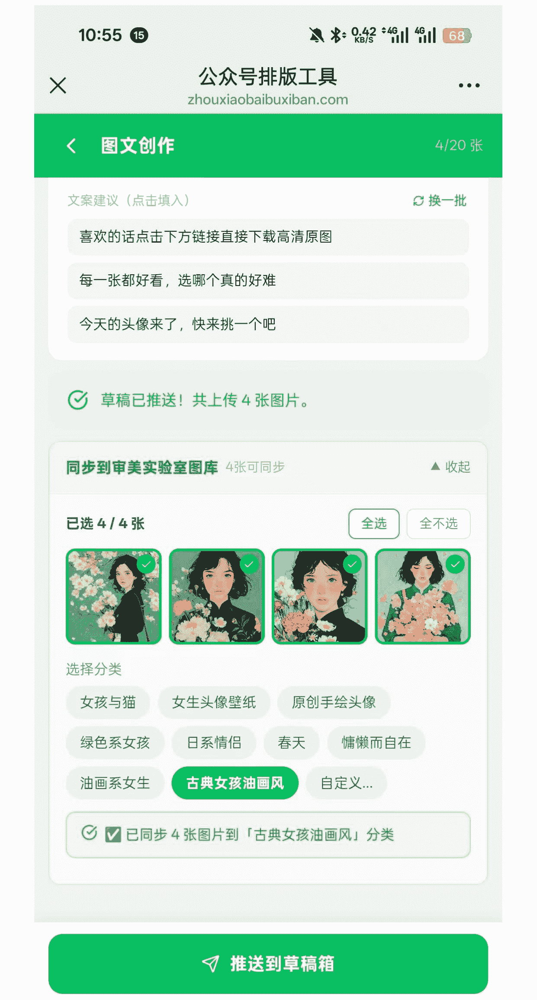

### 4.7 公众号后台配置：一次搞定，终身受用

必做 5 件事：

- 1. **菜单栏挂载小程序**。 读者看完图点菜单 → 进小程序下载 → 产生额外收益
- 2. **标题加统一后缀**。 比如“| XX 壁纸号”，帮助搜一搜收录
- 3. **封面风格统一。** 列表页看着像“认真在做的号”，关注转化更高
- 4. **壁纸右下角不要有水印。** 影响用户二次使用，降低传播率
- 5. **首条欢迎语引导矩阵。** 新关注者的欢迎语里放你的其他账号，做矩阵引流

### 4.8 变现路径：8 条路，按难度排序

**Level 1：新手必开**
程序化广告：100 粉丝开通，每篇阅读都有流量主收入

返佣商品：100 粉丝开通，文章底部挂商品，读者下单你拿佣金

**Level 2：有基础了再做**
小程序跳转：读者点菜单→进小程序→下载图片/购买授权（审美实验室就是这个逻辑）

评论区广告：新开放的广告位，按曝光分成

**Level 3：号起来之后**
接单广告：账号有粉丝基础后会有人来谈，按每次有效阅读 0.4-0.5 元计费，5000 阅读的号单篇可接到千元级

插入小游戏/短剧：文中字数不够的壁纸号用这个补广告位，捉大鹅、短剧充值等

**Level 4：进阶玩法**
带货：做治愈系可以带文创好物、书籍周边

转私域：读者加微信→朋友圈经营→高客单价产品的长期路径

#### 内容如何把产品送到用户面前

这里最容易被忽略的一步，是“分发”。我不是把小程序做完以后等用户自己发现，而是持续用公众号和小红书内容，把“想换头像、想找图”的人送进小程序。

2026 年 5 月的一周，17 篇内容获得平台推荐，合计带来 1.8 万阅读；后来也有单篇头像内容突破 2 万阅读。内容先获得注意力和信任，小程序再承接搜索、浏览和下载。

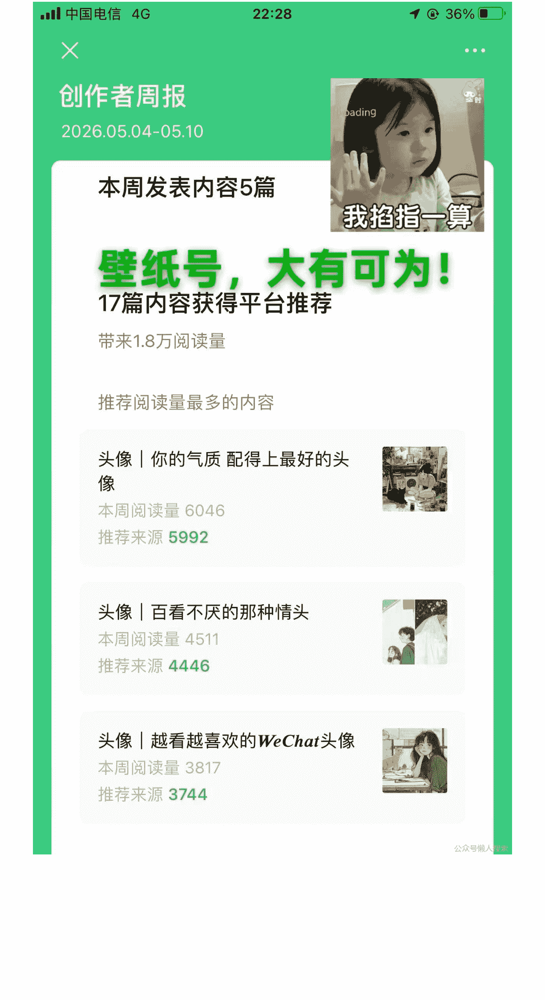

内容获客→产品承接→用户行为→产品迭代→新内容继续分发。这个飞轮真正有价值的地方，是每一环都会给下一环提供素材：评论和私信暴露需求，产品行为告诉我什么最受欢迎，用户反馈又成为下一篇内容和下一次迭代的依据。

## 五、AI 在开发中具体怎么用

### 5.1 分工逻辑

我不会写代码，但我会“提需求”。整个开发过程可以简单理解为：

需求描述→AI生成代码框架→我看懂逻辑→AI修改细节→部署测试

| 角色 | 负责内容 |
| --- | --- |
| 我做的 | 产品方向、用户反馈收集、UI 审美判断、测试、运营 |
| AI 做的 | 代码实现、Bug 排查、SQL 建表、API 对接、文档查阅 |
| 一起做的 | 架构决策（用什么数据库、如何绕过微信限制） |

这个分工是我摸索出来的，不是一开始就规划好的。

早期我会问 AI 很具体的技术问题，比如“这个报错怎么解决”，效率不高。后来我学会了用“需求语言”而不是“技术语言”跟 AI 沟通——我描述我想要什么效果，AI 来决定怎么实现。

比如：

- 不好的问法：setData 之后读到的值为什么是新的
- 好的问法：我有一个下载按钮，用户点击后需要先判断余额，然后扣费，然后解锁图片。我现在的逻辑是扣费和解锁在同一个函数里，但有时候会出现没扣费就解锁了的情况，怎么解决

后者给了 AI 足够的上下文，AI 能直接给出完整的解决方案，而不是只回答技术问题。

### 5.2 从 Idea 到 AI，再到 Business

我后来把自己和 AI 的分工总结成三个词：**Idea → AI → Business**。

- **Idea**：我负责发现问题、提出想法、判断审美和取舍。
- **AI**：AI 负责把需求翻译成代码、界面、数据结构和可测试版本。
- **Business**：再把产品交给真实用户，用访问、使用、反馈和付费验证生意是否成立。

所以 AI 不是替我当产品经理，也不是替我承担商业判断。它更像一支可以并行工作的执行团队。我会把需求拆成互不冲突的任务，分别交给不同 Agent：1 个查资料，一个改页面，一个测试，一个整理文档。哪怕我在散步、通勤或处理家务，电脑也可以继续推进。

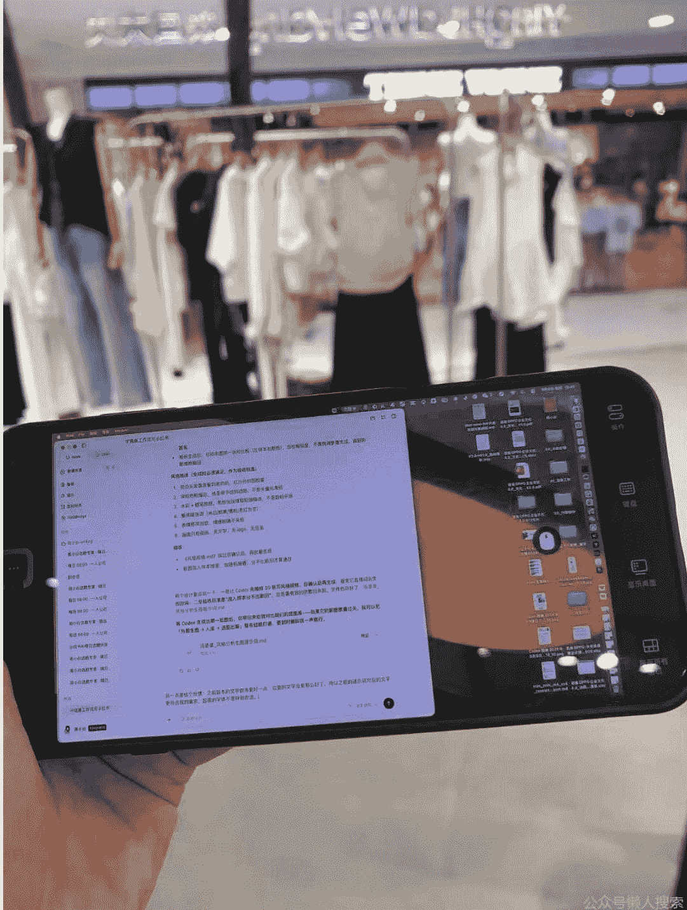

这是我在陪我妈妈和我姐姐逛街的时候，同时去了解这个项目进度。与 AI 沟通、时间管理的关键不是“把自己排满”，而是把必须由我判断的事留给我，把可以异步执行的事交给 Agent。这也是一个上班族能在碎片时间里持续做产品的原因。

### 5.3 AI 的“沟通记忆”系统

这是我觉得最值得分享的一个用法，也是我效率提升最大的一个改变。

我遇到的问题是：我是利用碎片时间做产品的。每天晚上 20:00-23:00，3 个小时。下班，做运动，20:00 开始写小程序。

问题是，这个时候我已经完全忘记昨天做了什么了。

上次解决了什么 bug？这个功能的技术决策是什么？数据库里这张表是干什么用的？

如果每次都要重新介绍这些背景，一次对话里有一半时间是在“讲故事”而不是在解决问题，效率极低。

于是我和 AI 一起设计了一个“沟通记忆”系统：

每次对话结束时，让 AI 总结本次的：

- 解决了什么问题
- 做了哪些技术决策
- 还有哪些待办事项
- 有哪些注意事项

把这个总结存成 Markdown 文件，放在本地项目文件夹里。下次打开对话时，第一步就是让 AI 读取这个文件，直接加载上次的上下文。

效果：每次打开对话不需要重新介绍项目背景，AI 直接接着上次的进度继续干。

一个具体的例子：有一天晚上我在解决微信第三方平台的 Token 刷新问题，搞了两个小时没搞定，快 23 点了，只能先睡。让 AI 做了一个总结：问题描述、已经尝试过的方案、还没试的方向。

第二天 20:00，打开 Claude Code，读取昨天的总结，AI 立刻说：“昨天我们遇到的 Token 问题，还有一个方向没有试……”然后很快解决了。

没有这个记忆系统，可能要花半小时重新把问题讲清楚，还不一定能讲得和昨天一样完整。

### 5.4 代码只是一人公司的六分之一

回头看这几个月，我一个人其实同时在做六件事：需求分析、创意、设计、代码、运营和销售。AI 最先帮我补上的只是代码，但真正把产品变成生意，还要让另外五件事彼此连接。

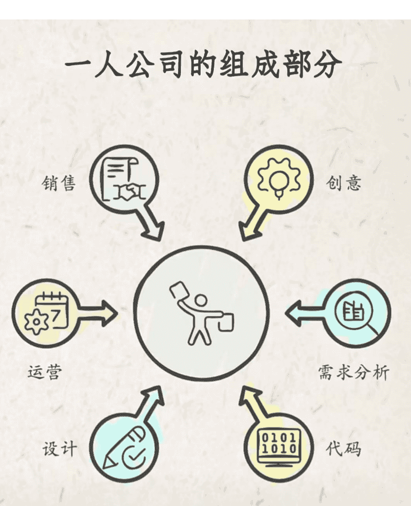

所以这篇文章的重点不是“大家都去学编程”，而是：用自己的经验发现问题，用 AI 补足执行能力，再用内容和真实交易完成验证。

## 六、技术选型：只选“刚好够用”的

### 6.1 数据库：Supabase

PostgreSQL 托管服务，有 REST API，不需要自己部署。

为什么选 Supabase：

- 免费额度：500MB 存储+50MB 数据库，做几个小程序完全够用
- Storage Bucket 支持公开 CDN 访问，图片直接存 Supabase，小程序直接引用 URL 显示，零额外费用
- 有管理界面，可以直接在网页上查看和操作数据库，不需要写 SQL 命令

### 6.2 部署：Vercel

Next.js 的官方托管，每次 push 自动部署。

**优点：** 免费，秒级部署，Serverless Functions 可以做 API 代理

**注意：** Vercel 是动态 IP，微信 API 需要固定 IP 白名单。我的解决方案是腾讯云服务器做中转，固定 IP 转发请求。

偶尔不稳定，需要手动 `vercel --prod` 重新部署。这个问题不频繁，遇到了处理一下就好。

### 6.3 小程序框架：微信原生

微信原生 vs Taro vs uni-app，我选了微信原生。

**理由：**

- 学习资源最多，AI 训练数据也最多，出问题更容易找到解法
- 不依赖第三方框架，减少一层出错的可能
- 微信官方调试工具支持最好
- 如果只做微信，没必要上多端框架

如果你有多端需求（同时做支付宝/头条小程序），再考虑 uni-app。

### 6.4 实际启动成本

| 项目 | 费用 | 备注 |
| --- | --- | --- |
| 域名 | 85 元 | 一年 |
| 小程序认证×2 | 600 元 | 企业认证，每个 300 元，有一个是复用了服务号的，好像没花钱。好像企业号还可以复用好多个，也不用花钱了。但是我没有必要开通那么多个小程序 |
| Claude Code Pro+codex | 140-280 元/月 | 按月订阅，用量超了错峰再买一个 |
| 腾讯云服务器 | 0 元 | 企业用户赠送 |
| 企业营业执照 | 300 元 | 微信第三方平台必须 |
| 合计 | 约 1125 元 | 其中 660 元是一次性固定成本 |

**企业认证的隐形价值：** 同时打通了安卓和苹果的支付问题，这是个人认证做不到的。对于要做付费功能的小程序，企业认证是必要投入。

## 七、变现路径：从 0 到稳定收入

商业模式不需要一开始就设计得很复杂。我更认可一条由轻到重的递进路径：**先广告，再付费，最后服务。**

- 1. **广告验证访问：** 先确认产品能持续被看见、被打开、被使用。
- 2. **付费验证价值：** 再为高清内容、会员、云同步、更高效率或更好结果设计增量价值。
- 3. **服务提升客单：** 有了前两层证据，再延伸图片授权、定制和陪跑服务。

它对应的不是三个孤立收入来源，而是一条逐步加深信任的交易链路：**需求 → 产品 → 分发 → 交易 → 复购。**

### 7.1 最快的路：微信流量主广告

门槛：小程序累计 500 个独立访客

实测：工具类小程序（每天打开 2-3 次）达标时间约 2-3 周，前提是**你的小程序真的解决了问题**。

收益量级：初期每天 1-5 元，稳定后随日活增长线性提升。不是大钱，但是**真实的被动收入，而且永远不会变零**——只要有人用，就有收入。

### 7.2 进阶路：付费功能解锁

时间管理小程序的模式：核心功能免费，高级功能付费。

**关键**是设计好**免费和付费**的边界。 免费要足够好用，让人离不开；付费要有明确的额外价值，让人觉得值得。

我的设计是：基础记录功能完全免费，AI 洞察、云同步、去广告、历史数据导出是付费功能。

用户先免费用，数据积累多了，舍不得走，自然就会升级付费。这是工具类产品最健康的转化路径。

### 7.3 内容驱动+图片授权+服务

审美实验室的模式：免费浏览，付费下载高清图。

定价 1-3 元一张，另有周/月/年体验卡。商业授权另行定价，比个人使用贵 3-5 倍。

**关键：** 免费内容要足够好，让人愿意继续来；付费内容要有明确额外价值（高清、商用授权、独家款式）。

### 7.4 平台模式：最难但最有潜力

做工具引流 → 让创作者授权账号 → 平台推内容 → 广告收益分成 → 邀请裂变。

**难点三个：**

一是需要过微信第三方平台审核，流程复杂，我提交了 3 次才过；二是需要固定 IP，Vercel 做不到，需要额外买服务器；三是需要有足够多的创作者授权才能形成网络效应，这是一个“先有鸡还是先有蛋”的问题，需要靠自己的第一批用户来破局。

---

### 八、 最重要的几条认知

从 3 月做到 8 月，回头看，有几条认知比技术本身更重要。

- **① 先做一个能用的，再迭代到好用。** 人生脚本 v1.0 只有 3 个页面，功能极简，但能用。我自己用了一周开始推广。
  很多人想把第一个版本做得完美再发布，结果永远发布不了。**完美是好的敌人。** 先出去，再改。
- **② 踩坑是必经之路，但可以让 AI 帮你预判。** 微信的各种限制（API 白名单、HTML 过滤、showModal 字数限制、iOS 支付限制），我事先完全不知道，都是做到那里才发现的。
  但每次遇到问题，把错误信息和上下文完整描述给 AI，基本上都能快速找到解法。
  **AI 不是让我不踩坑，是让我踩坑之后能快速爬出来。**
- **③ 小程序备案 ≠ 网站 ICP 备案，两者独立，不要被吓到。** 小程序备案是微信平台内部的流程，和网站 ICP 备案是两回事，不需要走工信部，流程简单很多。
- **④ 做第二个产品比第一个容易 10 倍。** 基础设施（Supabase 项目、Vercel 部署配置、微信开发者平台设置）配好了就复用，新产品可以在一周内出框架。
  我做审美实验室，很多底层配置直接从人生脚本复制过来改了改就用了。
- **⑤ 工具类小程序最好做**。用户打开有明确任务，留存靠功能而不靠运营。不需要每天想内容，不需要做社群维护，用户用了觉得好就会一直用。
- **⑥ 把“与 AI 的沟通记忆”当作团队知识库来维护**。每次解决一个问题，让 AI 记录下来。知识不会随着对话结束而消失，而是沉淀成项目的资产。
  这套记忆系统帮我在碎片时间里维持了开发的连续性，是效率提升最大的单一改变。
- **⑦ 选产品方向要看「复用性」**。我做的三款小程序都有一个共同点：用户会反复使用，或者帮助我反复完成同一类生产任务。
  时间管理——每天打开记录，养成习惯后离不开；壁纸头像——公众号运营者经常需要配图，会反复来下载。
  对比一次性工具（比如证件照生成），用户用完就走，很难形成留存和付费转化。
  **低频+刚需+复用 = 持续价值。**
- **⑧ 所有产品都是「先自用，再他用」**。先提升自己效率，确实好用，才做成产品。
  我的每一个产品都是这样来的：时间管理表格是自己用了半年的，审美实验室是自己需要一个取图的地方，排版工具是自己懒得手动更新 7 个公众号。

> 解决自己的真实问题，是做出好产品最可靠的起点。

### 九、新手常见问题

**Q: 完全不会代码能做吗？**
能。我就是证明。

要求是：会提需求、有审美判断力、愿意花时间搞懂基本逻辑。代码是 AI 写的，你负责知道要做什么、测试效果对不对、出了问题能描述清楚给 AI 听。

有一个能力是必须的：能够用清晰的语言描述你想要的效果。这是“提需求”的核心，也是所有沟通的基础。

我最喜欢的一句话，跟 AI 沟通的高频词是：“我有一个想法是这样子的……”我觉得这个是非常好的，所以我也希望鼓励所有的小伙伴在开发产品的时候，跟你的 AI 说：“你好，我有个想法。”你真的超级超级棒，你一定会感受到快乐的去玩耍吧，去享受这种开发和 Vibe Coding 带来的快乐。

**Q: 要花多少钱启动？**
最低配置：小程序认证 30 元（个人）。

如果要做付费功能，建议企业认证，但解决了 iOS 支付问题。AI 编程工具 Claude Code 月费约 140 元，按需订阅，用量超了可以错峰再买一个账号。

自从我的 Claude Code 被封了以后，我现在用的是：

1. 两个 Codex Plus
2. 一个 Codex 中转
3. 一个 Kimi
4. 一个扣子

**Q：要花多少时间？**
我是利用零碎时间做的，每天晚上 20:00-23:00。整个从 0 到第一个产品上线，大概用了 3-4 周。

但这 3-4 周不是每天都在写代码，中间有很多时间是在思考产品逻辑、测试、和用户沟通。真正的编码时间可能只有总时间的一半。

**Q：iOS 支付的坑怎么解决？**
iOS 不允许在小程序内直接购买虚拟商品，需要走苹果内购或者引导到外部支付。这是很多人卡住的地方。

我的解决方案是企业认证+走合规的支付路径设计。具体方案是 AI 帮忙搞定的，向 AI 描述你的场景和限制，它会给出合规的实现思路。

**Q：多个小程序怎么管理不乱？**
每个项目有独立的代码仓库、独立的 Supabase 项目、独立的沟通记忆文件夹。项目之间互相隔离，不会互相影响。

有了记忆系统之后，切换项目也不怕忘记上次做到哪里了——每次打开，先读取对应项目的沟通记忆，立刻回到上次的状态。

**Q：企业营业执照怎么注册？费用多少？**
闲鱼搜索“营业执照”，或者去当地工商局，个体工商户注册基本 0 元，公司注册视地区有所不同。

---

### 十、给想入门的同学

**第一步：找一个自己每天用到的痛点**
不需要是独创的，可以是已有产品的“精简版”或“特定场景版”。问自己：有没有哪件事我每天都在做，但每次做都觉得很麻烦？

这个问题的答案，就是你的产品起点。

**第二步：最小成本验证需求**
先做一个极简版本——可以是 Excel 表格，可以是 Notion 模板，可以是简单的网页。把这个版本发出去，挂一个低价（9.9 元或者 19.9 元），看有没有人付款。

有人付款，才值得继续做。没人付款，说明需求不够强，或者你的方案没有解决问题，趁早知道是好事。

**第三步：选最简单的技术栈，快速出 MVP**
推荐组合：微信原生小程序+云开发（Cloudbase）。云开发免费额度大，不需要自己搭服务器，适合快速验证想法。进阶之后再考虑 Supabase+Vercel 的组合。

**第四步：先给 100 个真实用户用**
不是 100 个朋友圈互赞，是 100 个“因为这个工具真的解决了我的问题”而留下来的用户。这 100 个人的反馈比你自己想破头有用 10 倍。

100 个用户的获取方式：发小红书、在生

财分享、在垂直社群里分享。不要只在朋友圈发，朋友圈的用户不是你的目标用户。

**第五步：开流量主，看数据**

过了流量主门槛之后，每天打开 Weixin Analytics 看曲线：哪些页面停留时间长、哪些页面跳出率高、用户是从哪里进来的。

迭代优先级从数据里来，不从感觉里来。

# 写在最后

我与 AI 的关系是：**Idea → AI → Business** 我提供想法，AI 把想法变成现实和商业。这是普通人做产品的新路径。

好像自从有了 AI，赚钱就开窍了。

以前没有 AI 的时候，做一个斜杠青年其实是很辛苦的。大概就是别人都在睡觉的时候，我把孩子哄睡了以后，开始坐在桌前写公众号文章。大概就是下班后，出差的时候，我都会带上 iPad，用 30 分钟速写一张手绘图，可能是孩子，可能是沿途的风景。

那个时候，靠着热爱发电。

而现在有了 AI 之后，同样的时间，我能完成的创作量和带来的影响力，是以前手搓作品完全比不了的。**AI 没有替代我的创作，而是放大了我的创作。** AI 极大地提升了我们的效率，也给了我们普通人很多机会，让我能够出现在更多人的视野里面。

所以我还是希望，流量不要影响我做一个快乐的自己。维持主业第一的原则——下班后，我们就做甲方好了。

目前自媒体的收入完全可以覆盖我的生活所需和艺术创作所需。我的工作是我的副业，我的爱好是我的主业。

> 而且，在兴趣爱好里，我是永远的甲方。

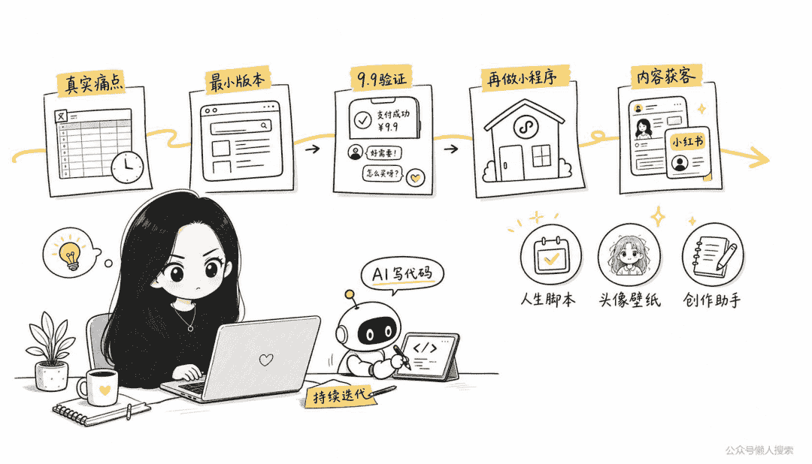

以上是我从 3 月到 8 月做出三款小程序、跑通内容分发，并逐渐把它们接成周小白工作台的全过程。

可以调成这样。如果大家有任何问题，都可以在评论区交流，我会尽量都回答大家的问题。祝大家都能做出自己第一个上线的产品！

# 【周小白】上班族 AI 副业·小程序·工作台变现

看完这篇 SOP，你觉得你懂了。但 90% 的人一到实操就会卡在第一步。

工具和教程只是最低级的壁垒，真正的壁垒是“立刻动手”和“圈层信息差”。

如果你想看全网最新的变现玩法，并且和一群执行力极强的极客一起下场拿结果，欢迎围观我的核心私域：【懒人专属群】。

我们不聊虚的，只做商业闭环的拆解与 AI 效率的压榨。系统内已沉淀 1000+ 跑通的套利实战局。

- 查阅圈子完整数字资产与上车门槛：
  [https://lazyso.com/insider/](https://lazyso.com/insider/)

认同价值、准备好下场干活的，扫码加我微信（lazyhelper1）
备注：【实操上车】，不闲聊

