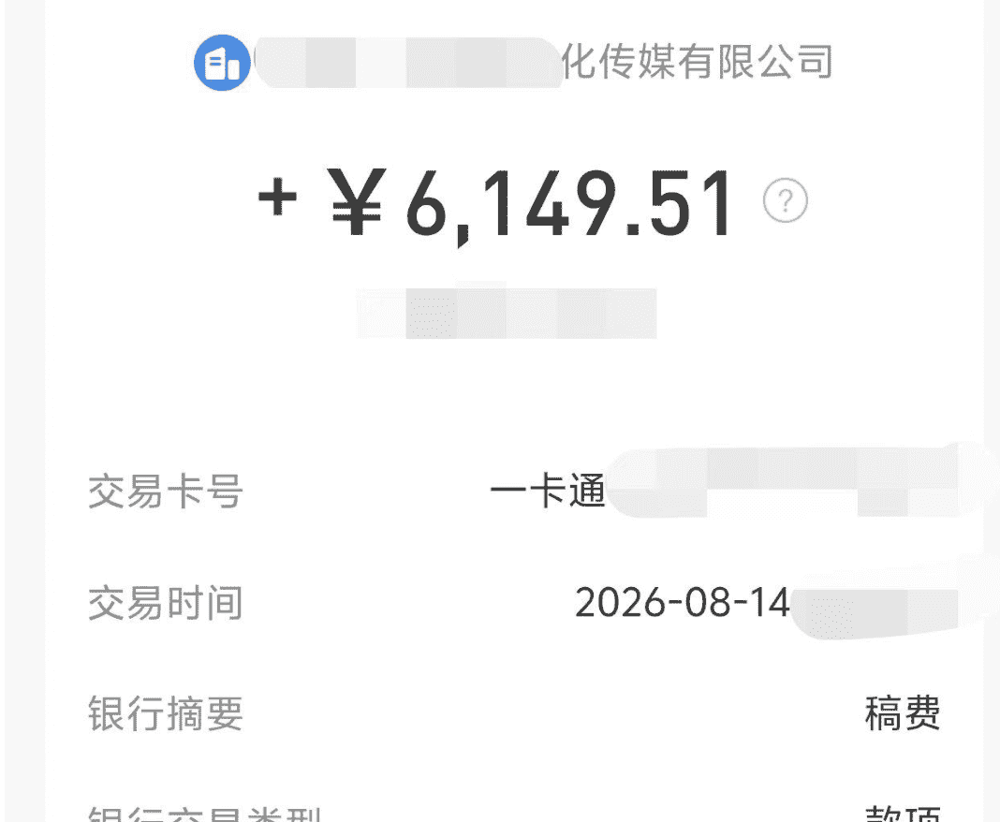
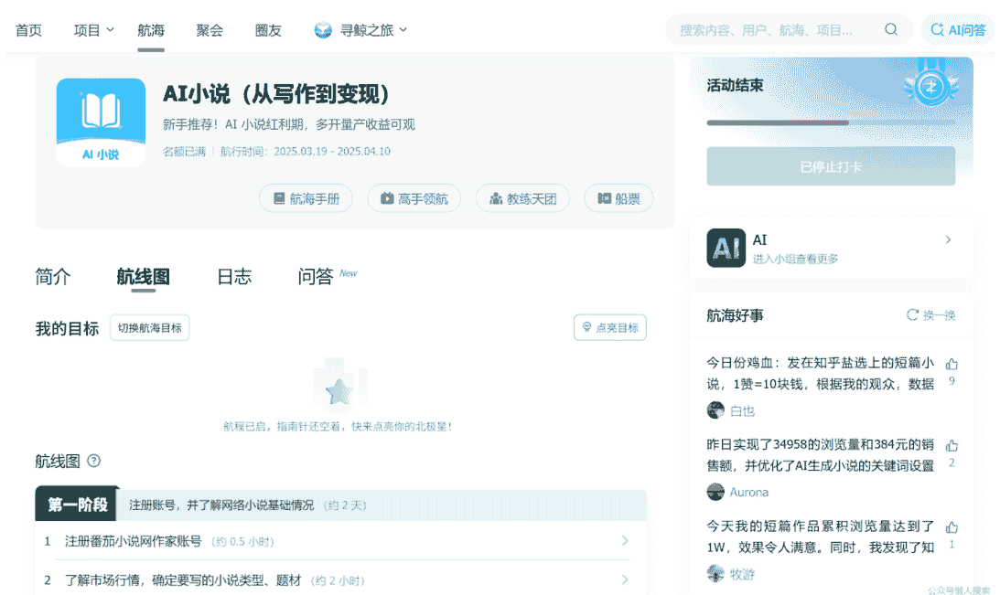
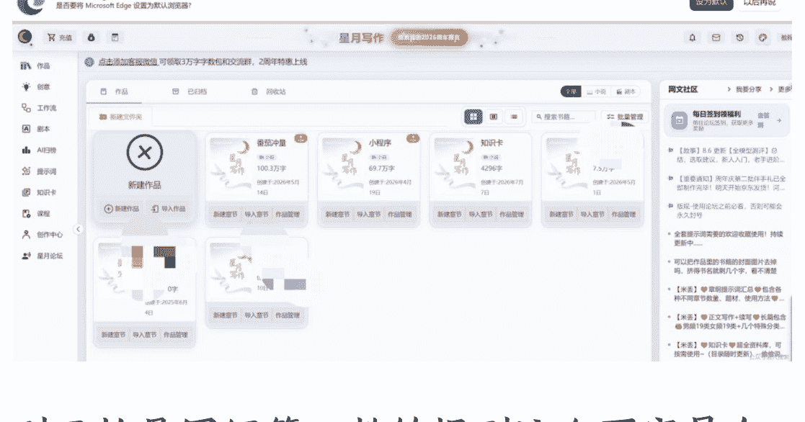
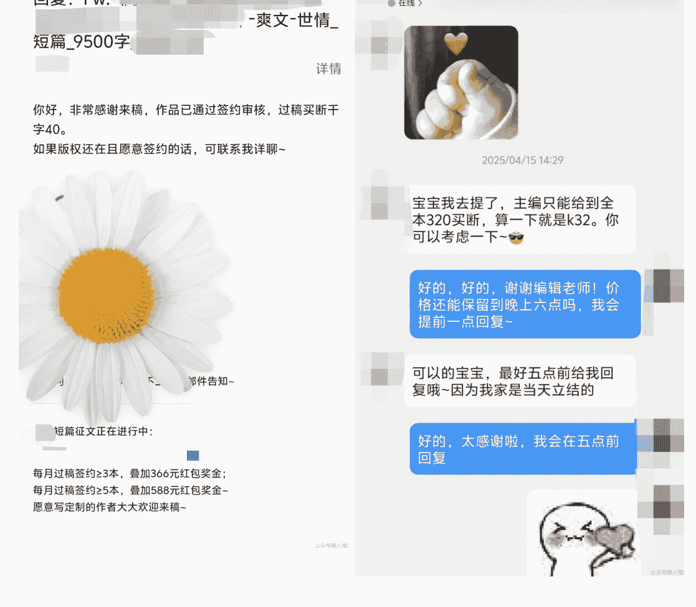
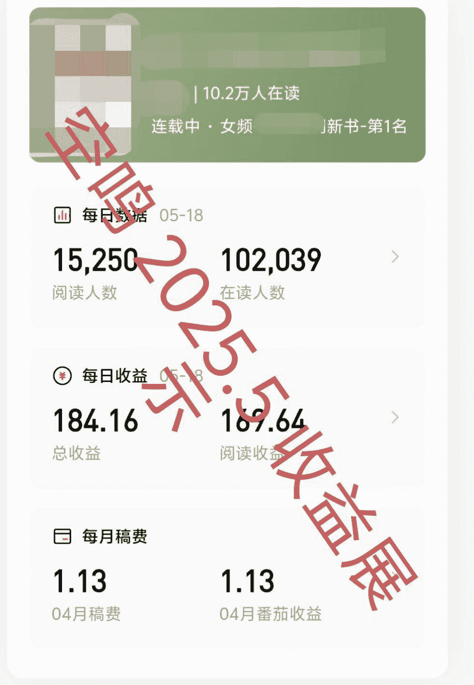
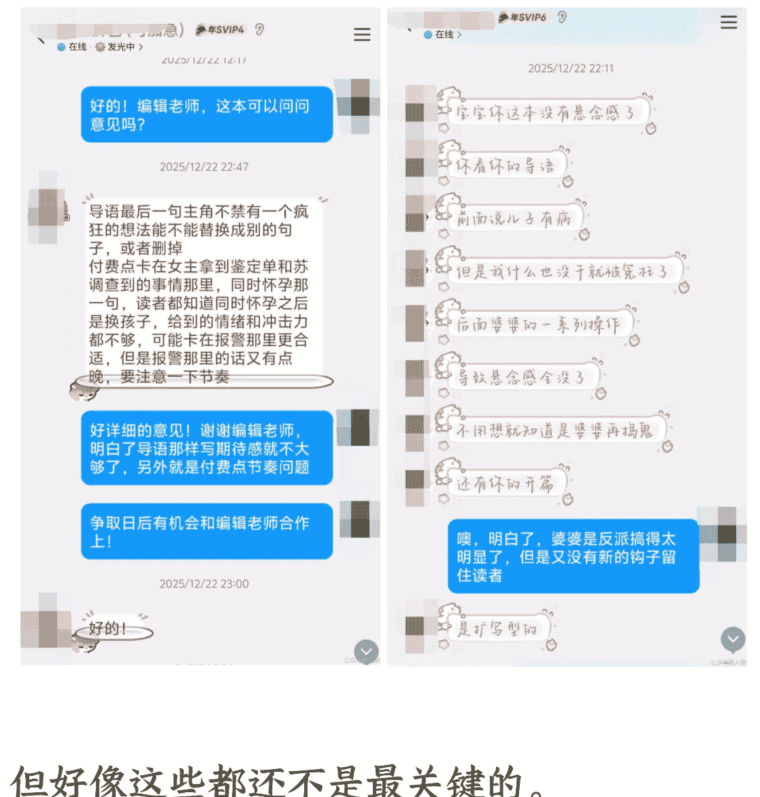
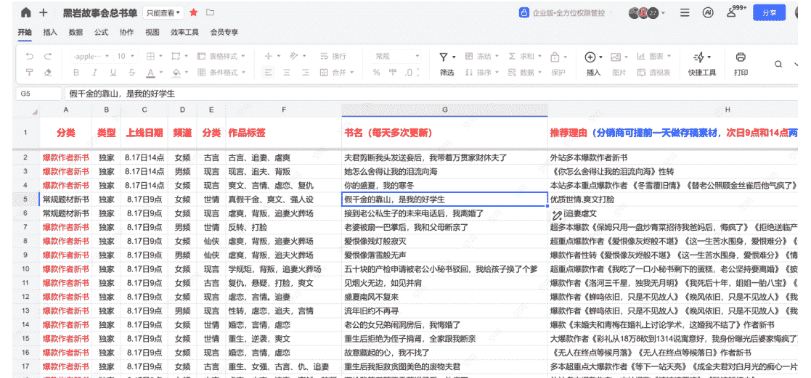
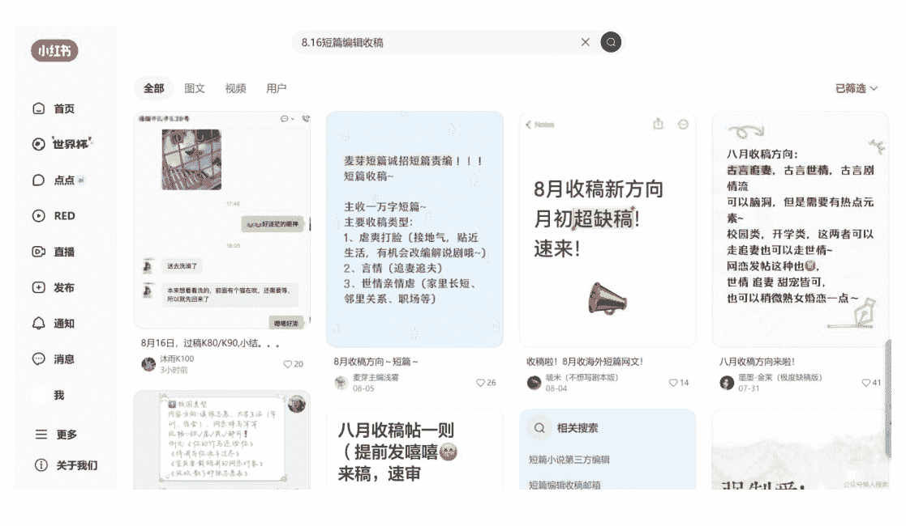
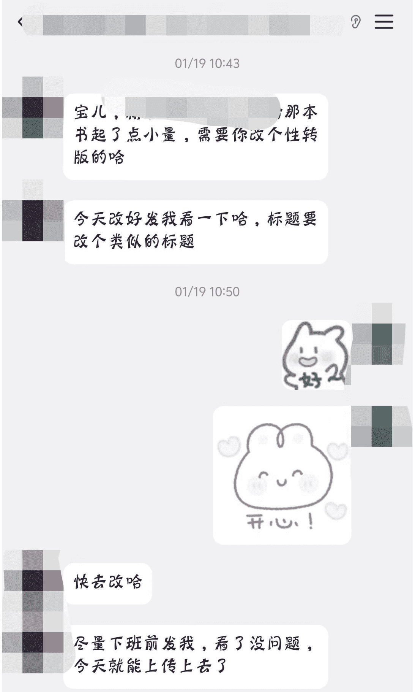

## 从航海变现 700 到单月最高变现 6000+，AI 小说现在还能做吗，分享我这一年来的实战复盘

- 260901 副业 SC 精华
- 整理：公众号懒人搜索，懒人专属群精选
- 懒人微信：lazylhelper1

> **小懒判断**｜适合爱看网文、能熬过废稿期的上班族兼职；不喜欢长短篇网文内容、想快速见钱的别碰。最有颗粒度的是网文怎么攒：每天扫书单和编辑例文两三篇进素材库，五天里五六篇同题材扎堆就是热点，上周真值千金这周就得迭代成状元错认，月写 3 到 5 篇每篇 4 小时稳赚 2000 到 6000。坑在 AI 文与例文剧情重合就是抄袭，编辑天天看榜单一眼识破，废 5 到 10 篇是新人常态。

大家好，我是空鸣。我是一名职场人，下班后用 AI 写小说作为副业。

去年 3 月，我参加了生财的 AI 小说航海。

作为一名有经验的长篇小说作者，刚看到“用 AI 写小说”时，我嗤之以鼻。小说的情绪、节奏、人物和冲突那么复杂，AI 怎么可能写出能投稿、能赚钱的作品。

但航海期间，我用 AI 完成了两篇短篇投稿，拿到 700+稿费，也跑通了一本长篇，第一个月收益 3000+。

我原以为找到提示词、照着流程写下去就可以了，可市场也很快变了。去年 11 月回来写短篇时，我一度连续 6 篇不过稿。直到我研究市场、积累自己的素材库，我才重新稳定过稿。

现在，我每月兼职写 3 到 5 篇短篇，一篇大约 4 小时，月收益在 2000 到 6000 元之间，单篇起量后的分成最高 3000+。

这篇我想分享的，不是用 AI 写小说的提示词，而是我这一年亲身经历的市场情况与思考：AI 写小说是否还值得做，我是怎么从连续废稿到重新跑通，以及现在想入局的人应该怎样开始。

## 01/我是如何接触 AI 小说

第一次接触到 AI 写小说是去年三月的一场航海。

当时我试过的两个项目都有卡点很难做下去，参加新一期航海时，意外发现有这个AI小说航海。

我第一反应是不大可能，AI 很难写出合格的小说。

我在大学时有过很长时间的手搓长篇小说经历，我很清楚一篇小说需要多少技能，这个复杂程度，我认为当时的 AI 没有办法做到。

出于看看这个到底能怎么玩儿的想法，我还是报名了。

没想到跟完这一期航海，我就忍不住发出了真香感慨。

我不仅用 AI 写出短篇小说，航行期间就投稿两篇卖出，赚到了 700+元，我也成功跑通了长篇，第一个月收益 3000+。

### 那 AI 写小说，是怎么赚到钱的？

## 02/ AI 小说怎么赚钱

小说大体上分为长篇和短篇，分别有不同的赚钱方式。

长篇通常是三十万到一两百万字一本的长度，作者在起点、晋江、番茄等网站上发表文章，靠读者订阅或文中插入广告的广告收益赚钱。

作者需要先选一个风格合适的网站，注册成为作者，然后发出文章申请签约，签约后每天更新4000-6000字，网站会根据这篇文章初步测试出的数据给相应榜单曝光，或算法分发推荐，阅读或购买的读者多了，作者就能赚到钱了。

这些网站中，番茄是免费网站，即读者看小说免费，但是小说中会有广告，作者靠广告的数据赚钱，比较类似公众号爆文。起点和晋江则是付费网站，靠读者一章章购买赚钱。

从AI写小说的角度，直接在番茄写就行。这个网站是流量分发推荐的，不需要像起点和晋江那样研究榜单，同时签约也卡得没那么严，又因为是免费的，读者没那么抵触，很适合用AI写。

短篇小说有所不同。一篇短篇字数通常1万字左右，通过向编辑投稿，或者在网站上签约获取分成赚钱。

目前短篇分为三个市场。

一个是知乎，作者可以在知乎注册作者后投稿，按文章数据获得收益。发表在知乎的文，会有知乎站内流量，也可能有知乎合作方在抖音上推文引流到知乎的流量。

知乎是纯分成，也就是收益和作者按比例分，数据起得来收益就高，一篇文三五千，甚至大神作者赚几万的都有，但是如果起不来，或者是被制作人——也就是知乎的编辑，拒稿，收益可能也只有几毛几块，甚至没有。

目前知乎仍然是小说单篇收益上限最高的网站。但因为绑定制作者，在投稿这块儿也会有一定难度，需要看制作人的脾气风格，有可能出现作者认为不错的文章，制作人认为不符合市场，导致无法上架，只能成为废稿。

第二个市场是番茄，番茄有一个短故事模块，就是做短篇小说的。和长篇小说一样，在番茄的短篇小说靠站内流量分发和站外推文引流后，读者看广告来赚钱。

番茄的收益也是纯分成，有时站内会有一些激励活动，如果数据很好可能有额外奖金。同样上限可能是一篇收益几万，下限是发了几十篇都只有几毛几块。

最后一个是小程序，很多公司或工作室制作了自己的网站，以及在抖音上挂载的读小说的小程序。

他们会招自己的编辑，在小红书上收稿。收稿分为保底和买断两种模式。

保底是过稿时给一笔钱，后续如果这篇小说推文后数据很好，还会有一笔分成。

推文数据好，称为起量。起量后的收益通常是扣除给作者的保底后再分成，所以只有起量收益超过保底才有钱分，这种称为破保底。

例如，新手过稿的最低价是保底 k30，就是一千字三十元，一本 1W 字的短篇小说收益就是 300 元。

日后如果投流数据好，收稿方拿到 1000 元净收益，就会扣除保底 300 元，剩下 700 元按照 5:5 分给作者一半，也就是破保底收益 350 元。

除了保底还有买断形式，买断可以比保底每千字高 5 元左右，但是除了过稿时这笔钱，其他任何收益都归收稿方了。

和长篇签约一本写几个月到一年不同，短篇是一篇篇投稿的。

番茄投稿门槛最低，在网站发文即可，机器人验证，几乎不会拒绝，但番茄的流量有时比较迷。

投稿小程序方就是直接在小红书上找相应编辑的邮箱投稿，难度大一些，编辑可能拒稿，但是过的话就会有保底，也相当于和小程序方风险共担。

投稿知乎的难度最大，但是收益也有可能最高。

目前除了稿费，还有一种短剧改编收益，通常在三五千到一两万之间。

因为做短剧的红果平台和番茄是一家，所以番茄的文很容易被改编。小程序的话就得看相应工作室有没有做短剧了，多写短剧风的稿子更有可能改编。

目前我就是写小程序风短篇，可以有保底收入，同时博一下起量后的分成收入。

## 03/我的第一轮验证

从不相信 AI 能写小说，到确定 AI 写小说能赚钱，都得益于我航海期间的尝试。

航海手册其实已经比较详尽地介绍了如何开始用 AI 写小说——可以用 Claude，也可以用 AI 写作网站。

我直接用了教练推荐的星月写作。

刚开始是写短篇，教练提到这个更容易在航海期间拿到结果，恰好我也没写过，就先试了一下。

手册上的步骤是找对标，下载文本，在 AI 写作网站上参考对标生成新大纲，AI 扩写润色，最后自己修改。

但我没有完全按照航海手册的步骤来。

得益于我长篇小说的经验，AI 直接生成的大纲在我看来是完全不合格的——和原文太像了。即使让 AI 再修改，改得不像，生成出来的剧情也并不都是都令人满意。

一篇小说，本质上是要给读者传递一种情感体验，情绪就是小说最重要的一点。

AI 直接生成的一些剧情，并不能引发对标文在这块儿能引发的情绪，这个位置和上下文情绪是不连贯的，那就是需要修改的。

但当时的我还不知道怎么让 AI 改，就通通手改。

自己拆解一遍对标文，拆解出剧情顺序，情绪和节奏，然后对照着情绪和节奏来改。

当时写出第一篇稿子很累，总共花了七八个小时。

但我不得不承认，AI 竟然真的可以写出我不擅长的题材、人设、台词，并且更快地写完。

尤其是短篇，这个我认为语言非常凝练，很难用 AI 写的体裁。

我的第一篇短篇在航海期间卖出，K40，世情文。第二篇尝试写了下追妻，K32 卖出。

而晚一点开始验证的长篇，更是证明了这一点。

在番茄长篇需要写到 8 万字才能开始验证。

我拿了一个废弃的脑洞，前两万字是手写的，后续直接上 AI。

我在星月网站上试了几个热门的长篇提示词，选了一个效果我比较喜欢的。

之后，每天花半个小时构思一下剧情，写成 200 字细纲，然后直接用 AI 扩写，语言风格可以和我保持的大致一样，200 字眨眼间就成了 2000 字，不满意就继续抽卡，重新生成。

生成后太 ai 味儿的句子就删掉，不满意的细节再手动改改。

这本文就靠这么粗糙的运用，拿了番茄这个频道的新书榜第一。

上架那个月，收益是 3000+。

在我对 AI 还不怎么熟悉的情况下，我竟然跑通，并通过 AI 写小说赚到了一笔稿费。我开始确定，我可以通过 AI 写小说赚到钱了。

但那会儿我还是更倾向于长篇。

短篇写起来太费劲了，一篇加上修改要七八个小时，如果不能提效，这很难继续做下去。

可生活往往不那么如意。

当时我工作非常忙，并且压力巨大，我没办法每天更新长篇。五月开始我的身体更是出现了一些意外情况，需要持续吃药，好好修养。

忙到十一月，终于又能抽出一点时间时，我决定还是要写短篇。只有短篇可以时间自由掌控，不用每天必须更新。

## 04/转做短篇后，我为什么投稿很多次却一直不过稿

我开始主攻短篇。只要严格按照对标文的节奏和情绪来写，这篇稿子正文就不会有大问题。但令人惊讶的是，我无法过稿了。

四五月分非常容易过稿，没有废稿，但是到了十一月，好像整个市场都变了。这两个月，我写了 6 篇，都没卖出去，成了废稿。

这时候，我稍微停下来了。这里肯定有什么问题。

我开始在小红书上搜干货贴，在生财里看教练的精华帖。

我才渐渐了解到，原来短篇编辑收到的 AI 稿件太多，很多编辑不怎么看邮箱，更多看 QQ 小窗了。

我一口气加了十几个编辑，直接通过 QQ 投稿，但还是没过。

我就问编辑有哪些问题。

有些编辑会说卡点期待感不足，没有悬疑感，有些会说没有导语累赘。

但好像这些都还不是最关键的。

有两个我没注意，但重要的问题渐渐浮出水面。

一个是提示词，一个是网感。

## 05/我如何解决提示词问题：AI 负责什么，人必须负责什么

如果一篇短篇，即使用 AI，我也需要花费6-8 个小时，那我一周最多也就写 1-2 篇，想要靠多写产生质变都来不及。

这肯定也不是使用 AI 后应该有的效率。

当时读到 AI 小说航海教练的精华帖，加上发发教练好友，看到他那里有个课程，我干脆买了一下。

到这时，提示词问题才迎刃而解，我的效率也骤然提高了。

课程里的提示词是三月雨老师写的，使用方法和航海时变化不大，但是我渐渐学到了在使用这套提示词时，怎么提效。

比如通过对标文的导语生成新导语时，如果自己有点子，可以追问，让 ai 结合我的脑子生成新的导语。

再比如觉得剧情不大行，不用等到正文已经生成了再修改，可以直接在生成细纲那一步就通过追问开始修改。

还有对导语或者剧情没有灵感时，可以让 ai 先生成，自己从里面挑选比较好的地方拼凑一下。

我渐渐意识到，要写出一篇高质量的文章，一定是要自己把控好内容的，对短篇小说来说，就是导语、付费点、前四章细纲，但也不用全累着自己，可以通过 AI 来激发灵感，并让 AI 全盘接手正文生成。

而课程里提到的素材库，终于让我又抓到了另一个问题的解法，网感。

## 06/短篇“网感”到底是什么

人在没有网感时，可能都不觉得自己没网感。只觉得怎么自己辛辛苦苦写的稿子，就是卖不出去？

实际上，这些稿子从选题开始可能就错了。

那会儿我看到课程里提到素材库，还不知道它能有太大威力，只是确实没其他办法，加上以前写长篇时，也会时不时扫榜，才开始积累。

我最初用的是黑岩的书单
https://docs.qq.com/sheet/DYVWNwaVJZV2ZxTW13?tab=q1ans7&t=1786896546003&nrc=1

同时，我也会看小红书上编辑收稿。搜索当天短篇编辑收稿，按最新筛选，就能看到各家编辑要的题材类型和例文。我会看他们给的例文和明确收的题材、迭代方向。

我从黑岩书单上最新的文，以及编辑给的例文中，挑出我看的下去的文，每天两三篇，积累在素材库的表格里。

表头一开始用的教练给的书名、导语、导语写法、噱头元素等等。

积累几篇后，想到我写作时对短篇的框架也有问题，我就把框架加上了，后面又加了创新逻辑链。总之，任何感觉自己缺的，都可以加上。最后就形成了我这一版素材库。

| 序号 | 姓名 | 类型 | 框架 | 导语 | 导语写法 |
|---|---|---|---|---|---|
| 37 | 公众号写手接单：我会接自己单练稿，首篇让他/她做一遍 | 公众号写作（代笔） | 要针对公众号编辑/领导的要求【框架要简明/小课题】+ 公众号推文有编辑/老板、短文案编辑、运营新媒体，运营写各种任务（注意编辑提需要） | 拿到400元修改费的时候，我正式确认了编辑让我写1200字作为我为人处事。当时我做为，因为我想和他/她保持联系，觉得其实了解这么么时，就爱上了，变成单相思的了。而他的原因：正因为害怕了5天以后我还是拒绝，我开始和他/她说了断的话。七夕天，我会拒绝他，潇洒离开。老总的助理事几乎要从嘴边说出来：“为什么！为什么我付出了都做了 | 1. 新媒体文章写作可以，写话题较少，注意新话题，2. 从用户第三方反应写同情代，让读者代入，进一步共情和推，3. 如果写1/3的，用第一人称，第四视角，4. 把观点放到第，更多读者+有参考说和，话题写作的背景或中，写时间的大负面媒体写作的场景中，写话题大小： |
| 38 | | | | | 导语写法：1. 新媒体文章写作可以，写话题较少，注意新话题，2. 从用户第三方反应写同情代，让读者代入，进一步共情和推，3. 如果写1/3的，用第一人称，第四视角，4. 把观点放到第，更多读者+有参考说和，话题写作的背景或中，写时间的大负面媒体写作的场景，写话题大小。 付费点钩子：我平静地回答：“写话题无动于衷的，只能靠自己每一次突破创新。一次次的写出来，再写出来，他作为我文章的交集工作，我不做他编辑的交稿人写一个长篇幅的私人写题稿。如果希望女主故事多的用户永远都成编辑喜欢的写手。我要做公众号编辑认可的写手就写这个题材。我的故事一把写到的了，不仅适用于了我原创里面，也有于体现了写作的难度性。他的朋友圈也写不了。办公室进入了一个新的话题，我在话题朋友圈中，他的手抖拉我放了一下。我看来一条一条的。点头，有一些和他写梗梗的你Pher，来自一家私人来写公司，官网‘节能科技’。Office上，我的职位是：高级合伙人。新话题是聊一把，他从一个私人创业公司的写手。 破头元素：聊：数字，何时时 爆点逻辑分析：用现代性错文+数字，何时时 数，导语写了 创新突破眼：创新对等 写参考爆文：导语，写题 + 创新方法 |

不用积累太多，我甚至才扫了十几篇，就发现了关键：短篇需要追热点，而且会迭代！

书单上，可能最近五天能有五六篇同一个题材或者元素的文，扎堆出现。

而且这些题材迭代很快，可能上周大爆的那篇还是现代真假千金+性别错认——讲主角是真千金，被认回家后被刁难陷害，实际上主角是男的，不可能用被栽赃的那个手段，下周就必须迭代到其他领域，例如古代+事业错认，主角是新科状元，被污蔑考试时文章抄了另一个人，还把对方搞成乞丐，结果主角揭穿自己是武状元，根本不可能抄袭文章。

写得越晚，需要迭代创新的就越多。

再加上小程序风第三方收稿，实际上是编辑根据市场风向，收相应题材的稿子，热点收得多，非热点收得少。

这就意味着——如果不写最新市场风向，会变得很难过稿。

当我学会追市场风向，很快，我迎来了时隔半年后的第一篇过稿。

而我的第二篇也顺利过稿，甚至还直接起量了。编辑很快喊我性转一篇，把女主角换成男性，改写成男主视角。

这篇能起量，得益于当时做的素材库，以及我在框架上的创新。

但是当我拿到破保底分成的1000+元时，心情格外复杂。

很难想象我在这之前的几篇，根本过不了稿。而一开始过稿，就开始起量。

我的写作水平真的和两周前差别很大吗？没有。

我还是那个我，提示词也还是那一套，只是我更贴合市场，也在适合创新的地方创新了。

到了这时，我才对短篇小说的网感，有了更全面的认知。

从题材上来说，它是对当下流行什么题材、有什么热门噱头元素、过去流行过什么、不变的是什么、能翻新的是什么，怎么嫁接创新的一种感知。

从正文内容上来说，它是对写作的节奏、情感、信息量等等综合把控产生的感知。写了一章觉得不对劲，往往就是情绪不到位，节奏不到位。

这时回看我没过稿的文，要么是题材是市场题材，但是热点前几天已经过了，该迭代创新却没有创新；要么是噱头元素是自以为有趣、有吸引力，实际上只是奇葩，或者非常无聊；同时还有付费点期待感不够等问题……没过稿真是太正常了。

可随着破保底稿费而来的，不是更多高价稿，而是心态问题。

因为一开始就破保底起量，我对“不起量”这个可能变得很有心理负担。

体现在写作上，我的心力就不足了，我开始每天拖延，非常难启动开始写稿。

起量后第一个月本应该乘胜追击，我却几乎没动。

一整个二月，我只在春节放假前写了第一篇，节后才交给编辑。春节期间各家收稿都提价了，并且需求量大，非常容易过稿，我也没写。到月底为了拿到最低档全勤，我才又写了第二篇。

但是万万没想到，这个月的第一篇，也就是节后我才交给编辑的这篇，又起量了。

它蹭上了当时的一个大热点，热到那两三个月一直都有这个类型的爆文。

更有意思的是，我写的这篇起量了，很快会有别人进行迭代，吸收我这篇的优点从而起量，然后对方起量的文又会被编辑拿过来当例文，让我再写一篇。

## 07/现在我的兼职收益、时间投入和真实工作流

现在我兼职用 AI 写小说，每个月写 3-5 篇，一篇 4 小时左右，几乎每个月都有起量，月收益在 2000-6000 元之间。没有起量时，收益就是 2000+，有起量破保底的时候，分成最高拿到 3000+，总收益就上 6000 了。

我写的数量比较少。如果质量上放低要求走量的话，一个月三十篇，收益也会相当可观。

不过前面提到的心力，依然是现在严重困扰我的问题，再加上我会尽量留足够的时间睡觉、陪伴家人、运动等等，写小说的时间相较而言就不是很多。

## 我目前的工作流是这样的：

先在工作日找编辑要例文，把比较有迭代感觉的例文放在星月上，用提示词生成新的导语，结合自己的灵感修改，确定导语，给编辑看，编辑认可后确定最终导语。这一步大概半个小时到一个小时。

第二步是写细纲。有了前一步导语后，换生成大纲的提示词，生成细纲，我没灵感时会不断重新生成矛盾冲突，挑好的拼拼凑凑，有灵感时就按自己的灵感要求它生成相应细纲。

总之需要一章一章地修改细纲，直到前四章满足围绕主线，矛盾冲突不断递进，付费点钩子能勾住读者。这一步大概需要一个小时。付费点后的细纲不用太在意，但我一般会在五六章卡一次矛盾冲突解决，第七八章卡一次，这样更有利于起量。

第三步先生成前四章正文，删掉 AI 味表达，再把情感不到位的地方补一两句情感表达。大概一个小时。

第四步是把写好的付费点前内容给编辑看，编辑会直接通过或者是给修改意见，修改后我再写完后六章，提交。这一步大概一个多小时。

我这个流程是基于我和这位编辑是从定制开始合作，他们家给的价格低但要求少，且风格和我相符，容易起量。

大家自己写的时候，可能需要先自己搜集例文，写完后直接投稿，渐渐有熟悉的编辑了就可以找编辑帮忙直接看付费点前，或者看导语了。

## 08/ AI 小说适合什么人做，不适合什么人做

AI 小说适合对文字更有感觉，喜欢看小说，能耐心不断尝试一段时间的人做，不适合不喜欢如今长短篇小说内容的人。

无论是追妻，还是世情，如果对相应内容无法接受，无法理解，在扫榜拆文积累的时候，很难培养起相应的网感。这种情况下能不能做起来就更凭运气了，市场一旦波动变化就很难应对。

短篇小说目前仍然有一定红利，每个月我都能看到小红书上有新人入行，一个月从废稿到卖出 K30 甚至 K50。

但也正因为短篇最低都是 K30，从 0 到这个价格，对市场的了解，对正文内容的把控都需要有一定提升，才有可能过稿。过稿前就很容易废稿，接连废 5-10 篇都是正常的。

同时，短篇小说市场也一直在不断提高过稿要求，去年可能轻轻松松卖 K40 的稿子，今年卖不出去了。要经常扫榜，不断更新自己。

对新人来说，现在入场更需要多钻研榜单，多看榜单文，多看编辑的例文、收稿方向。在 AI 的辅助下，前期不用学太多技巧，但一定要学会拆文，要能看懂文章，知道一篇文大概是怎么构成，为什么这样是写得好，才能积累起自己的素材库，才知道让 ai 改文怎么改。

新人前期的稿子可以尝试对榜单文替换两三个元素，模仿着写。前几篇卖不出去也是正常的，可以放在番茄上。

等导语，第一章，付费点钩子都合格了，就容易过稿了。

新人前期需要注意的是，ai 生成内容一定要检查和对标文有没有重复，剧情一定要修改。

对剧情修改太少，和例文重合时，就会涉嫌抄袭，也会很难过稿。

编辑每天会看新的榜单文，对内容都是很熟的。还有一些编辑可能过稿时会问是根据哪本例文写的，然后看写的和那本例文是否有太多一致。所以细纲那一步最好是剧情都替换了，自己最后修文润色时也要检查好有没有重复。

即使写同一个梗，也要做到换人设换背景换人物关系的迭代，剧情要大部分都不一样，如果能叠加新元素更好，更容易写出新剧情。

另外，有些编辑对 AI 文很讨厌，这种编辑小窗投稿时最好避开。有些编辑是不大在意的，甚至例文都是 AI 文。可以多找这类编辑投稿。

最后和大家谈谈怎么应对短篇市场变化。

光是我 2025 年 3 月开始写到现在，就经历了两次市场变化，一次是收稿要求逐渐提高，忽然过不了稿了，一次是现在第三方收稿减少。

我们能做的其实就两点，一个是不断提高水平，不断挡着看市场风向，跟着市场而变化，另一个是开拓其他渠道，比如我写之前只写小程序，现在就可以尝试下知乎和番茄，甚至是短剧编剧。

第一点看似废话其实很重要。直接说要不断提高会感觉好难，实际上它像市场上多出来一个门槛，跨过去之后就显得平平无奇，和过去积累的经验一样，并不觉得难了。

比如去年五月是稿子里有热点元素，文章情绪节奏可以，就能过稿，十一月后是迭代爆款文的才更容易过稿。

对我来说，就是以前更多从新闻上找素材，文章内容可以更天马行空，付费点卡前一点后一点都行。现在得更多参考例文和市场上的爆款，对相关元素排列组合，只从热点新闻上找个噱头，内容框架节奏等需要更稳定。

但只要学会了排列组合，之后再排列组合就不难了。应对所谓的提高了收稿要求，只需要更新一次 sop。

当然，我知道面对市场变化，比起实际上的问题，心态更容易出问题，大家可能会不断地想：这是不是意味着短篇不好赚钱了？我还要继续做短篇吗？

对于这种心态问题，给大家分享我的两个判断标准。

第一个，是市场上新人是否还容易赚钱。

从一个新人的角度来看，在纯自己摸索，搜小红书干货帖学习的情况下，只要投入半个月到一个月的学习摸索期，就可以卖出一篇稿子至少 300 元。一个月卖出 10 篇 K30 的稿子，就能月入 3000。

有了第一篇，后面废稿就会越来越少，如果肯努力，每天写一篇卖出去，一个月就能收益 1.5 万。小红书上每个月都能看见这样的作者，纯手搓都能做到，借助 AI 肯定是简单更多的。

新人做这个项目，靠努力在第二个月就能收益 1.5 万，这个市场我认为就是还有红利的，还可以继续做。

这里可以给大家分享一个小故事。

我大学开始写长篇小说，也经历了长篇市场的变化。

长篇小说网站，可能早几年是潇湘红袖这些网站最火，但经营不善后，又是云起最强，然后是晋江，再到现在番茄。

2023 年晋江流量开始下滑，原本月入三五万的中层作者好像收益都往下掉了一个档，很多作者发帖感慨小说要没落了。然而，这一年也正是番茄开始走向巅峰的时间，不乏新人作者写了几个月就能月入三五万。

2025 年番茄好像也有些难以为继了，作者们哀嚎算法改来改去给量的问题，不乏厉害作者新文根本没量，没收益。但这一年正是短剧编剧最巅峰的一年。编剧写一个能过红果的剧本，收益 8w，快的话半个多月就能写完一本。

由此可见，一个网站的变化，一小块市场的变化，并不是整个市场的变化。只要市场上需求还在，即使承接流量的网站变了，哪里流量多，我们也可以去哪里。

那么流量下滑的市场就完全不行吗？这里有第二个小故事分享给大家。

去年我认识了一个刚到晋江写的朋友。按照之前的流量下滑趋势，我以为她的收益也会很糟糕。

谁知她告诉我，她的月收益也是 3000+，就和前几年流量巅峰期新人刚到晋江时常见的月收益一样。

后来想想，可能是很多人离开了，于是那个市场从流量不够分，又变成刚好够分，恢复到新的平衡。

所以看似网站流量少了赚不到钱了，实际上赚钱的难度并不一定有提高。甚至可能别人在这里赚不到钱了，自己在这里还能轻松地赚到。

这也是我的第二个判断标准，自己在这里还能相对轻松地赚钱吗？只要能，这个项目就还可以做。

对我来说，尽管 AI 小说难度在提高，但我做 AI 视频等项目决不会有这么轻松，可以花这么少的时间获取同等收益。从我的时薪上来看，这个项目就是还能继续做的。

先把能赚到的赚到，对吧。还有多的时间，再看看其他新项目。

我的经验就分享到这里啦，如果能帮上你真是非常荣幸！

祝大家一起生财有术！

---

看完这篇 SOP，你觉得你懂了。但 90% 的人一到实操就会卡在第一步。

工具和教程只是最低级的壁垒，真正的壁垒是“立刻动手”和“圈层信息差”。

如果你想看全网最新的变现玩法，并且和一群执行力极强的极客一起下场拿结果，欢迎围观我的核心私域：【懒人专属群】。

我们不聊虚的，只做商业闭环的拆解与 AI 效率的压榨。系统内已沉淀 1000+ 跑通的套利实战局。

- 查阅圈子完整数字资产与上车门槛：
  https://lazyso.com/insider/

认同价值、准备好下场干活的，扫码加我微信（lazyhelper1）

备注：【实操上车】，不闲聊

