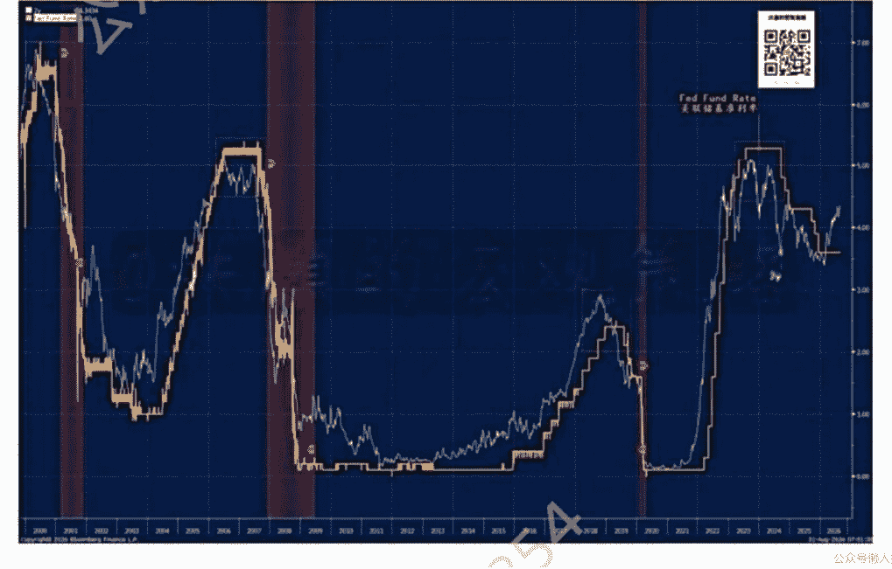
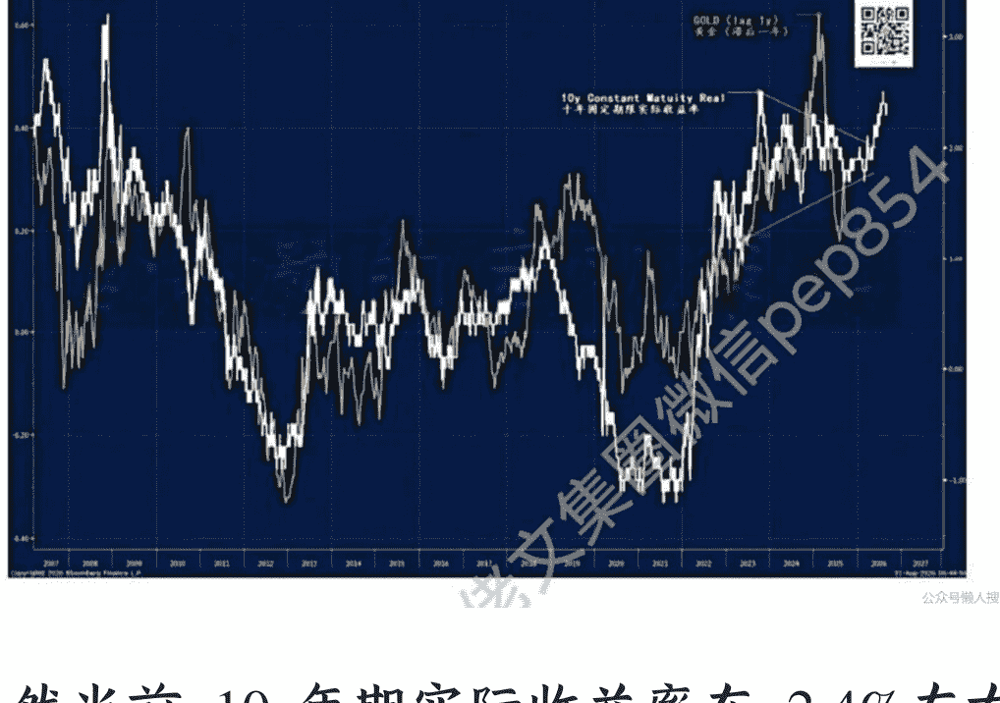
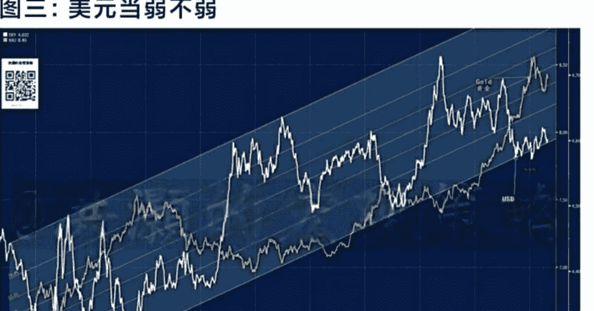
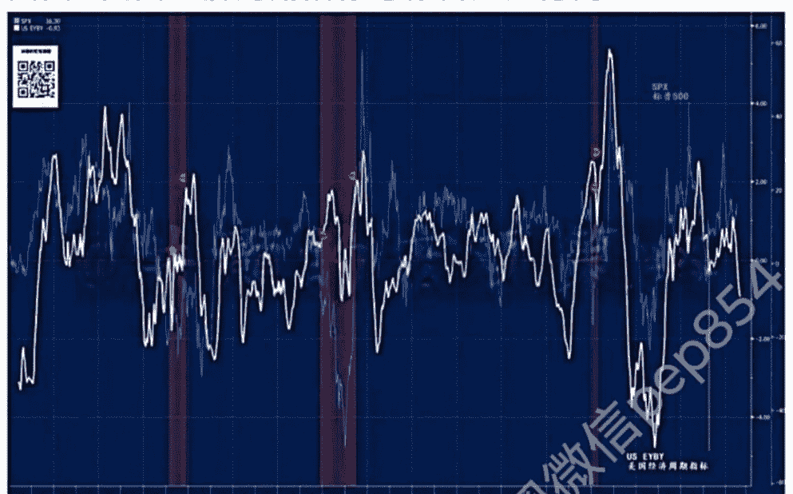

# 市场将如何定价沃什和贝森特的巅峰对决

260901 洪灏

整理：公众号懒人搜索，<u>懒人专属群</u>精选

懒人微信：lazyhelperl


微信：lazyhelperl

> **小懒判断** ｜ 关心美联储和 大类资产的值得细读，只想看热闹的可以省了。最有颗粒度的是扭曲操作的历史账：1962 年峰值只压低 10 至 15 个基点，2011 年 6670 亿美元也才 23 个基点，贝森特每次 40 亿就想压低长端，明显不够看。坑在 9 月议息前市场还会反复定价，沃什放鹰一次波动就放大一次，仓位别上太满。

## 前言

是财政主导，还是货币主导？

周末，沃什在杰克逊霍尔全球央行峰会上发表了他就任以来第一场真正意义上的政策演讲。会前，市场预期沃什中性表态，毕竟沃什早就暗示过“前瞻指引早已不应该受欢迎了（overstayed its welcome）”。近七成基金经理押注沃什会维持模糊姿态。然而，沃什的讲话却异常鹰派，甚至还提出了一些具体的观察标准和数字尺度，也让美联储与美国财政部之间的政策边界重新被市场审视。

沃什认为，美国通胀并未如期降温，已经几年维持在美联储的通胀目标之上了。他明确表示，美联储必须确信“潜在通胀正以足够快的速度向 2% 的目标回归”，否则“我们还有工作要做”。沃什强调，2%这个具体的数字目标“不应有任何误解”。沃什还认为当前的美国经济并没有被政策所抑制：过去四个季度实际消费支出增长超过 2%，今年以来私人内需增速接近 3%，失业率维持在 4.1%，申领失业金人数处于数十年低位。这一系列的消费和就业数据，显示美国经济的韧性。

同时，信用市场几乎没有任何紧缩迹象，公司债和杠杆贷款的信用利差处于历史低位，发行量非常强劲。企业盈利也很健康，标普 500 过去一年利润增长超过 20%，利润率远远高于历史均值，盈利超预期的程度应该是我们有数据以来最强的一次。资本开支的加速很大程度上来自人工智能基础设施建设，今年企业资本开支增长中有一半以上与之相关。沃什承认，过去 65 个月持续偏高的通胀，责任在于美联储的政策自身，而非外部冲击。因此，沃什主张美联储回归一种“更安静、更审慎、不被市场牵着走”的沟通方式。

简言之，在峰会之前，市场认为沃什的政策基调是现有的经济数据给了沃什理由不收紧；而峰会之后，市场发现其实沃什的政策基调是现有的经济数据需要*不给*沃什理由不收紧。收紧政策的门槛在峰会之后大幅度降低。

## 图一：市场定价美联储基准利率将上调



不出意外，市场反应了鹰派重新定价。峰会当天，美债收益率全线跳升，美债收益率曲线变动幅度跻身沃什就任以来三次最大单日波动之一，而掉期市场一度将美联储 9 月加息定价为基准情形而非尾部风险，9 月加息概率从沃什讲话前的 35% 左右，一路推高至接近 60%。美元指数当日上涨 0.4%，当周涨幅 0.6%，创下六月中旬以来最大单周涨幅。美元兑日元一度突破 160 关口，日债市场也感受到明显溢出效应，2 年期日债收益率朝着 2% 迈进，市场对日本央行 9 月加息的预期同步升温。相比之下，美国股市的反应显得克制多了。这也符合杰克逊霍尔历史上的惯例。除非讲话释放重大政策转向信号，否则美国股市通常不会马上出现剧烈反应。

然而，市场一时间的膝跳反应是否对于后市有指导意义？当下，市场共识对于周末峰会的解读仅仅停留在了沃什峰会发言的本身，却看不到沃什和最近日渐活跃的贝森特之间政策的互动，以及这些政策整体对于全球风险资产价格的影响。

美股整体市场表面的平静，并不能掩饰个股波动性的飆升。早在年初的专属文章《2025年启示录》里，我们就讨论这种现象的成因以及持续性。同时，美国债市名义收益率的上升，主要是由实际收益率驱动的，而非通胀预期。以5年期为例，实际收益率上升了45个基点，远超名义收益率22个基点的涨幅，这意味着5年期盈亏平衡通胀率（breakeven rate）反而下降了约23个基点，从约2.53%降至2.30%左右；10年期盈亏平衡通胀率下降约10个基点，30年期下降约5个基点。换言之，市场认为沃什的鹰派政策将有助于控制通胀预期，而不是在为通胀失控做对冲。长期看，这是一个健康的信号。如果美联储的通胀掌控能力被质疑，我们看到的应是通胀预期（breakeven rate）上升，而非下降。

### 图二：美债长端实际收益率跳升，领先黄金走势一年左右



虽然当前10年期实际收益率在2.4%左右，从历史绝对水平看并不算极端，但相对于当前美国的股票估值而言却异常昂贵。标普500的股票风险溢价目前只有约2.7%，不仅远低于2010年至今5.45%的历史均值，甚至低于2022至2023年加息周期中约3.1%的低点，这是这组数据有记录以来最小的一次。历史上，股票实际收益率与股票风险溢价之间存在稳定的负相关关系，过去16年间的相关性达到-71%，在 2022 至 2023 年加息周期中更是收紧到 91%。这种相关性其实不足为奇：风险溢价越低，股票估值越高，未来的回报率也就越低。换言之，只要实际收益率继续上行，理论上估值应当承压。

但奇怪的是，自 2024 年以来，实际收益率与远期市盈率之间的历史负相关关系明显松动，相关系数甚至一度转为正值 20%。这很可能是人工智能带来的盈利增长预期，支撑市场愿意在高实际利率环境下，依然愿意给出 19 倍以上的远期市盈率。在 2008 年之前的历史区间里，同等实际收益率水平下市场给出的估值通常只有 13 至 16 倍。这意味着，当前股票市场其实是押注人工智能带来的盈利增长真的可持续，并足以消化当下这么低的股票风险溢价。沃什在杰克逊霍尔的鹰派讲话则让这种押注的赢面和赔率大大下降了。

更值得探讨的是美联储和美国财政部之间的政策互动。我们在之前的专属报告里，讨论了美国财政部长贝森特正在推行一项被市场称为“扭曲操作”的策略：通过回购长期国债、增加短债发行，试图压低 10 年期至 30 年期的长端收益率，以降低政府融资成本。八月中旬，他已经将常规回购操作的规模翻倍，并暗示未来还会有进一步的财政整顿措施。这种操作类似于美国财政部的量化宽松，有利于风险资产的表现，也是我们在七月底八月初提示“可交易反弹”的机会。

表面上，贝森特要压低长端利率，沃什要维持甚至推高短端利率，两者叠加恰好导致收益率曲线走向熊市平坦化（bear flattening）。沃什讲话后的市场走势正是如此，曲线形态上两者似乎互补而非矛盾。然而，沃什明确表示信用利差处于历史低位、金融条件并不紧缩，而贝森特压低长端收益率的操作，恰恰是在为按揭利率、企业融资成本和贴现率这些货币政策传导的关键渠道松绑，等于在系统性地抵消沃什想要实现的紧缩效果。简言之，贝森特长端操作的成本将溢出市场的其它利率和美元汇率，从而对冲了可能即将到来的、沃什货币政策的收紧。

### 图三：美元当弱不强



沃什的强硬姿态意在把通胀预期重新锚定在低位，而美国财政部动用国库资金去捍卫一个特定的收益率水平，容易被市场解读为“财政主导”的信号，而财政主导本身就是通胀性的。德鲁肯米勒，贝森特和沃什老师和前辈，公开批评贝森特的这种扭曲操作是一个错误。德鲁肯米勒的评价颇为直白，政府若试图用干预去对抗市场，最终总是输家。市场很快用行动验证了这一判断。美债回购公告后不到两天，10年期和30年期收益率便重新上行。

我们认为德鲁肯米勒的观点更适用于长期的政策制定，但是对于短期的交易和市场价格波动，则意义略轻。毕竟，我们交易员要活过了短期，才能看到长期。

短期，特朗普政府可以在政策上活力全开，埋葬那些胆敢做空调市场的交易员。这种特朗普“看多期权”，让今年市场尤其难以操作，也让今年的市场价格往往走向极端，甚至泡沫化。周六，花街日报发现德鲁肯米勒的公开文章其实是AI写的，而德鲁肯米勒本人对于这个发现也供认不讳。当然，文章是否是AI写的并不重要，重要的是这篇文章是否反映了德鲁肯米勒真实的观点。

历史证明，这场“扭曲操作”注定艰难。

1962年肯尼迪政府时期的那次扭曲操作，是美联储与美国财政部联手进行，目的在维持短端利率以捍卫布雷顿森林体系的同时、压低长端利率以刺激投资。学界事后的评估是这种操作的效果平平且短暂，对10年期收益率的峰值影响大约只有10至15个基点，而且随着私人部门对于长债的需求因为利率低而上升，扭曲操作的效果很快消退。更重要的是，当年通胀水平仅约1%，财政状况也相对健康。然而，布雷顿森林体系最终仍在1971年瓦解，说明市场干预终究无法长期压制基本面力量。

2011至2012年美联储自己执行的扭曲操作，动用了约6670亿美元的规模，对10年期收益率的峰值压低效果约为23个基点。而贝森特目前的操作规模仅为每次40亿美元左右，不到当年联储计划的百分之一，却在公告当日制造了大致相当于其一半的期限溢价影响，足见当下市场情绪的极端。

更关键的结构性差异在于：1962 年和 2011 年的操作都伴随着低通胀或通胀下行的背景，而当下已经是连续 65 个月通胀高于目标，长端收益率中包含的是真实的通胀风险溢价，而不仅仅是久期供需失衡，回购操作对通胀风险溢价基本无能为力。加之贝森特动用的是财政部一般账户里有限的资金空间，估计在千亿美元的可用规模，而非联储可以无限扩表创造准备金的能力。一旦贝森特的回购节奏放缓，收益率曲线随时可能迅速回吐此前被压制的效果。这种“金融抑制”（financial repression），很有可能反过来削弱美元、推高通胀预期，从而自我挫败。

沃什在货币立场上是一个偏货币主义的鹰派。他长期执念于收缩联储资产负债表，这意味着即便联储刚刚因应资金市场的压力重启的扩表，仍有可能因为通胀而回归量化紧缩，而这将对银行体系和货币市场的运行机制提出根本性挑战。沃什在资产负债表这件事上的立场，与贝森特存在某种深层的一致性。他们对于美联储资产负债表的规模抱有疑虑，只是沃什更看重紧缩本身的信誉价值，而贝森特更看重财政融资成本。这种“表面对立、深层部分同频”的关系，恰恰解释了为何杰克逊霍尔之后的市场反应会呈现出混合信号：短端利率因通胀预期而走高，长端利率的压力却部分被财政部的操作所抵消。在一个日益走向财政主导的世界里，美联储的独立性正在被结构性地侵蚀，货币政策与财政政策的边界正在变得模糊。这意味着未来类似杰克逊霍尔这样的时刻，可能不再是单纯的货币政策事件，而更接近于一场关于谁在真正掌控美国利率曲线的权力博弈。

七月的美联储议息会议已经出现 9 票对 3 票的分歧，哈马克、卡什卡利和洛根三位委员投票支持立即加息，这种程度的异议在沃什就任仅第二次会议时便已出现，说明鹰派阵营在委员会内部并非孤立声音。如果接下来的美国通胀数据不能明显改善，沃什几乎没有退路，只能兑现“还有工作要做”的承诺而加息。

总结一下：沃什在 Jackson Hole 峰会的讲话鹰派超出了市场预期。本质上，这次讲话重申了沃什自其担任美联储货币委员以来一直倡导的传统货币政策理念，但更重要的是这次讲话提高了九月份美联储不加息的门槛。而市场对于九月加息的概率不再是定价为一个尾部事件。与此同时，贝森特在长端美债的扭曲操作似乎暂时不能奏效，美债长端收益率又回到了操作前的水平左右。

毫无疑问，贝森特的扭曲政策效用在历史上已经被证伪，而当下他的政策工具可以调用的资金的体量，远远低于沃什可以调用的资金量。贝森特的操作无疑对于风险资产价格走势图来说，是一剂强心针，也是我们过去七月底八月初提出的交易性反弹的原因之一。然而，随着鹰派沃什的出现，我们认为风险资产已有获利在当下的市场显得脆弱，而九月也是美股表现季节性较弱的一个月。因此，当下交易员应该控制仓位，兑现一部分盈利，静待更好的入场时机。这个观点与我们在上周五在我的行星上提示的金矿股走势的风险一致。

### 图四：美国经济周期指标与标普走势背离



在这个 AI 能替写代码、写文章的时代，基础技能正在迅速贬值。绝大多数人正被淹没在海量的免费垃圾信息里，陷入低效的体力内卷。

当“努力”不再是壁垒，人与人之间唯一的护城河，只剩下“信息过滤”的效率与“认知系统”的维度。

圈子已稳定运行 7 年。我们每天利用 Python 爬虫与大模型算力，过滤全网最顶级的政经内参和搞钱风向标，做你最冷酷的“外部大脑”。

如果你认同这种“重塑认知防线”的极客主义，欢迎围观我的个人情报智库：【懒人专属群】。

```
https://lazyso.com/insider/
```

认同信息过滤价值、想省下每天 3 小时无效阅读时间的读者，扫码加我微信（lazyhelper1）


微信：lazyhelper1
