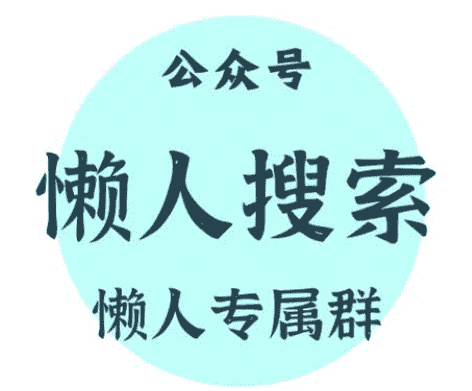

## 国际粮价暴涨，背后有什么图谋？

260902 文/卢克文工作室嘉宾 雨巡星宿
整理：公众号懒人搜索，懒人专属群精选
懒人微信：lazyhelper1

微信：lazyhelper1

> **小懒判断** | 看不懂最近农业股为啥涨、想理清粮价和美联储关系的人，这篇信息密度够高；只想要"马上要缺粮"恐慌结论的别看，作者结论恰恰相反。最值得关注的是 2008 年那组数字：全球产量创新高，大米照样涨 224%，炒期货不消耗一粒粮食却能抬现货。坑在于日韩被收割那部分是作者推演，不是已发生的事实。

最近发生了一个奇怪的现象，代表存储芯片板块的费城半导体指数跌得妈都不认，国际粮价却涨疯了。

根据第一财经报道，截至 2026 年 8 月 31 日，芝加哥小麦期货年内涨幅超 54.5%，玉米期货年内累计上涨 21.8%，双双创下三年新高，投机基金一周内加仓 41% 的农产品净多单。就连 A 股农业板块都走出了一枝独秀的行情。

而且，绝大部分涨幅集中在 8 月份，也就是摩根大通、汇丰一致发布研报，预警全球粮食危机将会在 2027 年上半年到来的这段时间。

那么，到底是真可能发生粮食危机，还是资本另有图谋？

### 1

我们先根据公开信息，粗略分析一下到底会不会缺粮。

全球主要粮食作物是玉米、小麦和大米，大豆作为油料和蛋白来源，属于另一类。

- 玉米是全球产量最高的谷物，产地遍布北美、东亚、南美，欧洲，其中 70% 以上用作饲料和工业乙醇，人食用占比很低。
- 小麦的产区分散，温带气候才适宜生长，黑海周围、北美、欧洲、中国华北地区，印度以及澳大利亚南部，阿根廷都有产区。
- 大米是亚洲人的核心主食，90% 的产区在亚洲，中国和印度就生产了全球超过一半的大米。

全球农业领域最权威的统计机构是联合国粮农组织（FAO），根据它 7 月发布的最新报告，预计全球谷物 2026 年产量接近 30 亿吨，库存近 10 亿吨，不但处于历史相对安全区间，甚至是有记录以来的第二高产量。

也就是说，哪怕今年颗粒无收，全世界人口光吃库存也能撑将近 4 个月。

你可能会质疑，FAO 是 7 月发布的数据，7 月金融机构炒作粮食危机，又搬出了新的叙事，会不会之后 FAO 修正数据？

我们一个一个看。

**第一，厄尔尼诺将带来大干旱，导致作物减产。**

国际气候中心指出，当前赤道中东太平洋海表温度持续升高，预计将于 11-12 月达到峰值，形成一次超强厄尔尼诺事件。也就是说，干旱影响可能会在后续几个月加强。

历史上三次超强厄尔尼诺事件，主要影响东南亚，各国的水稻（大米）产量普遍出现了 5%-20% 的下滑。目前东南亚干旱信号已经显现，但东南亚的水稻一半以上都有灌溉设施，即使干旱加重，也不会让水稻产量崩盘，只会产量会低一些。

即便按最严重的 20% 算，东南亚占全球大米产量的 26%，那么全球大米产量只不过会减少 5% 左右。

两个最核心的大米生产国，中国和印度，共占全球大米产量的 55% 以上，其实并不是厄尔尼诺影响的中心地带，而且都有庞大的灌溉设施，对大米产量的影响就更小了。

另澳大利亚的小麦对干旱极为敏感，今年已经因为厄尔尼诺出现减产，大概导致全球小麦产量较去年下降约 4.3%。

**第二，俄乌冲突冲击黑海航运，导致小麦运不出来。**

俄罗斯、乌克兰合计占全球小麦出口的约 28%，黑海是它们的核心海运要道，主要运往北非和中东。

最近两个月，俄乌用无人机、导弹对着黑海码头和货船不停打击，黑海海运粮食的能力大幅下降。

俄罗斯还有两个远一些的港口，但其中一个也被无人机袭击，俄罗斯政府已经拨款补贴走陆路和铁路，8 月全月俄罗斯小麦出口量预计只有 200 万，是去年同期的一半不到。

乌克兰也有一个运力小的多瑙河港口，还有一条经欧盟的铁路和公路，根据 8 月出口量，也是只能发挥一半不到的运力。

这样算下来，黑海如果一直通不了，全球市场会大约减少 16%-18% 的小麦，而依赖俄乌进口小麦的北非和中东首当其冲。

**第三，是霍尔木兹海峡危机导致化肥供应出问题。**

霍尔木兹海峡是重要的氮肥枢纽，因为氮肥需要天然气才能生产出来，而中东恰好有丰富的天然气。

大米、小麦、玉米都需要氮肥，现在三分之一的氮肥运不出来，对农业影响还是挺大。原油没了还能释放储备，但一旦错过施肥窗口期，农作物减产就是板上钉钉的事。

随着各个地区施肥窗口期的到来，霍尔木兹海峡危机，已经影响到非洲的玉米生产。如果 12 月份海峡还没通，孟加拉的部分大米、巴西的玉米都会受到重大影响。

虽然听起来有点可怕，但非洲的玉米只占全球谷物总量的 0.1%，也不出口。印度虽然是 8 月施肥，但人家早在几个月前就找到替代氮肥来源了，此外孟加拉的粮食也只占全球谷物不到 0.2%。

而对于美国、中国、俄罗斯这些产粮大国来说，氮肥自给自足，完全没影响。

综合上面这些因素，今年最受影响的可能是小麦，大米、玉米受影响较少。至于大豆，全球第一大产国巴西已经收获完毕，产量创了新高，库消比 19.8%，说明不缺大豆。

而且奇怪的是，今年 3 月我们就知道今年是厄尔尼诺大年，霍尔木兹海峡危机也快半年了，真正在最近两个月出问题的只有黑海，玉米和小麦的价格就被炒得这么高。

为啥会这样呢？

因为粮食够吃，和粮食危机是两码事。

这二十年来的粮食危机，从来就不是因为真的缺粮导致的，是欧美超级粮商哄抬粮食价格，导致穷国买不起粮食。

虽然网络上流传“四大粮商控制全球 80% 粮食”，但其实全球的粮食，约 83% 是产粮国自留的，用来国内消费或国家储备，只有 17% 的粮食在国际贸易市场上流通。

而这 17% 的粮食，就决定了国际粮价，四大国际粮商也只能影响这部分价格，而且它们对大米控制力度很低，仅能操控大豆、小麦和玉米。

如果四大国际粮商这时候说，粮食运不出来了，减产了，我不卖了，那么金融机构就有动力去炒期货。

炒期货，本身不会消耗一粒粮食，但现货价格等于期货价格加上基差，只要期货涨价，那么在基差不变的情况下，现货报价也会涨。

粮食进口国看到粮价涨，担心国内闹饥荒，就可能发生恐慌性抢购，推高粮食价格，陷入恶性循环。

这就是粮食减产 5%，却可能导致粮价暴涨 100% 的传导机制。

2007 年到 2008 年的全球粮食危机中，全球粮食总产量不但没有下降，反而创下历史新高。

但就因为金融机构说美国要用玉米生产乙醇燃料，玉米不够了，结果四大国际粮商捂着不卖，金融资本疯狂投机，导致从 2007 年至 2008 年上半年，大米上涨 224%，小麦 134%，大豆 117%，玉米 74%，全球新增 1 亿饥民，总数达到 10 亿的空前规模，全球多达 37 个国家因缺粮导致抗议、骚乱甚至流血冲突。

在穷国的饥殍和白骨背后，是四大粮商净利润翻倍，和金融资本一起在高位获利了结。

你还觉得前几天摩根和汇丰的研报，只是单纯地提示风险么？

### 2

它们为什么选择这个时机？

2007 年的粮食危机，正值次贷危机爆发，资金从股市和楼市撤出，美联储史无前例地大放水，迅速贬值的美元流入了全球大宗商品期货市场。

这次虽然还没发生金融危机，但投机的资本没啥地方去，很容易就打起粮食的主意。

美国通胀压力极大，美联储加息已经走到十字路口，AI、黄金、美债，三大硬核资产都受加息预期的压制。

顺便解释一下为啥美联储加息会加剧全球抛售美债，因为如果美联储加息，你这会儿买的美债收益率就不高了，你干嘛不等加完息再买呢？加息概率高，大家就宁可卖掉现在手里的美债，坐等加息。

就在这个买啥啥烫手的档口，它们突然炒作起了粮食危机，毕竟现在再没有比粮食危机逻辑更丝滑的叙事了。

现在的世界比 2007 年更乱，减产、断航、战争确实在发生，当年玉米做燃料都能制造粮食危机，这次好歹证据还多一些。

对中国来说，主粮能自给，有充足的储备，即便涨价，我们抛储就能压价。大豆虽然依赖进口，但我们外汇储备充足，完全扛得住。

可对那些粮食重度依赖进口、又没有外汇的小国来说，买不起粮，就真的会饿死人，更可能发生暴乱。

到时候西方人为制造的粮食危机，就不仅是人道主义灾难，更是经济和政治灾难。

未来可能有两个不同走向。

**第一，围魏救赵。**

能遏制金融机构继续炒作粮食的，从来不是良知，只有一个办法：降息，延续 AI 泡沫。

对于金融资本来说，炒 AI 比炒粮食的利润高多了，迫不得已才去祸祸粮食市场。

美国要么把伊朗哄好，要么赶紧跟委内瑞拉搞出点石油出来，把石油价格打下来，把国内通胀摁住，美联储就不会加息，甚至可能降息。

这样就能挽救美股的 AI 泡沫，吸纳大量资金去自嗨，那么此次的粮价暴涨，可能只是短期投机行为。

**第二，如果事情走向完全相反的方向，即美国无法控制通胀，美联储加息，那此次粮食危机炒作就可能拉开金融资本又一次收割全球的序幕。**

世界上有很多穷国，粮食无法自给，必须从国际市场上进口。

一旦发生粮食危机，首先就会冲击这些国家，包括也门、苏丹、叙利亚、索马里、吉布提、肯尼亚、埃塞俄比亚、马里、毛里塔尼亚、布基纳法索、阿富汗、尼泊尔、塔吉克斯坦等非洲、亚洲、拉丁美洲国家。

这些国家虽然贫穷，但很多国家却拥有丰富的关键矿产资源，布基纳法索、马里有大量黄金矿，毛里塔尼亚有高品位铁矿，是非洲第二大铁矿出口国。

极度缺少粮食的国家，很容易在粮食危机中发生饥荒和暴动。

美国是农业强国，也是全世界公认的最懂粮食外交的国家，没有之一。

二战西欧农业被摧毁，“马歇尔计划”的三分之一都是粮食和化肥援助，美国当时最怕的就是西欧人吃不饱，倒向共产主义。

那么，美国有没有可能“趁你病，要你命”，盯着有关键矿产但缺粮的穷国，通过提供或者切断粮食援助的方式，渗透这些国家的政权，甚至推动政权更迭？

既然美国现在整合拉美的意图，已经完成了七七八八，为什么不会盯上有矿但缺粮的非洲呢？

除了这些缺粮穷国，富裕国家里的日本和韩国也比较危险。

日韩的大米能自给自足，但小麦、玉米、大豆高度依赖进口，而这些是饲料的主要来源，居民食品消费在总消费支出中占比很大。

今年日元韩元贬值得厉害，如果国际粮价大幅上涨，影响的不只是小麦类主食，日韩的肉蛋奶这类民生食品也会大幅涨价，推高国内通胀。

如果日本为了应对通胀选择加息，导致日元剧烈升值，会引发国际金融市场的巨大动荡。日元是影子美元，日元流动性收紧，全球金融市场都会收紧。

如果粮食危机和金融危机同步发生，对日韩更加不妙。

日韩的半导体已经和美国高度绑定，国运几乎全部系于此，尤其是韩国。

一旦发生金融危机，两国的货币、股市、资产价格暴跌，美国是不是可以顺手抄底，抢走韩国两大核心支柱三星和 SK 海力士？

无论是哪种结果，把算盘打到饭碗里，都是世界人民绝不可原谅的行径。

——分割线——

绝大多数人只盯着眼前的工资，却不知道一次远在中东的冲突、一次降息的决议，就能在一夜之间洗牌普通人的财富。

看懂宏观，是为了在周期切换时，不被当作代价。

如果你认同这种“抬头看路”的长期主义，欢迎围观我的个人情报智库：【懒人专属群】。

圈子已稳定运行 7 年。我们每天利用 Python 爬虫与大模型算力，过滤全网最顶级的政经内参和搞钱风向标，做你最冷酷的“外部大脑”。

https://lazyso.com/insider/

认同价值的。扫码加我微信，备注：【进群】

微信: lazyhelper1
