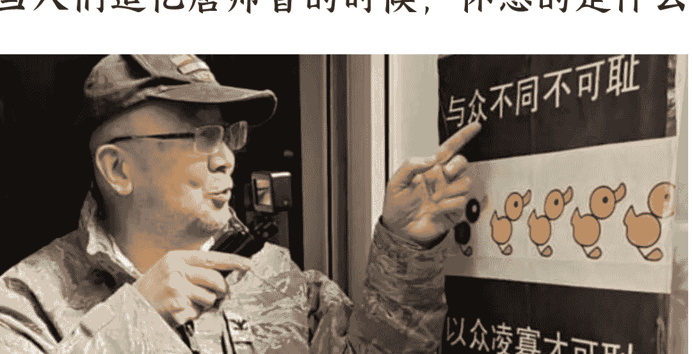

# 唐师曾

**260902 新闻实验室**

整理：公众号懒人搜索，懒人专属群精选

懒人微信：lazyhelperl

> **小懒判断** | 做内容、搞媒体的人看这篇会有共鸣，尤其是入行前后对行业变迁没概念的年轻人；想看唐师曾生平八卦的会失望，这是一篇借逝者谈新闻业变迁的评论。最值得关注的是战地记者偶像落幕的三个原因——榜样断档、全球化退潮、信息不再稀缺，这套框架套到你所在的行业也成立。注意这是会员通讯，文中引了不少会员文章链接，点开可能看不全。

当人们追忆唐师曾的时候，怀念的是什么？

最近的大大小小新闻很多，无论是严肃大事还是吃瓜八卦，都有不少值得分析的。不过，因为我刚刚跨国搬家到波士顿，开启一个学年的访学，这几天疲于安顿，因此没有精力去做及时的追踪，而且本期通讯的发送时间也一再延迟，在此也要向各位会员朋友致歉。在最近的新闻里面，我想挑出一件，写写最近的一位逝者，因为他在 8 月 23 日去世、享年 65 岁的记者唐师曾，在中国新闻史上留下了自己的位置。

和前不久去世的朱镕基一样，唐师曾的离去也引发了一波回忆，尤其是在 1990 和 2000 年代受他影响而进入新闻业的一代人的回忆。我不想用“一个时代落幕”这样已经用得过于泛滥的形容，但是，如今的这个世界确实已经和属于唐师曾的那个时代非常不同。

## 精神底色

很多人怀念唐师曾，并不仅是因为他曾经很有名——有名的人很多，但如果不具备引发广泛共鸣的精神底色，名人也会很快被遗忘。

唐师曾的精神底色，通过他的诸多行为和讲述，已经非常明显地反映出来。

出生于 1961 年的唐，成年时刚好赶上文革结束、改革开放起步，以及随之而来的恢复高考。他的精神底色与这样的时代背景息息相关：不再相信集体主义的神话（因而非常强调个人自由、独立思考等，乃至向往漂泊，即所谓“一个人的远行”），对假大空的政治宣传有深度的反感（因此看重新闻记者的专业主义精神）。他曾在文章中以调侃的语气说：“在此之前波澜壮阔的无产阶级文化大革命中，我已日积月累向数不清的英雄人物学习致敬：挖地道触电身亡的胡业桃、抢救串联网电身亡的刘文忠、面对新沙皇‘生命不息冲锋不止’的于向阳、‘身居长工程拉革命车不松套’的王国福、‘小车不倒只管推，一直推到共产主义’的杨水财……连阿尔巴尼亚的霍查、越南的阮文追都是我心目中的革命英雄。……我由于赶上一个个英雄辈出的革命年代，英雄太多又逝者如斯，到现在除了上海知青金训华为抢救一根电线杆子被大水冲走外，其他已记不清是谁是谁。”

显然，对塑造这些典型人物的政治宣传，他的态度是否定的。但是，他自己其实又是想当英雄的，这种个人英雄主义后来驱使他把自已的照片放在几本书的封面上。不过，他想当的是自下而上、自己赢得声名的英雄，而不是自上而下、被钦定的英雄。

从一定程上来说，他的确成为了这样的英雄。

18 岁时，唐师曾考上了北大国政系。他后来的那篇《我在北大的阳光里》看得人好生羡慕。我的一个北大校友在朋友圈感慨：“诶，这师兄活成了想象中北大人的样子。看得让人好惭愧~”

那么，什么是想象中北大人的样子呢？从唐的文中，我读出的关键是：允许在专业范围之外自由探索（“不务正业的流寇四处乱走”）、容忍甚至提倡个性（“北大独有的教育体制帮我辨认出自己潜在的个性并得以发展”）、各路英雄汇聚（不仅同学都是精英，后来也频繁遇到在重要岗位任职的校友）。他在文中还至少六次提到北大的民主科学传统，并以“民主、科学、自由、容忍，再勇敢诚实地面对人生”结束全文。

可以说，这是经典意义上对北大精神的论述，或者至少是北大精神在个人层面的充分体现（北大精神另外还有在社会层面的体现，即积极参与推动社会变革，这一点自然是难以充分地公开论述）。唐师曾对北大的描述，也符合了后来者对八九十年代北大的想象，令 21 世纪才入学的校友们感到眼红。

在接受采访和写文章时，唐师曾反复提及的几位记者，自然也是浸染了他的精神底色的人物，并且是他选择走上记者道路的直接原因。

一位是著名的战地摄影师罗伯特·卡帕。在那篇关于北大的回忆文章中，唐师曾说自己是在北大图书馆读到卡帕的故事的。他甚至写道：“两杯黄汤落肚，我总是产生我是卡帕转世的错觉，仿佛我真经历过卡帕经历的一切，连身上的臭汗也带着卡帕身上才有的老公羊特有的刺鼻味。”

另一位是埃德加·斯诺。唐师曾屡次提起，他刚进入北大，就在未名湖畔发现了斯诺之墓。他对这位“中国人民的老朋友”的评价是：“斯诺不仅追逐热门新闻，而且热衷一切有价值的进步事业，这更令‘爱管闲事’的我神往。”可以说，唐师曾对斯诺的欣赏，是基于斯诺在延安年间选择支持弱者的道德立场。

斯诺的学生萧乾是对唐师曾产生最直接影响的记者。二战期间，萧乾担任《大公报》驻英国特派记者，亲历了伦敦大轰炸及欧洲战场的多次重大报道。在二战西欧战场初期，他曾被称为“唯一在场的中国记者”。

这段已经遥远的职业经历，其实并不是唐师曾欣赏萧乾的唯一原因，甚至可能不是主要原因。萧乾从欧洲战场回国后，对于国内问题坚持畅所欲言、抨击不公，后来得罪了郭沫若，引得郭撰文批判他为“黑色鸦片”。1957 年，萧乾在反右运动中被划为右派。虽然有很惨痛的经历，但还是改不了说话的习惯。1996 年，萧乾在给《新闻记者》杂志的文章《老记者断想录》中写道：“新闻记者应尽力眼睛朝下。例如报道灾难性新闻，首先应着重报道受灾情况而不是把重点放在哪些中央或地方领导同志（名字一个不漏）立即前往慰问，然后才笼统地加上一句‘已做了妥善安置’。”放在 30 年后，这样的点评仍不过时。

萧乾那一代知识分子的经厉，进一步影响了唐师曾的思想观念。后来，唐师曾说吸取了萧乾的教训，“永不写字，铁了心只当摄影记者”。不过，这显然更多只是一种姿态，因为他连书都写了好几本，遑论大大小小的各种文章，还有之后在网络上大量发布的视频讲述。

关于唐师曾的精神底色，还有一个观察的侧面，那就是他和芙蓉姐姐的友谊。当芙蓉姐姐遭受群嘲的时候，唐师曾表达了对她的同情和支持。这种心底的善良，和嘴上的脏话连篇（以至于萧乾夫人文洁若写给他“请注意别说狠话，勿带脏字，以示精神文明”），同时存在于他的身上。

## 体制内外

1980 年代成长起来的自由派，几乎全都是在体制内开启事业的，因为当时的中国市场经济还非常初级，几乎没有什么“体制外”的存在。

唐师曾自然也是一样。从北大国政系毕业后，他加入了中国政法大学成为老师。当时的大学生十分稀缺，毕业之后分配到大学教书是常见的情况，唐的北大同级校友海子也是同样的路径。

但大学里面的氛围实在是不适合唐师曾，他的心比校园大得多。当时在政法大学当校长的江平也看出来了唐师曾不属于三尺讲台，所以特批他离开学校，令他得以在 1986 年加入新华社。

自然，新华社也是体制内单位。但是，当记者总是要往外跑的，这就限制不住唐师曾那颗不安分的心。他曾骄傲地回忆：“1987 年我在新华社开创 BP 机、手提电话跑新闻的方式，几乎控制北京地区所有突发事件的报道，名声大噪。”

这样的跑新闻方式，几乎与十几年之后都市报的做法如出一辙。这也再次说明，八十年代出自官方媒体的新闻改革，其实已经发展到了相当的水平。

唐师曾时代的法大有江平校长，新华社则有穆青社长。穆青曾在文革期间因为反对江青被停职检查。改革开放一开始，他就率先发文否定文革，并在 1981 年与郭超人、陆拂合写《历史的审判》——表面上是对林彪、江青反革命集团的审判，实际上是对整个文革十年浩劫的深刻清算与审判。

这篇长篇通讯的信息量非常大，包含不少广为传播的故事和细节，例如林昭被枪决后家属还被要求缴纳五毛钱子弹费，这个骇人听闻的细节也出自这篇通讯之中。

穆青对唐师曾照顾有加，也欣赏有加。当年新华社的开放氛围，更是唐师曾抵达职业顶峰的前提。他能在中以尚未建交的时候成为第一位前往以色列采访的中国记者，率先开辟并使用“新华社特拉维夫电”和“新华社耶路撒冷电”的电头，显然不是靠个人勇气就能完成的。

从战场归来后，唐师曾在职业上的发展似乎遇到瓶颈，这和他的身体状况有关，但应该也和他的性格与体制之间的冲撞有关。

后来，他在社交媒体上持续更新“一镜到底”的视频。这些视频拍摄的理念和他的摄影作品相似：关键是在场，是记录，而不是美观，不是精妙的构图或剪辑。由于早年出名等原因，他和一些社会名流颇有私交，所以他那看似随意的视频里面其实透露了不少平民百姓无法获取的信息。如果这些视频都被保存下来，会是很有价值的史料。

理解唐师曾与体制的关系，还可以参考他多次提到过的另一个人物：阿拉伯的劳伦斯。看过那部经典电影的朋友，对 T.E. Lawrence 的故事不会陌生。劳伦斯曾在一战期间，以英国陆军情报官及联络官的身份，协助阿拉伯部族发动反抗奥斯曼帝国的“阿拉伯起义”。虽然帮助英法在中东实现了很多战略目标，但由于战后的英法为了自身利益在一些安置上背叛了阿拉伯人，劳伦斯拒绝了英王给他的勋章。

唐师曾很欣赏劳伦斯的“干净”：干净地工作，干净地走。劳伦斯曾为一个庞大的体制工作，但是他在关键问题上坚持自己的原则，不惜对体制说不。相信唐师曾从中看到了自己的影子。

## 战地记者作为精神偶像的落幕

受唐师曾影响，对新闻产生兴趣、走上记者道路的人，应该不在少数。在包括他以及阎丘露薇、周轶君等人的影响下，想从事战地记者这种职业的年轻人，曾经大有人在。

我记得自己读大学时，从各所高校了解到的情况都是，真心想学新闻、想做记者的同龄人里面，有一半以上都有过做战地记者的梦想。

但是，如果在今天的年轻人当中再做调查，我的判断是：这个比例应该是绝对的少数了。我很少再听见学生说，想当战地记者。

这当然不是因为战争消亡了。恰恰相反，俄乌战争、加沙战争，都已经持续数年，其他小规模战争也没有停歇过。

那么，为什么战地记者不再是年轻人的精神偶像？

我能想到的几个原因是——

- 第一，几乎不再有榜样人物。现在谈起战地记者，很多时候还是 20 年前的那些人。由于大众媒体的衰落、报道尺度的变化，以及交战国对记者采访的限制（加沙战争尤为明显），我们很难再看到这个时代的唐师曾出现。战地还在，记者凋零。

- 第二，对战地记者的向往，背后是对全球化的憧憬和拥抱——无穷的远方，无数的人们，都与我有关。在 20 年前，这是能在年轻人当中激起深度共鸣的观念。但它显然已经不是当今这个时代的主流精神。

- 第三，从积极的角度来看，战地记者曾经的辉煌其实是建立在信息稀缺的基础之上，而今天的衰落背后则是信息不再高度稀缺。在社交媒体上，由平民拍摄的影像，以及通过卫星获取的影像等，都让前线信息有更多方式被获取到。虽然在场的意义从未被真正撼动，但信息稀缺带来的光环效应显然已经不再。

这种时过境迁，是唐师曾去世所引发的怀念情绪当中不能被忽略的一部分。

***

在这个 AI 能替你写代码、写文章的时代，基础技能正在迅速贬值。绝大多数人正被淹没在海量的免费垃圾信息里，陷入低效的体力内卷。

当“努力”不再是壁垒，人与人之间唯一的护城河，只剩下“信息过滤”的效率与“认知系统”的维度。

圈子已稳定运行 7 年。我们每天利用 Python 爬虫与大模型算力，过滤全网最顶级的政经内参和搞钱风向标，做你最冷酷的“外部大脑”。

如果你认同这种“重塑认知防线”的极客主义，欢迎围观我的个人情报智库：【懒人专属群】。

https://lazypo.com/insider/

认同信息过滤价值、想省下每天3小时无效阅读时间的读者，扫码加我微信（lazyhelper1）

