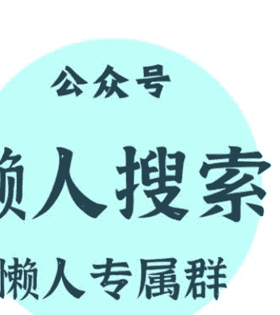
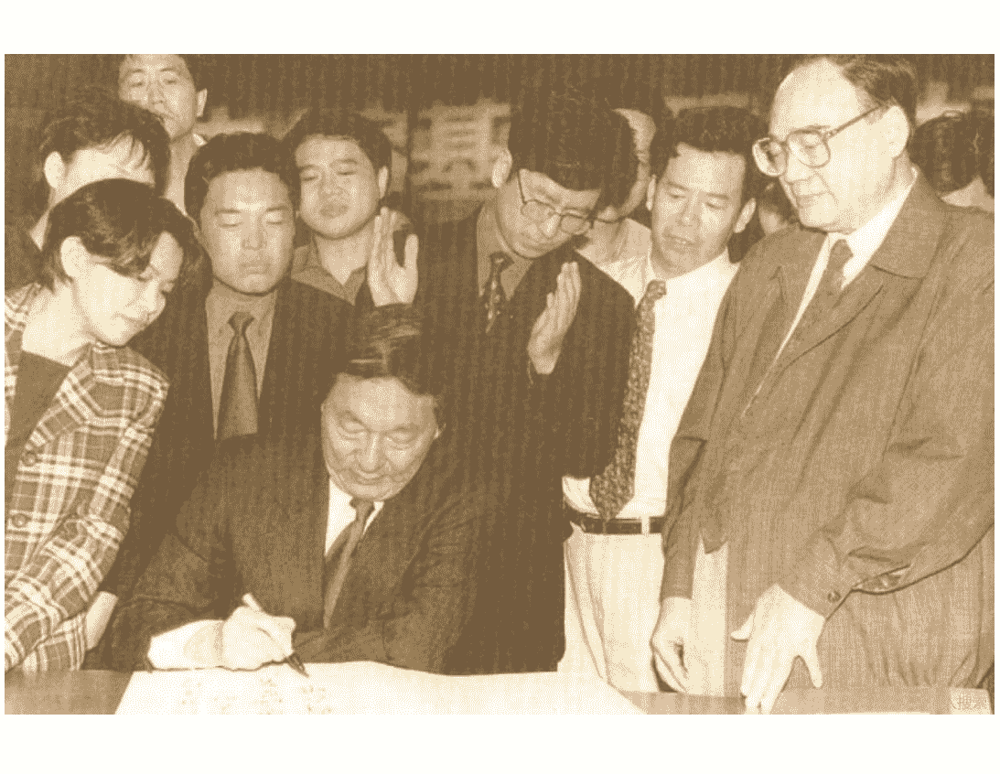
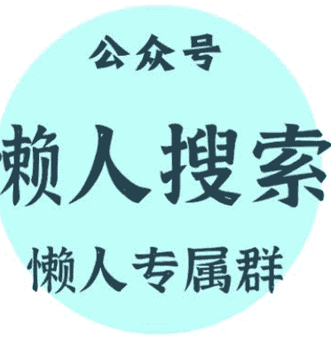

# 朱镕基与舆论监督的黄金年代

260902 新闻实验室

整理：公众号懒人搜索，懒人专属群精选

懒人微信：lazyhelper1

微信：lazyhelper1

**小懒判断** ｜ 经历过《焦点访谈》年代的人看这篇感触会深，研究中国媒体变迁的更该存一份；只想看朱镕基经济改革干货的会失望，这篇只谈他与媒体的关系。**最值得关注的是敬一丹汇报的那个数字：舆论监督占比从 1998 年的 47%跌到 2002 年的 17%，黄金年代在朱镕基任期末尾就开始收尾。** 坑在于别把这篇读成怀念文，作者结论很冷静——那是入世背景下的功能性透明，不是新时代的开始。

**舆论监督的黄金年代，只是特定时代背景造就的一段历史。**

2026 年 8 月 12 日，朱镕基在北京去世，享年 98 岁。在他身后涌动的纪念文字里，出现频率最高的有几段与媒体有关的旧事：1998 年记者会上那句“地雷阵、万丈深渊”，写给《焦点访谈》的十六个字，退休后“一介草民”的自称。

朱镕基担任总理的几年（1998-2003），也正是中国新闻业黄金年代的启幕。他的执政风格，与媒体上升期的开拓，形成了良好的互动，缔造了几段佳话。今天的新闻实验室会员通讯，我们就来追溯这位总理与中国新闻业，尤其是舆论监督之间的往事。

## “讲真话”、多发布

1998年3月24日，在就任总理后第一次主持国务院全体会议的讲话里，朱镕基对各级政府提出五条要求，其中第二条是“要恪尽职守，敢于说真话”。他说：“如果本届政府都是‘好好先生’，我们就对不起人民，要做‘恶人’。”这段讲话收录在《朱镕基讲话实录》第三卷，被多次在媒体刊发。

“讲真话”的要求也延伸到媒体。周瑞金是“皇甫平”系列评论的作者，1990年代初任《解放日报》党委书记兼副总编辑，在上海与朱镕基共事。他回忆，朱镕基主政上海时要求媒体“不仅要报喜，而且特别要报忧”，还说“哪个单位腐败、哪件事没有做好，我非常欢迎你们大胆揭发，再尖锐也不怕”。周瑞金后来把朱镕基对媒体的管理方式，概括为“宽松、依法、有序”，说他“尊重媒体人的新闻专业主义精神”。

对“真”的看重，也体现在他先后给上海、北京、厦门三所国家会计学院题写“不做假账”作为校训。2002年，他在世界会计师大会上说，希望每个毕业的学生永远牢记这四个字。一个工程师出身、在国家计委工作多年的干部，比多数人更清楚失真的数字会把机器带向何处。他要推进的经济改革，也必须建立在真实信息传播的基础之上。

2000年3月15日，朱镕基在九届全国人大三次会议记者会上回答德国电视一台记者关于新闻自由的提问。对方问他，如果中国不实现制衡、不取消一党执政，能否解决腐败问题。他说，他看不出反腐败与一党执政还是多党轮流执政有什么关系，“关键是法制，不仅要立法，而且要坚决地执法”；他坦承“我们在新闻的发布方面是落后于反腐败工作的进展”，但“将来更多的案件会要在报上公布，接受人民群众的监督”。

三年后，随着SARS爆发和政府最初瞒报带来的灾难，中国加速开启了政府信息公开的历程（详见会员通讯697期）。但是归根到底，朱镕基等高层在世纪之交支持和推动信息公开，讲求信息的真实性，背后还是中国经济日益融入世界经济秩序的要求。为了加入WTO等国际组织，中国政府做了一系列国际和双边的承诺，这些承诺都要求政府加强自身的透明度和开放程度。

此外，我们从朱镕基的表态中能看出来，他愿意让媒体更多介入反腐败信息的公布，但发布的方向和节奏仍由政府把握。可以说，他要的是一种功能性的透明，把信息发布当作治理的工具来用，媒体则始终置于权力系统内部。

## 记者会

总理记者会不是朱镕基发明的。这个制度可以追溯到周恩来时代，1987年做了制度化规定，1988年李鹏第一次以总理身份出席，1993年之后常态化。不过，让总理记者会从一项程序变成每年两会“必看节目”的，是1998年登台的朱镕基。他的机智、幽默和语锋犀利，让总理记者会成了重要的媒介事件。（这一媒介事件如今已经谢幕，详见会员通讯744期。）

1998年3月19日，他点名凤凰卫视记者吴小莉：“你们照顾一下凤凰卫视台的吴小莉小姐好不好。”随后说出那句被反复引用的话：“不管前面是地雷阵还是万丈深渊，我都将一往无前，义无反顾，鞠躬尽瘁，死而后已。”吴小莉一夜成名，这段轶事后来被媒体反复讲述。

全国人大新闻局原局长周成奎回忆，1998年朱镕基给总理记者会定下规矩：要尽可能把提问的机会给境外记者，因为大陆记者见面的机会多得很。

其实，大陆记者很少有机会直接采访到国家领导人，将机会给予外国记者，主要也是基于实际的考量：在中国积极融入世界贸易秩序的关头，向国际媒体展现开放的形象，是一件重要的事情。

这条规矩直接塑造了此后二十年总理记者会的面貌。有学者对朱镕基、温家宝、李克强三人的记者会做过实证研究：境外记者的提问占了将近一半，对抗性明显强于中国记者。

朱镕基接受外国媒体采访的量，在中国领导人里也是排名前列的。2009 年出版的《朱镕基答记者问》里，第二部分收录他接受德国《商报》、美国《商业周刊》、《华尔街日报》发行人、加拿大《环球邮报》、PBS、CNN、西班牙埃菲社等媒体的采访，多数内容在国内首次发表。这本书的编辑还透露了一个细节：审稿时，朱镕基坚持把所有的“您”改成“你”——总理称记者为你，记者也称总理为你，二者位置平等。

这本书本身，就是他与媒体关系的延续。2009 年出版时他已退休六年，选稿定稿都由他亲自参与，稿费全部捐给了助学基金会；连同后来的《讲话实录》《上海讲话实录》，这套书销量超过 800 万册。

## 舆论监督

朱镕基与媒体关系里最著名的一幕，是 1998 年 10 月 7 日他视察中央电视台，在《焦点访谈》演播厅与栏目组座谈并题词。朱镕基有一条著名的自律，叫“五不”——不题词、不受礼、不吃请、不剪彩、不批条子。为《焦点访谈》破例题词，是罕见的例外。白岩松后来在采访中回忆，他问朱镕基这十六个字想了多久，朱镕基说想了一宿，想到血压都高了。

这十六个字的题词是：“舆论监督，群众喉舌，政府镜鉴，改革尖兵。”这可能是对媒体的监督性、批判性报道的最高规格肯定，并且没有将媒体定义为“政府喉舌”。

那天在演播室，栏目组要送他礼物，他拒绝，说自己“也是被你们监督的对象”；座谈时他又说，“我也接受你们的监督”。一个掌握最高行政权力的总理，在电视评论栏目的演播室里对记者说这样的话，放在当时也超常规。

朱镕基在《焦点访谈》说的话，后来也全文公之于众。他说：“什么叫以正面报道为主？是指99%都应该正面报道吗？98%、80%就不行吗？我看51%也不行？大部分节目以宣传成绩为主，有这么一两个节目来指出我们前进过程中的问题，动员全党的力量去解决它，这样做的效果比单纯宣传成绩好得多。没有这样的节目，群众的声音反映不出来，那还有什么民主？还有什么监督？”

1996年12月，《焦点访谈》播出《盗伐危及大动脉》，揭露包兰铁路沿线乱砍滥伐威胁行车安全，朱镕基看完专门在会上说“揭露的问题触目惊心”，还跟中宣部部长开玩笑，说这节目“得获中国新闻奖一等奖”。1998年10月20日，他在广西北海视察，晚饭时一边看《焦点访谈》播出的山西运城水利渗灌工程弄虚作假节目，看完沉默不语，夫人劝他再吃点，他把饭碗一推：“不吃了。”媒体圈还流传一个细节：因为怕在国务院会议上被朱镕基问起《焦点访谈》的内容，部长们会在开会前夜专门看这档节目。这几段细节出自当事记者后来的回忆，细节未必处处精确，但整体可信。

这些高光时刻容易让人以为，舆论监督在当时畅通无阻。从《焦点访谈》内部传出的数字却提醒我们，它的边界一直存在。

2003年8月，主持人敬一丹曾向刚上任半年的温家宝总理汇报：《焦点访谈》的舆论监督内容在全年节目中的占比，1998年是47%，到2002年降到17%。也就是说，在朱镕基任期最后一年，这个数字已经跌到不足五分之一。

要理解朱镕基的舆论监督观，南丹矿难是最完整的案例。

2001年7月17日，广西南丹县龙泉矿冶总厂拉甲坡矿发生特大透水事故，81名矿工遇难。矿主有黑社会背景，与当地官员勾结，把事故瞒了半个多月。7月31日，人民网发表人民日报记者郑盛丰组织采写的《广西南丹矿区事故扑朔迷离》，这是全国最早揭露这起瞒报的记者报道。8月2日，人民日报的《信息专报》把《关于广西南丹矿井重大死亡事故的再次紧急报告》送进中南海，朱镕基当天批示：“如此重大事故必须查个水落石出，严厉打击黑恶势力勾结官员，草菅人命。”

批示内容后来收录在《朱镕基讲话实录》第四卷，首次公开。他后来在一次谈话中说，要不是《人民日报》的《信息专报》报道，“差不多上百人就要冤沉水底了”。南丹县原县委书记万瑞忠后来因受贿、滥用职权等罪名被查处，2004年被执行死刑。

这个案例同时展示了朱镕基媒体观的两面。一方面，他真心相信媒体的监督价值——没有记者冲破封锁，这起瞒报可能一直沉在水底。另一方面，这又是一次典型的“中央借媒体制约地方”：地方封锁信息，中央通过内参和党媒获取信息、追究责任。舆论监督在这里的功能，是让权力系统内部的信息流动保持畅通，媒体并没有获得独立于权力的位置。它可以监督地方，很难监督中央；可以监督个案，很难监督制度。

## 当时只道是寻常

2003 年 3 月，朱镕基卸任。退休前他告诉来京述职的香港特首董建华，退休后会闭门谢客，在家读书。此后二十多年，他几乎从公众视野消失，自称“一介草民”，不跟任何人谈工作。他仅有的几次公开露面都引起轰动，2018 年 90 岁生日前在清华大学经济管理学院的活动上现身，照片在朋友圈刷屏。

但他没有完全退场。2009 年到 2013 年，《朱镕基答记者问》《朱镕基讲话实录》《朱镕基上海讲话实录》相继出版。一个已退出权力核心的老人，通过出版物持续与公众对话，这在退休领导人里几乎绝无仅有。

把这些书与今天的现实放在一起看，多少有些“当时只道是寻常”的感觉。这几天，官方的《江泽民》纪录片正好在热播，更是让许多人追忆和怀念那个时代。2009 年《答记者问》出版时，总理记者会还是每年两会的重要戏，现在已经成为历史。

1998 年朱镕基要求把提问机会优先留给境外记者，而今天，境外记者采访受阻、签证不确定，乃至中美两国竞相驱逐对方记者，已经成为常态。

曾经，总理会说出“我也接受你们的监督”，于是人们以为，对权力的监督和限制会越来越大成为常态和常识。看起来，掌权者也许会真心相信：被审视不会损害执政，反而有助于治理。

然而，回过头看，舆论监督的黄金年代其实并不是一个新时代的肇始，它只是特定时代背景造就的一段历史：领导人需要在国内推进改革议程、在国外融入贸易秩序，这时，能够监督地方官员和丑恶现象的国内媒体，能够向外国人介绍中国情况的国外媒体，都可以起到重要作用。

这样总结，并非要忽视朱镕基本人对媒体和记者的特殊感情。只是，倘若不是那样的时代背景，仅凭个人的情怀和喜好，也终究难以改变大局。

————分割线————

在这个AI能替你写代码、写文章的时代，基础技能正在迅速贬值。绝大多数人正被淹没在海量的免费垃圾信息里，陷入低效的体力内卷。

当“努力”不再是壁垒，人与人之间唯一的护城河，只剩下“信息过滤”的效率与“认知系统”的维度。

圈子已稳定运行7年。我们每天利用Python爬虫与大模型算力，过滤全网最顶级的政经内参和搞钱风向标，做你最冷酷的“外部大脑”。

如果你认同这种“重塑认知防线”的极客主义，欢迎围观我的个人情报智库：【懒人专属群】。

https://lazyso.com/insider/

认同信息过滤价值、想省下每天 3 小时无效阅读时间的读者，扫码加我微信 (lazyhelper1)

公众号 懒人搜索 懒人专属群

微信：lazyhelper1
