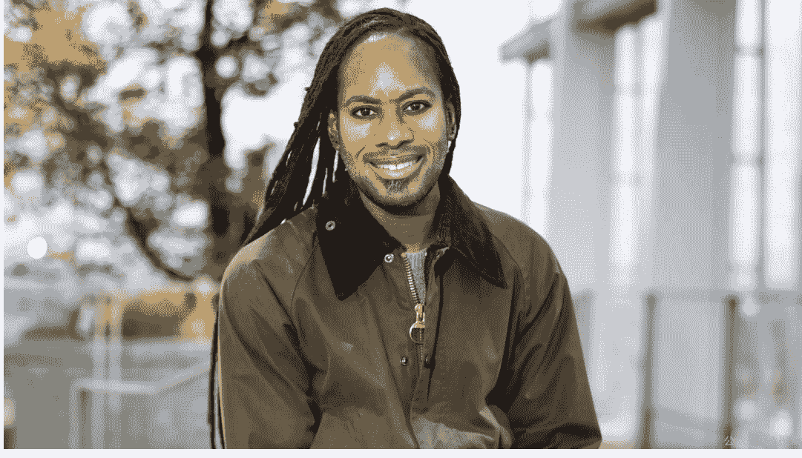

# 黑人明星学者 Jason Arday 之死

**2026.09.02 新闻实验室**

整理：公众号懒人搜索，懒人专属群精选
懒人微信：lazylhelper1

> **小懒判断**：在留学圈、学术圈或做国际内容的人适合看；只关心国内实操的可以跳过。最值得关注的是双重标准的数据对比：英国媒体 22 天给 Arday 发了 249 篇报道，而白人教授 O'Reilly 抄袭实锤后主流媒体几乎集体沉默。作者立场很明确——DEI 本身没错，错在表演式执行，把不够格的人捧上去再弃掉。注意文中事实和观点交织，自己掂量着吸收。

西方学术界的 DEI 只是表演式的表面文章，并不是真正有用的结构性变革。

8 月 15 日，曾任剑桥大学教授的黑人学者 Jason Arday 在伦敦南部住处被发现死亡，年仅 41 岁。警方称，死因目前被视为“意外且不具可疑性”。换言之，他应该是自杀身亡。

就在几天前，Arday 刚刚辞去剑桥大学教育社会学教授及相关职位。此前数月，他持续遭遇围绕学术诚信和个人履历的密集质疑。质疑者抛出的论文抄袭、履历造假等指控，可以说得上是证据确凿。

这起悲剧，集中反映了西方学术界的弊病。Arday 当然是个做了错事的人，但更大的错误，来自那个捧红了他，却并未真正关心与支持少数族裔的系统。

## 明星学者的可疑履历

在坠落之前，Arday 被塑造成为一位极具象征意义的明星学者。他出生在伦敦南部的工人阶级社区，父母是来自加纳的移民。2023 年，他以 37 岁之龄成为剑桥大学历史上最年轻的黑人正教授。

剑桥当时公开强调他的个人经历：他曾说自己直到 11 岁仍无法说话，18 岁才识字。他还说自己曾在 35 天内跑了 30 场马拉松，为慈善事业筹款。这套“从严重障碍到精英学术职位”的叙事，很快超越了普通的学者介绍，变成了剑桥大学展示多元化和社会流动的公共故事。

问题在于，剑桥几乎没有去核验这个故事的真实性，甚至在基本的学术资历上都是明显放水。《纽约时报》调查了剑桥招聘标准和内部材料，发现招聘 Arday 的那个职位时原本要求候选人拥有“国际知名的杰出研究记录”，并具备指导博士生的成功经验。然而，Arday 的发表记录相对有限，也没有在一所大学有足够长的任职经历来完成一名博士生的完整培养周期。和 Arday 一起进入最终面试的，还有另外三名更加资深的学者，其中包括两名少数民族裔女性学者。和竞争者相比，Arday 的论文发表不仅更少，而且存在语法错误、将同一句引语安到不同人身上等问题。

此外，在当时的招聘委员会上，有一位著名的儿童精神病专家，他应该完全有能力判断出所谓“11 岁才会说话、18 岁才能阅读”的说法站不住脚。

尽管有如此多的漏洞，剑桥仍然聘用了他，并在公开宣传中称赞他的研究和人生经历。当时 BBC 报道的画面中，剑桥教育学院的院长（一位白人女性）和 Arday 亲切握手，并表示：“聘用你的决定是大家一致通过的……你在自己的研究领域是全世界最好的。”

随后出现的质疑并非一夜之间发生。根据《纽约时报》的报道，Arday 入职三个月后，两名英国学者就其一篇论文可能存在的抄袭问题向剑桥提出警告。那位教育学院院长的回应是，她已与 Arday 谈过，并提及他“持续遭受直接和间接的种族主义”以及“重大健康问题”影响了他的工作。

2025 年，《泰晤士高等教育》又向剑桥提交了一份超过 60 页的材料，详细说明 Arday 的期刊论文和博士论文中的疑似抄袭问题。剑桥当时没有对外发表完整调查，而是表示相关问题应由授予博士学位的利物浦约翰摩尔斯大学或其他机构处理。利物浦约翰摩尔斯大学今年的调查则维持了授予其博士学位的决定。

今年 7 月，剑桥前研究人员 Nathan Cofnas（一个鼓吹种族与智商相关的种族主义者）在个人 newsletter 中重新提出有关抄袭的指控，学界监督组织 Retraction Watch 随后补充报道。随着讨论扩散，媒体又开始调查 Arday 关于童年经历、慈善募款、马拉松等方面的说法。《纽约时报》采访的前同学、语言专业人士及多名专家，对他“11 岁前不会说话”的叙述提出了质疑（比如，一位儿时同学记得 Arday 在教会活动的车上讲笑话、模仿各种口音）。报道还指出，他刚刚出版的回忆录与此前公开说法之间存在不一致。Arday 则否认故意违规，并曾表示，自己的自闭症使他倾向于通过模仿学习，从而导致了文本相似问题。

8 月 5 日，剑桥宣布将就 Arday 的学历、荣誉任命和学术不端投诉展开调查。此前，剑桥曾称他是“诋毁行动”的受害者，后来随着更多问题出现，学校的表态发生变化。Arday 在紧随其后的辞职信中写道，持续不断的指控、猜测和公众评论已经严重影响了他及他所爱的人；他不想继续生活在“每个生活细节都受到公开检视和评判”的聚光灯下。

## 剑桥的面子工程

如何解读 Arday 的上升与坠落？在保守派人士看来，这是左派提倡的多元化（DEI, diversity, equity, and inclusion）政策走火入魔的铁证。

DEI 的确出了问题。但是，在我看来，它的问题并不在于 DEI 错了，而在于当前西方学术界的 DEI 只是表演式的表面文章，并不是真正有用的结构性变革。Arday 就是这种面子工程造就的悲剧。

我们首先应该理解：为什么会有 DEI？少数族裔在学术界，尤其是精英大学的重要岗位上，的确是所占比例太低了。但是，这并不是有一批白人在招聘和晋升的过程中刻意为之的结果，而是更结构性的原因导致的：历史遗留的排斥机制、代际积累的社会资本分配不均，以及精英机构运作方式本身的封闭性，共同造成了今天的局面。

比如，黑人学者在英国教授群体中仅占百分之一的比例。这个数字并非源于某个招聘委员会在某次面试中对某位候选人的偏见，而是数百年制度性排斥的累积结果。精英大学的入学、入职和晋升路径长期依赖传承地位（比如家族中是否有校友）、非正式人脉网络和社会资本，而这些资源绝大多数都由白人精英所拥有。牛津剑桥式的家族传承管道，以及被学者 Paul Tiyambe Zeleza 称为 chumocracy（哥们儿政治）的圈子文化，使得那些家世背景良好、拥有既有人脉的候选人天然占据优势，而这种优势与种族之间存在着历史性的高度重合——并非因为种族本身决定了能力，而是因为财富、教育资源和社会网络的分配本就沿着殖民历史和阶级结构层层传递。

理解了这一点，就能明白：要想改变现状，靠的不应该是刻意提拔某几个具体的少数族裔学者，而是对整个不公平的系统做出结构性的改变。

然而，结构性的改变太难了，学界缺乏这种自我革新的勇气和能力，更何况种种既得利益早已盘根错节地纠缠在一起。所以，当前的 DEI 选择的更多是那条容易（但错误）的道路——捧出几个少数族裔学者，实现了某些数字上的指标，就当实现了多元化。

剑桥的黑人学者太少了，脸上实在挂不住，所以 Arday 就成了管理层的救命稻草。他们不是不知道 Arday 的问题，但是为了这个面子工程，他们需要对那些问题视而不见，直到再也捂不住盖子。

也就是说，这种面子工程的特质是：把不够格的人捧上去，表面上赞赏有加，但又不给予足够的实际支持，一旦失去利用价值，就随之弃而不用。

根据我的个人经验，除了不够格的少数族裔之外，此类 DEI 面子工程还会特别喜欢捧出另一类人，那就是长着少数族裔的脸、但在学术身份上早已融入白人主流传统的人（比如，白人大佬的徒子徒孙，或者在研究取向上高度遵从主流传统）。将更多这样的人提拔到重要位置，白人们既完成了表面的多元化，又在实质上巩固了自身的支配地位。

但很明显，这些都不是真正的 DEI，都没有对不公平的结构做出任何实质性的改变。

也可以说，这些是西方学术界的伪善。

## 偏袒白人的双重标准

认为 DEI 走火入魔了的保守派，会认为少数族裔已经得到了超越白人的优待。然而，数据表明：同样是面临被抄袭的指控，少数族裔得到的对待和最终的下场，比白人糟糕得多。

根据英国媒体监察机构 NewsCord 的统计，英国主流媒体在 22 天内针对 Jason Arday 发表了 249 篇报道。作为对比，2024 年，当爱泼斯坦文件披露显示英国前驻美大使 Peter Mandelson 与爱泼斯坦存在长期关系后，英国媒体在相当长的一段时间里也仅提及此事 119 次。另一个案例是，2023 年，一位名叫 William O'Reilly 的白人剑桥教授被正式认定抄袭属实，最终只有《金融时报》对此进行了较为深入的报道，其他主流媒体几乎集体沉默。

《大西洋月刊》的文章也提供了一个近乎同步发生的对照案例：就在 Arday 去世的同一天，白人作家 Ross Barkan 因被发现存在多达六七处抄袭行为，被《纽约》杂志解雇。然而几乎在同一时间，Barkan 宣布自己将转而为另一家知名媒体《国家》杂志撰写专栏。《大西洋月刊》的文章总结说：“当你是黑人，有些人会为你打开远比应有更宽的门。而当那门骤然关闭时，你不会获得第二次机会。……当一位著名白人犯错时，人们往往将其理解为个人的失误；当一位著名黑人犯错时，这种错误却常常被放大为一场公开表演，被当作证明其种族‘劣等性’的证据。”

因此，总结来看，以下是我对 Jason Arday 悲剧的看法：

- Jason Arday 的学术作品存在学术不端问题，他对外讲述的个人经历中存在明显的编造和夸大。
- 与其说 Jason Arday 是依靠欺骗进入了剑桥，不如说是剑桥迫切需要这位黑人学者来证明自己的多元化工作。对那么明显的漏洞视而不见，是剑桥的失职。
- 剑桥的做法背后是整个西方学术界在 DEI 方面热衷于面子工程，而不去做结构性的改变。Jason Arday 是面子工程的一类成果，面子工程还捧出了其他类型的少数族裔学者。
- Jason Arday 曾经是明星，获得了本不属于他的地位。但他始终是一个黑人，因此，当他坠落时，他遭受的攻击要比白人多多得多。

悲剧已经发生，平权的道路依然任重道远。表面轰轰烈烈的 DEI，其实没有触及更根本的不平等结构。但愿 Arday 之死能给伪善的学术体系一记重重的敲打，但愿大家不会装作什么都没发生。

---

在这个 AI 能替你写代码、写文章的时代，基础技能正在迅速贬值。绝大多数人正被淹没在海量的免费垃圾信息里，陷入低效的体力内卷。

当“努力”不再是壁垒，人与人之间唯一的护城河，只剩下“信息过滤”的效率与“认知系统”的维度。

圈子已稳定运行 7 年。我们每天利用 Python 爬虫与大模型算力，过滤全网最顶级的政经内参和搞钱风向标，做你最冷酷的“外部大脑”。

如果你认同这种“重塑认知防线”的极客主义，欢迎围观我的个人情报智库：【懒人专属群】。

https://lazyso.com/insider/

认同信息过滤价值、想省下每天 3 小时无效阅读时间的读者，扫码加我微信（lazyhelper1）

