## 下个时代权力架构的两种方案

260901 江宁知府

整理：公众号懒人搜索，懒人专属群精选

懒人微信：lazyhelperl

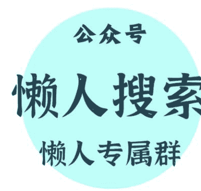

小懒判断｜在体制内或大公司里带团队、琢磨人事布局的人看这篇会很有感觉；想找中美时政分析的会失望，这是一篇借《雍正王朝》讲权力交接的剧评。最值得关注的是“扫清障碍”和“中和牵制”两种交接方案的对照，军机处“大机构负责执行、小核心负责决策”的思路放到今天的组织设计照样成立。坑在于情节全是编剧设定，别当清史引用。

然后我想起圣祖爷驾崩那天晚上，畅春园的雪花。阿哥们像潮水一样涌来，遗诏宣读结束，又纷纷退去。子时的紫禁城，仿佛什么都没有发生过。

本篇接《天下莫能与之争》。

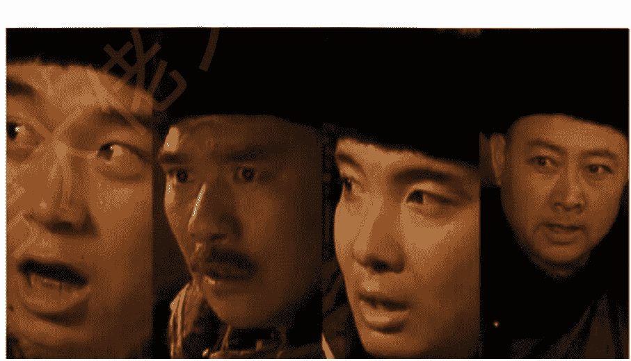

《雍正王朝》前二十集讲述了“康熙传位雍正”的故事，后二十集讲述了“雍正传位乾隆”的故事，对政治比较敏感的朋友能够发现，这两段情节存在显著区别。

“康熙传位雍正”的过程经历了九子夺嫡，可谓是跌宕起伏、一波三折。

雍正继位后，八爷党仍拥有强大影响力，先后发起两次凌厉攻势：一次是利用清流派去弹劾河南巡抚田文镜（文），另一次是压轴大戏“八王议政”（武）。

“雍正传位乾隆”的过程则比较平淡，规划性更强，甚至提前就为弘历扫清了障碍——亲自处理掉主要竞争者弘时。

即使雍正突然驾崩，二十五岁的弘历也能够从容掌权。

于是问题来了，难道康熙不懂得为雍正扫清执政障碍的道理吗？康熙爷是否还有其他不易被察觉的心思呢？

实际上，这是两种不同的权力交接哲学，具体来说，在布局下个时代的权力架构时有两种方案可选：

- 第一种方案是扫清障碍，把旧权力结构清空，尽可能交给继任者发挥。
  - 这种模式的优点是继任者权威建立得快，不会出现名义上的领导岗位已经调整、但旧班底仍然掣肘的情况。
  - 风险在于一旦继任者判断失误，前任几乎没有纠偏能力，对继任者自身的政治能力和政治素养要求很高。

- 第二种方案是中和牵制，保驾护航，给予继任者发挥空间的同时也防止其大幅偏离轨道。
  - 此时上一代权力集团不会完全退出，而是通过人事安排、制度设计、关键岗位配置等操作提前形成一个“安全边界”，最终局面是“核心权力完全交接+外围力量适度牵制”。
  - 该方案的优势是稳定性更高，即便继任者经验不足或发生判断失误，系统仍然具有纠偏能力，隐患则在于雄心勃勃的继任者可能与传统势力发生持续博弈。

以美国政坛的权力交接为例，文官体制某种程度上就起到了“外围力量适度牵制”的作用，也因此跟特朗普产生激烈矛盾。

Freezing the Government: We cover how President Trump is trying to reshape the government.
标题翻译：冻结政府（副标题：特朗普总统如何重塑政府的运作）。

康熙之所以选择第二种方案，是因为他既期望雍正变革，又担心雍正在激进改革的过程中出岔子。

而雍正认为自己已经完成了改革任务，后续乾隆只需要沿着既定轨迹前进即可，所以选择第一种方案。

通常来讲，方案二在现代大型政治组织里更常见，也是最为复杂的一种权力交接方式，需要通过缜密的人事安排——涉及高级将领、强力机关首脑、与继任者资历相当的核心岗位官员等——去划定边界。

前任对继任者越是不熟悉，越缺乏长期观察和信任，就越倾向于采用“外围制衡”而不是完全放权，康熙实际上是在最后时刻才做出传位四阿哥胤禛的重大决定。

反观弘历的地位从雍正继位伊始就十分稳固，带有“皇爷爷隔代指定”的意味。

当然，所有这些都只是“那个时刻的想法”，事后剧本究竟按不按这个方向发展还得另说，里面会牵扯到新旧力量消长和继任者自身政治能量、政治手腕的问题。

为了给弘历留下一个安定的基业
言归正传。

与不成功便成仁的“八王议政”相比，在雍正推行新政早期，八爷党的布局更为精巧，采取了顺水推舟、片叶不沾身的做法。

剧中以山西、河南两个省为典型介绍了雍正朝新政推行的情况。

山西巡抚诺敏欺上瞒下，通过从当地富商借银子、增加苛捐杂税等方式尽快凑好了国库欠款，但“诺敏案”的根本原因还是在于雍正过于心急，给地方大员们下了一堆不合理的指标。

十三爷在反思这件事情时用了“逢君之恶”这个词，让雍正很不开心。

> “逢君之恶”出自《孟子·告子下》——“长君之恶其罪小，逢君之恶其罪大”。

其意思是说，下属最危险的不是看不出领导的错误，而是明明看得出来，却为了迎合领导，故意帮领导把错误贯彻到底。

这点对于领导来说必须高度警惕，有时候那些卖力执行你命令的人并不一定是好心，很可能还是背地里想扳倒你的人，他们通过“故意放大错误”来打击你的执政权威和民望，例如八爷党。

即便有些人没有“放大领导错误”的野心，其初衷也并不是把新政推行好，而是打着为皇上排忧解难的幌子替自己捞政绩、骗荣誉，例如诺敏。

一入官场深似海，每个人都有自己的那一把算盘。

剧中佟国维有句十分经典的解释：“富贵两个字有时候就像一把锁，套在你的身上；钥匙呢，却在人家的手里。”

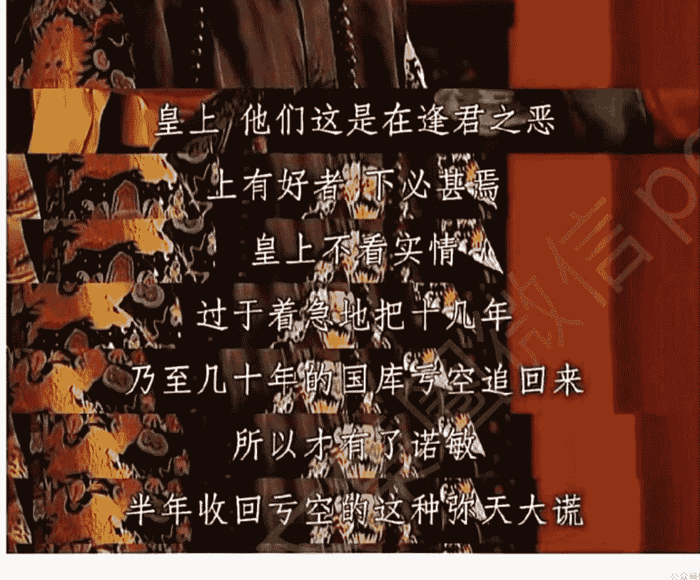

有趣的是，就在十三爷忠言劝诫的同时，长期以正面形象示人的军机大臣张廷玉再次上演了一幕“逢君之恶”。

张廷玉的语言艺术之高，他完全回避了雍正的问题，也回避了自己为什么不事先劝诫，而是用一句“怕动摇了皇上励精图治的信心”来掩盖。

由此不难体会领导所处的信息环境——即使犯了错，下属也会首先考虑自己的政治安全，而非事情对错本身。

假如领导者又缺乏清醒、超脱的认知，那将很难了解到真实情况。

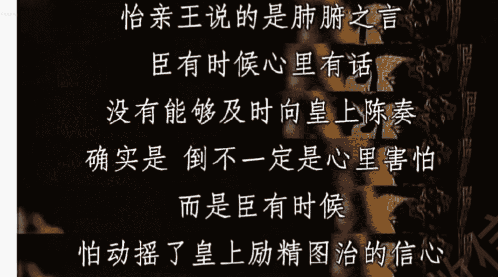

如果说山西巡抚诺敏是反面例子，那么河南巡抚田文镜则是雍正最器重的封疆大吏之一，获得火线拔擢，也是新政推行的核心人物。

清朝在山东、山西、河南不设总督，由巡抚直接统管全省军政事务，虽然没有总督的名号，但河南巡抚真实地位要略高于普通巡抚。

田文镜上任后雷厉风行，大刀阔斧推行新政，与当地士绅及读书人的矛盾日渐激化。

这里面有一个隐晦的原因，那就是田文镜本人为非科甲（进士）出身，对清流官员抱有抵触情绪。

反过来，科举出身的官员以及正在备考的学子们也不喜欢田文镜，对他们来说，捍卫科举出身（捍卫“原则”）就是捍卫自己的利益。

官场之上，一种晋升路径、一种身份标签或一种固定资历，事实上是一个政治集团的核心利益，任何绕开这条路径的人都可能被视为对整个集团利益的威胁。

即“资历派”“正统派”与“破格提拔者”之间先天存在矛盾。

假如越来越多的“田文镜”被皇上重用，还要我们这些辛辛苦苦考科举的人干什么呢？

事情闹到最后，朝廷的清流文臣集团纷纷上疏弹劾田文镜，河南当地的考生也集体罢考，形成了上下合力的“倒田”风波。

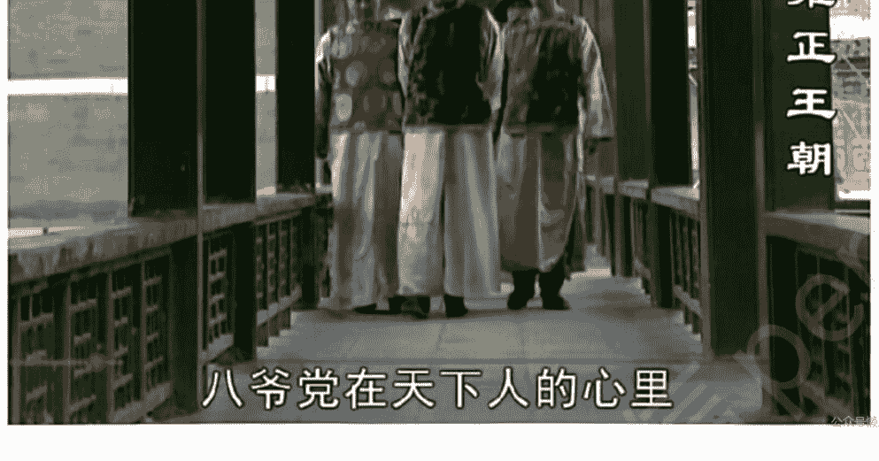

无论诺敏案还是田文镜案，整个过程中八爷党骨干并未亲自下场，反而趁机收买人心。

在八爷看来，如果雍正死保田文镜，那么整个清流集团就会走向对立面，用剧中的话叫“得罪天下读书人”。

而一旦雍正处理田文镜，则意味着新政推行遭遇重大失利，以后每件事都会很难办——皇帝亲自选定的新政执行者都保不住，以后还有哪个地方官敢替朝廷推行改革？

当军机大臣们在讨论河南形势时，雍正、张廷玉一脸两难神情，八爷却表现出一副稳坐钓鱼台、看热闹不嫌事大的架势，用一句“雷霆雨露莫非天恩”去埋汰雍正。

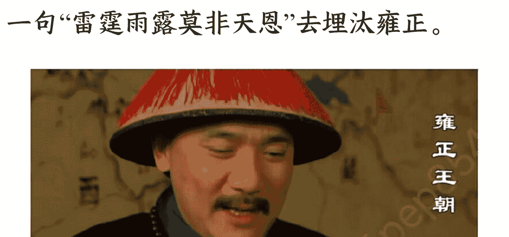

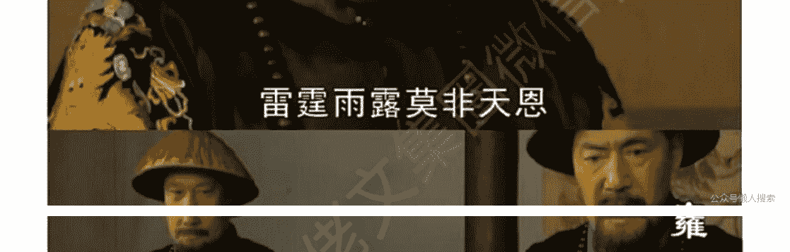

说起来雍正完全可以派一位科举出身又支持新政的官员去河南主政，假如田文镜是状元，做同样的事情很可能就不会遭遇太大反弹。

之所以没有这样安排，是因为剧中田文镜以“孤臣”自居，没有朋党、利益纠葛少，跟登基前的四爷颇为类似——领导都喜欢像自己的人。

面对来势汹汹的清流逼宫，雍正认定“倒田”就是为了反对新政，因此决定力挺田文镜，并不惜跟清流派决裂。

期间雍正还把最心爱的儿子弘历派去河南实地考察，既是为了锻炼弘历、看他能不能替自己摆平这摊子事，又借此彰显对此案的重视。

这一做法同样给了八爷可乘之机，八爷亲自下场做雍正三子弘时的思想工作，一举激发起他夺嫡的野心，为日后一系列事件埋下伏笔。

政治博弈是非常依赖经验的。

之所以老一辈比年轻一辈拥有更多的“政治智慧”，是因为年轻人的所思所想老一辈政客也都似有过类似的心路历程，很容易形成降维打击。

当八爷跟弘时等小辈进行沟通时，基本能够实现“全过程碾压”，嘴里说的句句是真话，起到的效果却是让雍正手足相残，用心不可谓不歹毒。

比如当弘时问八爷为什么要帮自己时，八爷给出了三个理由：其一是弘时上位后封他一个铁帽子王作为酬劳，其二是要跟雍正争个输赢，其三则是指出眼下有机会打击弘历。

这几点无懈可击，轻易博得了弘时信任。真正高段位的操纵从来不是替别人做决定，而是诱导当事人产生“自主推理决策”的感觉。

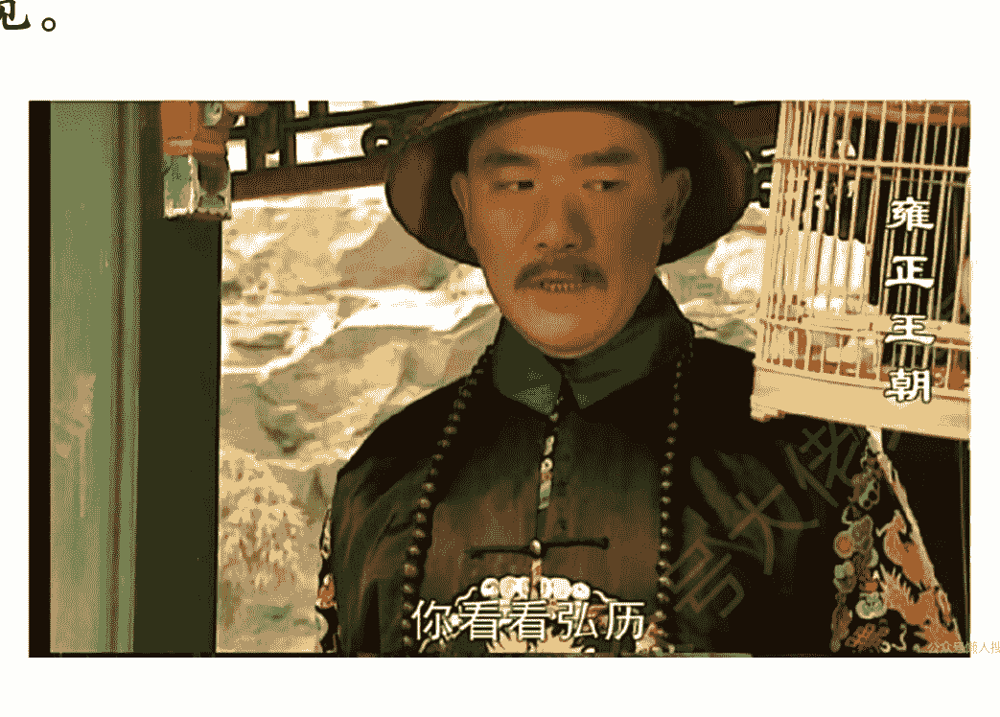

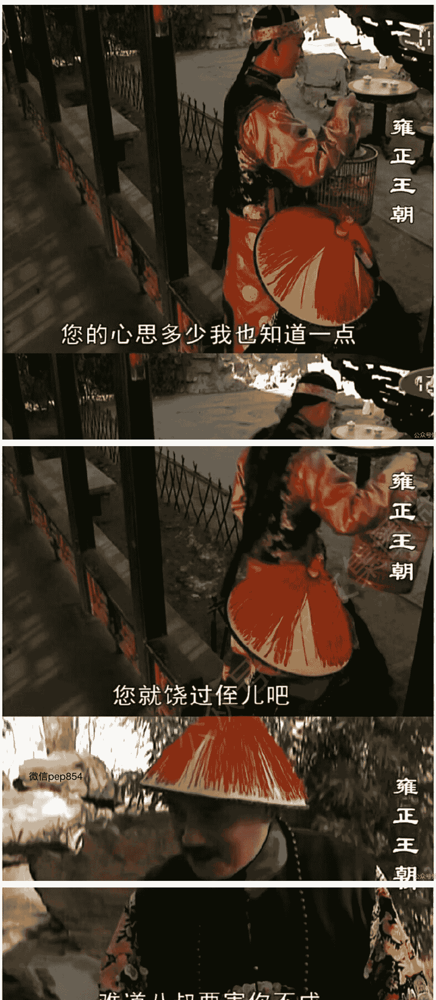

某种意义上讲，雍正继位后的开局并不好，干什么事都显得很累，每天如坐针毡，最终也是被身体给拖垮的。

反倒八爷游刃有余，他擅长让别人替自己承担政治成本，借力打力。

这侧面印证了编剧的设定，即雍正咬着牙推动变革，代表“新势力”；八爷乐于守成，工于心计，代表“旧势力”。

既然八爷给雍正掣肘，为什么还让他做总理王大臣、不直接罢免呢？

按照剧中解释，这是康熙临终前明确给四爷下的指令，必须善待这些兄弟。

其实根子还是出在上面的“第二种方案”——康熙虽然选择了四爷，但对他苛刻刚直的性格多少有些不放心，因此才留下八爷作为“调和剂”，牵制雍正朝新政不至于搞到失控。

九子夺嫡期间，八爷的绰号是“八贤王”，四爷的绰号是“冷面王”，如果说四爷是“大棒”，那八爷就是“胡萝卜”。

八贤王对于收拢人心、春风化雨可谓驾轻就熟，在文人群体中备受欢迎。

以田文镜案为例，雍正得罪了清流派，八爷收拢了清流派，假如兄弟二人能够唱好双簧，于爱新觉罗家族而言本质上并没有什么损失。

## 公众号懒人搜索，懒人专属群分享

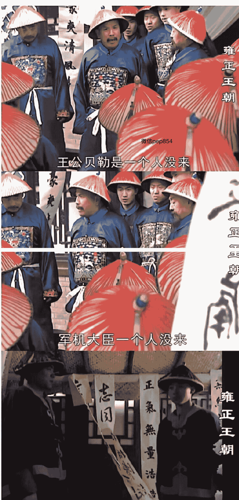

王公贝勒是一个人没来

军机大臣一个人没来

廉亲王驾到

八爷 八爷来了

雍正本人也明白不能得罪读书人的道理。

他曾跟弘历解释，为了推行新政自己可以押上名誉、被清流们骂，但弘历务必要跟这一切保持距离，待到新政推行完，乾隆朝还要恢复康熙朝“政通人和”的执政风格。

变革期间一些雷厉风行的动作仅仅是暂时性的，四爷就是康熙挑来做这件事情的人，他艰难的执政经历从一开始就已经注定。

只是康熙生前不曾料到的是，雍正决心硬朗天下清流，而“田文镜案”让八爷党意识到靠清流和舆论来约束雍正已不现实，遂启动“半武力夺权”计划，即借“八王议政”来逼宫。

清朝历史上，确实是在雍正年间虚化了全部由满族亲贵组成的议政王大臣会议（乾隆年间彻底取消），改为满汉1：1配置的军机处。

值得一提的是，军机处日后成为一种极具生命力的顶层组织架构，即在正式官僚体系之外，建立一个规模很小、直接服务于最高决策者、能够跨部门协调、快速处理重大事务的“核心中枢”。

直到今天，在主要大国的权力中心我们仍能看到它的影子，其思想可以被概括为“大机构负责专业化执行，小核心负责综合信息并决策”。一个组织的权力很大程度上是守恒的，想象成一团橡皮泥，可以捏成各种形状。

最后，改写一段近两日流行的作文来结尾，题目不妨就叫《我的皇上四哥》——

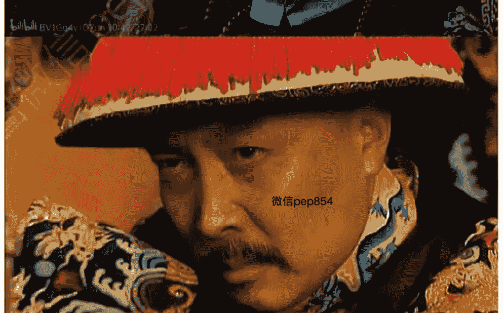

我第一次意识到四哥走在前面，是很小的时候。

那时我还不知道什么叫夺嫡。

我只知道额娘身份低微，是一位出身辛者库的宫女。

小时候我甚至不是跟她一起长大的，而是被抱到惠妃那里。

四哥的生母是德妃，养母是佟佳氏，也就是当朝皇后。

他不需要拉帮结派，因为身后天生就有一股强大的力量。

人们都说我人缘好，有亲和力，这何尝不是出身劣势下的一种性格保护。

还记得第一次有人叫我“八贤王”时，我高兴了整整三天。

现在回头看，自己输得并不冤。

因为我经营的是“贤王”人设，而四哥的目光始终锁定在皇位。

“贤王”需要博得大家喜欢，“皇上”只需要让所有人服从即可，方式不重要。

八王议政失败后，我一直在想一个问题。

如果当时我没有搞这一出逼宫大戏，四哥他会放过我吗。

我想了很久。

抄家那天，我把那份八爷党官员的名单又看了一遍，二十几页。

有些人我认识，有些只见过一两面，印象很模糊。

我把手放在胸口，数了一下，心跳很稳，仿佛是迎接宿命到来一样。

然后我想起圣祖爷驾崩那天晚上，畅春园的雪花。

阿哥们像潮水一样涌来，遗诏宣读结束，又纷纷退去。

子时的紫禁城，仿佛什么都没有发生过。

分割线

在这个 AI 能替你写代码、写文章的时代，基础技能正在迅速贬值。绝大多数人正被淹没在海量的免费垃圾信息里，陷入低效的体力内卷。

当“努力”不再是壁垒，人与人之间唯一的护城河，只剩下“信息过滤”的效率与“认知系统”的维度。

圈子已稳定运行 7 年。我们每天利用 Python 爬虫与大模型算力，过滤全网最顶级的政经内参和搞钱风向标，做你最冷酷的“外部大脑”。

如果你认同这种“重塑认知防线”的极客主义，欢迎围观我的个人情报智库：【懒人专属群】。

https://lazxyso.com/insider/

认同信息过滤价值、想省下每天 3 小时无效阅读时间的读者，扫码加我微信（lazyhelper1）

