# 从没做过小程序，到9000元接单10天交付客户项目：我是怎么用AI Coding跑通闭环的

**260901 副业 SC 精华**  
整理：公众号懒人搜索，懒人专属群精选  
懒人微信：lzyhelper1

> **小懒判断**  
> 想用 AI Coding 接小程序定制单的开发 者可以直接抄作业，但连服务器和备案都没摸过 的纯新手先补课再说。最值钱的是10天工期怎么 压出来的：开发、素材、备案、服务器四条线并 行推进，谁也不等谁，串行做必然超期。坑在微 信审核环节，权限用途和隐私协议必须按实际功 能逐项写，直接抄模板很容易被打回。

我做过16年全栈开发和项目管理，现在正在创业，主要方向是「企业 AI 落地服务」。

虽然做了很多年开发，但之前我从来没有开发过微信小程序。

过去一年多，我开始深度使用 AI Coding，并拿自己的业务做了一些真实项目。

后来，我接到了第一个外部付费的小程序定制单：

报价 9000 元，客户要求 14 天上线，最终 10 天完成交付。

这次我把整个过程完整复盘了下来。

不讲复杂代码，主要分享一个真实客户项目，从第一次沟通需求，到最后正式上线，中间到底经历了什么。

这篇文章主要讲清楚下面 6 个问题：

1. 第一次接小程序项目，怎么快速和客户把需求说清楚？
2. 客户要求 14 天上线，我是怎么拆任务并在 10 天内完成的？
3. AI Coding 在一个真实客户项目里，到底参与了哪些工作？
4. 客户需要准备什么，哪些事情其实应该由开发方解决？
5. 服务器、OSS、真机测试、备案、微信审核，我实际踩过哪些坑？
6. 第一次从“做出来”走到“正式交付”，还有哪些以前不知道的事情？

完整的项目过程、10 天时间线、AI 的具体用法和踩坑记录，都整理在飞书完整版里。

## 第一部分｜介绍一下我自己

大家好，我是 Allen，坐标杭州。

我曾做过 16 年的全栈开发和项目管理，现在是一名创业者，方向是企业 AI 落地服务，有一年半深度 AI Coding 的经历。借助 AI，我先跑通了 2 个自用小程序项目，有了 0-1 的经验后，接到一个外部客户的定制单，这也是我第一次接到收费定制的微信小程序项目，最终用 10 天时间完成了一个肖像美学馆小程序的开发和上线，项目报价 9000 元。

这篇文章里，我会分享一个真实交付的项目里，需求怎么定、功能怎么拆、审核怎么过、上线怎么落地的全过程。

如果你也在尝试用 AI Coding 做真实项目，或者想知道一个完全陌生的技术栈，怎么从第一次尝试走到正式交付，希望这篇复盘能给你一些参考。

接下来进入正题，这一切是怎么真实发生的呢？

记得我最早接触 AI Coding 是在 2025 年的 7-8 月份。那时为了准确统计课程报名接龙人数，我尝试了几个基于对话的 AI，后来安装了 Claude Code。它第一次比较稳定地帮我得到正确的统计结果，那也是我第一次真正感觉到：AI 可以拿来做事了。

接下来，我开启了疯狂的探索。截至目前，大大小小探索了 200 多个小工具和项目，AI 辅助生成和迭代的代码量超过 1000 万行。

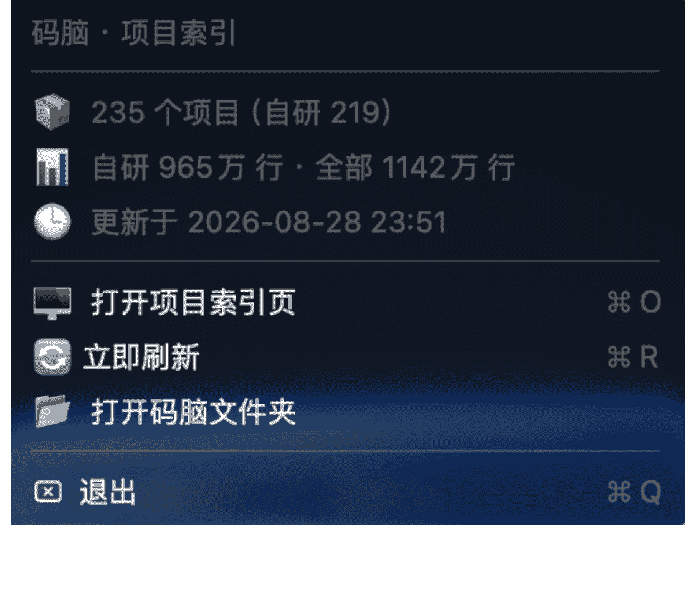

AI 仿佛打开了一个新世界，真的是想什么就能做成什么，这是我从未有过的感觉，那一刻，我是真的被 AI 的能力给震撼到了。

我在职场的 16 年，主要做政企内部管理系统，从来没有开发过微信小程序。那我能不能借助 AI，把一个小程序从 0 做到正式上线？我很想试一次。

答案，当然是可以的。

我开发的第一个上架的小程序，是我们自己 IP 系统内的一个课程报名小程序，我跑通了小程序的从零开始开发到上架的全过程，包括：

- 如何设计小程序的架构；
- 服务器如何部署；
- 备案如何进行等等。

我还进行了一些探索，包括活动发布、形象美学、在线商城等不同类型的小程序。

下面是一些示例的小程序界面。

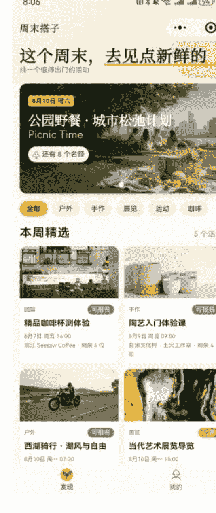

这些尝试让我确认了一件事。我可以借助 AI，把 一个小程序从想法做成能用的产品，也知道中间最容易出问题的地方在哪里，在熟练地跑了两轮后，我接到了第一个外部项目。

有一天朋友圈的一位好友找到我，她们公司有一个着急要上线的小程序要开发，问我 会不会开发小程序，能不能接。

客户提出的要求很直接，14 天上线，我最后给出优惠后的报价是 9000 元。

最后，这个项目从确认需求到正式发布，实际用了 10 天时间。

这篇文章不讲软件怎么安装，也不讲复杂的代码。我只讲一个普通客户的小程序项目，究竟是怎么做出来的。

## 第二部分 ｜ 这 10 天我干了啥

### 1、客户想要什么

客户经营一家肖像美学机构，主要为客户拍摄形象宣传用的写真照片和视频。最初始的时候，他们想先做一个对外展示的窗口，让更多人看到已经拍过的作品，也给业务多一个流量入口。

顾客打开小程序后，可以浏览作品，了解品牌和门店，可以进行预约。预约之后，还能查到自己的预约和订单。

门店需要一个管理页面。工作人员可以在里面发布新作品，管理作品分类，查看顾客资料，处理预约和订单。

除此之外，客户还有一些合作渠道，这些渠道会帮他们介绍客户。以前要知道某个客户是谁介绍来的，消费了多少，该结算多少佣金，往往要靠微信沟通和表格记录。

所以每个渠道都需要一个自己的小程序码。用户扫哪个渠道的码进入，系统就把这个用户记在对应渠道下面。以后用户到店消费，由总部在管理后台录入消费金额和时间，系统按照事先设置的比例算出佣金。渠道方打开小程序，就能看到自己介绍了多少用户，这些用户产生了多少消费，累计有多少佣金。

钱还是在线下结算。小程序不做在线支付，也不做自动打款和提现。它主要解决的是记录和查看，让总部与渠道方看到的是同一份数据，不需要反复在微信群里对数字。

听起来功能不少，我先没有急着做页面，而是把事情换成三条简单的流程。

真正让我把项目做快的，不只是AI写代码快，前面先把要做什么和暂时不做什么讲清楚，也很重要。

- 顾客这一边，是看到作品，点开详情，提交预约，查看结果。
- 店里这一边，是发布作品，看到预约，联系顾客，录入消费，再查看每个渠道带来的用户和佣金。
- 渠道这一边，是用自己的小程序码推广，然后查看自己带来的用户、消费记录和佣金。

这三条流程能跑通，小程序就有实际用途。至于在线支付、自动打款、复杂排班和会员积分等想法，可以以后再做。14天的项目，先把最重要的事情做好。

### 2、我怎么开始做

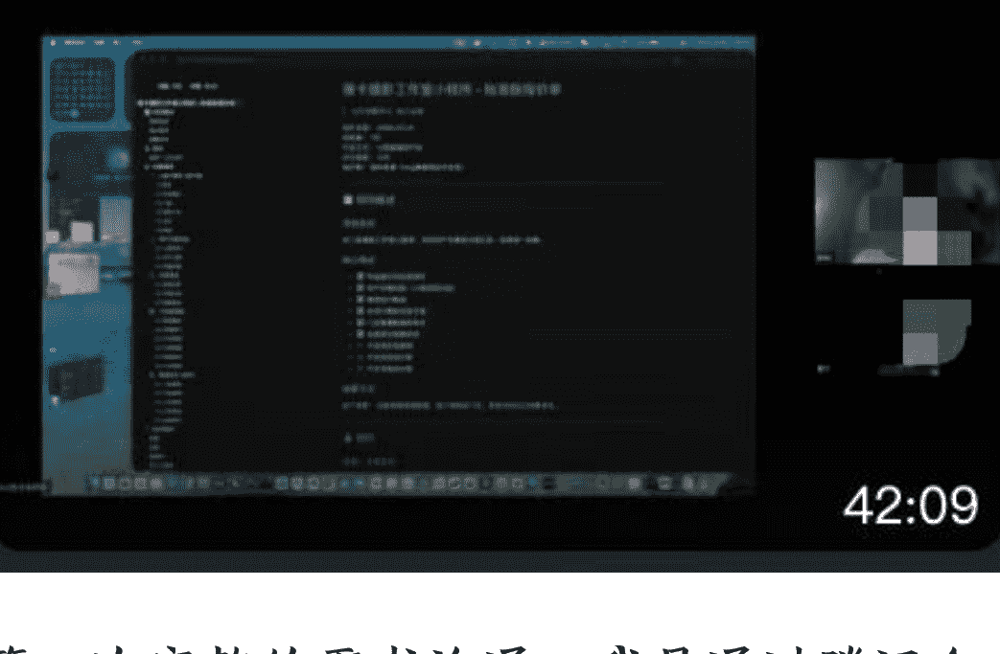

第一次完整的需求沟通，我是通过腾讯会议，42分钟确认了需求的范围，形成了一个必做功能清单。

和客户逐项确认，明确了需求边界。哪些功能一定要在第一次上线时完成，哪些可以以后再加，哪些这次不做，都提前说清楚。作品展示、简单预约、渠道绑定、消费记录、佣金计算和后台处理属于首期内容。

客户这边其实不需要准备一大堆技术材料。她主要负责把需求讲清楚，确认页面内容，再把作品图片等素材提供并上传。

小程序的域名注册、备案等事情，花几百元交给第三方办理就可以，客户只需要配合提供资料。

隐私协议可以借助 AI 和现有模板辅助起草，再根据小程序实际采集的数据、使用的权限和业务流程逐项核对修改。域名、配置和上线相关的事情由我来处理。

最后我是采购了阿里云的基础配置的服务器，还采购了 OSS 服务，购买了一个域名，请了第三方完成了域名备案，而且这些是需求开发同步进行的，耗时也是一个礼拜左右。

这个小程序项目实际发生的费用如下：

1. 基础的阿里云服务器：199 元/年
2. OSS：170 多元/年
3. 域名：85 元/年
4. 第三方备案协助服务：约 200 元/次
5. 微信年审：300 元/年

对客户来说，配合工作主要就是三件事，**一是把想做什么说清楚，二是把要展示的素材准备好，三是配合第三方完成域名和小程序备案。** 这样做的好处是，客户只需要盯住自己的业务。她要展示什么、顾客要完成什么操作、页面最后呈现什么效果，这些由她来确认。备案、域名和审核这些事情，不需要客户自己研究，也不会因为这些手续卡住项目进度。

会议之后，我整理了需求并结合客户提供的对标小程序界面作参考，我使用ChatGPT设计了第一版的小程序4个入口页面，因为效果并不复杂，小程序代码UI实现也能接近于设计稿。

### 3、这10天是怎么过的

#### （1）第1天和第2天

我把项目的基本结构搭起来，见下图（因为有了前2个内部项目的积累，我基本上直接迁移过来使用了现有架构），同时开始设计数据库和接口。用户、渠道、作品、预约、消费记录和佣金这些内容，先分别想清楚怎么存、怎么关联。这里不能只盯着小程序页面，因为渠道方以后要看到自己的用户和佣金，总部还要录入消费记录，前面的关系没有理顺，后面页面很容易返工。

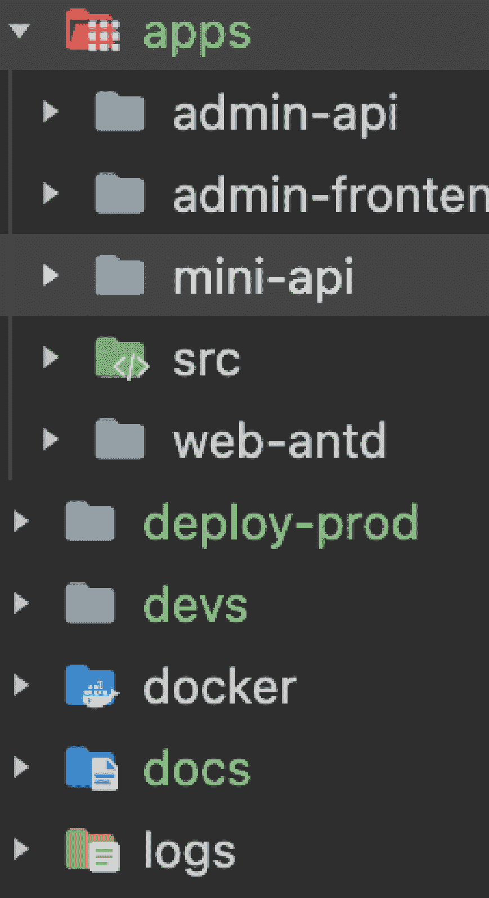

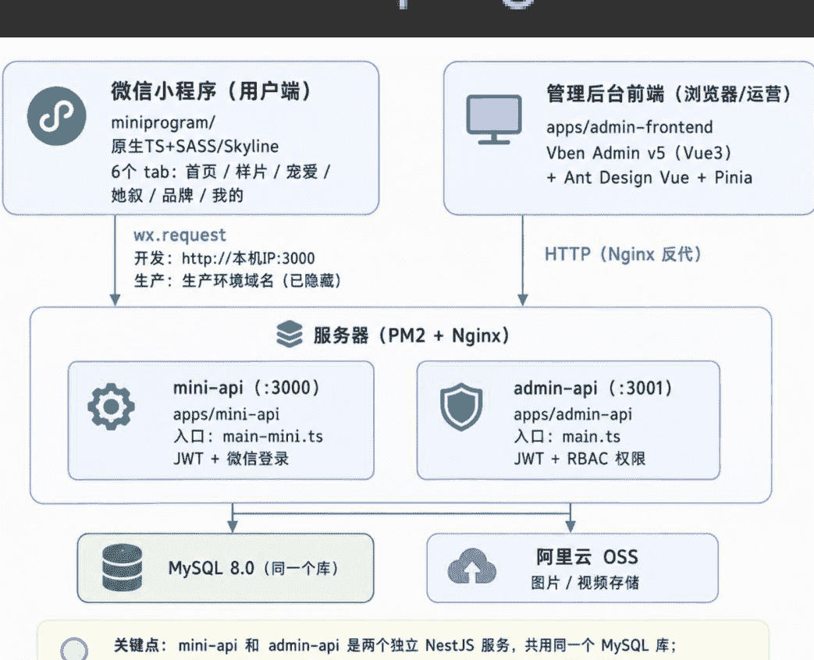

#### （2）第 3 天开始

后台和小程序两边一起做。后台先做登录、权限、用户、渠道和作品管理，小程序同步做首页、作品展示、作品详情、预约和个人页面。渠道码、用户归属、消费记录和佣金计算也在这一阶段接进去。

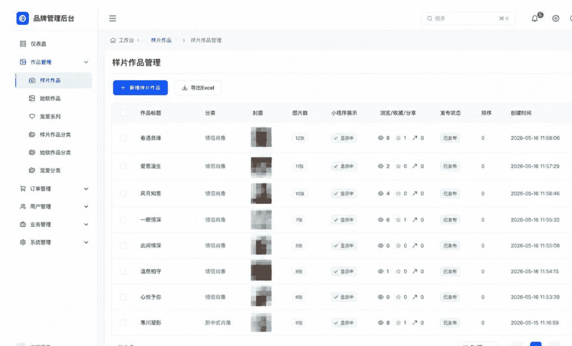

#### （3）第4天

前后台的主要功能基本跑通。用户可以浏览作品和提交预约，总部可以在后台看到预约、录入消费，系统再按渠道比例计算佣金。渠道方登录后，只能看到自己的用户和记录。前台和后台是边做边连接的，每完成一项，就马上看数据能不能传过去。

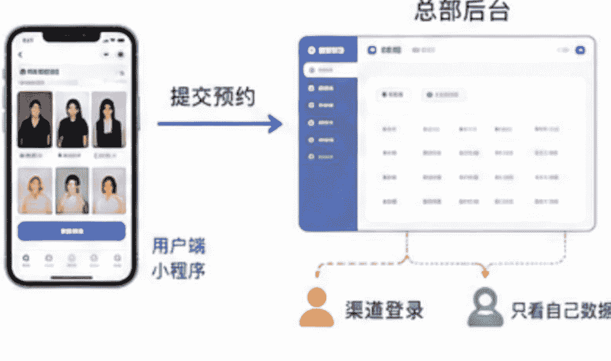

#### （4）第5天和第6天

主要是补功能和改问题。作品分类、点赞、收藏、用户资料、订单查看、渠道数据导出等内容陆续补齐。遇到页面显示不对、数据没有关联上，或者接口报错，就在当天处理掉。

**第 5 天：补功能**

1. 作品分类
2. 点赞、收藏
3. 用户资料
4. 订单查看
5. 渠道数据导出

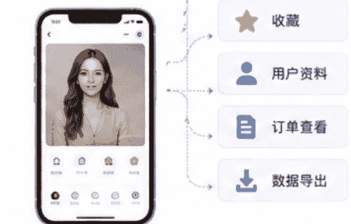

**第 6 天：改问题**

1. 页面显示问题
2. 数据关联问题
3. 接口报错问题
4. 当天排查并解决

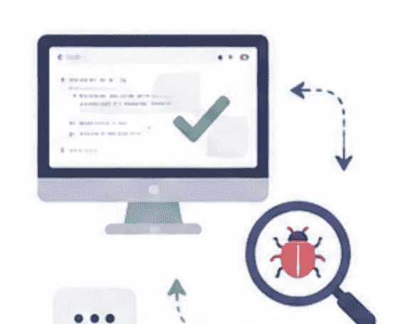

#### （5）第 7 天

开始做集中自测。先按顾客的步骤走一遍，再按总部工作人员的步骤走一遍，最后用渠道方的身份走一遍。不同角色看到的数据必须分开，用户扫哪个渠道的小程序码，也要确认归属没有错。

**第7天：集中自测**

- 按顾客步骤走一遍
- 按总部工作人员步骤走一遍
- 按渠道方身份走一遍
- 不同角色数据必须分开
- 扫码来源归属确认无误

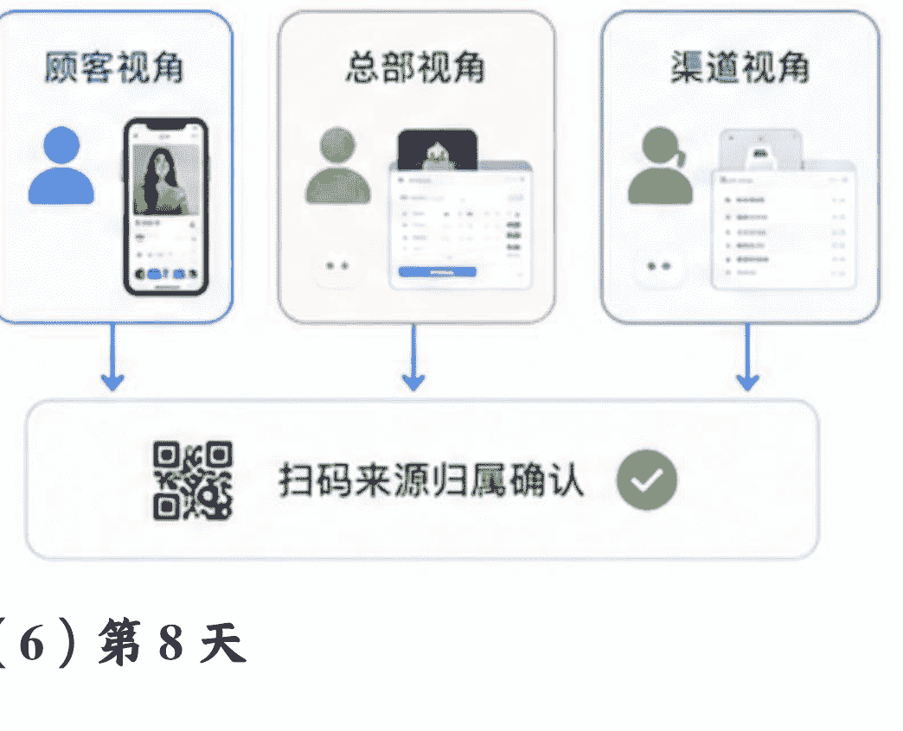

#### （6）第8天

继续做手机测试和上线准备。图片上传使用阿里云 OSS，服务器、访问地址和上传权限需要一起确认。域名注册和备案则交给第三方办理，和开发工作同时推进。

**第 8 天：手机测试与上线准备**

- 手机端全面测试
- 图片上传使用阿里云 OSS
- 服务器、访问地址和上传权限一起确认
- 域名注册和备案交第三方办理与开发工作同时推进

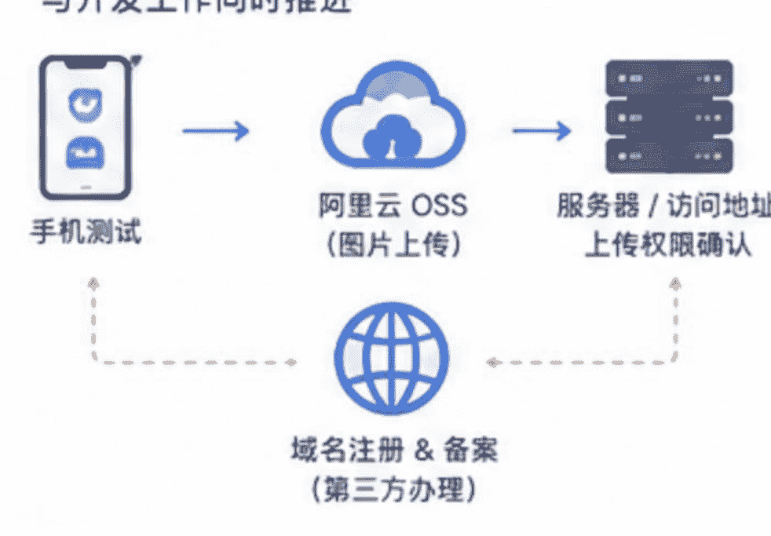

#### （7）第 9 天

填写微信审核需要的各种模板。获取照片、地理位置等权限，都要说明实际用途。我让 AI 根据小程序已经实现的功能整理说明，再逐项核对，避免写了项目里根本没有用到的权限。

**第 9 天：填写微信审核模板**

- 整理所需权限及用途说明
- 获取照片、地理位置等权限说明实际用途
- 由 AI 根据已实现功能整理说明
- 逐项核对，避免多写无用权限

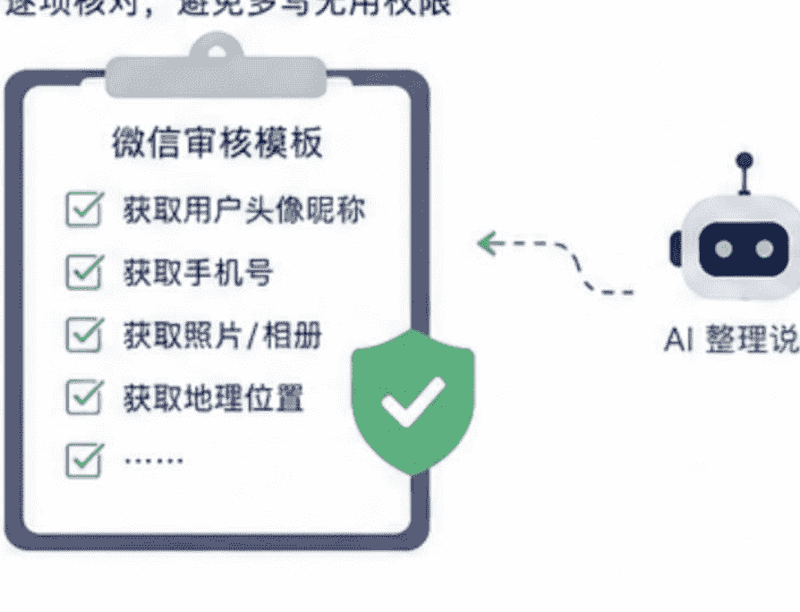

**Xxx 小程序隐私保护指引**

本指引是 xxx 小程序开发者 yyy（以下简称“开发者”）为处理你的个人信息而制定。

**开发者处理的信息**

开发者将在获取你的明示同意后，收集你的手机号，用途是【用于用户注册、登录验证、账户管理以及活动通知。】

开发者将在获取你的明示同意后，使用你的相册（仅写入）权限，用途是【用于用户资料展示和活动宣传】

开发者 收集你选中的照片或视频信息，用于活动宣传、展示和用户内容展示。

开发者 读取你的剪切板，用于简化信息填写流程和用户分享操作。

开发者 获取你选择的位置信息，用于提供基于位置的活动推荐和导航功能。

**更多信息...**

开发者承诺，不会主动共享或转让你的信息至任何第三方，如存在确需共享或转让时，开发者应当直接征得或确认第三方征得你的单独同意。

开发者承诺，不会对外公开披露你的信息，如必须公开披露时，开发者应当向你告知公开披露的目的、披露信息的类型及可能涉及的信息，并征得你的单独同意。

你认为开发者未遵守上述约定，或有其他的投诉建议、或未成年人个人信息保护相关问题，可通过以下方式与开发者联系；或者向微信进行投诉。

电话：1888888xxxx  
邮箱：xyz888.com  
更新日期：2026-xx-xx

#### （8）第10天

提交审核并完成正式发布。项目从需求确认到上线实际用了10天，比客户原本提出的14天提前完成。项目日志里后面还有一些上线后的修复和优化，但首期约定的功能已全部完成并投入使用。

**第10天：提交审核并正式发布**

- 提交审核
- 审核通过，正式发布上线
- 从需求确认到上线共10天，比原计划提前4天完成
- 首期功能全部完成并投入使用
- 后续持续修复与优化

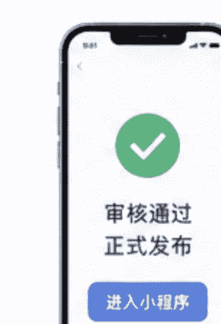

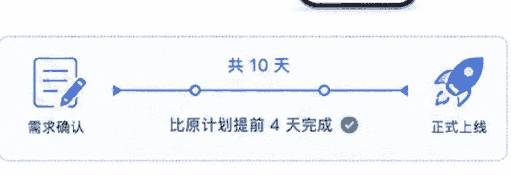

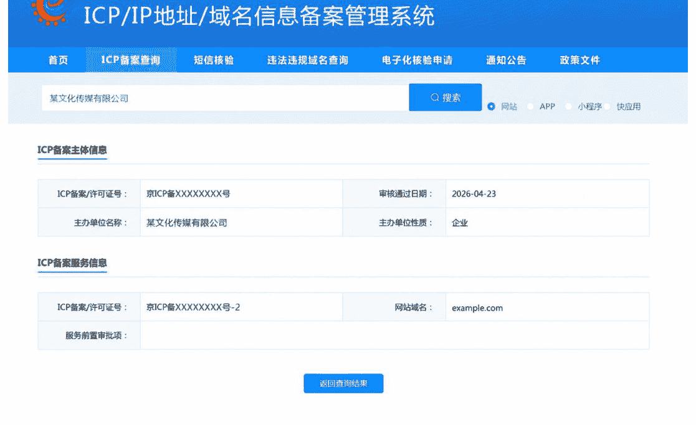

【工业和信息化部】验证码：

您的新增备案已提交，核验链接：beian.miit.gov.cn，有效期1天【工信部ICP备案】

【工业和信息化部】尊敬的用户袁娟，您的ICP备案申请已通过审核，备案/许可证编号为：京ICP备xxxx号，审核通过日期：2026-04-14。特此通知！【工信部ICP备案】

这条时间线是根据项目提交记录和需求文档按阶段整理的。实际开发中，页面、后台、服务器、备案和素材准备有很多交叉，不是每天只做一件事，而小程序备案和网站域名备案事项，从项目启动已经交给第三方同步开始。

### 4、AI 在里面做了什么

这个项目里，我没有把整个项目一句话扔给 AI，而是先把需求和边界确认清楚，再把已经明确的小任务逐个交给 AI。

页面设计也是直接从需求开始。我把客户想展示什么、用户要怎么浏览告诉 ChatGPT，让它先生成第一版设计稿，再把设计稿交给 Claude Code 继续实现，并通过微信开发者工具不断预览和调整。当时页面还原主要靠我和 AI 一轮轮沟通。

后来在更复杂的小程序项目里，我又摸索出了一套更成熟的 Codex + Figma MCP 设计开发流程。

我可以直接从需求开始，在 Codex 里把页面要实现什么讲清楚，再让 Codex 通过 Figma MCP 在 Figma 中完成第一版页面设计。设计不满意，就继续调整，直到达到想要的效果。设计稿确认以后，再让 Codex 读取 Figma 里的设计，继续完成小程序页面的代码实现和还原。

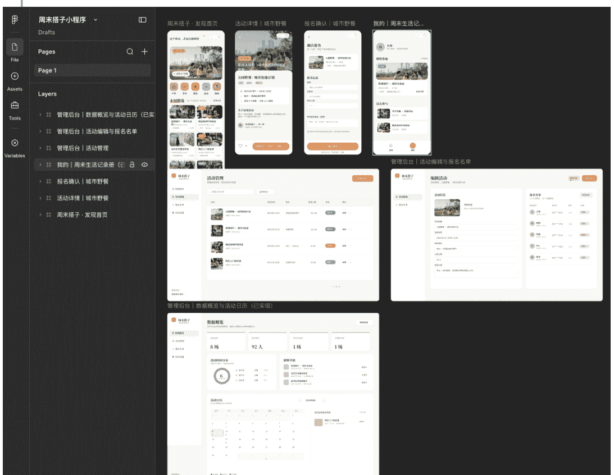

图片上传我用到了阿里云 OSS，还要配置图片存放位置、访问地址和上传权限，并采购配套的阿里云服务器，这些也在开发过程中一起处理了。

遇到报错，我把报错信息和相关代码交给 AI，让它帮我找原因。作品列表、详情、点赞、收藏这些功能有相似的地方，AI 可以先完成重复的部分，我再按照真实使用情况检查和修改。

AI 也帮我整理了测试内容。登录、预约、订单、图片上传，这些流程都要用真实情况试一遍。比如用户换了手机，点赞和收藏还在不在。图片上传失败时，页面有没有提示。预约提交后，店里能不能马上看到。

但有几件事 AI 不能替我决定。

客户到底要解决什么问题，第一次上线做哪些功能，哪些功能暂时不做，顾客资料谁能看到，什么时候才算完成，这些都需要我和客户一起确认。AI 能帮我把决定写成程序，不能替我做决定。

### 5、最后几天在检查什么

最后几天主要是验收和上线准备。很多事情仍在并行推进，但测试时我只盯住一件事：分别站在顾客、店员和渠道方的视角，把完整流程走通。

客户准备素材，我制作页面和管理功能，这两件事也是同步进行的。我会根据作品需要怎样展示，先把相应的管理页面做出来。客户只要把图片等素材上传进去，后面就能在小程序里看到对应内容，不需要再学习复杂的后台操作。

客户工作室还要准备品牌 Logo、介绍文字、作品分类、官方样片、客片和渠道名单。渠道名单里要有联系人和佣金比例。素材不用等到全部整理完才开工，客户整理一部分，我就先接一部分。管理页面做好以后，客户自己上传作品，前面的小程序就会出现对应内容。

**01 客户素材与页面同步搭建**

不等素材全部齐全，边整理素材，边搭建后台与前台展示

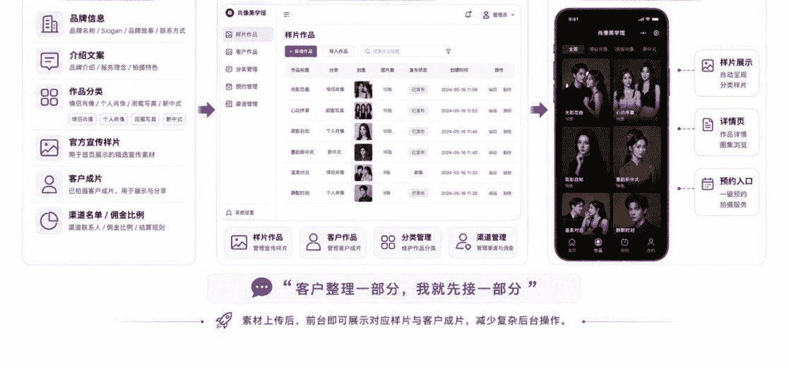

> “客户整理一部分，我就先接一部分”  
> 素材上传后，配合即可展示对应样片与客片，减少复杂后台操作。

页面做完以后，我把自己当成顾客，从头到尾走一遍。打开小程序，浏览作品，点进详情，提交预约，再去查看预约记录。

**02 站在顾客视角走完整流程**

把自己当成顾客，从打开小程序到查看预约记录，完整走一遍

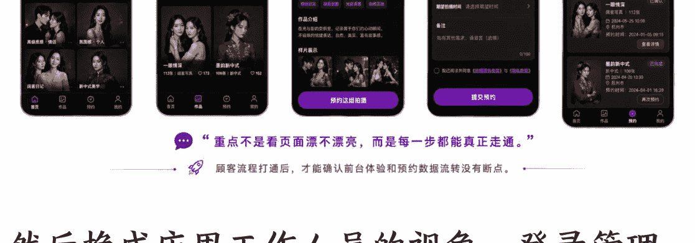

> “重点不是看页面漂不漂亮，而是每一步都能真正走通。”  
> 顾客流程打通后，才能确认前台体验和预约的数据流转没有断点。

然后换成店里工作人员的视角。登录管理页面，发布一张新作品，查看刚才的预约，更新处理状态，再给测试用户录入一笔消费，检查佣金有没有按照渠道比例算出来。

## 03 站在店员视角验收后台

不仅能看前台不能约的，也能确认后台能否同步业务真正接起来。

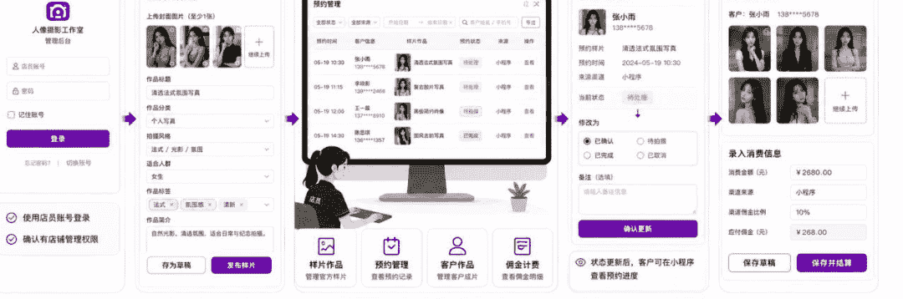

> “前台预约之后，后台必须要接得住，数据也要取得上。”

用店员身份走一遍，确认样片、预约、复成片、消费、佣金形成完整闭环。

最后还要换成渠道方的视角。扫渠道自己的小程序码注册，确认用户有没有归到正确渠道，再查看用户列表、消费记录和佣金。不同渠道之间的数据也要隔开，不能让一个渠道看到另一个渠道的客户。

## 04 站在渠道方视角检查归属与隔离

确认用户归属正确，佣金计算正确，不同渠道之间数据相互隔离。

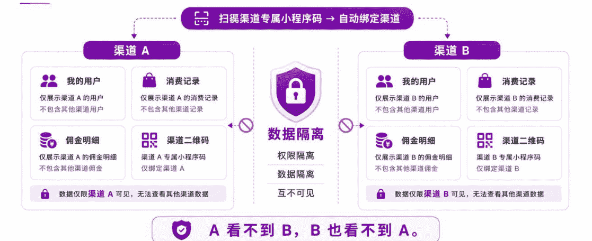

> “A 看不到 B，B 也看不到 A。”

验收重点：归属不能错，佣金不能错，权限更不能串。

真机预览、图片上传和审核资料里也遇到了一些具体问题，这些我放到后面的“踩坑”部分集中复盘。

## 05 真机测试与上线前问题闭环

最后几天的重点，是在真实使用环境里把问题一轮轮找出来并修掉。

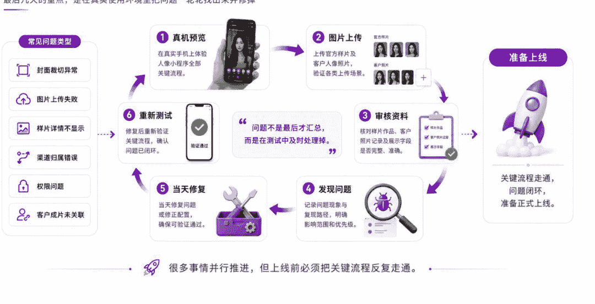

很多事情并行推进，但上线前必须把关键流程反复走通。

## 6、结果怎么样

这个小程序经过 10 天开发，已经正式上线并投入使用。项目一开始约定的功能全部完成，中间修复问题和优化了页面，又再发了一个版本，目前稳定运行，没有新的迭代需求。对客户来说，用户可以在小程序里看作品、预约和查看订单；店员可以在管理页面维护内容、查看用户和录入消费；渠道方也能查看自己带来的客户和佣金数据。

## 第三部分 | 我的踩坑经历和新手提醒

### 1、做完这一单，我也踩了一堆以前不知道的坑

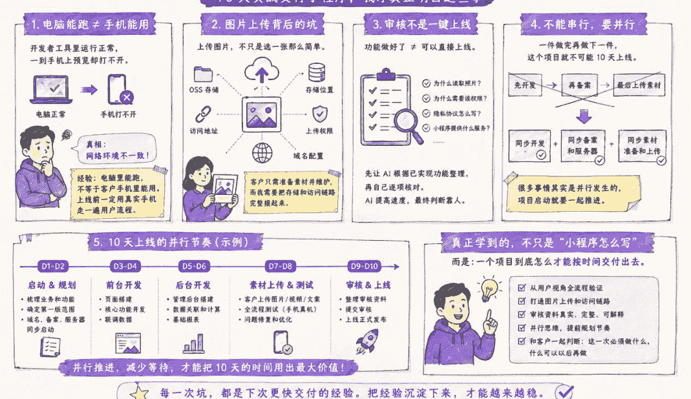

当然，这10天并不是一路顺利。

第一次真正把小程序交付给客户，我**才发现**，很多坑不是“代码不会写”，而是只有**真正上线一次才会碰到**。

比如最开始在微信开发者工具里明明运行**正常，一到手机上预览却打不开**。一开始很容易怀疑是不是代码有问题，排查了以后才发现，是手机和电脑的网络环境不一致。切换以后，手机才能正常访问。

这件事让我第一次意识到：

**电脑里能跑，不等于客户手机里能用**。真正交付之前，一定要拿真实手机，把用户会走的流程重新走一遍。

**图片也是一个坑。**

摄影类小程序有大量照片，我原来不会觉得“上传图片”不过就是选一张图片。真正做起来以后，背后还有 OSS、存储位置、访问地址、上传权限、域名配置等一整套事情。

对客户来说，只需要准备照片、视频和文字素材，然后通过管理页面维护。

但作为交付方，我得把后面的服务器、存储和访问链路接起来。

### 2、审核也是一样

代码做完了，并不意味着可以直接上线。为什么要读取照片、为什么需要某项权限、隐私协议怎么写、小程序到底提供什么服务，都需要根据实际功能逐项填写。

这部分我会先让 AI 根据已经实现的功能帮我整理，再自己核对。AI 可以提高速度，但最终提交什么，还是得由人判断。

还有一个后来我觉得非常重要的经验：

开发、素材、服务器、备案，不能一件做完再做下一件。如果代码全部写完以后才开始备案，这个项目就不可能 10 天上线。

所以从项目启动开始，我就让域名、备案和服务器同步推进；我开发页面的时候，客户同步整理照片和介绍；后台做好以后，客户就可以开始上传素材。

很多事情其实是并行发生的。所以后来回头看，这个项目真正让我学到的，不只是“小程序怎么写”，而是一个项目到底怎么才能按时间交付出去。

### 3、客户不用懂技术，但一定要把业务说清楚

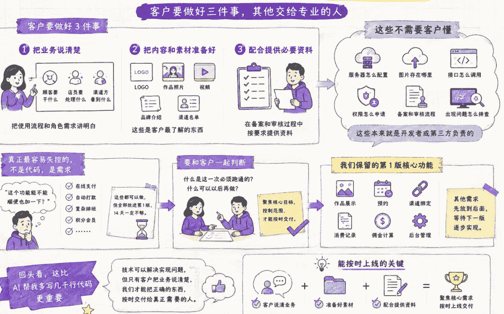

这一单还有一个很明显的体会。

客户其实没有必要去学什么服务器、OSS、接口、备案和微信审核。

这些本来就应该由开发者或者第三方解决。

客户真正需要做好的，是三件事：

- **第一，把自己的业务说清楚。** 顾客进来以后要干什么，店员要处理什么，渠道方要看到什么，这些必须讲明白。
- **第二，把内容和素材准备好。** Logo、品牌介绍、作品照片、视频、渠道名单，这些是客户最了解的东西。
- **第三，在备案和审核过程中配合提供必要资料。** 至于页面怎么做、图片存在哪里、服务器怎么配置、权限怎么申请、出现问题怎么排查，这些不应该成为客户开始做小程序之前必须掌握的知识。

但反过来，**客户虽然不用懂技术，却一定要懂自己的业务。** 因为这个项目里真正最容易失控的，并不是代码，而是“这个功能能不能顺便也加一下”。

在线支付、自动打款、复杂排班、积分会员，这些其实都可以做。

但如果全部放进第一版，14 天一定不够。

所以我真正需要和客户一起做的，是不断判断：

**什么是这一次必须跑通的，什么可以以后再做。** 最后我们保留了作品展示、预约、渠道绑定、消费记录、佣金计算和后台管理，把其他需求先放到后面。

现在回头看，这可能比 AI 帮我多写几千行代码更重要。

## 4、AI 带给我的，不只是开发速度

### AI 让我**10天**完成了第一个付费小程序

### 一次从 0 到上线的真实交付方法论

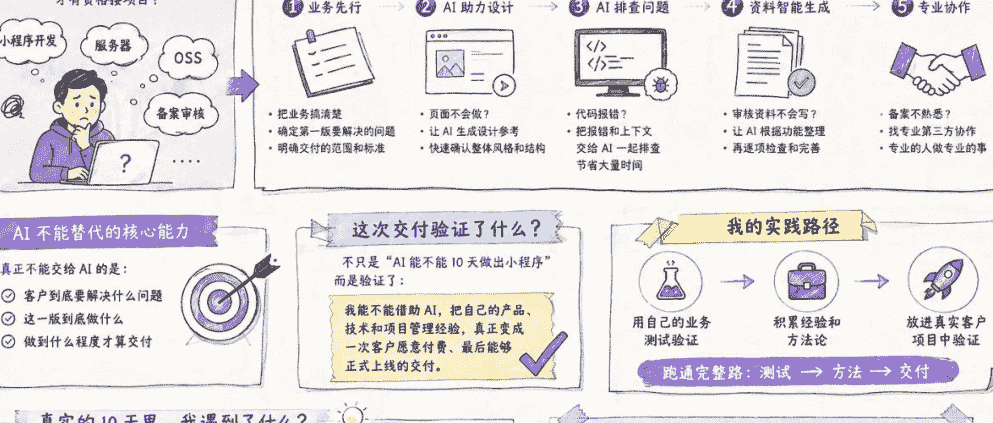

以前没有做过小程序时，我会觉得：

我要先把微信小程序开发学会，把服务器学会，把 OSS 学会，把备案、审核全部研究明白，才有资格接一个项目。

真正完成这一单以后，我的想法发生了很大变化。

我不需要在开始之前就知道所有答案。

可以先把业务搞清楚，把第一版要解决的问题确定下来，然后一路往前推进。

页面不会做，可以让 AI 先生成设计参考。

代码报错，可以把报错和上下文交给 AI 一起排查。

审核资料不知道怎么写，可以先让 AI 根据实际功能整理，再逐项检查。

备案不熟悉，可以找专业第三方协作。

真正不能交给 AI 的，是：

**客户到底要解决什么问题，这一版到底做什么，以及做到什么程度才算交付。** 这也是这一单真正让我意识到的：AI 降低的是技术实现门槛，但交付能力并没有因此消失，反而变得更重要。

它验证的并不只是：

**“AI 能不能帮一个以前没有做过小程序的人，10 天做出一个小程序。”** 而是进一步验证了：

**我能不能借助 AI，把自己的产品、技术和项目管理经验，真正变成一次客户愿意付费、最后能够正式上线的交付。** 答案至少在这一次交付中，是可以的。

当然，这只是一个案例。

它不代表所有小程序都可以 9000 元完成，也不代表所有项目都可以 10 天上线。

但从自己的第一个小程序，到第二个尝试，再到第一个外部付费客户，我跑通了一条完整的路：

先用**自己的业务进行测试，再把能力放进真实客户项目里验证**。这是我的第一次分享，里面还有一些内容并没有展开。

比如：图片上传到底踩过哪些坑，域名备案和小程序备案怎么操作，服务器和 OSS 怎么配置，AI 生成的设计怎么更接近 1:1 还原，以及第一次面对真实客户时，怎么控制需求不要越做越大等等。

限于篇幅，这些真实的避坑经历和过程经验，可以再接再厉圈友分享交流。

毕竟，比“10 天做完一个小程序”更值得分享的，可能是：

**这 10 天里，我到底遇到了什么问题，又是怎么一个个把它解决掉的。**

看完这篇 SOP，你觉得你懂了。但 90% 的人一到实操就会卡在第一步。

工具和教程只是最低级的壁垒，真正的壁垒是“立刻动手”和“圈层信息差”。

如果你想看全网最新的变现玩法，并且和一群执行力极强的极客一起下场拿结果，欢迎围观我的核心私域：【懒人专属群】。

我们不聊虚的，只做商业闭环的拆解与 AI 效率的压榨。系统内已沉淀 1000+ 跑通的套利实战局。

- 查阅圈子完整数字资产与上车门槛：

https://lazyso.com/insider/

认同价值、准备好下场干活的，扫码加我微信（lazyhelper1）

备注：【实操上车】，不闲聊

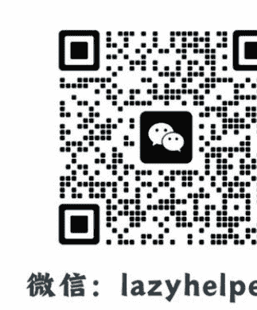
