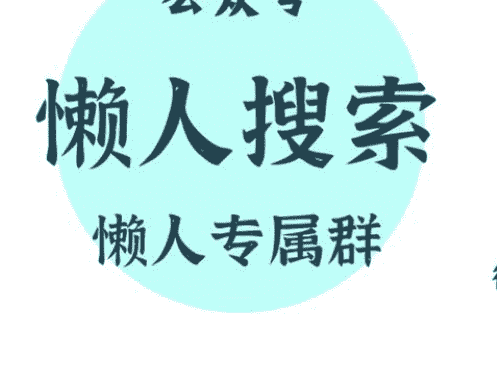

# 闹到国外的某宇裁员事件，反映了什么问题？

260903 文/卢克文工作室嘉宾 概略北方
整理：公众号懒人搜索，懒人专属群精选
懒人微信：lazyhelper1

> **小懒判断**｜在制造业、做外贸供应链的打工人和管理者都该看，正在秋招的应届生更要存一份；只想吃瓜的会觉得后半段说教。最值得关注的是00后的反击路径——不等劳动仲裁，直接整理证据捅给港交所和欧洲车企，正中上市静默期 ESG 造假+德国《企业可持续尽职调查指令》两个七寸。坑在于别读成“洋大人管用”，西方在乎的从来是踢掉中国供应商的借口。

8 月 27 日，闹得沸沸扬扬的某宇裁员事件，终于告一段落，某宇道歉，人力总监停职。

事情虽然结束了，但这事后续的影响，却比我们想象的要大得多。

9 月 1 日，大众中国正式宣布，开启对某宇裁员事件的调查。

毫无疑问，这件事已经超出了一开始劳资纠纷的范畴，而是很可能将成为中国制造业出海与西方贸易软壁垒碰撞的一次标志性事件。

那么，这背后，到底暴露出了哪些问题呢？

我们先来简单复盘一下发生了什么。

事件的主角，是国内有名的车灯龙头——某宇股份。

今年 7 月初，某宇通过秋招招了一批应届毕业生，这里面有六成是硕士，还有不少是博士。

本来这些毕业生开开心心地入职了，但万万没想到，仅仅过了一个月，风云突变。

8 月 8 日起，这些年轻人突然被分批叫进会议室，向他们宣布，公司不要这么多人了。

要么，签“个人原因”主动离职协议，发你半个月的工资当补偿。

要么，公司给你调岗，把你送到流水线去打螺丝，薪资按普工发。

而且 HR 明里暗里都在暗示，如果不主动离职，后续背调可能通不过。

一般来说，涉世未深的学生们遇到这种阵仗，基本都会自认倒霉，拿点钱走人。

但某宇似乎严重低估了这届年轻人的战斗力，他们不仅申请了劳动仲裁，而且并没有被动等待（按照常规的劳动仲裁流程动辄几个月），而是把录音、通知书和劳动合同都整理好，发给了两个机构：

- 港交所
- 以及欧洲车企

这一下子打到某宇七寸了。

一方面，就在这波裁员爆发的十天前，某宇刚向港交所重新递交了 H 股的上市申请，正处在冲刺“ A+H ”双重上市的关键静默期。

而根据港交所的要求，是需要提交 ESG 报告的，涉及雇佣、健康与安全、发展及培训、劳工准则等内容。

某宇刚在 ESG 报告里面把自己夸成一朵花，后脚学生就告到了港交所，那就不仅仅是裁员的问题了，而是信息公开造假的问题了。

另一方面，德国车企还真重视这种事情。

欧洲最近两年刚出台了一个《企业可持续尽职调查指令》，简单来说，如果车企供应链上出现了严重的侵犯劳工权益等行为，整车厂也要被罚款。

几天后，奔驰的企业和人员保护办公室正式回函，说将对此事开展调查。如果德国车企真的以这个理由取消了订单，那企业还怎么赚钱？

所以某宇动作很快，赶紧发了一封致歉信，还给了涉事毕业生 3 个月补偿，如果 11 月底还没找到工作，公司再额外补偿 6 个月工资。

看起来是亡羊补牢了，但这并不能挽回某宇的形象。

很多人都不理解，如果你不需要人，你不招不就完事了？ 7 月把人招进来， 8 月把人开了算怎么回事？

要知道，学生们损失的可不仅仅是一个月时间，而是应届生身份。他们从某宇离职后，可能就没法再参加秋招或定向考选调生了，这一纸裁员通知，改变了多少人的未来？

还有那个“打螺丝”威胁，明明知道车间里高温、噪音、两班倒、计件考核，连现在的低学历年轻人都不愿意干了，更别提高学历年轻人，把他们调过去打螺丝，其实就是故意让你干得憋屈，逼你自己走。

如果说因为企业经营不善而裁员，这个谁都没话说，但没有任何合理理由，就采取这种威胁裁员的方式，确实太过了。

那么，某宇到底图什么呢？

也许看看某宇的动作，就能猜出一二。

最近，某宇要上市，财报必须漂亮。

可是现在汽车零部件生意很难做，车企价格战已经杀得尸山血海，主机厂纷纷把压力往上游传导，供应链企业的利润其实已经很微薄了。

想让财报好看，唯一的出路就是压缩成本。

拿什么开刀见效最快？裁员嘛。这个逻辑，想必看过《年会不能停》的都懂。

逼这些年轻人主动离职，就可以省遣散费，这样在上市前就不会影响财务报告。

虽然这事让 HR 总监停职了，但这么大的事情，肯定不是 HR 总监这个级别能定的。

而且，某宇被网友扒出它不是第一次这么干了。

整个 2025 年，某宇 2900 名员工悄无声息地“消失”了，人走了，活谁干？答案是外包。

某宇同期的劳务外包工时，比 2022 年涨了 3 倍多。订单来了，找中介拉几百个人进厂；没订单了，一句话就让他们走人，一毛钱赔偿都不用给。

只不过，之前他们裁的大都是普工，他们学历不高、维权意识淡薄，所以没遇到什么抵抗。

但这次不一样，他们面对的是整顿职场的 00 后，毫不犹豫就把事情捅到了天上去，所以某宇的操作就翻车了。

# 2

某宇事件发生之后，网上一片嘲讽，说什么“还是西药管用”，言下之意就是中国劳动者的权益，还是要靠外国人去保护。

但仔细想想，事情真的那么简单吗？西方人大真的，真的会同情那些应届生么？

开啥玩笑，国家与国家之间，资本与资本之间，哪有什么跨国的爱。

什么尊重权利，无非是因为利益罢了。

如果他们真的这么关心人权，为什么当年那些第三世界国家的血汗工厂他们不管？那些挨个跳楼的富士康员工他们不管？那些健康保护趋近于零的矿工他们不管？

因为那时候他们不在乎这些，他们只在乎中国廉价劳动力带来的低价红利，只要你的价格够低，他们根本不在乎你到底一天工作多少时间。

但现在，情况变了。

中国制造业崛起了，我们不仅在传统工业产品上把他们打得落花流水，我们还把新三件铺到了他们的腹地。

西方国家突然发现，如果单纯比生产效率和成本控制，他们根本打不过中国，再这么下去，他们都要被卷死。

那怎么办？简单，既然在原本的牌桌上赢不了你，那我就利用庄家的身份，直接改规矩。

于是，各种五花八门的软壁垒被发明了出来。

环保、碳排放、动物保护，当然，还有最好用的那张牌——劳工权益。

结果，这张牌正好和急于出海的中国企业碰上了。

当前，国内供应链很卷，无数中国企业正在拼命想办法出海，去抢占欧洲、东南亚、拉美的市场。

某宇这两年去塞尔维亚建厂，去港交所谋求上市，走的就是这条路。

企业利润变低，人力成本不断变高，企业想节省人工费的心情可以理解。但问题在于，中国很多制造业老板的思维还停留在 90 年代。

那个时候，企业能活下来，靠的就是极致的成本压缩和对工人的强力管控。工人就是耗材，我花钱雇你，你就得把命卖给我，让你走人你就要走人，让你去打螺丝你就要去打螺丝。

那时候中国还很穷，60后70后为了挣钱，普遍吃苦又隐忍，默默接受了一切。

哪怕这些企业已经成长为巨头，都快成国际企业了，但脑子里的思维方式，还是乡镇企业时代那一套。

这种漠视劳工权益、把人当成纯粹耗材的管理模式，在过去的确曾大行其道，恰好也赶上了西方国家睁一眼闭一眼的时代。

但现在这套办法完全不行了，尤其是出海企业，在西方人苛刻的审视之下，满身都是破绽。

人家正愁找不到借口踢掉中国供应商，这样做无异于把软肋送到人家手里。

而且这一代年轻人，成长在中国崛起时期，受过良好教育，有很强的规则意识，甚至知道国际规则怎么玩，也知道一个企业最大的弱点在哪里，信息差被抹平了。

他们反抗精神特别强，不能单纯说他们被宠坏了、吃不了苦，经济基础决定上层建筑，经济环境变了，人的思维和行为模式必然会跟着变。

企业如果还按管 60后70后的方式，管 00 后职场人，就跟不上时代变化了。

如果企业好好说自己的难处，给出合理的赔偿，那么可能不至于闹成这样，但如果企业使出“威逼式裁员”的办法，00后分分钟会掀桌，双输好过单赢嘛。

所以，某宇事件，给企业敲了一个警钟：

传统那种十分粗放的人才雇佣和管理模式，越来越走不通了。

如果继续这么干，对内会遭遇新一代年轻人的反噬；对外，可能一不小心就成了西方国家的活靶子，他们会以不尊重劳工权益为由，名正言顺地把你的产品拒之门外，你连申诉的机会都没有。

那么，面对这个困局，我们到底该怎么办？

宏观层面上，我们必须要想办法去争夺国际规则的制定权，不能总是跟在别人屁股后面，被动挨打。

今天欧洲搞个规则，明天美国搞个法案，如果我们永远只是去“适应规则”，那永远都跟不上他们变脸的速度。

中国要想真正成为制造强国，就必须在碳排放、ESG等领域，建立起一套基于发展中国家实际情况，拥有自主话语权的标准体系。

这样，在西方国家把劳工权益调查和软性壁垒扩大化的时候，我们才有与之对抗的武器。

简单来说就是，你说某宇的事侵犯劳工权益，这个我们认，但你绝对不能以这个借口，把你认为符合你“侵犯劳工权益”标准的中国企业统统拉黑。

而中国新一代的企业家们，也必须学会一门新时代的必修课——尊重劳动者的价值。

在过去，我们靠吃苦耐劳，实现了中国崛起。但在新的时代，特别是在国际贸易规则发生巨大变化的时候，我们不能再把“吃苦耐劳”当成一种免费资源去肆意透支。

未来的中国制造，绝不能仅仅是能够生产出世界一流的产品，更关键的在于能够让创造出这些产品的劳动者，活得有体面、有盼头，这样他们才能去消费，才能去恋爱生子，才能拉动经济。

所以，某宇的 100 多个年轻人，其实是给全中国的企业上了一堂合规课。

改变旧模式，让劳动者分享到产业升级的红利，让每一个普通人在岗位上获得应有的体面。

这不仅是防止被西方人敲打的手段，也是走向制造强国之路的正确方向。

绝大多数人只盯着眼前的工资，却不知道一次远在中东的冲突、一次降息的决议，就能在一夜之间洗牌普通人的财富。

看懂宏观，是为了在周期切换时，不被当作代价。

如果你认同这种“抬头看路”的长期主义，

欢迎围观我的个人情报智库：【懒人专属群】。

圈子已稳定运行7年。我们每天利用Python爬虫与大模型算力，过滤全网最顶级的政经内参和搞钱风向标，做你最冷酷的“外部大脑”。

https://lazyso.com/insider/

认同价值的。扫码加我微信，备注：【进群】

