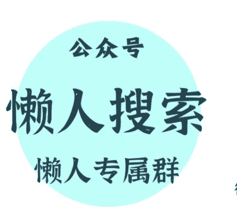
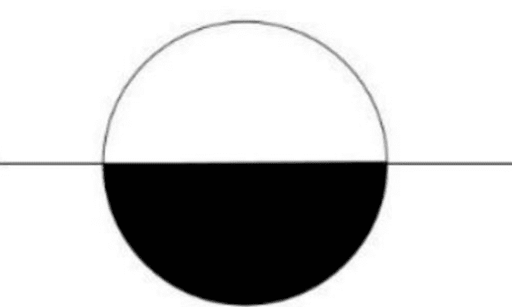
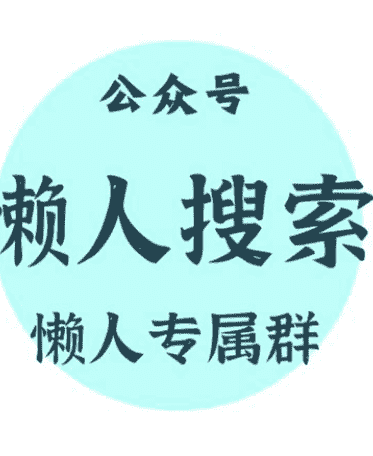

## 生命、业力、轮回、苦乐、修炼，人生意义

260903 第三只眼观

整理：公众号懒人搜索，**懒人专属群**精选
懒人微信：lazyhelper1

> **小懒判断** | 被内耗、焦虑、意义感缺失困住的人值得慢慢读一遍，对佛道话语体系有兴趣但嫌文言难啃的更合适；追求严密学术论证的会嫌它糙。最值得关注的是那张黑白轮转图——白圆是显现（肉体+意识），黑圆是业（隐藏作用），生命是轮转本身而非任何一半，“我”只是轮转的衍生品。坑在于作者对西方哲学的批判是论战式的，粗暴有余、精度不足，吸收框架别吸收情绪。

聊“苦乐”这件事就会有点墨迹啊，敲了1.6万字，多少需要点耐心…为什么>是什么！为啥要聊生命、轮回、业力啥的？因为我们被西化得太严重，它是畸形娃啊，就会把我们身心搞得很畸形，就很痛苦呀！那有的舔西狂魔就不乐意了、“哼！竟敢说我爹地”！

咱不掰扯那么多啊，咔嚓一下啊：

- 西方哲人——动不动就自虐疯了自杀，一直就没停过！
- 东方圣贤——各个解脱自在潇洒快乐。

好了，讲完了…例如：最近有个著名的哲学心理学大师维多克埃隆自杀了，治疗人的却自杀了，灯塔又倒塌了一个…咱们这可不是幸灾乐祸啊，希望每个人都快乐地活着，而是单说这种现相背后是有问题的！

要不上面为啥说西方思想是“畸形娃”啊？因为思想上残缺不全，就导致痛苦自虐没停过…而且这玩意具有传染性的！最开始传染到我们这时候，就出现那种卧轨自杀的诗人嘛，公知最喜欢这种诗人了。

这篇就是把背后的暗线给说明白，从中提供一个离苦得乐的基本原理。

用佛家话来说：

搞思想的人，是给人们种“心田”的人！但首先“种子”不能畸形呀，那不是种出来都是歪瓜裂枣的…我们要会给自己种心田，种啥种子就得啥。

要种啥样种子？饱满的、圆满的。放在思想上，佛道都是“圆转”的思维。而西方思维——较劲！不是跟别人较劲，就是跟自己较劲，较劲当然就会难受呀，西方哲人就是把自己较劲死的呀…而当种下一颗圆种子，随着发育成长遇到啥事自然就会转化了呀。

咱先画个图，看图说话就简单了，你就是这个图…

这是个啥造型？好像阴阳鱼啊？把阴阳鱼丢掉，那属于品牌符号，要使用时侯，就要看上图！
- 横线=地平线。
- 白圆=天亮了。
- 黑圆=天黑了。

简单吧？

但道家这种简单可不是肤浅啊·易经：简则易从。老子：图难于其易。啥意思呢？

这都是古人想尽各种办法，才产生了“象形”的思维，通过天啊地呀的形象，让人们以最简单的去方式去认识更深层的道理。

而且这玩意一直“卦”在那就很方便，看看天地再看看自己，一对比就明白咋回事了。

这种简化又好比啥呢？老子《道德经》才5000个字，就已经把世间的道理讲透了，这玩意不是说谁字多就牛逼··为道日损，是把多变异少，当然我们现在是搞解读，就要为学日益了，就得把简单的东西磨叽磨叽··还有中文模型啥的，都是这个图来的。

那么好了，西方思想为啥残缺不全？因为只看到了——白圆！

例如：要不然专注于物质（唯物），要不然专注于意识（唯心）。而这俩都属于白圆部分，本来就是缺一半的，好家伙又给割裂开唯物和唯心，岂不是更加残缺了？

同理：

当我们看到生命和人生的时候，只能看到物质，或者只停留于意识层面，那就不是完整的人生啊，缺东西肯定会导致痛苦啊。

咋缺的后面一步步抠啊..

先搞清楚为啥物质和意识属于白圆？因为它俩都属于——显现！要是没有上面的图，一说很多词（如显现一词）就不带感，词汇建立了沟通屏障.但这回好了，拿上面道家图一看，显现就是“天亮了”呀，就是直接就能看得见的存在部分，这就好理解了吧？

不是说天亮了=物质和意识呀，而是说“显现”这种性质层面。就好比一说“天人合一”这词，很多就以为是人类和天地长得一样，那不神经病嘛..古人是借着天地运行的形象，来表达背后的本质存在!

那么好了，当我们只能看到白圆，是不是就残缺不长了？就被现相（天亮部分）给束缚住了呀!

**插一嘴：**

为啥西方思想更容易在青少年中占市场？因为青少年还没长开呢，就好比小盆友第六识。发育还不完全，圆还缺失呢，还困于现相里呢（只看到天亮部分，看到啥就信啥），而西哲正好残缺不全，好家伙啪一下就共振上了!

所以就有好多公知啊、青年导师啥的混饭吃嘛，批判这个批判那个的，青少年没长开最吃这一套了。为啥拿西方思想作为反面教材呢？因为生命是一股力，但直接这么讲很难理解。需要啥？需要——破相见力！

即：

要破掉白圆的存在，破不是不要的意思啊，而是“穿透”的意思。当穿透白圆后，认识到西方思想的局限性，就看到了黑圆，进一步看到了黑白轮转力，这才是生命的本然完整态。

反之：

如果注意力一直聚焦在白圆上，认为没别的玩意了，那就残缺不全了呀。

替换一下：

只看到白圆，等于只看到了肉体和意识，以为这就是生命本身。佛家管这叫做身见和我见，这是开智的两大障碍！破完之后呢？下面的黑圆，就叫做——业！

问：白圆是你？还是黑圆是你？
答：都不是，而是黑白轮转起来才是你…所以啥是真正的你？你是个生命，生命就是一股力，就是转呀转的作用力，它无始无终相续不止。这就叫做——轮回！这回“看图说话”是不是就简单明了了？

那么好了，接下来详细解读一下。先破白圆啊！也就是先破除西方残缺不全的思想·笨寻思啊，把人都搞得不断自杀了，还不破它？

### 为啥现代人容易空虚？

迷茫？抑郁？焦虑啥的？精神疾病是本世纪的大问题了！因为被西化污染了，具体咋污染的呢？从逻辑上文绉绉讲，西方思维侧重于：结构思维、量化思维、主体性思维、实体性思维！

这几个词有些人觉得头晕…

不是敲字要拽词啊，而是这几个词特关键，是绕不开的。对于认识生命真相来说，这几个“反面词汇”是必须要破除的，破除之后你看生命和人生肯定就变样了！

用最通俗的大白话给你解释啊…较劲表现背后的本质是——量化算计。

例如：富人才是精神疾病高发群体，焦虑抑郁重灾区！为啥？因为太会算计了…不算计哪来钱啊？

我们通常所说的“实在人”是啥样的？就是差不多就行了，吃点亏就吃点亏吧，都是不太会算计的人，因此还比较社恐呢，即不会算计又害羞，就是淳朴表现了。

现在西化之后，人们都贼头贼脑的…算计和俭朴不一样啊！道家就提倡俭朴，馒头掉地上擦一擦接着吃那种，这是一种美德。美德是跟自己抠门，而算计是抠别人的…这种性格表现背后的本质，就是陷入在“量化”思维里了！

那这与精神抑郁有啥关系？因为人活着是一股流动的相续力，这玩意无法量化算计，就好比水力没法一勺一勺算啊。

那么当思维认知上搞错位了，大白话就是没法算计的东西却非要算计，算不出来就会产生空虚迷茫焦虑啥的…而实在人看起来虽然比较“傻乎乎”的，反而远离抑郁痛苦啊，这就老祖宗说的“吃亏是福”的背后原理。

聪明反被聪明误了…例如：

当陷入在量化思维，人生意义只限于物质考量，比如跟人攀比赚多少钱买多大房啥的，最后的结果一定不快乐！没有的时候，只是一个“希望获取”暂时给人充实慰藉罢了，当你真有了，那就开始进入空虚了…当然，不是说明人就躺平了！

追求物质享受没有错，一点毛病没有，但这与人生的意义与幸福真没有必然关系，不能搞错位了呀。倒不是说量化思维就不好，这玩意分干啥。

凡事都要分对象，有些人一根筋就掰不开镊子…当研究“死物”的时候，比如眼镜男改造物质，这时候必须要通过量化思维啊，我们敲的键盘和手机都是通过量化“建构”出来的。

但是呢？当研究“活物”的时候不能陷入此思维啊…咱就笨寻思啊…问：你是活物还是死物？答：这不废话嘛，肯定是活物啊！

也就是说啥呢？当你以量化思维看待自己和人生，就会把自己搞成“死物”了呀，即通常所说的“物化”的意思，这种思维普及之后，当然就会“物欲横流”了呀。

再啰嗦一下：

物欲横流 vs 你追求物质享受，完全不是一码事，要掰开镊子。
- 物欲横流，是把一切都聚焦（欲即注意）在物质量化算计上，这是很极端的思维。
- 物质享受，比如你觉得房子有点小，家人住不开啦，或者自己没有独处空间了，搞个大一点的就很方便了，这不挺好吗？这不该追求吗？

**插一嘴：**

力是看“性”的，就好比看水流的中性。而所谓“量”呢，正是性的下一层认知。

这两种思维有个先后顺序，性才更本质，就跟我们平常处理事似的，说这玩意到底是个啥性质呢？当把性质给挖掘出来，就看明白事了呀。

换个角度说呢？事物存在先有运动性质，这种动态才产生了静态量化思维，其实压根就不存在静态，静态量化只是一个暂时的方便工具罢了。

所以呢？一旦陷入量化算计思维，就等同于陷入了表相，失去了对本质的认识。放在我们活人生命上呢？物化生命就是陷入表相，就是不究竟的残缺认识！

那么好了，具体咋陷入量化思维？知道咋陷进去的，你才能知道咋破出来对吧？就跟小鸡破蛋壳似的，破出来就认知重生了。它背后需要有个“量思想”的推手吧？具体一点呢？就是：实体性思维、主体性思维！

其实不仅唯物主义，唯心主义也犯了这毛病，要想理解《佛道力学》的话，就必须穿透这两种思想。当然，我们中国也有这些思维，但是当做“工具”用的，而不是当“真相”认识的。中国管这层次叫做——器！比如器量一词…但器之上还有法，法之上还有道，器只是一个表相层面罢了！

例如：

唯物主义：认为世界是“拼装”起来的，是由一个“最小粒子”组合而成。换成逻辑：有一个实体性的小块，然后组合成世界这个大块块，那么当你寻找这个最小块块到底是啥，就是在寻找主体了呀！

例如：唯心主义貌似和唯物主义干架，其实哥俩都一个路子。

比如认为有一个“绝对精神”存在着，这其实和“最终粒子”一个思维，只不过把物质换成了意识而已。

这种不究竟的认识，就产生了“宗教上帝”这种主体性（主宰性）了呀！

这还没完呢…实体思维+主体思维=继续推动干架！

比如PK到底谁的上帝才是主宰，好家伙这顿干，这种错误思维到宗教到文化思想，就导致西方到现在还不能和谐统一。

回到上文：西式思维——较劲！较劲换个说法就是碰撞，因为思维看啥都是一块块的呀，看生命也就是一块块的。

例如：

产生弱肉强食的观念，两个生物作为俩块块，必须碰一下子分强弱…其实呢？动物界压根没有弱肉强食，这都是人的错误思想强加于动物，把人类自己血淋淋的单边意识强加于生物界。

这种思想是啥时候产生的？近代！就是强盗们鼓捣出了枪炮了，觉得自己武力牛逼能抢东西了，就开始玩弱肉强食，来洗脑出一个合理理由。

这玩意跟人的思想认知高度没半毛钱关系，技术和文化思想完全两码事。又好比啥呢？西方传播自由主义，当它们贸易占便宜了，那就提倡这个，占不到便宜了？

它们第一个不自由，是不臭无赖…所以西方就没文化、没思想，只有强盗的虚伪的装扮和造假。当然这是从整体普遍性上来说，西方也有有修养的人，别鸡蛋里挑骨头抬杠！佛陀还是印度人呢？

那阿三普遍啥样写在那啊…回到本文主题，人生意义和快乐问题，就是别老想着“块块碰”一下子，那就把自己陷入“物化”了呀。

那么好了，主体性和主体性思维，结合之前敲的文章。体现在个体意识上：是不是就是“我”啊？

之前文章也破解了：压根没有“我”存在啊.这里再加固一下！总敲“我”就是个意识错觉对吧？就好比“最终粒子”和“绝对精神”的错觉认识一样啊，大白话就是本来没有这玩意，这都是人脑意识刻意设定出来的。

又好比啥呢？ 直线、平行线、正圆、等边三角啥的，这些标准结构都是人脑意识刻意设定的，自然界和现实世界里压根没这些玩意。如果你能找出来，我就把它们都吃喽…这些意识设定都是为了形成——计算工具！

搞工具本身没问题，问题发生在使用工具这块…这些东西“玩死物”时候可以，啥叫玩死物？ 并不是说物质就是死的，而是人的意识把物质玩死了.好比啥呢？

说水就是 H2O，水真的是吗？ 并不是，水就是水本身，H2O 是把水给玩成了一个结构利用。 当然，这么玩水倒也不错，但不能玩人啊.例如：说人的生命就是一堆微分子组合，这不就把生命给玩死了嘛·痛苦咋来的？

这种“玩死了”就会形成——断灭见！ 通俗说就是认为人的微分子死了（结构损坏），那么生命就没了。

回到上面道家图：物质是“天亮了”的显现部分，说这块结构分散了，整个“黑白轮转”就没了？ 这是不是咔嚓一下就给割断了？

所以叫做断灭见嘛.那它具体咋产生痛苦呢？
1. 既然生命是一死百了的，那就开始生死看淡不服就干吧，纽约的枪击犯罪不绝于耳，欧洲大型聚会动不动就上演强奸，好家伙变成聚众淫乱了.
2. 这种断灭必然会空虚，因为观念上就“啥都没有”了呀！

其实呢？

这种错误思维都不用复杂掰扯，就这么破除啊：如果你能找出一个“啥都没有”的状态，我还是把它给吃喽…换句话说，这种思维本身就是逻辑错误的!

就好比啥呢？能找出最小粒子，我就把它吃喽…即：啥都没有、我、最小粒子、绝对精神，这些都属于意识错觉概念，不符合现实世界！这些错觉设定有用不？

当然也有用…例如：咱俩说话交流，用意识对吧？

那就必须要刻意设定出主体性和实体性，即必须要设定“主语”出来，要不然咱俩咋说话呢？

但是！不是咋说话，现实就是咋回事…例如：人与人交流是不是有障碍？因为语言不是现实！

例如：音乐（属于前五识，非第六识）也是个交流方式，它就能够规避主体性错觉了呀。

这就是——咒语的原理！佛道咒语不是神叨叨的，而是想尽办法“规避意识虚假干扰”呢呀，想办法找更加如实的沟通路径呢。

例如：

和尚打坐念佛号，不是佛号真的有个神秘力量，而是通过佛号能规避意识错觉，这样才能更有效的入本心（认知更深层的真相）。当然了，在改造物质来提供便利的时候，这种意识错觉设定就很好用了，因为只聚焦于物质本来就是残缺割裂的，用割裂思维来处理割裂的现相，对上了.

**插一嘴：**

这需要分清楚建构 vs 解构！ 很多人总把这俩事混在一起，很多时候的思想争端，都是鸡同鸭讲。
- 建构——刻意构建主体性，构建 H2O，构建“我”出来，这都是为了提供使用的方便。
- 解构——这是为了认识真相！

笨寻思：真相难道是可以建构出来的吗？

例如：真理一词就是错误逻辑，因为“真”不可能建构出来，是不可能直接说出来的。

例如：

佛道帮助我们认清生命宇宙真相，绝不是“讲道理”告诉我们的。佛陀：我未曾说一法··为啥？

有些人觉得云里雾里的好装逼··

因为道理只是为了提供方便，就好比本来没有“我”的存在，但我们沟通还是要刻意构建主语才能交流呀，不交流咋研究真相呢？那佛陀说我们咋能知道“真”呢？ 咋能搞清楚生命真相？

这需要——破（解构）！ 啥意思呢？ 换个词叫去伪存真，当你知道啥玩意是错误的，反过来就是真的。 要为啥开篇讲“西化”的弊端呢？

因为需要破除这些错误思想，真相才能显露出来呀，直接告诉是很难听懂的··好比：不见一法即如来！

那有的人就抬杠了：既然“动念即乖”是吧？

真相无法直接表达对吧？那你还说生命是一股力…看来你也是骗我的！

答：

力也不是最真相…讲《佛道力学》还是浅层次的，但这足够穿透现相了，先能穿透再说。

这么一条循环线路：万法无自性（明）——性——心——识——力——错误知见——无明。

我们是从后往前破，即从现相往本质上穿透，这玩意是一层层的，如果能达到“力”这一层就已经管够了。但这种本质还是相对的，继续往前破呀破，最后连性也要破掉…但不是啥都没有了，这块就太难表达了——真如为无方。

这都是后话，佛道的云端处了，不是语言能够交流的，需要修行了，比如打坐啥的，感悟要远比语言更深，语言是很低维的，这些暂且不论啊。

饭一口口吃，先达到“力”的观察层次即可…啥叫管够？当你能够穿透表相，这就叫做——慧力！只是我们先拿生命作为力的课件，等把生命力搞懂了，就能开始盘其它现相的力，一切都是力嘛·就是先把自己心性性命玩转了，自然就能够举一反三了，道家高端词叫内圣外王嘛。

敲字不是为了让你直接信，信我干嘛？就好比市面上很多讲法，说轮回是这样的那样的，有的讲的对有的讲的错，但是但凡表达都有局限性。

敲字为了引导你——能破！授人以鱼不如授人以渔嘛·鱼，就是直接告诉你啥，让你信就完了，那叫断人慧根。渔，是破解的方法！

再说我敲字这么累，骗你认为生命是“力”干吗？能不能忽悠你说生命就是弱肉强食？说你是微分子结构？说死了一了百了必须生死看淡？让你跟老公媳妇啥的碰一下？领导骂你就让你给他车胎放气？

其实那样讲才能受众更多呢！因为讲错误思维提供情绪价值啊，人们普遍思维都是错误的，这么迎合岂不美哉？读者就感到情绪好棒，你可真“理解”我呀·例如：现在网上一堆不知道是不是道士的人，披头散发的讲道家。

说有人骂你，那你必须骂他，骂完了你爽了，你就快乐了，然后大家夸奖说这是“真大师”啊·这不扯淡嘛，明个你试试？跟外人试验有风险，你就和你媳妇试试，她骂你你就骂她！

下场得老惨了，给你脸上来个“#”符号·当然也不是说就受着，那就又犯了“实体性”思维的毛病了，媳妇是一块实体，你是一块实体，好家伙块块碰撞没搞过，所以此块是大怂包？

不是这么极端看事物的，要以阴阳二力去看，先不掰扯这些生活稀碎啊·回到正经事——破！生命是力，这是咋破出来的？因为它不是实体，把实体破掉，自然就知道啥是力了！

### 两大实体错觉：

1. 认为肉体就是实际主体。
2. 意识又把这个主体错觉归纳成——我。

回到上图：这两个错觉显现都属于“天亮了”部分，不能陷在里面，还有天黑和黑白轮转呀。具体咋产生错觉的？就是先把肉身当做是我，因为人都是“眼见为实”的思维啊。

然后意识一看，哎哟喂，那我也跟着策划一下，就策划出一个“我”的意识错觉了。有的人可能反应不过来啊…类比：西方哲学家先把物质当做实体，就错以为有个“最终粒子”存在，他们也是眼见为实思维。

然后这种实体性错觉又进一步产生了主体性思维，比如产生了“绝对精神”这种认识。

没完事呢…然后西方哲学就开始内斗，PK啥玩意是“主”啊对吧？

例如：

哲学界干架，体现在“本体林立”这件事上。好家伙西哲的“本体”（即主体性、实体性的存在）老多了，主观唯心、客观唯心、主观唯物、客观唯物，子子孙孙无穷匮也，爱啥啥不用理会…总之西方从哲学界干到宗教界，再干到政治上、民族上、男女上、性别上，好家伙塑料袋都有个性别，反正就是不断干架！

最终形成了——较劲文化！（包装叫做自由思想）因为较劲爱干架，整天都往“碰一下”这件事上琢磨啊，是不是就要琢磨枪炮了？无论是玩思想的哲学家，还是大变态杀人犯抢劫犯啥的，都这么个路数琢磨事，就是狗都逃不开，也得来个血统碰撞一下·它们玩这一套，也想让别人玩这一套，动不动就忽悠我们这边搞“民族血缘”问题，就挑拨离间让你也内斗才好。

就好比啥呢？泼妇把自己家搅和稀烂，也自然会去搅和别人家生活。近代枪炮能揍人对吧？

我们被揍了，就跟古代游牧搞出骑射、马镫、一米长的大标枪箭矢啥的，你好好过日子有修养，架不住人家要抢你啊！没办法啊，你有导弹，那我也得研究·那思想咋跟着进来的？又是咋污染我们的？

这就必须要有带路的人，就是所谓公知那种了，民国公知最泛滥了！最初的公知，就是被揍懵逼了，脑回路就很奇葩了。咋个脑回路？最牛逼=最正确=思想先进！

笨寻思这脑回路合乎逻辑吗？技术和文化两码事·那明天土匪大刀片子砍你，你砍不过他，所以土匪就思想先进有文化？但民国公知还不是像现代公知一样主动当带路党混饭吃，而是脑回路迫使他们真的信了·例如：

文学是思想传播的途径，从这进来污染之后，就有那种卧轨自杀的诗人出现了·好家伙都玩命了，是不是真信了？结果呢？煤气罐啊、火车轨道啊、河道啊，都在召唤着·要不为啥组织要《反思想殖民》呢？

思想殖民翻译过来，就是把你的文化风气

给搞稀巴烂！强盗、土匪、资本家啥的，最怕的就是老百姓有文化有思想抱团。

而且邪门外道搞人可难防了。为啥？因为从青少年和女人这块传播，特别容易共振！俗话说的情性不稳定，认知残缺有障碍，这也有生理结构周期的因素，肉体是最大密度的业力，肉体快速发育时候障表现更强，肉体属阴的障碍就更大。

比如青少年就喜欢“碰”一下的思维，正好西哲也是这路数，啪一下就契合上。

敲字就是为了让人不走弯路。

回到破除身见我见，这俩是“天亮了”的部分。天亮了我们就能看到自然万物了对吧？逻辑上讲：事物就“显露”出来了是吧？这就是老子讲的那个“常”。

那么同理：你的肉身是不是白圆部分？太阳一圈一圈的，在此白圆“显露叠加”着，这就叫做——月或肉！月，可不是月亮啊，那只是引申。理解不了没事，回头再讲这些字中的道家思维。

大白话说呢？就是太阳运力不断的绕圈，这些运力就产生了万物。当然严格讲并不是太阳产生万物，而是有个作用力。

同理：你的肉身是不是“显露叠加”着的？你8岁时侯到18岁时侯，是不是叠加出来的？但是呢？这只是个“显现”层面的呀，也就是说所谓现象。而我们却把现相当做本质，把肉体当做真正的自己，佛陀管这叫做颠倒见！

比如照镜子：哎哟，我在这呢。是不是就强加给肉身一个“主体性”了？肉身有主体性吗？没有。如果真有个主体，你如何8岁肉体变成18岁？所谓主体，就跟“最终粒子”一样，必须设定为固定不变的，又好比“上帝”一样，他一直在那要不动。

但把你的肉体不断分解切块，是找不出一个“主”的呀！说脑瓜子是主？基因是主？其一，你可以继续分解它们就破了，不细辩扯。其二，更简单不墨迹的认识，大脑和基因只是“表达”罢了。

那么为啥会这么表达？为啥长成人形？大脑这么长？基因这么排序？这肯定不能是随机的吧？如果是随机的，今天是男的，明天是女的，后天是狗狗。因为背后有一股力在执持着！好比啥？太阳为啥那么“显露叠加”且非随机啊？因为背后有一股力啊。佛道都是穿透有形而看到无形层面，有形只是表达载体，无形才是更本质层面。

同理：肉体和意识只是我们的生命现相，都是“显露叠加”的影相，要不肉体和意识如何发生变化？你如何成长乃至衰老？而这场“显现”的背后，是一股无形的生命力在把持着，这股循环力才是真正的你！只不过啥呢？我们被现相给遮蔽了，就错以为身体和意识就是我，并错觉出一个主体性（我）来贯穿始终。要不为啥佛法讲“无我”呢？你本来就无我，这不是修炼出来的，只是你搞错了，幻以为有个我存在着。

当你掉进去了，聪明的智商就无法占领高地了，就丢失了对真相的认识。当然，肯定还有人跳不出来错觉，依然认为肉体就是自己。为啥？因为这个主体性Bug特难缠的，就跟口香糖粘裤子上似的，很难一下子搞干净的！

例如：现在西风越来越弱，东风开始变强，难受就会反应过来了呀，好多国人都开始研究佛法的，这倒是个好事，想要探究真相，摆脱西方思想污染。但好多人学了几十年，依然处于Bug里面，比如网上有个特别广泛的傻问题。说既然无我？那么谁在轮回？是不是非要跟“主体性”较上劲了？要不然有个“我”在轮回，要不然必须找出“谁”在轮回。然后由此就进一步产生错觉，比如自己这坨肉轮回了，什么打散重组啥的，或者比如说有个灵魂飘去出轮回了，这都属于不究竟认识，因为依然处于实体性思维之中。

佛陀：没有我，也没有谁，只有一股力。而且，这股力也没有主体性。然后呢？很多人肯定就懵逼了，咋也理解不了！为啥？

其实这就是一个习惯，因为把肉体和意识错觉（我）当做真实的自己，就是眼睛只盯着“天亮了”的部分，时间太太太太久了，就跟汽车急速狂奔的惯性，很难帕一下调转个头。就算你逻辑上打通了，下一秒面对生活还那样。这就叫做没有——定力！

这玩意不是一天两天的事啊，先说逻辑认识上咋办？看上面的图啊：要穿透这两个半圆，白圆（肉体和意识的显露）不是你！黑圆是啥？就是——业！大白话理解呢？就是提供“隐藏作用”的部分！没有黑的部分，会有白的部分显现出来吗？黑白啥关系？白的产生黑的（造业），黑的产生白的（业力显现）。这么一说是不是就简单了？就这么转呀转呀的。

当然，这只是借助日地运动的形象来说事啊，要看背后的力。黑与白是相依相存关系，它俩要轮转起来才行，这股轮回过程就叫做生命。为啥拿天地来类比？道家这种表达是为啥呢？通俗说这么个思路：你是个人，是个地上的东西，难道你能比天还大吗？没有天地的运动岂会产生你？你能超出天地的运行吗？所以看“大”的存在，便可以相信道家对“小”的存在表达了。道家思维要找自然然的感觉，就好比“本来就这样哟”的感觉。问：这轮回在哪啊？

答：一直在当下！像网上很多说佛家是“修来生”的，这纯粹是误导，佛家只说当下。啥意思呢？先别寻思来生，说了也不好理解，因为在未能破除“我执”（陷在天亮部分）之前，讨论来世今生也没用。为啥？因为你要先把“黑白轮动”看明白，这就在当下轮转着，分分秒秒都在轮回着呀，1秒钟里轮回都搞不清楚，还琢磨大的？老子：图大于其细！

也就是说，这股生命力每天都在转呢，先把轮转机制弄明白再说，之后才能“以小见大”啊。如果还是不好理解，那咱就换个类比啊。生命如同一场河流！河流有没有主体？并没有啊！河流就是流动本身，例如：你说不对，有黄河、长江啥的。这就是个名啊，这是人脑意识刻意定义强加的，就跟强加出“我”这个名相一回事啊。一股水都流到大海了，那它还是黄河或长江吗？

这股水流到某处，就“显现”出来个形，然后人们起个名字叫黄河。而在这个“显形”背后，水流是有看不见的隐藏惯性的，那就好比业力。这俩一显一隐，相依相存是分不开的！同理：你的肉体流到（显现出）8岁的肉，就说“我8岁了”呀。

那么好了：你能留住“8岁”吗？不能！同理，你能留住“我”吗？当然也不能！所以这俩并不如实。也就是说：你的生命力不停流动，毫不停歇，相续不断。当它流到某处，就是遇到缘分了，比如高岗下坡就水流湍急，比如地势平水流就缓，泡沫和波浪的“造型显现”就是你的肉体和意识啦。随着水流继续向前，这些“造型”是不是就要变化了？即生老病死，爱恨别离啥的。

而每一次的造型变化，又产生了隐藏的惯性力，如此轮转相续。但此时，肯定还有人破不了主体性。例如非要问：我这股力未来啥样呢？怎么轮回呢？真的有来生吗？Bug：还在把力强加个主体性（我）出来。刨根问底倒是对，但不把我执给破除掉，咋刨也理解不了的！

继续破：这股力里面没有我，没有主体，那属于倒果为因了。而是啥呢？因为这股力的流动，所以才产生了我（准确讲，是给你提供了将肉体和意识错认为主体的机会）。

所以：并不是“你”去哪了，而是“力”无主体流动着，是它的流动产生了你的造型，然后你又依据造型产生出了“我”的错觉！然后呢？有些人们似搞清楚上面了，但换来的是——感伤！

为啥？因为一旦破掉了主体性错觉，人就失去了“掌控”的感觉！这就涉及到————自我意志！问：人有自我意志吗？答：没有！所谓自我意志，也还是个错觉。比如你工作啊、处对象啊、办个啥事啥的，以为有个“自我”在掌控和处理着。其实不然！这只是个幻觉，从根上讲，是你背后有一股力在为人处世。例如：你和小王一起办事，你就爱生气，遇到问题就火急火燎的，你俩的处事结果就不同，但你能控制自己吗？就算是你读了很多书，比如来一本《完美处理》的书籍，难道看完你就能按着做吗？

笨寻思，如果这能实现，岂不人人都是超级牛逼的了？世界和平也简单了，就写书给大家伙看就好了。所以：你是控制不了自己的，这种“掌控感”只是意识编造出来的幻觉。先编造一个“我”的错觉出来，然后让你把所有行为都往这里扔，你就觉得有个自我意志了。这就是一场————组团欺骗！要不然为啥能算命？

说到底，其实就是算你“如何欺骗自己的轨迹”呢呀。算来算去，最后都是在计算————念！因为肉体和意识都是“念念成形”的呀，当然这块暂时不好理解，因为涉及面又广了，先不扯远啊。

例如：你掌控下念头试试？不用时间长，保持5秒钟就行，说一直想个美女，或者眼前有个香蕉。很难做到的。或者说让自己5秒钟啥也不思考，意识一直在欺骗你，那说咱们不让它骗，但你5秒钟也保持不了，你都不知道下一个念头是啥，好家伙明目张胆的骗你。

所以：那么好了：你“感伤”了咋办？失去了“掌控感”可咋办？重点来了：掌控换成——调整！啥意思呢？你的本身是一股生命力，是一股河流，对于水流是要用调整的！你能直接干预波浪啊、泡沫啊啥的吗？就好比水流很湍急，波浪就特剧烈，你能给按住吗？例如你性格火急火燎，你能按住吗？性格就是一种显现，也属于“天亮了”的部分。

人总幻以为性格改变了，其实那是根据环境而显现的，比如没啥事在家里呆着，性格就表现不出火急火燎了，那换个环境呢？因为隐藏作用（业）还在啊，就是“天黑了”的部分，只是还没到时候有个机缘显现呢。但是呢？如果你会调整水流，咱压根不往湍急处流动呢？换成逻辑：我们要学会的是调整“业力-显现”这个大轮动，而不是死盯着里面的残缺半圆。当然了，更牛逼的是——跳出轮回！啥意思呢？

我们的业其实理论上都一样，你有的我也全都有，例如说我们性格的内容部分其实无差别。你火急火燎？我也一样啊。即爱嫉妒人？我也一样啊。只不过咱俩得“轮动显现”不同罢了！可能你火急火燎，但不咋嫉妒人。而我特爱嫉妒人，但性格不毛躁。因为我们困在——人心！更牛逼的是啥？人心不死，道心不生！就是一直定在“轮转”这件事上，而直接无视各种“显现”和“业力”的干扰。

那为啥我们不直接来个牛逼的？因为定不住呗。为啥定不住？因为我执的惯性依然强大，佛陀让我们看大圆，叫做大圆镜智嘛，但我们非要死死盯着小半圆，这就是一种习惯。例如：读完上面一段，肯定有人就琢磨了。问：既然生命力（河流）没有主体性，那么“谁”来调整它了？好家伙，是不是Bug又出来粘裤子了。答：没有“谁”来使劲，调整是通过——出离！

然后呢？你肯定又问：那么“谁”来出离啊，Bug+1。答：没有谁出离，更不是“我”出离，出离就是出离。啥意思呢？如果你能破掉主体性思维，破掉“我”的错觉障碍，你就立马回到河流本身了，你就是轮转力本身。如果非要用主体性来说事：你都是河流了，它难道不能“玩自己”吗？

这个“我”的错觉，就是河流轮动的衍生品，相当于污泥浊水啊、礁石障碍物啥的。难道你要用礁石去调整河流吗？反之，但你非要把河流搞出个主体性，那不就又产生淤泥障碍了嘛。回到河流本身就叫——出离！出离之后咋调整？不是“我”来调整，而是——善恶！善恶是啥？就是河水流动的取向啊。善恶不是形的层面（天亮部分）的事啊，善恶不是理性啊。

为啥不是理性？因为理性还属于意识显现层面，就是脑瓜子不停组装逻辑呢，还属于白圆部分呀，善恶是穿透白圆才能理解的。例如：说扶老奶奶过马路，这就是善吗？并不是，因为这只是个形。可能老奶奶要回家，家在马路这一头，好家伙你为了表现好人好事，非要把老奶奶强扶过马路，老奶奶骂骂咧咧的。那在这里面，啥样叫做善行？答：绝不强扶老奶奶过马路！

这块不太好理解。你可能就会说：那我要是不扶，那我也啥也没干啊，难道啥也不干也是善行？答：对！重点公式来了：善行=不XX！这块特别重要。就好比啥呢？水流不往礁石上碰，就不会产生剧烈的波浪和泡沫（如同肉体和意识上剧烈的挫折）。水流说：不是我往哪流叫做善行，而是我不往那流才叫做善行！

同理：不是我们做啥玩意叫做善行，而是不做啥玩意才叫做善行！

例如：你性格暴躁、爱生气、爱嫉妒人啥的，这就叫做恶行。善行呢？并没有一个“合理且完美的性格”存在啊，而是当你不这么做，那就是善行了呀，没有完美的善，只有尽善尽美。也就是说：无论是我们个体，还是集体，遭遇了各种痛苦挫折，都是我们作恶产生的，这就叫恶有恶报。而善呢？只有你row做恶才行，从中出离出来，自然就善有善报。所以呢？我们很容易理解恶有恶报，比如说有家伙特别见不得别人好，整天琢磨挖人家墙角，哎哟有那么一天，碰到一个较劲的，给他上了人生一课。这种“恶有恶报”的逻辑，是不是就很容易理解？

因为恶是“做”出来的，是“显现”层面的，就有迹可循！而“善有善报”就不好理解了，因为它是“不做”产生的，是通过“出离”产生的，并没有一个主动刻意的轨迹可循。而人们思维认知里，必须要看得见啥玩意，作恶的行为能看见，所以就好理解，但善是“不做啥”而看不见的，就很难理解了。所以呢？人们动不动就喷“善有善报”是一句骗人的鬼话！

其实呢？是人们思维能力太差，就是没有慧力，没有穿透现相看到力的层次，当然就理解不了呀。所以古人有句话：为善无名。翻译过来：这玩意很难以“名”去定义它，当你定义出啥是善，那就是不善了。就好比你不能行“我”来定义生命，当你一旦“强名”出了自我之后，就陷入恶的错觉了，你就洞察不了这股生命力了！

换个角度：当你很“卖力”的做事，认为如此能够“改命”的话，其实越卖力，就越是处于“我”里面。好家伙，越努力越吃苦。更细致来说，是你背后那股业力在使劲，并且让你产生了“自我意志”的幻觉，你就感觉是自己在卖力。而这个“我”是啥？就是所有“恶”的集合体！所以，当一个人越是自我，它就越是恶。笨寻思，你不讨厌特自我的人吗？是不是大家伙都讨厌？这个“被讨厌”不就是最简单的恶有恶报嘛。那怎么才能理解善？怎么才能善有善报？正如开篇所讲，这都是破出来的，必须先要破除错误思维！

破除：实体性、主体性、结构性、量化性。不是说这些思维不好，在玩“死物”时候是有用的，但作为“活物”来说不能这么办，就把自己给坑了。然后呢？破除之后进入“力”的层面，所谓破就是“穿透”的意思。噢，原来我的本质是一股力！重点：上面的不XX还属于行为层面（显现层面），比如不嫉妒人、不喷人啥的。在行为层面叫做——戒！

这些都属于“善行”，还不是“善”的本义。啥叫善？就是能够跳出来，善是一种认知提升！例如：当看到上面道家图了，知道了不仅有天亮部分，还有天黑以及轮动，这里面是没有主体性的。再基于这种认知，就明白“我”是个错觉，也明白了西方思想的局限性和埋汰地方。

再通过对错觉的观察，就看到这种错觉进一步产生“自讨苦吃”的行为，无论是看别人还是看自己，必然会感觉这是很恶心的一件事。简化一下：能真正跳出来观察，必定能识破错误并排斥它。恶心了咋办？是不是就要躲远点的？就要出离来对对吧？这么一出离，压根就不用强行的不嫉妒人爱生气啥的，这与对方无关，这是自己的心行。因为你能明确的感知到这些心行很恶心，对人对己都造成巨大伤害，让自己痛苦不堪，自然不会刻意去戒掉了呀。

啥叫地狱？就是在纠缠伤害别人的同时，产生更强的反噬作用，但始终搞不明白有这么回事，就不停地重复这个“自害”过程，人就往下道走了呀。搞清楚之后叫做——慧！

当然了，哪怕有慧力了，很多时候还是想要干点XX的行为，因为业力还在啊，惯性力太大啊，所以有时候也要戒一下。戒和慧就这么轮番搞起来，最后必然产生——定！定就好比啥呢？是一种自然反应，无需刻意的智慧出离，也无需刻意的不XX。戒定慧=螺旋攀升！不断升呀升，水流就变成气流了，这就是清净。

不是说逃避人群啊，而是心清净了，像一股无形的气在游动，无有入无间嘛。这时候“道心”就开始产生了。啥叫悟道？比如上面罗里吧嗦一堆，这就是在提供一个“轮动导引”的路径，不断破相见力，能够心力轮动起来了，就是悟道的一种（解悟）。啥叫修道？就是光理解还不够，文字只是停留在大脑里，下一步还要“上身”呢。就是融于自己日常感受了，戒定慧转起来，定的层次就越来越高，身心气场越来越好。

有个典型判断——法喜！大白话说就是不内耗了，反而感到挺开心的，这是有感的啊。如人饮水冷暖自知，到底是难受内耗，还是法喜快乐，自己还不知道吗？只要难受，那肯定是有问题的呀。例如：遇到一个恶人，善并不是否定此人是恶人，那成老好人了，是糊涂虫和神经病了。善不是好的意思！而是他恶他的，我决不能因为它的恶引发 出我的恶，例如特别生气，戾气附体了，轻则伤及生理，重则驱动恶行。说白了恶人就是刺激你“我执”出来呢。

比如你把恶人也臭骂一顿，特别能怼人那种，给他气的脸憋通红，其它围观群众也解气了，大家伙都夸赞你是“好”的了。但这种“好”的行为背后，就是一种恶业！为啥？因为你生气了，不生气如何解气？为啥生气就恶？因为这是在不断强化“我” 的错觉了，那就停不下来了，回家了“我”也在不断起作用，那就不仅是生气了，可能产生委屈、忧伤、焦虑、抑郁啥的，接二连三的就失眠多梦啥的。啥叫恶人？

公式：把你往下道“拽”的人！咋能拽你？就等你的“我”出来反馈呢，就好比骂人的人，不仅是为了骂你，更是等着你骂他呢。当你的“我”出来骂他，你就被它拽进下道了呀。当然，有的人就会以为，不回应这不是忍气吞声吗？这块又涉及到“生态位”和“因果法则”了，有点小复杂了。大概啥意思呢？道家不是法家那么硬朗，那是法家的生态位。

比如说六道轮回吧，善恶是会分流的，不被“拽”下去的就往上走作为头部，恶人都集中于下道去了！这里有个弱胜强、曲则全的法则。而法家专门向下玩，专门利用恶人，利用污泥浊水。法家=给道家擦屁股的，两个生态位。不是本文主旨，那就扯太远了，先能把轮回搞清楚，下一步自然就会。内生外王就是里面先转明白，外面自然就知道咋转了。

总结一下：

生命的本质是一股力，如同河流一样。且这股力是没有主体性的，当你妄加一个主体性出来，就好比附加了一层油污，就产生了认知障碍，就一定会产生痛苦。而所有的恶，都集中在一个叫“我”的主体概念上，这家伙是个大本营。当能够直接消灭大本营了，无穷无尽的妄想痛苦自然就消失了。啥叫无穷无尽？就是XX是很多的，我们的情绪障碍理论上无限的，可不是就贪嗔痴那么几条，佛陀形容说有八万四千烦恼。当XX了，就来个不XX，虽然也有点治标的效果，但这能把人给累死，就像跟屁股哄小孩似的。

所以最好是能把“我”这个老窝给端掉，这就叫做无我。一开始你会使劲的去无我，但经过反复的闻思修佛法，久而久之就放松了，哎哟原来本就无我啊。这会有一个拿得起-放得下的过程，越放松就越是会调整轮转，对轮回的感知就越来越深。这个过程有的人很快，有的人很慢，这取决于我们的业障大不大，因为我们“我执”惯性实在是太坚固了，就好比油烟机上面油污。一开始使劲去擦，肯定会折腾一会的，但最后发觉使劲就行不通。

而是用——消！也就是伴随着对佛道的更深入理解，就如同喷上试剂一样，就不用使劲坐等油污自己消融了。也就是说，学佛悟道肯定要经历使劲到放松。例如：有的人虽然破掉了“掌控感”的幻觉，人的心理不“感伤”了，知道河流是要用“善恶之性”来调整的。但是呢？又会产生——委屈！啥叫委屈呢？就好比在琢磨，哎哟在上游对水流调整了，但得到好处的是下游啊？

这其实还是我执。因为依然受困于一个“受报”的主体啊！对不对？替换那个傻乎乎的问题：

## 既然无我，那么谁在轮回？

**替换视角：** 既然无我，那么谁在受报（得好处）？是不是一回事…感伤、委屈、以及那些无穷的恶之痛苦，不都是这个“傻乎乎”产生的吗？

现在的学习进步，1年后的你得好处，难道就委屈了吗？因为压根无我，只有一股相续力，它就在当下，这叫做性不离相，相不离性。

或者更简单这么说：当能够破相见力，一直定在这股力的流动上，即所谓定力嘛。

那么你的情绪痛苦自然就逐渐消失了…当你遇到各种外界因缘搅扰你，比如有人不断的评价你的时候，你的定力（定的层次）早已不在那个虚幻的“我”上面了呀，你就不会有情绪反馈了呀！

六根清净不是躲出来的，而是认知维度上去了，就好比 你超越了什么，自然什么就束缚不了你了。然后呢？当定力越来越强，自会深刻感受到“身外之物”是咋回事了，不仅是物质啊，包括亲人啥的都属于外物。

只有你这一股力在那流动呢，其它都是草木礁石等外缘…这玩意不是刻意的，当你刻意放下什么，那就还是有个“我”在那坚固着。而是要不经意的，只要定在这股生命轮转力上，进入这股流动感受，久而久之自然就放下很多外物了，就好比活在一个不同维度的世界里似的。

可不是“躺平消极”或“不负责任”啊，很多人把道家和佛家解读的特消极！而是啥意思呢？进入新的层次后就不会被现相纠缠，就不会拖泥带水的了，这不仅不是消极，而是一种更强的积极性!

就好比“认命”一词似的，也都解读成消极。恰恰相反，认命就是认得生命是一股力，列子叫“力命”嘛，如此认识更能让 人对生命意义有迹可循。活着的意义是啥？

其实压根不用意义来描述，有意义没意义都是戏论。生命就是一股流动，流动没有什么固定的目标，也没有对结果的执拗，从善如流就得善报，不断地出离净化就是善，反之恶会把流动纠缠和障碍住，就失去天真鲜活了。

增善业结善缘，体验感就变好了，就这么个简单原理，就跟一层窗户纸似的·只是我人非要 以“我”和“我的理性”去较劲，提升慧力捅破窗户纸就自然放下较劲了呀。

心力转起来，脑力自然就跟着转，心明脑子就明，上级带下级了.

———分割线—

在这个 AI 能替你写代码、写文章的时代，基础技能正在迅速贬值。绝大多数人正被淹没在海量的免费垃圾信息里，陷入低效的体力内卷。

当“努力”不再是壁垒，人与人之间唯一的护城河，只剩下“信息过滤”的效率与“认知系统”的维度。

圈子已稳定运行 7 年。我们每天利用 Python 爬虫与大模型算力，过滤全网最顶级的政经内参和搞钱风向标，做你最冷酷的“外部大脑”。

如果你认同这种“重塑认知防线”的极客主义，欢迎围观我的个人情报智库：【懒人专属群】。

https://lazyso.com/insider/

认同信息过滤价值、想省下每天 3 小时无效阅读时间的读者，扫码加我微信（lazyhelperl）

