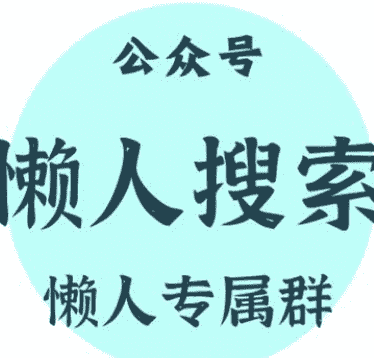

# 旺旺大危机：“被嫌弃的糖”与“离不开的糖”

260904

整理：公众号懒人搜索，懒人专属群精选  
懒人微信：lazyhelper1

> 小懒判断｜适合做消费品、做产品的经营者，尤其是正犹豫老配方要不要动的人；不适合想看旺旺八卦的读者。最值得关注的“替代”的真相：糖在饼干里同时管水分、口感、色泽和保质期，换代糖不是替换甜味，而是重排整条工艺链。坑在远看一道坎近看一座山，判断改动难度先数功能链长度。

上个月初，旺旺集团董事长蔡衍明，在公司内部发了一封全员信，标题叫《大团结，致全体旺旺人的一封信》。据说措辞罕见地严厉。

蔡衍明把旺旺2026财年第一季度的业绩，定性为“重大经营危机”。具体到数据，2026财年第一季度，旺旺营收同比下降6%，净利润同比下降38%，堪称暴跌。蔡衍明还说，旺旺“靠几只拳头产品过了近30年的好日子”“今天的苦果，是我们过去几年因循怠惰所致”。这几款拳头产品，包括旺仔牛奶、旺旺雪饼、旺旺仙贝，你一样都没吃过的概率应该很低。

那么，为什么这几款产品突然之间不行了呢？解释有很多，渠道老化、新品跟不上、零食量贩渠道冲击、进口奶粉成本上涨，等等。还有人认为是旺旺的组织架构出了问题，集团在很大程度上依然是家族式管理，最关键的决策岗位上全都是“自家人”，外请的专业人士不够，即使请来了，这些专家也没有足够的话语权。总之，各类分析的声音都有。

但是，假如你去翻网上用户的反馈，会发现最集中的声音其实就三个字，太甜了。

一瓶标准装的旺仔牛奶，含糖量几乎打平《中国居民膳食指南》建议的每日 25 克上限。一天喝一瓶，糖额度基本用光。这个配方是 1990 年代早期定下来的。那个年代，糖是稀缺品，甜就是价值感，越甜越好。配方 30 年没变，但问题是，消费者的偏好变了。首先，人们对糖的警惕性在提高，大量的消费者买东西时，已经不看广告，而是专门盯着配料表。而且这不是旺旺一家公司的个例，糖这个东西，正在很多地区面临系统性地“挤出”。

比如，2024 年 5 月，雀巢推出了一个新品牌叫 Vital Pursuit，包括 12 款冷冻食品，包装上直接标注“GLP-1 Friendly”，也就是为使用 GLP-1 类减肥药物的消费者专门设计。特点是，小份量、高蛋白、低糖。

再比如，可口可乐的无糖系列，现在已经在多个市场超过了经典含糖款的销量。还有通用磨坊，在缩小包装、降糖。百事，在重新配置产品线。亿滋，开始强调蛋白质和纤维含量，而不是口感的上瘾性。

而且对糖的“排挤”，不只发生在消费层面，甚至发生在公共政策层面。目前，全球已经有超过 50 个国家或地区，实施了含糖饮料税。没错，是针对“含糖饮料”的税。英国 2018 年推出糖税之后，含糖饮料的糖含量在一年内平均下降了约 30%。

中国还没有糖税，但《中国居民膳食指南》已经把添加糖的每日推荐量，从过去的不超过 50 克收紧到不超过 25 克。25 克是什么概念？喝一瓶 500 毫升的基础款可乐，就直接超标。

换句话说，在食品行业里，最可怕的事情已经不是被对手打败，而是被标准淘汰。在很多消费者的新标准里，糖已经从原来的 C 位，变成了被“嫌弃”的对象。

听到这，有人可能会觉得，这还不简单，我生产食品的时候直接少加点糖不就行了？不行就换成代糖，现在的各类代糖也很成熟啊。

但是，不好意思，这个事没这么简单。事实上，消费者对糖的回避，正在一定程度上，改写整个现代食品工业的研发逻辑。对食品工业来说，糖不仅仅是一个味觉元素，它更是一个极其关键的组件。

首先，在很多食品的生产中，糖承担着大量的其他功能。比如饼干。糖不只是让饼干甜，它还会影响面团里的水分，影响淀粉和面筋形成的过程，最后决定饼干的口感，糖还参与颜色和香气的形成。

再比如冰淇淋里，糖能降低冰点。糖少了，结出来的冰会更多，口感变硬。还有果酱，糖会参与凝胶和结构形成，还能降低食品里的“水活度”，让微生物更难生长，从而帮助延长保存时间。

换句话说，**从对生产工艺的影响看，“甜”反而是糖最容易被替代的功能**。至于甜的口味，可替代的东西很多，比如阿斯巴甜、三氯蔗糖、甜菊糖苷，都能提供甜味，有些甜度比蔗糖还要高。一旦从食品里拿掉糖，不像一道菜里少放一勺盐，更像是从一栋房子里抽掉一根同时承担好几项功能的主梁。

其次，**糖也在很大程度上决定了，你会不会对一个食物“上瘾”**。过去几十年，食品工业的底层逻辑是，围绕一个叫“极乐点”的东西来研发产品，英文叫 bliss point，据说是美国食品科学家霍华德·莫斯科维茨在1970年代提出的。

意思是：**对于糖、盐、油这三种成分，存在一个让人类大脑产生最大愉悦感的精确配比。找到这个点，消费者就会反复购买，停不下来。** 这背后有着实打实的工程化操作。大型食品公司的研发实验室里，有专门的感官科学家团队，用精密仪器测量人在吃下不同糖浓度食物时的神经反应。包括，脑电波、唾液分泌、吞咽节律，并且在过程中不断优化配方，让它一点一点逼近那个让你大脑最兴奋的甜度值。

他们甚至会研究“消退速度”：甜味在口腔里消散的节奏，如果消散太慢你会觉得腻，太快你就不够满足，恰好的消退节奏会让你下意识地再吃一口。你觉得薯片“根本停不下来”是因为好吃？准确地说，是因为它被精确工程化地设计成了“让你停不下来”。糖在这个工程里，是最关键的变量之一。

而拿掉糖，意味着拿掉“极乐点”，这对食品企业来说是个巨大的挑战。

那么，当以糖为核心的“极乐点”不再是有效的研发指针，新的指针又是什么呢？关于这个问题，这两年流行一个词，叫“营养密度”。什么意思？假设两种食品的热量都是 200 千卡。而营养密度指的是，这 200 千卡里面，蛋白质、膳食纤维、各类维生素的含量。也就是，单位热量里的营养总量。让用户一看这个配料表，就觉得这个东西值得吃。但问题是，营养密度依然不是简单地靠添加某些物质就能解决。

比如，蛋白质。假如直接把蛋白粉加进饮料、饼干、蛋糕，会让这个东西口感变差，发涩、发干，在嘴里嚼几下又会发黏。尤其在你把糖拿掉以后，这个问题就更难解决。

你看，说了一大圈，又回到了“糖”。

说到这，你可能已经发现了，乍一看，糖好像只是食品的众多配料之一，拿掉它也没什么大不了。但仔细观察你会发现，它是现代食品工业最重要的核心之一，很多设计都是围绕它展开的。

而一旦你把某个东西作为你工作的底座，你的工作目标、工艺过程、评价标准，既被它加持，也被它锁定。首先，它在你的整个系统里承担的功能会越来越多。其次，这个东西会直接锁定你的技术路径，你想做出任何改动，都意味着要重置整个系统。

这个局面，可以说是“远看一道坎，近看一座山”。离远了看，有的东西好像只是很小的一道坎，抬抬脚就迈过去了。但走近之后你会发现，这中间隔着一座山，想翻过去难度很高。

这个逻辑在食品工厂上游的制糖业，体现得更明显。你看，前几年代糖很火，为什么传统的糖企不做代糖呢？按照粗放的分类，这两个东西都属于“碳源加工”，也就是把大自然的碳源加工成其他东西。为什么很少看到传统糖企转型做代糖呢？

这主要是因为，这二者看起来接近，但实际根本不在一套技术逻辑里。糖是物理层面的压榨与结晶，主料是甘蔗。而这几年流行的几类代糖，普遍来自化学层面的发酵与转化。二者需要的技术、人才、设备，都不一样。

说白了，糖和代糖，看起来接近，但完全分属于两条不同的技术路径，传统的糖厂，所有的资源、技术、人员结构，都是围绕生产糖搭建的，要想转型做代糖，几乎等于重建一座新厂。要知道，尽管很多国家和地区的消费者在躲避糖，但全球总体看，糖的消费是在增长的。就在今年 6 月，经合组织和联合国粮农组织，还发布了最新一期农业展望。按照它们的预测，未来十年，全球糖消费量仍然会以每年大约 1% 的速度增长，到 2035 年接近 2 亿吨。这主要是因为，全球各个地区的发展并不平均，很多地区的甜食消费依然旺盛。

而且很多糖企不仅做糖，还做乙醇。糖和乙醇在工艺上有很多共通的环节。糖卖得好的时候，他们就做糖，乙醇卖得好的时候，他们就做乙醇。但制糖也好，做乙醇也罢，这些事的技术门槛都不高。于是，大家只能卷成本，卷价格，导致利润越来越低。

假如说我们能从整件事里获得什么，那么我觉得最值得关注的，也许是两件事。

第一，假如你是一位食品业的从业者，你大概率比我更清楚，这个转向的必要性有多强。毕竟，“**替代**”这件事远远没有想象中那么简单，不是把A拿走，换上B。而是把A原来承担的一整套功能拆开，再重新分配一遍。因此，这个转变越早启动越好。

第二，假如你是一位普通消费者，你就更加身处这个“减糖”的趋势中。尤其是现在，食品工业正在减糖的十字路口分化，我们就更有必要建立对食品的判断力，以及做好对自己糖摄入的管理。假如你想深入探索相关的方案，在这里，向你推荐冯雪老师的《高血糖医学课》（见专属群内的通才计划），里面有很多适用于各个年龄段的实用方案。

————分割线————

在这个AI能替写代码、写文章的时代，基础技能正在迅速贬值。绝大多数人正被淹没在海量的免费垃圾信息里，陷入低效的体力内卷。

当“努力”不再是壁垒，人与人之间唯一的护城河，只剩下“信息过滤”的效率与“认知系统”的维度。

圈子已稳定运行7年。我们每天利用Python爬虫与大模型算力，过滤全网最顶级的政经内参和搞钱风向标，做你最冷酷的“外部大脑”。

如果你认同这种“重塑认知防线”的极客主义，欢迎围观我的个人情报智库：【懒人专属群】。

https://lazyso.com/insider/

认同信息过滤价值、想省下每天3小时无效阅读时间的读者，扫码加我微信（lazyhelper1）

微信：lazyhelper1
