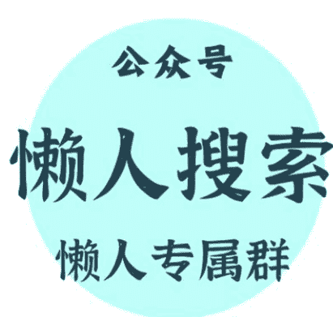

## 刘翔不满的背后

260831 猫哥星球
整理：公众号懒人搜索，**懒人专属群**精选
懒人微信：lazyhelperl

> **小懒判断** | 适合关心体育圈是非、想看懂运动员与体制利益结构的人；不适合只想吃瓜刘翔八卦的读者。最值得关注的是 2001 年分红规则：运动员商业收入本人 50%、教练 15%、地方体育局 20%、项目管理中心 15%，刘翔的代言上海体育局固定抽两成，而他 2015 年只是口头退役没办手续，十年分成糊涂账才是矛盾核心。坑在于别被带节奏，废除举国体制听着解气，跨栏这类没法职业化的项目会最先没人兜底。

最近，刘翔和上海体育局的恩怨，闹得满城风雨。上海体育局要求刘翔二选一，要么转岗当教练，要么买断离开体制内。

那么，究竟怎么回事？背后藏着哪些问题？拿到奥运冠军的运动员，除了金钱奖励，通常还会收获一个体制内的挂职职位，这个职位属于虚职，不用处理具体工作，但能正常领取各类福利。

因为运动员没退役前，还要全力比赛，根本没时间去岗坐班。刘翔拿到的挂职岗位，是上海市体育局团委副书记。

这个岗位属于事业编制，并非公务员编制，基本不用干活，不用定点坐班。按规定，等他们退役后，必须在一年内做出选择。

要么虚职转实职，岗位大致分为三类：
- 高校体育专业教师
- 体育系统管理岗
- 专业教练

要么买断工龄，退出体制。

规定是死的，人是活的，早年执行并不严格。郭晶晶 2011 年宣告退役，挂名的河北省体育局副主任职务，一直拖了四五年才办离职。

田亮也是同样的情况。2007 年退役后，他挂职陕西游泳中心副主任，常年不上班，进军娱乐圈，拖了五年，才选择办理离职。

还有羽毛球运动员黄穗，挂职湖南省乒羽中心副主任，常年不上班，本人早已移民海外，却依旧按时领取工资，最后被官方免职。

刘翔的情况和他们类似，2015 年宣布退役后，既没有选择转岗做实职，也没有买断离职，就这么一直拖着。

之所以出现集体拖延，一方面这些运动员战绩斐然，早已实现财富自由，不愿意坐班。在大众认知里，奥运冠军是国家荣誉的象征。如果强行他们二选一，很容易引发大众反感，单位很多时候不敢强压，只能反复沟通，运动员不愿意配合，就只能这么耗着。

另一方面，也有钱的因素。国家体育总局 2001 年出台过规则，明确了运动员商业广告的分红比例：
- 运动员本人 50%
- 教练团队 15%
- 运动员注册的地方体育局 20%
- 对应的项目管理中心 15%

简单来说，刘翔所有的商业代言收入，上海体育局都能固定分到两成。一旦刘翔转岗，从业编转公职岗，商业活动会受到严格限制，不管是对于他自己，还是对于上海体育局来说，都得不偿失。

加上早年编制核查不严格，挂靠的人多了，上海体育局对刘翔的安置就没那么热心。但如今编制核查越来越严格，大批拖延的运动员，都陆续完成了二选一，刘翔也不得不面临抉择。最关键的问题是可能存在一笔糊涂账。

那就是刘翔 2015 年退役后，上海体育局到底有没有继续从刘翔的广告收入中分成。按理说，运动员退役后，体育局不能再分成。但刘翔比较特殊，他 2015 年退役只是口头退役，至今没有办理正式手续。

因此，存在 2015 年后继续给上海体育局分成的可能。到底有没有，就需要双方公布了。

刘翔有耐克终身合同，不方便坐班。如果买断走人，体制内给不了多少买断费。

买断费分三个部分：
- 基础安置费
- 成绩奖励费
- 运龄补助

刘翔能拿多少，官方没公布具体数字，但媒体测算在 85 到 130 万左右。130 万对普通人是天文数字，对刘翔却不是什么大钱。

如果 2015 年后，刘翔一直给上海体育局分成，十年累积下来肯定远超 130 万，换谁都是刘翔，都会觉得亏。

不满不仅来自于金钱，还来自于精神层面。刘翔大概率觉得，自己没有受到尊重，随便“给点钱”就想把我打发了？

而问题的根源，在于举国体制。国内体育实行举国培养模式，大多数运动员，都是由各地体育局培养的。

好处是，举国体制能为运动员兜底，特别是那些家庭条件一般的运动员，他们没钱请私教，没有体制内的资源，大概率打不出来。

除此之外，能拿到商业代言的运动员本就是极少数。大部分成绩普通的，别说商业合作，日常收入都有限，退役之后的再就业更是难题。

也正因如此，体制提供的保障，就尤为重要。但这套模式也存在短板，运动员会受到诸多限制。商业代言的合作方、收益分成比例都需要审批。

客观来说，这套机制并非全无道理。因为培养一个优秀运动员，成本动辄几千万上亿。要是没点回报，谁愿意付出？很多机构培养出一个运动员后，都靠这个运动员赚钱。相当于把运动员当销冠，体制和运动员的关系，变成了大家合伙开公司。

2001 年出台那份文件，本意就是理顺运动员和体制的关系。问题在于，顶级运动员会感到不满，就像销冠，通常想出去开公司。

针对这一矛盾，不少人提出废除举国体制，认为如今金牌不再是唯一追求，应当放开运动员的发展自由，但这种情绪化主张并不合理。

别看很多人嘴上说金牌不重要，到了奥运会，如果真的只拿几枚金牌，绝对出现大量反思党。所以，真正的出路是深化举国体制的精细化改革。

目前部分体育项目已经率先落地了这类改革，篮球、足球就是典型案例。

这两大项目高度市场化，运动员能靠市场养活自己，不再依赖体制编制兜底，受体育局的约束大幅减少，个人商业收益基本归自己所有。

退役后当个教练，也能混口饭吃。改革的难点，集中在跨栏这类难以职业化的项目。

和集体球类项目不同，跨栏赛事的大众关注度、商业受众基数都很小，能达到刘翔级别寥寥无几。

即便是史冬鹏、谢文骏这类好手，收入也和刘翔差距悬殊。他们不像刘翔那样有底气单飞，依然需要体制兜底。

针对这类项目，最稳妥的方式是优化运营模式。

首先，明确分成的时间期限与收益上限。既能保障国家、地方体育局及教练团队的回报，收回培养成本，也能避免运动员长期被高额抽成。

现行规则仅划定了基础分红比例，既没有时间约束，也没有金额上限，且比例只是原则性标准，弹性极大。话语权更强的一方，可能出现超额抽成的情况。

其次，治理上要管办分离。体育局与项目管理中心既负责行业监管，又参与分红，必然会产生严重的利益冲突，催生更多类似刘翔的案例。

管办分离的核心，是推动体育行业协会实体化，撤销冗余的项目管理中心。体育局回归监管职能，专注管理，不再干预运动员的个人事务。

当然，管办分离的改革推进难度极大，没人会轻易放弃手中的利益。

目前管办分离最彻底的是足球，行业管理中心已正式撤销，中国足协也已完成实体化改革。说句题外话，国足多年来那么烂，和管办不分有密切联系。

过去足球行业同时存在足协、足管中心两套管理机构，权责重叠、职能混乱，经常相互拆台。

最后，为顶级运动员设置弹性化专属岗位。

比如刘翔这类成绩顶尖、商业价值高，既不愿坐班、也不想参与行政工作的运动员，可以设立推广大使、专项顾问等荣誉岗位。

这类岗位无行政实权、无需坐班履职，同时不会约束个人商业活动，恰好平衡体制管理与个人发展的矛盾。

刘翔与体育局的拉扯，本质是旧体育体制和市场经济发展的适配难题。

一刀切废除举国体制，无法解决问题，还会催生更多问题。唯有渐进优化规则，平衡各方利益，才能化解矛盾。

————————分割线————————

在这个 AI 能替你写代码、写文章的时代，基础技能正在迅速贬值。绝大多数人正被淹没在海量的免费垃圾信息里，陷入低效的体力内卷。

当“努力”不再是壁垒，人与人之间唯一的护城河，只剩下“信息过滤”的效率与“认知系统”的维度。

圈子已稳定运行 7 年。我们每天利用 Python 爬虫与大模型算力，过滤全网最顶级的政经内参和搞钱风向标，做你最冷酷的“外部大脑”。

如果你认同这种“重塑认知防线”的极客主义，欢迎围观我的个人情报智库：【懒人专属群】。

https://lazyso.com/insider/

认同信息过滤价值、想省下每天 3 小时无效阅读时间的读者，扫码加我微信（lazyhelper1）

