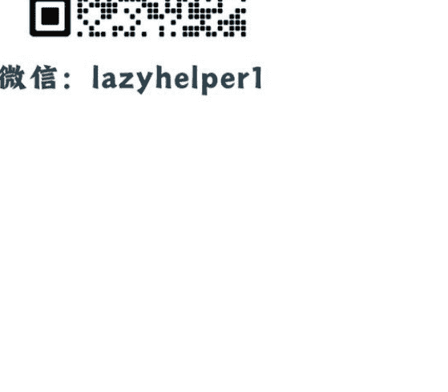

# 投资备忘：英伟达的炸裂预测，证明铲子股还能玩很久

260831 端宏斌

整理：公众号懒人搜索，懒人专属群精选
懒人微信：lazyhelperl

小懒判断 | 适合自己持股、看得懂财报持仓逻辑的投资者；不适合不碰股市的读者。最值得关注的是英伟达那句“需求要涨 100%、产能只能满足 70%”——它直接证伪了“AI 资本开支 2026 年见顶”的鬼故事，上游铲子链（建滔的 CCL/PP 材料）逻辑反而被强化，大股东四天连续增持就是最硬的信号。坑在房地产救市新政：只解决信用和交付，每次新政板块都是冲高再阴跌，只能做短线别当长线拿。

老端注：本文 ChatGPT 生成内容占 15%。

本周我们重点关注的建滔系在中报之后，出现了明显的上涨，目前建滔系两只股已经占了我的仓位。

## 1. 建滔系跟踪

8 月 28 日的那份涨价函已经得到了建滔官方的确认，同时，松下电子材料也准备从 9 月 1 日起上调部分线路板材料价格。

这就说明，短缺是全面的，不是建滔一家的事情，可以进一步认为：全球 CCL/PP 材料链正在出现一轮行业级价格重估。

所以建滔系两家公司下半年的业绩有可能继续上调。本周在财报静默期结束之后，公司大股东连续三天增持，周五的数据还没出，如果周五继续增持的话，就是连续四天增持了。

- **建滔集团：**
  - 8月 25日 50.43买；8月 26日 49.89买；8月 27日已经涨到 52.64，还是买。
- **建滔积层板：**
  - 39 块多买；39 块多继续买；到了 43.17 还买 100 万股。

这就进一步削弱了“低位象征性护盘”的解释，如果只是为了护盘而做做样子，他完全可以等待股价回调之后在下面托单。这样股价跌不下去，它的买入成本也可以降低不少。

实际上，就算股价在短期内出现了大幅上涨之后，老张还是选择继续买入。

这给市场的印象是，老板认为当前整个价格区段都是低估的，都值得买入。如果下周一收盘后，我们发现周五老张也买了，那么这个增持行为的信号就非常强了。

周一是 8 月 31 日，是 MSCI 收盘调仓的日子，建滔集团尾盘收市阶段会有巨量的成交，如果 31 日巨量换手以后，9 月 1 日仍然稳住甚至继续上涨，那对后面的势信心会比 31 日本身暴涨更有价值。

因为市场会意识到，MSCI 利好都已经兑现了，股价还能稳住。周一尾盘大致可以分三种情况：
- 1，巨量成交、价格基本不动：最好。说明筹码承接强，指数资金顺利完成换手，没有制造明显短期泡沫。
- 2，上涨 1%-2%：正常，说明有被动需求，但不算严重扭曲。
- 3，突然拉 4%-5% 甚至接近竞价价格上限：短线反而要提高警惕，因为这部分上涨很可能主要来自机械买盘，下一交易日很可能回吐。

## 2. 房地产又救市

多部门 8 月 28 日又发布了新的房地产救市政策，个人住房贷款最长期限由 30 年延长至 40 年。更加重要的是，对于预售住房，个人住房贷款原则上要到项目竣工备案后才发放；房地产项目同时建立“主办银行制”。

住建部等三部门另外明确，要稳步推进现房销售，新出让土地项目优先选择现房销售。

这件事基本上是改变了中国房产的核心商业模式。在以前，中国房产的游戏是这样的：买地，挖个坑，盖售楼处，开始预售，拿购房者的钱继续再买地。

将来，游戏变成：开发商先把房子盖出来，买房者看到成品，银行按揭资金再进入。最大的变化是，购房者退出开发商的融资链条。

这对央企国企和资金雄厚的开发商是利好，因为它们能够承担更长的开发周期。高杠杆、依赖预售款滚动开发的小房企则会越来越难生存。

过去三年来，每次房地产出什么新政，地产相关板块都会短期冲高一波，然后就开始阴跌回调，不仅跌回启动位，甚至还跌得更多。这次会不会也这样呢？

我认为大概率还是这样，所以做一波短线交易是可以的，长期持有就免了吧。本轮新政，解决的还只是信用和交付问题，对于人口、百姓预期和局面信心，并没有多大帮助。

百姓最大的问题是收入端出事了，如果他不再相信未来能赚到更多的钱，他就不会有信心买房。

## 3. 黄金要回落了

美国万亿国库账户干预市场+避险需求推升金价，周四金股集体反转（湖南黄金涨停、赤峰+2.58%）。周六美联储主席沃什放话“通胀不落仍可能加息”，金价直线跳水，所以周一金股低开几无悬念。

不过呢，这是上升通道中的正常回调，最多算一个中级调整，因为短期涨多了，所以跌一跌。贵金属股票里，目前弹性最好的是湖南白银，这波反弹已经是 70% 的涨幅了，现在已经 11.65 元了，如果跌回 10 元以下，你又可以买入了。

## 4. 厄尔尼诺炒作

最近农业板块因为厄尔尼诺现象开始疯狂炒作，厄尔尼诺现象肯定是真的，但是对农产品具体会有多大影响，现在根本算不出来，但市场就是不管结果如何，先炒了再说。

关于农业板块，你可以注意一下我们之前玩过的一只股：诺普信。他本身是做农药的，后来转型卖蓝莓。诺普信的故事是：厄尔尼诺现象会导致南美蓝莓减产，国内价格会维持高位，它是国产大玩家，蓝莓直供山姆会员店，所以他吃到大蛋糕。

另外，诺普信还有一个独家秘诀，就是促早熟技术，他能比别人早 2-3 周上市，相当于价格最贵的那一段，他能吃满。看多诺普信还有一个原因是，最近公司疯狂接待机构调研。

诺普信 8 月 21 日公告称，8 月 20 日接待申万宏源等 39 家机构调研。8 月 26 日分析师会议，接待 40 位机构投资者调研。接待完了机构调研，股价就开始涨了。

原因很简单，调研完了，这些机构多少会买一个观察仓，由于公司平时成交量很小，稍微买一买，股价就动了。公司平时成交连 1 亿都不到，机构调研完了，成交马上就到 5-6 亿的样子，诺普信的验证窗口很短，现在已经 9 月了，马上 10-11 月，最早的一批蓝莓就要上市了，到时候一看蓝莓价格就知道今年业绩能不能超预期了。

所以需要持有的时间并不多，最晚到明年过年前必须要卖掉，因为那时候蓝莓价格是最高峰。

## 5. AI 铲子

本周小米发布国内首款 3nm 智驾芯片“玄戒 D100”，苹果同周发布 M6 版 Mac（AI 性能 4 倍），双重催化。资金选了封测/存储分支——长电（47亿）、通富、兆易、海光放量确认；果链龙头立讯、富联反而滞涨。

扩散先行、龙头未动=结构性行情，不是全面主升。传导路径：AI 硬件（M6/玄戒）→半导体国产链（封测→存储→GPU）→消费电子（折叠屏铰链），是一条完整硬件资金链。

本周还有一件重要大事，英伟达给出了极强的远期业绩指引，竟然号称明年业绩还能涨 70%，大超市场预期。英伟达的逻辑是，市场需求非常旺盛，可能需求方面要涨 100%，但由于我们的产能问题，导致我们只能满足其中的 70%，所以姑且就算 70% 的涨幅吧。

证据是，亚马逊竟然计划在 2027-2028 年度再买 200 万块 GPU 芯片。英伟达的话，基本上直接否认了此前流行的鬼故事：AI 资本开支 2026 年见顶。

现在的新故事是：需求增幅大于供应链的扩张幅度，所以利好 AI 铲子。

这也是我为什么看好建滔系的原因，因为上游铲子链的逻辑不仅没有证伪，还进一步强化了。

---

在这个 AI 能替你写代码、写文章的时代，基础技能正在迅速贬值。绝大多数人正被淹没在海量的免费垃圾信息里，陷入低效的体力内卷。

当“努力”不再是壁垒，人与人之间唯一的护城河，只剩下“信息过滤”的效率与“认知系统”的维度。

圈子已稳定运行 7 年。我们每天利用 Python 爬虫与大模型算力，过滤全网最顶级的政经内参和搞钱风向标，做你最冷酷的“外部大脑”。

如果你认同这种“重塑认知防线”的极客主义，欢迎围观我的个人情报智库：【懒人专属群】。

https://lazyso.com/insider/

认同信息过滤价值、想省下每天 3 小时无效阅读时间的读者，扫码加我微信（lazyhelper1）

