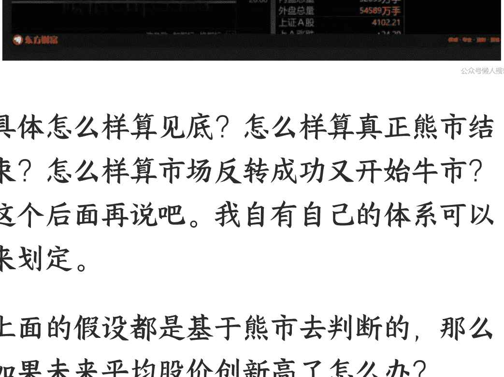

## 9月趋势预测

260826 花荣

整理：公众号懒人搜索，懒人专属群精选

懒人微信：lazyhelper1

> **小懒判断** | 适合重仓 A 股、纠结现在到底是牛是熊的散户；不适合不炒股或只想抄到最低点的人。最值得关注的是两个硬数字：平均股价 33.67 基本做实牛市顶，熊市里反弹高点一次比一次低，30.8 附近的黄线就是反弹压力位。坑在于作者明说核心依据是自家周期体系、只给结论不给推演，全信等于把仓位决策交给黑箱。

现在的行情，有的话不能说的太过于直接（否则容易被封），所以还是会定期更新下个月的趋势预测，让大家知道目前到底是处于一个怎么样的真实行情中。

来看下这 20 多年的平均股价的走势，股市只有 2 种形态，一种就是牛市，另一个就是熊市，没有第三种形态，持续往上走的就是牛市，持续震荡下跌的就是熊市。A 股每一次牛市大概 2-3 年；熊市最短 10 个月，最长 4 年，所以判断行情，就是要判断现在到底是处于牛市，还是处于熊市。

那么现在 A 股处于牛市还是熊市？

依据我目前的判断，我认为 A 股现在处于熊市周期了。

原因简单说几个，当然最核心的原因，这里就不透露了，我们从 K 线上是不能完整看懂股市内在的周期规律的，这个我已经根据自己的体系划分好这些周期结构了，我在这里只说结果。

每一轮牛市，其实都可以计算理论上的高点，一旦到了理论上的高点后，那么市场就会彻底疯狂，市场就开始盛极而衰。

从平均股价的角度来算，从 24 年 2 月开始的牛市，能到 35 左右，目前最高 33.67。

从全 A 等权指数来看，牛市理论最高点 1650 附近，实际上 1643 点，平均股价跟全 A 等权指数已经都接近理论最高点了，一旦等周期走完，近期不能再破新高的话，那么最高点就做实了。

一旦最高点做实后，那么从最高点开始，就可以理解为熊市了，这个熊市的调整时间就是几个月~几年。

那么这次熊市会调整多久？

我的观点是几个月~1 年左右就够了，因为美股还能走个 2 年多的牛市，在美股走牛的大环境下，A 股不会很长时间走熊。

另外还有很重要的一点，一轮牛市，至少需要 1 年半的时间，美股还能走 2 年多，那么 A 股再调整个几个月的话，到时候美股还剩个 1 年半~2 年的牛市，这样 A 股刚好可以在最后跟着美股共振一起走个牛市，那么时间上是够了。

那么现在接下来的问题就是等待熊市结束，至于会跌多少，这个不好说。

但是熊市有一个显著的特点，那便是，反弹的高点一次比一次低。

我就随便取 15 年-18 年吧，熊市每一次反弹一次比一次低。

那么我们目前认为 33.67 已经是牛市最高点，那么从 33.67 跌到 23.98，反弹最高就 30.8 附近，也就是我画的黄线附近，这里涨不动了后，市场就会开始新一轮下跌，跌到位了后再反弹，高点一次比一次低。这个假设就是 33.67 就是牛市最高点，然后开始了熊市，按照这个假设，市场就会这么走下跌趋势，直到跌到底。所以我们要做好按这样的假设去观望。

具体怎么样算见底？怎么样算真正熊市结束？怎么算市场反转成功又开始牛市？这个后面再说吧。我自有自己的体系可以来划定。

上面的假设都是基于熊市去判断的，那么如果未来平均股价创新高了怎么办？

创新高是破除熊市最强的办法，强如美股，哪怕在熊市周期，都能创新高，创新高的话，能让熊市周期在最短的时间内结束，所以美股一直能走长牛，核心原因就是它们的熊市调整周期很短，就几个月。所以，未来如果能新高，那么其实更好，熊市周期就能在几个月的时间内快速结束，这个我们只要跟踪观望市场就行了，真新高了的话，再说吧。

炒股，牛市的时候是加大仓位猛干主线；熊市的时候，保存实力才是最重要的。

所以熊市内，有能力的就自己玩玩短线即可，控制好仓位，等待熊市彻底结束。下一次像样的反弹，还需要市场再砸出一个大坑才行了。

这些都是目前我对市场真实的看法，别乱投诉，否则以后我连真实的想法都不写出来了。这篇文章的评论我也不翻了，否则删评论，如果展示出悲观情绪，文章也容易被封。

——————分割线——————

在这个AI能替你写代码、写文章的时代，基础技能正在迅速贬值。绝大多数人正被淹没在海量的免费垃圾信息里，陷入低效的体力内卷。

当“努力”不再是壁垒，人与人之间唯一的护城河，只剩下“信息过滤”的效率与“认知系统”的维度。

圈子已稳定运行7年。我们每天利用 Python 爬虫与大模型算力，过滤全网最顶级的政经内参和搞钱风向标，做你最冷酷的“外部大脑”。

如果你认同这种“重塑认知防线”的极客主义，欢迎围观我的个人情报智库：【懒人专属群】。

[https://lazyso.com/insider/](https://lazyso.com/insider/)

认同信息过滤价值、想省下每天 3 小时无效阅读时间的读者，扫码加我微信（lazyhelper1）

