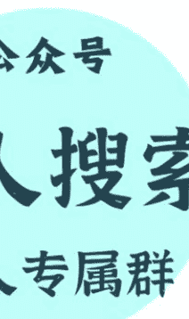
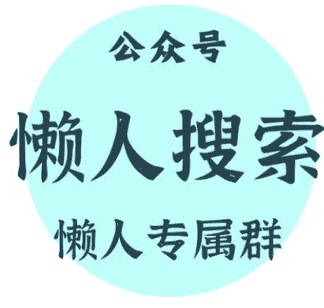

## 照见内心！稳扎稳打是基石，守住底线才能蒸蒸日上

260901 雪球花甲老头

整理：公众号懒人搜索，懒人专属群精选

懒人微信：lazyhelperl

公众号

懒人搜索

懒人专属群

微信：lazyhelperl

**小懒判断** | 适合正被选择搞内耗的人，找对象、挑城市、做投资都在来回摇摆的；不适合想抄具体买卖点的读者。最值得关注的是三步法：审视先定一票否决的底线（野外的高压线默认有电），取舍让次要矛盾给主要矛盾让路，换位去执行。坑在这篇全是心法没有标的，别指望直接选股，但“利润持续下滑的领域不碰”这条够硬。

### 前言

此心光明，知己知彼。著力即差，稳扎稳打。九月，暮秋，草木黄落，霜始降，收五谷。在古代，人们要顺天时，应四季，春种，夏长，秋收，冬藏。

步入秋天，宜收心神、收杂念、沉淀积累、复盘整理。知收敛，知敬畏，知坚韧，知预备。

我们如今不是农耕时代，但人们依然处于四季之中，春天的生机，夏天的燥热，秋冬的萧索，依然是影响着心情。

所以，还是要顺应时令，按照规律去做事，有这方面的敬畏心。有一个好处就是避免被情绪和欲望驱使，知进退，知深浅。九月，是一个非常适合沉淀的阶段，从此刻开始，有大量的时间去思考。

反思过去，应对未来，在农工时代如此，在如今，也是如此，我们的心情，也是会受到大自然四季轮转的影响，在这个阶段，缓慢下来，也是节奏的把握。

上一篇长文，应该是五月前后，转眼已经步入九月。时间很难在一刹那改变一个人的积累，但是潜移默化的水滴石穿会带来意想不到改变。

人的身体，在青春期就基本发育成型了，但是人的思维能维持的更久，且思维的上限更高。

我们的身高体重，其实差不了太多，但是精神世界我个人认为是千差万别，或者说天壤之别都有可能。

所以，在很多年前，我就明白，在绝大多数的情况，或者拉开时间去着，人的内在更为重要。

比如，找一个伴侣，一位合作伙伴，其实对方是一米七还是一米六五，对你没什么太大影响，但是对方是否善良真诚，是否有包容心，是否可以良好沟通，是否有上进心，是否情绪化等等，这些内在的东西，在长时间的相处共事之中，更为重要。

对于一件件事情的看法，以及基于这些看法的底层逻辑，才是构筑起我们世界观的要素。本文的标题，我讲的是照见内心。

那是因为当经历很多事情之后，你会发现，内心状态是很重要的，认识到这一点的人，也就会明白，为什么外在条件差不多，但不同的人做事的结果却不同？

所以，我们应该静下心来，想一想，是不是先把自已的内心照亮，理清脉络，再去披荆斩棘。之所以，在过去的很多事情中，我能毅然决然做出选择，而不是受外界干扰，我认为得益于此，习惯于在内心把一切摊开，想清楚。

这些年，我不断反躬自省，理清思路，权衡选择，实际上能节省很多内耗。

后来的一些大决策，我很少后悔，无论结果如何，我都在做决定的那一刻，就明白了这是符合自已内心的最优解。

照见内心，这是很多年前在日记里写下的一个词。

在当时，对于背井离乡无依无靠早年间的自己，是不会放过任何一个能够提高自已的机会。读书是，遇贵人是，在经历中总结经验是，在不断的思考中照见自已的内心也是。

多年以后，我发现，应该把了解自已的内心放在第一步，这是基础，这个地基打好，极其重要。

我特别喜欢深夜，而且是独处的深夜，如果白天能睡个午觉就更好了，因为在这种宁静的夜里，安静且舒适，大脑里的思绪活跃。

很多百思不得其解的事情，在这个状态下，就很容易想明白，梳理出轻重缓急。

所以，我有了写日记的习惯，无冬历夏。哪怕没什么特别的事情，我也会梳理下今天发生的事情，还有自己对于一些问题的看法，这个习惯，短期不会有什么大的改善，但是十年呢？二十年呢？

我并不是在这种状态下谋求一个多么宏伟的目标和结果，只是单纯认为，这个方法适合我，也能帮助我。内心，偶尔还能进入到一种心流的状态，那种感觉收获很大。

我相信，很多脑力工作者，无论是作家，科研人员，工程师，企业主等等，可能或多或少，都会进入过这种心无旁鹜的心流状态吧。水滴石穿，必有影响，全文一万五千五百字左右。

照见内心，我自己的方法是这样的，有几个关键词，能帮助自己梳理清晰脉络。

- 审视。
- 取舍。
- 换位。

总结一下，就是审视是为了找到初心和彼此优劣势，取舍是为了获得最优选择，换位思考是为了有效地执行。

我自己这一路走来，还有所见所闻，发现其实绝大多数的人，其实是很难直面自己的内心的。我们总说初心，其实很多人根本不知道自己的初心是什么。

所以习惯于人云亦云，一会跟着别人的意见，一会跟着自己的情绪，一会跟着自己的欲望。这样做事，如浮萍一般，风一来，就散了。

我们第一点的审视，就是要直面自己的内心，审视自己的实际情况，这里包含的因素有很多，想法也会有很多。抽丝剥茧，找到那个最根本，第一性的东西，把它最为主要矛盾去思考，其他都是次要矛盾。

而我们审视的，不仅是自己的初心，或者目标，还有自身的实际情况，自身的优势，外界的选择，对方的情况吗，这些都是我们在第一步需要审视的。这三步，每一层都是一个体系，或者一套方法论，而不是某个点。

### 1、审视

比如审视，我们需要思考的地方很多，但是一定要找到最重要的点，继后再分析其他次要的点。举例，我们想找一个伴侣，其实是人生一件重要的事情，不仅影响自己接下来后半生，影响后代，甚至影响三代人。

但是，其实有不少人，对于选择伴侣这件事情，都是随波逐流，一点也没想法，甚至从来不想。有的是跟着眼睛去走，最后识人不明，一路跌跌撞撞。

有的是到了年纪，让父母或者朋友给介绍个对象，毫无积累和感情基础，可选择性也不多，甚至会觉得跟谁过不是过啊，在哪都吃一口饭。

还有的是挑来挑去，最后眼花了，时间也过去了，也没有收获感情。

我觉得，大家哪怕拿出一个夜晚，安安静静去想好这件事情，你做事就会特别有章法和目的，是一个一劳永逸的办法。

从审视开始，就拿找伴侣来说，在第一步要明确最重要的是，你最看重的是对方什么品质。

然后还要思考自身条件，对于另一半的其他要求，这要仔细剖析，不能对自己隐瞒。

第一性的要求出来了，自身优劣势出来了，还有其他次要的要求也出来了。把自己的优劣势逐步想清楚，你现在想的，也是未来在路上需要面对的，因为你在第三步执行的时候现在明晰自己优劣势至关重要。

这个优劣势，不局限于出身，家乡，学历，事业，收入，性格，颜值，口才，才华等等。然后，对于另一半的要求，也要列出来，比如对方的家庭，事业，收入，性格等等。

但是注意，我们第一步分析出来的，对方身上你最看重的地方，这个是地基，其他都要为此让路。从这一点来说，大家就因人而异了。有的人喜欢幽默的，有些人喜欢家境好的，有些人喜欢有责任心的，有些人喜欢颜值高的，没法有一个统一标准。

那么，我就说我自己的认知标准，仅供参考。注意，这个最重要的第一性，可以概况去思考，未必是一个点，可以是一个笼统的范围。

比如我认为寻找伴侣，最重要的是善良，真诚，踏实，三观正确，这些内在的品质，就是一个范围，它不是一个点，如果具体说可以是“内在品质”。

这是最重要的，相当于其他要求都能稍微让步，但是在这个上面是不允许有商量余地的。

这就是你想找对象的初心，也是主要矛盾，也是目标，这个是一票否决的，没有模棱两可的地带。你找对象，不仅是给自己找伴侣，对方将来和你是一家人，既要和自己的父母相处，也要和自己生儿育女，从长远去看，一定是内在品质最重要了。

漂亮有用么？未必那么重要，妲己也很漂亮，也不是过日子人。收入很重要么，也未必那么重要，如果对方和你不是一条心，对方赚多少，可能也未必幸福。

然后，梳理次要矛盾，比如对方的年龄，你得有个范围，比如在自己上下四五岁之内都可以接受。

比如事业，学业，颜值，你都可以有一个大概的标准，但是这些都是可以缓和的，是有余地的。因为，在相处之中，只要没差太多，几乎不会影响什么，你是和一个 985 的学历人谈恋爱，还是和一个 211 院校毕业的人谈恋爱，亦或者是普通本科谈恋爱，几乎没有差别。

当然，也要分析好自身的优劣势，这个每个人的情况也是不一样的，不能一概而论，但是自己心里要有谱儿。

为什么审视出来第一性很重要，因为它承载的是底线，是你最看重的点，这个地方，绝不含糊，记住，绝不含糊，不能有侥幸心理，这一点不满足，其他都不考虑。

记得，曾经有一位女读者跟我说：“寿老，儿子带女朋友回家了，问他哪里认识的也没说清楚，我今天在厨房做饭，看到这个女孩子在院子里吸烟呢，腿上还有文身，您说，不一定纹身吸烟的女孩子就不好吧。”答案肯定是不一定，我们不能说一个女孩子吸烟她就一定不好。

其实，在这个时候，这个女读者就在有侥幸心理，她认为万一对方是个好孩子，自己岂不是冤枉人了但是她既然来问我，可见她自己或者家里的观念，对于女孩子这一点也是有抵触的。有些事情，只有自己想明白了，才能很果断的去做选择。

为什么说第一步审视是基础呢，因为你只有清楚自己想要什么，自己什么条件，才能去做选择。

比如这个女读者，也要结合家庭条件去分析。如果她儿子挺优秀，可选择也多，那完全可以继续找，如果她儿子条件也很一般，过了这村没这店，那就降低标准。

但是，标准降得再低，其他都可以让步，自己想出来的第一性原理是不能让步的，甚至是一票否决。很多人不懂什么叫一票否决，但是我作为外人也不好明言，就像刚刚那位读者所说，抽烟也未必不是好人吧？带着一种侥幸和担忧。

我们换一个场景，在野外你看到一根高压线在地上，你肯定不会去碰吧，因为你默认它就是有电的，在野外碰到一株蘑菇，你也不会去采摘食用吧，因为你默认它是有毒的，在野外你看到一头牛站在那里吃草，你肯定不会去离它很近吧，因为你默认它会顶你。

这就是一票否决，放弃幻想。你不会因为遇到一条蛇，还去考虑它有没有毒吧，肯定是默认都有毒。果断放弃幻想，也不要想概率的事情，因为你的第一性最重要的事情，是底线。

什么叫识人断物，就是经验，甚至有一些主观，可能会误判，但底线的作用就是如此。你总用小概率或者幻想去思考问题，那怎么选都行了，因为任何结果都有可能发生。

可是，时间和试错成本，承担得起么？审视，最重要的是知道自己要什么，同时这也是可以一票否决的底线。

同时，还有一个层面，就是分析出自己的能力范围优劣势，让自己明白能承受的范围。

就像我曾经离开老家的村子，也是自己在年少的时候无数个夜晚琢磨的事情，我反复推敲衡量得失。

后来想明白了，我还有什么可以失去的么，肯定要出去的，所以抓住一切能出去的机会。任何阻挡我出去闯荡的声音，都可以一票否决了，因为自己审视清楚，也想明白了。

### 2、取舍

我们不能既要也要，尤其是自身条件有限的情况下，所以想好自己第一性的需求之后。势必要有取舍，这个取舍，必须以自己第一性需求为基础。

比如另一半，内在很好，素质高，心地善良，做事和气，意志品质坚定，对人也友好，符合要求。

那么你就应该放低一些其他的标准，这就是取舍。

既要对方内在美，也要外在美，还要事业有成，性格温柔，家境优渥，才华横溢，那是可遇不可求的。次要矛盾可以给主要矛盾让步，但是主要矛盾不给次要矛盾让步。

但是，咱们也不能极端去考虑问题，什么对方内在特别好，但是一百多岁了，这就是抬杠了。我相信，适婚的年纪，正常的容貌，也有很多合适的。你的优势越多，可选范围越多，你就可以增加要求。我们做人做事，考虑问题不能过于极端和偏激。

这里的取舍，就是让步，我们可以因为对方的主要矛盾过于优秀，而包容对方的次要矛盾不足。

这叫瑕不掩瑜，我们应该大度的地方，其实是在次要矛盾这里。取舍的目的，最终还是为了选择，当你知道需要的是什么，那么第二步就是取舍。

就像我准备好离开村子，最好的方法是读书考出去，实在不行就是两眼一抹黑出去闯。万幸，赶上一个好的机会，还是有会通过读书出去。

然后，就是取舍，因为自己想明白要的是出去，不能一辈子在村里，又有这么一个机会。

那这个机会在自己的眼中，就会格外耀眼，为了它，就可以舍弃很多东西。我那个时候到处找书看，也抓住一切能学习的机会，农村孩子哪有看书在当时，我却做到了心无旁骛，这就是舍，舍弃了之前自由散漫的状态，把所有的时间都用来学习。

我们人生中，无数次要面对取舍。但如果不先审视自己内心，不知道自己要什么，那如何做出正确的取舍呢？

我之前记录过一件事情，就是有个销售担心吃饭垫付的钱多，请合作伙伴只喝茶喝咖啡，从不去饭店，知道这个事儿之后，我都无奈了。

他这种取舍，我觉得就是自己没有真正想明白，至少当时我就认为，他不会成为一个优秀的销售，这碗饭他吃不了。因为他取的是小利，舍的其实是一次次机会和信任。

在他的心里，可能觉得生意很重要，合作伙伴关系也重要，钱，也很重要。没有主要矛盾，也没有次要矛盾，眉毛胡子一把抓，所以在取舍的过程之中，就非常混乱。

而且这件事，我是从好几个人的口中得知的，包括合作伙伴，可见他当时已经闹笑话了，自己还不知道。世间安得双全法，不负如来不负卿。自古忠孝难两全，人不能什么都要，我很早就明白这个道理了。

但是取舍，取的是第一性原理，取的是主要矛盾，舍的是次要矛盾，这一点很多人没想明白。

比如，最近几年的生活，我选择的最重要的事情，就是换一个生活方式，同时把孩子带好，把他培养好，其他所有的东西都是次要矛盾。

所以，取舍就来了，我选择的是读书，写文章，到处走走，陪陪孩子，时间和精力，就放在这些事情上面。舍的东西，其实可多了，早年问的人际关系，几乎都没什么联系了，自身也没什么妄念，一不找异性，二不贪小便宜，在这个阶段就能省下很多时间。

我看到有的人，早上起来跳广场舞，然后去超市排队抢鸡蛋，这都是我生活里舍弃的，不适合我，我就不选。

所以，我选择蓝姑娘照顾我们的生活，小诺帮衬，因为我知道自己要什么，她们能帮什么，或者说，我能给她们什么。只要自己审视清楚，未来的路是很清晰的，面临抉择时候，也知道该如何选，如何取舍。如果我是既要也要的心理，那生活会是一地鸡毛。

比如，我既要带好孩子，还要读书写文章这些爱好，还要和老朋友保持吃吃喝喝的联系，还要去跳广场舞，还要去抢鸡蛋，还要去垃圾桶捡纸箱子，那精力就崩溃了，最终一事无成。

比如，我既要蓝姑娘帮我带孩子，也要小诺帮衬，但是自己是个守财奴，分文不出，最后也是不欢而散。

### 3、换位

这是基于审视好了要什么，也明白是那么可以取舍，之后的执行方法。换位思考，就是一个很好的方法，换的人可以是对方，可以是你认为一个比较优秀的人。

这一点，比较类似王阳明的知行合一，他就会想，如果是圣人，该如何处理，其实也是换位思考，把自己和圣人互换角色，去面对当下的问题。

当然，还可以和对方换位思考，比如和朋友相处，与合作伙伴谈生意。其实，换一个视角，很多问题就很清晰了，有时候就是当局者迷。

我们只是在思路中打转，最终可能因为一点小的失误，就容易造成误会。在我背井离乡之后，无人托底，所有的事情，都需要自己理清楚，遇到的人，遇到的事情。

换一个视角，或者换到他人的视角去看，很多事情就容易促成，或者和解。

那时候，会遇到欺负人的，其实换个角度去想，对方无非就是求财，在自己能力范围之内，还是好解决问题的。

在找对象的角度去思考，也很清晰，如果你审视好遇到一个对的人，也明白了自己能取舍的点。

当你真正能换位思考，站在对方的角度去分析，其实很容易走到一起的。因为对方会发现，你很用心，而这种用心，就是基于换位思考，如果你不站在对方的角度去想问题，只是单纯站在自己的角度，就很容易有巨大的分歧，结果也不太好。

很多人都会说，想追求一个人发现不好追，其实如果自身条件和对方匹配，哪怕差一些，经过审视之后对方确实是你认定的，你也愿意做出取舍，其实已经成功一半了。

再加上自己的一些方法，概率能有 70%吧。世界上没有 100%的事情，如果做足功课，依然没有成功，那不是方法问题，而是缘分使然，寻找下一个机会就是了。

就像世界杯，奥运会，每个教练组都做足功课，但是结果不如人意，也能欣然接受。

这才是，尽人事，听天命。任何方法，都不是100%的，我们是为了提高效率，节省时间，而不是说保证完美和100%成功率。

照见内心，最好养成一个习惯，它其实就像打球，打牌，也是需要不断练习的，最开始可能觉得很吃力，没有头绪，但是久而久之，就会反应很快了，有些时候甚至不需要找个安静的时间去思考，哪怕发生在电光火石的谈判直接也能做出最有利于自己的选择。

同理，我们在投资里，也可以用这个方法，去照见自己的内心。审视，取舍，换位。

审视的第一步，就要问自己，是要做投资，还是做博弈，是要赚企业成长的钱，还是赚市场情绪的钱，是要做确定性的事情，还是在赌运气等等。

其实，我相信，很多人在市场里10年了，都没想明白，自己到底要做什么样的事情。有的人听风就是雨，今天张三说了句，他就追进去了，明天李四说不行了，他就割肉了。

还有的人是摇摆，一会想做投资，一会到处找消息。审视，也是尊重自己的内心，甚至如果审视的结果是，自己承受不了任何波动，自己不适合这个游戏。

那就放弃，而不是明知不可为，而为之。如果审视的结果是自己只适合小仓位闲钱参与，那就不能投入过多。

这个过程，也是因人而异，每个人的情况，相差太大了。我从不认为，有一套方法适合所有人，这是我看过很多人，很多事情，才接受的事实，但就是如此浅显的道理，其实很多人接受不了的。

因为，我们这么多年，接收到的信息，都是标准化的居多，而这些信息，就误以为是适合所有人的。

就好比，读书改变命运，就这件事情而言，这句话很对，没有问题，但是面对数以亿计的人来说，读书这件事就很难，有的人就不适合读书这条路，这第一步走不出去，何谈改变命运呢？

应该有一类人，一看书就头疼，他的天赋不在读书这里，如果和他说，读书能改变命运，他其实是没有结果的，因为第一步他都很吃力，就没有后续了。

社会输出一套标准化最优解，读书、考学、按部就班向上走，这套路径对一部分人是坦途，但对另一部分人，从第一步就充满痛苦。

有一类人，不是懒，不是笨，就是面对书本、文字、课堂体系天然排斥，一看书就头疼，坐不住，读不进去，记不住书本知识，但也许在别的地方感知力极强。

人的大脑优势分区本就不同：

- 一部分人擅长符号、文字、逻辑记忆、抽象思考：读课文、背知识点、做题对他们是相对顺手的事，这正是现代学校教育选拔的天赋。
- 另一部分人，优势在具象感知、动手、人际洞察、空间、实操、应变。他们处理抽象文字信号效率很低，长时间阅读印刷文字，大脑会过载，出现头疼、走神、烦躁、越看越懵。也许是输入媒介不对，同样一件事，看书看不懂，但是看别人做一遍、上手实操、听人聊天讲解，就理解的容易些。

现实里很多这样的人：学课本一塌糊涂，但修车、做菜、做生意、社交、画画、手工、调度统筹，一点就通。学校的试卷测不出他们的能力。

所以，有一句话很对，叫做 360 行，行行出状元，也就是不同领域的人，都能有优秀的，虽然领域不同，专业不同，但是成就可高一样高。

但无论是读书，还是做手工，亦或者是销售，无论哪一行，大家都不需要给自己太大压力，出状元的事情，任何行业都是凤毛麟角。

我们能做的，就是比自己提高就好，最重要的事情就是，找到那个让自己做起来不累的事情，就对了。

比如乔丹打篮球，他就是找到了自己的一个天赋，你如果让他当物理科学家，我相信他也痛苦。

我们这个时代，是一个包容性很强的时代，选择性也多样的时代，我觉得大家都应该挖掘一下能让自己有兴趣的事情，原则就是做这件事，你觉得有趣，可以做下去，未必有多大成就，先做下去是第一步。有了第一步，才有后续的可能。

## 照见内心：实事求是与自我认知

我们有一个抓周的习俗，最早文字记载见于南北朝《颜氏家训》，是江南风俗。孩子满一周岁，把各类器物摆在面前，任由孩子伸手去拿，看他最先抓取什么，以此判断下性情、志趣、前途。唐宋之后普及民间，流传至今，南北都有这个周岁礼俗。

比如在古代，有算盘，有书笔，有印章，男孩子是刀剑，女孩子是剪刀之类的女工等等。虽然这件事情，有一定的随机性，但是我们可以看出，在古代，家长也知道，孩子的路不是一条，甚至天生就不一样。

在古代孩子小时候成长阶段，有的孩子喜欢读书，有的喜欢舞刀弄剑，这个不是父母强制的，真的是出于本能的喜欢。而现在，如果你发现家里孩子，看书根本坐不住，沉不下心，看一会就头疼，坐一会就要喝口水去遛一遛，说明他做这件事情吃力。

不排除有孩子通过意志力，最终能养成一个好的学习习惯，但是这需要付出的努力也是很大的。本质上，脑力劳动和体力劳动，不是一群人。

以前在农村，有些老乡和我聊天说：“我也想让孩子好好读书，结果让他暑假跟着种地，结果孩子种的挺开心，说一看到试卷就头疼，种地虽然身体上累，但是脑子很舒服。”

“照见内心”，看似只是四个字，但是能真正了解自己和孩子的的人，其实不是很多。绝大多数的人，会被外界的信息裹挟，会被评价标准裹挟，去做一些本不擅长且没有兴趣的事情。

我曾经认识一个朋友，她是一个高学历的人，也有着体面光鲜的工作，但是我们茶余饭后聊天，她不止一次表达过：“我最大的梦想就是去扫大街，多解压，多舒服。”

另外，如果以一个单一标准去要求所有人，人容易形成自我否定，这件事对信心的危害很大。无论如何，很多事情是我们无法改变的，我们可以选路，但不能轻易否定自己。

张三汽车，李四马车，但是在没有公路坑坑洼洼的山道上，汽车可开不过马车。审视自己，照见内心，一定要分析出优劣势，扬长避短。

我们听过一件事，就是很多减肥的人常常挂在嘴上的：“我喝凉水都长肉。”他们一定从没有照见过内心，也没有客观去实事求是，因为喝凉水是不能长肉的。抛开体质问题，我是经历过只喝水吃不上饭的时候，那时候还不止喝凉水，还能吃上野菜和一些玉米渣，也没有变成一个胖子。

我们从科学上讲，能量是守恒的，凉水怎么能转化成脂肪呢？结果只有一个，那就是这些人没有说实话，他们甚至把自己都给糊弄过去了，自欺欺人。

曾经，我看过一个纪录片，就是有人说自己吃的很少但是一直长肉，导演组真的给这些人的家里安装了摄影机，全程监控一段时间。起初，这些人还克制，后来习以为常了，回归了自己本质的生活。

最后，导演组给他们看影片，他们都惊讶了。打开冰箱之后，不自然仰着脖子喝了半桶果汁，走到阳台给花浇水的时候手里拿着一块巧克力，就连做饭期间还能边吃边做，最让人受不了的是晚上看电影居然喝着啤酒吃着爆米花。审视自己，照见内心，一定要做到实事求是，不能自欺欺人。

这不是一件简单的事情，甚至有些残酷，可如果是自己内心的独白，自我的剖析不展现给他人去看，可能还好一些。什么是装睡的人，我觉得某种角度去看，就是自欺欺人，他们相信的不是事实，而是自己会有侥幸心理，甚至对自己很宽容。

### 案例：主观偏差的代价

之前，我在网上看到一个女孩发了个视频，说自己找对象很难，因为是录视频，她也在自述自身条件，从她开口第一句我就觉得她偏离了事实。

她第一句说的是：“我的长相，怎么说也有八分吧。”后面的，我就不用听了。化着妆开着美颜，呈现出来的结果，我个人认为，都不到5.5分，她给自己的这个评分标准显然不太客观。

别说她的八分，就是去娱乐圈拉出来一些二三线女明星，去各大传媒院校找漂亮的女大学生，估计也没几个敢说自己评分在八分以上。不过，我还是很善意的，我看评论区给她的评分不乏二三分的。

这当然难找了，因为她觉得自己八分。如果从地基的第一步就错了，后面一切都是空谈，什么取舍，为什么要取舍？自己只喝凉水还长肉，难道自己水都不喝了么？

这种情绪下去，不仅是不客观，甚至会有怨气，觉得遭受了什么不公平的对待。自己8分啊，就冲颜值，也应该有美好的姻缘啊，结果一无所获，内心肯定不舒服。

种种的例子，在生活中比比皆是，其根源，是没有清楚的认知自己。这里面有太多的过度自信，自欺欺人，也有些人是妄自菲薄了。而我认为，这些都是在浪费时间。如果人不能实事求是，就没办法脚踏实地，后续就会心态失衡。

照见内心是一个底线，是自己应该知道的事情。但是我们的生活里，工作里，甚至爱情里，难免需要一些场面事，就是做一些和实际情况不符合的事情，这并不冲突。

比如，一个要上台表演的孩子，照见内心，剖析自己，是为了让自己知道自己的优劣势，优点可以继续保持精进，而缺点则可以改正。但是，一旦他上台表演，即使自己并不完美，也许就是一般的水平，但是不影响他很有自信。这份信心和之前剖析自己的优劣势，其实并不矛盾。

奥运会上那么多运动员，哪一个上去不是自信满满，但是在赛场下，又有几个不被教练组拎出来指出不足，甚至年轻运动员被劈头盖脸骂都是有可能的。

差距，要认可；自信，要长存。自信的来源，在于对自己的相信；差距的认可，是对于现实的认清。这俩事不冲突。

那个喝凉水都长肉的人，他们的本质是没有认清事实。他们不仅是台上，就是自己在家里都委屈的觉得自己喝凉水都长肉。那如果这样，真没法减肥了。减肥的宗旨和方法很简单，就是六个字：管住嘴，迈开腿。

但是为什么这么多人难做到，因为从一开始，就没有实事求是。虽然，减肥有体质问题，但是体质我们又无法改变DNA，就像自己没法改变原生家庭一样，所以就不过多内耗在这上面。

当然，还有熬夜，生活不规律等其他原因，可是如果一个人从源头就纠结自己遇到的不公平，什么喝凉水都长肉，那他肯定依然会我行我素，他不会认为自己要管住嘴，已经只喝水了还怎么管住？

所以，他没有改变，没有行动，一如既往，最后还是出了怨天尤人，就是质疑一切方法，因为他觉得都是无效的。问题，出在了他自己的身上，而且是源头。

这就是为什么很多人懂得很多道理，依然过不好一生。因为人是有思想的，思想有可能是动力，也可能是阻力。同一个道理和方法，有的人就深以为然，有的人就嗤之以鼻。我们终究，是无法叫醒装睡的人。

但是，如果自己是有心之人，我们要把自己叫醒，让光照进内心，先把自己了解清晰。在投资里，其实很多人最应该做的事情，也是了解自己。有多少人自以为在做投资，实际上在做着博弈的事情呢？

多少人，实际上内心都是想着一夜暴富，但是嘴上说的是价值投资。还有多少人，明明知道要用闲钱去参与，但是不由自主最后加了杠杆甚至和父母亲朋借钱。他们连审视自己，都从没有做过，也没有耐心思考过。我认为这些人需要的不是道理，也不是方法，他们如果是这个状态，甚至不应该把大好的时间花费在这上面。

你们看，很多专家会告诉你，看技术，看财报，看业绩，看基本面，看情绪，看趋势，看政策。没有人告诉你，先看看自己，了解自己吧。

如果一个人连自己都没有看清楚，上面那些就能助他一飞冲天了么？

所以，少看专家，少看纷杂的信息。我们做任何事情，首先要做的，就是照见内心，就是要看清楚自己。小马过河的故事告诉我们，别人怎么说也不重要，最重要的是先了解自身的情况。

如果自己的了解有偏差，结果会如何呢？有多少人的失败，其实就是做了自己不擅长的事情。有多少人的失败，其实就是做了超出自己能力的事情。有多少人的失败，其实就是被他人和情绪裹挟着前进。最终，就是没有做到，知己知彼。

千年传下来的话，看似就是几个字，深刻理解的人，实在是少。知己知彼是孙子兵法，知行合一是阳明心学，著力即差是苏轼哲学。

大家都听过，但是听过不代表听懂，懂了不代表理解，理解不代表认可，认可不代表行动，行动不代表做好，即使做好，最终也是谋事在人成事在天，结果仍然有不确定性。

这就是事实，我们能做的，就是稳扎稳打，从地基开始。

### 理性与取舍：家人的榜样

对于我儿子，我们的性格和思想都有一些分歧，但是他有件事是我认可的。
- 第一，做自己擅长的事情。
- 第二，不擅长的事情不做。

他不吸烟，不喝酒，也不善于参加生意场合的推杯换盏，我从小就觉得这孩子，太理智了，一点也不性情。但理智也有很好的优点，那就是不被情绪裹挟。

记得他结婚的时候，有人想多灌他喝点酒，他每一桌都敬了，但是对方明显有些想捉弄的想法，他根本不应，做事有自己的原则。所以，他不适合在生意场混，他自己也知道，但是他也不碰。

后来我发现，理性和理智的人，其实上限很高，而且底线也挺高的。我儿子的生活圈子很简单，他并不喜欢过多的交际，休假回家的时候，他偶尔陪我钓钓鱼，大多数时间就是陪陪孩子，在家里看看书，忙一忙工作。

儿媳的圈子更简单，所以妹夫说的话她不高兴，积压了一段时间，她直接把妹夫给删了，还退群了好像。他们应该挺喜欢自己的生活，简单，不内耗，也没有什么妄念，做着自己喜欢而擅长的事情。

曾经的我，对于生意场也不喜欢，但是没办法，为了生活，好在我也 有自己的优势，这就是自己分析出来的。没有人脉，那就积累；没有家庭背景，那就不焦虑这个。好在我实在是不拒门，也愿意换位思考，这就是取舍和换位，最终也有了自己的合作伙伴，也有了自己的一些朋友和生意吧。

当然，出去谈生意，肯定不能说自己这也不行那也不行。剖析自己，最重要的是知道要走哪条路，如何走，这件事自己知晓就可以了。出去谈生意，就要是另一个状态，是换位思考。

如果在投资里，比如你关注的是流动性，哪里的流动性最好；你关注的是公司营业能力，哪些公司赚钱最多；你关注的是未来，哪些公司是承载着梦想和希望的，其实都能显而易见。只要想清楚自己需要的是什么类型，寻找就是一件简单的事情。

怕就怕，不知道自己要什么，或者明明买错了，自我安慰，甚至不惜自欺欺人。说到底，人还是在和自己治的过程。如果上面的三点，能成为自己的一个体系，甚至可以下意识去思考，就算地基打的不错了。每一件事都要具体问题具体分析，这种思考模式，可以在任何场景下去试。

### 高目标牵引

接下来有一件事情还是很重要的：高目标牵引。

这件事为什么重要，我给大家列举几个古人的经验：
- 1、“取乎其上，得乎其中；取乎其中，得乎其下；取乎其下，则无所得矣”。
- 2、“求其上，得其中；求其中，得其下，求其下，必败”。
- 3、“取法于上，仅得为中，取法于中，故为其下”。
- 4、“学其上，仅得其中；学其中，斯为下矣”。

我们很多的事情，就是看似会很矛盾，但实际上效果很好，其实根本就不矛盾。原因是，即使身居浅滩，但有鸿鹄之志，那么就不会纠结内耗于当下，这一点是比较重要的。有一句俗话，叫做：“好人不长命”，我告诉大家，因为好人顾虑的多，内耗这个事儿，特别影响健康。

所以做好人，更要学会把事情想通透，减少内耗。任何事情，都在矛盾中前行，花开花谢，叶长叶落，吃了拉，拉了吃，看似没意义，看似矛盾，其实理解了就好说了。

认清自己，和高目标牵引，其实根本不矛盾，也不冲突。认清自己，是脚踏实地；高目标牵引，是仰望星空。一个“向上拉升”，一个“向下扎根”。

如果不认清自己，但还不切实际，这就是好高骛远了，这完全是两码事。高目标的核心价值，本质上不是“必须实现”，而是通过标准上移，对冲现实中的损耗。

- 1、任何行动都存在不可逆的熵增，信息偏差、能力波动、意外干扰、人性懈怠，都会让最终结果比初始目标下跌一个层级。定高目标本质是给损耗预留缓冲空间——目标定在90分，实际可能落到80分；目标定在60分，实际大概率不及格。
- 2、人的能力边界不是“先具备再达标”，而是“被目标拉扯出来的”。高目标会迫使你调用未开发的资源、学习新技能、重构认知框架；而完全贴合现有能力的“务实目标”，本质是在舒适区内循环，能力上限会被自己忽视。
- 3、你对标的标准越高，筛选信息、选择伙伴、分配时间的阈值就越高。以“及格”为目标，会自动过滤掉“精深但短期无用”的知识；以“顶尖”为目标，会主动向最优秀的范式看齐，注意力和资源都会向高价值处聚集。

注意，高目标牵引的本质，未必执着于数量层级，而是在境界层级。曾经，我写过一个观点，就是当一个人在哪里战战兢兢，那么他的天花板，可能就在这里了。

就像一个人，考了 68 分，还在和老师争执说有一道题老师给判错了，那他就很难考满分了，因为他计较在 60 多分的这个层面。

所以，把你想做的事情，拔一个高度，事情自然会顺利些。比如就是为了改变命运而读书，因为在意的不是眼下的利益，而是更长久的结果。

物质在保证基本的衣食住行之后，它应该变成了基础，而不是追求的最终目标，没有肯定不行，但是以这个为最终目标，也会迷失。一个医生，他的最终目标应该是提高医术；一个老师，他的最终目标应该是提高知识；一个演员，他的最终目标应该是提高演技。如果，他们把目标定在多赚点钱的维度，最终就会在这个层面战战兢兢，事业上提高肯定有限，而赚钱的底线反而会降低。

我最开始的时候，为什么要选择北京？因为在我曾经的认知里，这里是首都。反正在哪里都是举目无亲，在哪里都是孑然一身，在哪里都是白手起家。

那我，就去首都吧，这是我经过分析之后的结果，高目标牵引。从离开老家的村子，读书完，之后到选择北京发展，我都是毅然决然的，毫无后悔，甚至眼睛里都是充满希望，即使当时也不知道要什么出路。真正上路之后，也是一直迷茫。但是，心中有光，因为曾经想清楚了，无论如何，这是最优解，最好的一条路。

我们有时候不要被内心的枷锁禁锢，有时候需要一些逆向思维。比如你找伴侣，很多人都愿意退而求其次。其实，如果你真的做好了自我分析，彼此分析，倒不如去追求自己最喜欢最合适的一个人。可能有些人会觉得，对方优秀追求的肯定多。

有时候是这样的，失败就接受，但有的时候反而有些人过于优秀会让人觉得很 难追求，可能竞争对手反而少。就好像，很多人会觉得一线城市生活压力大，如果你是背井离乡，举目无亲，去哪个城市压力不大呢？

后来，我在北京立足了，也能养活自己了，熬过去走街串巷的糊口阶段，也开了店。当然开店也不是卖水果，当时是不得已为之。可是我无论是卖水果还是开店，都很游刃有余，也不计较，因为我想要的生活也不是这样，我觉得目前都是过渡阶段。我真正内心想的是，抓住时代的机遇，广阔天地，大有可为。虽然不知道做啥，但是总觉得有更好的机会，所以有这种向往，反而当下做的事情比别人觉得轻松多了。

因为，目标不在这，就不计较；不计较，就不累。去北京，是高目标牵引。当时想抓住时代的机会，其实相当于拔高了一个层次，至少没有和别人争那一分一厘的钱。

韩信之所以可以受胯下之辱，是因为他想要的根本不是在这个层面，所以他并不计较。这也是我自己的经历和内心想法。

### 投资中的本分与平常心

后来，在投资的路上，有过惨痛的教训，能想的就是不断复盘和反思，后来剖析了很多问题。总结下来就是，投入的太多超出了自己的承受能力，而分析出来这个之后，我很少再做超出能力的事情。

以瓦注者巧，以钩注者憚，以黄金注者婚。这是发生在很多年前的事情了。后续的投资当中，无论有多大的机会，我都是用闲钱，不影响生活和生意的现金流。我发现耗得起了，心态也好了，对投资的机会也更耐心。

如果不是自己经历了，悟到的，别人说多少，可能我也难以这样刻骨铭心。本分保证不走歪路，平常心保证不动作变形。这两个品质加起来，就能跑赢绝大多数怠工近利的人。能了解到本分这个层面，其实也是做了取舍：不懂的不做，不懂的不碰，做内力之内的事情。

所以，照见内心，不是一件简单的事情，它也不是单一的事情，它可以应用在方方面面，无论是学习，工作，生意，投资，都可以踏踏实实把心打开去分析。

心打开了，光就进来了，种子才能萌芽，最终才有可能长成参天大树。这就是我内心的想法，一个人最终都是扎根成长的过程。当然，如果自己思考之后，还有一个好处，就是能承担多少风险，自己内心也有数。做有风险的事情，心里就有底线了。

失败和痛苦本身不是财富，对痛苦的反思才是。没有反思的失败只会让人自我怀疑，有反思的失败才是成长。

另外，人的精力是有限的，什么都想做，结果什么都做不好。真正厉害的人，都懂得主动放弃，把所有力气集中在最重要的事上。最终，这个体系就是精简再精简。如果一个人取舍到，自己做的事情，都是擅长的，都是有兴趣的，都是能力范围之内的，能有多大成就不确定，但是这个游戏他可能会活得更久。活得久，机会就多，下了牌桌，啥也不用谈了。

### 投资的体系与看法

最后，想聊些关于投资的体系和看法。照见内心，在投资里其实很好用。上文也提到了，你静下心来去分析，哪些是成长的，哪些是情绪的。

找一个自己真正适合的方式，如果找不到，先做减法。有的人，今天这个板块涨了，就追了，明天那个涨了就换了，电风扇行情的话，做几轮本金就会少很多。

我个人比较关注的几点：
1. **不能退市。**
   这一点，宽基指数有天然优势，因为会更替，也是由不同公司组成。
2. **你自己有信心。**
   这一点，很重要，因为跌了你敢于加仓。不要小看这一点，当你被套了，你就知道有多重要。
3. **利润最差也是能维持。**
   我个人一般不会选择利润持续下滑的领域和公司，因为利润其实是我们判断的一个锚。
4. **价格合理。**
   好东西贵一点，长期来看依然划算；烂东西再便宜，本质还是垃圾。人和事都是如此，质量永远比价格重要。

再说一遍，在好的东西里，去等待合适的价格，不要不顾质量，只图便宜。如果你有耐心，好的东西也会有好的价格的。重要的是多年的厚积薄发，到时候你就会发现，这个机会就是你的，很清晰。

你内心要明白什么是好东西，这个见仁见智，你需要的是客观去分析。我认为，最少的基础是利润不能持续下滑。找好东西，眼光要挑剔一些，你不需要太多好东西，最起码要做到百里挑一，千里挑一吧。

剩下的就是耐心了。机会永远在，甚至每一天都在，但是要想清楚，这个机会适合自己么？如果每个机会都能抓住，那自己成什么人了？神仙了？

我自己在日记里，写过几句话，今天也分享给大家：
1. 景气行业，业绩持续上涨的，适合长期持有，直到利润增速结束。比如全世界最好的公司，业绩能持续增加的。
2. 稳定行业，业绩没有什么波动的，适合做大波段，因为下有业绩支撑，上无太多想象力。典型的就是些公共事业类的。
3. 下行行业，业绩持续下滑，我自己通常不会触碰。

没法说得过于具体，但是话已至此，大家可以自己分析，去思考。其实，如果这三句话大家能吃透，加上自己的理解，和经验的融合，我觉得对大家的体系会很有帮助。因为，你仔细分析之后，看清楚自己的品种，它处于什么阶段，就知道如何选择，如何对待了。

### 对人工智能的看法

再聊聊关于人工智能的一些看法。我看了不少公司的财报，他们的战略也都在加码人工智能。我很多年前就关注了，几年前也开始写。到目前，这个技术和发展其实是明牌了。

对于资本市场来说，人工智能的预期也充分体现了。因为资本市场交易的是预期，所以大家会发现到了一个阶段就会震荡，就是因为有分歧。资金也是在等新的突破，或者是技术上的进步，或者是下游的盈利增加。

就像上面所说，景气行业的业绩遇到瓶颈，利润增速结束，可能也无法确定带来更高的收益。所以，我觉得大家可以慎重一些，如果你实在看好，也量力而行，不能过于盲目激 进，因为即使是世界上最好的一些科技公司，也不能说便宜了。

如果实在没把握，就不参与，但是可以继续学习生活中关于人工智能的发展和技术。投资这件事，不需要太努力，这个地方未必越努力结果越好。想明白了，看清楚了，其实应该是一个很轻巧的事情，只要平静下内心，断舍离一些贪婪和恐惧即可。

机会永远有，没必要一直紧绷着状态。多做有复利的事：读书、健身、积累技能，这些是可以线性增加的，有正反馈的。

以上仅为个人思考记录，不构成任何投资建议，市场有风险，决策需谨慎。

九月启序，夏尽秋来。愿过往的遗憾随暑气消散，往后的日子沉淀从容。把浮躁归于平静，把期许交给时光。

————————————————

在这个AI能替你写代码、写文章的时代，基础技能正在迅速贬值。绝大多数人正被淹没在海量的免费垃圾信息里，陷入低效的体力内卷。

当“努力”不再是壁垒，人与人之间唯一的护城河，只剩下“信息过滤”的效率与“认知系统”的维度。

圈子已稳定运行7年。我们每天利用Python爬虫与大模型算力，过滤全网最顶级的政经内参和搞钱风向标，做你最冷酷的“外部大脑”。

如果你认同这种“重塑认知防线”的极客主义，欢迎围观我的个人情报智库：【懒人专属群】。

https://lazyso.com/insider/

认同信息过滤价值、想省下每天 3 小时无效阅读时间的读者，扫码加我微信（lazyhelper1）

