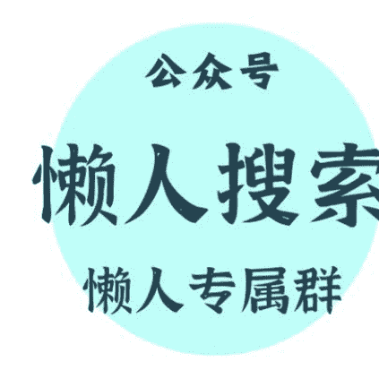

# 税收新规痛击“伪外资”，富人又少了一条避税通道

**文/卢克文工作室嘉宾 风雨如歌**
**整理：公众号懒人搜索， 懒人专属群 精选**
**懒人微信：lazyhelperl**

> **小懒判断** | 适合自己持股拿分红、或身边有人琢磨海外身份避税的老板；不适合完全不碰股权分红的打工人。最值得关注的是：9月1日起外籍自然人从外资企业分红不再免个税，以前100元分红能全额换汇出境，现在只剩80元，换护照避税的玩法直接失效。坑在于灰色产业链比想象大，亲属代持、假外资骗补贴、地下钱庄环环相扣，浙江一次就罚了1.2亿。

9月1日，税务总局发布新规：外籍自然人股东，从外资企业拿到的分红，不再免征个税。

这条新规，真正影响的是靠海外身份避税的“伪外资”老板。

改革开放前期，为了吸引外资，国家给外资企业、外籍投资人设置了很多优惠政策，其中有一条是“外籍个人从外商投资企业取得的股息红利，免征个人所得税”。

只要你是外籍身份，手里又有外商投资企业的股权，分红时免征个人所得税。而中国籍股东，分红时需要缴纳 20% 的个人所得税。

很多中国老板一看，换个国籍就能免税，于是纷纷加入外籍，再把内资公司改成外商独资企业，也享受一把免税待遇，这种玩法就是“返程投资”。

2004 年亚洲开发银行研究院在报告中估算，中国每年的外商直接投资（FDI）里，返程投资的比例高达 26% 到 54%，取平均就是 40%。

2004 年，中国 FDI 金额约 600 亿美元，40% 就是 240 亿美元，按当时的汇率，折合人民币近两千亿，涉及的个人股权分红税，无论如何计算都至少有数十亿规模。

那国家不知道吗？

当然知道，所以早些年监管要求，你办了海外身份，就必须注销国内户籍。但当时各部门数据不互通，很多细节难以核查，出现了很多漏网之鱼。

而且很多老板不是自己换成外国籍身份，因为放弃国内身份，会带来许多不便，所以，主流方法是找人代持。

- 大多数时候是亲属代持，老板保留中国国籍，安排子女或配偶拿外籍身份，再把部分股权登记在子女或配偶名下。公司分红时，优先给外籍子女或配偶分红。
- 第二种是通过外籍朋友代持，私下签订代持协议，股权挂在对方名下。企业分红后，资金可以免税购汇汇出境外，再通过私下渠道转回国内实际控制人手中。

返程投资侵蚀了税基。

2017 年，江苏税务查处了潘某案。潘某是内地企业实控人，专门办理香港居民身份，再把自己的企业变更为外商投资企业，以外籍股东身份持股，靠政策规避个税。

税务部门发现，潘某长期在大陆居住生活，所有业务、资产、人脉都集中在大陆，办香港身份没有实际生活用途，就是为了规避税费。

最终，潘某被追缴个税 428.58 万元。

避税还只是第一步，背后有一条灰色产业链。假设潘某这 428.58 万元成功避税，转到境外，潘某可以再用“外商直接投资”名义，在国内新设一家企业。

这样就能骗到不少补贴。

因为各地为了招商引资、拉动经济发展，会推出各式各样的外资扶持补贴政策，很多像潘某这样的伪外资，会利用漏洞薅羊毛。

这些伪外资公司，大多没有实际业务，它们成立的目的，就是为了拿政府补贴。拿到补贴后，再以经营困难等各种理由，办理企业减资或者直接注销。

而他们套来的补贴，会在分红后转移出境，之后换一个城市，注册新的外资企业，继续骗取补贴，如此反复循环。

2025 年，浙江外汇局一次性查处了 15 家假外资，开出了合计 1.2 亿元的罚单，就是因为这 15 家公司涉嫌骗取补贴。

表面上，它们的注册资金规模不小，动辄数千万美元，但其中大部分企业的参保人数只有 1 到 2 个，有的甚至是零，就是个空壳公司。

调查发现，这批空壳公司的注册时间相近，运作模式一致，很可能是同一批人在幕后操控，批量套利。

除了套利，返程投资还加速了资金外流。

普通人想转移资产到境外，会受到国家严格管控。但如果你开设了一家外资企业，就不一样了。外资企业赚了钱需要换成外汇，汇回自己国家，这不是很合理的事？

国家对于这方面，是有专门通道的。这样一来，假外资老板们就可以合法地转移资产。和非法地下换汇不一样，地下换汇不合法，而假外资整套流程披着合法外衣。

正因为“正规”，这条漏洞还被人用来搞灰产，比如地下钱庄。

2024 年青岛外管局就披露了一起典型案例，青岛某假外资公司，通过 FDI 流入国内的资本金账户，调查发现这些钱一毛钱没有用于正常经营，全部流入了地下钱庄。

时间久了，不仅造成资金外流，还会扰乱国际收支数据，不知道哪些是真实外资赚走的收益，哪些是跑出去的假外资。

这次 9 月落地的税收新规，就是为了专门整治这种返程投资乱象。

新规更深层的意义，不只是税收层面，更重要的是：公平。

我们现在正在建设统一大市场，关键是要破除各种壁垒。

这些壁垒，除了地方保护主义，税制带来的身份差异也是一道隐形门槛。差别是，税制身份差异带来的不公平更加隐性，没有地方保护主义那么引人注目。

早年国内缺资本、缺投资，给外资各种优待也是没办法，没有优待外资可能来都不来。但随着时代变化，曾经推动经济发展的规则，变成了发展的阻碍。

就拿规模难以估计的假外资来说，大家都是在国内做生意，那些老老实实用中国身份做企业的老板，分红到手先扣 20% 个税，有的人只是更早掌握信息差，办了外国护照，企业改个外资的壳，分红就可以不用交这笔钱。

如果越来越多老实经营的企业，发现钻空子带来的利润更大，那么他们还会再把心思放在认真经营上面吗？还是变成一门心思琢磨怎么把自家企业包装成伪外资呢？

取消外籍自然人分红免税，就是取消身份带来的特权，以后大家标准都一样，就没必要再折腾换国籍和套利手段，具备竞争力的企业获得更多市场。

缺乏竞争力的就逐步淘汰，这才是正常健康的市场秩序。

除了维护市场公平，整治假外资更能加强资金监管，减少资金外流。

旧规则下，外籍个人股东从外资企业拿到分红，不仅不用交个税，这笔分红还可以换成外汇，成为资金外流的灰色通道。

打个比方，以前企业分红 100 元，股东能把这 100 元全部换成外汇转出去。现在同样分红 100 元，只有 80 元可以汇出境，剩下 20 元留在了国内，直接减少了资金外流的体量。

既然套利空间变少、利润变低，公司就会重新算账，是不是要把利润留在国内，用来自主创新或者扩大业务？

这样一来，这些资金就能留在国内，而不是流向海外。

今年我们已经紧密落地了一系列税收新规，可以看出，中国经济正在走出草莽发展期，进入了新的阶段，现在的重点转向了打补丁、堵漏洞。

1980 年，全国人大通过《中外合资经营企业所得税法》，规定合资企业的所得税税率为 30%，另加 3% 地方所得税，综合税率最高 33%。

那时候国企税率高达 55%，外资优惠力度极大，这也是国内最早的外资扶持政策。

改革开放初期，国内资金和技术都很匮乏，给外资优惠是当时最务实的选择。外资靠着这些政策让利进入国内，快速拉动了经济增长，哪怕是早期伪外资的避税套利行为，至少也在当地带动了就业和经济，客观上也为中国经济做了贡献。

经过几十年的发展，中国经济早已今非昔比。今天我们依旧需要外资，但重点已经从量转向质，我们需要的是拥有先进技术和理念的高质量外资，而不是低质量外资和伪外资。

这次新规落地，是一次必要的纠偏。

清理伪外资乱象，才能促进公平，让所有踏实经营的企业，逐渐站在同一套规则下，真正凭实力说话。

## 重要参考资料：

- 1. https://www.adb.org/publications/round-tripping-fo...
- 2. 两部门：9月1日起外籍个人股息红利不再免征个税\_新浪财经\_新浪网

---

绝大多数人只盯着眼前的工资，却不知道一次远在中东的冲突、一次降息的决议，就能在一夜之间洗牌普通人的财富。

看懂宏观，是为了在周期切换时，不被当作代价。

如果你认同这种“抬头看路”的长期主义，欢迎围观我的个人情报智库：【懒人专属群】。

圈子已稳定运行 7 年。我们每天利用 Python 爬虫与大模型算力，过滤全网最顶级的政经内参和搞钱风向标，做你最冷酷的“外部大脑”。

https://lazyso.com/insider/

认同价值的。扫码加我微信，备注：【进群】

