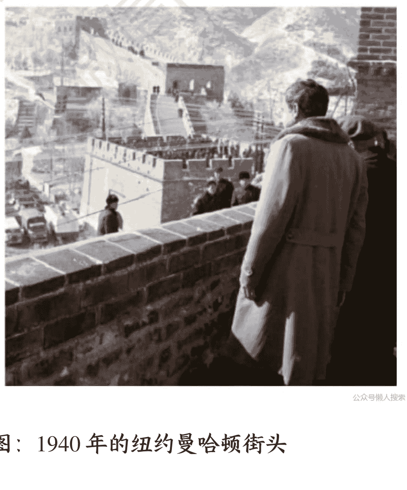
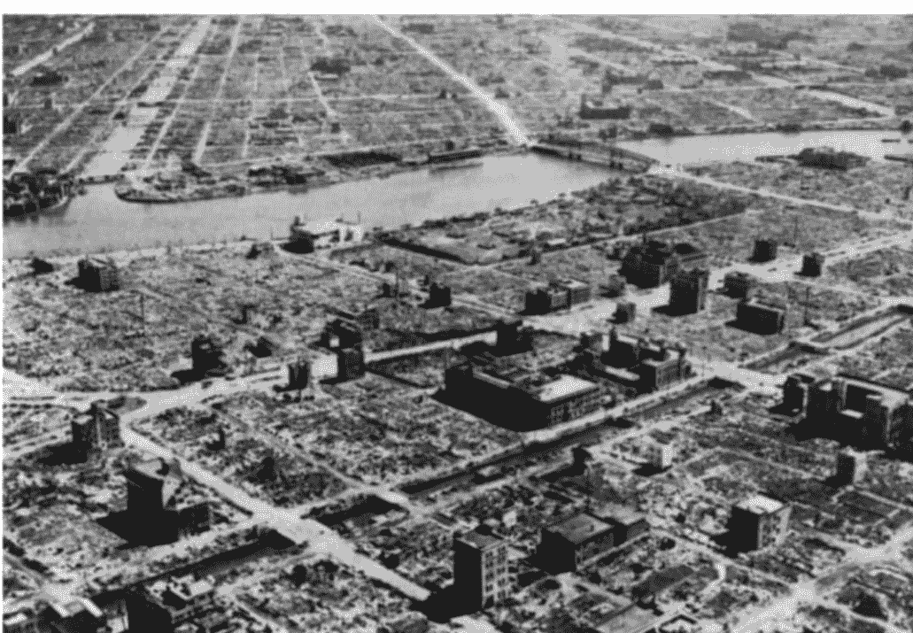
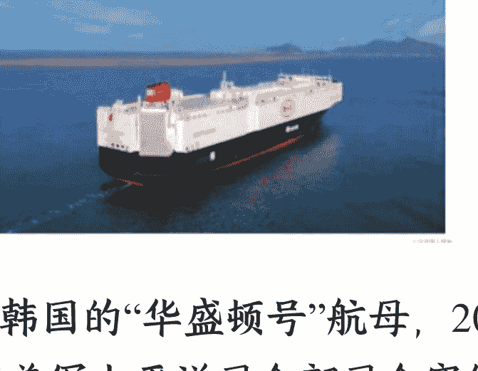
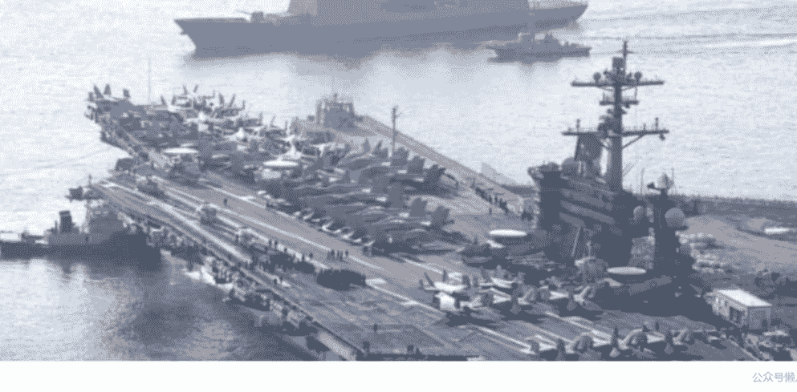

# 中国对当前形势的理解与预判

**260905 江宁知府**

整理：公众号懒人搜索，懒人专属群 精选  
懒人微信：lazyhelper1

> **小懒判断** | 适合想系统理解中国大战略演变节奏的人；不适合找短期市场含义的投资者。最值得关注的是三阶段定位：2018-2025 为战略防御、当下处于防御转僵持的过渡期、尚无任何战略进攻特征——判定锚点很硬：2025 年以来官媒“美国衰落”报道频次急剧减少，是在防止激怒特朗普兼对内降温。坑在于作者全篇基于公开信息反推决策层意图，阶段判断滞后于实际政策，别拿它当择时依据。

当我们讨论中国的大战略时，有一个绕不开的根本问题：中方究竟是从什么时候开始确信中美关系已无法挽回，需要新的大战略来应对这一严峻现实呢？

综合种种公开信息，这个转变应该是发生在 2018 至 2022 年间。

2017 年 10 月 18 日的报告中，开篇对“形势”的整体描述是这样的：“当前，国内外形势正在发生深刻复杂变化，我国发展仍处于重要战略机遇期，前景十分光明，挑战也十分严峻。”

“处于重要战略机遇期”和“前景十分光明”都是相当积极乐观的表述，另外，“和平与发展仍然是时代主题”也出现在报告中。

而在 2022 年 10 月 16 日的报告中，这几个乐观表述都不见了，改为“严峻复杂的国际形势和接踵而至的巨大风险挑战”。

那么在 2018 至 2022 这五年里都发生了哪些事情呢？此处不妨简单梳理一下。

第一件大事是 2018 年中美首次爆发贸易冲突。当时中方明显处于守势，被迫在外交和国内政策上采取了多项重大变革，比如把先前对海外的基础设施投资大幅往回收，转而投入国内战略产业扶持，全力实现技术自给自足，经济安全的弦骤然紧绷起来。

经过七年的准备，中国在 2025 年与美国的第二次贸易冲突中做出了更充分、更有力的应对，其结果自然是进一步巩固决策层对“新战略”的信心。

第二件大事是疫情和“去风险化”。拜登政府时期，世界各国对于原先的经济全球化假设做出重大调整，供应链安全被摆到相当高的位置。作为曾经遭受西方封锁禁运的社会主义国家，中国对供应链安全尤其敏感，高度强调本土全产业链制造能力。

第三件大事是俄乌战争，有关中国对这场大战来龙去脉的理解在《对过去五年的战略复盘》里有过介绍，此处不再赘述。

从地缘政治视角看，加强中俄伙伴关系是中国大战略里的一种防御性举措，即通过升级与莫斯科的合作来扭转跟美国的力量天平。

借用一句官方表述：“鉴于复杂且动荡的国际形势，中俄关系的稳定与确定性极为宝贵。”

作为坚定的结构现实主义者，历届中方决策者——无论是公开还是内部讲话——都表达过对美国及其盟友可能采取“先发制人行动”阻止中国崛起的担忧。

因此在对未来做判断和规划时，中方实际上拟定了三个阶段、每阶段有不同的政策措施：

## 1、战略防御

中国战略界的精英们很喜欢“持久战”理论，因为这是一套从弱势地位起步并最终获得胜利的剧本，也是革命年代积累下的宝贵经验之一。当讨论中美竞争时，不少中方学者将其比作“新时代的持久战”，其潜在含义即不争一城一地之得失，而争长期国力之消长。

按照持久战理论，在过去相当长的一段时间里，中国都处于战略防御阶段。

防御阶段有防御阶段的打法，比如：通过充分动员内部资源来增强自身实力；利用外部力量牵扯对手；谨慎选择交锋战场；避免硬碰硬（打得赢就打，打不赢就走）等等。

从某种意义上讲，中方自 2018 年以来其实进行了一轮“轻微的国内动员”。

这里的“动员”当然不是像俄罗斯那样四处征兵去打仗，而是在外部环境恶化的背景下，增强中央政府对经济、金融、科技、产业链以及其他社会资源的统筹调度能力，以备不测。

但仅靠存量动员是不够的，最重要的还是不断增强自身实力，实现发展壮大，所以政策的主要关注点仍放在经济持续增长上，要求不管外部形势如何，“集中精力办好自己的事情”。在战略防御阶段，如何拿捏紧绷的力度十分关键，理想状态应当是做好底线准备的同时，尽可能给发展留出宽松空间。

## 2、战略僵持

有观点认为，2018 年以来中国发展思路转变的力度可以与上世纪六十年代初中苏分裂和七十年代末中美关系正常化相提并论，在这个时间点上，中方认定已进入与美国危险对抗的时代。截至目前，中国整体上仍采取了战略防御姿态，即在冲突初期对手拥有显著优势时避免与其交锋。

自 2018 年第一次贸易冲突以来，国内经济政策的显著特点是着力减少潜在的脆弱性，俗称“补短板”。

战略层面，中国减少了大规模投资海外基础设施建设（连接周边国家的铁路、电网等除外），南海造岛暂时告一段落（直到 2025 年底在西沙重启），唯一一个官方承认的海外军事基地仍停留在 2017 年 7 月启用的吉布提保障基地。

如果要给当下所处的阶段做个定性，我们可以大致认为是从“战略防御”向“战略僵持”的过渡期。

战略僵持阶段双方实力更为均衡，都无法获得主动权，核心特征是消耗性和不确定性增加。

此时绝对不能把国家命运押注到一场扑朔迷离的“决定性战斗”上，必须等形势进一步明朗再做打算。

如果说战略防御阶段要给自己打气，避免投降主义，那到了战略僵持阶段就要保持耐心，避免机会主义。

有西方学者统计了特定范围内中国官媒涉及“美国衰落”的报道次数，发现 2025 年以来频次急剧减少。

分析人士认为，缓和这类言辞的目的一方面是防止激怒特朗普，让白宫继续保持目前对中国相对有利的外交政策趋势，另一方面也在对内稳定情绪，避免整个社会陷入急躁冒进的状态。

## 3、战略进攻

随着第二次中美贸易冲突停火和中美关系暂时归于平静，战略僵局的态势日渐明显。

特别是进入 2026 年后，由于乌克兰和伊朗两场中等规模战争的牵制和干扰，美国在东亚方向的进攻势头陷入停滞，“亚太北约”“美日韩同盟”“AUKUS”和“四方安全对话”等安全框架统统被抛诸脑后，西太平洋唯一的航母也调去了中东。特朗普激进的贸易政策促使其广大盟友（除日本）缓和与中国的关系，“集体西方”的压力大大减小。

供应链博弈方面，中国通过限制对美出口稀土首次获得了反制制裁的能力，犹记得 2025 年 9 月特朗普曾夸下海口说“一年后就会有用不完的稀土”，现在看三年五年内很难实现。

但所有这一切仍是“战略僵持阶段初期”的表现，中方缺乏符合战略进攻特征的政策或举措，对美外交以安抚、管控、反制为主。

回顾历史，战略进攻需要天时地利人和。美国逐鹿天下过程中的两次重大胜利——1945 年二战和 1991 年冷战——都是科技革命（原子弹/信息技术）叠加国际大环境变化（二战/苏联解体）的结果，因此给人一种干脆利落的感觉。在中国自身没有取得突破性实力进步的前提下，对美博弈的关键将取决于国际大环境和美国国内状况。

马基雅维利有句名言：永远不要伤害敌人，要么结交为朋友，要么将他彻底击倒。

图：1945 年的日本东京

区别于美苏冷战，今天的中美竞争不像是一场不同制度间的冲突，它更像一场尖端技术、产业权力和地缘政治的综合性竞赛。

尖端技术领域，战略僵持阶段的两国都面临着诸多困境，都押注科技革命能够解决这些问题，也都坚信时间站在自己一边。

设想一下，如果美国在以人工智能、生物技术和机器人为代表的下一轮产业竞争中失败，其结果就像在电动汽车、动力电池和新能源等领域的失败一样，将不可逆转地改变力量平衡，甚至在极端情况下变成“讲英语的大号拉美国家”。

产业权力领域，特朗普第二任期四年提供了一个罕见的机会窗口，使中国能够积极拓展经济影响力而较少遭到“集体西方”的抵制。

特朗普面向全球的关税施压客观上成为中国制造出海的“掩护”，他减少了“中国直接出口美国”的部分，却增加了“中国制造嵌入全球产业链”的部分。

一位西方学者回忆了自己在巴基斯坦港口城市卡拉奇的境遇——每天有许多船只将货物卸下，当地银行负责资金清算；在资金支付过程中，以美元为中心的金融体系拥有巨大影响力，所支付的货物则几乎都是中国制造，或高度依赖中国供应链里的零部件。

该学者点评道：“美国建立了金钱和武器帝国，而中国正在建设一个万物帝国（An Empire of Things），今天人们可以在一次商业交易中同时遇到两种形式的超级大国。”

在特朗普的极限施压之下，中国不仅保住了世界最大贸易国的地位，还实现了创纪录的1.2万亿美元贸易顺差，且大大减少了对美国市场的依赖。

图：2026年上半年比亚迪在海外市场的收入首次超过了本土市场

地缘政治领域，中国不急于重建已摇摇欲坠的国际秩序，无意充当美式秩序崩塌过程中的危机管理者——事实上将美国在海外的战争视为警示和教训，同时避免公开对抗美国。

对于崛起大国来说，和平取代霸权的行为包括两种按顺序进行的策略。第一种策略是削弱霸权国家的控制力。

具体包括抵制美国发起的国际制裁、建立替代性支付体系、供应链重构、打造新的国际组织等。如果美国仍然能够掌控全球绝大多数国家，那中国的崛起无疑将面临更大阻力。

第二种策略是建立新的控制形式。所以前面判断当下正处于“战略防御”到“战略僵持”的过渡期，或者说“战略僵持阶段初期”，从对这两种策略的观察便可窥视一二。

目前中国在哪些领域建立起了备份体系，但远没有达到跟美式秩序“分庭抗礼”的水平，总体上仍以“第一种策略”为主。

除非先削弱霸权控制力，否则建立新秩序的努力将是徒劳的。

图：访问韩国的“华盛顿号”航母，2025年11月

现任美军太平洋司令部司令塞缪尔·帕帕罗坚持“存在即威慑”的理论，热衷于安排航母频繁停靠中国周边国家的港口。

长远看，一个完全实现的“中国版地缘政治秩序”最终可能包括美军从日本、韩国撤军，结束美国在“第一岛链”地区的军事联盟，海峡两岸统一，以及解决东海和南海的领土争端。

海外秩序往往是国内秩序的延伸。

部分学者预测“中国版地区秩序”可能比现有秩序更聚焦发展、更稳定、较少关注东亚之外的纷争，全球层面则以继承现有秩序为主。

需要注意的是，每一个国际秩序的缔造者都必须支付成本，比如二战后美国通过“马歇尔计划”资助欧洲重建、向国际机构注资、构建安全保障体系等，再比如冷战初期苏联对中国等社会主义国家的支持，其背后都是巨大的财政承诺。

只有当形势已高度明朗时，才可能启动新秩序构建的步骤。

简单做下总结。

现阶段中方认为大形势正逐步从“战略防御阶段”进入“战略僵持阶段”，对外主要任务是稳定和管控分歧，对内主要任务是深度转型，包括增强经济韧性、增强军事能力、实现关键技术完全自主、应对疲弱的消费问题等。

决策者希望长期保持中国制造业的主导地位，避免走西方发达经济体去工业化的道路，这一过程中将遭遇越来越大的外部限制。

从国际市场产业竞争角度看，中国最大的对手是传统高端制造业中心欧洲，再叠加俄乌战争对中欧关系产生的负面影响，接下来几年摩擦风险极大。

当下欧盟之所以没有全力对华发难，一方面是因为凝聚内部共识需要时间，另一方面也是因为来自特朗普政府的压力——布鲁塞尔正处于艰难的对俄、对美、对华“三线作战”状态。

倘若华盛顿换成亲欧政府，重新组织“集体西方”，欧盟立场会迅速强硬起来，这也是欧洲建制派和日本、加拿大等国苦心期盼的时刻。

届时中国将进入战略僵持阶段最困难、最危险的时期，政治因素、安全因素对国际商业往来的干预越来越多，“委内瑞拉事件”“安世半导体事件”和各种形式的关税/贸易冲突层出不穷，崛起大国渐渐触及和平力量的上限。

不过中方似乎对未来充满信心和耐心，坚信成功会随着时间积累，愿意一步步试探出这个“上限”的位置究竟在哪里。

在这个 AI 能替你写代码、写文章的时代，基础技能正在迅速贬值。绝大多数人正被淹没在海量的免费垃圾信息里，陷入低效的体力内卷。

当“努力”不再是壁垒，人与人之间唯一的护城河，只剩下“信息过滤”的效率与“认知系统”的维度。

圈子已稳定运行 7 年。我们每天利用 Python 爬虫与大模型算力，过滤全网最顶级的政经内参和搞钱风向标，做你最冷酷的“外部大脑”。

如果你认同这种“重塑认知防线”的极客主义，欢迎围观我的个人情报智库：【懒人专属群】。

https://lazyso.com/insider/

认同信息过滤价值、想省下每天 3 小时无效阅读时间的读者，扫码加我微信（lazyhelper1）

