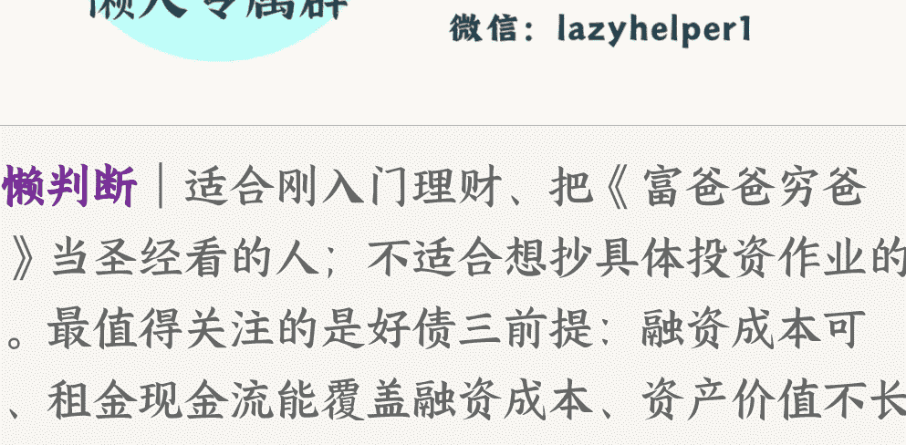

## 作者“欠债”12亿：《富爸爸穷爸爸》过时了吗？

260908
整理：公众号懒人搜索，懒人专属群精选
懒人微信：lazyhelper1

> **小懒判断** | 适合刚入门理财、把《富爸爸穷爸爸》当圣经看的人；不适合想抄具体投资作业的人。最值得关注的是好债三前提：融资成本可控、租金现金流能覆盖融资成本、资产价值不长期缩水——一线城市住宅租金回报率只有1.6%到2%，"借钱买资产"的逻辑今天很难自洽。坑在于"现金是垃圾"是口号不是方法，巴菲特自己手上都留着3500亿美元现金。

就在前几天，《名利场》杂志刊登了一篇报道，说的是一个叫罗伯特·清崎的人，负债12亿美元。

罗伯特·清崎，这个名字你可能有点陌生，但是有本书你大概率听过，《富爸爸穷爸爸》，这是有史以来最畅销的大众理财书之一，从1997年出版到现在，畅销29年，全球总销量超过4400万册，被翻译成51种语言，在109个国家和地区发行，长期占据畅销书榜单。没错，罗伯特·清崎，就是这本书的作者。

听到这，有人可能会说，一个理财教练居然欠了12亿美元，这不是妥妥地“打脸”吗？但是，你要是仔细看这条新闻，会发现这里面有一点误会。

首先，12 亿美元不是清崎的个人债务。根据清崎前妻的说法，这是“他们和其他合作伙伴共同持有的大约 1500 套公寓所对应的整体项目负债”。说白了，这大概可以理解成一帮人凑在一起炒房，这一大堆房子对应的总体负债大概是 12 亿美元，而具体到清崎自己，根据媒体的测算，他的个人负债应该在 3000 万到 6000 万美元之间。

有人可能会说，这也不少啊。但是要知道，清崎自己一直以来的理念之一就是，“你要为资产去负债”“现金是垃圾”“不要老老实实打工攒钱”。在《富爸爸穷爸爸》这本书里，最核心的观点就是，负债分好坏。借钱买消费品，比如分期买手机、贷款买车，这叫坏债；但借钱买能产生现金流的资产，比如用贷款买出租公寓、每月用租金覆盖融资成本，这叫好债。因此，清崎“负债”这个事，至少从媒体报道的信息看，跟他自己的理论大体是自洽的。

但是，说到这，也引出一个问题，《富爸爸穷爸爸》毕竟是 29 年前出版的，都快 30 年了，书里的方法放在今天还有效吗？它到底适用于什么环境？什么时候可能会失灵？

咱们先回到这本书本身。《富爸爸穷爸爸》的英文版 1997 年上市，中文版是 2000 年引进。而引进的第二年，2001 年，中国就正式加入了 WTO。

当时，经济高速增长，外资涌入，城市化加速，越来越多家庭手里开始有了积蓄，但投资、资产、现金流这些概念，远没有今天这么普及。对大量普通家庭来说，储蓄仍然是最熟悉的财富管理方式。这时候突然来了一本书，用一个特别简单的故事告诉你，别只存钱，要买资产。别只靠工资，要想办法让钱替你工作。在一个整体高速增长的市场里，清崎的观点是很有吸引力的。而且现实也在不断强化这种感觉：房价在涨，资产在涨，一些敢于承担风险的人，也许比只把钱放在账户里的人收获更多。

说白了，清崎提供的是一套强调“踩油门”的财商观，用负债撬动资产，用资产产生现金流，再利用现金流继续扩大投资。但这套方法不是无条件的，它要奏效，需要几个关键的前提。

第一个前提，是融资成本可控，而且融资渠道不会突然断掉。比如清崎本人，他做的并不是一般意义上的自住买房，而是大型公寓投资。这类房地产融资的流程比普通人贷款买房复杂得多。这个模式类似于，跟银行合伙做生意。你出首付，银行出大头，赚了一起分，但银行随时可以决定要不要继续跟你合伙。因此，如果利率突然上升、银行收紧贷款、再融资变难，这套模式就会面对压力。

第二个前提，是资产本身要产生足够的现金流。简单说，你借钱买了一套房子，房子每个月带来的租金，至少要能覆盖融资成本。而不同市场之间，情况差异很大。比如中国的一线城市住宅，近年来的租金回报率大致只有 1.6% 到 2%，想“纯吃租金”是有一定难度的。

第三个前提，是资产价值不能长期大幅缩水。一旦房价长期下跌，抵押物的价值会缩水，再融资会变难，而原来的债务并不会跟着一起消失。你的资产缩了水，但欠银行的钱一分不少。

你看，清崎的逻辑有自己的前提。融资成本要可控，现金流要撑得住，资产价值不能持续恶化。

换句话说，很多看起来特别有力量的方法，背后都有一组前提条件。

再比如，清崎一直反复说的另一句话，“现金是垃圾”。

他的逻辑是，政府持续增加货币供应，通胀侵蚀购买力，现金长期放在那里会越来越不值钱，所以应该把钱换成房产、黄金、比特币这类资产。在高通胀，同时资产价格并不昂贵的环境里，这个逻辑当然有它的道理。

但“现金是垃圾”毕竟是一句口号。它牵扯到至少两个前提：第一，你手里的现金到底有没有收益？第二，你现在能买到的资产，到底贵不贵？有时候，资产太贵，或者未来太不确定，保持流动性反而可能是更理性的选择。

当然，关于到底什么是当下的好的投资策略，这个问题我肯定是回答不了的。假如你有兴趣，可以看看何刚老师的《投资参考》。虽然跟钱打交道这个事我外行，但是，因为工作原因我要经常跟书打交道。因此，我也许能提供另一类参考观点，就是怎么读这些“大众财商”类的书。

假如你今天走进书店，会发现在大多数书店，尤其是连锁书店，《富爸爸穷爸爸》这样的书依然摆在书架最显眼的位置。除非店主本人是个重度的读书人，否则大概率不会跳脱出这个“越畅销，越推荐”的逻辑。

这些书放在今天也许依然是好书。但是，书本身不会说话，它不会告诉你，我说的哪些东西过时了，哪些依然有效。因此，我们在选书的时候，就需要把握一个平衡。

怎么把握？具体来说，你可以把这些书大体分成两大类。

- 第一类，是“踩油门”的书。也就是告诉你，成功是有方法的，世界的前景是一片大好的，因此你要有野心，要大胆去做，要一脚把油门踩到底。这类书扮演的角色，就有有点像《富爸爸穷爸爸》里的那个“富爸爸”。在 2020 年之前，这类书几乎是绝对的主流。

- 第二类，是“踩刹车”的书。而且最近这几年，至少根据我的观察，这类书的品质越来越高，而且关注度也在提升。什么叫“踩刹车”式的书，不是劝你躺平不动，而是告诉你，这个世界没有那么多所谓“另辟蹊径”的方法，它的运转方式非常朴素。你走得慢一点，稳一点，别犯错，结局大概率上不会差。比如我很喜欢的一位作者，摩根·豪泽尔，也就是《金钱心理学》的作者。我们曾经多次讲过他的观点。其实，你要是看他过往的作品，里面没有什么复杂的技巧，几乎通通是在讲故事，而且多数故事都在告诉你同一个近乎朴素的叮嘱，“别乱动，别犯错，别作死”。

一个人一两天不犯错容易，但人这一辈子太漫长了，总难免有各种各样的方式在“理财”这个事上犯错。豪泽尔观察了大量的“富人”，他发现除了金字塔尖儿的极少数人之外，对于多数富人来说，在资历、本钱、时机差不多的情况下，决定一个财富水平的不是你做过多少次成功投资，而是你能不能避开那个让自己彻底出局的错误。

再比如，**巴菲特在退休之前，每次的股东会发言都被广泛传播。但是巴菲特到底说了什么？最主要的观点之一就是，“稳住”**。而且巴菲特长期以来还有一个习惯，始终给伯克希尔保留巨大的流动性。说白了，就是“手上留现钱”，或者随时能变成“现钱”的东西。截至 2026 年 6 月底，伯克希尔持有的现金、现金等价物和短期美国国债，仍然超过 3500 亿美元。

这类书、这类文章，之所以受欢迎，也许是因为，在经历过更多轮波动之后，人们越来越容易意识到，赚钱当然重要，但“不被一轮意外直接清零”，也同样重要。

注意，我们刚才说的这两类书，踩油门、踩刹车，不是说谁一定对或一定错。我想请你关注的重点是，这两类叙事同时存在，而且有必要同时被了解。就像开车，油门和刹车都好用，这车会开得更踏实。

从这个角度看，以后再看到任何理财建议，不管是一本书也好，短视频也好，博主推荐也好，先别急决定“信”或“不信”。可以先问三个问题。

- 第一个问题，它成立的前提是什么？是假设经济持续增长？是假设利率足够低？是假设未来随时能够融资？还是假设资产价格长期不会大幅下跌？任何一套方法背后，都有隐含的前提。没有前提的建议，可能不是洞见，只是口号。

- 第二个问题，这些前提，放在我今天的情况里，还成立吗？十年前在增量市场里管用的策略，今天放到另一个市场环境里还能不能照搬？参考之前，最好先核对条件。

- 第三个问题，可能也是最重要的一个问题，假如我的判断错了，我能否承受？比如，假如房价连降五年，怎么办？假如你突然需要一大笔钱，怎么办？

> 从这个角度看，也许所谓财商，不是笃信“现金是垃圾”，也不是换成另一句“现金为王”，甚至也不是判断今天到底属于“油门时代”还是“刹车时代”。而是知道针对自己，什么情况下可以踩油门，什么情况下考虑踩刹车。帕斯卡在《思想录》里说过一句话：“人的伟大，不在于站在某一个极端，而在于同时触及两端，并占据其间的全部空间。”放在对“财富观”的选择上，这个道理或许依然成立。

在这个 AI 能替你写代码、写文章的时代，基础技能正在迅速贬值。绝大多数人正被淹没在海量的免费垃圾信息里，陷入低效的体力内卷。

当“努力”不再是壁垒，人与人之间唯一的护城河，只剩下“信息过滤”的效率与“认知系统”的维度。

圈子已稳定运行7年。我们每天利用Python爬虫与大模型算力，过滤全网最顶级的政经内参和搞钱风向标，做你最冷酷的“外部大脑”。

如果你认同这种“重塑认知防线”的极客主义，欢迎围观我的个人情报智库：【懒人专属群】。

https://lazyso.com/insider/

认同信息过滤价值、想省下每天3小时无效阅读时间的读者，扫码加我微信（lazyhelper1）

