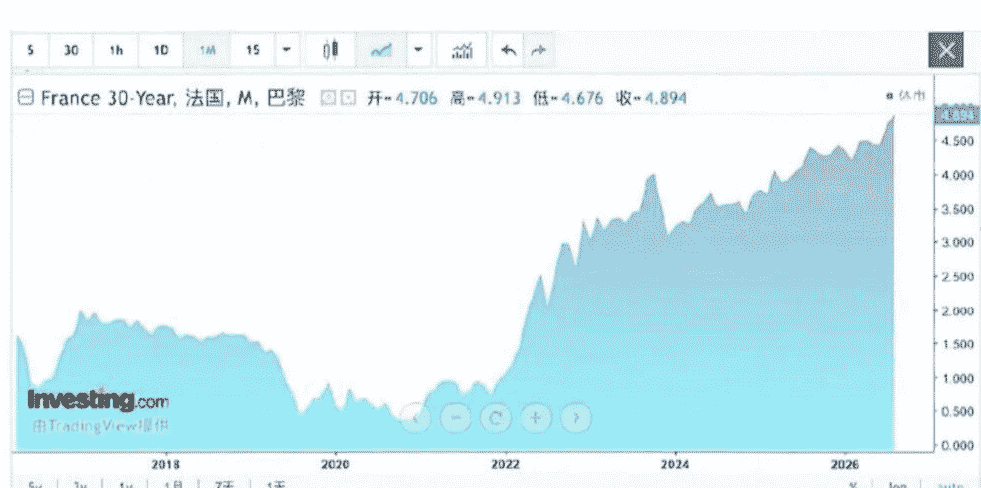
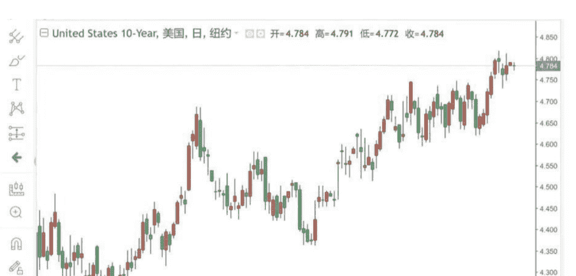
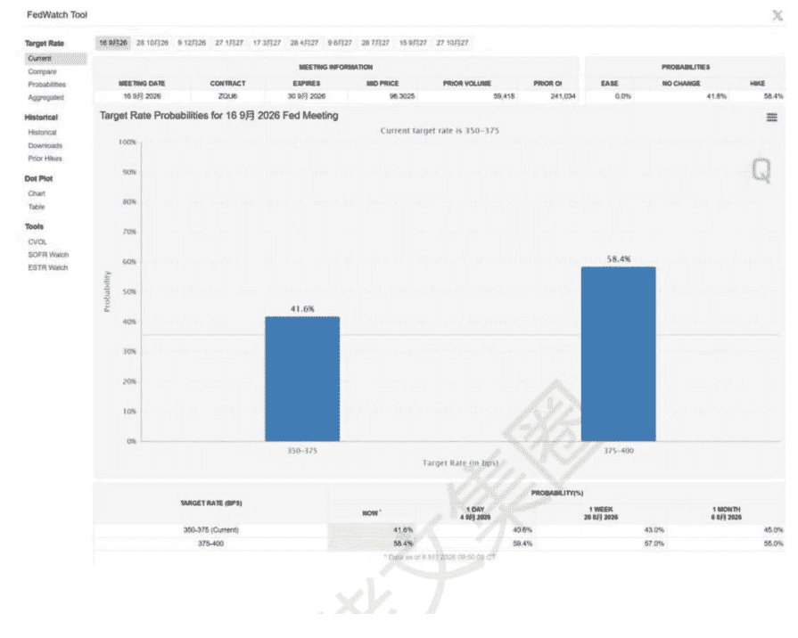

# 美国加息，天下必乱

260907 六爷阿旦
整理：公众号懒人搜索，懒人专属群 精选
懒人微信：lazyhelper1

> 小懒判断 | 手里有持仓、尤其是重仓港股和 A 股的朋友，这篇必须在 9 月 16 号美联储议息前看完。不适合找短线代码的，六爷阿旦给的是宏观推演不是操作指令。最值得关注的是他判断 9 月加息概率偏低、但年底 12 月概率很高，八九月是最后的变现窗口期，十月可能是转折点。坑在于这是推演不是预言，窗口期若延续也别抱太高期待。

## 前言

美国 9 月会不会加息？

这短期内对全球金融市场，都将会产生巨大的影响，我过去提过一个观点，叫金融战下无牛市。只要美国重启加息，意味着全球金融市场，可能会面临一轮风暴。

而现在市场这个预期正在加强，目前距离美联储 9 月议息会议只有一周时间，窗口期会不会提前结束，该做出怎样的预判和决断？今天的文章，正是对此以及相关问题的深入分析，全文 5500 字，共三个部分：1、九月加不加息？，2、加息必乱，3、我们的应对。希望能对大家有帮助。

是加息，还是降息？美国现在正走在十字路口。从 2022 年 3 月起，美国是拉开了一轮加息周期，这次加息总共加了 525 个基点，一直持续到了 2024 年 9 月份才开始首次降息。

这次降息持续到了 2025 年的 12 月份，总共降息 175 个基点。然后就是一持续到现在空窗期，没有升也没有降。今年以来美国的金融政策走向，其实一直是有分歧的。

特朗普希望降息，但是美联储主席从之前的鲍威尔到现在的沃什，一直没有松口。而全球主要经济体的金融政策，现在已经分成了两个方向。

一个是我们这边，目前虽然没有继续降息，但是金融政策是选择的宽裕方向。另一个是欧洲和日本，从今年 6 月份开始，先后再次开启了加息周期。

当前这种情况下，美国到底是选择再次开启加息周期，还是继续降息，这是现在最大的一个悬念。

实际上在美国，从总统特朗普到副总统万斯，都在喊话，希望美联储继续降息。

但是我们看整体金融市场的反应，对于美国未来的方向选择，基本上都是倾向于会继续加息。

现在唯一的问题是，美国会在什么时候加息？而目前最大的担心是，9 月会不会突然开启加息？

## 1、九月加不加息？

关于美国的这个加息节奏，我之前分析的比较多，在 7 月之前，美国的预期引导是倾向于在 7 月进行加息的。

但是中间出现了一次紧急的战略转向，所以整个七八月份发布的金融数据和预期引导又完全走向了另一个方向。目前我们看到的结果，就是七八月份并没有加息。

与此同时，从金融市场的各项指标以及美国公布的相关数据来看，更有可能的情况是会在年底加息。但是到了 9 月，情况又突然发生了变化。

首先是从 8 月底到 9 月初，从欧洲到日本都集中出现了国债抛售的情况。8 月 28 日，法国国债市场正在遭遇猛烈抛售，法国 30 年期国债收益率升至 4.894%，法国 10 年期国债收益率升至 4.127%，与德国 10 年期国债利差扩大至 85 个基点，意味着投资者对法国财政状况要求的风险补偿仍然更高。

9 月 1 日，美国、英国、日本及澳大利亚的国债市场遭遇猛烈抛售，其中英国 30 年期国债收益率日内一度升至 5.904%，创出 1998 年 3 月以来的最高水平。

彭博全球政府债券指数收益率已连续四个交易日走高，报 3.72%，为 2008 年中期以来最高水平。一般来说，这种大范围的国债抛售，往往预示着新一轮的加息潮可能会再次开启。

从现在的市场预期来看，9 月份即将举行的欧央行和日本央行议息会议，可能都会再次继续加息。在这个背景之下，如果美国不加息的话，它的金融压力会比较大。

我们看现在美国 10 年期国债的收益率水平，基本上已经是在 4.8%附近。距离 5%的收益红线，所剩空间已经非常小，这给美国的金融市场造成了比较大的压力。

与此同时，美国劳工部上周公布了最新的非农就业数据，美国 8 月非农就业人数增加 16.2 万人，预估为增加 5.5 万人，前值为减少 2.3 万人。

美国的这个新增非农就业数据，跟前面七、八月份公布的数据可以说是再次来了一个大反转。在 7 月份的时候，美国一开始想加息，后来又停止了，所以当时 7 月份公布的数据，从之前 6 月份的特别好，变成了特别差。

然后 9 月份公布的这个数据，就跟 7 月份的时候有点像，就是从 8 月份的特别差，突然又变成了特别好。

所以市场现在就开始猜测，9 月份的议息会议，美国是不是要开始加息了？

这是美国那边非农数据公布之后，从美国到日韩再到我们的 a 股，都出现了一次大幅回调的主要原因。就是市场资金担心美国可能会在 9 月份加息，这样的话在资金层面，对于金融市场毫无疑问是不利的。一般来说，金融市场都要提前做出反应，来消化这种预期。

但是说句实话，美国的这个节奏也拉得太快了。美联储的议息会议是 9 月 16 号，而上周公布非农数据大反转，这中间前后的时间差，连半个月都不到。

如果美国真的准备在 9 月份加息的话，这给市场的缓冲时间差不多只有 10 天。这么玩的话，那不变成搞突然袭击了？

但是我们也可以看一下美国那边芝商所推出的美联储利率观察工具。

目前为止，它给出的 9 月份加息概率只有 58%，这个跟之前比其实是下降的。因为在 8 月底的时候，这个观察工具给出的 9 月加息概率还有 66%。

那么从现在这个情况综合来看，美国 9 月份到底会不会加息呢？尤其是现在美国的国债收益率在不断走高，这么一个背景下，如果美国不加息，美国金融市场可能还会面临更大的压力。

同时，美国在美伊冲突中，目前也还没有一个有效的给局势降温的办法。

所以现在的油价，通胀预期，以及美国的十年期国债收益率，都在高位，等于把美国架在火上在烤。在这个情况下，很多人最关心的一个事情其实也不是美国加不加息，而是我在上个月的时候判断的 8 月和 9 月作为美国重启加息之前，整体市场反弹所形成的最后窗口期，会不会提前结束？

就现在的情况来看，9 月欧洲和日本加息将是大概率的事情，但是美国加息，目前仍然还不确定。我个人的感觉是，美国在 9 月的概率仍然是偏低的。

这与现在市场上所营造的预期看起来是矛盾的，但是从我 8 月长文章中所分析的那些基础逻辑来看，并没有发生根本的改变，所以我还是倾向于这个窗口期目前仍然还未结束。

实际上我在 8 月 3 号长文章发布之后，市场确实经历了一轮反弹，但是在 8 月下旬又展开了一轮回调，目前这个位置确实是处于一个方向选择的路口，到底是反弹继续，还是开启新一轮下跌？

我目前认为这个窗口期还未结束。但随着窗口期变得越来越逼仄，后续的空间和风险，也会被压缩在更短的窗口期内。

所以对于投资者而言，后面的情况可能会是震荡会进一步加剧。变盘的不确定性和风险，会与日俱增，最难的地方就在于，如果这个机会窗口延续，切记不要抱有太高的期待。

因为从中长期来看，美国加息仍然是大概率的选择，只不过时间早晚而已。美国一旦要选择加息，那么天下必乱。

## 2、加息必乱

实际上从现在的整体情况来看，美国要想选择降息的可能性仍然很低。虽然特朗普一直在呼吁进行降息，但是他以及他背后的资本势力，对于美国金融资本而言，恐怕影响力始终还是不够的。

这也可以说是美国内部最大的矛盾之一。我一直在强调一点，就是在上一轮的加息周期中，美国主要是针对我们。当时的美国和欧洲，以及五眼联盟国家，他们开启的加息周期，时间和节奏上面都是有相互配合的。

这也是在民主党任期内开启加息周期的一个有利因素。而他们共同进行配合的核心目标，就是在金融上针对我们。

但是到 2024 年 9 月份，美联储再次转为降息为止，这一轮加息周期整体来看其实是失败的。它的核心观察点就是汇率，人民币的汇率有一定程度的贬值，可能资金层面也有相当规模的流出，但是总体上来看，汇率的贬值幅度仍然是在一个正常可控的水平上。

反映金融安全的一个最直观最核心的指标，就是看我们的外汇储备规模，始终是维持在 3 万亿美元以上。

这就是说美国的加息周期，要想实现第 1 步，也就是抽干我们的美元流动性，都没能实现，那后面的所谓资产价格崩盘，外资以白菜价对核心资产抄底，那基本上就都不可能进行了。

所以美国在 2024 年 9 月转为降息也是迫不得已，虽然是很不甘心，但是也确实是没办法。那个时候美国的基础利率已经拉到了 5.5% 左右。

以美国的经济增速情况，不可能长期维持在这个利率水平，美国金融市场也承受不了。

所以后面的情况就是美国降息降到了现在的这个位置，然后就维持不动了。

这其实是美国需要有一个新的方向选择，背后的原因，就是美国的总统也换人了。美国的战略选择其实也面临着一个方向性的选择，那就是到底是搞特朗普所说的战略收缩，回到美洲，还是再搞一次加息周期进行收割。

对美国来说，搞加息周期进行收割，当然是最好的选择，既熟悉又轻松，成本也低，问题的关键是，那么要收割谁，才能达到这个目的呢。

在这个背景之下，这也是我去年以来一直在阐述的另外一个观点，就是美国后续唯一能采取的自救措施，就是收割欧洲，欧洲既有足够大的体量，又有比较高的收割胜率。这也是特朗普上台以来，美国和欧洲出现一系列矛盾的原因所在。

但是这里面最大的一个问题还在于，如果美国要收购欧洲，应该用什么方式？因为不同的方式就决定着你需要联合什么样的资本力量才能去干成这件事情，现在的问题恰恰就卡在这。

最开始，特朗普采用的方式是直接抢，比如抢格陵兰岛，这样去作为资产直接注入美国的资产负债表，但是截止到目前，都遭遇到了欧洲巨大的反弹。

如果格陵兰岛都抢不下来，那要去抢加拿大，就更不可能了。然后就是要考虑用金融的方式，那这里有一个问题，就是用金融的方式就需要联合美国的金融资本，而美国的金融资本在很大程度上又和欧洲金融资本是一体的，那等于是美国的金融资本要牺牲自己的欧洲利益。

现在的情况是，欧洲的金融资本和美国可能已经产生了一定程度的分化。但是作为自保，他们已经提前开始了加息，来缩小欧美利差。

那么等到美国真正开启新一轮加息的时候，这种通过利差吸引美元回流从而打爆欧洲资产的方式，到底还行不行得通？我过去一直认为，如果美国的金融资本愿意，其实他们是有其他办法的，比如在欧洲的金融机构定向制造金融危机，导致欧洲的金融资产价格因为某些巨型金融机构的破产危机而暴跌，然后美国再去抄底，这是有可能实现的。

甚至过去其实一直有这种迹象，就是德国的德意志银行和出事之前的瑞士瑞信，其实都有很多金融层面的风险后门，是有可能被引爆的。

这样的操作成本很低，但是又完全依赖于美国金融资本的配合。如果特朗普争取不到这种程度的配合，最简单粗暴的方式，就是快速大幅的加息。搞一轮短促而猛烈的加息周期，去拉爆欧洲。这个只需要掌握美联储的金融政策调整权即可。

现在是否会走到这个路径选择上来，还不能完全确定，但是这样做的风险是越来越大。只要美国开启加息周期，这可能就没有回头路。虽然我认为 9 月加息的可能性偏低，但是年底 12 月加息的概率还是很高的。如果那个时候加息周期开启，大概率就没有第 2 条路可以选择了。

那相对应的，我们都知道，美国要开启加息周期，不管是短是长，往往都会同步制造地缘上的危机来进行配合，对资金进行驱赶。上一轮加息周期开启的是俄乌冲突，那么如果后面要开启新一轮加息周期，越是短促，那地缘上的冲突危机将越是猛烈。

恰好这个时间，特朗普的特使正在俄罗斯和乌克兰进行斡旋。从这整个一系列的宏观背景来看，与其说是美国想去进行调停，不如说是在去摸底，有可能是在为升级更大的冲突去做准备。

因为金融上面收割欧洲，如果是没得选择的选择，那么地缘上面升级俄乌冲突，对欧洲资本进行围三阙一，就是必然的选择。

而且升级的强度和危机所制造预期，必将大幅上升。因为只有把这种预期拉满，欧洲的资金外逃才会是不顾一切的。那么美国要如何围三阙一呢？

## 3、我们的应对

这里面可能有一个比较重要的封堵方向就是东亚，也就是在东亚方向也会制造相应的预期，或者是在金融层面，破坏掉资金向东亚流入的选择。那最后欧洲资金唯一能选择的安全点，就只能是美国。

现在美国在东方向进行这种操作的主要抓手，一个是日本在制造摩擦和地缘安全局势不稳定的预期。

这个对于我们来说其实是比较好解决的问题，因为实力上面的碾压不存在太大的问题。关键是另一个方面，美国和日本在金融层面的操作，其实已经很大程度上在阻碍这种全球层面的资金向东亚流动。

此前日元汇率贬值到了 164 附近，其实再往上就是一个上不封顶的状况。

但是出人意料的是美国居然联手日本去维护日元的汇率，我当时给出的结论是美国的资金从日本金融市场撤出还未结束，它需要更多的人去做对手盘。

实际情况是全球金融市场的共识，是日元的贬值仍将持续，而且还远未结束，那么这种中途的日元升值，恰好是给了资金流出的机会。就在 8 月，日本的美元储备大幅减少将近 900 亿美元。

美国通过口头支持，让日本拿出了大几百亿的真金白银去市场上进行对冲，这几百亿美元的对手盘，可能恰好就是跑路的美国资金。

那么现在日元汇率所处的这个位置，对于国际资金来说，就有很大的风险。

这是后续资金向东亚流动，一个比较大的阻碍。当然现在我们的问题可能也并不是说需要大规模的迎接欧洲的资金流入。从整体战略上面来讲，我们跟欧洲没有做好相应的制度准备，连中欧投资协定目前都还没有解禁。

我们更多的可能，只是说后面欧洲市场开放，我们能分一杯羹，就已经很不错了。真正的问题在于，如果美国开启新一轮加息周期，这个时间到底会持续多久？

对于我们金融层面的冲击会有多大？尤其是现在资金持续流出的这个背景下，我觉得我们应该做一些未雨绸缪的对冲准备。

在宏观层面的国家政策上面，我不想做过多的讨论，有的时候说起来会比较让人生气，我这里重点说一下，我们个人对可能出现的情况，需要做一些应对。

- 第 1 个是之前提到的安全窗口期的问题，其实最根本的是这个窗口期是一个变现准备现金流的机会。之所以说要做这样的准备，是要防备后面的这种加息周期重启带来的市场冲击。
- 第 2 个是如果这种冲击出现，很多人关心有没有机会进行抄底的问题？目前来看，我觉得这种不确定性非常高。因为美国那边自身会不会出问题，现在还不确定，尤其是 AI 泡沫会不会受到牵连而崩盘的问题。
- 第 3 个是后续的冲击和时间会持续多久的问题？我觉得站在目前的这个时间点，还无法做出预判。但是越是这样，第一点的重要性无疑就变得越高。

### 最后

在今年初，其实是能感受到经济层面在回暖。

但是在 5 月份之后，微观层面有一种特别明显的再次调头往下的感觉。我不太确定这不是一个宏观层面的共性情况，但是从几个一线城市的消费零售数据走势来看，跟我的感受是吻合的，说实话，这是一个不太好的感觉。

老读者都知道我是一个长期乐观主义者，但是短期的这个变化，确实让我也无法忽视。在这种情况下，很多人寄希望于在金融市场博到一个好的机会，我个人的感觉是这恐怕不太现实。

我一直讲，八九月可能是一个窗口期，那么那对应的其实就是十月可能会是一个转折点。我不希望这个会发生，但是从投资的角度来讲，我想再次提醒的是，控制风险永远比博取收益更重要。

扩展阅读：窗口期开启，这将是最后的逃生机会？

## 评论：

zIz：不太理解：如果说美国不想 9 月加息，为什么上周五的非农数据要搞这么大。如果说他想加息，但好像数据出来后市场的真实反映又并没有那么大。

六爷阿旦（作者）：是的，这就是比较矛盾的地方，但是恰好印证了我之前的观点，数据调整为预期引导服务，我觉得这可能是为后续加息做铺垫，如果九十十一连续三个月的数据都很好，那么年底加息就顺理成章了。

熊二：港股是不是彻底废了，基本跌回熊市了

六爷阿旦（作者）：跟资金流有关系，跟基本面关系没那么大，所以总体看，整体资金流出压力还是很大

氤氤氤核聚变：九月份有可能中美俄会晤，还有中期选举也不可能加息让七朵花暴跌，所以最有可能九十十

六爷阿旦（作者）：这个我八月长文章写过，不会有那么长的窗口期的，一般都会提前两个月左右就开始消化预期了，所以等到真正加息的时候，往往已经是靴子落地的时候了。

明丰钢材赖生：写忖为敬，睡前安静边听边思考

咱们今天公告的银行保险注资是什么操作？

六爷阿旦（作者）：我看了不同角度的分析，有风险角度的未雨绸缪说，这个是央媒的专家观点，可能是对外宣传口径。还有就是可以加杠杆的观点，另一个就是涉及到有些专项投资，属于是国家战略层面的需求，因为短期收益不明显，所以补充资本金用于专项投资项目建设的资金需求。大致就是这几种观点。

Ljc：旦总，市场现在是不是已经按加息来定价了

六爷阿旦（作者）：目前看还不是，加息会比这个严重得多如果加息，而且是长期大幅度的加息，那美国国债利息和财政平衡怎么办？科技损八百，只怕没那个条件吧？

六爷阿旦（作者）：所以这里也没讨论这个可能性，主要还是考虑短期大幅加息的可能性

迅电电机许生：我们为金融注入 3000 个小目标是不是也有提前做好美帝加息冲击的准备？

六爷阿旦（作者）：我看了不同角度的分析，有风险角度的未雨绸缪说，这个是央媒的专家观点，可能是对外宣传口径。还有就是可以加杠杆的观点，另一个就是涉及到有些专项投资，属于是国家战略层面的需求，因为短期收益不明显，所以补充资本金用于专项投资项目建设的资金需求。大致就是这几种观点。

迅电电机许生：回复六爷阿旦：可能这几种都兼而有之吧，中期选举临近了，9 月加息可能性很低。11 月就很难说了

----------------分割线----------------

在这个 AI 能替你写代码、写文章的时代，基础技能正在迅速贬值。绝大多数人正被淹没在海量的免费垃圾信息里，陷入低效的体力内卷。

当“努力”不再是壁垒，人与人之间唯一的护城河，只剩下“信息过滤”的效率与“认知系统”的维度。

圈子已稳定运行 7 年。我们每天利用 Python 爬虫与大模型算力，过滤全网最顶级的政经内参和搞钱风向标，做你最冷酷的“外部大脑”。

如果你认同这种“重塑认知防线”的极客主义，欢迎围观我的个人情报智库：【懒人专属群】。

https://lazysso.com/insider/

认同信息过滤价值、想省下每天 3 小时无效阅读时间的读者，扫码加我微信（lazyhelper1）

微信：lazyhelper1
