# 做外卖 CPS 一年后，我用 Codex 做了两个小程序，帮我放大业务

260908 副业 SC 精华
整理：公众号懒人搜索，**懒人专属群**精选
懒人微信：lazyhelper1

> **小懒判断**｜适合手里有现成流量、想用 AI 做个小程序把业务沉淀到自己地盘的副业玩家；不适合零业务零流量、指望第一个产品就起飞的人。最值钱的是那套 SPEC 提示词——让 AI 像苏格拉底一样追问一百多个问题，把模糊想法压成 MVP 和不做清单，排班小程序返工一周就是没走这步。坑在微信认证和备案的顺序：先认证再备案，反了要多耗 6 天。

# 前言

大家好，我是伍拾陆，一个非科班出身的 0 基础代码小白。

从去年 7 月参加了外卖 CPS mini 航海至今，我一直在做 CPS 业务，也慢慢积累了一些真实的长期用户。在上一篇帖子中，我提到想把正在做的 CPS 业务进一步扩大，一开始我考虑过做矩阵、做私域，或者通过多个平台分发 CPS 内容。但在不断摸索的过程中，我发现这些方式并不适合我，这样下去也不是办法：**流量和转化始终依赖平台，我缺少一个真正属于自己的承接流量的方式。** 在 5 月 AI 大航海学习了 AI 编程后，我开始尝试一个新的方向——做自己的小程序。

这也是我第一次尝试用 AI 开发完整可上线的产品。

6 月下旬到 7 月中旬的这些日子里，我全程使用 Codex 进行开发，完成并上线了两个微信小程序：

一个是根据生财里的中标信息制作的排班找同休的小程序；另一个是根据自己的 CPS 业务开发的优惠券聚合小程序。

从需求分析、页面设计、功能开发，到测试、提交审核、最终上线，整个过程都是我一步步摸索完成的。

作为一个不懂代码的普通人，这次最大的收获不是做出了两个小程序，而是验证了一件事：

普通人借助 AI，也可以把一个想法快速变成一个上线的产品。所以这篇文章，我想站在一个 0 代码基础小白的视角，记录我是如何利用 Codex 开发小程序从 0 到 1 的全过程。

文章分成四部分。先讲我为什么选择做小程序来放大，再给一套小白也能照着执行的 SOP，然后复盘两个项目里遇到的问题和解决办法，最后总结几条给圈友的启示。

## 第一部分：我为什么选择做小程序来进行放大

### 一、我想要的不再多一个平台账号，而是一个适合自己的稳定流量承接工具

做 CPS 时，最常见的放大方式是增加内容数量、扩大分发平台、沉淀私域，再把用户引到成交链路里。

这些方法都有用，但对我来说，问题也很明显。

第一，CPS属于重营销的类型，容易被官方警告甚至封号，平台规则一变，原来的内容和路径可能立刻失效。第二，用户每次都要重新翻笔记、找口令、问活动，交付过程很散。第三，CPS我已经做了一年了，有真实用户和持续更新的活动内容，却没有一个固定入口把流量沉淀下来。第四，我作为普通人，精力有限，手里的号就几个，现金流也不多，做矩阵、私域那些没啥经验也整不过来，目前还是处于探索阶段，求稳还是比较重要的。

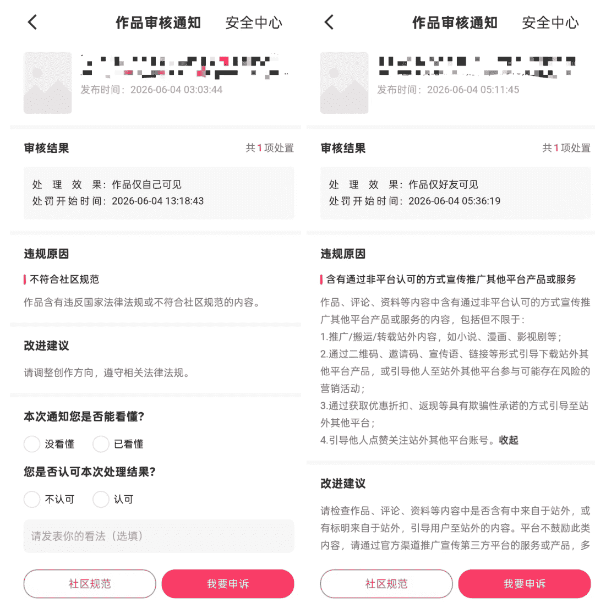

（以上两个违规是因为当时我想拓展账号业务，发了有关618的内容，结果差点把号的稳定流量整没了，而且那天少了几十块的佣金收入）

我在深海圈学习了 AI 编程，通过圈友的精华帖也知道了具体怎么做小程序，而小程序刚好能作为我的流量承接工具填补这块缺口，可以把原来散在视频内容里的流量，整理成一条稳定沉淀到微信小程序的路径，拓展我的 CPS 业务。

对于我做的 CPS 来说，这条商业闭环的路径很短：

用户准备点外卖、订酒店或者出行时，打开小程序，找到对应平台，复制当前需要的优惠口令，再去官方 App 便可以领到优惠券。

### 二、第一个开工的不是 CPS，而是找同休小程序

我真正动手做的第一个小程序，是找同休小程序，这个需求来自生财的一条中标信息。

需求：倒班人群自己的班表已经不好记，两个人或者一群人想找共同休息时间，还要反复问每个人哪天休。

我去搜索了这篇笔记，发现评论区反馈很强，很多人希望尽快有小程序，也有人把场景延伸到医护、铁路、电力、民航和酒店等行业。

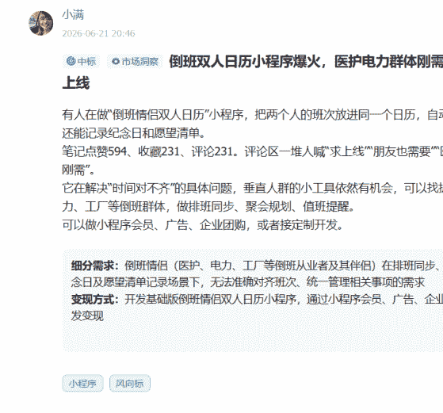

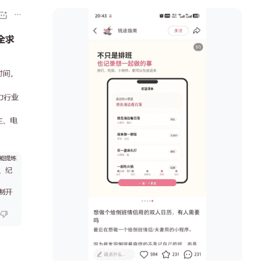

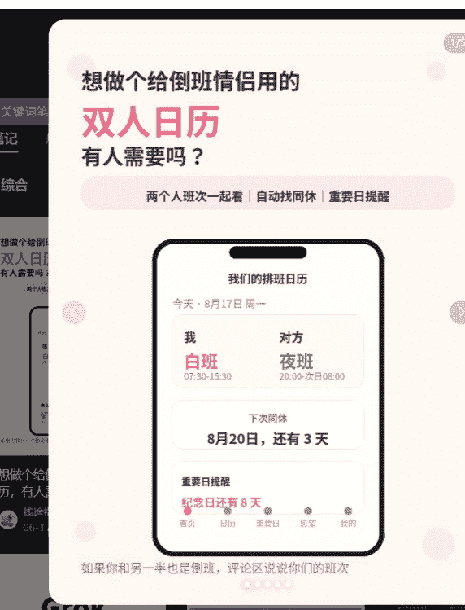

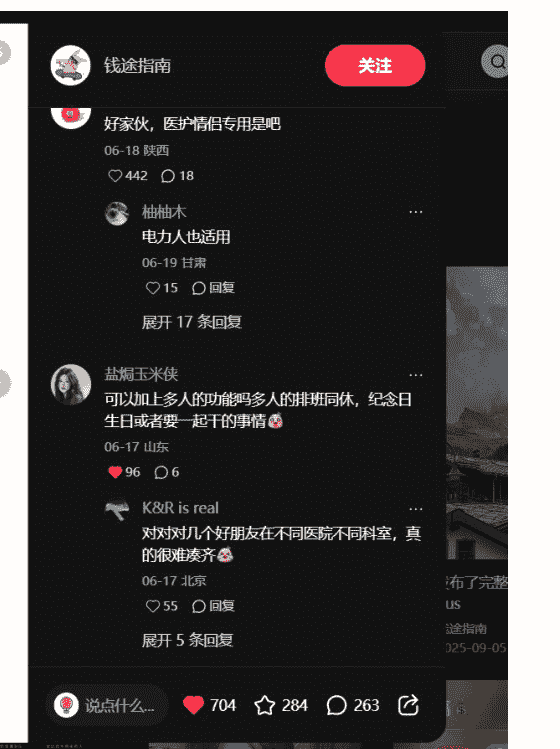

为了验证需求，我发了一篇小红书笔记。

当时我觉得，需求已经这么明确，几天就能做完并上线。

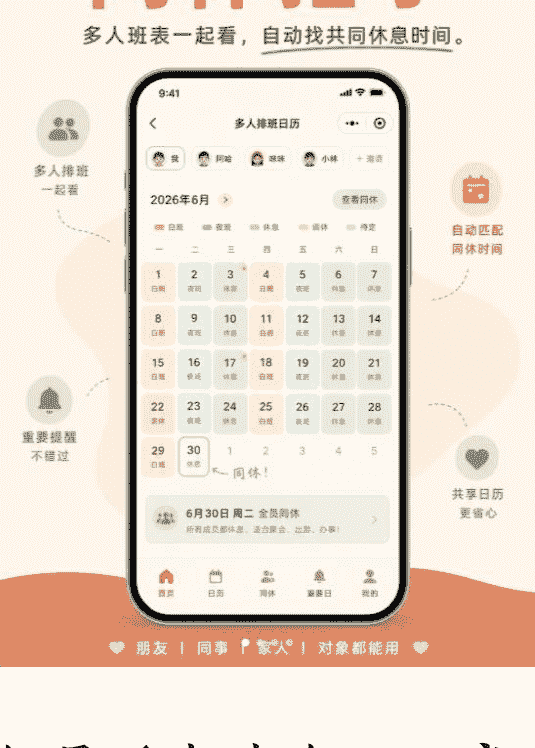

但是后来才发现，我只验证了需求存在，却不知道小程序的第一版应该长什么样，后面跟着 AI 给的建议一直不停的优化，代码越写越多，范围很快从双人排班拓展成多人排班，还有记录生日、纪念日等等一堆杂七杂八的功能，Bug 也跟着增加。我开始像无头苍蝇一样到处修 bug，一个星期了还没能完成最基础的功能，最后只能先停下来。

### 三、排班项目暂缓后，我才重新从自己的 CPS 业务出发

排班小程序暂停后，我翻圈友的帖子寻找做小程序的经验，在看到HP圈友写的关于优惠券聚合小程序的帖子之后，我恍然大悟：

> 与其从零寻找一个项目，不如围绕自己一直在做的CPS业务，做一个更有确定性，能够放大现有流量的小程序。

这个项目有几个确定条件：用户本来就会在消费前找优惠，不需要养成一个全新的习惯；我手里有持续更新的活动口令，不需要做完产品再去找内容；口令一键复制后可以直接在对应官方App识别，用户信任度高。

不过我一开始选择的并不是口令，而是短链接+口令的形式，我在小程序体验版进行测试的时候，发现短链接无法正常跳转，才把小程序缩减成“一键复制口令，再去官方App领券”的形式。

更重要的是，这一次我没有马上写代码，而是先用SPEC方法让AI连续追问，把原来模糊的“优惠券聚合小程序”整理成了一个可实现最小MVP的形式。

所以，CPS小程序虽然后做，却先上线。

## 第二部分：小白能看懂照做的小程序SOP手册

### 第1步，找需求选方向

找需求，是产品开发的第一步。需求的本质，是有人愿意为某件事付出代价。

现在做产品，讲究**“需求倒做”**——**先找到用户的需求痛点，再开始设计产品，最后进行开发。**

很多人刚开始做小程序的时候，不知道自己要做一个什么样的小程序。

这时候可以借助小排老师的产品自查方案，问自己四个关键问题：

- 什么人？
- 在什么场景下？
- 愿意花多少钱？
- 解决什么问题？

如果实在没有方向，可以去看看**生财的中标和风向标**，里面经常会发有各种可以做成小程序的需求。

**我做的第一个小程序，就是在生财的中标那里找到的灵感。** 平时刷小红书的时候，也可以多注意注意评论区，最好是发布时间在一个月或者一周之内的，评论多的笔记。

找到这样的笔记之后，可以使用 Chrome 浏览器的“**社媒助手**”插件批量提取评论，因为有机会会被封号，所以建议登录小号进行提取。提取评论后发给 AI 分析评论区的人都在抱怨什么，他们的需求痛点是什么，这样大致就能知道做小程序的方向了。除此之外，还有好几种方法：

1. 发一篇小红书记，直接描述场景和痛点；
2. 在目标用户群里提问；
3. 翻同类产品的差评、评论和求助帖;

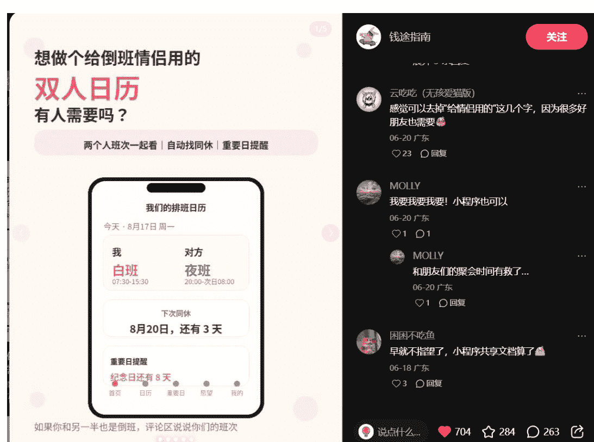

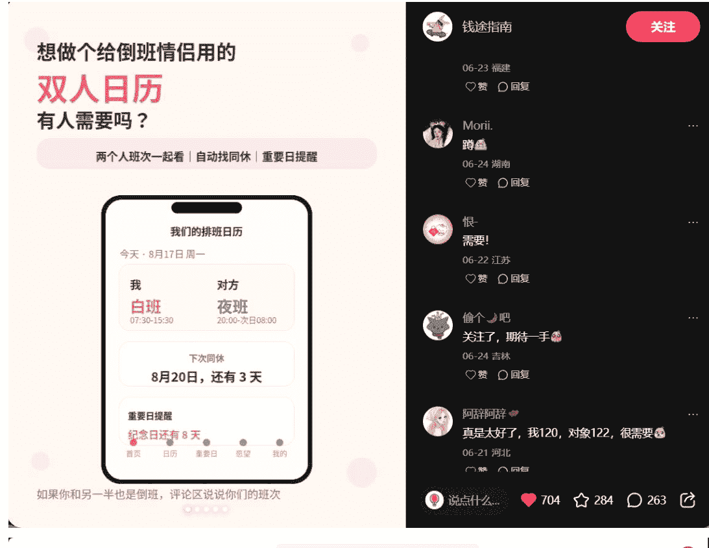

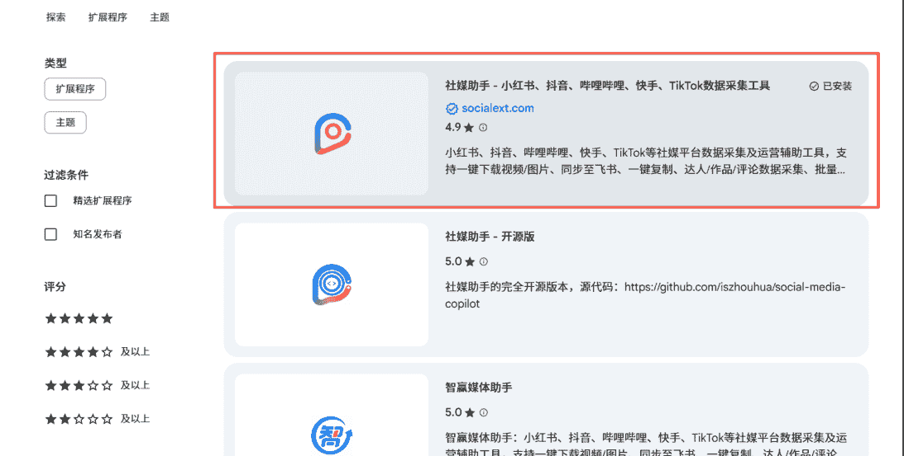

#### 第 2 步，先明确产品定位，再划定边界，最后定义 MVP

- **产品定位**：确定方向——这个产品要解决谁的什么问题；
- **边界**：划定范围——哪些功能不做、哪些场景不覆盖；
- **MVP**：在定位和边界之内，挑出最小可验证的那一版。

需求得到初步验证后，用 SPEC 方法整理完整需求，划定产品的边界，避免开发的时候像无头苍蝇一样经常碰壁。

**下面是在 AI 编程深海圈学到的 SPEC 提示词 我有一个需求，想跟你说一下。但在写一行代码之前，我希望你扮演一个极度认真、稍微有点偏执的产品经理。**

你的任务不是写代码，也不是给我方案。

你的任务是，像苏格拉底一样追问我，直到把我下面这些藏起来的东西全挖出来：

我没想清楚的隐含假设（我以为不言自明、但其实没说的事）；我没想清楚的边界（出错怎么办、空数据怎么办、撤销怎么办）；我可能在偷懒（把“随便实现一下”当成“已经想清楚”）；我可能在自欺（把“我想要”当成“用户想要”）。

请每次只问一个问题，问到第 N 个问题之后，你认为问得差不多了，再帮我总结成一份完整的需求文档。

下面是我的初始想法，你开始问吧：

这里的 N 不一定要填具体数字，它代表的是**"持续追问，直到问清楚为止"——具体要问清楚四件事：用户是谁、边界在哪、不做清单有哪些、验收标准是什么。** 我开发 CPS 小程序之前，用这套 SPEC 提示词让 AI 连续问了我一百多个问题，其中很多是我自己根本没注意到的点。所以重点不在于问了多少轮，而在于知道第一版小程序该做成什么样。

等需求彻底明确之后，就可以开始动手做小程序了。

#### 第 3 步，微信小程序开发

##### 1. 小白词典

**AppID**：这个小程序的身份编号。

**微信开发者工具**：用来创建、编译、预览和上传小程序代码。

**Codex**：能够读取项目文件、修改代码并运行检查的 AI 编程工具（开发小程序消耗 token 较多，有条件的建议开 Pro 套餐，小白的话 plus 套餐很卡效率）

**Git**：给代码留下可回退版本的工具。如果暂时不会用，至少先复制一份完整项目备份。

**CloudBase**：为小程序提供云数据库、云函数和文件存储的后端服务。

**云函数**：运行在云端的代码，适合处理权限、数据校验和不应放在前端的操作。

##### 2. 开工前需准备这些东西

1. 微信小程序账号和对应 AppID；
2. 微信开发者工具；
3. Codex 或其他能读取项目文件的 AI 编程工具；
4. 一个独立的项目文件夹；
5. 已确认的 SPEC 和不做清单；
6. Git 版本记录或至少一份可恢复备份；
7. 真实测试样本、测试微信账号和测试手机；
8. 完成账号和本地项目准备；是否创建 CloudBase 环境，在下一步根据数据是否需要跨设备共享再决定。

##### 3. 小程序账号注册教程

生财的三月小程序航海手册里的有关账号注册和环境搭建步骤很详细，这里我就不多赘述了 链接直达：

https://scys.com/activity/9632/course/148?chapterId=9617

##### 4. 常用官方入口

微信公众平台： https://mp.weixin.qq.com/

微信开发者工具下载：
https://developers.weixin.qq.com/miniprogram/dev/devtools/download.html

微信小程序开发文档：
https://developers.weixin.qq.com/miniprogram/dev/framework/

腾讯云 CloudBase 微信小程序快速开始：
https://docs.cloudbase.net/quick-start/frameworks/wechat-miniprogram

##### 5. 步骤简介

1. 先在微信公众平台按当前官方引导注册小程序账号，确认账号主体、服务类目和计划使用的能力是否允许发布，再取得 AppID。
2. 然后安装微信开发者工具，用自己的微信登录，新建一个空白小程序项目，并确认它可以正常编译和预览。
3. 代码要放在单独目录里，不要让 AI 在空目录上假装已经读取了不存在的配置文件——如果目录还是空的，先让微信开发者工具生成基础项目结构。
4. 接着把已经确认的需求文档放进项目目录，让 Codex 只做只读检查，明确指出缺少的文件，而不是一打开目录就开始大改。
5. 确认项目入口、页面目录和云端配置后，建立第一次 Git 记录或完整备份，最后再进入功能开发。
6. 每完成一步都保存结果，不把账号注册、环境配置和写功能混在同一轮里。

**验收标准**

微信开发者工具能正常打开和编译项目；SPEC 已放进项目；知道报错在哪里看；当前版本有可回退基线；前端没有 AppSecret、云 API 密钥或其他管理凭据。

**避坑注意**

不要把 AppID、云环境 ID 和管理密钥混在一起。AppID 用于识别小程序，密钥用于获得更高权限，不能因为 AI 说要"帮我配置"，就把密钥直接写进前端代码。

##### 6. 小程序的命名，备案和认证

**小程序发布流程**

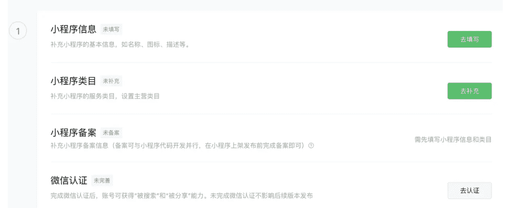

- 在写代码之前，小程序的命名，备案还有认证都很重要，先把这些确定了再开始也不迟。
- 微信认证需要提交 30 元的费用。
- 小程序的信息、类目、备案需要和认证内容完全一致。
- **特别需要注意的一点：先认证再备案。**如果先备案，但是微信认证不通过的话，又得重新提交备案审核，这样又会浪费几天的时间。
- 我刚开始是根据官方的小程序发布流程从上到下进行操作，先备案了，然后再进行微信认证的。但是微信认证的时候信息和备案的不一样，**认证信息和备案不一致的话小程序可能无法上线**，以防万一我把备案信息修改后重新提交了，这样算下来一共提交了两次审核，消耗了 6 天的时间（如下图）。
- **每个小程序因为功能不一样，审核的时间也会有差异。**我做的找同休小程序审核一次大概需要 3 天的时间。
- 小程序的审核人员一般是在工作日进行审核，所以提交审核时间尽量在周一或者周二比较好。如果是周五的话，大概

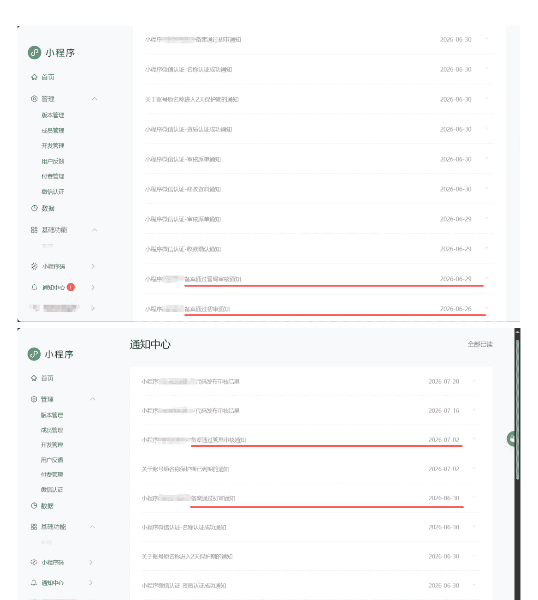

##### 7. 代码、流程不懂就问 AI

我是非科班出身的，在开发小程序的时候，很多代码，流程什么的我也都不懂。我都是截图直接问 AI 这些代码是干什么的，下一步要干什么，然后这个报错又是怎么回事，怎么解决，如果有这些问题直接问 codex，让它解决就可以了。

用 codex 开发小程序的时候，推理模型不需要开到最顶，一直开极高的话，codex 容易规划太多，做很多无用功。小程序代码并不算难，平时推理模型是 5.6sol 的时候用中或者高就行了，个别情况才用极高，省 token 的同时又能提速。

#### 第 4 步，做多人跨设备的功能需先决定真相源

真相源：就是在一份数据上，所有人都认它说了算 做多人或者跨设备的功能，第一件事就是确定哪份数据是真相源。先把数据分成三类：

第一类，只给自己看的临时数据，比如草稿、页面偏好，放本地就行。

第二类，多人多设备要看到的数据，比如小组、成员、班表，这种必须放云端，大家都认同一份数据。

第三类，来自第三方平台的数据，比如优惠到底成没成交，不能由小程序自己说了算。

云端失败的时候要明确提示失败，不能偷偷伪造一个"看起来创建成功"的结果。

还有一点容易忽略：记录的动作要跟真实动作对上。点击不等于复制，复制不等于领券，页面打开不等于成交。只记录自己能观察到的那一步。

做多用户产品还要想清楚一件事：系统怎么区分用户。第一版不做账号密码登录，不等于不需要区分用户。小组成员、班表和权限都要能绑到一个稳定的用户身份上。

**验收标准**

知道每类数据存在哪里、谁能读写、失败时怎么办。多人产品中，设备 A 写入后，设备 B 在有权限的情况下能读到。

#### 第 5 步，建立逻辑地图，每一轮对话都给 Codex 执行指标

每轮开发前，让 Codex 先回答四个问题：

改什么；影响哪里；不能动什么；怎么验证。

**逻辑地图开发法，就是在写代码前，先把“这个功能是什么、用户怎么用、系统怎么跑、数据放哪、规则是什么、怎么验收”画清楚。**这是郭东超老师在深海圈直播时分享的技巧。

比如我们要做一个“创建任务”功能。

普通做法可能是：想到哪里写到哪里，先做页面，再补接口，最后才发现漏了校验和测试。

逻辑地图开发法会先把这个功能拆开：

- 它属于什么能力？——任务管理（CAP）
- 出现在哪个页面？——任务列表页（PAGE）
- 用户点哪个按钮？——创建任务按钮（UI）
- 用户做了什么？——填写任务并点击提交（ACT）
- 系统完整怎么处理？——校验内容、调用接口、保存数据、刷新列表（FLOW）
- 调用了什么接口？——创建任务接口（API）
- 保存了什么数据？——任务记录和列表缓存（STORE）
- 哪些规则不能破坏？——任务标题不能为空（ RULE ）
- 怎么确认没问题？——测试空标题、正常创建、列表刷新（ TEST ）

这样，功能就不是一团代码，而是一张能追踪的地图。

再简单一点，可以用“修路”来比喻：

- CAP 是要去哪里：目标能力
- PAGE 是经过哪些地方：页面
- UI 是从哪里上车：按钮
- ACT 是乘客做了什么：用户动作
- FLOW 是整条路线：业务流程
- API、STORE、RULE、TEST 是路上的配套：接口、数据、规则、验收方式

前五个是主路线，后四个是配套设施。

只画路线，不看配套，路可能走不通；只写代码，不 看地图，功能容易漏东西。

它最重要的价值，是让每个功能都能回答九个问题：

做什么？在哪做？点什么？谁来做？怎么流转？调 什么接口？存什么数据？哪些规则不能破坏？怎么验证？

开发前，还要先回答四个问题：

改什么？影响哪里？不能动什么？怎么验证？

所以它不是为了把文档写复杂，而是为了让开发过程少靠猜。

人能看懂这张地图，AI 也能按照这张地图改代码。

##### 验收标准

Codex 能说清这轮改了什么、影响了哪里，改完之后需求和代码是一致的，能单独回退这一轮。

##### 避坑注意

不要用"还有什么可以优化""帮我全面检查"这类话，没有停止条件，AI 会根据自己的想法越改越多，token 的消耗量也会大大增加。

#### 第 6 步，先验证技术路径，再优化页面

用到微信平台、第三方页面、OCR、支付、定位、剪贴板这些功能的时候，先别急着做完整页面。先做一个最简单的测试：一个按钮，一条真实数据，一台真机，看关键链路能不能跑通。

比如要打开外部活动页，先做个只有 web-view 的测试页，验证域名能不能跳转；要做图片 OCR，先拿一张真实截图，看服务到底能不能用。

技术路径跑不通的时候，先记录证据，别马上换方向继续堆代码。

##### 验收标准

最不确定的外部依赖，在真机上跑出了结果：能用、不能用、或者暂时不做。不能用的话，有明确证据。

##### 避坑注意

模拟器和开发者工具只能证明一部分，很多问题只有真机才会出现。

#### 第 7 步，用四层证据验收，真实设备测试数据

验收分四层：

- 第一层，代码和自动测试。
- 第二层，开发者工具里页面能不能打开、按钮有没有反应。
- 第三层，真实业务数据，就是用户真的会粘贴、填写的内容，不是自己编的。
- 第四层，真机和真实账号。多人产品至少两台设备两个号。

**自动测试通过不等于真机能用。验收标准**
每条核心路径都有测试记录。多人功能完成双账号双设备测试，解析功能用真实原文测，没有做的明确标成未验证。

##### 避坑注意

测试数据不能用自己编，要用真实的设备进行测试。自己编的样本测过了，不代表真实场景没问题。

#### 第 8 步，提交审核上线前需核对隐私、权限和回退方案

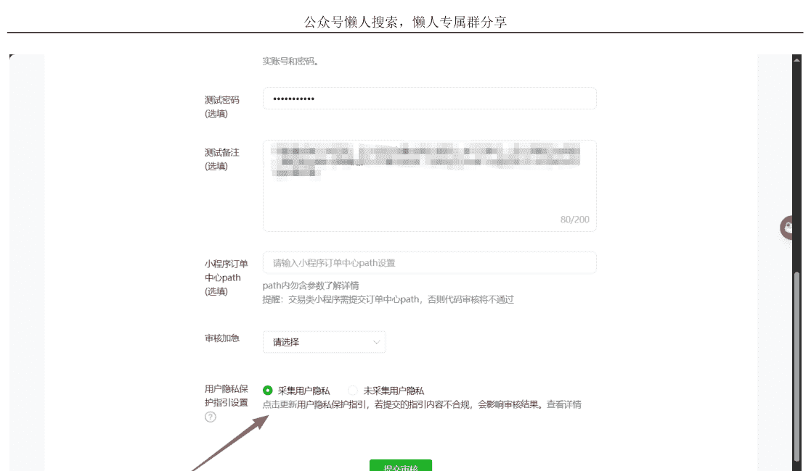

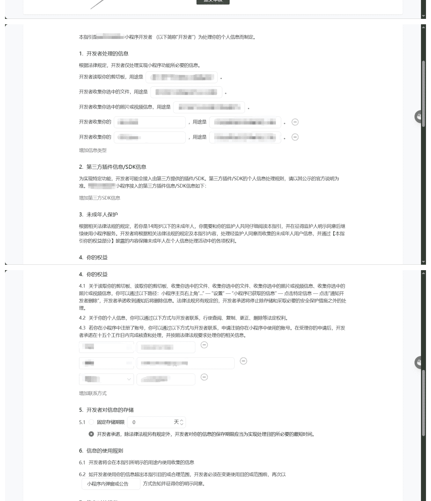

提交审核上线前，如果需要采集用户隐私，得列出小程序实际用到的所有能力（比如剪贴板、相册、定位等），按微信要求逐项说明。用了什么就说明什么，没用的不要提前申请。

同时检查：前端有没有密钥、数据库权限是不是太大、云环境对不对、代码和数据分别怎么回退。代码能回退，不代表数据会自动回退。

##### 验收标准

隐私说明跟代码真实用到的能力一致，前端没有密钥，数据库不是谁都能改。

#### 第 9 步，代码写完不等于可以上线

代码写完不等于上线。上传代码、提交审核、正式发布、用户能找到、用户真正能用，是五个不同状态。

每前进一步都记下版本号和时间，任一状态出问题就停下来处理，不要把"已上传"写成"已上线"。具体操作以微信官方当前页面为准。

##### 验收标准

平台后台显示目标版本已发布，用非开发者账号能打开，核心功能在线能使用。

#### 第 10 步，给每一个版本留痕

上线、重大回退、暂停，这三种情况都要复盘。复盘的时候把需求文档、Git、测试结果、真机记录这些材料留好，按时间顺序还原发生了什么。

重点把"代码写完了"和"用户真正能用了"分开，别拿前者冒充后者。复盘的结论写回下一版需求文档。

##### 验收标准

复盘不是流水账，每个结论都能找到对应的事实、截图或线上记录。

#### 第 11 步，小程序做出来了如何推广

推广这方面，我其实没多少经验可以分享的。就是把小程序身边的朋友试用，他们觉得好用，再让他们分享给各自的同学，再配合我的 CPS 账号慢慢推，上线半个月，已经有 200 多个用户了。

总结下来其实就两条路：需求来自身边人，就先给朋友试用，好用让他们帮忙推；需求是从公域挖出来的，就发到自己公域账号上推，比如公众号、小红书、抖音。

> 这也正好对应亦仁老大发的超级标：小红书产品打造养成系。小红书负责种草、聚集用户，小程序负责承接和支付。

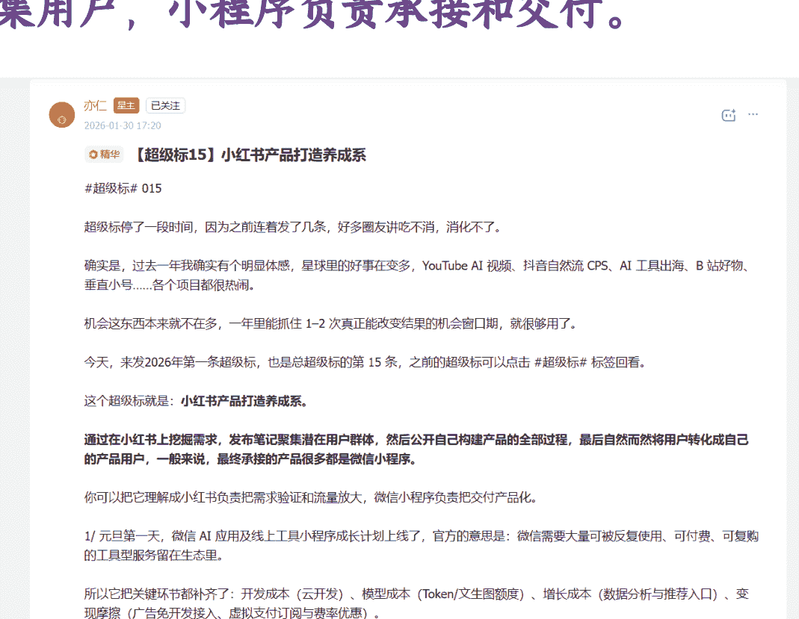

| 小程序活跃概况 | 数值 |
| :--- | :--- |
| 累计用户数 | 207 人 |
| 日访问人数 | 33 人 |
| 日打开次数 | 41 次 |
| 日访问页面数 | 61 |

| 新增用户概况 | 数值 |
| :--- | :--- |
| 新增用户 | 27 人 |
| 新用户当日打开次数 | 33 次 |
| 总添加人数 | 0 人 |
| 新添加人数 | 0 人 |

## 第三部分：我遇到了什么问题，又是怎么解决的

## 一、需求是真的，但我把"需求"误当成了"知道第一版怎么做"

排班小程序的需求来自生财中标信息，不是我凭空想象的。为了验证这个需求我发了一篇小红书笔记，评论区反馈比预想更强，说明这个需求是真实存在的。

但问题出在哪呢，我把"用户确实有这个需求"，直接理解成了"我知道第一版该做什么"。有人提多人，我就加多人；有人提纪念日，我就增加纪念日功能；再往后，日期提醒、反馈问卷、使用手册、新功能投票等等，全塞进了第一版里。

每个功能单独看都有理由，合在一起却把一个"帮大家找共同休息日"的轻量工具，做成了一套复杂的排班系统。

> 需求验证只能说明这个问题值得做，但不能帮你决定第一版到底做什么。

## 二、没有 SPEC，AI 只会不断帮你加功能

找同休小程序刚开始做的时候，我没有先用 SPEC 整理需求，都是碰到一个问题修一个，有了新想法就加功能，后面连自己都不知道时候才算完成第一版。

现在回过头来看，其实核心链路一开始就出现了：创建或加入小组，邀请成员填班表，自动找出共同休息时间。但我没把它写成不能随便突破的边界，反而塞给 codex 一大串需求，还让它自己不停的查漏补缺。每一轮对话过后看起来都像有了新进展，页面更完整、测试数字在增加，但是真正缺的是三个标准：这版只做什么、哪些不做、做到什么程度停下来验收。

AI 不会主动帮你划定产品边界，只要你给的任务是"继续优化"，它就会照着常见产品的样子，给你补登录、设置、提醒、统计、后台。

SPEC 不是为了把 PRD 写得完美无缺，是让你在写代码前就想清楚做什么、不做什么。

## 三、首页堆了很多入口，越改越乱

排班小程序的首页有一版同时放着一堆入口：登录、填班表、导入文件、创建小组、加入小组、邀请成员、今日班表、共同休息结果、重要日、反馈、手册、版本投票等等，还有一些重复入口和点击无跳转的入口。

我花了很多时间调整按钮位置、字号、热区和卡片间距。后来才看明白，首页拥挤的根本问题，是我没想好用户点进小程序来的第一件事该干什么。

解决办法：没创建小组时推创建或加入；加入了但没填班表时推填班表；数据齐了才展示共同休息结果。页面跟着任务状态走。

页面跟着任务状态一步步进行，只保留核心动作，不是把所有功能都摊开来。

## 四、本地缓存把单机原型伪装成了多人产品

单机原型用本地缓存很顺，但产品如果要做创建小组、生成邀请码、跨设备加入、多人同步班表等功能，本地数据就不能再冒充正式数据了。

项目里真实出现过这些问题：云端小组创建失败后页面自动生成本地小组、邀请码在另一台手机查不到、成员加入后双方看不到彼此班表、设备B存了新班表但日历还显示旧数据。这些不是补几个提示框能解决的，真正的问题是：**多人产品必须有一份所有设备都认的云端数据**。

图片OCR 又出了另一类问题：它不光依赖代码，还依赖云端服务、密钥、地域、额度。代码没改，部署参数写错，用户看到的照样是“解析失败”。所以外部依赖要单独做真机原型，不能等页面全做完了再测。

## 五、排班项目屡出bug不断返工，我停下来换了方向

第一次做AI产品很不熟练，小程序bug频出，找同侪小程序在经历了一段时间的不断返工后，我停了下来。不是需求不存在，是继续在没有路线的情况下硬改，只会花更多时间返工。

后来翻圈友帖子，我想到可以围绕自己的CPS业务做小程序。这次我没有马上写代码，而是先用SPEC让AI逐个追问，把模糊的“优惠券聚合小程序”收缩成一句话：当用户准备消费、但觉得价格偏贵时，帮他用最少的步骤拿到一张当前可用的优惠券。

流程清晰了，不做清单就跟着出来了：不做登录、不做个人中心、不做站内交易、不做自动比价、不把“点击按钮”包装成“领券成功”。用户端只保留打开首页、找平台、复制口令、去官方App用；运营端只保留粘贴文案、识别口令、人工校对、发布云端、前台读取。两个闭环跑通，第一版便成立了。

## 六、自动测试全通过了，真实文案一粘进去全挂

CPS小程序开发的过程中，有一次自动测试全部通过，但我把影刀整理的一批真实推广文案粘贴进后台，结果全部识别失败。

原因：测试用的是我自己编的规整样本，真实文案里混着栏目标题、表情符号、活动名、说明和口令。

解决办法：把真实原文直接放进回归测试，重新调解析规则，再把识别出的口令逐条放进官方App验证。其中有一条口令经多次测试却无法稳定识别，我便直接将其移除。

真实测试会反过来修改产品范围，这比保住一个好看的通过率重要。

## 七、真机里短链接一个都打不开，我把20个活动减少成11个口令

一开始做CPS小程序时，我做的主要是活动短链接，口令是后面才加的。我的直觉是用户点链接比复制口令少一步，所以想拿短链接当主路径。

开发者工具里测试的时候看起来很顺，但到了体验版真机测试时，那批短链接一个都点不开，还提示业务域名没通过校验。多次测试之后我意识到：短链接在真实微信环境里不可用，用户点陌生链接也会担心安全。

所以我把路径改成"一键复制口令，再去官方App领券"。虽然表面多了一道步骤可能会影响转化率，实际把最关键的领取动作放回了用户更容易信任的环境里。

## 八、用影刀 RPA 把定期更新口令的操作自动化

CPS 的活动口令会定期变化，如果前台一直显示旧口令会无法使用，所以需要定期更换小程序里的口令。每次替换口令需要反复进后台、搜活动、开推广窗口、复制口令、替换旧口令并发布，这一套流程步骤不多，但重复度高。

我一开始想让 codex 帮我自动跑完这一套流程，但实际跑起来的时候发现网页的登录状态、浏览器环境和页面限制让这套流程无法进行。

这让我意识到，需要登录、频繁点击、又有反自动化限制的网页，可能更适合使用模拟真人操作的工具。于是我把采集部分的操作交给了影刀 RPA。

影刀当“手”，负责在已登录的页面上搜索、打开、复制活动口令并整理到一个文件里；后台程序当“脑”，负责检索文件并进行分类、过滤；最后我来验收。即使页面操作偶尔失败，也不会直接影响要发布的内容。

调教影刀的时候踩了不少坑：

- 网页的登录状态拿不到就先手动登录再接管；
- 弹窗没关好下一轮就容易卡住，要把关弹窗的操作放进每次循环里；
- 读页面内容不稳定就改成点复制按钮读剪贴板；
- 搜索到相似活动就只认指定关键词，不拿相似结果替代；
- AI 额度不够了就别让它反复改流程，把活动清单做成变量就行；
- 采集失败的日志别被误当成有效口令，要加异常过滤。

> 自动化的重点不是彻底取消人工，是把重复劳动交给工具，把关键判断留在自己手里。

## 第四部分：给圈友的启示

## 一、做小程序优先从自己有流量的业务出发

排班项目的痛点是真的，但我对用户的了解和产品前期铺垫不够，后面用户不多，算是练手的第一个 AI 产品了。CPS 小程序做起来要简单很多，而且原本就有长期流量在我手里，商业闭环来的更快。

做完这两个小程序后，我的经验：**先盘点自己拥有的东西——真实用户、稳定内容、行业经验、交付流程、渠道或可持续数据。一个人做产品，围绕已有的资产做小程序更有确定性。**

## 二、需求验证了，还要继续验证 MVP

公域帖子的评论多、点赞多、用户说想要，只能证明问题值得关注，不能证明登录、提醒、模板、社区和复杂设置都应该进第一版。

每收到一个功能建议，先问三件事：它是不是核心用户反复遇到的问题；没有它，第一条闭环能不能完成；它能不能在当前已有资源下跑通。三个问题没有明确答案，就放进备选需求池。

## 三、零代码基础不是零判断

AI 把做产品的门槛降下来了，但没降低判断的门槛。

看不懂代码没关系，代码都是给 AI 看的，遇到什么报错之类的直接问 AI 即可，但是业务全流程自己必须清楚，做出来的 AI 产品，得知道它具体解决用户哪个问题。

## 四、先跑通真实闭环，再谈页面完整

排班小程序不是页面能展示班表就完成，是多台设备、多个账号能共享数据并算出共同休息日。

CPS 小程序不是按钮能点击就完成，是口令能复制、能被官方 App 识别，线上用户也能走通。

页面可以慢慢变完整，功能可以慢慢加，但是真相源和核心链路需要优先完成。

## 五、不要盲目相信 AI 的建议

在做小程序的时候，有段时间我盲目相信 AI 给的建议，增加了一堆没必要的功能，"优化"了很多的代码。

那个时候正值 GPT-5.6 更新，然后我就把原本用 GPT-5.5 写好了的代码，重新用 GPT-5.6 全部优化了一遍。结果优化之后，原本的界面全部大改，bug 也比以前多得多，完全不能用。

不得不重新回退到 GPT-5.5 那时候的版本，浪费了很多的 token 和时间。

## 六、技术门槛逐渐降低，只需迈出第一步

现在各个 AI 模型越来越厉害了，技术逐渐平权，从有产品 idea 到制作上线的路径已经很短了，人人都可以拥有自己的小程序，只需要迈出第一步。

生财里常言道：不要想太多，先下场把手弄脏。在制作小程序的过程中，你会遇到很多不同的问题，每一步都是在积累经验。刚开始制作小程序的时候，可能是摸不清头脑的，但有不懂就问 AI 嘛。

小程序只是 AI 产品里面很简单的一个，后面小程序的制作经验可以平移到其他地方，搭建自己的工作台、AI 员工、Agent，都有相当大的帮助。

大家都是新时代的弄潮儿，希望我这篇文章可以给想做或者在做小程序的圈友一些参考和帮助。

---

看完这篇 SOP，你觉得你懂了。但 90% 的人一到实操就会卡在第一步。

工具和教程只是最低级的壁垒，真正的壁垒是“立刻动手”和“圈层信息差”。

如果你想看全网最新的变现玩法，并且和一群执行力极强的极客一起下场拿结果，欢迎围观我的核心私域：【懒人专属群】。

我们不聊虚的，只做商业闭环的拆解与 AI 效率的压榨。系统内已沉淀 1000+ 跑通的套利实战局。

- 查阅圈子完整数字资产与上车门槛：[https://lazyso.com/insider/](https://lazyso.com/insider/)

认同价值、准备好下场干活的，扫码加我微信（lazyhelper1）

备注：【实操上车】，不闲聊

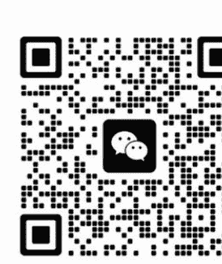

微信：lazyhelper1
