# 新手在抖音教育资料 6 个月做了 100gmv，我从选品、上架到达人合作的复盘

260908 副业 SC 精华

整理：公众号懒人搜索，懒人专属群精选

懒人微信：lazyhelperl

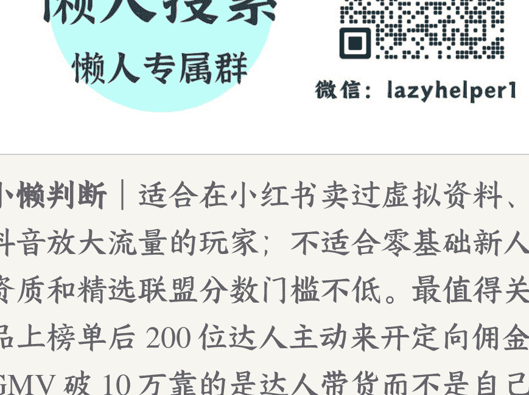

> **小懒判断** | 适合在小红书卖过虚拟资料、想搬去抖音放大流量的玩家；不适合零基础新人，开店资质和精选联盟分数门槛不低。最值得关注：产品上榜单后 200 位达人主动来开定向佣金，月 GMV 破 10 万靠的是达人带货而不是自己发内容。坑在带货团长：报名后不管谁出单团长都抽 30%，达人 45% 佣金被截走近半；且教育资料类目已收紧，虚拟发货只剩读书卡老店。

大家好，我是蓝子鱼。之前一直在做小红书，22 年就做过一个 40 万粉丝的大号，也做过同城引流和教育资料类项目，近一年主要在做教育资料和小程序。虽然没有抖音基础，但我把小红书验证过的资料生意搬到抖音后，没有投流半年做到了 100 万 GMV，最高一个月做到 46 万+。

这篇文章主要想复盘我怎么判断这个赛道值得做、怎么选品、怎么上架、怎么做素材、怎么找达人，以及中间踩过哪些坑。希望能给同样在做资料类、轻交付类项目的圈友一些参考。

## 数据罗盘

抖音电商数据，就用罗盘

- 首页
- 交易
- 搜索
- 商品
- 市场
- 服务

- **成交分析**
- 退款分析new
- 收支投放分析new
- 近30天

## 指标概览

- 全店
- 不限载体
- 投放时段
- **看环比**
- 看同行

成交金额 ¥46.12万 ↑295.62% | 千川券占比 0%
支出金额 ¥8.6万 ↑538.51% | 投放消耗占比 0.3%
用户支付金额 ¥45.87万 ↑295.49% | 成交订单数 9,401 ↑291.22% | 结算金额 ¥42.3万 ↑295.68%
退款金额 ¥3.88万 ↑321.75% | 商品曝光人数 163.49万 ↑140.78% | 商品点击人数 5.7万 ↑180.07%
成交人数 9,318 ↑291.35% | 客单价 ¥49.23 ↑1.06% | 退款率 8.26% ↓0.02%

我要反馈

- 成
- **趋势**
- 分布

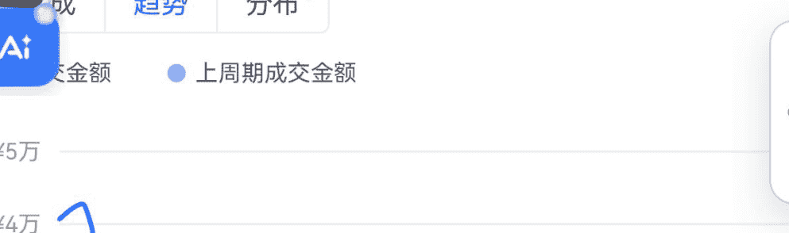

我觉得做教育资料是最适合超级个体的，链路最短，交付最轻松，把产品开发出来，只要集中精力做内容就可以。

为什么抖音依然值得做？抖音的流量至少是小红书的 3 倍，之前就有圈友在抖音一个月比之前小红书半年的量还多。我在去

年年底刷抖音的时候，经常跳到抖音图文，而且最开始还不知道如何才能切换回视频，那时候开始意识到抖音在刻意推图文流量，而我在小红书做的就是图文，直接搬运过来几乎没有成本，所以才开始做抖音图文带货。

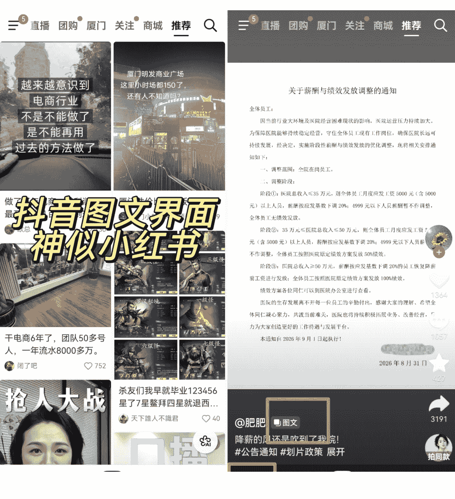

我最开始做抖店，就是把小红书虚拟资料的玩法在抖音重新做了一遍，抖店全靠自己一点点摸索，然后不断的踩坑，填坑，一步步走过来的，也希望自己的这个内容复盘能够帮助到圈友。

## 一、产品的设计思路

你的资料能够卖多少营业额，其实在你把产品做出来，就已经决定了它的天花板了，很多人做虚拟资料的时候，经常凭自己的喜好，或者看别人在卖，自己也跟着做出来卖。

有一句话叫：先谋而后战，谋定而后动，在做产品之前不一定要先思考，这个产品的

天花板在哪里，优先选择受众人群足够大的。

像在小红书里面有一个产品，全部销量加起来将近 30 万单，叫 i 人的社会化指南，因为 i 人足够多，好几个店都卖超过 2 万单。

我在抖音做的第一个产品，是到一个客户工作室泡茶，然后桌面上摆放着三本英语资料，了解后才知道她们卖英语学习机，然后每周都会组织活动带着孩子训练，我觉得这个资料在线上肯定有很多家长需要，解决了家长不知道如何教自己小孩入门英语的需求，所以选择了这个产品在抖音上卖。

这个产品包含一份少儿英语训练的材料，一些英语视频，还有每天晚上腾讯会议少儿英语朗读。对应家长的需求就是有材料，有视频，还有一起练习，定价 49 元，我们的目的希望通过这个产品引流家长购买学习机。

这个产品跑通了以后，后面陆陆续续上架了几个跟英语还有 k12 相关的产品，总的销售额达到了 100 万 GMV。

## 二、抖音商品上架

抖音在卖课和卖资料这个类目现在非常非常严格，开店要求会比较高，对资质要求比较严格，我完全就是赶上好时候，现在很多都需要进行实物发货，虚拟发货的要开通读书卡类目的老店。

在 26 年 1 月份之前，只要营业执照带有教育咨询这个类目，在上传商品的时候，自动可以选择教育资料，然后就可以虚拟发货，利用阿奇索或者抖音后台的发货短信系统，完成虚拟发货。

后面抖音把教育资料类目下架，我们又上架成一份英语学习资料，利用快递卡片进行实物发货，卡片里面留开通的微信二维码，最近平台对商品上架审核越来越严格，听说很多人读书卡类目被关闭了，我们的老店也遇到这个问题，最近在开新店铺。

现在想做的话，上架成为学习工具或者是找到已经开通学习卡的店铺，或者利用第三方平台上架商品，第三方平台正常都会收 10% 手续费。

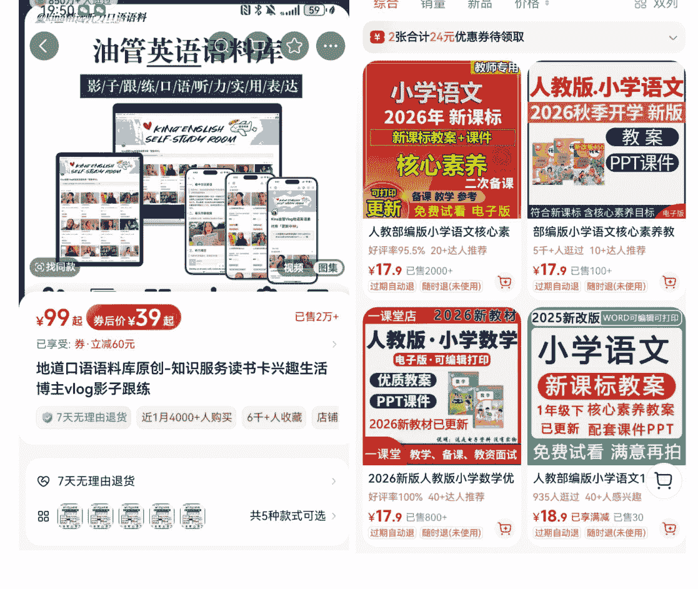

做小红书虚拟资料的，应该对上面的产品不陌生吧，只要解决了店铺问题，现在还是能做通的。

## 三、账号与内容推广素材

很多人最头疼的就是商品上架成功了，如何把商品卖出去，最直接的就是发内容直接带货，但是抖音和小红书不一样，门槛更高了。

### 1、账号问题

抖音的带货账号都需要实名认证，一个人只能实名一个账号，或者用个体户开通账号，押金500元。

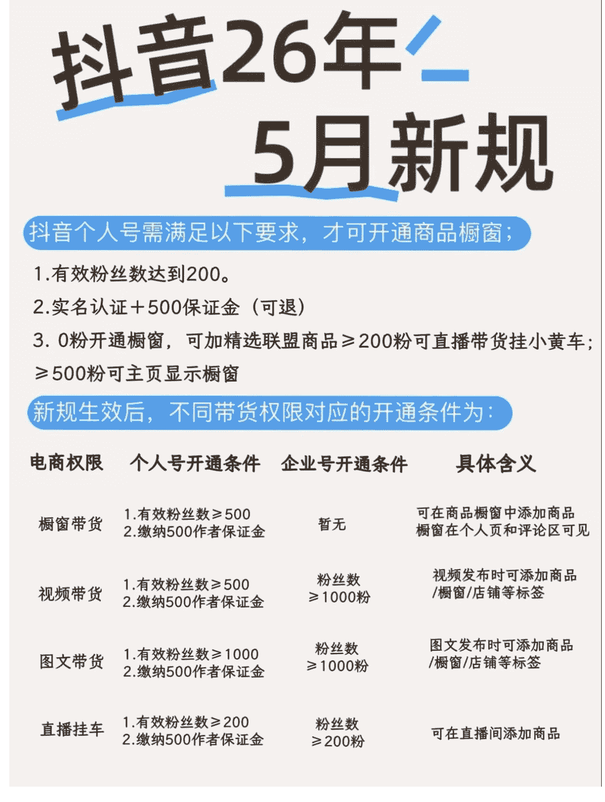

粉丝也有要求，粉丝不够需要找人刷，而且要求是有效粉丝量，千粉成本在240到300之间 1000粉丝，一天2条挂车3000粉丝，一天5条挂车10000粉丝，一天10条挂车这其实已经卡掉很多人了，现在小红书开店除了主账号一千粉丝开通电子资源类目，其他三个没有粉丝要求，一个店铺能关联4个小红书账号。

我自己总共有6个账号，其中最高的一

个账号卖了24万，另外3个号都差不多卖了3到5万，另外两个号基本上没有怎么出单，到3月份开始基本上自己的账号流量就下滑比较严重，主要以达人合作为主。

### 2、账号素材

很多圈友都对素材和文案很头疼，不知道怎么做内容，不知道文案怎么写，或者写完发了卖不出货。我自己也招了几个员工帮我做素材，都是以前没有接触过小红书运营的实习生。

借助豆包都能够快速上手并且开始陆续出单，我觉得最重要的就是要对客户和产品足够了解，知道客户会因为什么而购买你的产品，痛点足够痛，卖点足够多，发布数量足够多，一般都卖的不差。

我们最开始做抖音的时候，流量也比较不稳定，富贵老师说你重点放在封面上，后面我们把小红书爆款封面搬过来，效果很好。

**很多人可能会想问一个问题，就是小红书和抖音的素材有什么区别，或者什么素材比较容易火，我个人感觉带货其实要研究的是人群和需求，图文和视频没有那么重要，重要的是你的内容里面输出的产品卖点时哪些？人还是那群人，需求还是那个需求。** 第一种大字报，大字报永远的神，发现效果还是非常好，因为能让用户非常直观的知道，你这篇内容想表达什么。

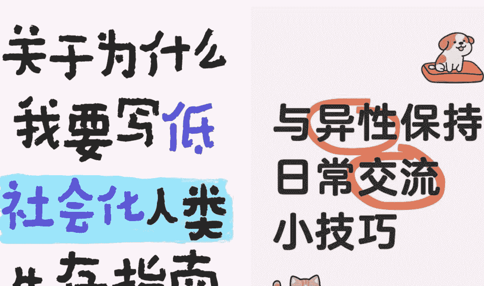

第二种产品实拍图，可以把资料打印出来，然后拍照，也可以直接拍电脑，或者平板的画面，就是要告诉用户你有这方面的资料。

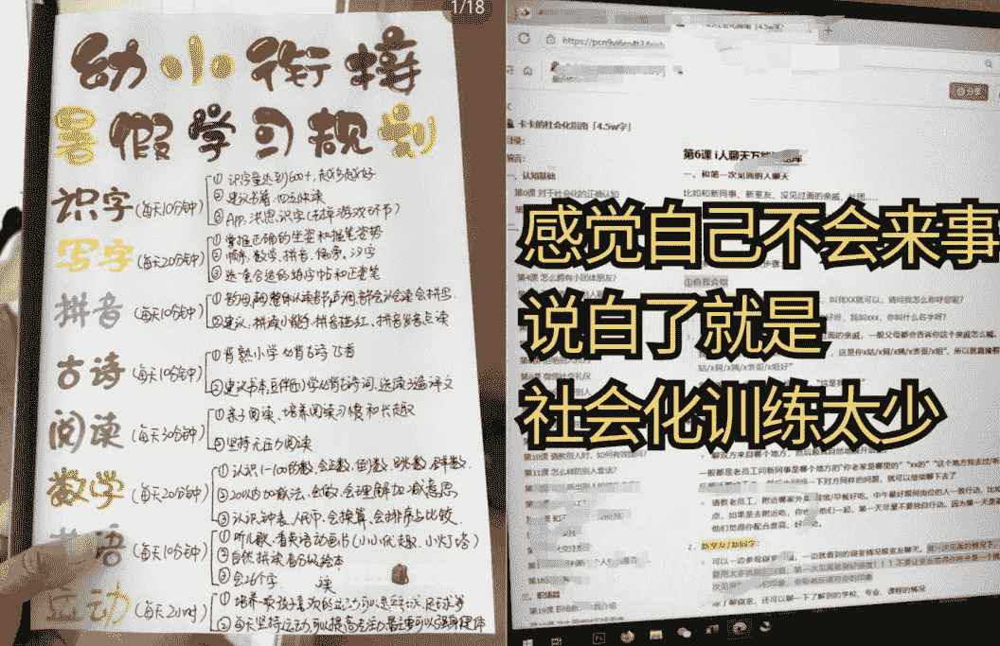

内页就是跟小红书图文一样的，把你的产品卖点罗列出来，然后放你产品截图或者照片，一张图代表你的一个卖点。

抖音视频带货素材，以跟油管学英语为例。

【此处有两个视频，大家可见群里分享的在线版】

带货最直接的就是告诉用户你这个里面有什么，上面这两个视频，都是非常直接的录屏，用户通过这个视频能知道这个产品具体的内容形式，如果这个产品是自己想要的，自然会进行下单。如果已经在做小红书资料的圈友，可以试着把小红书的内容，直接搬运到抖音进行带货。

## 四、达人对接推广

让我们月GMV突破10万的一个关键点，就是开始有达人帮我们带货，这也是抖音比小红书好的一个点，就是抖音的达人带货体系非常完善，并且有非常多的达人专门带货，她们也会自己进行投流。

在3月份我自己的账号，把自己的产品带货了，就会上精选联盟的榜单，然后陆陆续续有200位达人加我微信，然后让我给她们开定向佣金，真的非常的爽，不用自己发内容，就能躺赚，这个感觉在小红书是完全体会不到的。

### 如何与达人建联

①达人主动合作，记得在精选联盟设置你的微信和手机号，达人可以在这里加到你，然后直接跟你沟通，或者在店铺后台，达人消息里面，达人也会主动发信息，问能不能合作，能不能设置定向佣金。

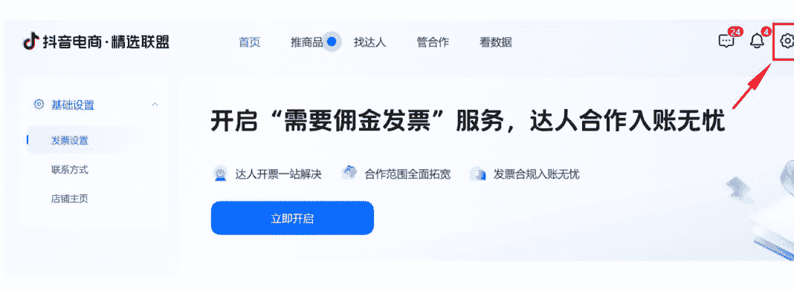

②主动建联达人，在达人广场里面去找到你这个类目里面的达人，然后主动发信息建联。

如何给达人设置定向佣金，输入达人的 uid，就可以进行设置。可以根据自己产品的实际情况，给达人设置带货佣金，还能设置日常佣金和投流佣金。佣金比例我看30%—50%之间，看你自己 的接受程度，也可以看同行的佣金比例。

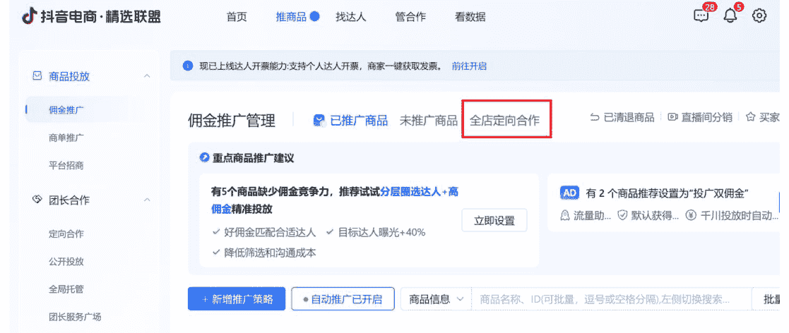

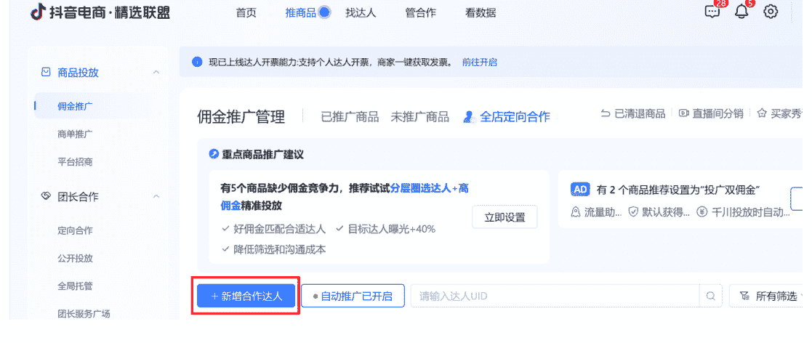

达人一但爆单，量是非常可怕的，之前有个达人一天能卖 4 万 GMV。记得及时给达人提供产品素材，能出单的品她们都非常愿意，之前店铺后台合作的达人有 300+，出单的达人 200+。

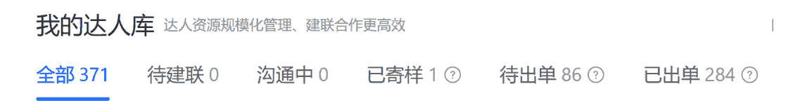

## 五、新手容易踩的坑

我自己做这个项目从一个完全不懂的小白，到 GMV 超过百万，踩了非常多的坑。

### 1、精选联盟分数

抖音都精选联盟的分数要求非常高，店铺的分数和商品的分数都会有要求，一担低于这个分数，就会被移除精选联盟，达人号就没办法卖了。

- 店铺评分大于等于 70 分
- 商品评分大于等于 65 分

一定要每天去看商品评价，一旦出现差评，里面要找人进行体验分维护，不然掉精选联盟后悔都来不及。

### 2、抖音带货团长

遇到带货团长要注意，我自己就是被骗过佣金，团长的让你报名他们的团，然后设置团长佣金和达人佣金，一旦报名了，原来的达人出单他们一样会抽佣金，比如原来总的佣金 45%，设置成为团长 30%，达人 15%，以后不管哪个达人出单，团长都自动抽佣 30%，原来本来达人是直接拿 45% 佣金的，团长根本没有干事情。

当然肯定也有真正在做事的团长，但是之前踩过坑，所以对抖音团长要小心，会有很多团长主动加微信咨询合作。

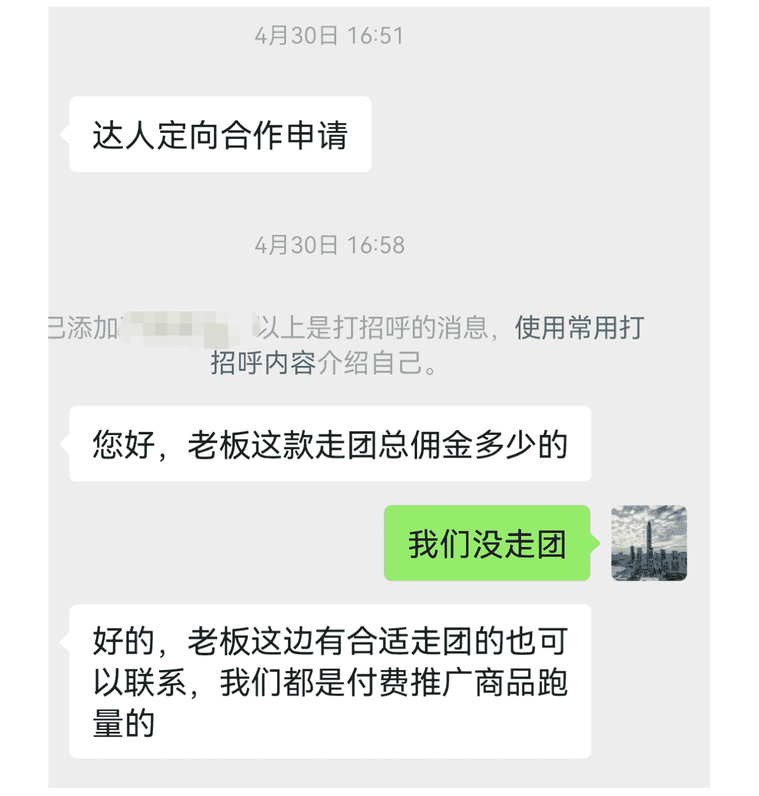

### 3、同行竞争

抖音的抄袭爆款速度非常快，只要你卖的好，就会有同行进行抄袭，因为你会上官方的榜单，他们都能看见，而且价格可能只有你的一半不到，虚拟产品一定要提前去申请版权。

### 4、没有直播

抖音如果是产品爆量的时候，可以通过直播去承接流量，可以大大提升转化率。我就刷到最近很多做小程序的还有卖虚拟资料的直播间。

## 六、总结

我觉得所有的资料都值得在抖音做一遍，最近几年大家都在小红书上卖资料，但是抖音的流量更大，可以把小红书验证过的资料同步到抖音，之前让几个朋友试了，

都是能很快出单，我也是碰巧做了抖音，没想到真的做起来了，而且抖音的店铺和账号门槛更高，竞争的人会比小红书少很多。

## 分割线

看完这篇 SOP，你觉得你懂了。但 90% 的人一到实操就会卡在第一步。

工具和教程只是最低级的壁垒，真正的壁垒是“立刻动手”和“圈层信息差”。

如果你想看全网最新的变现玩法，并且和一群执行力极强的极客一起下场拿结果，欢迎围观我的核心私域：【懒人专属群】。

我们不聊虚的，只做商业闭环的拆解与 AI 效率的压榨。系统内已沉淀 1000+ 跑通的套利实战局。

- 查阅圈子完整数字资产与上车门槛：

https://lazysso.com/insider/

认同价值、准备好下场干活的，扫码加我微信（lazyhelper1）

备注：【实操上车】，不闲聊

