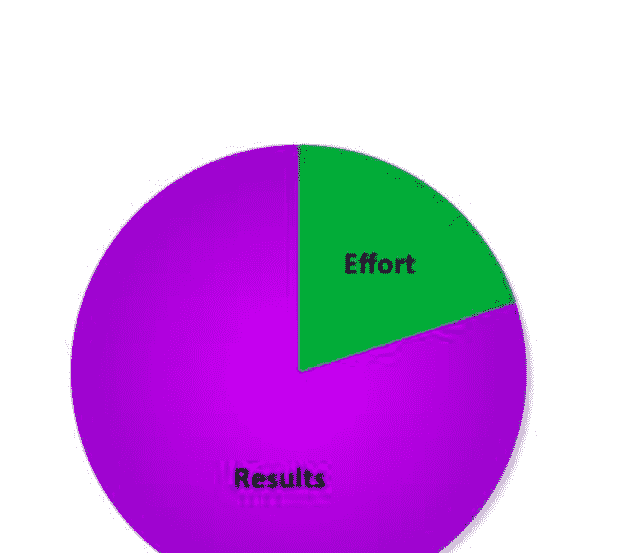
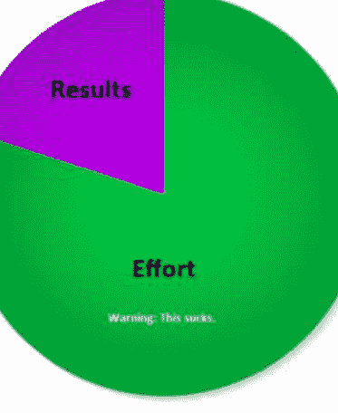
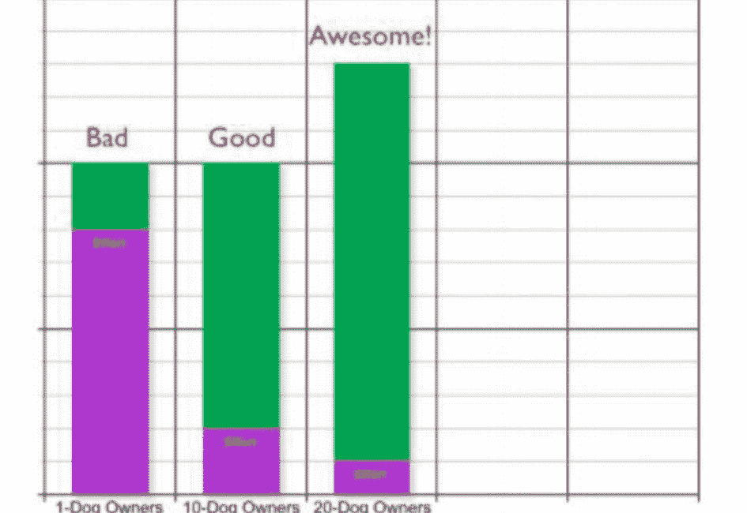
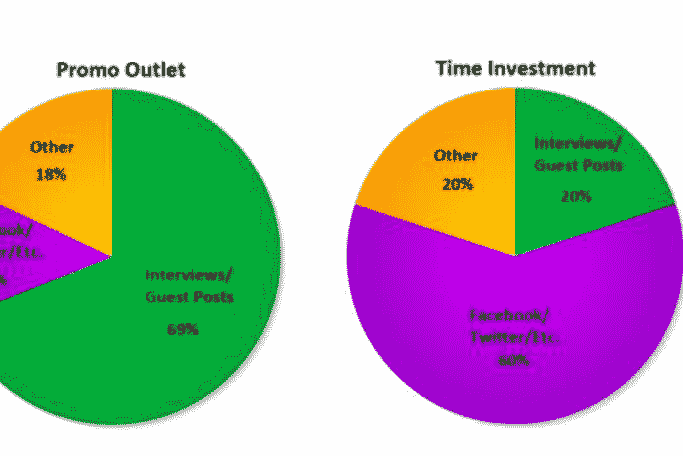
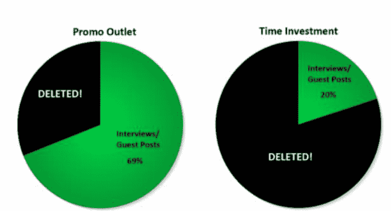
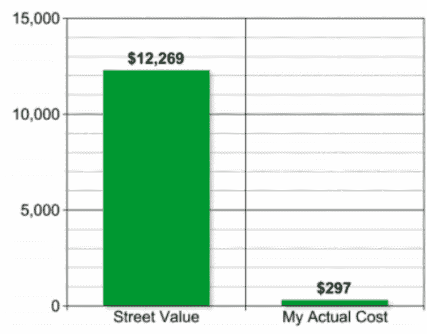
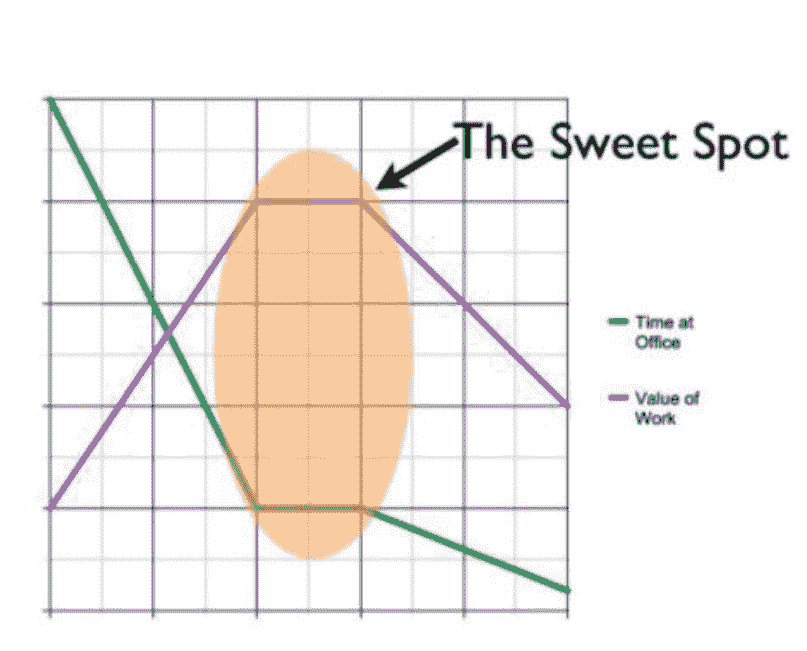

# 如何用二八定律干最少的活赚最多的钱

260908 懒人专属群
整理：公众号懒人搜索，懒人专属群 精选
懒人微信：lazyhelper1

> **小懒判断** | 适合被杂活淹没、想靠砍任务而不是加班提效的上班族和一人公司老板；不适合指望看完就躺赚的人。最值得关注：泰勒砍掉九成低效推广渠道后，每周不到 2 小时营销换回 2000 订阅——先做 80/20 审计再动刀。坑在把二八定律当偷懒借口：砍掉 80% 的前提是先精准识别哪 20% 真正成果，这一步最费劲也最容易被跳过。

在追求成功的道路上，我们通常会陷入一个误区——认为只有通过不懈的努力和长时间的工作，才能实现梦想和目标。

这种信念导致我们陷入了永无止境的忙碌循环，让我们感到困惑和挫败，因为不论多么努力，似乎总是达不到预期的成就。

但成功并不总是与努力和时间成正比。正如 80/20 法则所揭示的，很多时候，80% 的成果往往来自 20% 的关键行动。

这意味着通过识别并专注于最具影响力的活动，我们可以更高效地实现目标。

以下是文章中部分观点高亮：

- 1. 减少 80% 的工作量：你 80% 的成果来自于 20% 的努力。成功的关键在于消除 80% 的繁重工作，比如取消不必要的会议、过滤不需要的电子邮件、外包或委托不重要的任务，然后将剩余的 20% 的工作放大。
- 2. 搬到生活成本更低的地方：高昂的生活成本是许多人感到工作束缚的原因。
- 3. 理解并利用他人的动机：是指洞察他人行为背后的真正原因，并利用这些信息来更有效地与他们沟通和合作。
- 4. 获得更灵活的工作：如果你的工作需要你每天固定时间坐在椅子上，你将无法减少工作时间并增加收入。应该寻找一个更灵活的工作，让你能够专注于高影响力工作。
- 5. 在 ROWE 公司工作：ROWE（Results Only Work Environment）公司不关心你投入了多少小时或何时投入，他们只关心结果。在这样的公司工作，你将更有可能减少工作时间并增加收入。
- 6. 如果你是自己的老板：考虑哪些工作必须由你亲自完成，哪些任务可以外包或委托。专注于完成最重要的工作，你的业务将会蓬勃发展。

今天，咱们来聊聊怎么用 80/20 法则，把那些没用的活儿从你的生活里踢出去，专心做那些真正重要的事。

这样一来，你就能多挣点钱，少干点活，还能把时间花在你真正喜欢的事情上。

在下面的文章里，你会看到......

- •如何每天减少工作两小时？
- •如何在 26 岁时实现薪水翻倍
- •如何仅用 297 美元完成价值 12000 美元的环球旅行
- •杰米每周只工作 20 小时，却能每月赚 11,000 美元，他是如何做到的？

这些有什么共同点？

80/20 法则。

我们很多人总是抱怨生活太忙，无论是工作、家庭，还是日常琐事。

但是，有些人，他们和我们拥有一样的时间，却能做出惊人的成就。他们到底是怎么做到的？

实际上，如果我们仔细审视一周内的时间分配，我们会发现大部分行动都无关紧要。听起来是不是有点悲观？有可能。但如果你调整自己的行为，专注于真正重要的事，你就能超越你的同龄人，过上不一样的精彩生活。

比如，在个人理财上，大家总想成为全能高手。还债！存钱！投资！少买咖啡！多挣钱！少花钱！自己下厨做晚餐！行动起来！！！啊啊啊啊啊啊啊啊啊！！！

事实是，我们每个人都是“认知吝啬鬼”，我们的注意力和认知能力都是有限的。

所以，把精力集中在最重要的事情上，而不是什么都想要，这才是关键。

这也是我经常写关于被动理财（automating your finances）的文章的原因。同时，这也是我在日常生活中运用“稳定三角架”（Tripod of Stability）策略的原因。

在这篇精彩的客座文章中，泰勒·特沃伦（Tyler Tervooren）通过一些生动的例子，向我们展示了如何专注于真正重要的事情，并且还附上了一些吸引人的图表来辅助说明。

我得补充一句。

泰勒提议给我写篇客座博客，结果他举的例子裡我出现的频率有点高，可能是考虑到我那点小小的自恋。我让他把文章改改了，少夸我几句。所以，这是修改后的版本。但它依然像是在听录音里自己的声音——既尴尬又奇怪。

但其他部分都是精华，所以一定要看。

泰勒，接下来看你的了......

泰勒·特沃伦挑战现实极限，为一群技艺高超的冒险家团队“高级冒险学”撰写文章。你可以在 Twitter 上关注他，账号是 @tylertervooren。

你知道拉米特（Ramit）、蒂姆·费里斯（Tim Ferriss）和埃丽卡·道格拉斯（Erica Douglas）这些人做了什么，而你没做什么吗？

你什么都没做。

然而，大多数人并不这么看。他们只觉得这些人不过是更努力一些，运气稍微好一些，所以走得比他们更远。

我们很多人可能觉得拉米特、蒂姆和埃丽卡在人生路上把我们甩得远远的。确实，他们做到了，但并不是靠加班加点或者单纯靠运气。看这里，关于人类有这样一个事实，大家都心知肚明，但很少有人愿意承认，更别提真正利用它：

那就是懒惰。

人类天生就懒，只有少数人愿意努力，而那些愿意超越普遍设定的低标准的人，会因此获得许多好处。拉米特、蒂姆、埃丽卡，他们做的事其实和我们大家一样。只不过，他们在真正重要的事情上做得更出色。

这就是这个普遍真理中带有讽刺意味的部分。虽然我不会说他们中任何一个人懒惰，但这些确实享受到了少工作的好处。他们通过极大地改善自己的生活流程，使得自己不必再那么辛苦地努力工作。

时间一长，他们就练就了一种我称为“复合式卓越”的本领。而我们大多数人呢，却依然停留在那些不起作用的舒适区，或者每周都在重复造轮子，却从不去想我们造的轮子到底好不好用。

不信？来试试下面这个练习，看看我到底在说什么：

选出你最亲近的 5 个声称关心个人理财的朋友，问问他们上周花了多少时间优化预算或调整 401k 的配置。

然后再问他们花了多少时间看电视。

让我们继续吧！

事实是，拉米特、蒂姆和埃丽卡之所以能脱颖而出，并不是因为他们天赋异禀，而是因为他们不懈的努力和持之以恒。

这需要每天进行一些衡量，并且始终专注于改进那些行之有效的事情，同时摒弃那些无效的努力。

这事儿得有点创意。得有点新意。最关键的，得有点策略。下面，我给你支几招。

# 策略 1：按下 Ctrl+Z，重置你人生的 80%

哎呀，说到那个耳熟能详的“二八定律”，也就是帕累托法则（Pareto’s Principle），你肯定不陌生。

它告诉我们，在很多情况下，80% 的成果其实只来源于 20% 的努力。这法则，真是挺有意思的！

但不那么令人兴奋的一面是，你可能付出了 80% 的努力，却只收获了 20% 的成果。

你发现这个机会了吗？你不仅可以减少 80% 的辛苦工作，还能利用剩下的 20% 来扩大规模，取得更好的成果。但这究竟意味着什么？

举个例子，如果你刚开始做兼职遛狗员，每遛一只狗 20 分钟收费 20 美元。假设你已经相当厉害了，你已经找到了 10 个客户。

很快你就会发现，你服务的 8 位客户，每人只有一条狗，每天给你 20 美元。

另外两位客户，每人拥有一个狗舍，里面有 10 条狗，他们每人给你 200 美元来遛狗。无论你是遛一条狗还是十条狗，20 分钟的散步时间都是一样的，对吧？

比起只养一只狗的客户，那些养多只狗的客户能给你带来更多的收入，而且你花的时间还更少。

你想要吸引更多这样的客户，但已经累得筋疲力尽，没有多余的精力去应对他们。

所以，你该怎么做？

你他妈的那 8 个只有一条狗的客户全都甩了，不再接受只有一条狗的新客户，开始寻找至少有 8 条狗的顾客，哪怕只找到一个。

她可能更难找到，但你现在有的是时间，因为你刚刚减少了 80% 的承诺，而且损失并不大。你完全不必就此止步。你大可以继续寻找那些拥有更多狗狗的顾客，同时逐渐放弃那些规模较小的顾客。

这正是我们正在讨论的核心内容：

让我们来聊聊几个真实生活中的例子吧。

## 杰米每周只工作 20 小时，却能月入高达 1.1 万美元，他是怎么做到的？

几年前，杰米还在全职工作，收入不错，但和许多美国人一样，她并不喜欢自己的工作。后来，她有了孩子。

现在，我对这些“小孩子”还一无所知，所以我不得不相信杰米的话：有了孩子，生活会大榜样。确实，这改变了她的生活。她决定辞去工作，开始自己的事业，只做兼职，这样她就能成为她一直梦想中的模范母亲。

但她也不想真的放弃太多钱。

现在，想要减少 60% 的工作时间，同时还能保持收入不变，这是完全可能的（这也正是蒂姆·费里斯出名的原因）。但别以为这很容易，它需要一些技巧和策略。

杰米需要仔细检查自己的工作方法，找出她教练业务中效果显著的那 20% 的关键部分，然后充分运用它们。

这样，她就可以完全停止那些占用时间却效果不大的琐事，也就是那 80% 的部分。

看了她的业绩报表，发现一个现象：参加社交活动似乎并没有给她带来多少客户（听着是不是有点耳熟？）。

不过，她偶尔的几次演讲却效果不错。她决定不再参加那些社交活动（这通常不是个明智的选择），而是开始更多地投入到演讲中，这样反而能节省时间。

但她并没有就此止步。杰米还决定不再出差去见客户，这样她就能节省时间，帮助更多的人。

杰米说：

> 今年年初，我决定不再找本地客户了。为啥呢？因为我发现，每周参加社交活动、拜访客户公司，太耗时间了。住在缅因州的我，每次开车出门都得花上好长时间。我算了算，每周开车就得花掉 6 小时，而我一周总共也就 20 小时的空闲时间。所以，我决定改变策略，不再亲自跑腿，而是通过电话和当地客户保持联系。这样一来，既节省了时间，又提高了效率。

她自豪地称这为“大胆行动”。虽然商界人士对她经营公司的方法一直有争议，但杰米刚刚迎来了她离职后的第一个月收入————高达 11,000 美元。

更多的钱，更少的时间，这就是 80/20 法则的魔力所在（还有在朋友圈子里的 C 位）。

## 为什么我喜欢写这样的文章

当我自己做 80/20 分析时，结果一目了然。6 月份我推出了 Advanced Riskology，头两个月我试遍了所有能想到的推广策略。不出所料，有些策略效果显著，而大多数则不尽人意。

这是我网站流量的实际来源以及我在每个推广渠道上花费的时间的具体分布：

与其每天花几个小时去跟进那些效果不明显的策略，我选择彻底放弃它们。

现在，我只把大约 10% 的时间用在那些对我来说非常有效的推广工具上：

这就是为什么你今天正在读这篇文章。我发现，为大型博客撰写优质文章，是投入时间获得最大回报的好方法。除了这个策略，我还采用了接受采访和媒体报道的方式，每天大约花费 15 分钟来执行这个策略。

结果如何？爆炸性增长！在最初的三个月里，每周仅用不到两小时的“营销”时间，就吸引了近 2000 名订阅者。

我宁愿选择这个，也不想每天面对挫折。

# 策略 2：旅行、结婚，或做其他任何令人惊叹的事情……（真的不花钱）

我一直在努力成为一个好朋友，我不太喜欢主动给别人提建议。

但是，当我听到人们用一种近乎绝望的语气谈论他们想要的生活，然后又否定自己，因为他们觉得自己需要像史高治·麦克老鸭（Scrooge McDuck，迪士尼角色，以富有著称）的金库那样多的钱才能实现梦想，这让我非常生气。

这就是为什么这个策略和寻找创新方法有关，要么用很低的价格，要么完全免费，去做一些真正有价值的事情。我敢肯定，对于你那些需要 10000 美元才能实现的想法，只要你愿意动动脑筋，肯定能找到一个不到 100 美元就能搞定的方法。

## 旅行和工作

我的朋友肖恩·奥格（Sean Ogle）在金融公司工作，但他厌倦了这份工作，想要去旅行。当他的老板拒绝了他远程工作的请求时，他毫不犹豫地辞职了。

他手头有点积蓄，但这些钱在波特兰长期生活是远远不够的。于是，他买了张去曼谷的单程机票，打算在那里定居。因为曼谷的生活成本要低得多，这就是所谓的地理套利。

肖恩去了那里，找到了一份兼职。在泰国待了六个月，游览了东南亚其他地方后，他带着和离开时一样多的钱回家了。

免费 6 个月的假期，听起来真不错！

## 全球探险，仅需 297 美元！

明年，我计划飞往非洲和东欧，挑战世界最高峰，还会参加一两场马拉松。这些旅行都需要长途飞行，为了旅途舒适，我打算选择商务舱。

不过，机票价格高达 12,000 美元，即便我曾有一份收入不错的工作，这笔费用对我来说也是一笔不小的开销。

但是，我会用常旅客里程和一些旅行攻略策略，只花税费就能免费飞行。我每天只花 10 分钟或更少的时间来学习这些策略。比如：

- •使用信用卡的优惠，我们可以轻松累积大量的免费航班里程，而且这完全不会影响我们的信用评分。
- •在合作航空公司预订机票，这样我就可以轻松地去任何地方，等等……
- •安排在中转城市免费停留，这样我就不用多次预订旅行了。

为了强调这一点，下面是它的样子：

如果你觉得梦寐以求的假期价格太高，那可能是因为你还没找到合适的地方。

## 免费的米老鼠主题婚礼

前几天，我和一个叫特蕾西（Tracy）的女孩聊天。她告诉我，她在迪士尼乐园——她最喜欢的地方——免费举行了婚礼。当时，她和未婚夫正和家人一起度假，她突然想到：“为什么不趁我们在这里的时候结婚呢？”

当然，这项服务对别人来说至少得花 5000 美元，如果还要请客人和准备美食，那价格还得往上加。

所以他们自己请了个牧师，还掏钱让他进公园主持仪式。我问了特蕾西（Tracy）准备这个需要多少工作量，这是她的回答：

> 我之所以提这件事，是因为在迪士尼的粉丝看来，这可是个天方夜谭。大家都觉得这事儿不可能，但我们轻轻松松就做到了，这让我觉得特别搞笑。我们想在哪儿结就在哪儿结——酒店、海滩、泳池、游乐场，等等。

当你下定决心，用更多的努力和智慧去工作，那些看似遥不可及、价格昂贵的东西，其实都触手可及。

如果你愿意，不妨试试看。

但用这种策略有个问题：听朋友们抱怨那些因为太难克服的借口而永远做不成的事，你会变得越来越受不了。

说到更聪明地工作…….

## 策略3：25岁前晋升高管，告别加班地狱

马特（Matt）登场了。

25岁那年，他已经是UPS的高级财务主管。就在几周前，26岁的他辞去了这份工作，因为他跳槽到欧洲的一家在线图书零售公司，并且将自己的薪水翻倍，同时改变了生活节奏。

马特给人的第一印象，可能让你觉得他是那种标准的宅男，白天埋头于办公桌，晚上则似乎连床都懒得上，直接在桌下安营扎寨。

事实是，他并没有比其他有抱负的人更努力。

实际上，他最近告诉我，他每周工作大约 55 小时。对一些人来说，这可能看起来很多，但请注意，其中至少有几个小时是在家里一边看体育节目，一边做新项目。

我们得先澄清一件事：马特并不是什么商业帝国的继承人。他高中毕业后，并没有因为父亲是老板就得到一个管理职位。

2003 年，我遇到了马特。那是个凌晨两点的夜晚，他正忙着把箱子装上 UPS 的卡车。

那么，他是如何迅速升职的呢？我向他询问了这个问题，以下是他的回答：

> 我致力于探索系统如何运转，以及人们背后的动机是什么。掌握事物的运作原理及其背后的原因，会让你拥有巨大的力量。这正是我高效工作的核心原则。
>
> 投入时间去建立关系、分析流程、探究原因，这是为其他所有活动打下坚实基础的关键。

这位年收入超过 10 万美元的大佬，他成功的关键秘诀就是：深挖人心，搞懂人们做事的真正原因。

这恰恰证明了心理学在提高收入和理财上的神奇力量！

他在金融行业打拼。金融和心理学，这两者看似不搭界，但联系起来其实挺有意思的。

希望现在能有更多人意识到这一点。

如果你多花点时间了解老板的想法，你的工作之路会不会走得更远呢？

## 如何减少每天的工作时间

在我告别建筑行业之前，我用了一招，让我每天能少干差不多两小时的活（注意，这里又是一个典型的 80/20 法则故事）。我不再花大把时间在那些我本该负责却总是半途而废的工作上，而是开始集中精力在真正重要的任务上，同时果断放弃那些无关紧要的事情。

我不需要任何许可就能停止做那件事。我明白，只要我出色地完成了重要的事情，别人就不会真的在意那些排在最后的事情有没有做完。

这样的做法是值得的。如果你把我的工作时间表和我的生产力变化画成图，看起来会是这样的：

来看看我们 Y 世代的高管马特，他是怎么回答我关于加班是否有助于晋升的问题的：

> 我的看法是，加班并不一定有用，除非我们把时间花在对的事情上。在我看来，一个工作岗位，其实就是你手头有一定资源的地方。
>
> 初级工作的挑战在于，至少有一半的任务是行政性的，或者是那些其他人没有充分利用或理解的工作。
>
> 我认为，这是一个充满机遇的领域。个人可以深入审视这些任务，评估它们真正的价值所在，并探索更高效的方法来完成它们。你还会惊喜地发现，很多任务其实可以被简化，甚至直接取消。这样做能让你每周轻松省下10%的时间，大约是4到5个小时。
>
> 现在的秘诀不在于“拼命加班”，而是要发现你的上司或团队伙伴现在正头疼什么，然后制定个计划来搞定它。坚持这样做，你就能树立起解决问题的好名声。

这就是当事人亲口说出的真相。勤奋工作是美德，但如果只有这一个招数，那可就是在白费力气了。

真正的突破，来自于深入了解老板和同事的想法，找到解决他们头疼问题的方法。

这就是你迅速到达目的地的方法。

## 回归懒惰

还记得我之前说过，人天生就是懒惰的生物吗？

这话一点没错。但有趣的是，如果你能振作起来，用上一些策略，长远来看，你还能享受到更多的懒散时光。

这存在两种权力或控制体系同时运作。

享受生活 的同时，看着朋友们抱怨自己总是得不到想要的，你不仅想跳起来，给他

我们挨一记响亮的耳光，而且通过运用这些策略，你最终能找到最有效、最省力的方法来完成重要的事情。

这样，你的工作负担会减轻，而其他人却因为“一直都是这样做的”而继续辛苦工作。

这正是你在生活里打败同龄人的办法。

当然，如果你还算是个正直的人，可能会选择教育并帮助他们提高，而不是当众羞辱他们。

——分割线——

在这个 AI 能替你写代码、写文章的时代，基础技能正在迅速贬值。绝大多数人正被淹没在海量的免费垃圾信息里，陷入低效的体力内卷。

当“努力”不再是壁垒，人与人之间唯一的护城河，只剩下“信息过滤”的效率与“认知系统”的维度。

圈子已稳定运行 7 年。我们每天利用 Python 爬虫与大模型算力，过滤全网最顶级的政经内参和搞钱风向标，做你最冷酷的“外部大脑”。

如果你认同这种“重塑认知防线”的极客主义，欢迎围观我的个人情报智库：【懒人专属群】。

<https://lazys0.com/insider/>

认同信息过滤价值、想省下每天3小时无效阅读时间的读者，扫码加我微信（lazyhelper1）

