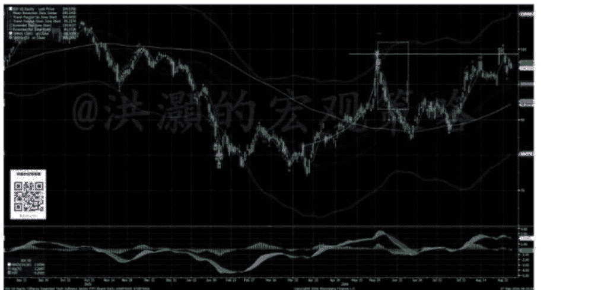
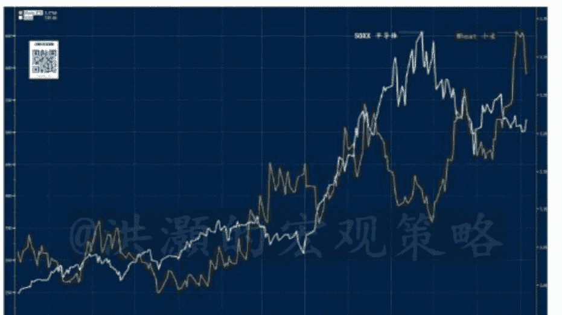
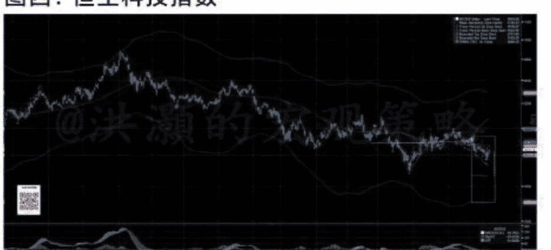

# 财政买入金融，市场买入什么

260907 洪灏

整理：公众号懒人搜索，懒人专属群精选

懒人微信：lazyhelper1

> **小懒判断** | 盯银行股和港股的值得看，洪灏把三次银行注资和 H 股 A 股定价分歧讲透了。不适合想抄短线代码的，这是宏观框架不是荐股文。最值得关注：6 家银行 H 股年内涨 12.5%到 35.7%全跑赢 A 股，国际资本真金白银给资本重组投票。坑在于注资只补资本充足率，净息差收窄的盈利问题没解，别把政策托底当永动机。

## 前言

历史上第三次银行注资，其显著意义和市场影响不容忽视。

九月六日，官方新闻报道称为，至少 8 家金融机构合计寻求 3600 亿元人民币的新增资本金，财政部认购比例超过 80%，另有 3000 亿元特别国债同步发行以支持相关融资。

乍看之下，这不过是又一轮监管例行的资本补充，然细究其时点、规模与机制，却能读出管理层对于增长的支持计划。

这已是过去 25 年间，中国第三次以系统方式介入银行体系的资本结构，而每一次介入，都留下了不同的时代印记。回望二〇〇三年，彼时中国银行业的处境远不如今天。加入世贸组织的压力迫在眉睫，而数十年政策性放贷积累的不良贷款，按国际标准估算高达贷款总额的40%（国际组织数据），中国的银行体系的债务当时很可能高于其资本金。

当年的应对也颇具巧思：中国动用450亿美元外汇储备，通过专门设立的中央汇金公司“直接注入”两家大型银行，绕开财政预算体系，借道央行的资产负债表对于银行体系重新注资、补充资本金。

与此同时，四大资产管理公司在一九九九年至二〇〇四年间，以账面价值承接了约1.4万亿元人民币的不良资产，这是一次规模空前的准财政注资。

这场注资的战略意图从一开始便昭然若揭：将银行打造成可以赴海外上市的现代金融机构，以引入外资与市场纪律作为治理改善的工具。

当时，两大银行相继登陆香港资本市场，成为了这场脱胎换骨改造的重要里程碑。二〇〇八年的第二次注资则呈现出截然不同的特征。彼时，全球金融危机骤然来袭，汇金公司股权注入了最后一家尚未完成股改的国有大行，令其得以在二〇一〇年顺利完成当时全球规模最大的IPO。

这一轮注资相对于GDP的规模其实并不算大，约为0.4%，因为当时的银行体系的资本状况相对于二〇〇三年已经不可同日而语。真正消耗资本的，是08年次贷危机之后的4万亿元人民币刺激计划。

当时，银行体系迅速扩张信贷规模，资本充足率随之自然降低。也正是在这一时期，汇金公司的资金从一次性注资工具演变为汇金长期持股，成为中国银行体系一道隐形的资本后盾。

眼下的这一轮与前两次相比，呈现出三个根本性的结构差异。其一是机制上的透明化：财政部直接发行5年期与7年期特别国债，募集资金以股权形式注入银行，政府或有负债因此被正式计入主权资产负债表。这是三次注资中最“阳光化”的一次，也是最直接推高政府显性债务规模的一次；其二是节奏上的常态化：二〇二五年，四大国有银行合计获得5200亿元注资，核心一级资本充足率因此提升0.5至1.5个百分点；二〇二六年3月又追加3000亿元特别国债，9月6日再度加码3600亿元，覆盖进出口银行与中国出口信用保险公司等政策性机构。

累计算来，二〇二五至二〇二六两年间，中国的银行资本补充规模已达1730亿美元左右，占二〇二五年GDP之比重约为0.9%，虽然远低于二〇〇三年的2.7%，但持续性与广度却是历史之最；其三是范围上的系统化：这一轮注资已不再局限于商业银行，而是延伸至政策性银行、出口信用保险机构乃至大型寿险公司，俨然是一场覆盖整个金融体系的全面加固，而非针对某一类机构的定向修补。

促成此番动作的动因是多层叠加的。表面上，中国的国有大行资本充足率在技术上并无燃眉之急，这次注资是未雨绸缪，提前为更严格的全球资本监管标准巴塞尔协议的新一轮要求预留了缓冲空间，与此同时，自二〇二六年初以来，大批城商行与农商行也在陆续披露自身的资本补充计划，以应对日益趋严的监管要求。

然而更深层的驱动力，则在于国有银行扩大信贷投放以支持实体经济，但这种支持性政策具有两面性：放贷规模扩张的同时，净息差被持续压缩，银行的盈利能力遭到侵蚀。

二〇二五年中国头部银行的利润增速只有非常低的个位数水平，息差在低利率环境下不断收窄，银行依靠自身留存收益补充资本的能力逐步显得捉襟见肘。

厚实的资本缓冲，是让银行能够在不触碰监管红线的前提下继续扩张信贷的必要条件，直接服务于稳增长的政策目标。

此外，中国的大型保险公司也面临行业整合的压力，但一项规模约 2000 亿元人民币的专项国债注资计划正在同步推进，旨在强化头部机构，应对行业集中度提升的趋势。

凡此种种，有利于中国金融体系加固防线，以应对经济增长和房地产行业持续调整以及市场波动性上升的多重挑战。

这场注资潮对于市场的影响，才是真正值得细究的部分。自今年 3 月 5 日重要会议宣布首批 3000 亿元特别国债注资方案以来，6 家中国银行的 H 股股价都大幅跑赢恒生指数。

同期的恒生指数几乎原地踏步，仅上涨 1.3%，而 6 家银行的涨幅区间高达 12.5% 至 35.7%，为今年表现得最好的市场板块之一。

同时，在市场上一片看多半导体、AI 板块的同时，银行这种传统行业，尤其是在息差收敛盈利低个位数增长的情况下表现得如此优异，的确值得关注。

在市场共识一片看多半导体的滚滚洪流之中，我逆共识地推荐的银行和其他红利板块为投资者带来了丰厚的回报和远低于市场的风险波动率，但也在六七月份半导体泡沫破灭之际为我自己带来一片非议和辱骂。

如今，创业板已经基本上回吐了年初以来的涨幅。应该看到，这次银行板块的行情并非泛泛的香港市场普涨，而是一场围绕资本重组叙事展开的板块性重新定价。

一家中字头的国有大行的 H 股表现最为耀眼，涨幅达 35.7%，这与其在二〇二五年获得 1650 亿元人民币的最大单笔注资份额密切相关，市场对其资本充足率改善的预期最为强烈。

而 8 月 31 日前后，随着 9 月财政部新一轮注资消息的临近，其股价更是出现一波近乎垂直的拉升。

这家银行是唯一一家 H 股与 A 股均录得可观涨幅的银行，分别为 35.7%与 22.6%，显示出无论境内境外，市场对其资本改善故事均给予了正面回应。

更耐人寻味的现象，出现在 H股与 A 股的比较之中。

自 3月 5日以来，6家银行的 H股无一例外地跑赢其对应的 A股，反映出国际投资者对这场资本重组叙事的认同程度，明显高于境内投资者。

其中分歧最为剧烈的是一家最后上市的大型国有银行。其 H股上涨 26.2%，A 股却仅上涨 3.9%，差距高达 22.3 个百分点。个中缘由并不难理解。

该折价银行计划中 1600亿元人民币的定向增发规模，是本轮所有银行中最大的一笔，境内投资者显然对由此带来的每股收益稀释效应更为敏感与警惕，而离岸投资者则更愿意聚焦于资本充足率改善这一长期利好，对短期摊薄相对钝感。

银行的 H股相对 A 股历来存在 20%至 40%的估值折价，但此轮 H股却持续跑赢。

与其说是 H股本身涨了，还不如说是这一折价在缩窄。国际投资者是在以更宽的安全边际买入同一份资产，而境内投资者则要直接承受定向增发带来的机械性摊薄压力，这也解释了为何离岸与在岸市场对同一场资本重组会给出如此不同的估值反应。

穆迪已于 4月将 10家银行子公司的评级展望由负面上调至稳定，这在某种程度上印证了国际评价机构对这场资本重组的正面判断。然而，若仅以股价表现论成败，未免失之简单。

这场注资对银行盈利能力的中期影响，恐怕远比二级市场的亢奋更值得玩味。银行为补充资本所做的定向增发对现有股东而言，不可避免地带来摊薄效应。

这在一定程度上解释了为何中国企业盈利今年录得 26% 的强劲增长，资本市场的反应却显得“雷声大雨点小”。更值得注意的是，这一轮注资虽然缓解了资本充足率的燃眉之急，却并未真正解决银行业自身造血能力不足这一根本症结：在放贷支持经济与持续压缩的净息差双重挤压之下，银行依靠内生利润补充资本、又同时需要满足巴塞尔协议与信贷增长目标的能力，依然是一道难解之题。

净息差缩小的趋势短期内恐难逆转。换言之，此次注资并没有从根本上解决这个问题，未改变银行长期盈利模式所面临的结构性挑战，但的确为银行体系争取了时间与空间。

这或许正是这一轮资本重组与二〇〇三年那次注资的本质区别：后者以彻底剥离不良资产、引入市场纪律为代价，换来了银行体系上市的资格；而这一轮，更像是在不触动深层体制的前提下，以财政的显性化介入，为一个仍在转型中的银行体系争取腾挪的空间。

当前，十年期美债收益率报 4.78%，三十年期更是攀升至 5.25%，双双逼近数十年高位，且仍有上行惯性。驱动这一轮美债长端收益率失锚的结构性因素是美国财政赤字高企、大厂人工智能资本开支的巨额融资需求，以及日本和其他主要美债买家对海外债券需求的持续下滑。

这些因素短期内均难言逆转。美国和西方金融板块对利率上行的敏感度接近中性，西方银行股受益于收益率曲线趋陡带来的净息差扩张，在一定程度上抵消了债券组合浮亏的负面影响；科技板块对于高企的美债收益率同样呈现出令人意外的低相关性，这背后是人工智能驱动的盈利增长预期，部分抵消了纯粹由利率上升带来的估值压缩效应。

当然，长久期成长股内嵌的估值风险依然不容忽视。能源板块则是唯一与美债长端收益率呈正相关的板块，这源于二者共享同一驱动因子——中东能源冲击推升的通胀预期，同时抬高了收益率与能源企业盈利。

短端二年期美债收益率同样值得关注，当前报4.37%，较2月低点的3.38%已大幅攀升，沃什就任美联储主席后的鹰派转向与中东能源冲击带来的持续通胀压力是主要推手。

有意思的是，短端利率上行对板块的影响，与长端不完全一致。硬科技板、半导体、AI 板块对二年期收益率呈现正相关的关系，反映出短端利率上升在此轮周期中更多被市场解读为增长与人工智能生产率提升的信号而非单纯的货币政策紧缩冲击；美国金融板块同理受益于短端利率上行带来的净息差改善；中国财政注资的情况恰恰相反。

真正值得警惕的，是美联储自二〇二四年9月以来已累计降息175个基点，但股票风险溢价却始终未能重建，这意味着当前权益市场对长端收益率再度走高的缓冲，较历史上任何一个宽松周期都更为单薄，只有能源板块是正向的。

对新兴市场而言，历史经验一再表明，美债收益率的急速上行往往是资本外流、本币承压与金融条件收紧三重打击同时袭来的时刻，马来西亚、智利与墨西哥等新兴市场是对于日本投资者资金回流格外脆弱的市场。

如果日元进一步升值到151左右，纵使中国财政为国内银行体系加固了资本缓冲，但一旦全球长端利率的失锚趋势持续深化，新兴市场资产所面临的外部压力测试终究很难因一国国内政策的定向发力而完全豁免。

在全球债券长端收益率飙升，美债长端收益率似乎难以锚定的背景下，中国以国家信用支持银行体系托底。从二〇〇三年脱胎换骨式的危机到二〇〇八年未雨绸缪的预防性注资，再到今常态化、系统化、显性化的财政注资，中国应对银行体系资本问题的手法愈发娴熟，也愈发依赖国家资产负债表的直接介入。

二级市场已经用真金白银投出了信任票，H股相对恒生指数与相应A股的持续跑赢显示出国际投资者对于这种政策应对的信心。 但注资所能解决的是资本充足率问题，但银行业净息差持续承压、内生盈利能力有待加强恐仍需假以时日，依靠更深层次的利率市场化与经济结构调整方能真正化解。

而美债长端收益率失锚所酝酿的全球流动性重新定价是决定全球资本市场走势的关键。美债收益率继续上升反映的不仅仅是通胀预期由于油价飙升而居高不下的情况，美国财政赤字问题和美元信用问题都是推手。

在如此复杂的地缘政治和市场风险高企的情况下，技术上过去几个月上涨的板块的走势很可能需要歇一歇，投资者很可能将在半导体硬件板块中寻求短期公司盈利确定性的机会和能源板块由于油价居高不下而带来的相对确定性，而像软件业和一些农业板块这种在过去三个月大幅修复的板块，则很可能需要修养生息，然后再议。

### 图二：美国软件业指数运行到阻力位

### 图三：小麦和半导体负相关

### 图四：恒生科技指数

洪灏
2026.09.07

洪灏
2026.09.07

分割线

在这个 AI 能替你写代码、写文章的时代，基础技能正在迅速贬值。绝大多数人正被淹没在海量的免费垃圾信息里，陷入低效的体力内卷。

当“努力”不再是壁垒，人与人之间唯一的护城河，只剩下“信息过滤”的效率与“认知系统”的维度。

圈子已稳定运行 7 年。我们每天利用 Python 爬虫与大模型算力，过滤全网最顶级的政经内参和搞钱风向标，做你最冷酷的“外部大脑”。

如果你认同这种“重塑认知防线”的极客主义，欢迎围观我的个人情报智库：【懒人专属群】。

https://lazyso.com/insider/

认同信息过滤价值、想省下每天 3 小时无效阅读时间的读者，扫码加我微信（lazyhelper1）

微信：lazyhelper1
