# 4 个月，我用小红书垂直小号累计变现 2 万元：打工人最适合的第一个项目（喂饭版）

260909 副业 SC 精华

整理：公众号懒人搜索，懒人专属群精选

懒人微信：lazyhelper1

> **小懒判断** | 适合在一个行业干满 5 年、想做第一个 0-1 项目的职场人；不适合追求高天花板可放大生意的人——一对一咨询本质是卖时间。最值得关注：600 粉就能开张，评论区反复求什么就卖什么，9.9 元模板筛人建信任、399 元/小时咨询做主力，选题用“人群×场景×需求”拆成稳定选题库。坑：绩效晋升需求有淡旺季，别闭门憋大课，先发内容看用户愿意为什么付费。

大家好，新人报道！我是夏树，一名有 7 年经验的互联网产品经理，受朋友@瑞恩白影响，关注了生财公众号很长时间，最近加入生财两个月了，这是我的第一篇帖子。

去年我做了一个小红书职场垂直小号，把工作方法和职场经验用来做内容，前前后后加起来做了 4 个月，涨粉 4000+，跑出几十篇浏览量 1w+的爆款笔记，累计变现了 2 万元。

这个结果，放在生财里根本算不上什么。但我还是想分享出来，因为看到生财里有不少圈友和我一样，过去一直在职场工作。

我们或许很擅长做好一项具体工作，却没有独立跑过“发现需求—设计产品—获取客户—完成成交”的完整闭环。对我们来说，从0到1最难的，往往不是执行，而是看了很多项目，还是不知道第一个项目应该做什么？要做的话应该怎么开始？

我这次跑通的路径，恰好比较适合普通职场人：不需要进入一个完全陌生的行业，而是从自己过去几年的工作经验出发，把已经掌握的方法整理成内容和产品，通过一个垂直小号找到精准用户，完成第一次变现。

这篇文章，我会完整拆解自己如何选择平台、确定定位、寻找选题、借助 AI 生产内容，并用几千粉跑通“低客单虚拟资料 + 高客单咨询服务”的变现闭环。

我也想借这篇复盘做一次新人自我介绍，认识生财圈友，认识一些做小红书的朋友（一个人做太孤独了，经常遇到了瓶颈卡点，想找组织抱团交流！！）并寻找内容获客方面的合作机会。通过这个项目，我验证了自己的三项能力：对内容和选题比较敏感，能够理解垂直人群的真实需求，也擅长把复杂问题拆成可以执行的 SOP。如果你手里有成熟的产品、服务或行业资源，但正好缺少用户洞察、内容运营和获客路径搭建能力，欢迎读到最后，看看我们有没有合作的可能；或者是做内容获客的老板，你刚好缺做内容懂用户的人手，也许我就是你要找的人～全文主要分为以下几个部分：

- 1. 为什么做垂直小号选择职场赛道；
- 2. 为什么选择小红书，以及如何确定账号定位；
- 3. 从第一二篇爆款就爆了，到第三篇数据回落，我经历了什么；
- 4. 如何通过结构化拆解、追踪近期爆款两种方式找选题；
- 5. 如何借助爆款结构、个人经验和 AI 完成内容；
- 6. 如何用 600 粉跑通低客单 + 高客单变现闭环；
- 7. 4 个月拿到了哪些结果；
- 8. 这套模式适合哪些人、有哪些局限，普通职场人如何在 7 天内起步做；
- 9. 我能为你提供什么，以及我想寻找怎样的合作。

## 一、为什么做垂直小号选择职场赛道

在做这个账号之前，我在互联网大厂做了六年产品经理。

当时我已经裸辞，处于 Gap 阶段。旅行回来以后，我开始重新思考：除了继续找一份工作，我还能做些什么？

回头看过去六年的工作经历，我发现自己一直很擅长一件事：把工作中复杂、模糊的问题，总结成可以直接执行的方法、SOP 和工作流。

因为工作中带过人，我平时也会给下属整理很多方法文档，比如怎么写需求文档、怎么做数据分析、怎么推动横向沟通协作、怎么向上管理等等。

这些并不是网上随处可见的概念，而是我在大厂真实项目中反复使用和验证过的实操经验。

很多大厂职场人其实非常需要这些方法，却未必有机会遇到一个愿意把工作方法讲清楚的领导或者带教。

网上能搜到大量“产品经理应该具备什么能力”，但很少有人真正告诉你：

- 一份需求文档到底应该怎么写；
- 跨部门项目卡住时应该怎么推动；
- 绩效总结如何体现自己的价值；
- 晋升答辩怎么证明自己具备下一级能力。

我意识到，这些自己习以为常的工作积累，对别人来说可能正是一种稀缺信息。

于是，我决定先把其中一部分经验整理出来，做一个足够垂直的小红书账号，看看能不能找到真正需要它的人。

## 二、为什么选择小红书，以及我如何确定账号定位

### 1. 为什么我选择小红书，而不只做公众号

这种垂直职业内容，在公众号上可以做，在小红书上同样可以做。

相比之下，我当时选择小红书，主要有两个原因。

第一，小红书上年轻、收入高的女性用户较多，也更习惯为能够解决具体问题的产品和服务付费。这与我的目标用户比较匹配。从我自己的实际成交情况来看，付费用户中 90%以上都是一二线城市 22-32 岁的年轻女性。她们会因为一篇具体的工作干货找到我，也会因为《大厂工作至暗时刻》这样的内容产生共鸣，再通过持续阅读建立信任，最终购买模板或咨询服务。

#### 粉丝画像

统计周期 08-04 至 09-03

- 全部粉丝
- 新增粉丝
- 流失粉丝

##### 性别分布

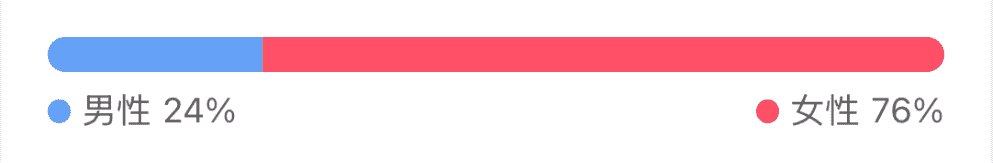

- 男性 24%
- 女性 76%

##### 年龄分布

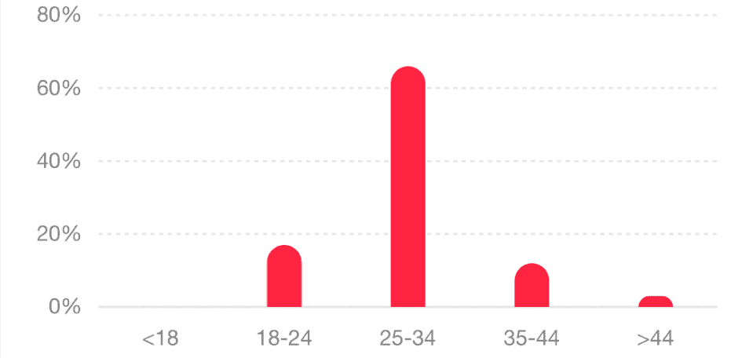

- <18
- 18-24
- 25-34
- 35-44
- >44

##### 城市分布

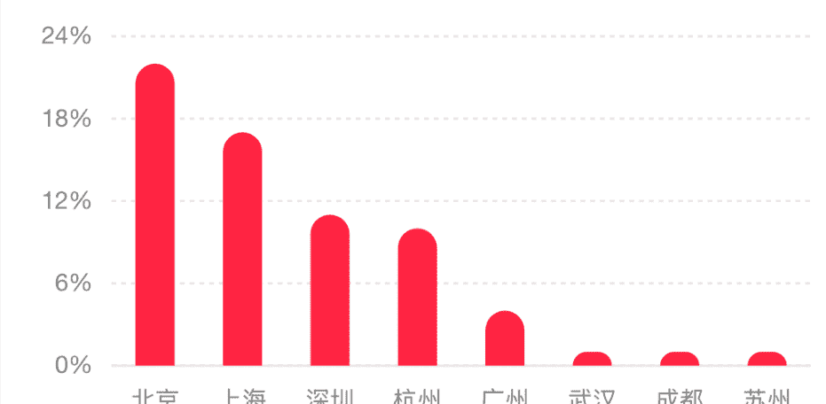

- 北京
- 上海
- 深圳
- 杭州
- 广州
- 武汉
- 成都
- 苏州

##### 兴趣分布

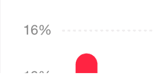

**第二，小红书的内容生产成本比公众号更低，更适合普通职场人利用业余时间持续更新。** 一篇公众号文章通常比较长，需要完整展开一个主题；而小红书图文笔记通常正文要求 1000 字以内，只需要讲透一个具体场景问题。

一篇完整的公众号长文，往往可以拆成多篇小红书内容。

例如，一篇“如何准备晋升答辩”的公众号文章，可以拆成：

- 晋升答辩的材料怎么写
- 晋升答辩评委提问如何准备
- 晋升答辩最重要的是讲好故事
- 晋升预兆出现的一些信号

这意味着，同一份行业经验可以被拆成更小的内容单元，持续测试不同选题，也能覆盖更多具体的用户需求。

对普通职场人来说，不需要一开始就具备写长文的能力。先从一个具体问题、一篇千字以内的图文开始，更容易完成第一次发布，也更容易长期坚持。

所以，小红书的优势不只是流量，而是它同时具备三个条件：

**目标用户集中、付费需求明确、内容生产成本相对较低。**

#### 2. 我没有做泛职场，而是从账号人群的两类需求，设计了两种内容的分工

我的目标用户很明确：在大厂工作 0—6 年、处于初阶到中阶阶段的职场人。

因为我自己也是从这个阶段走过来的，所以很清楚这群人主要有两类需求：

第一类，是工作中缺少具体的方法和指导。很多人知道自己要完成哪些工作，却没有 人具体告诉他应该怎么做。

第二类，是工作压力很大，需要一个情绪出口。他们希望自己的焦虑、委屈和崩溃被看见，也希望确认这些经历并不是只发生在自己身上。

围绕这两类需求，我把账号内容分成了两种角色：

- 工作方法类内容，主要负责提供实用价值、展示专业能力，并承接模板和咨询成交；
- 情绪共鸣类内容，主要负责扩大传播、吸引新粉丝，让更多目标用户进入账号。

这两类内容的判断标准也不一样：

> 情绪内容看传播和涨粉，工作方法内容看信任和成交。前者让用户产生“原来不只有我经历过这些”的共鸣，后者让用户确认“这个人确实懂我的问题，而且有能力帮我解决”。

对于垂直账号来说，流量和成交不一定要由同一篇内容完成。让不同内容承担不同任务，反而更容易形成稳定的获客与转化闭环。

至于我是如何围绕这两类需求持续找到选题，并逐渐跑出爆款系列的，后面会单独展开。

## 三、前两篇就爆了，但我很快发现：偶然做出爆款，不等于掌握了爆款方法

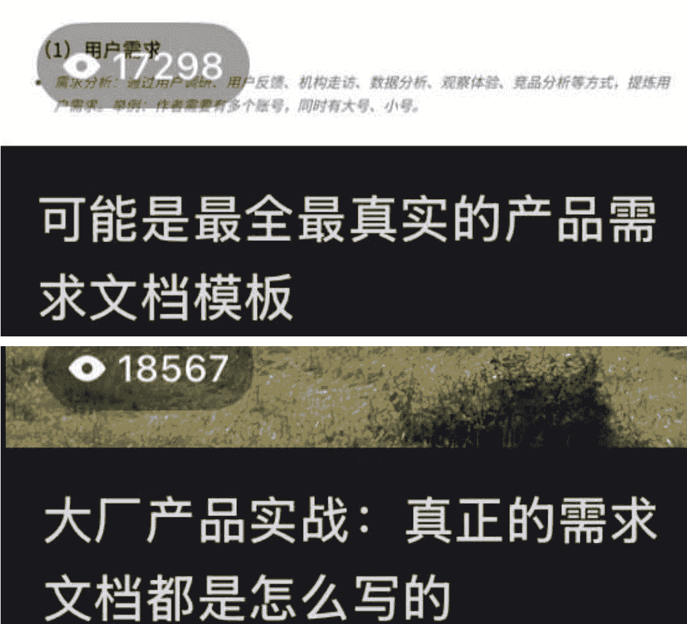

这个账号的开局比我预想中顺利。

我发布的第一篇内容，讲的是大厂产品经理在真实工作中，需求文档究竟应该怎么写。

这篇笔记发出去以后，很快获得了 1 万多阅读。评论区里，不少人在追问：能不能提供一份可以直接参考的需求文档模板？

后来复盘，我认为这篇内容能跑出来，主要有两个原因。

第一，它提供的是某个行业内部真实使用的工作方法，而不是网上随处可见的概念。

很多人知道产品经理需要写需求文档，却很难看到大厂内部一份真实的需求文档究竟包含什么、应该分析到什么深度，以及实际工作中的要求到底是什么。

第二，我在内容中提到了上一家公司的名字（在职不建议放，比较敏感）公司的大厂背景进一步增加了内容的可信度和好奇心。大家想知道，这类公司内部究竟如何做产品，一份真正用于工作的需求文档，与网上的通用模板有什么区别。

紧接着，我又发布了第二篇内容，主题是“可能是全网最真实的产品需求文档模板”。

这篇同样获得了 1 万多阅读。评论区里，很多人求分享模板。

正是这些明确的用户需求，让我意识到这份模板具备变现的可能。后来，我才把它整理成虚拟资料，挂到小红书店铺。

所以，我最初跑通产品的方式并不复杂：

先分享真实的行业经验→观察评论区里用户反复索取什么→再把它整理成可以购买的产品。

但连续两篇内容取得不错的数据，也让我产生了一个错觉：这个账号好像很容易做。

等我继续发布其他选题时，数据很快回落到了几百或几千阅读。这个时候我才意识到，前两篇内容跑出来，只能证明用户对这个方向有需求，并不代表我已经掌握了稳定生产爆款的方法。

于是，我开始重新寻找对标账号、拆解选题和内容结构，从“凭感觉发内容”，逐渐转向“通过观察、拆解和测试寻找规律”。

## 四、我的选题方法：结构化拆解建立选题库，追踪近期爆款捕捉变化

经过一段时间的测试，我越来越确定：做内容的选题，就像做电商的选品一样重要。

如果选品错了，详情页做得再漂亮，也很难卖出去；如果选题本身没有需求，文案写得再好，用户也不会感兴趣。

我的选题方法主要分成两种：一种是结构化拆解，另一种是追踪近期爆款。

### 1. 结构化拆解：按照“人群×场景×需求”拆解

第一种方法，是先确定自己要服务的人群，再沿着他们会经历的场景，寻找具体需求。

以我的账号为例，目标用户是在大厂工作 0—6 年、处于初阶到中阶阶段的职场人。围绕这群人，我又拆出了两类场景。

第一类是职业生命周期。

从刚入职试用期，到日常工作推进，再到 OKR、绩效总结、晋升答辩，基本贯穿一个大厂人的完整职业发展过程。

每进入一个新的阶段，用户都会遇到新的任务；每一项目任务背后，还可以继续拆出大量具体问题。

以“试用期新人”为例，可以继续拆成：

- 如何 x 个月丝滑通过试用期
- 新人入职如何看懂团队人员关系
- 新人如何搞定合作方
- 如何 x 个月和领导建立信任关系

第二类是情绪节点、具体事件和人际关系。

我会把大厂人容易情绪崩溃的时刻拆得非常细：被领导 pua、遇到团队里的“卷王”和“嫡系”、绩效结果不理想、长期纠结内耗，以及无数次想要跑路的时刻。

围绕这些场景，我做出了《大厂工作至暗时刻》系列，包括：

- 大厂 OKR 期十大至暗时刻；
- 大厂绩效考核十大至暗时刻；
- 大厂体检指标异常十件套；
- 我在大厂遇到的那些卷王们；
- 我在大厂遇到那些嫡系们。

结构化拆解的好处，是可以形成一个相对稳定的长期选题库，不需要每天临时想自己要发什么。

这个方法同样可以迁移到其他职业：先确定目标人群，再列出他们的职业生命周期、工作任务、情绪节点和人际关系，最后把每个大场景继续拆成具体问题。

### 2. 追踪近期爆款：从最近的爆款和评论区寻找机会

第二种方法，是通过小红书当下正在发生的内容，观察目标用户最近关心什么。

可以每周选择几个与自己行业有关的核心关键词，看看最近一周跑出来的笔记都在讨论什么。

例如，如果你想做体制内职业账号，可以搜索“体制内”，也可以搜索用户常用的缩写“tzn”。

找到近期数据比较好的笔记后，重点分析两个问题：

1. 最近一周的爆款笔记主要在讨论哪些选题？
2. 评论区里集中出现了哪些情绪和问题？

这一步可以人工完成，也可以把相关笔记截图发给AI，让AI帮助归类和总结。如果你会用 Claude Code、Codex、Workbuddy 这类 coding agent，可以进一步把笔记采集、选题分析和评论区分析做成自动化流程。

例如，我最近搜索体制内相关内容时，发现多篇笔记都在讨论：

- 体制内裸辞；
- 为什么选择从体制内裸辞；
- 如何在体制内保持身心健康。

当多个创作者在相近时间讨论同一类问题，并且评论区也出现大量相似情绪时，通常意味着这不是某个人的偶发感受，而是这一批用户当下共同关注的问题。

继续往下思考，就可以举一反三地延伸出更多选题：

- 哪些人真的适合从体制内裸辞；
- 想辞又不敢辞时应该怎么判断；
- 体制内工作最容易消耗人的几个阶段；
- 不辞职的情况下，如何降低工作带来的内耗；
- 体制内裸辞后，哪些能力可以迁移到市场化岗位。

追踪近期爆款寻找选题的核心，并不是机械地复制最近的爆款，而是通过内容和评论区识别：目标用户现在正在讨论什么、情绪发生了什么变化，以及这些变化背后有没有尚未被满足的新需求。需要注意的是，我最近使用小红书时发现，搜索和排序方式已经发生了一些变化。即使按最多点赞排序，继续往下浏览时也会出现大量数据低的新笔记，因此这套搜索方法没有以前那么好用了。

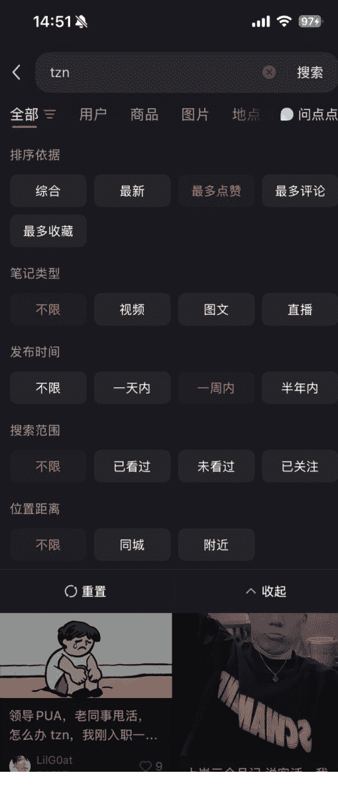

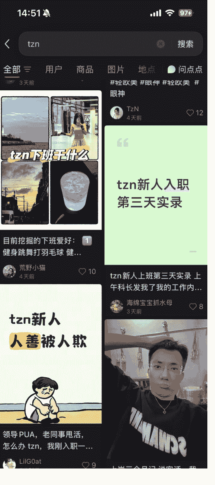

我的应对方式是，不再完全依赖搜索。

可以专门准备一个小号，或者直接使用平时刷内容的账号，多关注垂直领域里的同行和同类账号，持续浏览相关内容。当账号积累了足够明确的浏览和关注行为后，推荐算法会持续推送这个领域的新博主和新笔记。相比单纯搜索，这种方式有时更容易及时看到正在出现的新选题和情绪变化。

所以，我现在会同时使用两套方法：

**结构化拆解，建立长期稳定的场景选题库；追踪近期爆款，通过搜索、对标账号和推荐流，捕捉近期讨论与情绪变化。** 一个保证账号长期有内容可写，一个帮助账号跟上用户当下真正关心的问题。

## 五、选题确定以后，我如何用爆款结构、个人经验和 AI 完成内容

我的内容主要以图文为主，本质上还是通过文案打动用户。

我没有选择做视频，一方面是因为视频的制作成本更高，另一方面是我不喜欢对着镜头露脸口播。相比之下，图文更适合我，也更适合普通职场人利用业余时间启动。

但我必须承认，我并不擅长所有类型的文案。

像“第一、第二、第三”这种结构清楚的干货内容，我可以很快写出来；但涉及情绪表达、故事感和传播性更强的内容，我写起来会比较吃力。

所以，我没有逼着自己从零学习所有文案类型，而是借助成熟结构和 AI 补足这部分能力。

我的理解是：

选题决定用户是否关心，结构决定用户是否愿意看完，个人经验和灵魂决定用户是否会记住并相信你。AI只是帮助我们提高这个过程的效率。

### 第一步：收藏内容结构适合迁移的爆款笔记

确定选题以后，我会在平时刷小红书时，有意识地收藏一些不错的爆款笔记。

这些笔记不一定和我要写的是同一个主题。比如，我要写大厂绩效，它可能写的是亲密关系或考研焦虑，但只要它的开头、叙事节奏或正文结构适合承载我的观点，就可以作为参考。

寻找对标时，我不会优先研究那些已经拥有几十万粉丝、运营了很多年的成熟大号。

这类账号的数据中，可能包含长期积累的粉丝基础和个人影响力，对一个刚开始的新账号来说，未必具备直接参考价值。

我更关注的是：同一垂直领域里，粉丝量不算特别高，但在最近几个月或一年内快速成长起来的账号。

这些账号与新账号所处的阶段更接近。它们最近出现的爆款，也更能反映当下用户对什么话题感兴趣、什么表达方式更容易被接受。

找到对标账号后，我会重点观察：

- 最近哪些选题反复跑出高数据;
- 标题是什么结构，哪些因素吸引用户点进去;
- 正文使用了什么结构;
- 开头如何让用户快速代入;
- 内容的情绪和信息密度如何变化;
- 结尾如何引导用户互动、关注或者询问。

我关注的不是照搬它写了什么，而是研究它为什么能够让用户停下来、继续看完并产生互动。

### 第二步：让 AI 拆解结构和表达方式

我会把最近收藏的对标爆款笔记发给Claude code 分析，我做了一个小红书爆款笔记拆解和自动化写作的 Skill，可以用来拆解爆款笔记，把其中可以复用的内容结构、文风语料、写作手法沉淀到知识库中。

还有一种更简单的方法：直接使用豆包。把想要参考的爆款笔记截图发给豆包，然后问它三个问题：

1. 这篇小红书笔记为什么会爆？
2. 它的整体内容结构是什么？
3. 有哪些可以复用的方法？

这一步的目的，是把“我感觉这篇写得不错”，拆成可以执行的写作方法。

### 小红书笔记撰写协助

AI 生成可能有误 注意核实

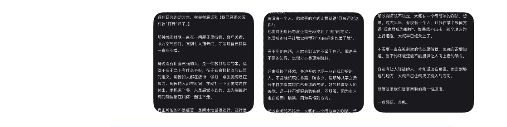

分析这篇小红书笔记爆的原因，选题和文章结构是什么样，有什么可复用的方法

- 搜索 2 个关键词，参考 12 篇资料 >

#### 《离职的第一性原理》小红书笔记完整拆解

##### 一、爆火核心原因

1. **选题踩中职场人强痛点**

市面上绝大多数离职笔记，都在聊加班、薪资、领导 PUA 这些表层矛盾；这篇拔高到成长维度，回答灵魂问题：「工作没明显糟，但我要不要走？」，击中大量大厂打工人的温水煮青蛙困境。很多人处境是：工作尚可、不痛苦，⬇⬇⬇止成长，不知道该

### 第三步：加入自己的经验、观点和个人灵魂

AI 完成拆解以后，我会把自己真正想表达的核心观点、亲身经历和真实案例告诉它，让它参考刚才总结的爆款结构生成初稿。

这里复用的是内容结构和表达方法，不是

照抄别人的观点、文字和案例。

最终文章里的行业经验、工作细节和案例仍然来自自我自己。AI解决的是“怎么组织和表达”，我提供的是“到底要说什么”。

真正能让用户记住一个账号的，是作者放进内容里的东西：

- 你是谁，你亲身经历过什么；
- 你观察到了哪些别人没有说过的细节；
- 你对这件事有什么不同的判断；
- 你的价值观、性格和态度是什么。

如果生成结果不满意，我会继续指出具体问题，例如：

- 开头不够吸引人；
- 描述手法不够具体，少了很多细节；
- 没有把我真正想说的观点写出来。

整个过程甚至不一定需要打字。把截图发给豆包，再通过语音描述自己的选题、观点和案例，来回交流几轮，就能得到一版可以继续修改的内容。当然最后还是需要有人的编辑，稍微改一下不满意的地方，加个符合这篇笔记情绪的图片，就可以发出去了。这样下来，一篇图文笔记前后也就不到一个小时左右的时间。

所以，我最终形成的内容公式是：

真实需求产生的好选题 + 被验证过的爆款结构 + 自己的行业经验、观点和人设特点

AI 可以帮助我们拆结构、组织语言、提高效率，但无法替代行业经验和最后的判断。

## 六、600 粉完成第一次变现：我如何搭建低客单 + 高客单闭环

我最早并没有先设计一套课程，再想办法把它卖出去。

账号做到大约 600 粉时，一位粉丝主动私信我，问我能不能提供付费咨询。她马上要参加一场面试，却不知道应该怎么准备。

这个需求推动我在小红书开通了店铺，上架了第一个产品：一对一付费咨询，定价 399 元/小时。

同时，随着账号陆续发布需求文档、绩效总结、晋升答辩等实操内容，越来越多人向我要可以直接使用的模板。于是，我又把这些工作方法进一步标准化，整理成 9.9 元一份的虚拟资料，也很快产生了销量。

至此，我逐渐形成了两条变现路径。

### 1. 高客单直接转化：用专业内容建立信任

一部分用户看完我的内容，认为这些方法足够真实、专业，而且确实来自大厂实战，便会直接进入主页购买一对一咨询。

这类用户的决策路径很短。很多人甚至不会先找客服询价，而是直接下单，再来预约咨询时间。

做了一段时间后，我发现咨询需求最多的并不是面试，而是绩效总结和晋升答辩。

当时，小红书上的面试辅导已经非常多，竞争相对激烈；但真正做过大厂绩效评估、参与过晋升答辩，又能提供具体辅导的人并不多。

因此，我没有继续扎进面试辅导这个红海，而是逐渐把绩效与晋升作为高客单服务的重点方向。这既是我更有优势的领域，也是一个供给相对稀缺的细分需求。

### 2. 低客单引流转化：先让用户用 9.9 元验证价值

另一部分用户不会立刻购买 399 元的咨询，而是先购买 9.9 元的工作模板。

低客单产品降低了第一次交易的门槛，也给了用户一次低成本验证我的机会。他们使用模板后，觉得内容确实靠谱、能解决问题，后续遇到更复杂的职场问题时，就更愿意购买一对一咨询。

所以，9.9 元模板并不只是一个单独赚钱的产品，它还承担了筛选用户、建立信任和承接高客单转化的作用。

### 3. 用真实案例降低高客单咨询的决策成本

购买模板的用户，我一开始尝试引导到私域。但实际执行后发现，这样会拉长发货链路，所以后来改为直接小红书店铺自动发货。

付费咨询用户则会沉淀到微信私域。针对这部分用户，我设计了两个简单的复购和转介绍机制：

- 用户下一次复购咨询，可以享受8折；
- 介绍朋友来咨询，同样可以享受8折。

除此之外，我还专门做了一个小号，用来持续发布真实的咨询案例，包括用户的背景、遇到的问题、咨询中给到什么分析和建议，以及最后取得了什么结果。

我把这个小号挂在主账号主页，相当于建立了一个可以持续积累的“案例库”。

最终，高客单咨询主要形成了三条成交路径：

1. 用户看完主账号内容，认可专业度和可信度，直接下单；
2. 用户先购买9.9元模板，验证内容价值后，再购买咨询；
3. 用户通过小号看到与自己情况相似的 真实案例，建立信任后下单。

回头来看，我当时跑通的并不是一个孤立的咨询产品，而是一套很轻的转化闭环：

专业内容建立信任→低客单产品完成首次交易→真实案例降低决策风险→高客单咨询实现主要变现→私域承接复购和转介绍。

这里还有一个对新手很重要的经验：不要闭门做完一套大课，再开始寻找用户。

先发布内容，观察用户反复追问什么、主动索取什么，以及愿意为什么问题付费，再把已经出现的需求做成一个最小产品。这样启动成本更低，也更容易完成第一次交易。

## 七、4个月，我拿到了哪些结果

先放一下这个账号4个月的阶段性结果：

- 账号粉丝：从0增长到4000+。没有之前的截图了，最近半年上班太忙没有用心经营，涨粉很慢。

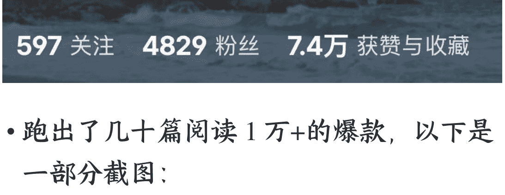

- 跑出了几十篇阅读1万+的爆款，以下是 一部分截图：

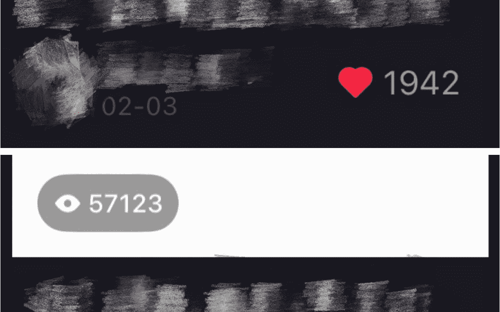

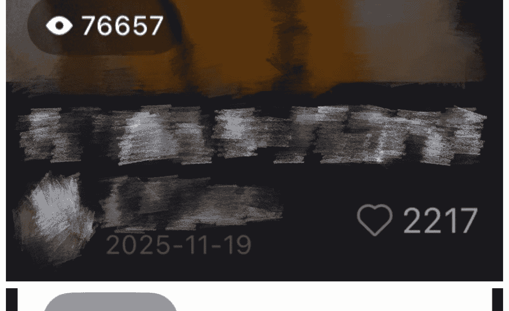

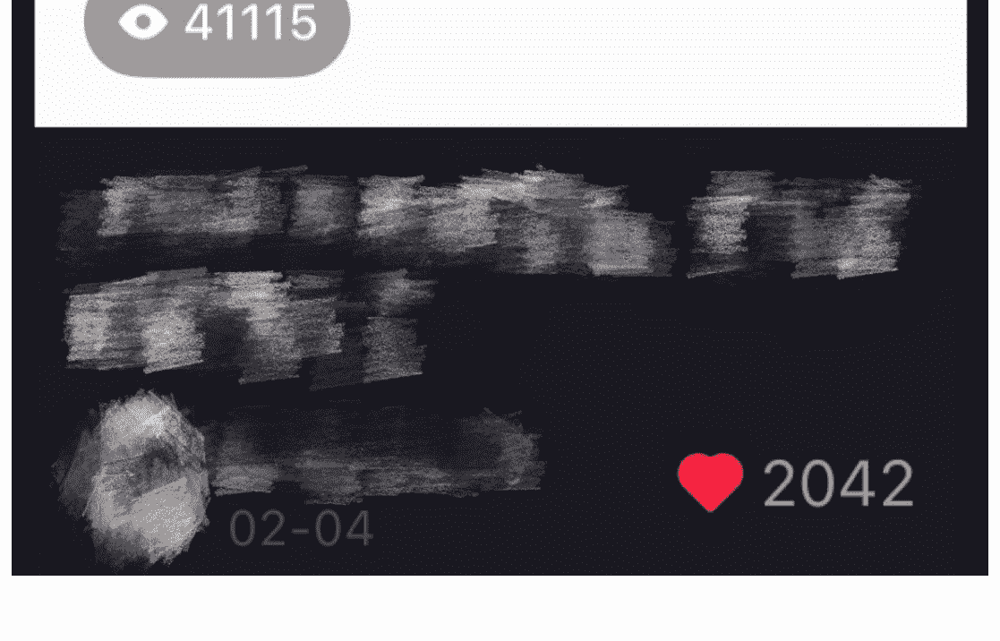

- 4 个月累计变现，小红书店铺+微信转账，加起来差不多 2 万

| 转账-来自 | 小红书咨询 | 金额 | 时间 |
| :--- | :--- | :--- | :--- |
| | | +160.00 | 11月3日 22:23 |
| | | +319.00 | 11月2日 09:46 |
| | -营销/... | +319.00 | 1月26日 13:50 |
| | 小红书咨... | +319.00 | 1月24日 14:33 |

小红书千帆后台数据截图显示：

| 日期 | 类型 | 金额 | 状态 | 流水号 | 备注 |
| :--- | :--- | :--- | :--- | :--- | :--- |
| 2026-02-20 21:29:25 | 结算入账 | 395.61 | - | 1730.88 | 结算入账-订单号 |
| 2026-02-20 20:44:43 | 结算入账 | 9.84 | - | 1344.27 | 结算入账-订单号 |
| 2026-02-19 20:05:22 | 结算入账 | 9.84 | - | 1334.43 | 结算入账-订单号 |
| 2026-02-19 14:55:46 | 结算入账 | 9.84 | - | 1324.59 | 结算入账-订单号 |
| 2026-02-19 10:31:07 | 结算入账 | 9.84 | - | 1314.75 | 结算入账-订单号 |
| 2026-02-18 11:18:33 | 结算入账 | 395.61 | - | 1304.91 | 结算入账-订单号 |
| 2026-02-18 03:52:52 | 结算入账 | 9.84 | - | 908.39 | 结算入账-订单号 |

这个结果验证了一件很重要的事：一个普通职场人积累下来的工作经验，并不只能留在内部。只要找到足够具体的需求，把经验整理成内容和产品，再通过一个垂直账号建立信任，就有机会独立完成从0到1的变现。

而且整个项目一个人+AI就能轻量完成，也没有很高的启动成本。

并不是先准备好一套完整的商业模式才开始，而是在真实需求中，一步一步把内容、产品和成交路径跑通的。

## 八、这套模式适合哪些人、有哪些局限，普通人如何在7天内开始

复盘整个项目后，我发现自己真正跑通的，并不只是“大厂职场知识付费”，而是一种具有通用性的内容变现路径：

把细分行业里的专业经验分享出来，通过持续输出建立人设，吸引同一领域的精准用户，再用资料、咨询或其他产品和服务完成转化。这种账号不需要拥有几十万粉丝。

因为用户足够垂直，所以哪怕只有几百、几千粉丝，也可能产生不错的变现效率。

我第一次收到付费咨询需求时，账号只有大约 600 粉；做到 4000 多粉时，已经形成了模板销售和高客单咨询两条变现路径。

对于垂直知识账号来说，粉丝是否精准，往往比粉丝数量更重要。

## 1. 这套方法不只适用于互联网大厂

我做的是互联网大厂工作经验，但这套思路并不局限于互联网行业。

很多职业和行业里，都存在大量外部很难搜索到、内部人员却非常需要的经验，例如：

- 银行从业者；
- 初高中老师；
- 大学老师；
- 体制内工作人员；
- 国企、央企从业者；
- 核电、水电等专业行业从业者；
- 房地产及其他传统行业从业者。

每个行业都有自己的专业门槛、工作流程、常见问题和信息差。

一个在行业里工作 5 年以上的人，可能已经积累了大量自己认为“很普通”的经验：新人如何入门、工作材料怎么写、关键流程怎么走、常见错误怎么避免、职业发展怎么选择，以及一些只有内部从业者才知道的真实情况。

这些内容对你来说可能只是日常，对刚进入这个行业、正遇到具体问题的人来说，却可能非常有价值。

如果你已经在一个行业工作了 5 年以上，又愿意总结和表达，那你可能并不是“没有东西可以卖”，而是还没有意识到：自己习以为常的工作经验，也可以成为一种有价值的内容资产。

## 2. 先说局限：这个项目并不是一门可以无限放大的生意

这条路径启动成本不高，但也有很多现实的限制。

首先，它更适合目前仍在行业里，或者刚离开行业不久的人。因为垂直内容需要持续的一线信息输入。如果离开行业太久，对最新的工作场景、用户情绪和组织变化不再敏感，内容就容易逐渐失去真实感。

其次，面试、绩效、晋升等需求存在明显的淡旺季。到了特定时间节点，咨询需求会集中出现；离开这些节点，需求量也会自然下降。

更重要的是，一对一咨询本质上仍然是在出售自己的时间。一个人能服务的用户有限，客单价和收入规模也会遇到上限。

我也考虑过把咨询内容录制成标准化课程，但后来发现，很多职场问题很难通过一套录播课解决。每个人的公司环境、上下级关系、目标和卡点都不一样，他们需要的不只是一个答案，还包括持续的方法支持、信息补充和情绪价值。

所以，如果继续优化这门业务，我会更倾向于从单次咨询升级为更高客单、更深度的陪跑服务，而不是单纯录一套大而全的课程。

即便如此，我依然认为它很适合作为普通职场人的第一个0—1项目。它不一定是天花板最高的生意，却能让人用较低成本完整经历一次发现需求、生产内容、设计产品和完成交易的过程。

## 3. 如果给你7天0->1起步做，我建议这样开始

如果你已经有5年以上工作经验，但从来没有做过账号，不需要先花几个月设计一套宏大的商业模式。接下来的7天，可以先完成下面三件事。

**第一步，盘点自己的经验资产。** 可以从两个视角梳理：

- 回顾自己过去几年在哪些具体环节和场景中遇到过问题，当时是怎么解决的；
- 回顾自己带新人、指导下属时，反复教过哪些方法、SOP和工作流程。

把这些问题汇总起来，找出自己已经形成成熟方法的部分。可以直接写下来；如果不擅长写，也可以用口述的方式和AI聊，把自己具体是怎么做的讲出来，再让AI帮助整理成文档和SOP。

**第二步，找到3个值得研究的对标账号。** 对标不一定要找几十万粉的大博主。相反，我更建议寻找最近一年成长起来、粉丝量在几千到 2 万以内、与你同类型或相似行业的小博主。

观察他们最近有哪些爆款，写了什么问题，用了什么标题和结构。因为这些内容已经被真实市场验证过，能够帮助你更快理解这个平台的用户愿意为什么停留、点赞和关注。

我自己刚开始时，大概找了 3 个对标账号，先模仿他们经过验证的选题和结构，再慢慢形成自己的表达。

#### 第三步，开始发，不要等到全部想清楚。

起号阶段最重要的是提高发布和测试的频率。你不需要一次规划几个月，先想清楚明天写什么、这周测试什么，就可以开始发布。

但每发完一篇，都要做一次小复盘：为什么这篇数据好，那篇数据差？是选题不够痛，封面图片、标题没有吸引力，还是正文结构和表达没有接住用户？每一篇笔记都应该成为下一篇的输入。

#### 第四步，一旦跑出爆款，就开始复制自己的爆款。

对于一个零粉新号来说，几千浏览已经可以视为一个“小爆款”；当一篇笔记达到 1 万以上浏览，就值得认真拆解并系列化复制。

比如我第一个跑出来的系列是“《全网最真实、最实操的 xxx》：从需求文档延伸到晋升答辩模板、绩效模板和其他工作方法。标题和内容结构保持一致，只替换具体问题，不断延伸，直到这个系列的流量逐渐衰减。

与此同时，继续测试新的选题和结构，跑出第二、第三个适合自己的爆款模型。账号前期不是靠每次重新发明，而是靠不断测试，再把已经验证的成功放大。

#### 第五步，让主页和内容形成稳定的记忆点。

除了选题和结构，还需要在主页及笔记里持续突出自己的经历、个人特点和核心观点，让用户知道你是谁、为什么值得关注。

最好把内容做出系列感。当用户看到一个熟悉的标题、结构或观点时，能够马上联想到你。对一个垂直小号来说，这种稳定的关注理由比偶尔出现一篇孤立的爆款更重要。

整条路径可以概括为：

盘点经验资产→找到对标账号→持续发布测试→逐篇复盘→复制自己的爆款→形成系列和个人记忆点。

## 4. 分享行业经验之前，先守住边界

垂直行业经验的价值来自真实，但“真实”不等于直接公开前公司的内部资料。

在分享和产品化之前，需要做好必要的脱敏：不公开公司的机密文件、客户信息、业务数据和内部决策，不直接出售属于前公司的知识产权。可以分享自己总结出来的方法、框架和经验，但具体案例、公司名称和个人信息都该根据风险进行处理。

发布咨询案例时，也要隐藏用户身份和公司信息。涉及职业选择等重要决定时，咨询可以提供分析方法和个人经验，但最终决定仍然应该由用户本人作出。

有边界的专业分享，才能真正积累长期信任。

## 九、从职场知识付费走向内容获客：我能提供什么，又希望链接怎样的合作伙伴

这次经历让我意识到，普通职场人过去积累的工作经验，本身就是一座容易被忽略的内容资产。

很多人一想到做副业，就觉得自己需要从 头学习一个全新的项目。

但对于已经在某个行业工作多年的人来说， 最容易开始的方向，可能不是再学一项完全陌生的技能，而是重新整理自己已经掌握的东西：把做过的事情拆开，把目标用户反复遇到的问题讲清楚，把经验变成内容，把方法变成产品或服务。

你不一定要先成为大 V，也不一定需要拥有很多粉丝。

一个足够垂直的小号，哪怕只有几百、几千个精准用户，也可能帮助你完成第一次独立变现。

而对我来说，这个项目带来的最大收获，也不只是 4 个月变现了 2 万元，而是我通过一次从 0 到 1 的实践，验证了自己真正擅长的能力。

### 1. 我通过这个项目验证的三项能力

**第一，是对内容和选题的敏感度。** 我理解的内容敏感度，不是偶尔想到一个好选题，而是能够持续判断用户最近关心什么、什么情绪正在发生变化、哪些爆款结构可以迁移，以及一篇内容跑通以后，如何把偶然的成功沉淀成能够反复复制的系列。

从结构化拆解“人群×场景×需求”，到追踪近期爆款和评论区情绪；从拆解别人的爆款结构，到识别并复制自己的爆款模型，这套方法是我对内容敏感度的具体实践。

**第二，是理解用户的真实需求。** 我会从具体的工作场景、评论反馈和真实付费行为里，区分用户嘴上关注什么、实际上缺少什么，以及他们愿意为什么样的结果付费。

需求文档下面大量用户求模板，让我看到了低客单资料的需求；绩效和晋升与收入、职业发展直接相关，也让我发现了高客单咨询的机会；情绪内容与专业内容的不同表现，则帮我进一步区分“为什么关注”和“为什么付费”。

**第三，是把复杂的问题拆成可执行的 SOP、工作流程和方法。** 无论是工作经验、内容生产还是转化路径，我都习惯把零散、模糊的经验整理成清晰步骤，让它能够被执行、复盘和持续迭代。

如果用一句话总结，我比较擅长的是：

> 从真实场景中发现用户需求和内容机会，再把模糊的问题拆成一套可以持续执行、测试和迭代的 SOP。也可以概括为：看见什么内容有机会→判断用户为什么需要→把它变成可以持续执行的流程。

### 2. 我真正想继续探索的是内容获客，而不只是职场咨询

我真正感兴趣的，是内容如何帮助一门具体的生意获得精准客户。

职场知识付费只是我跑通的第一个案例。继续往下看，我发现旅行、家政、教育、兴趣培训以及大量本地生活和专业服务行业，背后的内容获客逻辑其实是相通的：

找到一个足够具体的垂直人群，理解他们正在经历的场景，拆解他们的情绪、痛点和真实需求，再通过持续内容建立信任，最后提供一个能够解决问题的产品或服务。

不同行业的产品和交付方式可能完全不同，但内容获客的前端链路非常相似：

垂直人群定位→场景与需求拆解→内容矩阵设计→信任建立→精准线索获取→产品或服务承接。通过这个小书账号，我已经独立跑通了从人群定位、选题设计、内容生产，到低客单产品、高客单服务和私域转化的0—1闭环。这2万元对我来说，不只是一个收入结果，也是这套能力的一次最小可行的证明。

接下来，我也希望把这套能力放进更多真实业务中，进一步探索内容获客和线索获客的可能性，而不只是局限在职场付费咨询领域。

### 3. 我希望找到怎样的合作伙伴

我希望链接的，是手里已经有成熟产品、服务、行业资源或交付能力，但正好缺少用户洞察、内容策划和获客路径搭建能力的创业者和老板。又或者是已经在做内容获客的老板，你刚好团队缺做内容、懂用户的人手。

不一定非要是职场知识付费，也可以是旅行、家政、教育、兴趣培训、本地生活，以及其他依赖精准线索的垂直行业和专业服务。

我能够提供的，不只是帮忙写几篇内容，而是和你一起完成：

垂直人群定位→需求与场景拆解→内容矩阵设计→内容生产 SOP→线索承接→转化验证。 我也希望找到在产品、资源和交付上与我互补的伙伴，把这些能力放进更多真实业务中，一起用结果继续验证。

也欢迎对内容获客、线索获客和小红书垂直小号感兴趣的圈友一起交流，或者你在做小红书也可以链接，有小红书交流群也可以拉我，我还是个生财的新人，希望多多认识圈友、多多请教，谢谢大家～

————分割线————

看完这篇 SOP，你觉得你懂了。但 90% 的人一到实操就会卡在第一步。

工具和教程只是最低级的壁垒，真正的壁垒是“立刻动手”和“圈层信息差”。

如果你想看全网最新的变现玩法，并且和一群执行力极强的极客一起下场拿结果，

欢迎围观我的核心私域：【懒人专属群】。

我们不聊虚的，只做商业闭环的拆解与 AI 效率的压榨。系统内已沉淀 1000+ 跑通的套利实战局。

- 查阅圈子完整数字资产与上车门槛:
https://lazyso.com/insider/

认同价值、准备好下场干活的，扫码加我微信（lazyhelper1 ）

备注：【实操上车】，不闲聊

微信: lazyhelper1
