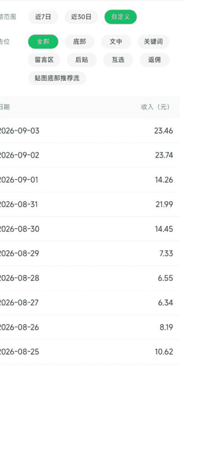
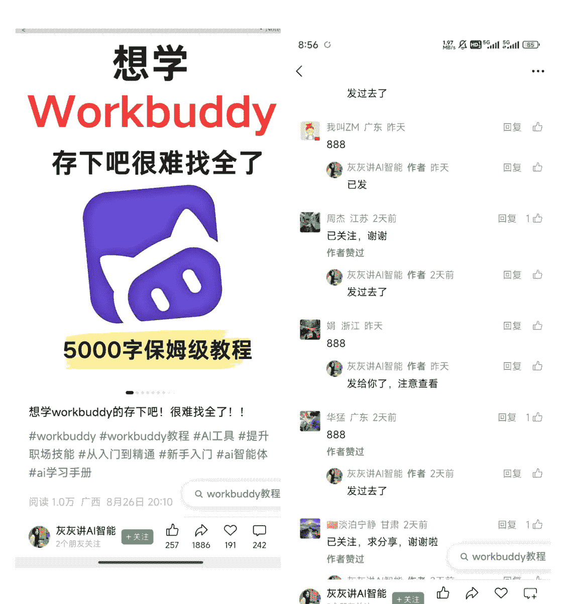

## 利用碎片信息+workbuddy，两个月跑通职场类公众号垂直小号自动化，全流程及提示词分享

260910 副业 SC 精华
整理：公众号懒人搜索，懒人专属群精选
懒人微信：lazyhelper1

**小懒判断** 适合想用 AI 批量做公众号小号、能折腾工具的实操派；不适合零基础想躺收流量主的人。最值得关注：先用 workbuddy 吃透对标号全部文章建风格索引，写前先检索同主题优秀案例再动笔，月耗约 2 小时维护 5 个号，单号最高 1.1w 阅读、稳定 1000+。坑：直接投喂选题不改提示词，写 10 篇全是模板没"人味"，选题别自己想、抄对标爆款最稳。

拿到的结果：

- 每个月大概花两小时用 workbuddy 撰写 5 个公众号的文章
- 每周花 20 分钟群发一周的文章
- 已有一个账号跑通流量主（其他账号最近一周才开始更新，不过基础阅读量都在 150 左右了）
- 跑通的账号最高流量 1.1w 阅读，最近稳定在 1000+了

# 碎片信息及用到的工具:

- 一个自己看得懂的公众号，稳定更新 1 年以上，阅读量较稳定，偶尔有爆文。
- 我根据马老师的提示词，迭代的 V5.0: 提示词 5 副本
- workbuddy+公众号文章下载工具

# 完整历程及流程分享:

- 在生财有术看到马老师这一篇超级术
- 注意到马老师提到的文风复刻提示词文章
- 然后去拿到了这个提示词
- 注意到一个公众号在反复写一个相似的选题（关于职场的），结构我能看懂，＋我觉得内容写起来不难。
- 我把该博主的所有文章都下载了下来，下载工具：wechatDownload
- 我用 workbuddy 软件和提示词对该博主的文章进行了分析，生成了一个非常大的 json 文件。
- 我把博主 1 万阅读以上的选题，喂给 AI，大概写了 10 篇以后，发现所有内容都比较模板化，没有“人味”
- 我和 Deepseek＋GPT5.6sol 讨论，问题出现在哪，反复迭代＋测试，出现了第 5 版提示词：提示词 5 副本
- 现在运用提示词 V5.0 让 AI 对文章进行分析后，通过喂选题，出来的质量大大提高。
- 排版方面：直接下载一个对标文章的 html，让 workbuddy 学习它的排版风格，并对自己的文章进行排版，并沉淀一个 skill，后续直接全部一键排版好。
- 上传，群发，等待收益。

# 提示词迭代思路（重点）：

- 我想让 AI 根据一个博主的创作风格来创作新文章，注意到马老师的提示词：多篇文章风格分析与模仿系统 V3.0
- 发现每个博主的文章都有几种不同的创作主题，用提示词 V3.0 写出来的文章太过死板。
- 看到马老师的新文章：为什么写好提示词反而不如直接给例子？
- 灵感一现，那我可以让 AI 每次创作前根据标题，先检索优秀相关主题的优秀案例，再进行原创写作。
- 我在 V3.0 的基础上迭代出了： 提示词 V5.0
- 版本 5 的主要作用：
  - 全量盘点项目内文章，完成分类、主题标注与表达任务梳理，建立可检索的文章索引
  - 提炼作者跨主题稳定的写作特征，拆解不同主题下的适配写法，沉淀为可复用的风格模型；
  - 后续输入新选题时，可直接匹配该作者风格生成对应文章。

# 避坑经验：

- 文章下载后最好删除 html 文件，只保留 md 格式的文件，在一个文件夹
- 用 workbuddy 打开存放 md 格式文件的文件夹，然后发送我给的提示词 V5.0，让 AI 对博主的账号进行分析
- 分析后就可以告诉 AI 你想写的文章的选题了，让它创作就好
- 不要自己去想选题，直接投喂对标博主的爆款选题最佳（我自己是这样做的）。

# 我的发现和思考：

- 最近公众号感觉已经改为纯公域平台了，只要后台检测无违规，无论什么账号，都有基础阅读量 100+ (我用我朋友的账号以及自己的小号发文章是这样的，无论什么内容）
- 大家比较关注用什么 AI 工具，好像忽略了自己的基本功，诸如：提示词工程、指令拆解、角色设定、上下文管理、输出格式约束、边界限定、迭代调优、任务拆分等等......
- 不要说 AI 很贵了，我现在写的文章，用的都是免费积分，趁现在大厂在竞争，大家尽快薅吧。（ PS：我从 Cursor 到用 augment 再到用 kiro，Codex，workbuddy，这一路好像都没怎么花钱，但一直在用顶尖模型）
- 我在找对标的时候，看见了一些贴图号案例，发现贴图号很像最开始的小红书，很多账号在这里野蛮引流，如图：

# 分割线

看完这篇 SOP，你觉得你懂了。但 90% 的人一到实操就会卡在第一步。

工具和教程只是最低级的壁垒，真正的壁垒是“立刻动手”和“圈层信息差”。

如果你想看全网最新的变现玩法，并且和一群执行力极强的极客一起下场拿结果，欢迎围观我的核心私域：【懒人专属群】。

我们不聊虚的，只做商业闭环的拆解与 AI 效率的压榨。系统内已沉淀 1000+ 跑通的套利实战局。

- 查阅圈子完整数字资产与上车门槛：

https://lazyso.com/insider/

认同价值、准备好下场干活的，扫码加我微信（ lazyhelper1 ）

备注：【实操上车】，不闲聊

