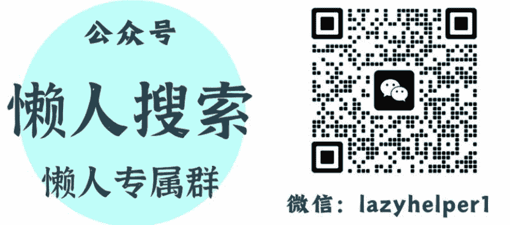
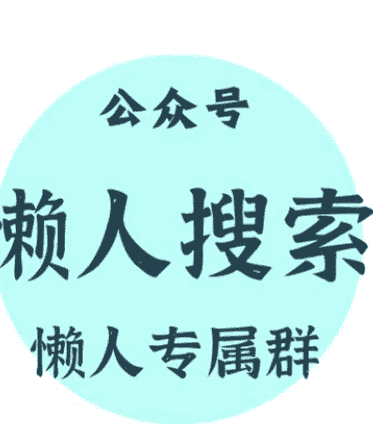

# 星宇事件，可能成为里程碑

+ 260910 猫哥
整理：公众号懒人搜索，**懒人专属群**精选
懒人微信：lazyhelper1

**小懒判断**｜适合在出海公司上班、想掌握维权新打法的职场人；不适合只想要“资本家活该”情绪爽点的人。最值得关注：107名被裁毕业生把证据链翻成英文，绕开劳动仲裁，直投港交所、欧盟合规渠道和奔驰宝马大众的供应商举报通道，德国LkSG最高罚全球营收2%。坑：别以为外企良心发现，人家是被法规强制回函；这打法只对深度嵌入全球供应链的企业管用。

9月7日，星宇股份的内部分决定出炉，董事长兼总经理周晓萍扣薪1年，分管人资的副总扣半年，人力资源总监直接免职。

那么，这份处分决定，是否能给闹了半个月的逼退应届生事件划个句号呢？

我觉得事情也许才刚刚开始，不要把这件事看小了，因为这背后还藏着一条影响巨大的暗线。

先把时间拨回去，把这件事的来龙去脉捋清楚。

去年秋招加今年春招，星宇共与440名2026届毕业生签三方，毕业后实际入职372人，另外68人因另择业、回校等未入职。

7月新人报到，8月初人资对其中140人分批约谈，抛出了主动离职补半月工资、不去就调流水线打螺丝的二选一方案。

结果33人留原岗，107人解除。

这107人里涉及本科75人、硕士32人，其中研发技术类39人，含光学、结构、电子等产品设计，生产制造类60人，含组装工艺、设备保全、装备调试，另有质量、项目、质检等职能8人。

然后约谈录音一流出来，全网一下就炸了。

特别涉及硕士更扎眼，其中有人就说自己读了七年，工作一个月就要被裁，或者只能去打螺丝，这不是调岗，这是羞辱。

说实话，这种操作哪怕不是上市公司高科技企业，就算一个普通本地中大型企业，一旦曝光都是极其扎眼的臭棋。

到了8月25日，常州市人社局通报确认了基本事实，定性协商过程方法简单生硬、缺乏充分有效沟通，人资总监被停职。

8月27日，星宇发出致歉信，推出补偿方案。

9月2日，董事长兼总经理周晓萍在业绩说明会上公开道歉。

然后是9月7号的内部处分决定，开篇提了，这里不累述。

了解完整个事情脉络后，现在我们来聊聊一个核心话题，为啥这回星宇事件会闹得如此之大，而且从地方到企业，处理态度和方式会如此的干净利落呢？

说实话，类似的劳动纠纷最近几年多得起堆堆，各地劳动仲裁委大家可以打听，有几个忙得过来的，都是连轴转。

根本原因就是这次剧本被改写了。

而且改写剧本的，不是人社局，也不是劳动仲裁委，而是这群毕业生自己。

他们没有去厂门口拉横幅，没有一头扎进动辄半年起步的仲裁流程。而是研究清楚了一件事，公司到底怕什么？

下面我们顺着文章逻辑，结合网上的相关资料，大致聊聊星宇股份是什么来头？

在常州，它能算上当地制造业的招牌。

从 90 年代一间校办小作坊起步，靠纯手工敲塑料件，一步一个脚印啃下南北大众的订单，并在 2011 年 A 股上市。如今常州的新能源产业链把比亚迪、理想、中创新航当门面，星宇就是本地土生土长的老资格一级供应商。

如果放到车灯产业圈，它的分量更大。2025 年国内乘用车车灯市场份额 11.6%，本土独立车灯厂头把交椅，全球排名第七。客户覆盖大众、宝马、奔驰等合资大单，以及奇瑞、吉利、鸿蒙智行等国内新能源头部。

再放到全球看，重点来了，它在塞尔维亚有工厂，是德系车企的一级供应商，7 月 29 日刚刚第二次向港交所递交 H 股上市申请，想拿国际资本的钱去给海外产能和全球研发输血。

看到这里大家懵否，反正这帮毕业生 100% 是懂了，星宇是一家深度嵌入全球汽车供应链的中国龙头企业。

所以，毕业生们就把他们劳动合同、约谈录音、聊天记录整理成完整证据链，翻译成英文，分头投了四个方向，包括人社部门、港交所上市科、欧盟供应链合规渠道，以及奔驰、宝马、大众的供应商合规举报通道。

这波操作简直太有才了，真真对准星宇的命门去的。

结果是奔驰 BPO（企业和人员保护办公室）正式回函，案件编号 WB0011869，邮件主题写得毫不含糊：供应商的严重道德和劳动失当行为，已转交专家团队进一步审查。

大众中国对外也确认，收到针对供应商星宇股份的相关投诉，集团高度重视，已启动专项调查。

而港交所那边，材料被转交上市科审阅。

我们吃瓜群众最先还以为就是一起国内企业下作的人事纠纷，而实际上，成了跨国供应链的合规事件。

很多人看到这里，第一反应是中国人找外国客户告状，是不是有点过分了？

但我认为，真正要清楚的是，他们为什么觉得这条路比国内渠道更管用？

先看时间成本。

劳动仲裁从立案到出裁决，动辄两三个月起步，企业不服上诉到法院，流程可以拖上 半年甚至一年。对于刚毕业的应届生来 说，他们耗不起。而对 企业来说，时间只 是法务部门的日常工作。

再说赔偿力度。走劳动仲裁就算毕业生赢 了，能有几个钱赔偿，对于上市公司而言， 连挠痒痒都算不上。但如果触发供应链合 规审查呢？

德国《供应链尽职调查法》（LkSG）2023 年就已生效，白纸黑字写着德国企业必须 对全球供应链中的人权和劳工问题履行尽 职调查义务。供应商一旦违规，整车厂在 德业务若满足相关条件，理论上最高可被 处全球年营收2%的罚款。奔驰2024年营 收约1456亿欧元，理论罚款上限接近 29 亿欧元，但需满足在德千人企业、违规认 定及个案情节等前提，并非投诉即罚。除 此之外，严重违规还会被限制德国公共采 购，最长三年。

欧盟层面，《企业可持续尽职调查指令》 （CSDDD）经 2026 年修订简化后，对非 欧盟企业按欧盟净营收 15 亿欧元、员工 5000 人等门槛，统一自 2029 年 7 月起适用， 罚款上限约全球净营收 3%，并要求品牌方 对上游供应商的劳工合规承担相应责任。 一旦被客户认定用工不合规， 失去的不是 几万块的赔偿金，而是数亿元的订单和整 个欧洲市场的准入资格。

更直白的说，走国内仲裁， 企业方最坏的结果不过是把本来就该赔的钱赔出去，伤不到筋骨，但投诉到欧盟和客户，丢的可能是订单、估值和上市窗口问题，动辄数亿甚至几十亿，完全不在一个量级。

当然，这里也要提一下，也不是说奔驰宝马突然就有了良心，愿意帮毕业生仗义执言，而是有政策合规层面的制度约束，要求它们必须回函或者立案。

所以你看，毕业生们，也没干什么激进的事，只是把规则研究透了，然后精准爆破。

回头看星宇股份干这事的动机，网上有很多解读，包括失去大额订单等等，但我更认为背后可能和赴港上市及近期经营情况有关。

星宇 1 月递表港交所、7 月 26 日失效、7 月 29 日重新递表，递表后约十天，大规模劝退约谈就开始了。IPO 审核期压缩人力成本美化报表，这是资本市场心照不宣的老手法，用极低成本清掉校招储备，短期人均效能好看，费用率降一点，报表更干净。

赴港上市是赶点了，内核也包括经营情况。财报显示 2026 年上半年，星宇营收 68.84 亿元，同比仅增 1.87%，归母净利润 6.69 亿元，同比下滑 5.26%，典型的增收不增利，利润被上下游两头挤压。

车灯行业正在从 LED 卷向 ADB、Micro- LED、DLP 投影，技术迭代烧钱，但主机厂价格战又把采购价往死里压。

当然，到底动因是什么，或者说主因是什么，也许只有几个高管晓得，不过无论啥原因，都属于算盘打得响，操作太粗犷的类型，把自己是一家出海企业、上市公司、想在港股二次上市、嵌入全球供应链的特征忘得干干净净。

最后，说一下为什么我认为星宇事件可能是一个里程碑？

因为这件事第一次清晰地向所有中国企业展示了一种全新的博弈格局。

当你的公司嵌入了全球供应链后，你的员工就不再只是你说了算的弱势个体，而是可以直接撬动你海外客户、资本市场、海外订单的变量。

过去几十年，我们制造业的逻辑很简单，总觉得自己是当地的纳税大户，在用人方面就很强势，有点儿为所欲为的感觉，反正我交税了、我解决就业、地方招商把我当座上宾，用人我说了算。这套逻辑在国内、在封闭供应链能打，但到了全球供应链就够呛。

换句话说这并不是星宇一家的问题，它只是一个当下的现实案例而已。这是一部分中国制造企业的通病，业务能力早已全球化，治理观念还停留在作坊时代。

但未来中国企业深度出海是大趋势，不是选择题。一旦出海，就要接受两套规则的同时审视，国内的和全球的，哪一套都糊弄不过去。

星宇事件，本质上是这群毕业生在告诉所有大厂现在的年轻人不好欺负，别以为地方保护能兜底，别以为省下几个月工资就是赚了。在全球化规则面前，粗暴用人的代价，已经从赔点钱升级为丢订单、卡上市、毁品牌。

无独有偶，在近日中国超级跑车锦标赛（CHINA GT）上海站发生赛车事故，背后竟牵扯出网传日结 60 元劳务外包的荒诞用工模式，目前相关截图尚待官方核实，但已被全网怒喷调侃，丢人丢到国际上。

这和星宇事件异曲同工，因为无论是全球车灯龙头，还是办国际赛事的主办方，只要站在全球聚光灯下，用工合规就是底线。你在本土可以糊弄，但国际规则和舆论不会放过你。

所以星宇的罚单和赛车的嘲讽，本质上是一堂课，全球化时代没有谁能靠压榨劳动力赢得尊重，也没有谁能靠地方保护躲过全球供应链的审查。

现在国内正在反内卷，这个信号所有人都看到了。但很多人还没意识到的是，反内卷不只是政策导向，它和全球贸易格局的变化是同一条线上的两件事。

中国制造的贸易顺差越来越大，欧洲、北美、东南亚都在给你设门槛。过去那套玩法，靠压人工成本卷价格、靠粗放用工换利润、靠地方保护兜底，在国际市场上会越来越难走通。顺差越大，别人找你麻烦的理由就越多，而用工合规是最容易下手、也最不容易被反驳的切入点。

所以，星宇事件，可能成为里程碑，谁还抱着旧逻辑不放，谁就下一个上台。好戏，才刚刚开始。

在这个 AI 能替写代码、写文章的时代，基础技能正在迅速贬值。绝大多数人正被淹没在海量的免费垃圾信息里，陷入低效的体力内卷。

当“努力”不再是壁垒，人与人之间唯一的护城河，只剩下“信息过滤”的效率与“认知系统”的维度。

圈子已稳定运行 7 年。我们每天利用 Python 爬虫与大模型算力，过滤全网最顶级的政经内参和搞钱风向标，做你最冷酷的“外部大脑”。

如果你认同这种“重塑认知防线”的极客主义，欢迎围观我的个人情报智库：【懒人专属群】。

https://lazyyo.com/insider/

认同信息过滤价值、想省下每天 3 小时无效阅读时间的读者，扫码加我微信（lazyhelper1）

