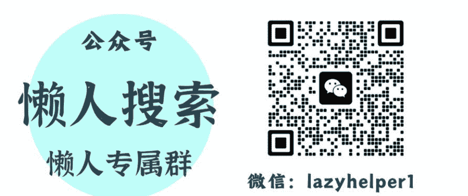
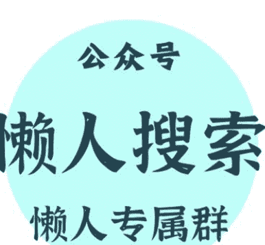

# GLP-1，正在“搅动全世界”

260911

整理：公众号懒人搜索，[懒人专属群](#) 精选

懒人微信：lazyhelper1

> **小懒判断** | 适合做产品、找机会、想训练“变量思维”的人；不适合关心用药本身的病患——这篇不谈疗效，只谈影响传导。**最值得关注：家用 GLP-1 全家食品支出降 5.3%、航空燃油省 5.8 亿美元的传导链，以及斯坦福通用技术三特征和“前提性变量”框架。坑：文中研究多为观察性的“相关”不是因果，别把趋势分析当用药指南。**

乍一看今天的标题，有人可能会觉得奇怪。GLP-1，“搅动全世界”，未免有点夸张了吧？

GLP-1，也就是以司美格鲁肽为代表的一类药物药物的统称。最早主要用于糖尿病治疗。后来人们发现，它在控制血糖之外，还会影响胃排空、饱腹感和食欲。2021年，美国 FDA 批准司美格鲁肽用于慢性体重管理，此后 GLP-1 就迅速成为全球最受关注的药物类型之一。今天市面上的玛仕度肽、替尔泊肽，都属于这一类。

当然，我们今天的内容，转述自不同的研究，**而具体到不同地区，不同的人，能否用药还是需要专业医院就诊，以医生建议为准。**听到这，有人可能会说，你要说这个药畅销我能理解，毕竟，一个成年人对减肥有多迫切，这不用多说。但你要说它“搅动全世界”，未免有点夸张了吧？那些跟减肥无关的领域，又能跟它有什么关系呢？

你别说，还真有。举个例子，航空。按照通常的设想，这跟 GLP-1 八竿子打不着。但是，就在今年 1 月，投资银行杰富瑞做了一组测算。他们拿波音 737 MAX 8 做模型，假设未来随着减重药物普及，美国乘客的平均体重下降 10%。注意，这只是情景假设。但按照计算，乘客平均体重下降 10%，一架满载飞机总重量大约能降低 2%，由此可能节省大约 1.5%的燃油。

1.5%听起来很小。可航空公司最贵的东西之一就是燃油。杰富瑞估算，如果假设成立，美国四大航空公司一年最多可能省下大约 5.8 亿美元燃油成本。

一个医学变量，就这样绕了好几道弯，变成了交通业的成本变量。

而且类似的情况，不只发生在航空业。接下来我们就说说，GLP-1 的影响是怎么一路传导，波及各行各业的。

我们先从受 GLP-1 影响最直接的行业说起，这就是，食品与餐饮。

关于 GLP-1 的作用，我们通常的印象之一，是“减肥”。但问题是，单纯的减肥，其实未必会波及餐饮业。比如有个词叫“放纵餐”，说的是一个减肥的人，偶尔也会大吃一顿。而对于餐厅来说，我不需要你天天来吃，只要每个人都偶尔吃一顿，就足够养活我的生意。这也是为什么，减肥的潮流一轮又一轮，但它们对餐厅的影响都有限。

但是去年，美国心理学会发表了一篇文章，里面提到一个词，叫“food noise”，食物噪声。什么意思？就是有些人过去一天到晚都会想到吃：下一顿吃什么？冰箱里还有什么？附近新开了哪些餐厅？这些念头就像一个永远关不掉的后台程序。而一些GLP-1 使用者描述，开始用药以后，这个后台程序突然安静了。换句话说，你大脑里关于食物的“噪声”消失了。

这跟传统意义上的“管住嘴”不太一样。过去减肥，体验往往是：我很想吃，但我要忍住。而一个人一旦不关心吃，不只他去餐厅的次数会变少，刷美食视频的频率也许会变低，看点评网站的习惯也许会淡化。根据咨询公司 FTI 的估算，到 2030 年，GLP-1 的使用可能影响美国大概 540 亿美元的餐饮支出。

而且注意，人类社会是一个网络，小到家庭，大到公司，这个网络连接决定了，一个人的行为也许会影响另一个人。就在 2025 年 12 月，康奈尔大学发布了一项研究，把美国数万户家庭的 GLP-1 使用情况和真实购物记录放在一起比较。结果发现，家里只要有一名成员使用 GLP-1，那么整个家庭前 6 个月食品方面的支出，平均下降 5.3%。咸味零食下降大约 10%，糖果、烘焙食品也下降明显。上涨的品类很少，主要是酸奶、水果、营养棒等。

而且类似的变化，已经开始传导到高端酒店。因为最开始用司美格鲁肽减肥的这群人，跟高端酒店的用户画像是高度重合的。以前高端酒店的服务重头之一，是菜品，而且很多酒店会主攻那些吃起来特别“过瘾”的大餐。这也是很多酒店最重要的卖点之一。

而在GLP-1的影响传导下，住客对吃的要求发生了变化，酒店也需要重新思考卖点，思考怎么设计新的用户体验。比如，迈阿密的艾迪逊酒店开始增加更多的高蛋白菜品，无酒精鸡尾酒。一些四季酒店也调整了菜单。甚至还有酒店考虑房间是不是需要冷藏空间，因为一些注射型GLP-1药物需要冷藏。

类似的影响还有很多。

比如，整形美容。最近几年有个词叫“Ozempic face”，司美脸。有些人在快速大幅减重之后，脸颊脂肪减少，皮肤松弛，整张脸显得比以前苍老。这创造出了新的整形需求。美国整形外科医生协会这几年反复提到，越来越多患者在减重之后寻求面部填充、脂肪移植、拉皮和身体轮廓重塑。甚至出现了一个新说法，叫“Ozempic makeover”，司美脸改造。

再比如，科研领域，尤其是在论文发表方面。因为这类药物的热度很高，因此很多研究都瞄准了相关的方向。

比如，研究GLP-1停药之后的反弹，已经成为一个相当热门的方向。今年3月，美国阿拉巴马大学伯明翰分校公布了一项研究，正在开发一种叫TIX100的口服候选药物，适应证之一，就是GLP-1停药后的体重反弹。

再比如，有人研究 GLP-1 对成瘾行为的影响。2025 年 7 月，布朗大学公共卫生学院发了一篇文章，标题叫《成瘾精神病学的转折点？》。据说是有 GLP-1 的使用者报告，自己喝酒的冲动变弱了。还有人说，过去很难控制的赌博、购物甚至其他强迫性行为，也有所减轻。

注意，这些研究里的措辞是“相关”。这是观察性研究，不能推导出“打一针就能怎样怎样”。

我们要说的重点，不是这些研究的结论本身，更不是给 GLP-1 打广告。事实上，前面的不少研究在学界尚且存在争议，它可能只是特定情景下，在一部分样本身上发现的情况，未必是普遍真理。

我想请你关注的是整件事的发生方式。当一个事物的热度足够高，对社会网络的嵌入足够深，那么它就会像漩涡一样，把各行各业的注意力都卷进来。让很多与它原本不相干的事情，围绕它重新组织。 注意，这个道理不难理解。关键是这背后那个更具体的问题，到底哪些变量更容易溢出？哪些因素更容易传导到各行各业。

关于这个问题，有很多相关的研究。搞懂这些研究，没准能帮你发现一些不太显而易见的新机会。

比如，早在 1995 年，斯坦福大学有两位经济学家，就在《计量经济学》上发表过一篇经典论文。他们研究的是，为什么蒸汽机、电动机、半导体这类技术，跟普通的技术创新不一样，它们一旦出现，往往会带动整个经济发生变化。

他们最终的结论是，这类技术普遍具备三个特征。
- **一是通用性**，用的人，用的行业足够多。
- **二是自改进性**，也就是这个东西本身会不断改进，越来越好用，越来越便宜。
- **三是具备“创新互补”**，也就是，因为这个东西本身不完美，需要改进，而且改进的方案可能来自其他行业，而对这个东西的改进，又会提高其他行业的创新价值。

再比如，2012年，达龙·阿西莫格鲁等四位经济学家，在《计量经济学》发表过一篇论文，叫《总量波动的网络起源》。他们研究的是，在什么情况下，一个节点的波动会触发整个网络的波动。

再比如，2017年，经济学家恩金·阿塔莱发表过一项研究。研究的是“冲击”在不同行业的传导过程。

尽管每个研究的角度不同，但其中有很多共通的部分。这些容易产生外溢的变量，往往有这么三类。

**第一，是处在很多关系中间的东西。**它也许本身并不起眼，但很多人都直接或者间接依赖它。于是它一动，变化就会沿着网络一层层传下去。比如，支付方式。你看，移动支付出现之后，触发的影响有多大，不用多说。

**第二，是那些“绕不开的东西”。**比如，新能源汽车行业都需要用电，或者其他的清洁能源。那么一旦这些清洁能源的技术范式发生变化，对整个行业都会有影响。

前两种情况并不难理解，真正需要留意的是第三类情况。

**第三，很多人“默认不会变”的变量。**也就是，“前提性”变量。人们都默认，某个东西就该是这样，它不该变，也不会变。于是，人们会依照这个“不变”的前提去做周边的设计。比如，人的食欲。我们总说人是铁饭是钢，言外之意，什么事也没有吃饭重要。这就是为什么我们常说餐饮业是“百业之祖”，不管什么时候人总是要吃饭的。

而这样的东西除非不变，一旦发生变化，影响的传导能力可能会很强。你看，GLP-1就在一定程度上改写了这个前提，导致很多行业都要跟着变。

贝索斯有句很著名的话，大概说的是，很多人关心未来十年什么会变，但他更关心什么是不变的。但是今天我们或许在后面再加上一句，不仅要关心什么不变，更要关心哪些所有人都认为不会变的东西可能会变。

——分割线——

在这个 AI 能替你写代码、写文章的时代，基础技能正在迅速贬值。绝大多数人正被淹没在海量的免费垃圾信息里，陷入低效的体力内卷。

当“努力”不再是壁垒，人与人之间唯一的护城河，只剩下“信息过滤”的效率与“认知系统”的维度。

圈子已稳定运行7年。我们每天利用Python爬虫与大模型算力，过滤全网最顶级的政经内参和搞钱风向标，做你最冷酷的“外部大脑”。

如果你认同这种“重塑认知防线”的极客主义，欢迎围观我的个人情报智库：【懒人专属群】。

https://lazyso.com/insider/

认同信息过滤价值、想省下每天3小时无效阅读时间的读者，扫码加我微信（lazyhelperl）

