# AI虚拟 IP从0到1：4个月做到千万播放和百条商业合作线索

**260911 副业 SC 精华**
整理：公众号懒人搜索，懒人专属群精选
懒人微信：lazyhelper1

> **小懒判断** | 适合想做 AI 虚拟人设、有内容审美的女生赛道玩家；不适合指望提示词一键出片、不肯磨细节的人。最值得关注：同模型同提示词换个开头效果就完全不同，起量靠拆对标加筛图加磨细节的六步流程；以及"品牌买的是 AI 虚拟演员话题本身"的商单逻辑。坑：最能复制的是流程，最难复制的是她五年女装直播攒下的内容手感，零经验直接照搬会卡在审美判断上。

“别让你的 AI 能力藏着，主动展示才能抓住机会”，响应号召，所以我来啦。... 我是柠柠，五年女装主播，今年 4 月开始我的虚拟 IP 之路，0 投流，拿到了几千万播放，100 多个品牌询单，今天复盘下这 4 个月的心路历程。

我是真的没有想到做流量如此简单。哈哈

## 一、先说结果：这几个月我做到的正反馈

去年的我对 AI 零基础，我在品牌的时候一直都是做前端，但对后端、技术这些东西一窍不通，去年的我，什么也不会，只会用豆包，我连 GPT 都没有。

但是经过这四个月拿到了下面这些结果：

- 两个虚拟 IP 累计全平台涨粉 17 万+、高净值女粉占比 98%
- 抖音新号第一条单视频 500w 播放量
- 小红书新号第一条视频单视频 190w 播放量
- 100+ 个品牌、爱奇艺、快手、百度等平台、代理商开始主动发合作邀约
- 后台 100+ 个人问“怎么制作”“能不能教学”“有没有课程”

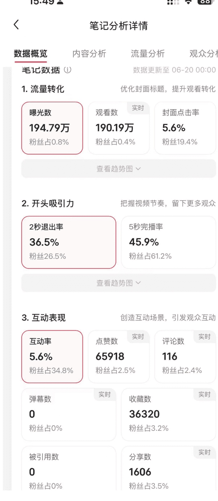

### 小红书新号的第一条视频

**作品数据详情**

作品共获得1031流量激励

切换作品

总览 流量分析 观众分析

作品状态正常

**流量**

- 播放量: 515.7万
- 点赞量: 17.8万
- 评论量: 261
- 分享量: 1.9万
- 收藏量: 6.6万
- 弹幕量: 3
- 完播率: 37%
- 2s跳出率: 26.68%

新增 累计 每小时 每天

设置观测

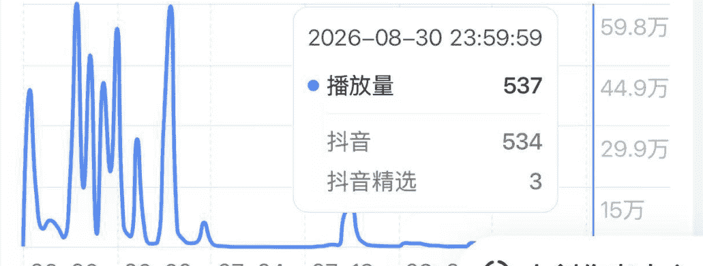

去创作者中心

投放DOU+可获得更多播放量和互动

### 抖音新号的第一条视频

**作品分析**

2026-08-15 17:41发布

切换作品

总览 流量分析 观众分析 喜爱分分析

**内容吸引力** ⓘ 部分数据产出延时

| 播放量 | 平均播放时长 | 封面点击率 |
| :--- | :--- | :--- |
| 93.4万 | 16.5秒 | 19.1% |

| 2秒跳出率 | 5秒完播率 | 完播率 |
| :--- | :--- | :--- |
| 12.2% | 77.1% | 37.9% |

新增 累计 每小时 每天

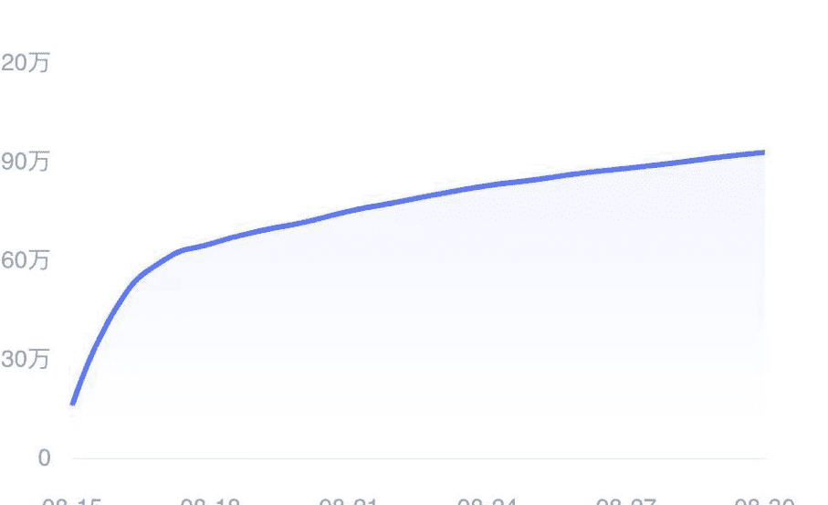

比往期均值高1859%，选题很受欢迎！

**观众互动** ⓘ 部分数据产出延时

| 点赞量 | 评论量 | 分享量 |
| :--- | :--- | :--- |
| 7.2万 | 405 | 6443 |

快手

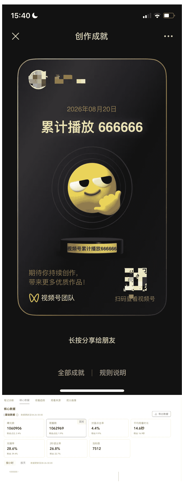

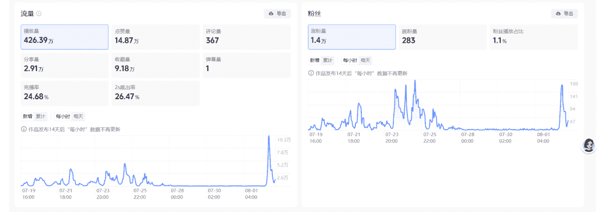

**抖音单条视频涨粉 1.4 万**

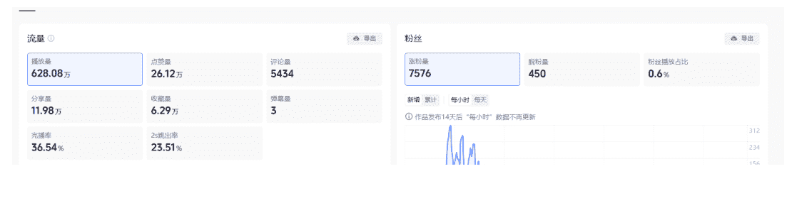

**600 万播放量啦**

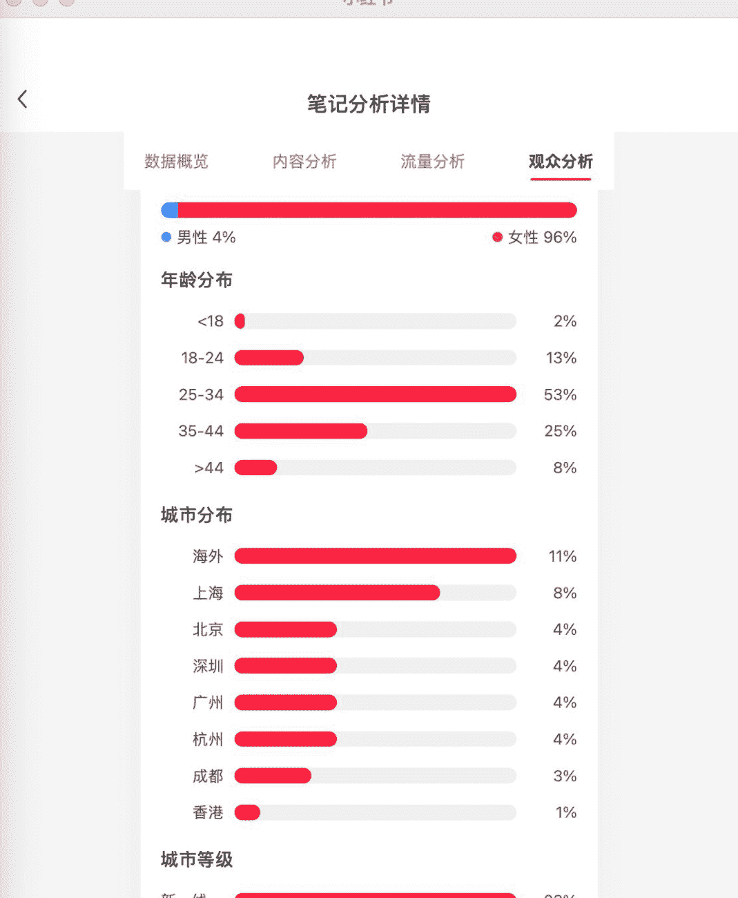

**账号的粉丝占比都是高净值女粉**

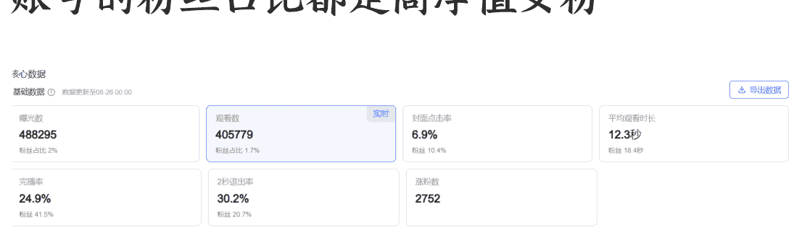

## 二、我后来发现，AI 只是工具，真正值钱的是判断

百万播放的爆款视频，token 成本只要 30-50 块，这四个月这样的爆款我做出了 18 条。

但如果你问我，这些视频为什么爆，我不会说是因为用了哪个工具。因为同样模型，一样的提示词，换一个人物、衣服或开头，最后的效果可能完全不同。

这几个月，我做过很多测试。有的视频制作简单、成本很低，却能从几万跑到几百万播放，有的视频换个平台后，依然能跑出来。

所以我越来越相信：

爆款就是爆款，放在哪个平台，都有成为爆款的可能。

平台当然有自己的算法，但真正决定一个人会不会停下来看的东西，并没有那么容易变。

- 她为什么第一眼愿意看？
- 为什么会觉得“这说的不就是我吗”？
- 为什么愿意看完，并点进主页？

这些问题，比我用了哪个模型重要得多。

而这些东西，其实我以前就在学，只不过是在直播间里学。

我做了 5 年女装直播，卖过几十万件衣服，累计销售额过亿。

那几年，我每天面对的都是真实的女生：

“我胸大，穿这个会不会显壮？”

“我黄黑皮，这个颜色能穿吗？”

“我个子矮，穿这个会不会压身高？”

以前我以为自己只是在卖衣服。

后来做虚拟 IP，才意识到，我真正积累下来的，是对消费者的理解。AI 只是把这些经验重新放大了一遍。

所以这篇文章，我不想写成一篇“AI 工具教程”。

工具和流程当然会讲，但我更想复盘的是：

一个零基础 AI 小白，如何把过去的经验迁移到 AI 内容里，跑出爆款、涨粉、品牌合作。

这个过程并不总是顺利。我也是边做边试，不断调整。后来发现，真正的关键：

人物、画面、选题、内容、生产 sop。

所以后面我会把这些部分一个个展开，尽量讲清楚我当时为什么这么做，哪些地方有效，以及后面我是怎么继续调整的。

因为工具会迭代，平台也会变化，今天好用的方法，过一段时间可能就要重新适应。

但一条内容为什么有人愿意看，为什么有人愿意关注，为什么品牌愿意进一步了解，这些问题我觉得更值得拿出来复盘。

放一些我比较喜欢的作品

视频见在线文档版本

这是技术不精湛的时候做的有很多瑕疵

视频见在线文档版本

这是最近 MiniMax 做的好喜欢！

视频见在线文档版本

算是我的第一条百万爆款

视频见在线文档版本

## 三、为什么我选择做虚拟IP

很多人都问我：“你形象这么好，为什么不自己带货？”因为从外面看直播带货，好像是我最顺手的路。

做了五年女装直播后，我越来越确定，自己不想继续局限在直播，我想把过去积累的经验，带到 AI 里，重新学、重新做，摸索出一套适合未来的方式。直播只是我过去发挥这些能力的一个场景，不是终点。

我在品牌的时候，身边有两个助理，有摄影师，也有置景师。灯光不对，我说一句；背景不好，我说一句；衣服要换，助理已经拿过来了。

我真正需要做的，是站到镜头前，把衣服展示好，把状态拿出来，给观众一个买的理由。

后来我从品牌出来，花了一个月自己拍视频。为了在家里找一个光线好的拍摄位置，我前前后后试了三天。

布置灯光、调角度、找背景、搭衣服、拍素材、剪视频……以前在品牌里说一句话就有人解决的事情，现在一个人做，我甚至能折腾一个星期。

也是那个阶段，我突然意识到一件事：

以前我以为自己拥有的是全部的能力，后来才发现，并不是这样。

如果接下来我继续依赖真人出镜，我可能只是从一个直播间走进另一个直播间，从依赖一个团队，变成所有事情都依赖我自己。

只要我不拍，内容就停了。只要我状态不好，生产就停了。

这不是我想做的下一件事。

AI 时代来了以后，我开始重新想：有没有可能做一件更长期、更有内容，也更能沉淀下来的事情？

所以我选择了虚拟 IP，不是因为 AI 更轻松。

恰恰相反，刚开始一点都不轻松。

但它让我看到了一种以前没有的可能：内容不一定永远依赖“我今天有没有站在镜头前”。

一个人物可以被持续经营，一种内容可以被反复验证，一套跑通的方法也可以慢慢沉淀下来。

所以前三个月，我没有变现。

我已经做了五年离钱很近的生意，所以我太知道一件事情有流量以后，最快怎么把它换成钱。

但这一次，我不想那么快。

我不想账号刚有一点流量，就开始追着广告跑，也不想今天哪个品牌找我，就把内容往哪个品牌身上靠。

我想先看看，如果我不急着赚钱，这个东西到底能长成什么样。

所以前三个月，我做得最多的事情，就是内容。没有急着接广告，也没有急着卖东西。

现在回头看，我反而很庆幸自己当时慢了一点。

因为一个 IP 刚开始的时候，最珍贵的不是它一个月能接多少广告。

而是它最后会变成什么。

它有没有自己的内容，有没有人愿意持续看，有没有可能从一条爆款变成十条，从一个账号变成一套真正属于自己的内容资产。

这些东西一旦出来，商业化反而是后面的事。

品牌合作、付费咨询，包括后来我决定把自己的实践整理成课程，都是在这之后自然发生的。

这是小红书发布的第一个月已经收到了不少品牌咨询，太多啦没有放全面

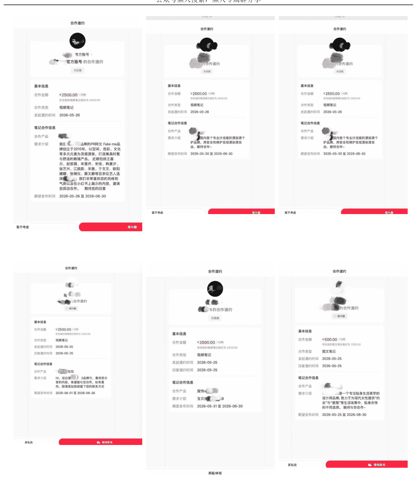

第二个月第三个月我依然没有变现商单已经涨到了五千，我也在试探品牌对于虚拟IP的的价格的边界在哪里？

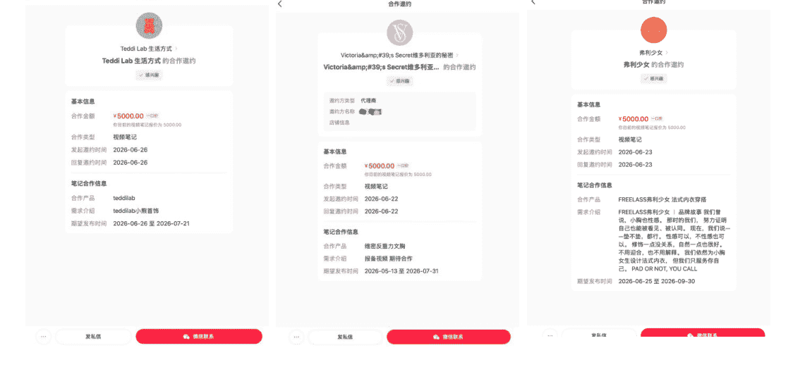

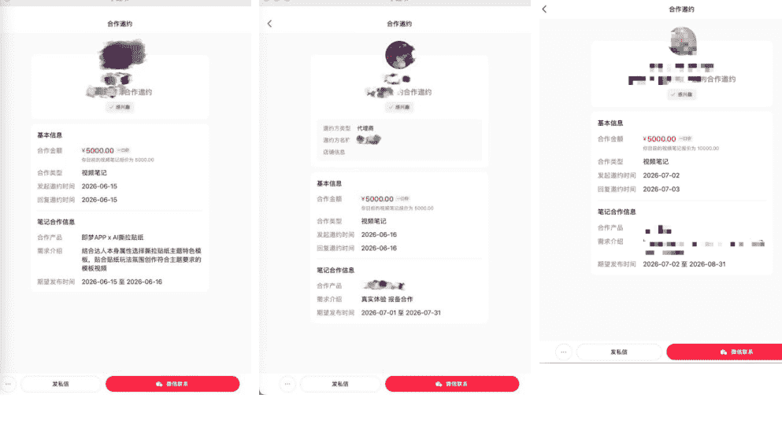

## 四、从0到第一批爆款：我经历了什么

一个爆款的产生，一定要和观众有强关联。

因为很多技术博主很容易陷入到一个自嗨的情绪当中，好像说我展示的技术够难，设备够贵，成品够炫酷，大家就会点赞。

观众其实只会想说“哦，好厉害，那跟我有什么关系？”

好的内容是要真正地作用到人身上去。需要把你的专业转换成普通人能听懂的语言，击中普通人的痛点，这件事情也很重要。例如我的视频选题都会从“黄黑皮怎么穿”、“发型穿搭公式”...简单直白，能在生活中都能引起共鸣的。

在制作视频的一开始的前五秒，先不要介绍自己这个东西有多么多么厉害，一定要把这个画面给到大家，不要浪费大家的时间。

因为现在视频节奏太快了，一定要有这种即时的满足感。要利用信息差来制造认知的反差。

我前段时间跟手机的品牌聊了一下，他就告诉我说：“你在拍照的时候，放大的时候最好是，比如说用一倍、二倍、三倍、四倍这种整数去拍，不要说用1.2倍或者2.9倍。”

为什么？

他说：“因为一倍、二倍拍照的画面会更清晰。如果说你要2.2倍的话，它实际上是给这个画面进行了一个裁切。”

这些行业内可能他们都觉得是很普遍的知识，但是对于我们普通人来说，这个是完全不知道的。可以把这些所谓的、好像很普遍的专业知识，结合生活的场景，用大众能理解的方式告诉大家。

## 五、我真正沉淀下来的不是提示词

### 1. 看人物：她是谁，为什么值得被记住

虚拟 IP 不是一张好看的脸。脸只是入口，人设才决定用户会不会继续看。

不要觉得她是一个 AI，要拿她是一个真实存在的人来运营。

我会看她的年龄、气质、穿搭、表情和生活场景是不是统一。她像不像一个真实存在的人？她有没有稳定的审美？观众看到她，会不会觉得这个人有记忆点？

例如最近大火的“被裁掉的女孩”方桃子。为什么她能做到全网 3 亿播放？为什么能上时尚 Cosmo？为什么一条广能报价 25w 一条？

她太像一个真的人了，不是那种一眼看过去很完美的 AI 美女，她是有生活感的。

会做饭、会健身、会谈恋爱、会拍一些很日常的东西，甚至她的脸也不是那种特别精致、特别标准的 AI 脸。

所以你看她的时候，不会一直觉得“这是一个 AI 账号”，反而慢慢开始觉得：方桃子今天又在干嘛？

她们根本没有把她当一个普通 AI 博主在运营。更像是在运营一个艺人。

先让大家通过《被裁掉的女孩》认识她，先有这个人物，再去做她自己的账号、日常、广告。

因为品牌和杂志看中的，不只是她有多少粉丝，而是她已经变成了一个有话题度、有故事、有人设的“人”。

她的广告能报到 25 万，也不单纯是因为流量好。而是因为她现在有稀缺性。

品牌投她，不只是买一条视频，也是买“AI 虚拟演员”这个话题本身。所以我现在越来越觉得，虚拟 IP 真正重要的，不是把人物做得有多漂亮。

而是你能不能让大家相信：她是真的有自己的生活。

方桃子的人物记忆点，齐刘海加脸部的两颗痣。

### 她上的时尚 Cosmo 杂志

教大家捏小脸：对于生财里的各位小伙伴，这个简直小几科。

这一步特别简单！真正影响效果的，往往是五官比例、脸部轮廓和整体气质这些细节。

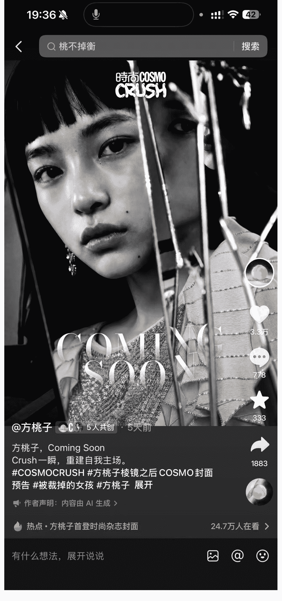

我的要求不是把人物改成一张标准的 AI 美女脸，而是在保留原有人物辨识度的基础上，增加一点自然的混血感，让她既像原来的人，又比原来的版本更立体、更耐看。

我拿自己的脸做了很多轮测试。下面这些都是不同版本的迭代。

人物的气质真的特别特别重要！一张脸我一般都会调整三天，会抽无数张卡。太完美主义者了。

所以坦白说，我对她们还不算特别满意。因为时间有限，加上我本身比较在意细节，人物的脸型、骨相、五官比例和神态，只要有一个地方不协调，我都会继续调整。

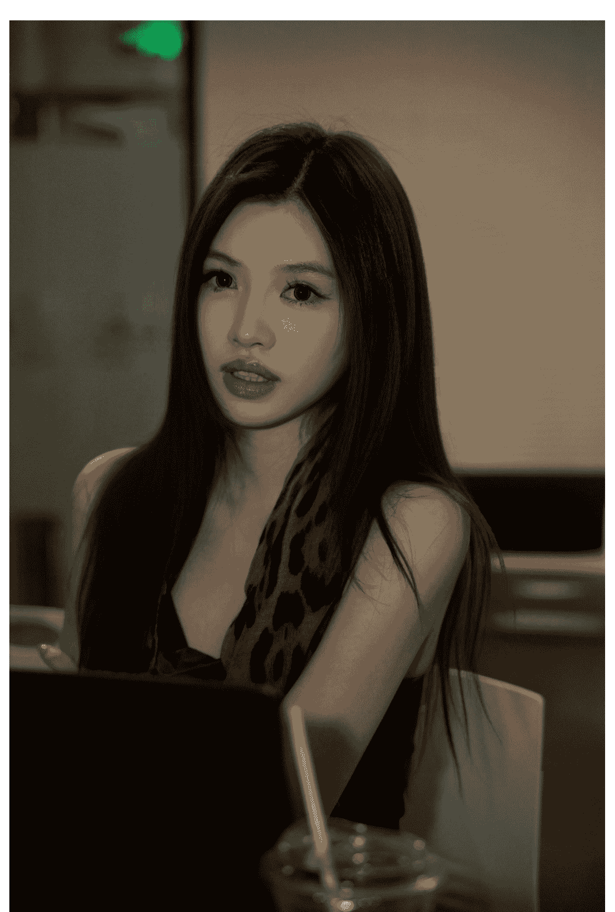

**实拍图**

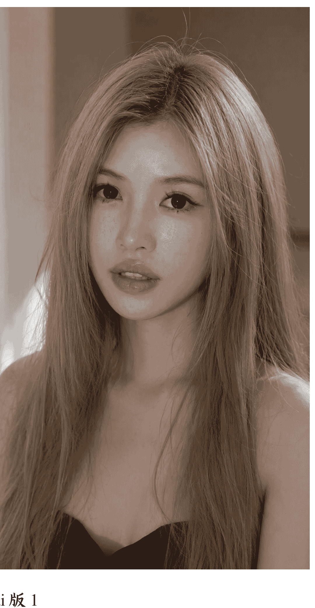

ai 版 1

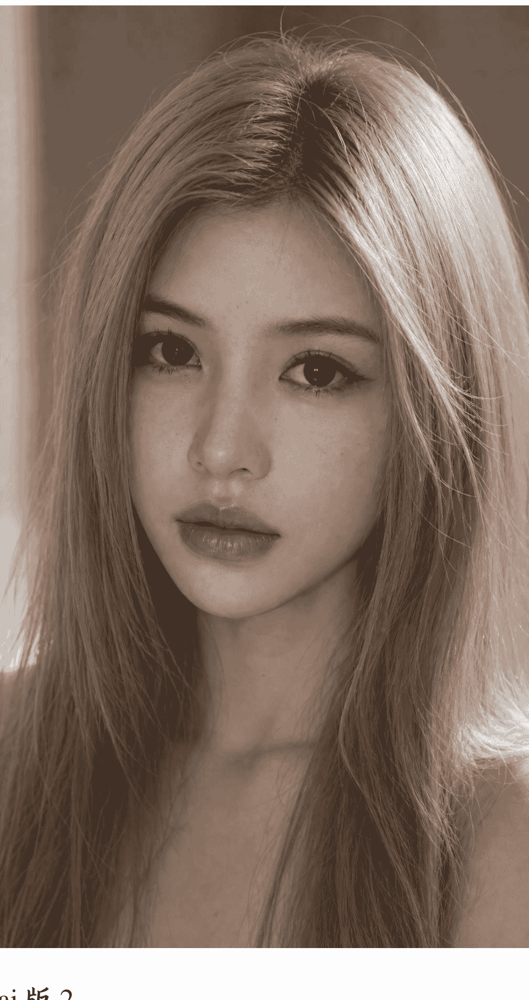

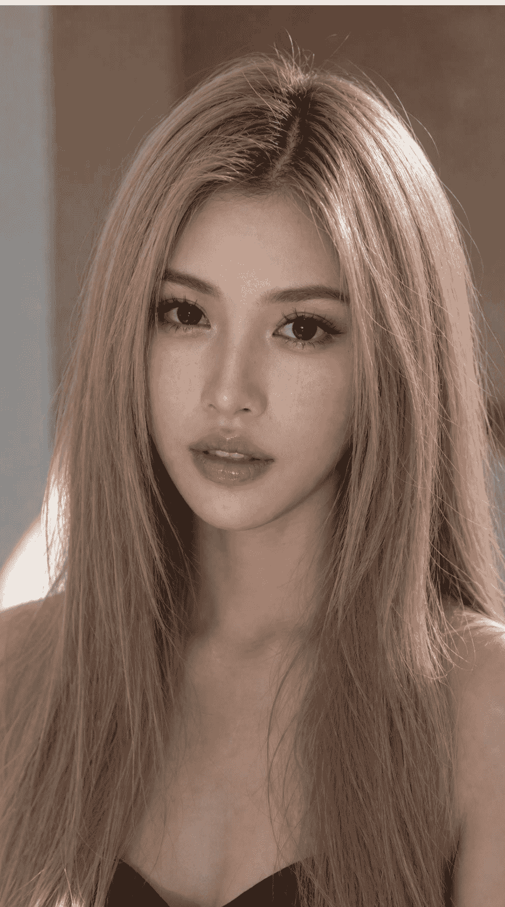

ai 版 3

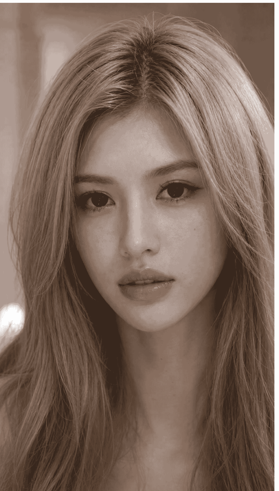

ai 版 4

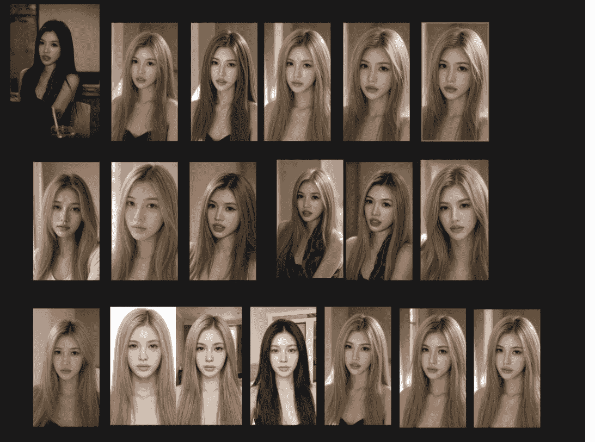

这张是人物脸部的迭代版本。

我使用的是 Lovart 里的 Image 2。现在市面上的生图模型已经很多，具体用哪一个并不是最关键的，关键是你是否清楚自己要保留什么、调整什么，以及最终想让人物呈现出怎样的气质。

这一轮我主要会看三个方面：

人物的基础辨识度有没有保留，五官比例是否自然，整体脸部是否有真实的骨相和立体感。

所以捏脸不是一次生成就结束，而是不断对比、筛选和微调，直到人物逐渐稳定下来。

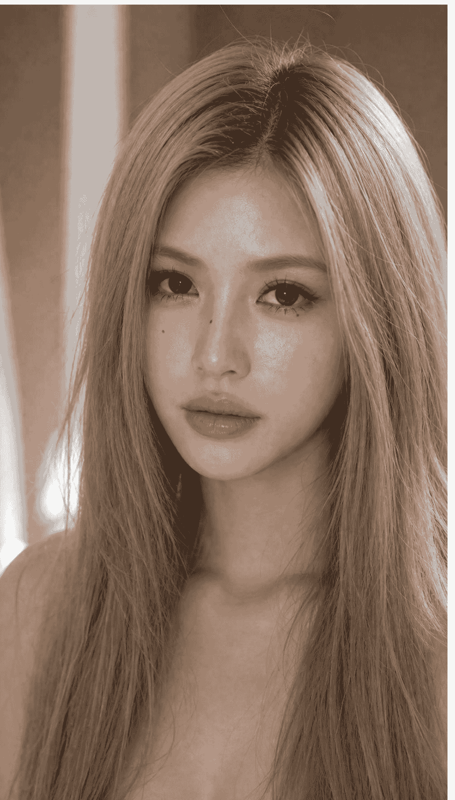

人物脸部稳定以后，我还会继续补充细节。

为了让人物不只是“脸好看”，是更像一个真实存在的人，这一轮我加入了更明确的皮肤质感、光影层次和面部细节，包括脸上的痣。

重点不是把人物磨得更精致，是需要保留真实的皮肤、骨相和轻微瑕疵感。太光滑、太标准的脸，反而容易失去真实感，也很难让用户记住。（其实这张也很假，但是没时间修改啦）

后面的提示词，我会继续围绕人物辨识度、混血感、皮肤质感、面部痣和拍摄质感进行修改，避免每次生成时人物都发生明显变化。

我的提示词:

生成一张超写实女性人脸特写肖像，画面为脸部近景特写，人物头部和少量肩颈入境，双眼清晰对焦，真实人像摄影质感。

[核心目标:两张脸真实融合，不是单纯像图1] 最终人物必须是图1与图2的人脸融合版本，不是图1原样复制，也不是图2直接替换。整体要求保留图1人物的基础辨识度，但必须明显融入图2的混血感、立体骨相和精致五官特征。最终效果要达到:第一眼能看出是基于图1的人物，人物不要张嘴，变成正脸照脸不要侧脸，人物不要张嘴!!但同时也能明显看出融合了图2的五官风格与混血感，不是"几乎和图1没区别"，而是"图1人物经过融合后，明显更有欧美混血感的版本"。

[人脸融合比例] 图1作为基础身份参考，图2作为强风格参考。融合方向建议为:60% 图1 人物辨识度 + 40% 图2 混血感与立体骨相不要把图1锁死成 1:1 照搬，允许在保留图1基础辨识度的前提下，明显引入图2的骨相与五官气质。

[图1保留内容] 保留图1人物的基础脸型轮廓、整体五官分布、原始神态气质、眼神感觉和大致辨识度。要求最终人物依然能让人感觉"是图1这个人融合后的版本"。

[图2必须明确融合进来的特征] 必须清晰融入图2的以下特征，而且要肉眼可见:更强的混血感，更深邃的眼窝，眉骨结构参考图2，只参考骨相立体度，不参考其他，更高更挺的鼻梁，更精致清晰的鼻尖和鼻翼结构，更明显的面中立体度，更清晰的颧骨与面部明暗转折，更精致的唇形和嘴部边界，整体五官更加立体、深邃、精致，呈现自然的欧美混血气质。注意:混血感不是只靠妆容实现，而是通过骨相、眼窝、鼻骨、面部结构和五官立体度真实体现出来。

[重要限制]禁止最终人脸几乎和图 1 一模一样;禁止只做轻微优化;禁止只增加一点鼻梁高光就算“混血感”;禁止完全变成图 2;禁止变成陌生人脸。最终人脸必须是一个真正融合后的新结果:既像图 1，又明显拥有图 2 的欧美混血感和立体骨相。

[发型]发色改为浅金色长直发。头发为自然浅金色、米金色、蜂蜜金之间的色调，不要假发黄，不要荧光，不要过白的白金色。长发顺直自然垂落，发丝必须真实清晰，有细碎发丝、自然毛流、轻微层次感，发根、发中、发尾过渡自然，发际线真实，头发具有自然柔顺光泽，不能像塑料片，不能结块。

[皮肤质感]保留真实皮肤质感:毛孔、细微皮纹、轻微肤色不均、鼻翼纹理、眼周细节、唇纹、自然骨骼转折、面部轻微绒毛。皮肤状态要细腻但真实，禁止过度磨皮，禁止塑料皮，禁止蜡像感，禁止油亮假面感，禁止陶瓷肌。

[妆容]整体妆容自然精致，偏高级感轻欧美妆。重点突出五官立体度和混血感，底妆轻薄，眉毛毛流清晰，睫毛自然浓密，眼妆干净，可有轻微眼线和淡淡阴影强化眼窝，唇色自然裸粉或低饱和豆沙色。妆容只是辅助，重点仍然是骨相和五官融合后的真实混血感。

[构图与拍摄要求]脸部特写近景，人物脸部在画面中占比高，额头、下巴完整保留，不要裁切五官，不要夸张歪头，不要过强侧脸，镜头视角与眼睛平，背景简洁自然虚化，柔和漫射光，真实摄影质感，双眼最清晰，整体高清、干净、自然。[最终效果总结]生成一张超写实女性脸部特写照，人物是图1与图2真实融合后的人脸，保留图1基础辨识度，但必须明显拥有图2的混血感、深邃感、立体骨相和精致五官。浅金色长直发，真实发丝，真实皮肤质感，高级自然，无明显AI痕迹。GPTImage 2.中9:16.1张

### 2. 看制作流程：一条视频是怎么做出来的

真正开始制作时，我会把一条视频拆成几个步骤，而不是直接让AI生成一段画面。

#### 第一步：建立爆款采集库

我会在小红书、抖音、ins，翻阅各个爆款视频。看清楚这条视频到底要解决什么问题。

是展示一件衣服？还是讲一种穿搭方法？是突出颜色，还是强调身材比例和使用场景？

是分享口红、妆容和服装之间的搭配技巧，还是通过整体造型营造氛围感？

不同平台的内容，我也会分别看。

比如Ins，我会关注高播放视频。小红书，我会重点观察点赞、收藏、评论和高互动。

有些内容还会通过Codex做的小插件整理

到飞书的素材库里，方便后续分类和挑选题目。

我不会把所有爆款都收集，而是会优先保留和自己账号方向、目标用户以及时尚业务相关的内容，包括服装、穿搭、口红、妆容、配饰和整体形象管理等。

## ins 爆款采集

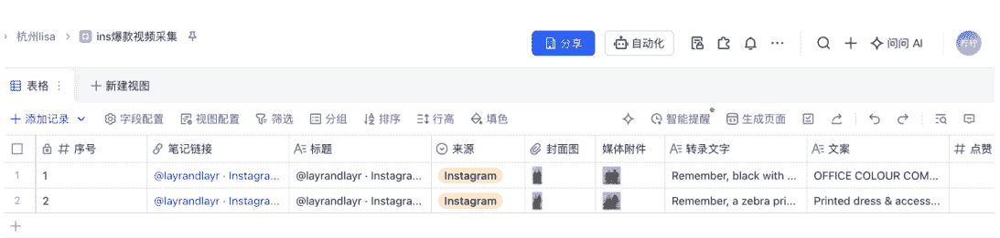

## 小红书采集

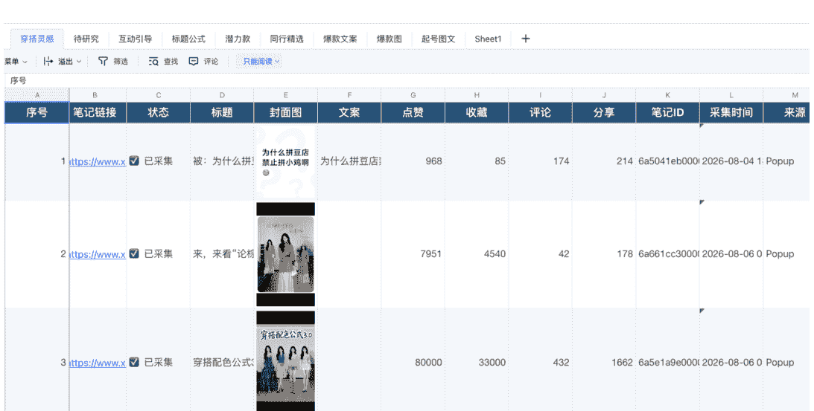

## 第二步：从真实用户和高互动内容里找选题

不要凭空想“今天做什么好看”。

从过去直播间里的真实问题、对标账号的高互动内容，以及最近平台上正在讨论的话题里找选题。

比如：
- 发型和领口应该怎么搭？
- 配饰怎样才能让整套穿搭更完整？
- 黄黑皮适合什么颜色？

这三个话题都是我的百万播放爆款。

选题一定要具体，最好让用户一眼就知道这条视频和自己有关。

就像前面讲的，很多行业知识本身并不稀奇，但如果能结合真实生活场景，把它转化成用户看得懂、用得上的内容，就更容易产生停留和互动。

比如我以前做过的发型领口搭配、配饰穿搭公式，本质上都来自女装直播中反复出现的用户问题。

找到选题以后，我还会参考同类高互动内容，再去拆解它为什么有效：
- 它的第一眼吸引力在哪里？
- 用户为什么愿意看下去？
- 它解决的是哪一个具体问题？
- 它有没有把服装、口红、妆容和配饰之间的关系讲清楚？

最后，我会把这些内容重新换成自己的、人物和审美，而不是直接复制原来的表达。

这样做出来的视频，既可以展示服装，也可以延伸到口红、妆容、配饰和整体造型，形成更完整的内容。

## 第三步：拆解参考视频，设计自己的画面

确定选题以后，我会先找参考视频，再把它拆开看。我会看里面有几套衣服，妆容和造型有没有变化，第一套和第二套之间是什么关系，镜头是怎么切换的，人物有没有走路、转身、整理衣服等动作。

> 视频见**在线文档**版本

这是我在抖音随便找的视频，咱们来复刻一下，时间有限。先教大家简单的比如一条看起来很简单的换装视频，拆开以后可能是：
- 两个镜头。
- 两种完全不同风格的服装。
- 一个明确的前后对比。
- 几处和音乐节奏配合的动作。

找到结构以后，我不会直接照搬，而是换成自己的服装、人物和审美。

然后再根据服装素材，去设计人物的站姿、动作、镜头角度和画面比例。

于是乎这是我找的衣服：

我会用极致的反差例如妆容>服装>画面滤镜的对比。

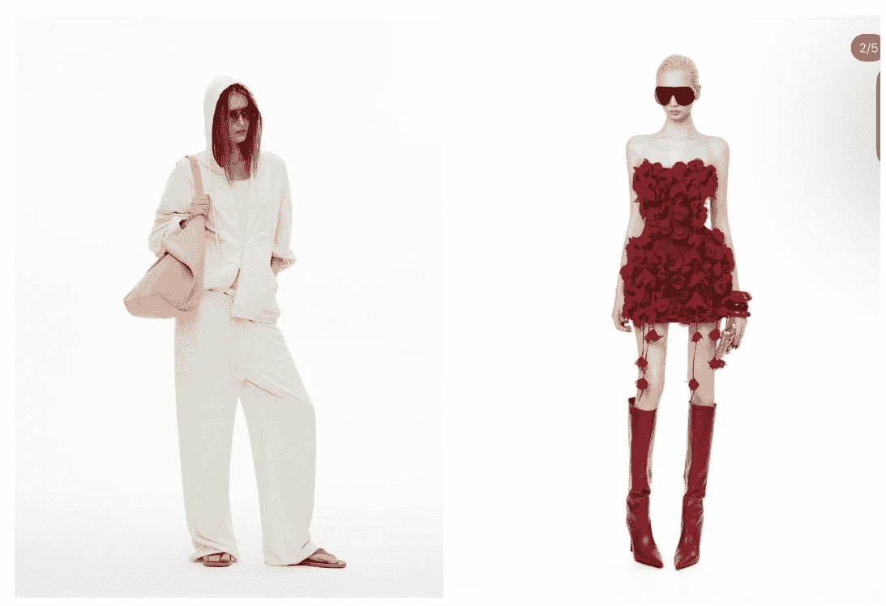

## 第四步：生成图片，并进行筛选

画面设计好以后，先生成图片。

人物图和服装图在这个阶段非常重要。人物要保持身份稳定，服装要尽可能还原版型、颜色、材质和细节。

AI 生成的结果不可能一次就完全符合要求，所以需要反复检查：
- 五官、发型和妆容有没有发生明显变化。
- 服装颜色和版型有没有跑偏。
- 手部、饰品和身体比例是否自然。
- 背景、机位和人物占比是否统一。

我一般会先生成多张，再从里面挑出最稳定、最适合做视频的一组，不会做完第一张能用就直接进入下一步。

我非常非常非常抠细节所以图片都会生成多次比较

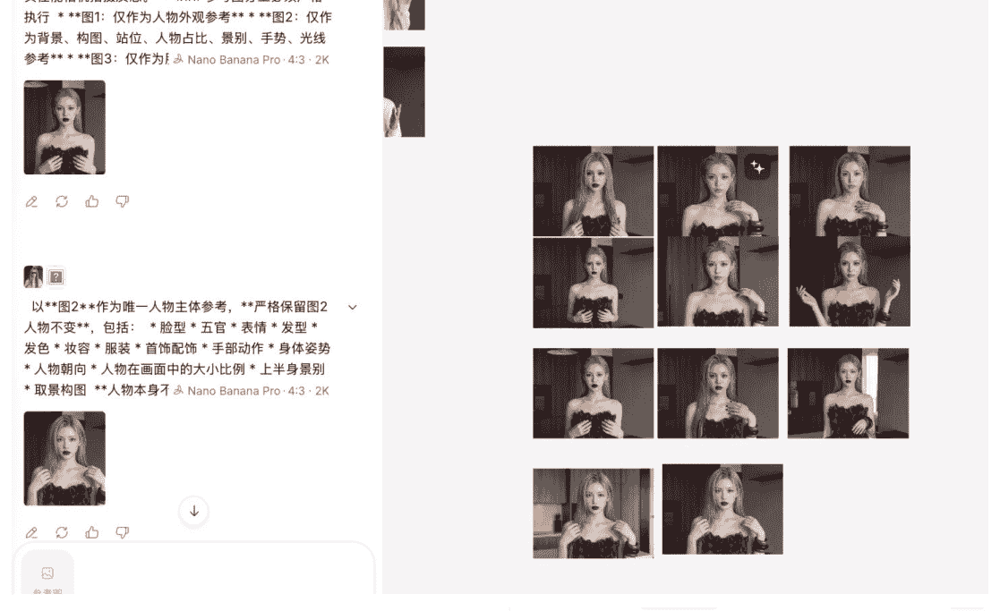

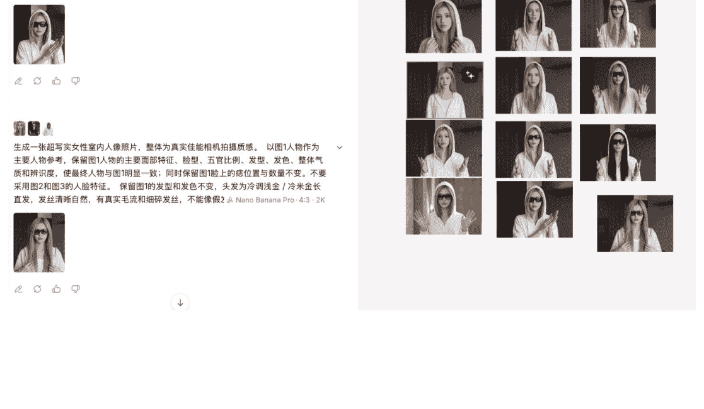

生成一张超写实女性室内人像照片，整体为真实佳能相机拍摄质感。 以图1人物作为主要人物参考，保留图1人物的主要面部特征、脸型、五官比例、发型、发色、整体气质和辨识度，使最终人物与图1明显一致；同时保留图1脸上的痣位置与数量不变。不要采用图2和图3的人脸特征。保留图1的发型和发色不变，头发为冷调淡金 / 冷米金长直发，发丝清晰自然，有真实毛流和碎碎发丝，不能像假发。 人物穿上图3的服装，戴上图3的眼镜，只参考图3的服装和眼镜款式，不保留图3的包包。画面中不要出现任何包包。 眼镜镜片自然干净，不出现人物倒影、摄影倒影、手机倒影，眼镜里不要出现任何人。 人物占比、景别和取景感都参考图2，呈现近景到半身剪图。只参考图2的室内背景环境与空间氛围，不参考图2中的所有背景、文字、水印和杂项元素，只保留干净的室内背景。背景清晰可见，不虚化、不模糊。 若手部出镜，指甲保持自然甲床状态，不要美甲，不要假片。皮肤保留真实质感，包括轻微毛孔、细小纹纹、自然肤色变化、鼻翼纹理、眼周和唇周肌理，自然唇纹。整体细腻、清透、有年轻感，但不过度磨皮，避免塑料皮、蜡像感和过度美颜脸。 画面高清清晰，双眼清晰对焦，人物轮廓边缘清晰，不糊边、不脑边。 整体效果像真实自然的室内摄影人像照片。 Nano Banana Pro ·4:3 ·2K

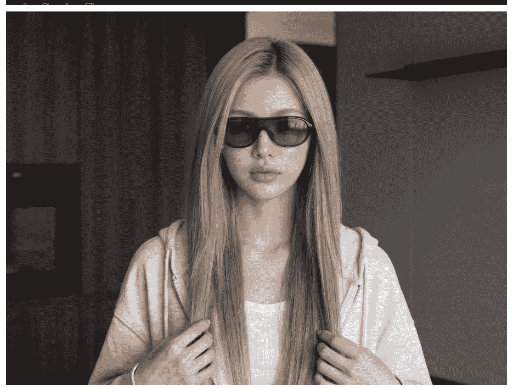

### 生成一张 4:3 横向超写实女性室内人像照片，真实佳能相机拍摄质感。

#### 参考图分工必须严格执行
- 图1：仅作为人物外观参考
- 图2：仅作为背景、构图、站位、人物占比、景别、手势、光线参考
- 图3：仅作为服装参考
- 图4：仅作为妆容参考
- 图5：仅作为发型参考

#### 发丝全部垂在身后

#### 图2为最高优先级：背景与构图锁定
背景必须与图2完全一致，不允许改动。

#### 严格保留图2的：
- 室内背景环境
- 空间布局
- 墙面、门框、家具位置
- 背景色调
- 光线方向与明暗关系
- 拍摄机位
- 镜头高度
- 取景范围
- 上半身景别
- 人物所在位置
- 人物在画面中的大小比例
- 双手位置与手势

#### 删除图2中的原人物以及所有背景、文字、水印、logo和杂项元素，但除此之外，背景必须保持和图2一模一样。
#### 不要重新设计背景，不要替换背景，不要模糊背景，不要虚化背景。
#### 人物占比必须与图2完全一致，不能放大，不能变成大头照。

#### 人物外观
以**图1**作为主要人物外观参考，保留图1的面部轮廓、五官比例、发色、肤色和整体气质，保留图1脸上的小痣与雀斑特征，自然真实，不夸张。 不要参考图2、图3、图4、图5的人脸特征。

#### 发型与妆容
- 发色保持图1的冷调淡金 / 冷米色。
- 发型参考**图5**的湿发造型，保留湿发线条感与贴合感，但发色不变。
- 妆容仅参考**图4**的妆容风格，不要参考图4的人脸、发型和背景。

#### 服装
人物穿上**图3同款服装**，只参考图3的服装款式、颜色、版型、材质和穿着效果。 不要参考图3的人脸、发型、背景和其他元素。 若手部出镜，双手都要出现在画面里，指甲为黑色美甲。

#### 画面质感
- 皮肤保留真实质感，包括自然毛孔、细小皮肤、轻微肤色变化、鼻翼纹理、眼周和唇周肌理、自然唇纹。
- 不要过度磨皮，不要塑料皮，不要蜡像感，不要过度美颜脸。
- 双眼清晰对焦，人物轮廓清晰，发丝清晰，不糊边、不脑边。
- 整体像**Canon EOS R6 Mark II + 50mm 镜头**拍摄，非广角，真实自然。

#### 最终效果
把图1的人物，换上图3的衣装，做图2相同的站位和手势，以图2完全相同的背景、构图、人物占比和景别出现在画面中。 背景必须与图2完全一致。

如把图1人物替换到图2原人物位置上，除人物替换外，图2背景、构图和人物大小全部不变。

Nano Banana Pro ·4:3 ·2K

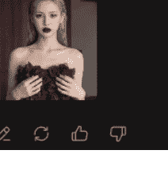

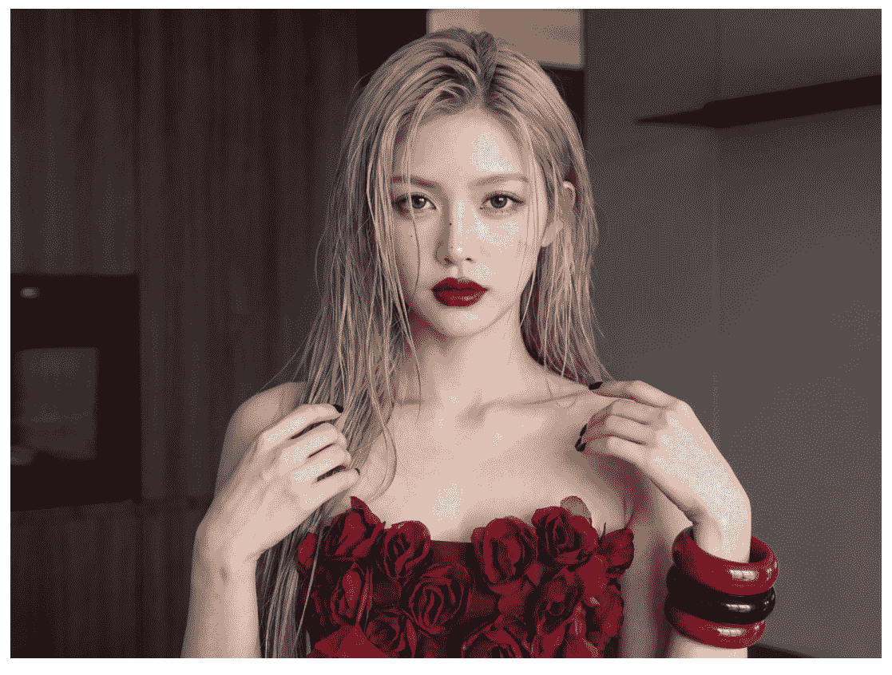

## 第五步：写视频生成提示词，生成动态片段

静态图片确认以后，才进入视频生成阶段。这一步不是把图片动起来，是要提前想清楚：
- 人物要做什么动作。动作从哪里开始，到哪里结束。
- 镜头是固定、推进，还是跟随人物移动。衣服需要展示哪个细节。
- 人物的手、头发和身体应该如何动的。背景和光线是否需要保持稳定。

这次之所以使用 Seedance 2.0 的全能参考，可以先根据参考视频整理提示词，再放进视频模型里测试。

等视频制作流程顺畅之后，基本上就不太需要依赖全能参考了，直接通过提示词加参考图，也可以明确指出想要的动作和画面效果。

提示词不用写得太复杂，但要说明关键动作、镜头运动、服装展示和画面限制，比如人物是转身、走近镜头。

要求越清楚，后面筛选和返工就越省时间。

视频结尾的转身动作最高优先级，必须完整复到，动作连续流畅，不省略、不截断。转身过程中人物的头部、肩膀、上半身和身体重心自然联动，符合真实人体运动规律。严禁出现脸部变形、五官错位、侧脸崩、手部畸形、肢体扭曲、肩膀结构异常、身体比例失衡或任何AI抽搐感。转身前、中、后整个人物身份必须始终稳定，脸型和五官不能变化，动作自然真实。仅参考视频中的嘴型、说话节奏、表情动态、手势、肢体动作和动作节奏。视频结尾的转身动作必须完整复到，包括转身前的准备动作、头部转动、肩膀跟随、上半身转动、身体重心变化和最终停留姿态，动作不能简化，不能截断。转身全过程必须符合真实人体运动规律，动作连续流畅，严禁出现脸部变形、五官错位、侧脸崩、手部畸形、肢体扭曲、肩膀异常、身体比例失衡或任何AI畸变感。最终人物的脸、五官、脸型、发型、发色、服装和参考图片方案。人物身份从头到尾保持稳定，尤其转身时脸不能变化。忽略参考视频中的字幕、文字、logo和所有叠加元素，最终画面不要出现任何文字。人物双手保持自然干净的甲，不参考视频中的美甲。Seedance 2.0·参照/视频·4:3·5s·720p

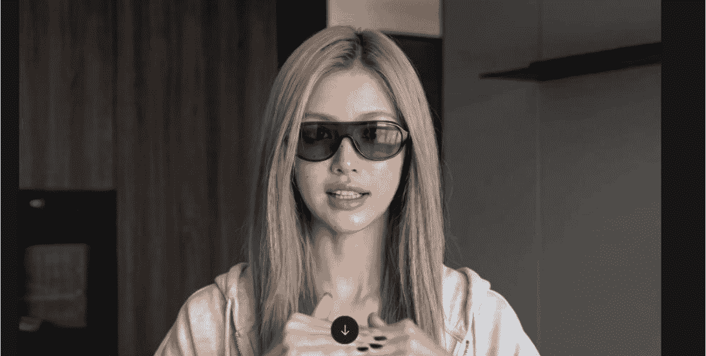

这是一个转场变装视频。仅参考视频中的动作幅度、身体运动、手势、头部转动、转身节奏和眼神表现。不要参考参考视频中的人脸、五官、脸型、发型、发色、妆容、服装、配饰、背景、字幕、文字和任何造型元素。开头转场为最高优先级：完整参考视频开头“侧面流畅转到正面”的动作。人物起始保持自然侧身，随后头部先向镜头方向转动，肩膀、上半身和双手同步自然跟随，连续流畅地转到正面。转场中途完成自然变装衔接，前后动作必须属于同一个连续转身过程，不能突然跳正面，不能动作断层，不能卡断。不要将“侧面”和“正面”理解为两个独立镜头，必须由同一个人物通过一次连续真实的身体转动完成侧面到正面的过渡。转身过程中严格保持参考图片人物身份稳定，脸型、五官、头部比例始终一致，不因侧脸转折而脸型或变形；肩膀、手臂、手腕和手指符合真实人体结构，不扭曲、不畸形。转正后仅参考参考视频那种冷静、犀利、有时尚感的眼神和神态表现，只学习眼神状态，不参考参考视频的脸和妆造。双眼有明确注视感，神态自信、有张力，但不过度凶狠。可以自然眨眼和轻微转移视线。人物全程不说话，不参考参考视频中的说话口型。嘴唇自然闭合，保持放松的闭嘴状态，不连续开合、不张嘴、不生成说话动作。后续继续参考视频的自然手势、头部轻微偏转、身体重心变化和整理头发等动作节奏，动作松弛，有时尚感，不机械、不夸张。保留参考图片中的黑色美甲完全不变，双手运动过程中始终保持黑色美甲，不变成素甲，不改变颜色和甲型。忽略参考视频中的所有字幕、文字、logo和叠加元素，最终画面禁止出现任何文字。Seedance 2.0·参照/视频·4:3·6s·720p

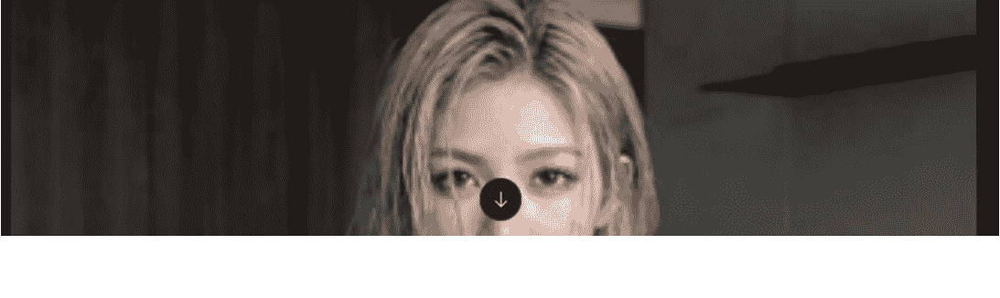

## 第六步是剪辑和包装：

视频生成以后，先筛选片段，再进行剪辑。

重点看：
- 人物在多个镜头里是否保持一致。
- 动作是否自然，有没有手部、头发和身体穿帮。
- 衣服在运动过程中有没有变形。
- 镜头切换是否连贯。
- 画面有没有真正展示出服装和人物状态。

有些片段单独看没有问题，但放在一起就会出现人物变化、光线不一致或者动作衔接不上的情况，这些都需要重新筛选。

确认片段以后，再进行剪辑、配乐、字幕和封面处理。

有时候画面本身不错，但开头太慢，或者字幕没有把重点说出来，观众还是会直接划走。

所以剪辑不是最后简单拼接，而是要让画面、节奏和内容保持一致。

> 视频见在线文档版本

## 最后是发布和复盘:

记录这条视频使用了什么主题、什么内容，以及数据。这样下一次制作时，不是重新凭感觉开始，而是可以直接参考已经验证过的经验。

我以前做女装直播时，也是在不断重复这个过程：选款、搭配、试穿、讲解、观察观众反应，再根据反馈调整。现在只是把直播间里的工作，换成了 AI 视频的制作流程。

所以我现在不会把 AI 视频理解成“输入几个提示词，等它自动出片”。

它更像是一套完整的内容生产工作：先确定观众要看什么，再决定怎么呈现，最后通过数据判断哪些方法值得 SOP。

## 六、商业化信号：不只是播放量，还有变现方式

这几个月让我比较开心的，不只是视频跑出了播放量，而是开始收到越来越多不同类型的合作邀约。

有服饰、内衣、包包、美妆，也有平台和其他行业的合作咨询。除此之外，还收到过希音的询单、快手、百度、爱奇艺、淘宝等平台的入驻或合作邀请。

但这些反馈对我来说依然很重要。

它至少说明，虚拟 IP 不只是一个用来展示技术的账号，也可能进一步接商单、种草、以及是否有更多的人有付费学习需求。

我自己也在观察，品牌到底在关注什么。

有些品牌关注的是人物风格，有些关注服装展示效果，有些关注能不能稳定批量产出，还有些关注这个账号能不能成为长期合作的内容载体。

### 收到了 SHEIN 询单

您好，我是希音平台的工作人员，目前我们有 AI 相关项目【ai 平面/ai 视频】正在对外寻求合作，希望对接具备跨境视觉审美能力的 AI 机构承接项目，想咨询下贵司是否有合作意向，期待您的回复

将 "AI" 添加到备注

有意向可以同步一下公司作品集还有报价～

是的账号来的吗

7 月 25 日 14:35

对的

ai 视频制作板块业务有接吗

7 月 25 日 14:45

哈喽，麻烦备注一下品牌/产品 + 合作需求 + 预算哦，平时工作比较忙，消息会集中回复，可能没法秒回，辛苦啦～

打扰啦老师~ 我在抖音私信联系过您哒

我是快手官方运营，诚挚的邀请咱们达人入驻我们平台，入驻同步上传站外平台的作品即可，还有百万流量助推及现金奖励喔，这是我的官方企业微信，您可以添加一下哈

活动非常简单，入驻后即进入扶持期一共 28 天，每周发布视频作品即可，参与活动不签约。不收费！！
作品权益：

将图片 添加到备注

你好，老师，这个是咱们的账号吗

嗯嗯是的

我这边是爱奇艺服务商的，看咱们作品很优质，想跟您谈一下商务合作

8 月 19 日 14:26

是什么合作形式呀

这个合作的话，是爱奇艺官方平台的是直接对接爱奇艺官方的，主要流量

### 爱奇艺也来找我们啦

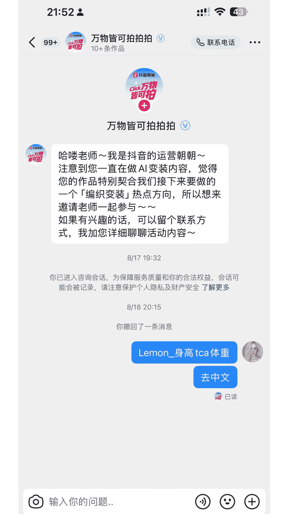

### 平台运营邀请共创

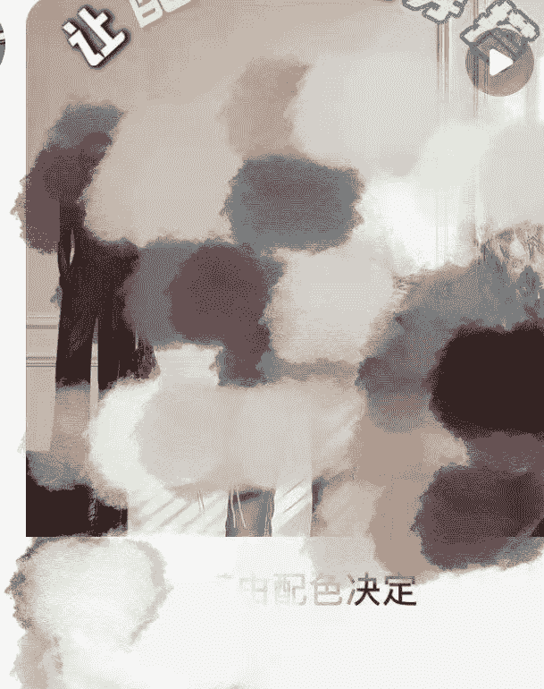

时尚薯 ✓
加个关注，方便以后畅聊

- 已阅
- 真好看
- 喜欢

hii老师，你这条笔记很优秀，可以编辑带上话题#colorfit 薯薯会来投流的。后续的其他内容也可以带上这个话题

- hello
- 谢谢宝
- 呃
- 在干嘛
- 喜:

发消......

小红书官方也经常投流

美妆薯

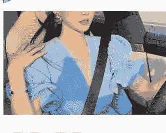

- 已阅 真好看 喜欢

hihi 宝，我们在站内看到了你的优质笔记，诚邀你带话题参与活动，官方将助推投流，让好内容被更多宝子看到✨！

参与动作：编辑笔记带话题#本命穿搭 和 #柔性穿搭

流量激励：带话题视频笔记均可获得 5W-20W 大额流量

宝加好 tag~之后跟着薯反馈，我们直接安排助推投流！ (注: 原文有表情符号 "💪")

06-15 19:41
加好啦
好滴宝贝 薯薯来啦！

- hello 谢谢宝 爬 在干嘛 喜欢 拜托拜托 笑死了 心心眼 抽血

### 恭喜获得话题活动流量激励

您在话题内发布的《这周...》获得官方流量激励啦，期待更多创作
薯队长 06-24

### 恭喜获得话题活动流量激励

您在话题内发布的《这周...》获得官方流量激励啦，期待更多创作
薯队长 06-24

### 恭喜获得话题活动流量激励

您在话题内发布的《世界杯球...》获得官方流量激励啦，期待更多创作
薯队长 06-24

### 恭喜获得话题活动流量激励

您在话题内发布的《世界杯球...》获得官方流量激励啦，期待更多创作
薯队长 06-24

将"w"添加到备注

16:52

你已添加了W，以上是打招呼的消息。

您好 我这边是淘宝短视频采购商MCN机构 看到您小红书作品 视频和图文非常优秀，所以想邀请您参加淘宝短视频采买活动，只需要同步您小红书的视频作品，目前与诸多品牌联动合作，我们帮您代发，您一个月的作品激励金额为■■□右上不封顶，商单收益另算，您看看有兴趣报名嘛

淘宝的也找来啦

您好！我是《偏爱之恋》节目组的选角导演。（优酷平台S+综艺，《势均力敌的我们》第一季制作班底。）

我们在社交平台上看到你的相关信息，觉得你非常适合，若您有兴趣，我们可以进一步沟通具体细节。如有任何疑问，欢迎随时联系我。祝一切顺利！

### 还收到了恋综导演的私信嘿嘿

除了品牌合作，也开始有人主动问：
- “这种 AI 变装可以学习吗？”
- “AI 视频到底是怎么做出来的？”
- “有没有完整的制作流程？”

这些问题对我来说同样重要，因为它说明观众关注的已经不只是最后那条视频，而是开始对背后的方法和生产过程产生兴趣。

这也让我更确定，过去积累下来的审美、内容判断和 AI 制作经验，确实有机会被整理成一套更标准化的能力。

当然，这件事还在持续验证中。

我现在不会因为收到几次邀约，就说自己已经跑通了完整的商业闭环。但至少从目前的反馈来看，播放量只是第一层结果。

更重要的是，内容有没有带来新的关系：
- 有没有品牌愿意进一步了解？
- 有没有观众愿意主动咨询付费？
- 有没有人想把这套方法用到自己的业务里？

这些信号，才决定了一个内容账号后面有没有继续发展的空间。

后台超多私信完全回不过来

## 七、一些需要注意的细节

第一，不要以为生成出来就等于能发布。

AI 可以帮你生成画面，但它不会自动帮你判断这条视频有没有内容价值。人物好不好记，衣服有没有展示清楚，观众为什么要继续看，这些还是得自己判断。

第二，不要只追求人物漂亮。

太精致、太像样片，反而缺少真实感，观众不一定会留下来。观众不一定会因为人物漂亮，就愿意停下来，更不一定会记住这个账号。

第三，不要只看播放量。

播放高但不涨粉、不收藏、不私信，可能只是短暂热闹。真正要复盘的是这条视频有没有让观众产生下一步动作。

第四，不要低估细节成本。

灯光、机位、人物稳定、服装质感、动作自然、封面标题，每一个都要磨。看起来是一条 15 秒视频，背后可能是反复试错。

第五，爆款之后不要急着卖课。

5 月份就有人问我什么时候教，但那时候我想更多专注在内容创作，需要确定哪些东西能复制，哪些只是偶然有效。

后来我继续做不同的人物、选题和视频，也在不同平台上反复测试，才慢慢把里面相对稳定的部分拆出来。

现在我更愿意先把过程讲清楚，再把已经验证过的经验，逐步整理成可以参考的方法。

## 八、如果你今天也想开始，可以这样做

如果你也想做 AI 内容获客，不建议一上来就学一堆工具。

我建议先做一个很小的测试：

1. 选一个你本来就懂的赛道，不要选完全陌生的。
2. 找 3 个你觉得观众真的会停下来的对标视频。
3. 拆它们的共同点：人物、画面、钩子、封面、评论。
4. 做 1 条 15 到 30 秒的 AI 短视频，不求完美，先发出去。
5. 用 5 个指标复盘：封面点击、平均观看、完播、收藏、涨粉/私信。

你先跑完这一条，再决定要不要继续学更多工具。

因为做 AIGC 这件事，真正的起点不是“我会用哪个软件”，而是“我能不能用 AIGC 内容拿到一次真实反馈”。

## 九、写在最后

我进生财以后，最大的感受是：这里很多人都在认真把事情摊开讲。不是只讲自己厉害，而是讲怎么做、怎么错、怎么改。

也是这种氛围改变了我。以前我会觉得，很多东西是不是只能靠运气、靠资源、靠天赋。后来我发现，很多结果背后都是一遍遍试、一遍遍复盘、一遍遍把动作拆细。

我现在还不够说自己已经完全跑通了什么很大的商业闭环，但我已经比较确定：虚拟 IP 确实是一条值得继续验证的内容获客路径。

如果你也在做内容、做品牌、做电商，或者一直想把 AIGC 真正用进自己的业务里，欢迎来找我聊聊。

————— 分割线 —————

核心是“立刻动手”和“圈层信息差”。

如果你想看全网最新的变现玩法，并且和一群执行力极强的极客一起下场拿结果，欢迎围观我的核心私域：【懒人专属群】。

我们不聊虚的，只做商业闭环的拆解与 AI 效率的压榨。系统内已沉淀 1000+ 跑通的套利实战局。

查阅圈子完整数字资产与上车门槛：

https://lazysco.com/insider/

认同价值、准备好下场干活的，扫码加我微信（lazyhelper1）

备注：【实操上车】，不闲聊

