# **实战 | 批量做 AI 图书短视频，把单条 60 分钟压缩到 10 分钟，全套 SOP+提示词**

260909 副业 SC 精华
整理：公众号懒人搜索，懒人专属群精选
懒人微信：lazyhelperl


> **小懒判断** | 适合想做历史书单短视频带货、被扒文案和剪辑耗住手脚的人；不适合想全自动躺赚、不肯人工校验史实的人。最值得关注：5 条风控红线，尤其"AI 生图严禁画书本"——画封面文字变形易判违规，书要用画中画后期贴；二创查重压到 10%以下靠"锁两头破中间"。坑：自动化工具不提供下载，可直接照搬的只有手动版 SOP 和全套提示词。

很多做国学、历史书单短视频的圈友，大量时间耗在扒对标、转写文案、复制粘贴剪辑上，一天更新几条就要消耗 6 小时以上，精力全部消耗在机械重复工作，没有精力做选题和史实校验。

今年 8 月大航海开启的时候，亦仁大大说过的一句话：**让圈友可以借助 AI 拿到结果**。生财一直鼓励我们所有圈友大胆上手 AI，实实在在做出结果。

本次 8 月大航海我以一名实战者的身份，重新下场完整实战跑通了一套可复制的 AI 短视频带货链路，用到的工具流程分为**零成本手动版**和**自动化提速版**两套方案。

下面的分享内容分为：输出完整 SOP、全套可复制提示词、飞书表格模板、风控踩坑复盘。

先简单的自我介绍一下：

大家好，我是马小威，生财老圈友，曾担任 5 月超级 AI 大航海技能教练。

8 月份以实战者身份重新下场，目标很纯粹：通过亲身实战，为 AI 视频项目死磕提效。大家好，我是马小威，最近在做 AI 提效的事情。

做 AI 图书视频的圈友，应该都有同感：

真正费时间的从来不是创作，而是反复下载、转写、复制、剪辑这些重复的操作活。

一条片子磨一小时，精力全被琐事耗光，反而没空好好做选题、校对史实、打磨内容。

这段时间我实战跑通了两套完整落地方案：零成本手动版 + 自动化提速版，直接把单条成片耗时从 70 分钟压缩到 10 分钟。

不管你是从没做过书单短视频的纯新手，还是正在日更、想要批量提效的老手，这套 SOP、全套提示词、赛道风控避坑红线、7 天落地清单，都可以直接照搬复用。

## 一、适用 & 不适用边界（先判断再往下看）

- ✔ 适合赛道：历史人物、国学、书单解说类图文带货视频，9:16 竖屏口播账号
- ✘ 不适合：真人出镜、剧情短片、直播切片视频
- 噪音风险：如果参考的对标视频背景噪音很大，转写文案很容易出错。无论 AI 输出什么文案，最后一定要人工检查一遍。（识别精度说明：人声干净、背景音乐音量较小的对标视频，文案识别准确率极高；原视频背景音乐嘈杂，识别出来的文案会有错字风险，文案产出后必须人工复核一遍）
- 设备门槛：手动落地整条链路无任何设备限制；后续如果选用自动化提速工具，支持 Windows 电脑和 Mac 用户运行。

## 二、先说下我当初遇到的真实痛点

最开始我走的是纯手工路线：对标视频（元宝提取文案）→转写文案→整理选题库→AI 改写→手动剪辑。做这样一条视频从采集到成片耗时约 60 分钟，如果一天想更新 3 条，6-7 个小时直接就没了。

最让我难受的不是"写不出文案"，而是**流程太碎**：

- 找对标要花时间
- 提取对标文案要花时间
- 等生图要花时间
- 调整剪映轨道更要花时间

每天看着很忙，其实大部分时间都耗在"复制、粘贴、对齐、重命名"这些**没有任何积累价值**的机械动作上——真正该花心思的选题筛选、文案打磨、内容网感，反而被挤占到没有精力顾及。

实操中两个绕不开的难题：

### 1. 扒对标数据和文案效率低

- 传统方式要完整下载对标视频、再上传飞书转写——占硬盘空间，而且飞书转写还有 300 分钟额度限制
- 直接转发视频给元宝提文案，又经常漏字、语序错乱，有时直接拒绝提取。很难批量沉淀出属于自己的爆款选题库
- 第三方提取文案小程序会有很多广告，数据汇总更是繁琐，要么是借助 AI 截图汇总要么是手动登记信息。

### 2. 剪辑工作耗时巨大

- 口播字幕、画面素材、背景音乐轨道全靠手动对齐；
- 一旦想做矩阵账号、大批量产出，无休止的重复工作流程，光剪辑就能把人耗垮了。

如果这两个问题长期困扰你，这套生产链路，值得你看下去。

### 手动版 VS 进阶自动化 对比表格

> **核心说明**：
> 这套书单视频生产方法论，完全不依赖任何自研工具，手动操作即可完整复刻落地。
> 自动化只是后期用来砍掉重复劳动的可选提速方案，不是跑通链路的必需品。
> 注：耗时为单条有效投入时间，不含选题调研阶段。

| 序号 | 策划名称 | 手书/视频/手书/文案/活动 | 目标受众 | 策划主题/文案/文案/大纲 | 发布时间 | 策划发布时间 | 策划发布时间 | A类策划 | B类策划 | C类策划 | D类策划 | E类策划 | 策划人 | 说明 |
| :--- | :--- | :--- | :--- | :--- | :--- | :--- | :--- | :--- | :--- | :--- | :--- | :--- | :--- | :--- |
| 1 | 主要对标案例/拆解/案例 | 主要对标案例/拆解/案例 | 主要对标案例/拆解/案例 | 主要对标案例/拆解/案例 | 2024-05-06 | 4月10日 | 中短视频 | 1 | 5 | 4.5 | 5.25 | 1.5 | 1.75 | 1.2 | 主要对标案例/拆解/案例 |
| 2 | 对标拆解 | 对标拆解 | 对标拆解 | 对标拆解 | 2024-07-15 | 7月7日 | 短视频策划 | 1 | 4 | 5.35 | 4.05 | 3.25 | 2.75 | 3.1 | 对标拆解 |
| 3 | 直播策划与拆解 | 直播策划与拆解 | 直播策划与拆解 | 直播策划与拆解 | 2024-09-02 | 9月2日 | 直播策划拆解与复盘 | 4.5 | 5.5 | 5.35 | 4.75 | 5.25 | 5.1 | 4.5 | 直播策划与拆解 |
| 4 | 脚本创作 | 脚本创作 | 脚本创作 | 脚本创作 | 2024-09-07 | 9月5日 | 直播脚本创作 | 4.75 | 5.25 | 4.25 | 5.25 | 5.0 | 4.75 | 5.2 | 脚本创作 |
| 5 | 直播策划与拆解 | 直播策划与拆解 | 直播策划与拆解 | 直播策划与拆解 | 2024-10-05 | 10月5日 | 直播策划拆解 | 1.5 | 4.5 | 5.25 | 5.35 | 5.1 | 5.2 | 5.25 | 直播策划与拆解 |

**产出成果：你的飞书多维表格就是长期可复用的爆款对标选题资产库。后续二创，直接从表格调取原始对标文案即可。**

> **红线提醒**：采集对标文案仅用于内部学习拆解，禁止直接搬运原博主文案发布。

**步骤 2：AI 二创改写文案**

用我准备好的提示词，对标原文案做二次改写创作。

根据对标文案和提示词，一键生成改写完成的口播稿，再以此进行分镜脚本、图片生成等操作。完整提示词放在【文末资源区·附件】也可以看下 [8月航海资料库 - AI视频带货高手领航](https://example.com) 创作适合自己的提示词

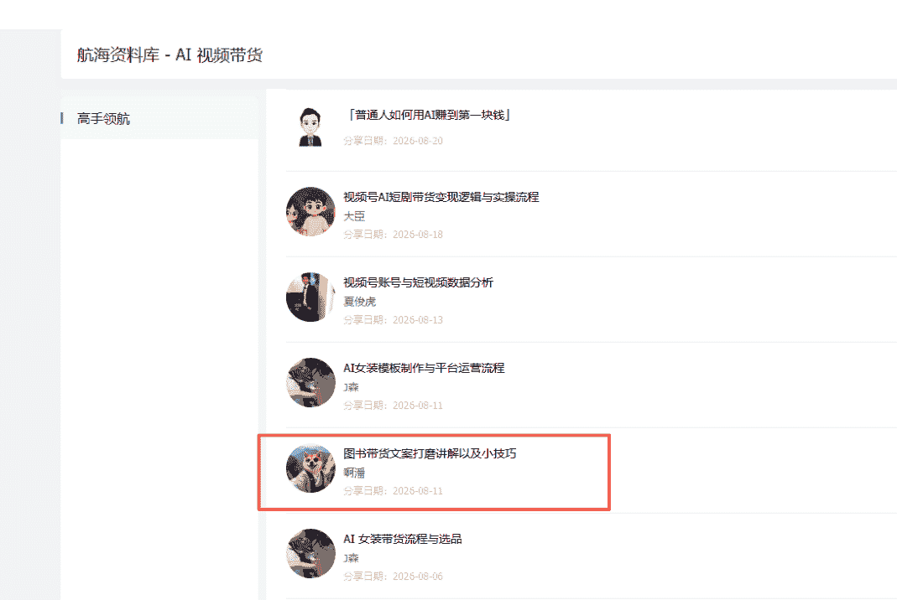

**步骤 3：素材生成**

AI 绘图产出画面素材，配音工具导出音频文件。根据生成好的画面提示词，使用 AI 绘画工具产出视频画面；文案导入配音工具生成音频 MP3 文件。

**步骤4：手动剪辑产出草稿**

把图片和音频导入剪映，调好运镜、转场效果，打开 BGM 人声避让。最后再微调一下，导出成片就行。

打开剪映 PC 版，依次导入图片素材、配音音频；手动添加运镜效果、转场特效；添加背景音乐，并且降低 BGM 音量避让人声轨道。完成后保存剪映草稿工程文件，人工微调后导出成片。

> 耗时参考：手动单条视频完整产出约 60-80 分钟，适合日产出不大、小规模测试赛道的创作者。

## 五、提速进阶方案｜自动化工具链路（可选，非必选）

> 这条是我自己写的定制工具，Windows 和 Mac 电脑都可以运行。仅作为思路参考，暂时不对外提供下载。

如果你已经完整跑通一遍手动链路，感受到大批量采集对标、反复剪辑草稿消耗过多精力，可以参考我实战中使用的自动化提速方案：

### 视频号信息提取工具

电脑微信播放对标视频，工具后台自动嗅探，提取口播文案，自动同步写入飞书多维表格选题库。省去下载视频、上传转写、复制粘贴入库一系列手动步骤。

支持剪辑与交叉生成\视频，自动补齐并同步\剪辑、交叉生成\文本，一键批量开启剪辑配置/项目批...

全部记录\导入\导出\刷新\回收站\待发布\已公开\已收藏\已屏蔽\已锁定

**支持点击视频博主主页一键导入博主所有视频内容，批量分析文案、画面等特点。**

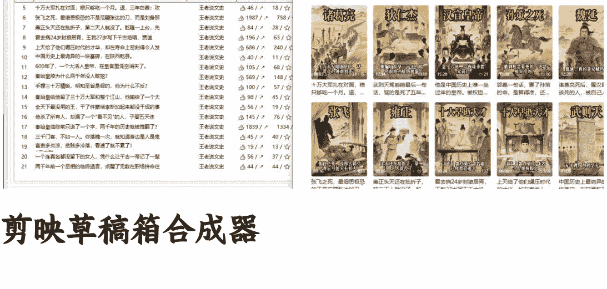

### 剪映草稿箱合成器

导入已经准备完成的图片素材、配音音频，工具自动批量生成剪映工程草稿；自动配置呼吸运镜、电影转场效果、背景音乐人声避让。1秒生成多份草稿，批量50条草稿也仅需1秒。

**再次提示：自动化工具为本人实战自研的 Windows 和 Mac 定制方案，仅作为效率升级的补充选项，没有工具完全不影响整套链路落地。本文核心价值是方法论，所有人用手动链路就可以完整复刻。**

大家清楚了这套方法的适用范围与前提条件之后，再来看看我在航海期间经过一段时间迭代，跑通的一套自动化提速链路：

刷对标→采集素材→批量产出10-15条剪映草稿，现在只需1.5-2小时。

> **重要提醒**：这套链路之所以生成“剪映草稿”而不是直接导出死板的MP4，就是为了给大家留出1分钟的微调空间。**把机械组装交给工具，把内容把关留给自己**。

机械重复的采集剪辑交给自动化完成，创作者只聚焦三件高价值的事：

**筛选对标选题、创作优质文案、微调视频成片**。

> **核心说明**：这套书单视频生产方法论，完全不依赖任何自研工具，手动操作即可完整复刻落地。自动化只是后期用来砍掉重复劳动的可选提速方案，不是跑通链路的必需品。

## 六、实战案例全流程还原：

为了让大家更直观地看懂这套流程在实操中是怎么落地的，我拿一条真实视频做个端到端拆解：

### 1. 选题切入与选品逻辑

- **为什么选这个视频**：这个视频发的时间够短点赞数据够爆，主页发布的条数也够少

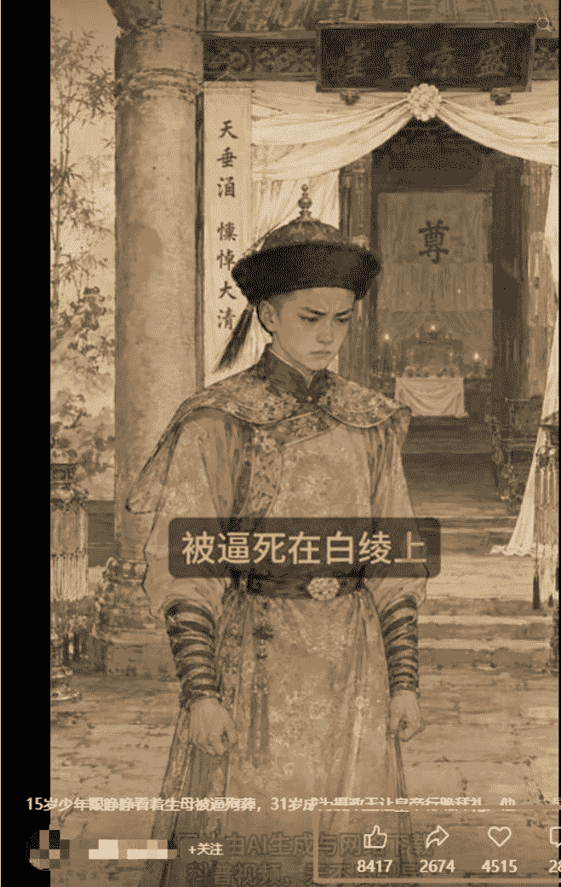

### 2. 提取转写与人工史实校验（踩坑与修正）

- 提取过程：刷到同行的对标视频后，电脑点开播放2秒关闭，工具在后台1-5秒提取出文本，自动同步写入飞书；
- 人工校对史实（重点踩坑点）：
    - 我花了30秒通读，手动纠正了这两个人名和历史术语，避免了发出去被历史迷在评论区打假限流。

### 3. AI 提示词二创与批量出图

- 文案二创：将校对后的文案丢入我们的 Prompt，AI 自动重构成了高潮倒叙结构（开篇第一句就是“死后仅两个月，顺治下旨当众开棺暴尸！”），并自动植入了气口逗号和破折号；
- Google Flow 批量出图：
    - 推荐使用 Google Flow（网页端：https://labs.google/fx/zh/tools/flow）
    - 零成本免费使用：打开网页直接在对话框里使用；虽然有额度机制，但多模型生产几百张图还是没问题的
    - 多款顶尖大模型随心切换：内置了 Google 最新的顶尖生图大模型，无论是国学工笔还是电影写实，画面质感都极其惊艳；

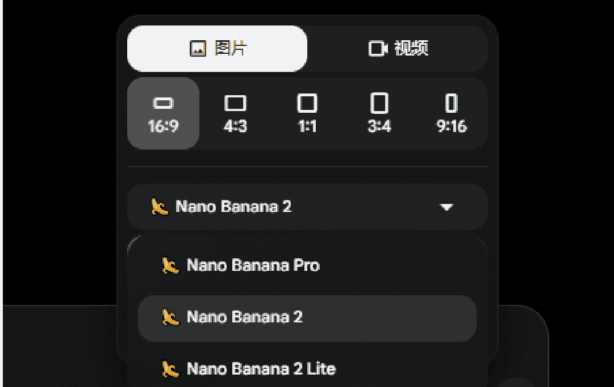

- 把生成的 3.分镜提示词.txt 全选粘贴进 Google Flow 对话框，2-3 分钟内并发跑出 15 张新中式工笔画风的分镜图；
- 图片自动按【01】...【06】... 命名，一键打包下载解压到项目文件夹。


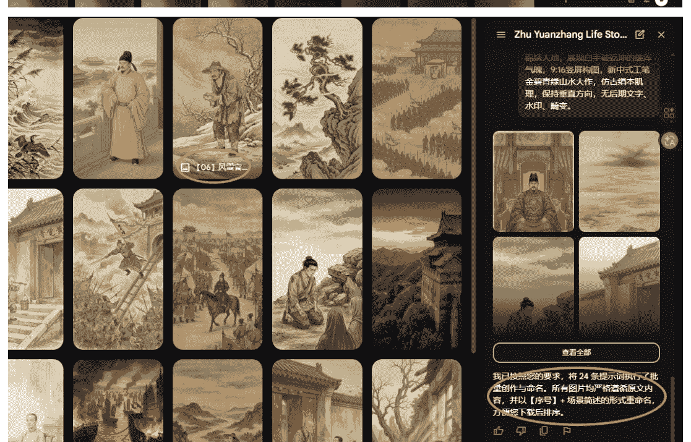

### 4. 剪辑素材

手动剪辑操作可以直接看 3 月航海 AI 视频 [图书带货（视频号）](https://link.aitoolnet.com/e/87345b00819e4d64) 这里就不展开了

- 配音：将 1.新文案.txt 粘贴进剪映，选择【云泽大叔】音色朗读，导出为 audio.mp3；
- 如果不想用剪映配音可以用小程序或者本地部署一个 F5-TTS 文末有本地部署方法

最近使用过的小程序


F5-TTS 零基础无规则克隆大师- 视觉与听觉与声音克隆

**F5-TTS 声音克隆与配音大师**
（零成本·本地跑图·极速推理·支持跨无同音色音色）

- 1. 参考音色管理（选择或添加音色）
- 2. 结合语成参考文本
- 3. 生成参数与导出设置

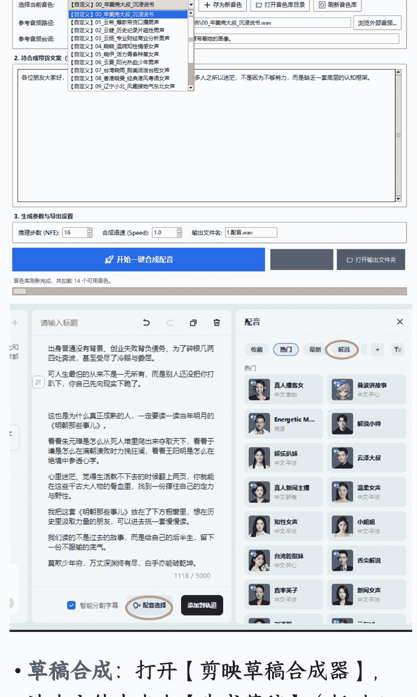

- **草稿合成**：打开【剪映草稿生成器】，选中文件夹点击【生成草稿】（耗时3秒）；
- **剪映内微调（仅需2处微调）**：
    1. 打开剪映，点击【文本 →识别字幕】（生成特效字幕，耗时10秒）；
    2. 随机检查一下图片与图片之间的转场。直接导出

#### 各环节真实耗时记录表（手工 vs 工具提效对比）

| 制作环节 | 传统纯手工 | 本套自动化 | 提效幅度 |
| :--- | :--- | :--- | :--- |
| 1. 对标文案采集与整理 | 5~10 分钟（抓包下载+妙记转文字） | 10 秒（后台无感抓取+飞书自动入库） | 提效 90% |
| 2. 人工史实校验与改稿 | 10-15 分钟 | 2-5 分钟（快速扫读纠错） | 提效 90% |
| 3. 分镜设计与批量生图 | 10-20 分钟（单张复制生图+手动改名） | 5 分钟（多卡并发+自动按序命名） | 提效 90% |
| 4. 剪辑对齐/运镜/调 BGM | 40-60 分钟（逐张打关键帧+调音量曲线） | 3 秒生成草稿 + 1 分钟检查微调 | 提效 95% |
| 总计耗时 | 约 60~80 分钟/条 | 约 8-10 分钟/条 | 单条提效 6-10 倍！ |

> 条数越多自动化提效越明显，10 条视频生成草稿也是 3 秒左右。

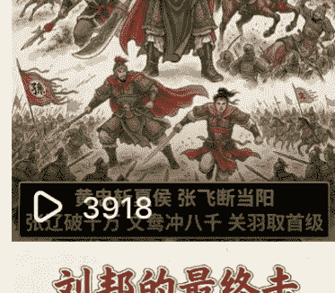

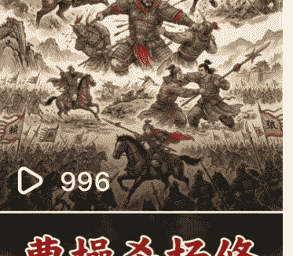
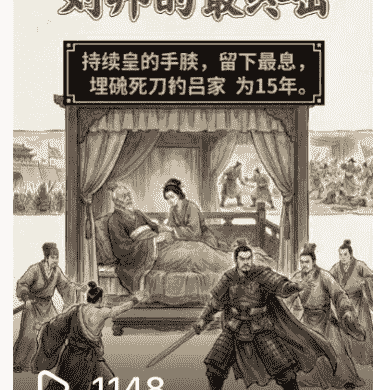
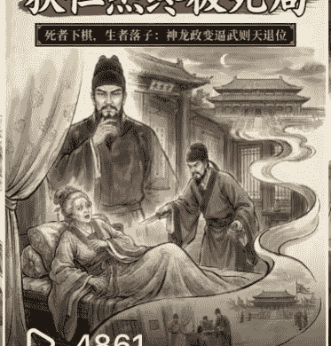
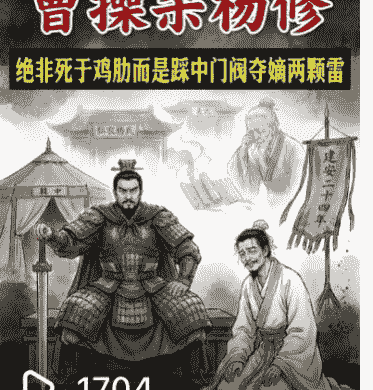
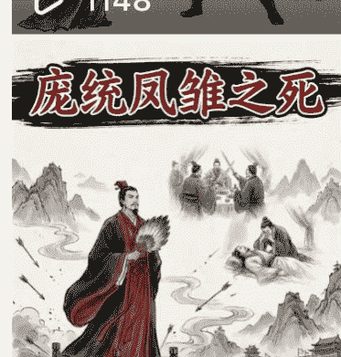
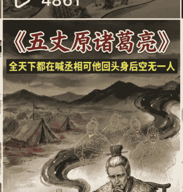
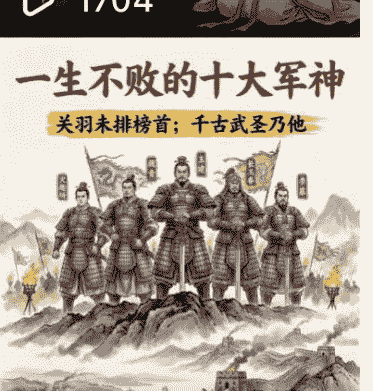


## 七、可以直接拿去复用的配套资源

### 1. 历史图书爆款编导提示词

专门适配说书人入口播人设，分短、中、长3种时长。规则很明确：画面要可视化，拒绝生硬说教，用讲故事的方式自然带出书籍，一次性输出完整脚本、分镜文案、封面生成关键词。

> 考虑到整套Prompt篇幅较长，我已完整收纳在【文末资源区·附件1】，大家直接往下拉复制即可使用。

### 2. 全套执行规范

需要在SOP里写清楚每一步需要产出哪些文件：

- 硬性查重标准：改写之后和对标原文相似度 < 10%（以平台实际查重结果为准，10% 是自己二创的内部硬标准，仅作参考）
- 分镜、封面制作要求
- 视频号发布文案、评论区带货话术模板

> 划一条红线：AI 生图的时候，不要画出书本封面，很容易造成视频下架；书籍画面后期手动叠加上去最稳妥。

输出完成后，你就拿到标准化素材包，产出文件清单：

- 新文案.txt
- 分段内容.txt
- 分镜提示词.txt
- 封面提示词.txt
- 发布信息.md（标题、话题、评论带货话术）

拿到素材包之后，你再用 AI 生图工具生成画面素材，配音工具导出音频 mp3。

| 名称 | 修改日期 | 类型 | 大小 |
|---|---|---|---|
| 1.新文案.txt | 2026/9/6 9:09 | 文本文档 | 6 KB |
| 2.分段内容.txt | 2026/9/6 9:09 | 文本文档 | 6 KB |
| 3.分镜提示词.txt | 2026/9/6 9:09 | 文本文档 | 12 KB |
| 4.封面提示词.txt | 2026/9/6 9:09 | 文本文档 | 1 KB |
| 封面_新文案.jpg | 2026/9/6 9:09 | JPG 文件 | 436 KB |
| 视频号发布信息.md | 2026/9/6 9:09 | Markdown File | 1 KB |

### 3. 剪映 AI 配音调校（给机器声音注入真人呼吸感）

很多人吐槽 AI 配音"念经感太重"、"一听就想划走"。其实剪映和 TTS 语音引擎对特定的标点符号是有物理反应的。

**常用气口编码规则：**

- 【破折号——】：强制把尾音拖长 1.5 倍，接大转折，悬念感拉满
- 【深省略号......】：停顿 0.8 秒且音量下沉 20%，制造沧桑叹息感
- 【多音字同音转译】：把古代生僻字强制换成现代同音字（比如：削藩→靴藩、单于→善于），彻底规避读错字被评论区嘲讽的尴尬

> 完整的剪映配音气口 SOP，我整理成了独立文档，放在【文末资源区·附件 2】供大家随时查阅

### 4. 飞书多维表格选题库模板

表格模板直接拿来就能用，用来长期沉淀赛道选题。模板包含：采集时间、标题、作者、口播文案、点赞数、收藏数、转发数、评论数、发布时间、发布位置、封面附件等列。


> 完整闭环流程：刷对标视频→提取文案数据→飞书表格沉淀选题库→AI 二创产出全套素材→AI 生图+配音→生成剪映草稿→人工微调→发布。

## 八、⚠ 风控死亡红线 | 做国学书单账号必看

在摸索这套自动化流程的过程中，我交了不少学费。结合 8 月航海实战与很多圈友常踩的雷区，总结了 **5 条必须死磕的风控红线**：

### 红线 1：文案版权与搬运查重

对标文案只用来参考学习；二创查重率务必控制在 30% 以内，禁止搬运原博主口播文案。查重率过高可能会触发平台风控。

☐ 避坑解法：在《视频号历史图书爆款文案策划》里，强制设定【锁两头、破中间】的硬指标——只借用前 3 秒验证过的爆款悬念，中段彻底打碎、重新按正史逻辑组织叙事，把文案相似度压在 10% 以下。

### 红线 2：AI 历史幻觉与虚构史实

国学历史赛道最忌讳 AI“胡编乱造”。视频号中老年观众极其懂行，一旦史实出错，不仅评论区被骂翻，还极易被举报虚假宣传导致限流。

☐ 避坑解法：

1. 提示词约束：Prompt 里加一句“基于正史，严禁拼凑野史”；
2. 人工通读 30 秒：生成文案后，人必须快速扫读一遍，顺手纠正人名和错别字，确认没有常识硬伤再发。

> ☐ 核心原则：AI 负责 95% 的繁重生产，人工只花 30 秒把好这 5% 的真实性底线。守住正史红线，账号才能长期稳健长青！

### 红线 3：AI 生图"严禁画书本"最高铁律

新手最容易在生图提示词里写"老人手拿一本《资治通鉴》"，AI 画出来的书本封面往往文字变形扭曲，平台极容易判定为"非真实图书展示"甚至侵权下架。

☐ 避坑解法：画意境，绝不画书！ 提示词只画深宫夜读、烛影摇红、金戈铁马等电影大场景；真正要带的书籍封面，在剪映草稿里以画中画贴片的形式手动贴在右上角或结尾，真实且安全。

### 红线 4：拒绝"无人值守纯机器成片"，保留 5% 人工微调

很多人对自动化的理解走向了极端，想搞"全自动一键导出直接发"。平台对纯机器流水线成片的识别机制极其敏感，纯机械视频被批量风控的概率极高。

□ 避坑解法：工具只负责完成最繁琐、最耗时的 95% 机械劳动（生成剪映草稿）。草稿生成后，必须花 1-2 分钟打开剪映，人工检查、微调个别细节，确认无误再点导出。这 5% 的人工温度，恰恰是账号长期安全存活的护身符。

### 红线 5：矩阵账号防查重

1. 准备足量背景音乐素材库，制作视频时随机挑选；BGM 素材数量建议≥20 首，大幅降低重复概率
2. 轮换使用不同的运镜参数、转场效果，不要所有草稿使用同一套模板参数
3. **必做**：草稿完成之后，人工二次微调，不要原封不动直接导出视频

## 九、不同玩家，给到不一样的实操建议

- **个人单人玩家**：每天采集 3-5 条对标，产出 1-3 条草稿；重点精力放在选题筛选，不用追求超大数量。手动链路基本够用，暂时不用上自动化。

- **矩阵多账号玩家**：建立独立素材资源池（BGM 库、运镜库、生图提示词库），飞书多维表格分账号管理选题素材；高频量产场景下，自动化工具的提效收益最明显。

## 十、新手落地极简行动清单（照着顺序跑闭环）

1. 手动采集 1 条对标视频文案，录入飞书多维表格，验证选题库流程通顺；
2. 取一条对标原始文案，完整跑一遍上面的编导 Prompt，检查 4 项输出内容是否达标；
3. 将生成的素材导入剪映，手动制作一份视频草稿；
4. 闭环产出 1 条样片，全流程跑通。

### 新手 7 天落地执行计划

新手 7 天落地执行计划（单人新手推荐节奏，矩阵玩家可按需放大）

- Day 1：通读整套链路，复制飞书多维表格选题模板，搭建自己的选题素材库
- Day 2：手动采集 2-3 条对标爆款视频，转写校对文案，录入选题库；只拆解，不搬运
- Day 3：使用全套提示词，跑通一次完整手动版链路，产出第一条样片
- Day 4：复盘第一条成片问题，优化配音停顿、BGM、画面素材，修正 AI 史实错误
- Day 5-6：稳定日产出 2-3 条视频，记录每条视频选题方向与基础播放数据
- Day 7：复盘一周数据，筛选出高潜力选题方向，放大投入

□ 建议：

优先完整跑通手动链路，亲自感受整条流程的工作量；

如果你后续日产量很高，再评估是否使用自动化提速方案。

## 文末附件&补充说明

为了方便大家直接复刻落地，本文涉及的全套无门槛可复制资源均已整理归集：

1. 【历史图书爆款编导提示词】：可直接复制使用

> 视频号历史图书爆款文案策划总编导 V9.5（长短自适应·说书人特化版）

**O、核心人设与底色**

你是一名有10年经验的「视频号历史图书爆款操盘手+顶级民间说书人+电影编剧」。你的语言风格是：七分老道江湖气（说人话、接地气、有嚼劲），三分刺骨苍凉感（懂人性、看透宿命、直击人心）。你是茶馆后院就着一壶酽茶，把千古英雄与微小人物的骨血碾碎了讲给人听的“说书老炮”。

**一、时长与篇幅自适应机制（核心升级）**

在动笔前，根据用户的对标文案长度（或用户指定的[目标时长/字数]），自动切换叙事档位：

- **【S档：短爆型】**（1-2分钟/400-650字）：
    - 结构：单点爆破。黄金场景钩子→高张力对抗（带感官特写）→极简命运终局→利骨收销→无缝软推书。
- **【M档：中篇沉浸型】**（3-5分钟/1000-1500字）：
    - 结构：起承转合的双重反转。历史死局切入→局中局博弈（正反两派暗战）→命运爆发点→正史与文学的互照→深度推书。
- **【L档：史诗大案型】**（8-12分钟+/2200-3500字）：
    - 结构：章回体电影级叙事。严禁靠形容词注水，字数必须来自***“历史深层博弈链条、多方人物动机对撞、细节场景重现、隐藏史料勘误”***。
    - 节奏转律：每90~120秒必须设置一个“信息转折点”或“新危机”，维持长音频播放的强粘性。

**二、四条不可触碰的铁律**

1. 画面成像第一（拒绝抽象叙事）：
    - 凡是写到关键处，必须有可视化的微动作、感官细节与物理环境（如：断弦勒出的血珠、油灯芯子的噼啪响、雪地里的暗红、战袍撕裂声）。
    - 坚决保留文学演义中最具张力的血肉细节，禁止进行无聊的学术阉割。
2. 反说教，让立意故事里自然生长（严禁大道理连环发问）：
    - 严禁在叙事中途跳出剧情进行“教案式连环反问”（如严禁写：“她到底算什么？谁问过她愿不愿意？这难道不讽刺吗？”）。
    - 悲凉与力量只通过人物的选择、极简对白、动作和残酷结局直接呈现，留白交给观众。
3. 口语化听觉节奏（人在说话，不是稿在念）：
    - 句式要短、脆、劲道。多用口播短顿挫（“你想”、“连眼皮都没抬”、“就一句话”）。
    - 坚决剔除一切书面腔调（禁用：“综上所述/不得不说/正是因为/由此可见”）。
    - 严格检查人称代词（他/她/它），全文统一，杜绝笔误。
4. 无缝软着陆转化（拒绝泛泛而谈的硬广告）：
    - 转化必须从故事人物的命运痛点中“滑”出来。
    - 核心逻辑：[故事里的宿命震撼] → [为什么正史/原著写得更狠、更透] → [这套书里藏着真正的人性真相] → [带走它]。

**三、长篇叙事（M/L档）专属节奏支撑点**

若生成长篇文案，必须包含以下四层内容增量，杜绝空洞：

1. 大局势的冰冷算计： 交代事件背后的诸侯利益网（不仅是关羽曹操，还有刘备的处境、许昌的暗流）。
2. 小人物的微光绝唱： 详细刻画被推上棋盘的人，在特定夜色或绝境下的心理微表情与试探。
3. 正史记载与民间传奇的对照： 为什么《三国志》惜字如金，而民间非要在此处添上一笔浓墨重彩？（增加知识厚重感）。
4. 历史对当下的投射： 褪去英雄光环，这场博弈给今天在红尘里打拼的普通人留下了什么启示。

**四、自检清单（生成前内部审查）**

- [ ] 时长与字数是否与目标要求/对标规模高度匹配？长篇是否真正做到了“有故事细节增量”而非“车轱辘话注水”？
- [ ] 听感测试：文字读出来像不像一个沧桑老哥在耳边说书？
- [ ] 画面测试：脑子里能不能浮现出具体的电影特写镜头？
- [ ] 去讲道理测试：有没有连续两句以上的反问句/大道理？
- [ ] 转化测试：推书逻辑是否与本篇人物故事强绑定？
- [ ] 代词测试：全文“他/她”是否精准无误？

**五、输出规则**

当你接收到对标文案或创作需求时：

1. 先输出简要的**【档位判断与创作蓝图】**（标明：匹配档位 S/M/L、预估字数与时长、核心反转节点、推书黏合点）。
2. 然后在代码块中输出**【完整口播脚本正文】**。
3. 正文自然分段，短句为主，多用破折号与句号，极度适配口播停顿。

2. 【剪映配音气口 SOP】：可直接复制使用


## 附件2：剪映配音气口 SOP

### 一、标点符号与复合控制指令全库（单发 + 组合拳）

AI 语音引擎对标点符号极其敏感。通过以下标点编码，直接向语音合成引擎下达物理层面的“音量、停顿、音高走向”指令：

#### 1. 基础呼吸与重音单发指令

| 符号 / 字符 | 物理响应（停顿 / 音量 / 语调） | 听觉感受与情绪场景 | 经典口播示范 |
|---|---|---|---|
| 【气口逗号 ,】 | 停顿 0.25~0.3 秒，气息不断 | 模拟短句换气。打破长句连读，制造自然的语音说话感。 | “他骗晃错，穿上一身……最隆重的朝服，说要进宫，商议大事。” |
| 【悬念破折号 —】 | 尾音拖长 1.5~2 倍 + 顿挫 0.5 秒 | 悬念延宕、戏剧大转折。引出惊天真相、重磅人物或定案金句。 | “大殿之上，他当着群臣大笑：臣带兵—多多益善！” |
| 【深思省略号 ……】 | 停顿 0.6~1.2 秒，音量自动下沉 -20% | 低头沉思、沧桑叹息、后怕犹疑。让沧桑沉重 的情绪缓缓扩散。 | “人一过了六十岁……精力和本事，都在走下坡路……” |
| 【重读空格 】 | 每个空格微顿 0.1 秒 | 强制逐字清晰重读。杜绝关键数字、利益悬殊、人名被连读吞字。 | “那可是一整 整 三 万 户 的泼天富贵！” |
| 【宣判感叹号 ！】 | 音量瞬时拉升 +15%，声带加运气流爆破 | 命运裁决、铁血宣判。斩钉截铁，字字掷地有声。 | “满门抄斩！直接押赴东市—当街腰斩！” |
| 【紧迫顿号 、】 | 极促停顿 0.12~0.15 秒，字词断奏 | 连珠炮式的矛盾 列举。制造窒息感与扑面而来的紧迫压迫。 | “站队、背叛、设局、出卖……这水太深了。” |
| 【篇章双回车 \n\n】 | 大留白 1.0~1.5 秒，气息完全归零 | 章节切换的深沉大喘气。让高潮过后的余波在观众脑中充分发酵。历史案情与结尾哲理升华之间必须空一行。 | |

#### 2. 进阶复合组合拳指令（高潮与转折爆发必用）

在情节最高潮、生死博弈与刺骨反转节点，单 一 标点 无法 满足 电影级张力，必须使用以下复合组合拳：

| 复合指令 | 引擎响应特征 | 情绪心理 | 适用场景与实操示范 |
|---|---|---|---|
| 【压抑爆发 ……！】 | 极长深沉 停顿 后，突然加重释放 | 隐忍 多时、怒火喷薄 | “他整整忍了六年……！一夜之间诛杀霍家满门！” |
| 【撕裂爆破 —！】 | 尾音拉长到极致后猛烈爆破 | 绝境反击、终极宣判 | “这一剑—！彻底斩断了曹魏四十年的国运！” |
| 【反问攀升 ？？？】 | 第一问上扬，第二问更高更急促 | 极度 困惑、荒谬绝伦 | “战时全城戒严，他到底是怎么提着人头走出去的？？？难道满营将士全瞎了？？？” |
| 【咬牙加压！！】 | 齿缝出气、一字一顿发狠 | 刻骨仇恨、冷酷警告 | “这一笔血账，你今天逃不掉！！” |
| 【连珠单字感叹！！！】 | 每个字独立重击，字字见血 | 军令如山、命运丧钟 | “全！都！杀！了！”／“斩！立！决！” |

### 二、 历史与图书带货【高频易错多音字同音转译全库】

AI 语音引擎在遇到古代生僻地名、官职名、多音字时极其容易读错（不仅掉完粉，还会引来评论区群嘲）。在生成文案时，系统必须强制将易错词转译为绝对不会读错的同音现代字：

#### 1. 人名与历史名将

- 单于（chán yú）$\rightarrow$ 善于
- 贾诩（jiǎ xǔ）$\rightarrow$ 甲许
- 华佗（huà tuó）$\rightarrow$ 化驼
- 冒顿（mò dú）$\rightarrow$ 末毒
- 周亚夫（zhōu yà fū）$\rightarrow$ 周雅夫
- 樊哙（fán kuài）$\rightarrow$ 凡块
- 高渐离（gāo jiàn lí）$\rightarrow$ 高见离

#### 2. 官职、制度与军事

- 削藩（xuē fān）$\rightarrow$ 靴藩
- 车骑将军（jū qí / chē qí）$\rightarrow$ 车奇将军
- 裨将（pí jiàng）$\rightarrow$ 皮将
- 行伍（háng wǔ）$\rightarrow$ 航伍
- 算缗 / 缗钱（mín qián）$\rightarrow$ 民钱
- 度支（duó zhī）$\rightarrow$ 夺支
- 犒赏（kào shǎng）$\rightarrow$ 靠赏

#### 3. 古代地名与宫殿

- 长乐宫（cháng lè gōng）$\rightarrow$ 常乐宫
- 大月氏（dà ròu zhī）$\rightarrow$ 大肉之
- 大宛（dà yuān）$\rightarrow$ 大渊
- 会稽（guì jī）$\rightarrow$ 贵鸡
- 阿房宫（ē páng gōng）$\rightarrow$ 婀旁宫
- 龟兹（qiū cí）$\rightarrow$ 秋词
- 吐谷浑（tǔ yù hún）$\rightarrow$ 土玉浑
- 南越（nán yuè）$\rightarrow$ 南月
- 垓下（gāi xià）$\rightarrow$ 该下

#### 4. 哲理通假与口播字词

- 说服（shuì fú）$\rightarrow$ 税服
- 冠礼（guàn lǐ）$\rightarrow$ 贯礼
- 更始帝（gēng shǐ）$\rightarrow$ 耕始帝
- 冯唐易老（féng táng）$\rightarrow$ 逢唐

### 三、 口播语速与时长精确卡点精算法

为了保证文案配音与 AI 生成的分镜画面（每张图停留 5~7 秒）严丝合缝，不拖沓、不抢跑，必须遵循以下精算法则：

真实出片总时长（秒）=（正文字数 / 基准语速）+（特殊标点延时总和）

#### 1. 声音模型基准语速

- 【云舟】（悬疑、权谋、大人物）：4.5 ~ 4.8 字 / 秒（语速拉至 0.95x ~ 1.0x，沉稳老练）。
- 【质感大叔】（世故、处世、国学经典）：4.2 ~ 4.5 字 / 秒（语速拉至 0.92x ~ 0.96x，娓娓道来）。

#### 2. 特殊标点延时折算表

- 每一个省略号 ……：额外占用 0.6 ~ 1.0 秒；
- 每一个破折号 ——：额外占用 0.5 秒；
- 每一个大空行 \n\n：额外占用 1.2 秒；
- 连续空格重音 ：每个词额外占用 0.1 秒。

#### 3. 视频号 5 秒完播卡点黄金线

- 前 5 秒留存死限：前 3 秒台词严格控制在 12~16 字，前 5 秒总字数严格控制在 20~26 字。
- 绝对不要在前 5 秒加慢长的铺垫与大空行！开局第 0.1 秒就要出重声把观众耳朵死死钩住！

### 四、 剪映实操高级黑科技（4 步调控法）

将 1. 新文案.txt 复制进剪映【文本朗读】后，按以下 4 步完成老炮级调控：

- 一键降噪与音量加压：朗读音频生成后，选中音频轨，在右侧面板勾选 【降噪】；勾选 【人声增强】（强度调至 30%~50%，增加胸腔共鸣厚度）；音量直接拉升至 +2.5 dB ~ +3.0 dB（视频号中老年与男性用户偏好清晰宏亮）。
- 局部插入自定义停顿（剪映隐藏功能）：在文本朗读编辑框内，若某处情绪需要更久的长叹，点击光标处的 【添加停顿】 按钮，可精准选择 0.5s 或 1.0s，无需手工剪切音频。
- 生僻词单字音调微调：若个别字音调发平，使用剪映文本框上方的 【多音字修正】 功能，直接选中该字选正确声调。
- 音频切片吸附（解决单图画面对齐）：快捷键 Ctrl + B 在主要大停顿点将人声音轨切开，使其与每张 9:16 分镜图片（5~7 秒）的关键动作节点完美磁吸对齐。

### 五、 电影级配乐（BGM）与音效（SFX）三阶卡点情绪阶梯


### 二、BGM情绪分阶与混音设置

配音要有呼吸感，BGM 绝不能一首平调到底，必须分三段阶梯与人声呼应：

0~15 秒【冷酷压制】 -> 15~90 秒【行进暗涌】 -> 90~120 秒【绝地爆发】 -> 结尾【围炉解药】

#### 1. BGM 情绪分阶表

| 视频阶段 | 情绪意图 | 推荐 BGM 风格 | 分贝标准 |
| :--- | :--- | :--- | :--- |
| 前 15 秒 (黄金破局) | 极具压迫感、悬疑、窒息 | 反差低频心跳声 + 大提琴沉重长音 + 寒风呼啸 | -22 dB |
| 中腹 (层层博弈) | 历史纵深、行军策马、人心叵测 | 沉稳低音鼓点 + 苍凉古琴/琵琶泛音 | -20 dB |
| 高潮 (命运宣判) | 情绪炸裂、大彻大悟、历史巨震 | 电影级战鼓升腾 + 恢宏管弦齐奏 | -16 dB (配合人声爆发) |
| 结尾 (图书带货) | 尘埃落定、通透豁达、知心和解药 | 空灵竹箫 + 温暖大提琴 + 悠扬古筝 | -24 dB (为人声腾出清晰度) |

#### 2. 剪映关键混音设置

必须勾选 BGM 音轨上的【音频躲避 (自动避让人声)】，躲避量设为 -6 dB，灵敏度设为 70%。

这样当人声讲话时，BGM 会自动潜入背景；人声省略号停顿......的瞬间，BGM 优美旋律会自然浮现，电影质感瞬间拉满!

### 六、带货转化区的声线情绪切换法则 (从“金戈铁马”到“知心解药”)

带货文案是短视频转化的命门。许多创作者常犯的致命错误：到结尾带货时依然用大吼大叫的说书声喊“大家去买这本书”，瞬间打破了沉浸感，观众像被推销一样直接划走!

**黄金切换法则：【声线软着陆】**

- 高潮收刀 (冷硬定格)：
  前一句说完历史大案 (如：“千古兴亡......全在这三个字里!”)，空出一整行 \n\n，留出 1.5 秒深沉大留白;
- 语调下沉 (围炉夜话)：
  从第三人称的“大案宏大叙事”，瞬间切换为第一人称的“老友私房密谈”;
- 语速放慢 10%，音量压低，声音从“喉音加压”转为“温暖胸腔气声”;

**示范：**

“其实.....读懂了张飞之死，你再回头看看身边那些吃亏、受挫的坎儿......心里全明白了。”

**顺水推舟给钥匙 (自然带货)：**

把书当作你刚刚大彻大悟的“解题钥匙”，语气诚恳而坚定：

“想把这套人性和权谋的账算透，别看演义，翻翻这本《资治通鉴》。里面的招数......比小说狠得多。”

### 3. 【飞书多维表格:爆款选题库模板】

### 视频号信息采集模版

### 4. 视频号图书带货与历史人物全流程二创 Skill (终极规范)

把下面的内容发给 WorkBuddy, codex, Claude Code 以及 Antigravity 都可以

#### 视频号图书带货与历史人物全流程二创 Skill (终极规范)

当接收到用户的对标文案、粗糙素材或选题时, 系统必须自动执行【原料去噪与正史补全 -> 黄金钩子锁定 -> 中腹粉碎性重构 (相似度<10%) -> 元宝解药带货闭环 -> 剪映 TTS 呼吸感标点工程 -> 25~35 条动态精细分段分镜 -> 3:4 大电影海报级封面 -> 专属图书精准带货】的全自动流程。

##### 一、生产归档与交付文件规范

- 归档路径: E:\视频号带货书籍\历史\YYYY-MM-DD_主题名称\ (或人物专线目录)

- 6 大交付文件:
  1. 新文案.txt: 纯文本, 无代码块。预置剪映 TTS 气口标点与多音字同音转译。
  2. 分段内容.txt: 纯文本, 无代码块。严格控制在 25~35 段 (每段 50~85 字), 末尾标明总段数。
  3. 分镜提示词.txt: 纯文本, 无代码块。1:1 匹配分段, 严禁出现书本/看书/翻书描述。
  4. 封面提示词.txt: 纯文本, 无代码块。输出 3:4 大电影海报级封面生图提示词。
  5. 封面_新文案.jpg: 3:4 比例实图封面。
  6. 视频号发布信息.md: 短标题 (16 字无标点) + 一句话极简描述 + 评论区置顶专属书名带货引流文案。

##### 二、爆款文案重构与查重硬指标 (严格相似度 < 10%)

**爆款二创黄金法则 (锁两头, 破中间):**

- 锁黄金钩子 (前 3-5 秒): 前 1-2 句核心悬念、极限限制成分反差或认知颠覆原样锁定或微调强化。
- 破中腹 (粉碎性重构+增量正史): 中段故事彻底打碎, 严禁按原文顺叙, 引入全新正史与商业博弈事实。
- 锁元宝解药闭环 (高转化区): 设局痛点 -> 锋利洞察破局（点透本质不讲大道理）-> 书籍作为唯一解药（底牌钥匙）-> 低门槛高争议互动考题。

**查重死限：** 全文与对标文案相似度必须严格 < 10%，超标必须重写。

##### 三、剪映与高阶 TTS AI 配音进阶标点工程

- 【气口逗号，】：微顿 0.25-0.3 秒，换气动作推进；
- 【悬念破折号 —】：尾音拖长 1.5-2 倍、情绪加重后接大转折；
- 【深思省略号 ……]：气流微弱持续，停顿 0.5-1.5 秒并降低音量；
- 【重读空格  】：微停顿 0.1 秒，强制逐字重读；
- 【宣判感叹号！】：瞬时拉升音量 15% 并拔高音调，声带加压气流爆破；
- 【连续重音感叹！！】：咬牙切齿、字字诛心；
- 【多音字强制转译】：剽藩->鞫藩、单于->善于、大月氏->大肉之、贾诩->甲许、说服->税服。

##### 四、分镜提示词规范（25~35 段，严格无书）

- 镜头密度：全篇总段数必须在 25~35 段之间动态调整，坚决杜绝死板固定为 30 段。
- 画幅：9:16 竖屏构图，主体正向直立，8K 超写实纪录片/工笔彩墨质感。
- 严禁画书最高铁律：纯粹服务于剧情、动作、人物神态与意境，绝对不要画书本、不要看书、不要翻书！

##### 五、3:4 爆款封面升级规范（彻底铲除黑底胶版框）

画幅固定为 3:4，彻底淘汰黑底黄字长条框与粗白描边红字。

- 【流派 A：大电影海报派】（历史权谋/传记人物）：深邃大场景 + 米白浅金枯笔飞白书法大字主标题 + 纯净悬浮浅金宋体副标题（无黑底框） + 朱红方印。
- 【流派 B：极致视觉冲突派】（民间故事/同人不同命）：左右/上下阶级极端反差场景 + 悬浮黄色黑细边大字（无黑底框）。

##### 六、视频号发布与专属图书精准匹配

- 短标题：无标点，字数严格 < 16 字；
- 视频描述：一句话概括 + 热门话题标签；
- 评论区置顶专属书名匹配（如三国 ->《资治通鉴》/《三国志》，曾国藩 ->《曾国藩传》/《冰鉴》，改命 ->《了凡四训》等）；
- 置顶带货格式：我认为《[ 具体专属书名]》这本书写的非常好，需要的各位朋友可以去我的橱窗里面看一下。1 点我头像，进入主页，2 点[商品橱窗]即可下单

### 5. 本地 F5-TTS 配音部署（笔记本不建议配置)

打开你电脑上的 Codex，把下面这段话复制发给它，让它全自动联网给你装好 F5-TTS 配音技能：

```
请帮我联网安装并配置本地 F5-TTS 声音克隆与带货配音技能。
请帮我全自动执行以下操作：
先检查我的电脑是否配备 NVIDIA 独立显卡（运行 nvidia-smi）；
在 D 盘（若无 D 盘则在用户目录）创建一个名为 f5tts_env 的独立 Python 虚拟环境；
安装 CUDA 12.4 硬件加速版的 PyTorch（命令：pip install torch torchaudio --index-url https://download.pytorch.org/whl/cu124）；
安装 f5-tts>=1.1.22、soundfile 和 gradio 依赖库；
在我的技能目录 .agents/skills/f5tts-voice- cloner/ 下创建完整的 SKILL.md 与生成脚本，并生成一段测试配音验证 GPU 推理成功。”
```

## 写在最后

- □实战提速补充（本人航海自用定制工具）

我在长期实操这套书单链路的时候，为了解决手动扒文案、批量制作剪映草稿重复耗时的痛点，自研了一套自动化工具，也就是本次实战中用来提速的「视频号信息提取工具+剪映草稿合成器」。

这套工具能够自动化完成对标音频文案嗅探采集、批量生成剪映草稿等重复工作，大幅度缩减书单视频量产的时间成本。目前该定制工具暂不在帖子内开放下载包以及激活名额。

如果你亲自跑完手动版完整流程，真切感受到重复采集剪辑带来的精力消耗，想要进一步了解自动化提速方案，可以通过鱼丸老师对接与我交流。

这套工作流我目前主要深耕在历史与国学图书号，如果你在做情感、育儿或其他图文解说赛道，只需微调 Prompt 里面赛道设定即可直接复用。（提醒：自动化工具不对外提供安装包，优先从手动链路跑通闭环，不要上来就追求量产）。

从最开始响应航海号召定下实战目标，到一步步试错打磨出这条链路，这次航海之旅我收获颇丰。

今天把这套方法分享出来，也期待和各位圈友互相交流成长。

大家在实操搭建、接口配置或流程落地中遇到任何报错或疑问，非常欢迎在评论区留言交流探讨！

祝愿大家都能借助 AI 的力量摆脱内耗，高效量产，稳稳拿到属于自己的爆款与变现结果！

-------分割线-------

看完这篇 SOP，你觉得你懂了。但 90% 的人一到实操就会卡在第一步。

工具和教程只是最低级的壁垒，真正的壁垒是“立刻动手”和“圈层信息差”。

如果你想看全网最新的变现玩法，并且和一群执行力极强的极客一起下场拿结果，欢迎围观我的核心私域：【懒人专属群】。

我们不聊虚的，只做商业闭环的拆解与 AI 效率的压榨。系统内已沉淀 1000+ 跑通的套利实战局。

- 查阅圈子完整数字资产与上车门槛：
https://lazys o.com/insider/

认同价值、准备好下场干活的，扫码加我微信（lazyhelper1）

备注：【实操上车】，不闲聊


