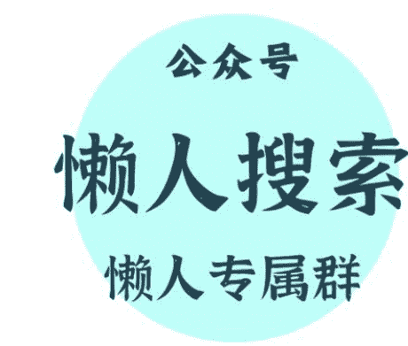
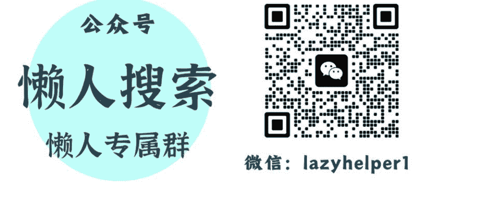

# 人与AI最好的模式：对抗性协作

**260911 猫哥**

整理：公众号懒人搜索，[懒人专属群](http://example.com)精选
懒人微信：lazyhelper1

微信：lazyhelper1

小懒判断 | 适合天天用 AI 但觉得回答平庸、想练提问功夫的人；不适合指望 AI 直接给答案、不愿动脑的人。最值得关注：用万科案例顶翻 AI“雷军做地产只能小而美”结论的完整过程，以及建框架→测反例→顶偏差→逼认错→升框架→问元认知六步循环。坑：AI 的元认知盲区短期无解，反例质量取决于你自己的知识存量，没存货就顶不动。

后台经常有人提问如何使用 AI 工具的问题，今天就分享我的感悟。

AI 是很好的工具，你越会用它，它就能给你创造更大价值，那么人与 AI 最好的合作模式是什么呢？我觉得是对抗性协作模式。

## 何为对抗性协作模式？

不是对抗 AI，而是用你的独立判断力去修正 AI 的输出，逼它：

- 暴露推理路径中的偏差（锚定、类比捷径、保守推断）。
- 用你已建立的框架重新拆解，而非另起炉灶。
- 给出“自我诊断”而非“安全回答”。
- 把一次结论沉淀为可复用的分析框架。

打个比方，这个过程类似导演和演员的关系，你就是那个有自己思想的导演，AI 是那个天赋极高但缺乏经验的年轻演员，你给它一个角色它能演，但演得比较套路。你得一遍遍跟它说不对、这个情绪不够真、再想想、如果是你亲妈遇到这事你会怎么想——反复磨，最后出来的表演才能直击人心。

我们还是用一个案例来拆解这个过程。

前段时间许家印的话题很火，全网嘲弄许家印的时候，我却认为，许家印的失败某种意义上是转型的失败，如果许家印转型造新能源汽车成功了，许家印就不会落到今天这个地步。

那么为什么雷军转型造汽车能取得成功，而许家印转型造汽车却是一地鸡毛呢？

我的思考结论是，房地产技术含量低，在高速增长时期容错率很高，但是汽车不一样，汽车产业链涉及几万个零部件，产业链整合难度极大，并且容错率极低——打个比方，干好房地产相当于小学生毕业就行了，但是要干好汽车必须是研究生毕业，房地产转型毕业去干汽车，如同小学生去做研究生的考卷，失败就是一种必然。

以上就是我对此认识的一个思想框架，我把这个框架放到 AI 跑了一下，AI 完全赞同我的观点，并且给出扎实的案例，除了许家印，其他房地产大佬去做汽车都失败。

到了这里，我突发奇想，给 AI 提出一个问题：

假如 21 世纪初雷军没有做手机，而是去干房地产会是什么结果?

AI 的回答是：应该是小而美，做精品公寓，每年大概几十亿营收，很难上规模。

面对 AI 的问题，我第一直觉就感觉问题很大。简单的逻辑是，小学生做研究生的答卷失败很正常，为什么研究生做小学生的试卷还不如小学生?

然后我思考了一下雷军做产品的基本模式是，单点爆品→标准化复制→规模放大，从手机到汽车都是这个路径。那么房地产是否有类似模式的企业呢?

有!

这个就是万科。

万科的起家模式就是在城乡结合部拿地，然后打造对白领有吸引力的房子（万科城市花园），然后在全国复制做大。

所以我马上就用万科这个案例去顶 AI，我认为你的结论不对，雷军做地产大概率会走万科的模式，万科能干到千亿规模，雷军也应该可以的。

然后，AI 就修正自己的结论，变成“雷军走万科路线可成科技版万科，千亿级合理”。

然后我继续追问，雷军搞地产你为何没想到另一个万科?

AI 承认自己“锚定偏差+对雷军能力建模不全”。

最后我继续追问，未来 AI 技术迭代是否能解决上述问题（锚定偏差+对雷军能力建模不全）？AI 给出答案是，信息检索的偏差未来可以解决 80% 以上，推理框架的偏差能解决 60%，但是元认知的盲区是无法解决的。

## 这个元认知的盲区是什么？

- AI 不知道自己“不知道”什么？
- AI 不知道自己的判断调用了哪个隐含前提。
- AI 不知道用户已经建立了框架自己没有调用。

这个元认知的盲区我的理解是 AI 思考模式与人类不一样，人类思考一个问题首先是建立一个整体的逻辑框架——比如我判断 AI 第一版给出结论有问题就是一种常识性框架——为什么研究生做小学生的试卷还不如小学生？

然后就能找到恰当的反例去怼 AI 的结论。而 AI 分析问题是有盲区的。

人与 AI 最好的协作方式就是找到盲区——最好的方法是找到 AI 结论的最硬的反例去顶 AI。比如我用万科去顶 AI 推演的雷军做地产只能小而美的结论。

## 现在我们可以总结一下，人与 AI 对抗性协作的六步循环：

1.  **建框架**：先独立给出分析维度（如“小学生/研究生”类比），不依赖 AI 起头。
2.  **测反例**：拿到 AI 结论后，主动想有没有一个反例能推翻它（如万科是不是反例）。
3.  **顶偏差**：把反例直接抛给 AI，要求它解释而非绕开。
4.  **逼认错**：要求 AI 定位错误类型（锚定/类比/保守/框架遗忘），而非泛泛你说得对。
5.  **升框架**：把修正后的判断回填进原框架，使框架更完整、更全面。
6.  **问元认知**：追问这个缺陷是数据问题还是架构问题、未来能否解决——把单次结论升到方法论。

通过上述的协作步骤你就会明显感受到 AI 后面给出的结论（回答）质量越来越高——调动的算力也会越来越强大，我的问题 AI 调动算力是普通人问题的 200 倍就是这么来的。

按照上述步骤多跑几次，你会发现自己驾驭 AI 的能力越来越强，AI 也越来越好用。

在这个 AI 能替你写代码、写文章的时代，基础技能正在迅速贬值。绝大多数人正被淹没在海量的免费垃圾信息里，陷入低效的体力内卷。

当“努力”不再是壁垒，人与人之间唯一的护城河，只剩下“信息过滤”的效率与“认知系统”的维度。

## 圈子已稳定运行 7 年

我们每天利用 Python 爬虫与大模型算力，过滤全网最顶级的政经内参和搞钱风向标，做你最冷酷的“外部大脑”。

如果你认同这种“重塑认知防线”的极客主义，欢迎围观我的个人情报智库：【懒人专属群】。

https://lazyso.com/insider/

认同信息过滤价值、想省下每天 3 小时无效阅读时间的读者，扫码加我微信 (lazyhelper1)

