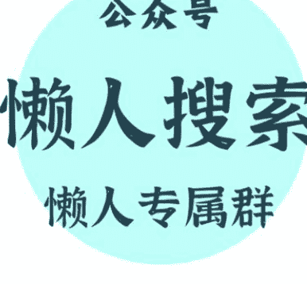
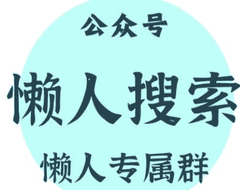

## 别在状态最差的时候，给自己下结论

260914

整理：公众号懒人搜索，懒人专属群精选

懒人微信：lazyhelper1

小懒判断｜适合状态低迷、爱给自己贴“我不行”标签的人，不适合想找医学级方案的人——科普向，作者明说不能替代医疗。最值得关注睾酮那条：关键时刻发怵，与其默念“我要自信”，不如站起来走两圈做几个俯卧撑，先让身体发力，勇气才跟得上。坑在于别只挑舒服的做，内啡肽要主动制造可控压力，躺平反而更糟。

每到秋天，总有人觉得自己的状态不如之前。比如早上更难起床，白天容易犯困。

这并不意味着秋天人的状态一定不好，但医学上确实有个现象叫“季节性情感障碍”，而多数患者的症状就是从秋末冬初开始出现。

因此，趁着刚刚入秋不久，我们就提前说说，怎么调节自己的情绪。

说起情绪，我们熟悉的方法大多是从心理层面入手。比如改变想法，调整认知，接纳情绪等等。但是今天，我们换个更简单直接的角度，化学。

我们之前讲过科普作者戴维·菲利普斯的《养出高能量》，这本书主要说的是通过调节人体的化学物质，提升人的能量值。而今天我们要说的是菲利普斯的另外一本书，叫《情绪鸡尾酒》。这本书更聚焦，主要说的是，怎么通过调节化学物质，管理自己的情绪。

菲利普斯本人就长期受抑郁问题困扰，最严重的时候甚至产生躯体化反应，连续两个月卧床不起。后来，他开始系统研究人的情绪和身体里的化学物质，并把自己使用的方法整理成了这本书。

在书里，菲利普斯一共讲了六种跟人的状态密切相关的化学物质，分别是，多巴胺、睾酮、内啡肽、催产素、血清素和皮质醇。

当然，情绪的过程远比这六种物质复杂。我们的情绪也不是哪一种激素高一点、低一点就能决定的。菲利普斯自己也说，这些内容很适合作为简化的参考，不能代替医疗。

接下来，我们就展开说说这六种物质。

**第一，多巴胺。**它对应的感觉，是“我想去做”。很多人一提多巴胺，就想到快乐。其实更准确地说，多巴胺跟“想要”的关系更紧密。

比如你订好了一个月后的旅行，从买完机票那天开始，你已经在查酒店、看天气、找餐厅。多巴胺系统很重要的一项工作，就是参与奖励预测。就像汽车的点火器，它负责的不只是“获得以后开不开心”，更是“我想不想发动起来，朝那个方向走”。

而成年人的日程表里，有大量的“应该”，应该回消息，应该开会，应该陪孩子。但很少有“想要”。那么，怎么主动调动这套系统？菲利普斯的建议是，主动给大脑制造期待和反馈。

不光要给结果安排奖励，更要给过程制造一点期待。比如，想跑步，可以提前选一条喜欢的路线；想学做饭，可以先买一种一直想尝试的食材。总之，主动给未来埋几个钩子。因为市面上关于多巴胺的文章很多，你可能也听过不少，因此这部分我们就不展开了。

**第二，睾酮。**它对应的感觉，是“我敢去做”。多巴胺解决的是，我想不想做，而睾酮对应的是，我敢不敢做。比如，明明准备了很久，马上轮到自己汇报，突然觉得还是少说一点好；已经想好了要去争取一个机会，走到对方办公室门口，心里又开始打退堂鼓。

睾酮当然远远不只是“自信激素”，但睾酮确实与运动、竞争、胜负等因素紧密相关。而且很多时候，你可以通过身体行动，反向激活睾酮，进而影响自己的状态。

比如，抗阻运动之后，睾酮就可能出现暂时的变化。再比如，菲利普斯会在重要演讲之前，给自己设计一个“上场程序”。比如，站起来，走一走，调整呼吸，这能在一定程度上，提升他的自信感。

所以，**下回要做一件心里有点没底的事情，与其一直默念“我要自信”，不如站起来，让身体“发力”**，比如，走两圈，做几个俯卧撑。这是在帮身体从“退缩模式”，切换到“迎战模式”。有些时候，我们不是等有了勇气再上场，而是先上场，勇气才会跟上来。

**第三，内啡肽。**它对应的感觉之一，是“松弛”。内啡肽，类似于身体自带的一套镇痛机制。严格来说，内啡肽并不是单独工作的。它属于人体更大的一套“内源性阿片系统”。这套系统里除了内啡肽，还有脑啡肽、强啡肽等物质。

你可能有过这种感觉。刚开始跑步的时候，腿酸、喘不上气，身体一直在提醒你，累了，别跑了。但跑过一段之后，那种难受有时候反而会好转，你还能继续往前跑。

这里面就有内源性阿片系统的参与。因为一定强度的运动，会给身体制造短暂的压力。在这个过程中，身体会调动包括内啡肽在内的一系列镇痛机制，帮助你降低不适感。

这就提供了一种很特别的情绪调节思路。有时候，一个人的状态差，与其躺在床上休息，不如主动给身体制造一点可控的压力。比如，出去快走，跑一跑，骑车，或者做一点能让心率提高的运动。

除了运动之外，还有一个状态调节方法，大笑。大笑同样会调动内源性阿片系统。它不只是快乐的外在表现，它本身也会成为快乐的触发因子。有时你不是因为高兴才大笑，而是大笑帮助你触发了身体的包括内啡肽在内的内源性阿片系统，而这个系统会帮助你完成自我调节，进而让你高兴。

**第四，催产素。**它主要参与亲密、信任和社会连接，是人与人建立安全感和依恋感的重要物质。你可能有过这种体验，忙了一整天，整个人一直紧绷。回家以后，跟家人拥抱一下，或者坐下来好好聊一会儿，状态会慢慢放松。因为这些行为会调动包括催产素在内的社会联结系统。也就是说，当你和一个信任的人发生亲密接触时，身体也在参与判断：这里是不是安全的？这个人是不是可以靠近的？

你很难坐在那里，命令自己“现在多分泌一点催产素”，但你可以主动创造那些容易调动这套系统的情境。比如，跟伴侣坐在一起，可以靠近一点。跟孩子相处的时候，牵牵手，拍拍背。这些动作看起来都特别普通，但真实的触碰，会从皮肤开始，把一整套身体信号输入给大脑，这是线上沟通无法实现的。

菲利普斯还给自己做过一个“催产素播放列表”，里面有家人照片、孩子的视频。看照片本身不能立刻提升催产素，但它能提醒自己，从处理任务的状态，切换到跟人连接的状态。

**第五，血清素。**它主要参与情绪稳定、睡眠和满足感，是维持情绪平稳的一种重要物质。多巴胺更容易让人产生“我还想获得什么”的动力，而血清素给你的，更接近一种偏向稳定的状态。你不会特别兴奋，但也不容易烦躁、低落，整个人比较淡定。注意，不是躺平，不是不求上进，是淡定。比如，看到朋友圈人均收入一个亿，你也不会特别嫉妒，你也会心如止水，专注于自己该做的事。

那么，怎么主动影响血清素系统？菲利普斯给出的一个重要方法是，见自然光。

有研究发现，光照变化与大脑血清素系统的活动存在明显关系，大脑血清素的周转会随着日照时间的增加而升高。换句话说，晒太阳不只是让你“感觉天气不错”，它也在帮你触发身体的血清素系统，让你感觉到内心平静。

所以，假如最近明显感觉自己容易低落，情绪波动，可以把见光直接写进日程。比如上午或者中午，找机会到室外走一会儿。

**第六，皮质醇。**它是人体压力反应系统里非常重要的一种激素，主要作用是提高警觉，让身体迅速进入应对挑战的状态。所以，皮质醇本身并不是坏东西。马上要考试、临时接到一个紧急任务，或者路上突然出现危险，这时候压力反应会迅速把身体调动起来。注意力更集中，身体更警觉，人也更快进入“战斗”的状态。

但问题是，这套系统不能一直保持打开状态。而现实情况是，很多人整天有做不完的任务，回不完的消息，这会导致皮质醇系统始终活跃，久而久之，人就会感觉“心累”。

那么，怎么主动影响皮质醇这套压力系统？菲利普斯建议，把最近所有让你感到压力的事情，一件一件写下来。工作太多，写下来。一段关系让你一直不舒服，写下来。有件事拖了几个月，每天想起来都烦，也写下来。

写完之后，想办法减少这些压力源。有些事情能删，就直接删掉。有些事情删不掉，那就尽快处理，让它从“持续存在的压力源”变成一件已经结束的事情。少一件待处理的任务，身体就少一个压力源。想让压力系统安静下来，最有效的办法，不是努力让自己“别紧张”，而是让触发紧张的引线减少一点。

说到这，这六种物质就都讲完了。换个角度，这些内容也是个提醒，提醒我们，很多时候，状态不好，并不等于你这个人出了问题。

没动力，不一定是懒，可能只是多巴胺低迷。关键时刻发怵，不一定是勇气不够，可能只是睾酮活跃度不够。人的状态本来就会受到睡眠、运动、光照、压力、社交，以及身体内部各种系统的影响。

状态是可以变化的。而一个暂时的低状态，不值得被你解释成一个永久的自己。

所以，别在状态最差的时候，给自己下结论。比起马上判断“我就是不行”“我怎么越来越差了”，更有用的是先问问自己，我现在到底处在什么状态？有没有什么具体的动作，可以先把这个状态调整回来？

在这个 AI 能替你写代码、写文章的时代，基础技能正在迅速贬值。绝大多数人正被淹没在海量的免费垃圾信息里，陷入低效的体力内卷。

当“努力”不再是壁垒，人与人之间唯一的护城河，只剩下“信息过滤”的效率与“认知系统”的维度。

圈子已稳定运行 7 年。我们每天利用Python 爬虫与大模型算力，过滤全网最顶级的政经内参和搞钱风向标，做你最冷酷的“外部大脑”。

如果你认同这种“重塑认知防线”的极客主义，欢迎围观我的个人情报智库：【懒人专属群】。

https://lazyso.com/insider/

认同信息过滤价值、想省下每天 3 小时无效阅读时间的读者，扫码加我微信（lazyhelper1）

