## 从 371 粉到 63000 粉，变现 40 万+：我的 X（推特）从起号到变现全复盘

260911 副业 SC 精华
整理：公众号懒人搜索，懒人专属群精选
懒人微信：lazyhelper1

> **小懒判断** | 适合有产品或技能、想把 X 当流量放大器的人，不适合空手做流量号求快钱的。最值得关注冷启动两件套：第一条推文磨 4 个半小时，发布后 1 小时内请大 V 转发——Handle 曝光转化率最高。坑在互关互赞群，会把受众模型搞脏、打上协同作弊标签，沦为无声降权的幽灵号。

大家好，我是鱼总。

熟悉我的老朋友可能知道，我是一位 UI 出身、做了 8 年 APP 和 SaaS 的产品经理。全职创业这几年，我先后做了 20 多个 APP 和出海网站，累计用户量突破了 500 万，单款产品营收超 12 万美金，基本全靠自然流量和蓝海选品。

在做自媒体这件事上，我也走过不少弯路：早期在国内平台做过 10 万粉账号，也曾招人尝试做矩阵自媒体，结果遭遇封号、没流量，一度拿做产品赚的钱硬倒贴。后来我彻底想明白了：**自媒体从来不该是为了做流量而做流量的空中楼阁，它必须跟真实产品、真实业务紧密结合，作为产品出海和个人 IP 的放大器。** 所以过去一年多，我把精力重新聚焦在 AI 出海与 X（推特）自媒体的深度结合上。经常有生财的圈友来找我交流，大家在做推特时普遍被几个常见痛点卡住：

### 圈友常见的三个核心痛点

- 冷启动太难：新号发出去几十个阅读，像对着空气喊话，完全没人理；
- 内容没方向：天天看别人出爆款，自己花大半天写的干货却石沉大海，不知道推荐算法到底要什么；
- 变现看不懂：总觉得推特只能吹水、接不到正经商单，不知道怎么把粉丝变成真金白银，更不知道怎么给自己的独立产品引流。

2025 年 9 月 10 号，我在生财的第一次 AI 自媒体-X（推特）航海上，发了我的第一条起号推文。

这条推文发布的时候，是我二宝出生的前两天，我带着媳妇在医院做产检，也就是在我二宝出生的这两三天里，我的第一条推文直接涨粉 3,000+，完成了推特起号最难的阶段：冷启动。

到现在：
- 用户量突破 500 万
- 单款营收超 12 万美金
- 基本全靠自然流量，核心优势还是“蓝海选品”。

🚕 去年的我 30 岁，买了一辆奔驰 GLC 送给奋斗的自己，然后把第二辆车当生日礼物送给了心心念念想买车的老爸。那一刻，比赚钱更爽。

👉 想知道我是怎么做到的？欢迎继续关注。

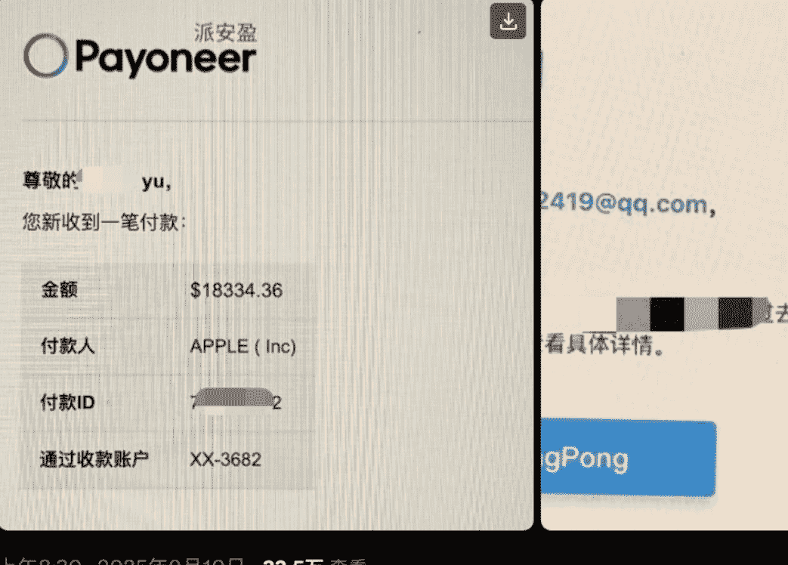

关于怎么冷启动的方法，我的这篇文章里面不会详细讲解，这个在之前的精华帖已经全盘拆解并分析，大家可以结合之前的这篇文章来看，链接：

> https://wx.szxq.com/group/1824528822/topic/5124258881122514

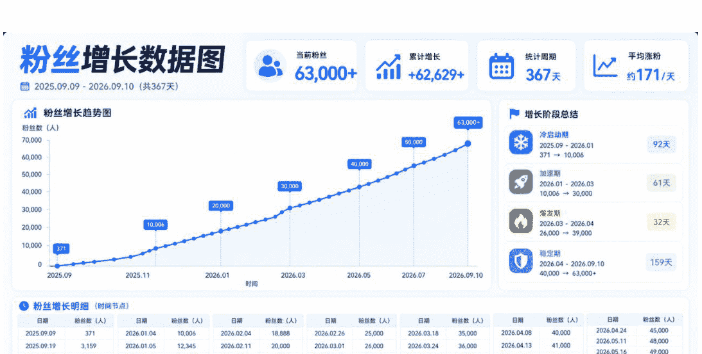

## 整整 12 个月后的今天：

- 粉丝从 371 增长到 63,000+；
- 6篇长推文突破 100 万阅读，单篇最高曝光 268 万；
- 做出了 1 个数百万播放的 AI 视频，被全网搬运到数千万播放量；
- 网易、百度、字节等大厂主动找来合作，商单报价从 0 涨到单条 6,000-10,000 元；
- 我组织的商单共享群，群内接单总额已远超 200 万。

很多圈友经常好奇：**变现 40 万到底是怎么构成的？花了多长时间？每个渠道大概占多少？** 出于商业合作保密与合规考虑，具体的绝对金额这里不做一一罗列，我把这 12 个月里各渠道的**大概比例构成与跑通逻辑**梳理如下，方便大家参考：

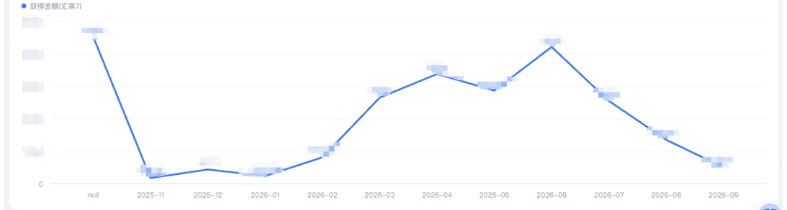

哈喽各位圈友，我是**鱼总**。UI 出身、做了 8 年 APP 和 SaaS 的产品经理，目前全职 OPC 创业，在做出海工具、独立开发和 X（推特）自媒体。

做产品出海，赚全球用户的软件订阅费；同时深耕 X（推特）自媒体，给自己的出海产品引流，顺便沉淀个人 IP。

去年 9 月的推特航海，我发了第一条起号推文，借着那一篇完成了**最难的冷启动**。整整 12 个月后的今天：

- 粉丝从 371 增长到 63,000+；
- 跑出 6 篇百万级阅读长推文，单篇最高曝光 268 万；
- 与 X 账号直接相关的变现（商单合作、工具带货分成、创作者官方收益）累计超 40 万，商单报价从 0 涨到单条 6,000-10,000 元，合作品牌包括网易、百度、字节等大厂；
- 组织的商单共享群，群内累计接单总额已远超 200 万。

经常有圈友问我：“推特到底怎么冷启动？写干货没人看怎么办？中推除了吹水到底怎么变现？为什么我发了几个月还是赚不到钱？”时隔一年，随着实操不断深入，加上 2026 年 X 平台算法彻底重构（开源了 Grok 模型推荐系统）以及创作者收益政策的全面收紧，玩法已经发生了根本性变化。所以今天抽时间把这一整年的所有一手经验、变现逻辑和踩过的坑，做一次毫无保留的完整复盘。

本篇只讲真刀真枪的最新实操和底层认知，不讲虚头巴脑的概念。

本篇文章主要用于解决下面 8 个核心问题：

- 一、推特涨粉的真正底层公式是什么？为什么大 V 转发一次顶你自己发十条？
- 二、2026 最新 Grok 开源算法到底看重什么？（为什么认真的对话远比点赞值钱）
- 三、动手起号前，必须答清楚哪三个定位问题？
- 四、冷启动的第一条推文到底怎么磨？怎么借势大 V 破局？（附千万别踩的 2 个降权大坑）
- 五、6 篇百万阅读的爆款选题逻辑与创作流程是什么？
- 六、中推圈层的鄙视链长什么样？如何用专业内容向上社交？
- 七、语言墙被打破后，中文内容如何撬动全球流量？
- 八、变现的五条路径怎么走？商单怎么接、工具怎么带货？（附 2026 原创奖励新政与避坑指南）

### 变现 40 万+ 的渠道构成与核心逻辑（耗时 12 个月）

> 注：以上仅统计了与 X 账号直接挂钩的这三类现金变现，不计算推特持续给我的独立 SaaS 产品（如 PaywallPro）和个人网站（yuzong.ai）沉淀的高净值用户与长期软件订阅收入。

**？我先回答一个最基础的问题：为什么值得做 X？**

很多人觉得推特流量小、圈子小。但我这一年的体验是：**这是一个被严重低估的流量金矿**。原因就四个词：

- **用户质量高**：中推圈聚集了大量出海创业者、投资人、海外华人和技术大牛，付费意愿与购买力极强，根本不是普通泛娱乐流量能比的；
- **信任积累快**：实名/半实名持续输出一手干货，更容易建立高黏性 IP，后续不管是合作、融资还是招聘都极其顺畅；
- **招聘质量高**：在推特上招人，候选人的自主能力和出海认知明显比国内传统平台高一大截；
- **复利效应显著**：粉丝到一定量级后，曝光非常稳定，挂一个产品链接能直接带来稳定注册与付费，转化链路极短。

## 全文目录

为了便于大家系统阅读和随时查阅，这篇文章我按照实战顺序拆解为十个部分：

- 一、涨粉就一个公式：曝光×转化（底层逻辑）
- 二、算法只认一件事：认真的对话，比点赞值钱（Grok算法拆解）
- 三、动手前先答三问：你是谁、给谁看、凭啥关注你（账号定位）
- 四、冷启动：第一条推文，值得花4个半小时去磨（0到3000粉实战与踩坑）
- 五、内容怎么爆？先解决别人的刚需（选题逻辑与爆款SOP）
- 六、中推的鄙视链：看看你站在第几层（圈层认知与向上社交）
- 七、语言墙塌了：中文内容，全球都在看（出海新机遇）
- 八、变现五条路：对号入座，总有一条适合你（商单/带货/原创奖励/个人网站深度拆解与商单避坑）
- 九、赛道与避坑：这些能碰，这些别碰（高危操作与 IP 防封踩坑盘点）
- 十、精力分配：别轻易把推特当主业（产品才是根本）
- 写在最后：真诚利他，主动出击（做号第一心法）

你可能会问：把这些全部公开，不怕教会徒弟饿死师傅？

我的答案和生财的初心完全一致：真诚利他。我自己就是一路被圈内前辈的无偿分享喂大的，所以我坚信把真正有用的东西讲透，收获的信任和长期合作机会，永远比捂着的那点信息差值钱得多。

这篇文章里有两条贯穿始终的宗旨：一是真诚利他，二是主动出击。无论是涨粉、写内容、混圈子还是变现，它们都是同一个底层逻辑。

话不多说，我们直接上干货。

## 一、涨粉就一个公式：曝光 × 转化

市面上大多数「推特涨粉教程」都在讲小技巧——什么时间发、封面怎么做、是否用标签、需要大佬助力等等。这些东西有用，但它们只是优化项，不是核心驱动力。

我想先给你一个框架，把涨粉这件事的底层逻辑讲清楚。

> 涨粉的核心公式极其简单：涨粉 = 曝光量 × 关注转化率。

但这个公式里，曝光量和转化率各自有不同的来源，它们的性质完全不同。

### 曝光量的三个来源

- **推文曝光**。 你的推文出现在别人的时间线里——无论是「为你推荐」还是「关注」列表。这是最大的曝光来源，也是大多数人唯一在意的。
- **个人主页曝光**。 别人因为某种原因点进你的主页。这个来源被严重低估了。实际上，大量关注行为发生在用户浏览你的主页之后——他看到你过去的几条内容，觉得「这个人值得关注」，然后才会去点关注按钮。
- **Handle 曝光——别人在推文里 @你、转发你、或者在评论区提到你。** 这种曝光的量级通常不如推文曝光大，但它的**转化率高得离谱**。为什么？因为这是一种「信任传递」——有人愿意在公开场合提到你，本身就是一种背书，很多大 V 到了一定阶段，就是靠别人不断的推荐，形成网络效应，粉丝会越来越多，比如头部的宝玉、歸藏、小互、Orange 老师等。

### 转化率的分层漏斗

有了曝光，转化率决定了多少曝光最终变成粉丝。而转化率并不是一个常数——它取决于用户进入的入口：

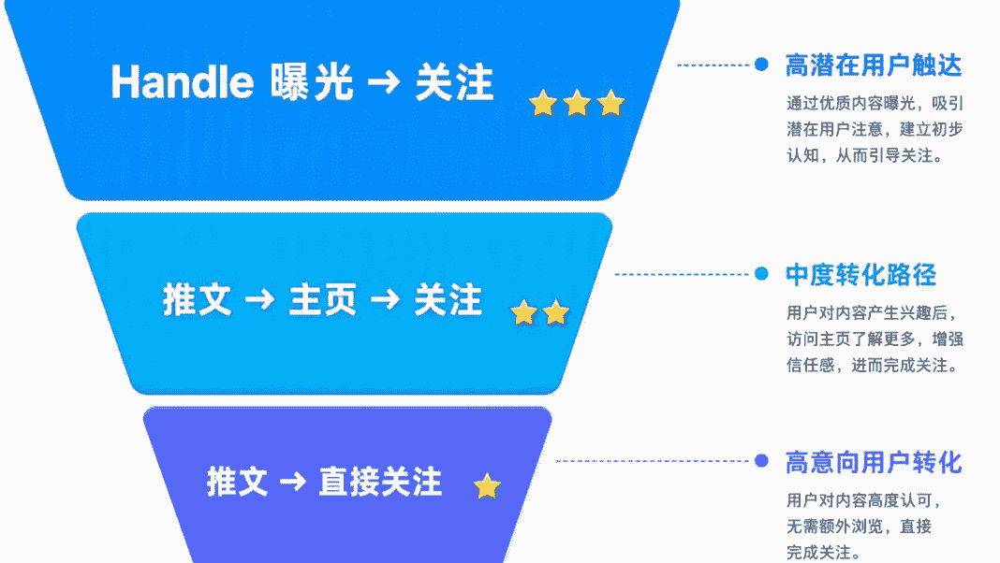

这个漏斗模型解释了两个常见困惑：

- 为什么有些账号「曝光很大但不涨粉」？因为内容能吸引眼球，但主页没有承接住。用户点进去一看，历史推文要么是转发抽奖、要么是没人看的碎碎念——那么凭什么关注你？
- 为什么「大 V 转发一次顶你自己发十条」？因为 Handle 曝光绕过了转化漏斗中最困难的那一步——信任验证，以及从众心理。
- 信任是怎么来的？不是包装出来的，是你长期真诚帮助别人之后，别人替你「说」出来的。大 V 愿意转发你，是因为你这内容真的帮到了人、值得被更多人看到；粉丝点进主页愿意关注你，是因为看到你一直在认真解决某个问题。利他不是口号——它是这条转化率公式里最底层的那个变量，装不出来，也刷不出来。

### 对普通人的实际意义

对一个非名人来说，内容和转发曝光是并列的第一优先级，其他都是优化项。

> ⚡ 一个关键细节：发布后一小时内的互动数据极为关键，算法会依据这段时间的表现决定是否扩大分发。所以如果你有大 V 朋友愿意在发布后第一时间帮你转发或互动，效果比发了之后再找要好得多。

理解了这套「曝光 × 转化」的框架，我们再往下看——算法给我们的信号，其实和这个框架指向同一个方向。

## 二、算法只认一件事：认真的对话，比点赞值钱

X 是全球唯一两次开源推荐算法的主流平台——2023 年 3 月首次公开，2026 年 1 月用 xAI 的 Grok 模型完全重写并再次开源。代码就挂在 GitHub 上（github.com/xai-org/x-algorithm），不需要靠猜。

对创作者来说，最值得记住的结论只有一条：**对话深度碾压点赞**。在算法的权重里，作者回复、真实讨论的分量远高于转发和点赞——一次有来有回的对话，比几十上百个赞值钱得多。

翻译成大白话：**算法奖励的是「认真」——而「认真」换到人身上，就是真诚。** 你真心回复评论区里的每一个问题、真心帮人 debug、真心和同行讨论，这些行为算法全都认；反过来，花钱买的赞、群里约好的互点，算法一个都不认（后面细说）。所以别把算法当敌人，它其实在替你筛选——**谁在真诚地与人交流，谁在机械地制造数据，它分得清清楚楚。** 那这套算法到底是怎么运作的？我把官方开源的代码翻译成官话，你只要看懂下面的「端菜模型」。

## 一个比喻：For You 是怎么给你「端菜」的

把 For You 想成一个特别勤快的服务员。你走进一家巨大的食堂，里面同时有几十万道菜。服务员不会全端上来，流程分四步：

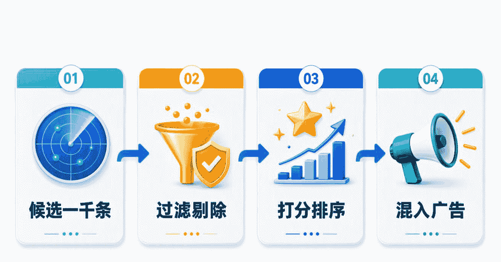

### 第一步：先端一小车候选（大约一千多条）

- 你关注的人刚发的帖（代码里叫 Thunder）——存在内存里，毫秒级就能取出来，相当于你点过名的厨师刚出锅的菜，优先上车；
- 没关注的人里猜你可能喜欢的（Phoenix 召回 + SimClusters）——你最近老停在 AI 帖上，它就多拿 AI；你老看某种内容，它就往那靠。

### 第二步：扔掉不该出现的

你拉黑过的、点过「不感兴趣」的、设过屏蔽词的、明显违规的、你刚看过的——直接拿掉。这一步只回答「能不能出现」，不回答「排第几」。

### 第三步：给每道菜打分（最核心的一步）

它不问「这帖全网火不火」，而是问：以你平时的刷法，你更可能多看几秒、点赞、回复、转发，还是划走、拉黑、举报？模型会为每条帖预测一串「你会不会做这些动作」的概率（赞、回复、转发、引用、点开、看视频、关注作者，以及不感兴趣、拉黑、举报），再按权重加总成一个分：

预测你会认真互动的，往上排；预测你会烦的，往下压。这里有个很多人读错的细节：权重乘的是「预测概率」，不是全站真实动作数——所以网上流传的「1个举报抵468个赞」这类换算，官方注释里已经写明不是这个意思。

### 第四步：中间插广告和「推荐关注」

这些不是排序模型打的，是另一套管线混进来的。

### 小白最该记住的五个结论

这也正好印证了上一章的框架：真正值钱的部分不在于粉丝「刷到」的曝光，算法更看重的是「聊起来」的转化。你刷得越认真，这辆小车就越像为你定制的；你只划不点，它就只能靠很粗的猜测。

## 三、动手前先答三问：你是谁、给谁看、凭啥关注你

定位是第一要务，但大多数人把定位想得太复杂了。

你只需要回答三个问题：

举个例子：如果你做 Web3 产品想拓展新用户，就别整高深的术语。做下沉内容，写「三步买到第一枚比特币」这种小白教程，才能吸引增量用户。

- 「别人凭什么关注你」这个问题，翻过来就是利他：你能为哪群人持续解决什么问题。想清楚这一点，定位就不再是包装，而是承诺——你向某一群人承诺持续提供价值，然后用一条条内容去兑现它。定位不是写给自己看的简历，而是写给读者看的「我能帮你什么」。

我自己的定位是：**AI 出海、独立开发、实战干货。** 内容分两类——认知类的思考和分享，实操类的教程。偶尔发生活感悟和吐槽完全没问题，只要不偏离主题太远就行。

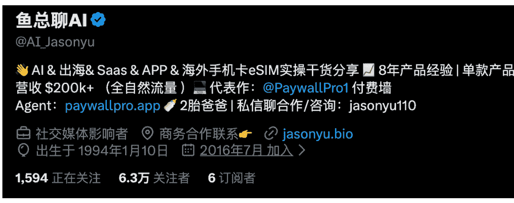

很多人也讲过说垂直领域这个词，我理解的垂直并不是你做 AI 领域，你就只发 AI 的相关内容，实际上，AI 相关的周边，只要是你的 人群所需要的内容，也是没问题的。比如和接码、网络相关的。

- 定位要明确，但没必要，也不自己把自己给框死。

## 四、冷启动：第一条推文，值得花 4 个半小时去磨

冷启动做不好，后面全白搭。

我冷启动的第一条推文花了**4 个半小时打磨，改了又改，结果就是 48 小时带来 3,000 多粉丝，曝光 24 万。** 这是一个经过了精心设计的起步。

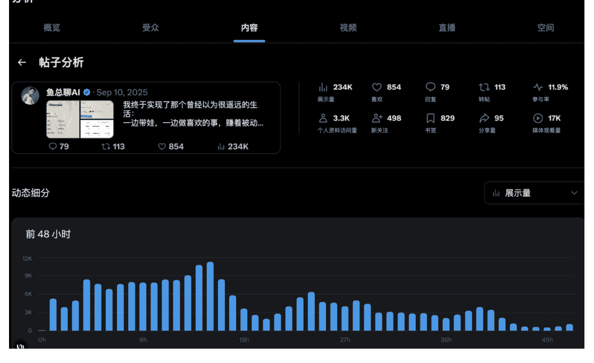

当然，这个贴现在的曝光已经33.5万了。

## 冷启动的三个关键要素

### 1. 优质内容是基础

第一条内容必须打磨到极致。可以结合真实故事，或写干货教程。内容要对新手友好，把步骤拆解到「小白都能看懂」的粒度——很多人写教程喜欢省略步骤，觉得「这个大家都懂」。错了，就是有人不懂。你就当他们是从零基础。

封面、排版、标题都要用心。我是学设计出身，所以特别注重这些细节。封面要简洁吸睛，排版要舒服，字体大小要合适——这些都直接关联到「停留时间」这个算法信号。

### 2. 大V转发是关键

内容再好，没人看到也白搭。冷启动时一定要想办法让大V帮你转发。

> 大V转发 = Handle曝光 = 最高转化率的入口。而且有了初始互动数据，算法才会继续推。

我冷启动时请了哥飞、小排老师这些朋友帮忙。后来我指导的小耳朵老师，文章经过我的转推带动，也获得了几十万浏览和近 2,000 粉丝。

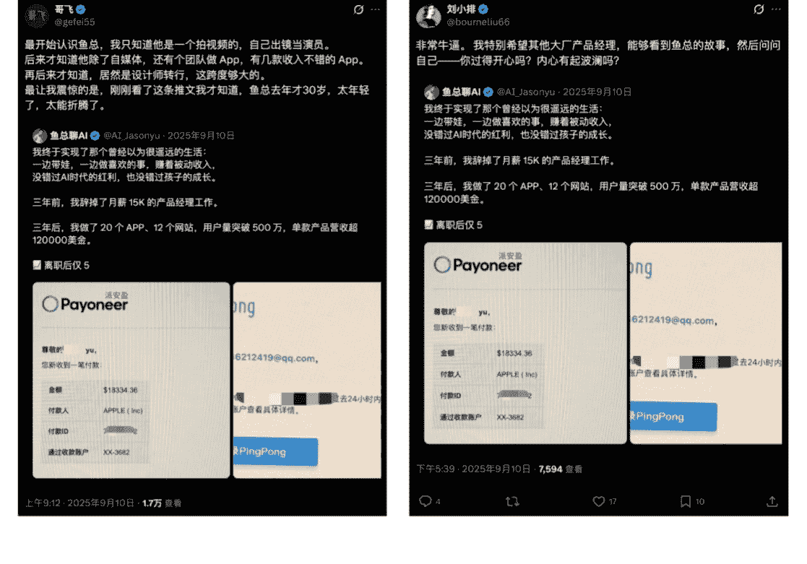

怎么找人 V 转发？如果你有朋友，直接求助。如果没有，先积攒人脉，多互动，混圈子——这没有捷径。但「没有捷径」不等于「只能干等」：**混圈子从来不是被动等着别人注意到你，而是主动去互动、主动去帮忙、主动去贡献价值。**我冷启动时请到的那几位朋友，也不是天上掉下来的，是之前很长一段时间里，我主动真诚互动、互相帮衬，一点点攒下的关系。

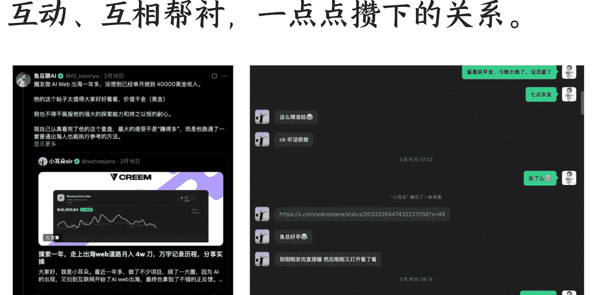

### 3. 账号准备要到位

- **开蓝 V：** X Premium 会给账号加分、提升分发的优先级。**这钱千万不能省。**
- **养号：** 新号别急着发转化内容，先发几条基础内容，完善个人资料。
- **个人资料：** 突出核心关注领域，让人一眼看出你是干什么的。头像别用系统默认的。

冷启动之后，粉丝到 2,000 左右可以进入相关社群——比如 tutti 等一些社群，里面有商单和推文加热机会。你也可以创建或加入商单共享群，大家一起共享商单、互相加热。

这里多说一句我建群的初衷：一开始真没想着靠它赚钱，就是自己接单多了，想把好机会分享给更多人，大家有资源也往群里丢、互相成就。至于这个群后来的接单总额远超 200 万——那是信任攒够之后自然长出来的，后面变现章节细讲。

### 冷启动千万别踩的两个大坑

在起步阶段，踩一个坑就可能让你前两个月的努力全部白费。我见过太多圈友死在这两件事上：

- **坑一：盲目加「互关互赞群」，以为抱团取暖**。很多人刚起号没流量，急于求成，跑去加各种「中推互助群、互关互赞互评」。**这是最严重的自杀行为**。正如第二章讲到的算法底层，Grok 模型依赖受众的兴趣聚类（SimClusters）来决定把你的内容推给谁。一群毫无共同兴趣标签的人互相机械刷赞刷评论，不仅不会帮你进入推荐流，反而会彻底把你的受众模型搞脏；更严重的，算法监测到短时间内高频集中互动的异常行为，会直接给账号打上**协作作弊（Inauthentic Engagement）标签**，信誉分直接断崖下跌，沦为无声降权的「幽灵号」。
- **坑二：刚发两篇推文，就急吼吼挂外链打广**

## 五、内容怎么爆？先解决别人的刚需

我今年写了 6 篇 100 万以上阅读的文章，选题分别是：

- 香港、荷兰、德国手机号的申请和保号教程——满足出海接码、注册海外账户的刚需
- 创作者收益指南——教大家怎么达到门槛、怎么绑卡收款
- 中文 X 头部博主关注清单——用 AI 整理的资源类内容，互动率极高

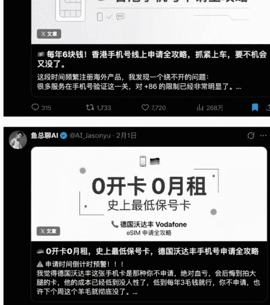
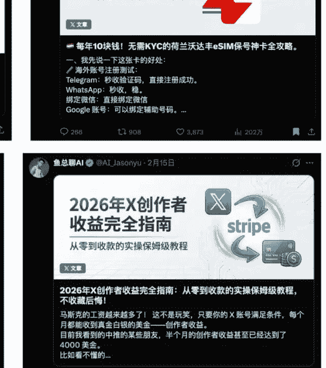

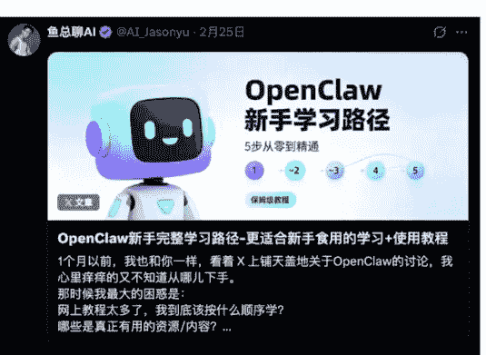
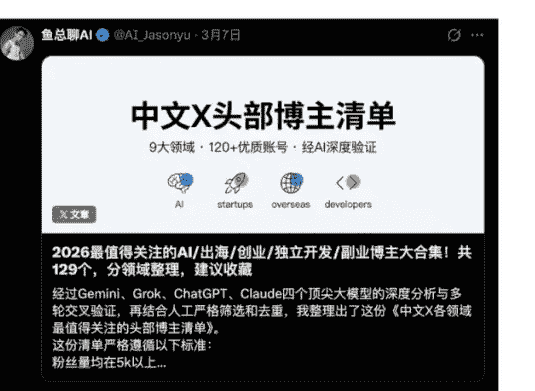
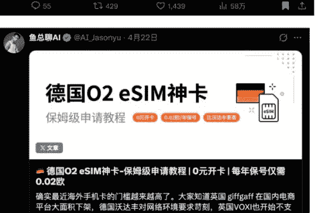
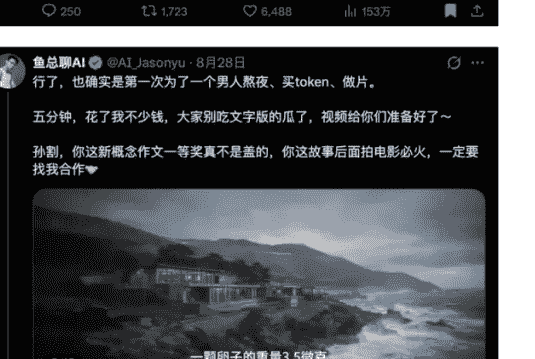

你会发现这些选题有一个共同点：

> - 解决一个具体、高频、有直接利益关联的问题。

这四个选题全是「读者正卡着脖子的问题」——接码、收款、找资源，没一个是我拍脑袋编的。爆款的第一性原理其实就是利他：先想清楚读者此刻最痛的是什么，再动笔。反正我观察到的爆款，没有一个 是整天自说自话的账号做出来的。

### 爆款的四个要素

不要写「然后去设置里改一下」——告诉读者「点击右上角齿轮 → 第三个选项 → 滑到『安全』板块 → 第四个开关」。

### 固定有流量的赛道

魔法工具、银行卡和信用卡、手机卡保号接码、机票酒店薅羊毛、海外充值礼品卡、AI 工具分享——这些赛道有稳定的流量池。

### 慎碰的内容

正黄、分享翻墙方法、住宅 IP、薅国外大公司羊毛——这些容易被删，甚至封号。

有些东西不值得冒险。

## 我自己的创作流程

内容搜集 → 自己实操一遍 → AI 辅助写长文教程 → 人工校验修改 → 排版发布

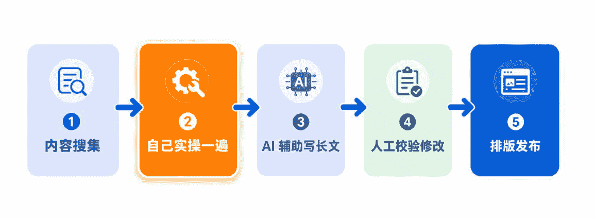

这个流程里最关键的环节是［自己实操一遍］——**不是被动等教程教会你，而是主动去用、去踩坑、去验证。** 只有你亲自跑通一遍的东西，写出来才有细节、才敢负责，读者才会信。这个习惯还有个意想不到的副产品：你日常在用的工具，就是你以后最顺手的变现资源（第八章细讲）。

工具方面，Youmind 能自动抓取 YouTube 等平台的内容，基于你已有的风格生成文章，排版也方便。Pro 版每月 20 美金，AI 生成后最好人工校验一遍。

https://youmind.com/pricing?ref=LTElKN&campaign=2026-618

顺便回答一个高频问题：为什么不同步发公众号？不是看不上公众号，而是两个平台的调性不一样——X 更开放，说话可以更大胆，很多内容并不适合同步；而且 X 运营到一定量级后阅读量相对稳定，能直接放产品链接做转化，公众号冷启动要加各种群、不能直接放链接，推荐逻辑和粉丝量关系不大，阅读量也不稳定。精力有限，先做好一个平台，比两个平台都做不好强。

### 写长推文最容易踩的两个坑

**坑一：纯靠 AI 一键写长文，自己不跑通每一步。** 很多博主为了追热点、抢速度，直接把英文推文丢给 AI 洗一遍就发。这种做法极其危险。工具经常会更新改版，如果里面某个核心参数变了、或者某个关键配置失效了，你没发现就发出去了；一旦推文爆了，成百上千读者照着做卡在半路上，评论区立刻变成「翻车维权现场」——不仅被读者喷「根本没用过出来误人子弟」，还会引来大量举报和拉黑（负分信号暴增）。我的原则是：凡是我发出来的保姆级教程，每一个关键截屏和步骤，我都必须在电脑上亲自实操验证一遍。实操带来的真实感，是任何 AI 编不出来的。

**坑二：通篇文字无排版，把读者看累劝退。** 在 X 这种快节奏消费平台，用户是在时间线上高速滑动屏幕的。如果一段话连写六七行不换行、没有加粗、没有小标题、没有序号，读者扫一眼大脑就会直接产生疲劳感，秒速划走。这会导致你的页面停留时间（Dwell Time）极短，算法接收到的信号是「用户不感兴趣」，立刻停止后续推流。记住：排版不是形式主义，排版是帮读者降低理解成本、帮算法争取停留时长的核心手段。

## 六、中推的鄙视链：看看你站在第几层

外面的人看推特中文圈（「中推」），觉得不就是一群人躲在墙外聊天吹水嘛。但真进来你会发现，里面的结构清楚得很，一层压一层，跟金字塔似的。搞懂这个结构，你才知道自己站在哪、该往哪儿爬。

说白，中推这个圈子特别小——顶层的号来来去去就那些，大家抬头不见低头见。你发一条内容，一天之内全圈基本都看得到。这是好事也是坏事：好事是出圈快，一条爆了圈里圈外都知道你；坏事是万一翻车，也传得飞快，别想着能捂住。

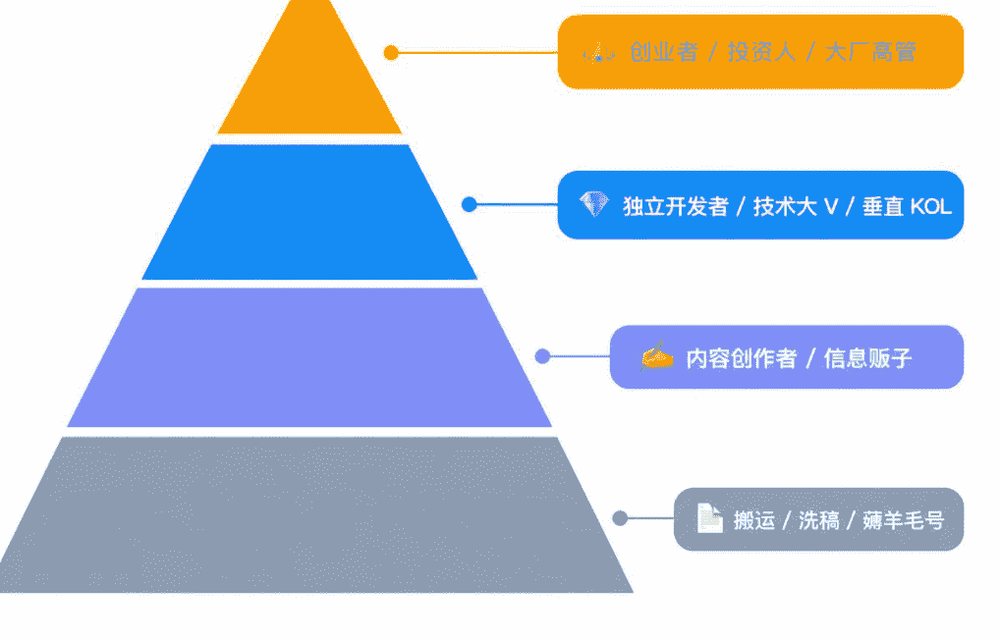

把这几层拆开聊聊，你就明白差别在哪了：

- **顶层：不靠这个吃饭。** 创业者、投资人、大厂高管，发推不是为了涨粉变现，人家现实里就有真金白银。今天聊聊行业，明天点评下热点，数据看着随意，但圈内地位高得吓人——他们的「信誉分」是现实身份给的，算法也认这个账。例子？傅盛就是——猎豹移动创始人、投资人，2026年了还在X上活跃聊AI，一条内容能跑出百万浏览，但他发推不为流量，为的是发声和站台。

- **第二层：圈里最吃香的一批人。** 独立开发者、技术大V、垂直KOL，手里都有真东西。内容要么是一手认知，要么是能直接上手的实操干货，粉丝质量高，商单转化率也高。说白，这一层的人发一条，可能顶第三层发十条。代表人物不用我多介绍：宝玉 @dotey、歸藏 @op7418、Orange 老师 @oran_ge——还有我冷启动时帮过忙的哥飞，都是这一层的。

- **第三层：绝大多数人待的地方，也最卷。** 内容创作者、信息贩子，包括刚开始做号的你我。靠流量吃饭，接商单、做联盟营销，日子能过，但总有种被算法拿捏的感觉——一个不小心就被判定成垃圾内容。这层门槛低，人人可做，所以竞争最激烈。长什么样？发 AI 资讯集合的、教人怎么做号的、晒收益截图挂课程链接的——圈里一抓一大把。

- **第四层：金字塔底，也最危险。** 搬运号、洗稿号、薅羊毛号，靠批量操作活着，今天这个号没了明天换个号继续。算法对它们最不客气，说降权就降权，说清退就清退。别眼红他们来钱快，那是在刀尖上跳舞。2026 年「原创内容奖励计划」上线后，搬运洗稿连创作者收益这条路都被直接掐断（第八章细讲）——这一层的生存空间正在肉眼可见地收窄。这种号我就不点名了——一天搬运几十条、全程不带一句自己观点的，洗稿套模板换个标题就发的，你刷 For You 的时候肯定见过，一眼就能认出来。

> 你的目标不是跨越层级，而是在自己的层里往上游移动。从第三层到第二层的跃迁，靠的不是粉丝数的增长，而是内容质量的质变——从「信息搬运」变成「一手认知 + 实操输出」。从第二层往第一层走，靠的不是内容本身，而是你在现实世界的事业进展——你的产品、你的公司、你的投资。

**关于鄙视链，再说两句实话。** 中推的鄙视链其实就一条主线：做产品的可能看不上做内容的，做一手内容的看不上搬运的，搬运的看不上蹭流量的。别急着骂它势利——这背后其实是「不可替代性」的排序：你的价值越难被复制，地位就越高。所以与其花时间吐槽鄙视链，不如想想怎么让自己更难被替代。而最难被复制的东西里，真诚和利他排在最前面——技巧可以抄袭、选题可以模仿，但你长期帮助过多少人、攒下多少真实的信任，别人搬不走。

□ 向上社交时，用专业内容敲门。你去给第一层的大佬留言「求互关」不会有任何回应，人家私信里全是这种消息，早麻木了。但如果你写了一篇深度分析，@对方说「受您之前那篇文章启发，我做了一个实操版」——这就不一样了。用内容当敲门砖，是圈子里最体面、也最有效的社交方式。

## 七、语言墙塌了：中文内容，全球都在看

2025-2026 年，X 发生了两件从根本上改变游戏规则的事：

1. **Grok 接管了推荐算法**，它能「读懂」每一种语言的内容并做跨语言匹配
2. **AI 翻译质量的飞跃**，让中文内容可以被全球用户无障碍消费

□ 语言墙正在消失。

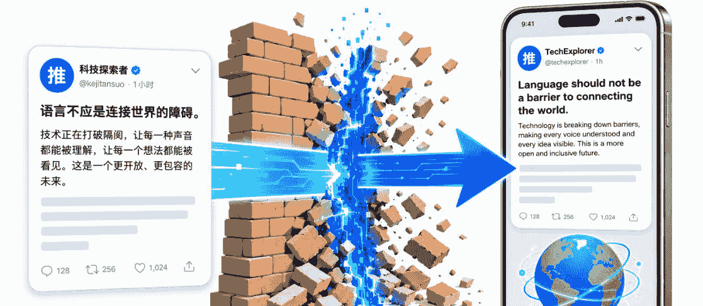

过去中推是一个相对封闭的圈子——你写中文，就只有中文用户看。但现在，一条中文推文完全可能被 Grok 推给一个不懂中文但「行为模式相似」的英语用户——他的客户端会自动翻译，体验几乎无缝。

### 三种新玩法

- 不同变现路径，不同的语言策略

## 八、变现五条路：对号入座，总有一条适合你

### 产品推广

把推特流量导向自己的产品——APP 或 SaaS 网站。推特的转化路径极短：

| 用户看内容 | 信任你 | 点进主页链接 | 注册/付费 |
| :--- | :--- | :--- | :--- |

比如 PaywallPro，我做的产品是面向 iOS 订阅型开发者的 SaaS 工具，利用 App Store 数据和大量的付费墙案例，加上大模型能力提供高转化率的付费墙方案，从主页带来了不少的新用户。

还有，拿我自己的个人网站举例：很多新读者是在 X 上刷到我的教程，再顺着主页链接点进 yuzong.ai 的。这个站把我在做的产品、在跑的出海小产品、免费工具和保姆级教程都收进同一屋檐下，一句话讲清「AI出海·超级个体」——你是谁、在做什么、能帮读者什么，十秒看完。内容在X上负责建立信任，网站负责把这份信任兑现成注册和付费。

所以个人网站千万别做成简历，要做成产品：每个进站的人，都值得被当成潜在用户对待。

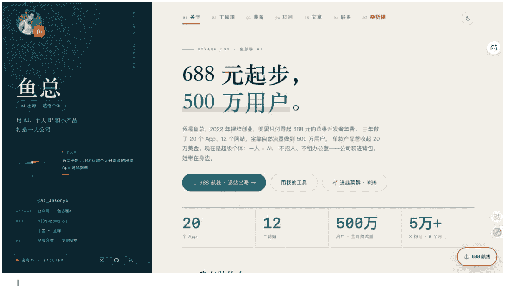

□ **策略：内容本身就是产品的前置价值。** 你的教程、你的认知分享，在「展示能力」的同时也在筛选精准用户——能被你的专业内容吸引的人，大概率就是你的目标客户。

### 商单合作

商单报价跟三个因素相关：**粉丝数、账号垂直度、数据表现。** 我目前的商单报价在7,000-10,000人民币一条。但十几万粉的泛流量号，可能报不到这个数，甚至接不到商单——因为垂直度差，广告主不买账。

□ **商单做好的核心秘诀：把广告写成干货。** 比如「五步买到第一枚比特币」「指纹浏览器教程」，既完成了甲方需求，又对粉丝有帮助，数据自然好——数据好，下次报价更高。这是一个正向循环。

□ **策略：保护好自己的内容调性。** 接商单不是越多越好——每接一条，你都在用粉丝的信任投票。只接自己用过或认可的产品，把每一条商单都当作内容来打磨，而不是「发个广告交差」。

□ 商单之外，我为什么建「商单共享群」？坦诚讲，这个群一开始压根不是设计出来的赚钱项目——就是我自己接单多了，看到好机会，本能地想分享给更多人。建群的初心是利他：我把接触到的商单和资源推给群友，谁有好的机会也往群里丢。大家因为共享资源认识、合作、互相成就，我因此交了一大批朋友，群里的人也陆续拿到了合作机会。结果呢？群的接单总额远超 200 万，我自己也从中获得了实实在在的收益——但那是信任和关系积累到一定程度后，自然长出来的果实，不是当初种下的目的。这个道理放之四海皆准：先给出去，回报会以你想不到的方式回来。

### 接商单必须警惕的两个大坑

**坑一：合作前没有约定「改稿次数与不保量条款」。** 很多新手第一次接大厂或商业客户商单，兴奋之下什么都没约定就开干。结果甲方把推特当成了小红书，要求加一堆企业自嗨的公关套话、改了五六遍还不满意。改到最后，不仅把博主原本干货的口吻全改废了，读者一看全是硬广直接掉粉，甲方还怪你曝光没达到预期。踩过坑之后，我现在接单前都会明确三条红线：1. 必须由我用我自己的口吻写干货；2. 终稿确认后仅支持微调 1 次；3. 社交平台受算法和热点波动影响，概不承诺保底阅读量。守住边界，甲方反而觉得你更专业。

**坑二：为了赚快钱，接自己没跑通的高风险灰产。** 中推圈子商业化活跃，找上门来的商单五花八门。有些涉币、高息套利、或者无监管借贷平台给的报价极高，动辄单条几千美金。这种钱千万不能拿。很多博主就是因为贪图快钱接了一条雷暴项目，粉丝跟着上当受骗，直接在圈子里被声讨到社死，一年建立的信誉瞬间化为乌有。我的底线是：任何商单，必须我自己能把玩明白、确实合法合规、且对读者有正向价值才接。爱惜羽毛，你的 IP 才能值大钱。

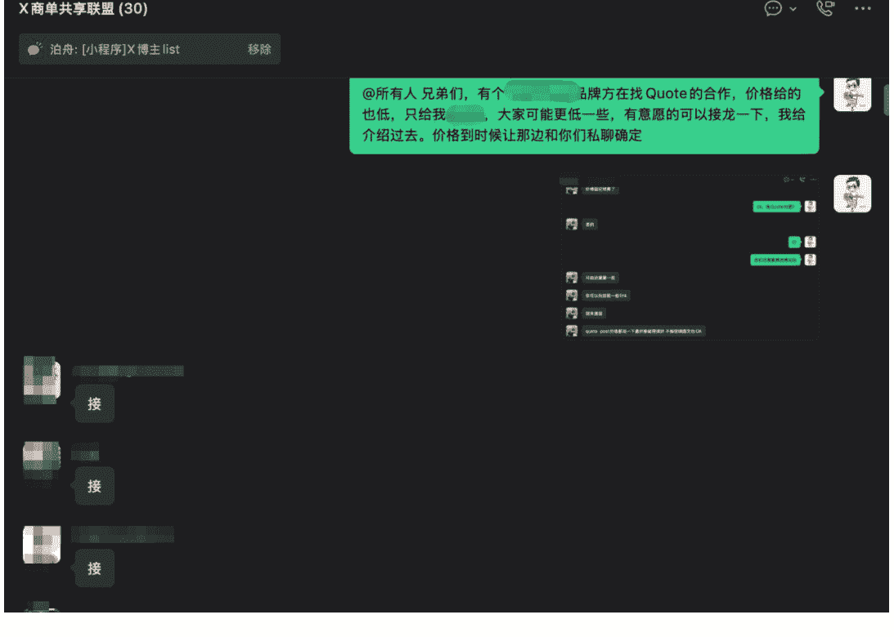

### 联盟营销

主动找带货提供商，比如推广各种卡类。
把内容和营销结合，长期下来收益不错。
手机号教程单篇能带来**1,000-2,000 美元**的分成收入。

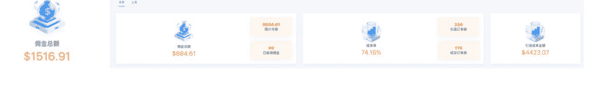

我的做法可能和大多数人不太一样：**我不等商家来找我，而是主动去找我日常在用的工具和产品谈合作**。我平时写干货会用到很多工具，只要是我自己真实在用、验证过、觉得确实好用的，我就会主动找到开发者或公司聊合作——联盟链接也好、定制内容也好。这样做的好处是双重的：文章里的推荐有真实使用基础，对读者是有价值的干货，而不是硬广；对我自己来说，**每写一篇文章都不再是一次性消耗，而是既帮了读者，又为自己攒下长期收益，持续获得正反馈**。

> 策略：核心是主动。别被动等别人找你。当你把「主动寻找变现机会」变成一个习惯后，你会发现你写的每一条内容都可以嵌入变现路径——教程里推荐工具、测评里放联盟链接、资源帖里带自己的产品。爱一行、用一行、推一行：你日常就在用的东西，就是你最自然、最有说服力的变现资源。

### 创作者收益：现在只奖励原创

X 创作者收益上限很高——有人半个月拿到 26,000 美元，月上限 50,000 美元。视频内容有全局扶持，更容易传播全球。

但 2026 年这里发生了一件大事，想靠这个赚钱的人必须知道：X 于 2026 年 8 月 7 日停止接受老版广告分成计划（Creator Revenue Sharing）的新申请，9 月 7 日正式退役，9 月 8 日起用全新的「原创内容奖励计划」（Original Content Rewards）分批接管。新计划的核心只有一句话——只给原创内容结算。聚合、搬运、直接复制、把别人的作品轻改一下就发，一律不满足资格、拿不到一分钱；老玩家也必须重新申请、重新过原创性审核，才能继续拿收益。平台官方也承认：老计划的激励是错位的，等于变相奖励「内容偷窃」，所以新计划会用模型做原创性判定，把这条薅羊毛的路从机制上堵死。

而且这不是「预告」，已经在执行了。X 的产品负责人此前明确说过：平台已能识别批量搬运小号内容来骗取创作者收益的大账号，并且会把对应的展示收益直接划给原创作者——一个拥有 350 万粉的头部账号，因为盗用媒体记者视频且不注明来源，上一周期的收益直接被砍掉 90%。

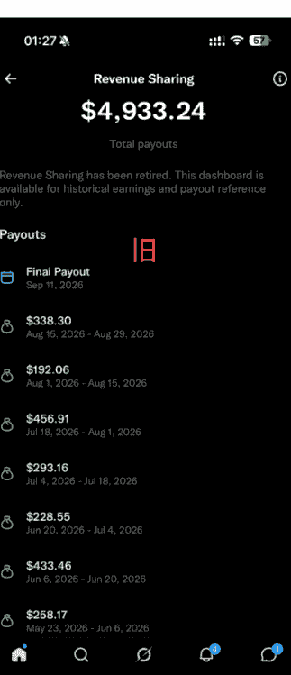
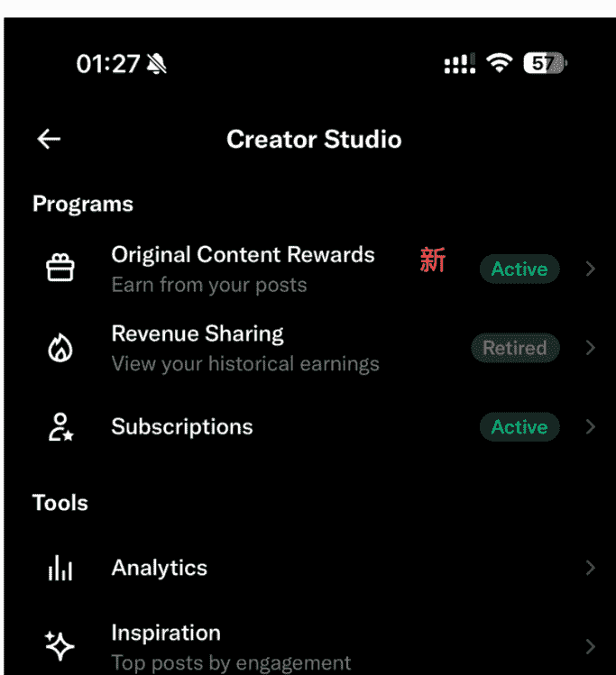

所以，如果你正打算靠搬运、洗稿、矩阵号去薅创作者收益——趁早别做了。这条路已经不只是「难走」，而是被平台从机制上堵死了：结算资格没了，还可能被反噬。想做创作者收益，只有一条路：做原创的、有增量价值的、你自己的内容。这恰好和这篇文章的主线一致——真诚利他，才是最稳的护城河。

策略：这条路上语言策略至关重要（见上一章）。中文内容也能拿收益，但单价低得多。如果创作者收益是你的核心收入来源，你必须做英文内容或视频。

### 社群与课程

部分人通过做社群或课程变现。但我不推荐——做付费社群交付太重，如果达不到交付标准会伤害 IP。而且收费低的话收益少，经营时间长，不如做产品。

如果你确实想做，把它当作「产品」来做而不是「副业」——定好交付标准、做好运营成本核算、设置合理的定价（太低反而吸引不到好用户）。但对有能力做产品的独立开发者，把同样的精力放在 SaaS 上，ROI 更高。

## 九、赛道与避坑：这些能碰，这些别碰

### 热门赛道

AI 和 Web3（两个圈子有融合趋势）、独立开发者、手机号相关、港股港卡、AI 摄影——这些赛道有稳定的流量和变现。

### 避开的赛道

健身、育儿等——竞争激烈、受众窄、变现路径短。除非你已经是这个领域的权威，否则很难突围。

### 发布时间

推文发布后 1 小时内的互动数据，对后续分发影响很大。第一时间请朋友互动（互相加热）不是可有可无的小动作，而是冷启动阶段必要的一部分。

### IP 环境与防封避坑

很多圈友辛辛苦苦把账号做到几千上万粉，结果一夜之间被永久封禁，死得不明不白。这里面 90% 的原因都出在网络环境上。

血泪教训：千万别用劣质机场节点天天变来变去！公共机场的 IP 池是成百上千人共用的，里面混杂了大量的黑灰产和自动化脚本，节点 IP 早就被各大平台标记为高危脏 IP。更致命的是，你可能上一分钟还在香港节点，下一分钟机场自动切换到了美国或欧洲。在 X 的安全风控系统看来，这属于典型的「跨洲异常登录/盗号撞库行为」，直接秒触发安全锁定甚至永久封禁。

正解做法：

1. 起号前就配置好固定的纯净独享静态 IP 或住宅 IP，平时发推、刷推尽量固定在同一个国家和设备环境上；
2. 一定要第一时间开启 2FA 双重身份验证（推荐使用 Authenticator 绑定），这样哪怕环境轻微波动，系统也优先让你验证而不是直接封号。环境稳了，你的号才能长命百岁。

### 矩阵运营

X 不允许矩阵运营，AI 生成内容容易被判定。再叠加 2026 年的原创内容奖励计划，矩阵搬运号的收益结算路径也被堵死了——做矩阵的投入产出比已经极低。如果非要碰，就只做 100% 自己生产、能扛得住原创性审核的内容，并做好随时被清理的准备。

## 十、精力分配：别轻易把推特当主业

聊完方法和机会，最后说说心态。能在这条路上走得久的人，靠的从来不是「坚持」硬撑——背后都有产品、业务，或者一个明确的目标在撑着。

> □ 推特只是渠道，产品才是根本。

拿我自己说，在推特上花的精力会控制在 30% 以内，剩下的 70% 留给产品和真正赚钱的业务。你也可以给自己定一个类似的比例——内容持续输出靠的是节奏，不是透支：一口气猛发三个月，不如细水长流发三年。

把 X 当放大器，它才能真的放大你；把 X 当救命稻草，它只会拖垮你。

## 写在最后：真诚利他，主动出击

推特这个平台，用户质量高，变现方式多样，复利效应明显。把内容做好、把互动做真诚，平台的复利自然就来了。最核心的就五件事：

## 核心观点

> 算法和人性和在这里是同一个方向。

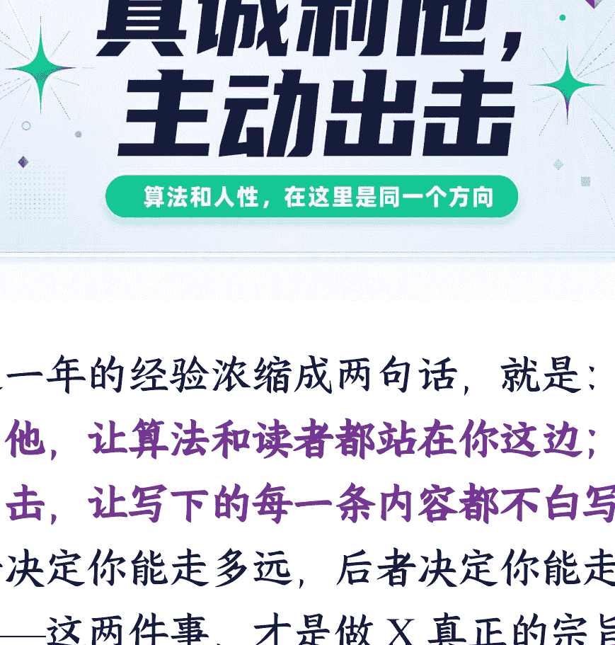

把这一年的经验浓缩成两句话，就是：

- 真诚利他，让算法和读者都站在你这边；
- 主动出击，让写下的每一条内容都不白写。

前者决定你能走多远，后者决定你能走多快——这两件事，才是做 X 真正的宗旨，也是这篇文章最想交给你的东西。

我写这篇文章，就是想把经验尽量完整地分享出来——写这篇文章本身，就是「利他」的一次实践。如果你有自己的业务，不一定非得把推特当主业——除非你真的想全职做内容，那么它也可以给你不错的收入。

最后还是说一句：别犹豫，干就完了。

——分割线——

看完这篇 SOP，你觉得你懂了。但 90% 的人一到实操就会卡在第一步。

工具和教程只是最低级的壁垒，真正的壁垒是“立刻动手”和“圈层信息差”。

### 商业闭环与 AI 效率

我们不聊虚的，只做商业闭环的拆解与 AI 效率的压榨。系统内已沉淀 1000+ 跑通的套利实战局。

- 查阅圈子完整数字资产与上车门槛：[https://lazysO.com/insider/](https://lazysO.com/insider/)

认同价值、准备好下场干活的，扫码加我微信（lazyhelper1）。

备注：【实操上车】，不闲聊

