# YouTube长视频月入万刀，油管老兵的复盘分享

260914 副业 SC 精华

整理：公众号懒人搜索，懒人专属群精选
懒人微信：lazyhelperl


> **小懒判断** ｜ 适合想做 YouTube 长视频、扛得住一个月零反馈的人，不适合想赚快钱或只会跟风搬运的。最值得关注找赛道三件套：搜 20 分钟以上+近一月发布+破万播放，对标账号视频数 15 个内、起号一个月内，同赛道开 3—5 个号一起测。坑在同质化判罚：5 个 YPP 号一夜全被取消，连没打款的钱都收不回。

大家好，我是私藏人间，生财 AI 视频深海圈咨询教练。

在看到亦仁的超级标之前，我几乎没有接触过 YouTube，甚至不知道原来 YouTube 可以赚钱。

到现在我做出过千万级 Shorts 和百万级长视频，Shorts 累计播放超过 1 亿；目前有 5 个长视频账号开通了高级 YPP，最高单月收入超过 1 万刀。

在这里非常感谢 @方波妮@Gary 曹淦总教练的给力指导，也非常感谢生财提供的深海圈社群平台。

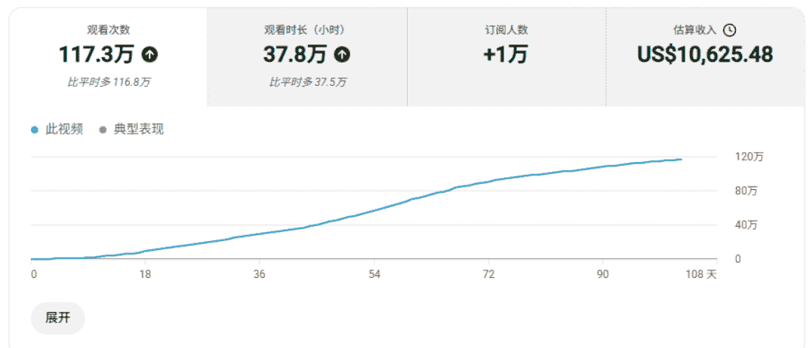

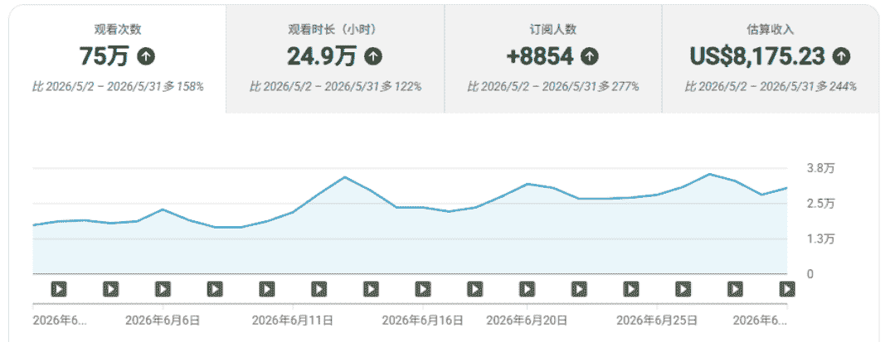

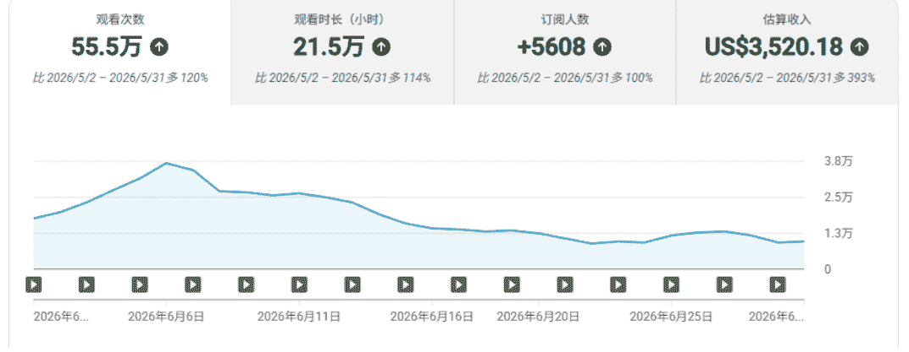

如果只看这些结果，很容易让人觉得我一开始就选对了方向，或者做 YouTube 的过程非常顺利。但真实情况并不是这样。

中间我做过多个赛道，经历过长期没有大播放、断更、重新开始，也经历过 5 个 YPP 账号同时被取消、收入一夜归零。

YouTube Shorts 科普解说赛道开通 YPP 历程：https://t.zsxq.com/4s452 这篇分享，我想完整复盘自己一路走来的经历，以及这段经历带给我的几个重要变化。

## 一、我的 YouTube 经历

### 1. 反复换项目

加入深海圈以前，我没有一份传统意义上的主业。

我做过淘客、小说推文、闲鱼卖货，都跑通过 0~1，但都放大不了，几乎没有赚到什么钱。

再之后，我做过一段时间的中老年书法项目。

主要模式是在视频号发布内容，把用户引流到私域，再通过私域转化付费课程赚取佣金。

刚开始时视频号还能正常引流。后来平台管控越来越严格，用户越来越难引到私域。差不多同一时期，我接触到了公众号图文，就想着用公众号尝试一下。没想到，公众号的引流效率非常高。

高峰时期，一天可以引流 200—300 人，那个月让我赚到差不多 2 万块钱的佣金。

后来后端渠道越来越不稳定，公众号也开始限制二维码，这个项目便逐渐停止。

现在回头看，我当时并不是完全拿不到结果，也不是完全赚不到钱。

真正让我困扰的是：每一个项目好像都只能做一段时间。项目刚有一点起色，平台规则或者后端渠道就会发生变化。然后，我就只能再去寻找下一个项目，一切从头开始。

我一直处在这样的循环里：

- 找项目 → 做项目 → 赚到一点钱 → 项目失效 → 再换项目。

因为这些项目就是我的全部工作和收入来源，每一次重新开始，都会给我带来很强的不稳定感。

### 2. 初入 YouTube

最直接的契机，是我看到了亦仁的超级标。

> **亦仁**
> 2024-10-24 10:56
>
> #超级标 02
>
> 来了，今天发布第二条超级标，请坐稳扶车，发车！
>
> 本次超级标是：通过 AI 生成的各种视频，上传到 Youtube 和 shorts，获取广告分成，空间无限大，以下我来说明理由：
>
> 1. 这是一个超级巨大的市场和空间，12年我作为第一批在 Youtube 上开始赚钱的人，那个时候就已经感受到巨大的流量价值不对等，同样的播放，在国内视频平台可能一文不值，在Youtube上可能有几千美金的收益。
> 2. 背后是 Google 广告平台的巨大商流量，以及 Google 为了自己的内容生态，把广告收益的一部分分给了内容制作者。
> 3. 各种 AI 工具的出现，让咱们生财有术的圈友可以快速便捷制作视频的能力，以前的大多数视频需要露脸，或者需要有比较强的口播表达能力，现在，都可以通过AI工具来解决。
> 4. 为了和 tiktok 竞争，youtube 推出了 shorts，shorts 又开通了广告分成计划，且已经看到一些中国人在 shorts 上赚钱和导流的案例。

在此之前，我根本不知道 YouTube 还可以赚钱，也几乎没有接触过 YouTube。亦仁的推荐第一次打开了我对这个平台的认知。

生财出了 YouTube 的航海，我直接就参加了。

刚参加航海时，我没有直接追当时很热的 AI 视频，而是选择了科普解说。

因为我当时觉得，科普解说只需要找素材、写解说词、完成剪辑，看起来应该比 AI 视频更省力。

真正开始以后，我才发现根本不是这样。

一条视频确实不到一个小时就能制作完成，但视频能够做出来，不代表观众愿意看完。我一直卡在完播率。

刚开始连续更新十几条，视频基本都只有 1万左右的播放。直到航海结束，因为一直看不到结果，我直接断更了。

后来我看到圈友们的数据都很好，又受到了一点刺激。我觉得别人能够做出来，说明这个方向可能还有机会，于是重新调整，继续更新。

恢复更新以后，大多数视频仍然只有1万左右的播放，但是偶尔会出现一条10万播放的视频。

因为偶尔出现10万播放，我觉得这件事还有希望。再加上一条视频制作不到一个小时，我就决定继续更新，先不要过早判断项目行不行。

大约做到第二个月时，终于有一条视频开始爆了。

这条视频发布以后并没有马上起量，而是过了十几天才突然起飞，最后达到700多万播放。

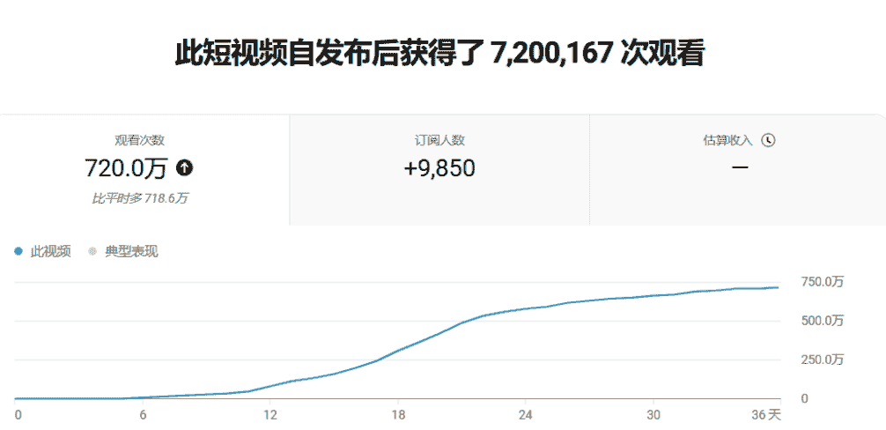

我原本以为它可以直接让我达到高级YPP，没想到播放量到700多万以后就停了。

虽然没有达到最初的预期，但这条视频给了我很大的信心：

既然我能做出第一次爆款，就有可能再做出第二次。后面还参加了2025年1月YouTube 私教陪跑（AI视频深海圈的前身），并学到了通过直播开通YPP的方法。这个账号就是通过陪跑里学到的方法开通了高级YPP。

现在回头看，如果没有那段私教陪跑，我很可能又会像以前一样，航海一结束，就慢慢停止更新。

### 3. 转做 Reddit 故事

真正的第一次赛道切换，是从解说转到Reddit 故事。

因为科普解说做了一段时间，一直没有获得特别大的播放。刚好那时，我找到一个Reddit 故事的新形式对标，就立即开始测试。

以前常见的 Reddit 故事一般是一分钟或者三分钟，而我找到的对标把内容压缩到了20秒以内。

这个形式有几个很明显的优势：

- 比一分钟、三分钟的版本更容易制作，流量表现反而更好；
- 一天可以更新3—5条；
- 全流程可以自动化；
- 非常适合批量生产和搭建账号矩阵。

即使单条视频没有跑出特别大的量，只获得基础播放，因为更新频率足够高，整体流量也比解说赛道更好。

测试跑通以后，我把主要精力转向了Reddit 故事。这个赛道最高一个月做到了 3000 刀左右的收入。

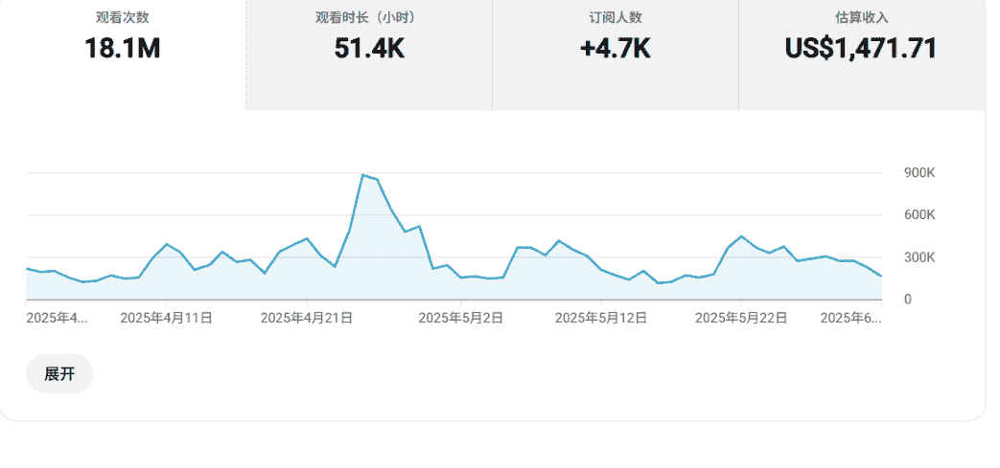

当时我觉得，这个模式制作简单、更新频率高，又能够短矩阵化，已经是一个比较不错的方向。

但真正的危机，很快就来了。

### 4. 遭遇同质化

26 年 1 月份，圈友们开始大批量的出现同质化，虽然 Reddit 的故事同质化的比较晚，但是终究还是来了。有 5 个已经开通 YPP 的 Reddit 故事账号，同时被判定存在“同质化”问题，并被取消 YPP。


**你的频道目前无法启用创收功能**

对你的频道综合运用自动和人工审核之后，我们发现它未遵循 **YouTube** 的频道创收政策。我们的审核人员发现你的频道包含以下内容：

**空泛或重复的内容**

内容似乎是空泛或重复的，或者未提供显著的创意、教育或其他价值。了解详情

注意：我们可能会依据相关规定扣留未支付的收入，包括《YouTube 合作伙伴计划条款》和通用政策。

这不只是之后不能再产生收益，甚至连之前还没有打款的钱也收不到。后续收益完全停止，原有收入直接归零。

当时，我很快意识到，这条路已经无法继续作为稳定的收入来源，必须立刻寻找新的方向。

我没有太多时间停下来纠结。因为我知道，长视频从起号到看到结果本来就需要周期。如果等到什么都想清楚、准备得很完美再开始，只会让没有收入的时间变得更长。

所以，账号出现问题以后，我马上开始测试长视频。

### 5. 转长视频音乐

最后，我选择了长视频音乐。

这个方向单条视频的制作相对简单：先使用 Suno 生成音乐，再用 AI 制作一个简单的视频或者图片作为画面。

它真正困难的地方并不一定是制作，而是赛道选择。

赛道选得好，内容可以慢慢获得流量；赛道没选对，视频做得再多，也可能一直没有明显反馈。这次转型并不是开一个频道就直接成功。我测了十几个账号，开了 20 多个频道，测了六七种细分赛道。

最终大概 1 个月的时间，第一个频道达标高级 YPP；第 81 天，第一条长视频突破百万播放；单月收入超过 1 万美元；目前有 5 个长视频账号开通高级 YPP。

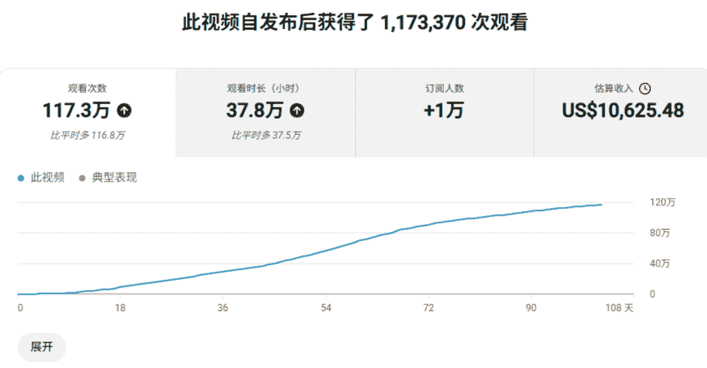

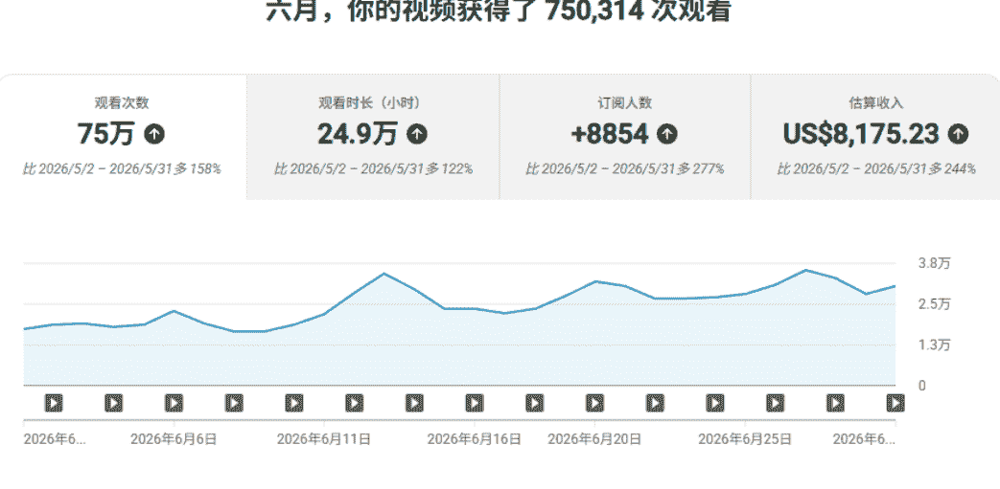

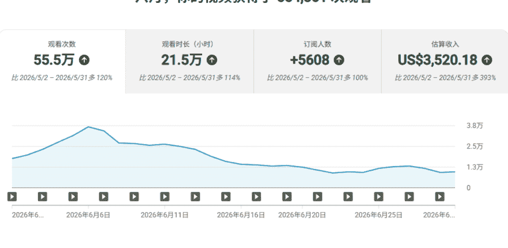

但即使取得这些结果，我也不认为自己已经彻底跑通了。一次爆款能够证明方法有机会，但不能证明它永远稳定。接下来仍然需要继续测试、分散风险和优化。

## 二、长视频音乐实操

前面聊了我做长视频音乐的一些经历，这一部分再具体讲一下，我是怎么找赛道、做音乐，以及后面怎么制作封面、写标题和简介，最后发布视频、测试账号的。

我觉得长视频很重要的一步就是选赛道。所以开始制作之前，要先去找对标，看看最近有哪些细分音乐已经有人做出了播放，再从里面选自己要测试的方向。

### 1. 找赛道

#### （1）找音乐类型

找音乐类型，可以先和 AI 聊。让 AI 推荐音乐大类，再选择更细的分类，可以从里面找到自己想做的音乐类型。这一步只需要找出一些关键词即可。

> 给我一些音乐风格的大类还有细分风格。

当然，音乐风格的分类没有绝对统一标准，很多风格彼此交叉，但下面这套“大类 → 细分”比较适合拿来做歌单、标签、找参考或做音乐风格标签。

| 大类 | 常见细分风格 |
| :--- | :--- |
| 流行 Pop | Dance Pop 舞曲流行, Electropop 电子流行, Synth-pop 合成器流行, Indie Pop 独立流行, Dream Pop 梦幻流行, Art Pop 艺术流行, Teen Pop, Bedroom Pop 卧室流行, City Pop 城市流行, Hyperpop 超流行 |
| 摇滚 Rock | Classic Rock 经典摇滚, Hard Rock 硬摇滚, Alternative Rock 另类摇滚, Indie Rock 独立摇滚, Punk Rock 朋克, Post-Punk 后朋克, Garage Rock 车库摇滚, Psychedelic Rock 迷幻摇滚, Progressive Rock 前卫摇滚, Glam Rock 华丽摇滚, Surf Rock 冲浪摇滚, Shoegaze 盯鞋 |
| 金属 Metal | Heavy Metal 重金属, Thrash Metal 激流, Death Metal 死亡, Black Metal 黑金属, Doom Metal 厄运, Power Metal 力量, Progressive Metal 前卫金属, Metalcore 金属核, Metalcore 死核, Nu Metal 新金属, Symphonic Metal 交响金属 |
| Hip-Hop / Rap | Boom Bap, Trap, Drill, Gangsta Rap, Conscious Hip-Hop 意识说唱, Alternative Hip-Hop, Cloud Rap 云说唱, Emo Rap, Jazz Rap, Lo-fi Hip-Hop, Phonk, Memphis Rap |
| R&B / Soul | Contemporary R&B 当代R&B, Neo Soul 新灵魂, Classic Soul, Motown, Quiet Storm, Alternative R&B, PBR&B, Funk Soul, Psychedelic Soul |
| 电子 Electronic / EDM | House, Techno, Trance, Dubstep, Drum & Bass, Hardstyle, Electro, Ambient, IDK, Breakbeat, UK Garage, Future Bass, Downtempo, Chillout |
| House | Deep House, Progressive House, Tech House, Future House, Bass House, Tropical House, Afro House, Funky House, Acid House, Chicago House |
| Techno | Detroit Techno, Minimal 极简, Industrial Techno, Hard Techno, Dub Techno, Melodic Techno, Acid Techno |

找到一个想尝试的类型以后，就把这个音乐类型放到 YouTube 搜索框里面搜索，去找近期的爆款。

搜索后，先筛选三个条件：20 分钟以上的长视频，以及近一个月内发布的作品。

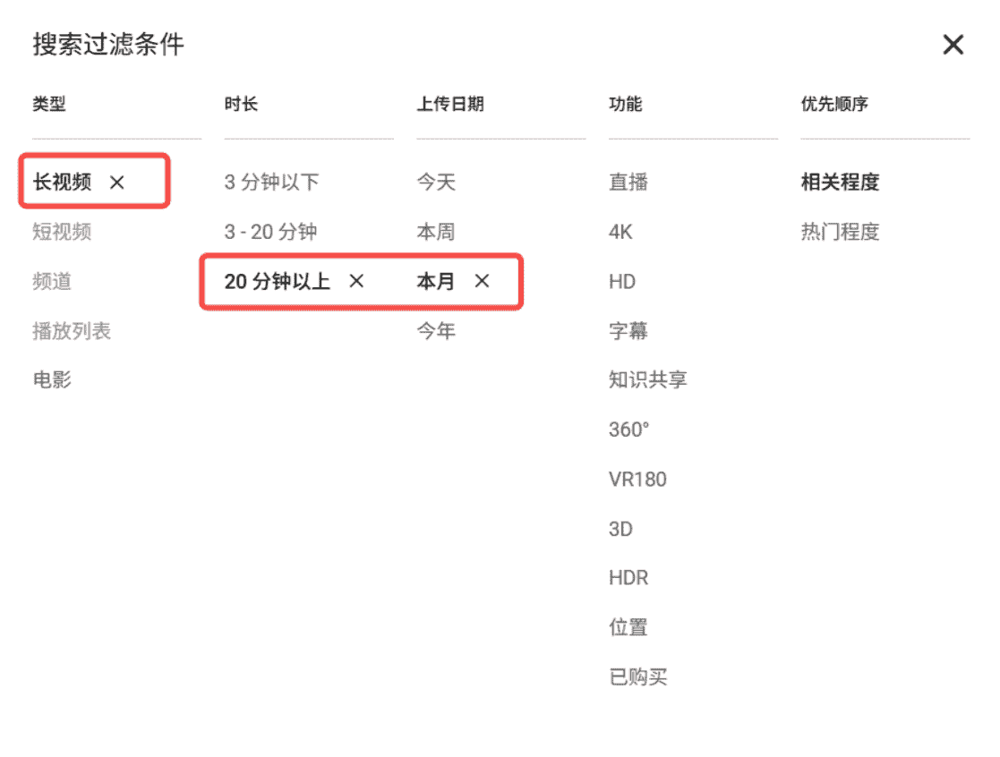

然后一个一个看搜索出来的视频，重点找已经破万播放的。看到符合条件的视频，就点进他的主页，继续看这个账号的情况。

#### （2）视频数和起号时间

进到主页以后，主要看两个地方：**视频数，起号时间**。

- **视频数量最好在 15 个以内。** 如果找不到，也可以稍微放宽，但能找到 15 个视频以内的，还是最好的。
- 起号时间最好是在一月内。不过一月的账号确实很难找到，所以实际找的时候，可以逐步放宽条件。
- 一个月找不到，再看两个月、三个月内的，这些都可以去测试。
- 起号时间点最早，看最早发布时间。

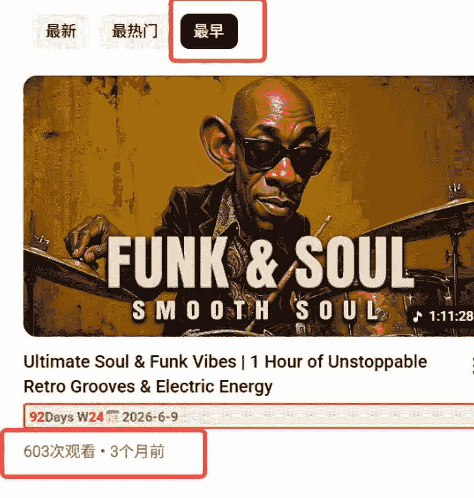

> 2026年5月12日注册
> 8010位订阅者
> 119 个视频
> 1,266,133次观看

就是找视频发得还不多、起号时间比较近，但已经有作品跑出播放的账号。

找到这样的对标以后，再继续看有没有人跟做他。

#### （3）用爆款标题搜索同行

找到对标以后，还有一个操作：把他最爆款的视频标题拿到 YouTube 搜索框里，再搜一遍。这次主要看有没有人抄他的，以及做类似内容的同行有多少。

如果搜出来类似下面图一个标题有很多个账号做，那就不做这个赛道了，继续找下一个。

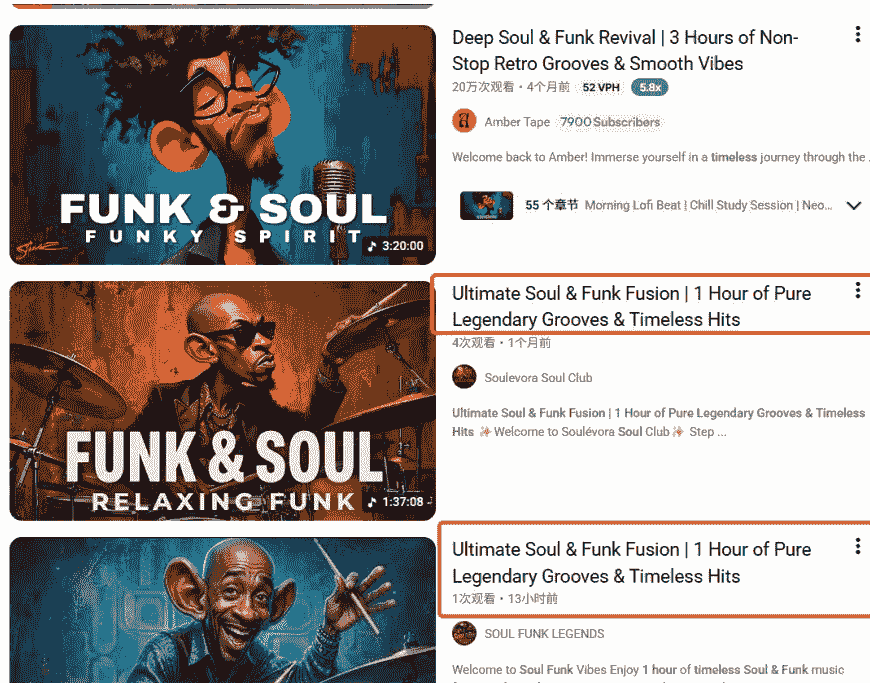

如果搜出来基本看不到跟做的账号，这样的对标就很好，可以优先考虑。

还有一种情况，是已经有人在跟做，但数量不多。这时候就要再点进去，看这些跟做账号的播放量怎么样。

如果他们的视频已经能有几百播放，说明这个方向还可以做，可以拿来测试。

但如果他们的封面和视频质量都已经和原对标差不多，播放量却只有几个，那这样的就不考虑做了。跟了大概也是没有量。


**原对标**

> Ultimate Soul & Funk Fusion | 1 Hour of Pure Legendary Grooves & Timeless Hits
> 35万次观看 · 3个月前
> 184 VPH >100x


**跟做账号**

> Ultimate Soul & Funk Fusion | 1 Hour of Pure Legendary Grooves & Timeless Hits
> 13次观看 · 2个月前

找赛道这一步，一定要有耐心。符合条件的对标可能没那么容易找到，但还是要继续找，尽量把最好的细分赛道找出来。

不要只是自己觉得这个音乐不错、这个方向不错，就决定做了。前面说的视频数量、起号时间，以及跟做账号的情况，都要去看一遍，再决定要不要测试。

## 2. 制作音乐

#### （1）反推音乐风格

赛道找到以后，下一步就是复刻对标的视频。音乐这一部分，会用到 Gemini 和Suno。

先用 Gemini 反推对标的音乐风格，这里会用到一个提示词。

> 你现在是一位资深的音乐制作人兼 Suno AI 提示词专家。接下来我会提供一段音频文件（或提供具体的音乐描述/歌名）给你。请你仔细聆听并深度分析它的音乐特征、情感、人声和结构，然后为我反推出能在Suno 中生成类似歌曲的精准提示词。请严格按照以下三个部分输出你的分析结果：
>
> 1. **Style of Music (曲风标签)**
>    请提取出核心的音乐流派（如 Synthwave, Pop Rock）、情感氛围、特色乐器、BPM 节奏感以及人声特征。要求：全部使用英文，用逗号分隔，按重要程度排序，精简干练。示例格式：Pop rock, anthemic, upbeat, male energetic vocal, electric guitar riffs, driving bass, 120 bpm
>
> 2. **Song Structure & Lyrics Breakdown(歌曲结构与歌词拆解)**
>    如果我提供的是一个包含多首歌曲的链接、歌单、专辑页面或音乐页面，请默认只分析该链接中的第一

### 1. 拆解歌曲结构与歌词

首先识别第一首歌曲，并根据实际歌曲内容，完整拆解它的歌曲结构、歌词段落、人声表现和编曲变化。必须按照歌曲真实的时间顺序进行拆解，并使用 Suno 可识别的中括号 Meta-tags 标记每一个段落，例如：[Intro][Verse 1][Pre-Chorus][Chorus][Post-Chorus][Verse 2][Bridge][Breakdown][Instrumental][Guitar Solo][Final Chorus][Outro][Fade Out]。不要机械套用固定结构。必须根据原曲实际听感判断段落类型；如果原曲没有 Pre-Chorus、Bridge、Solo 等段落，则不要强行添加。

对于重要段落，请在 Meta-tag 中加入能够帮助 Suno 理解原曲动态、配器和演唱变化的英文描述，例如：
- [Intro: Ambient synth pad, filtered vocal texture]
- [Verse 1: Minimal drums, intimate vocal]
- [Pre-Chorus: Rising tension, layered harmonies]
- [Chorus: Full instrumentation, powerful drums, wide backing vocals]
- [Breakdown: Sparse percussion, whispered vocal]
- [Final Chorus: Bigger drums, octave vocal layers, emotional climax]
- [Outro: Instrumental fade out]

同时分析原曲中的特殊人声表现，并在对应位置使用圆括号 () 标记，例如：(whisper)(falsetto)(breathy vocal)(spoken)(choir backing)(layered harmonies)(ad-libs)(vocal chop)(call and response)。

请以我提供链接中的第一首歌曲为依据，逐段拆解真实歌词的内容和进入位置，使 Lyrics 模板能够尽可能准确地对应原曲。如果歌词内容是我直接提供给你的，或属于可以完整使用的文本，请按照原歌词逐段整理到对应的 [Verse]、[Chorus]、[Bridge] 等标签下。

请准确标注每一段的歌曲结构；用简洁中文概括该段歌词表达的具体内容、主题和情绪；必要时仅引用极短的原歌词关键词或短句，用于确认段落位置；保留原曲的重复规律，例如 Chorus 重复几次、Final Chorus 是否有变化、Outro 是否重复某一句；尽可能还原歌词的句数、长短、密度、押韵节奏和演唱方式，以便后续续创作同结构的新歌词。

最终请输出一个可以直接用于 Suno "Lyrics" 框参考的完整结构模板，风格提示词和歌词给我可以复制的代码块格式，不要多余的解释。重点不是简单总结歌曲，而是尽可能把“原曲的歌词进入方式 + 段落长度 + 重复关系 + 演唱表现 + 编曲动态”完整拆解出来，让我可以直接参考这个结构，在 Suno 中创作一首结构、推进和情绪非常接近原曲的新歌曲。

#### 示例代码块

```text
Punk, retro soul, boogie funk, 1970s R&B, groovy, soulful, mid-tempo. Funky slap bass, brass horn stabs, electric rhythm guitar riffs, Rhodes piano, tight drum groove with handslap on 2 and 4, warm male soulful vocal, falsetto ad-libs, call and response harmonies, 112 bpm
[Intro: Funky slap bass groove, tight snap-catted drums, Rhodes chords, horn stabs, vocal hums]
[We hum...]
[We hum...]
[Hey baby...]
[Hum... yeah...]
[Verse 1: Laid-back groove, muted funk guitar chops, smooth but warm male vocal]
You came in slow
In that velvet coat
Cross the room
Like you knew I'd glow
Gold on your wrist
And a shy little grin
I lost my cool
From you slid right in
By one sweet will
By fast-foond lime
Baby, one look
And you were mine
[Pre-Chorus: Rising horn swell, layered harmonies, rhythmic clap build-up]
(Ohh You got that sway)
(Make me lean that way)
(Clap on two and four)
(Then you pull me more (Oh-wah))
```

风格提示词反推出来以后，就拿到 Suno 里面去试。最初测试的时候，要先用对标的歌词，这样能更好地反推他的音乐风格。生成以后，需要自己去听、自己去判断，看看做出来的感觉对不对。

如果感觉不对，就再跟 Gemini 说，具体是哪里不对，让它调整风格提示词。调整完以后，再拿到 Suno 里面生成，听一下新的结果。这一步需要自己参与判断。Gemini 可以帮忙调整提示词，但生成的音乐和对标像不像、感觉差在哪里，还是要自己去听。发现不对的地方，就继续反馈、继续调整，把风格先调出来。

### （2）生成音乐

风格提示词调好以后，下一步就是写歌词。写歌词也会用一个提示词。

【风格提示词】 这是我的 suno 音乐风格提示词，帮我写一些符合这个风格的英文歌词。并且给这首歌起一个歌名。每首歌的歌词用单独的代码块给我。

前面测试的时候，先用对标的歌词去找音乐感觉。到这一步把自己接下来要做的歌词写出来。歌词写好以后，再和调好的风格提示词一起拿到 Suno 里面生成音乐就可以了。

### （3）确定视频时长、歌曲数量和重复次数

音乐做完以后，还要看一下对标的视频时长，以及他实际用了多少首歌。有些音乐视频看起来很长，但里面的歌是重复播放的。比如，前面先放了 5 首歌，后面又把这 5 首复制了一次。

所以这里要看清楚三个地方：**整条视频有多长、实际有多少首歌、这些歌又重复了几次。** 如果对标就是 5 首歌再复制一次，那就按他的这个结构来做。具体要生成多少首歌、后面要重复多少次，都先看对标是怎么安排的，再去模仿。

## 2. 封面、标题和简介

音乐这一部分做好以后，接下来就是封面、标题和简介。

### 3. 制作封面

封面我目前是用 ChatGPT 来生成，复刻图片风格很准确，很好用。做法很直接：直接把对标的封面下载下来，上传到 ChatGPT，再把提示词输进去，让它帮忙复刻一张类似风格的图片。

提示词示例：模仿这个封面的风格，改变一下人物穿着，改变人物形象，改变人物姿势，做 1 张全新的原创封面。比例：16:9。


### 4. 写标题

最初起号测试的时候，直接用对标的原标题，完整拿过来，先不改。长视频标题对流量的影响很大。刚开始测试时，如果自己又改了标题，视频没量，就还要考虑是不是标题影响了结果。所以这一阶段，先把标题这个因素尽量固定下来。

具体用哪个标题，可以从对标播放量最好的视频开始，先用它的标题，再按播放量往后依次用后面的。等后面账号有量了，再让 GPT 小改标题。主要关键词保留，其他内容做一些调整。

### 5. 写简介

简介也可以交给 GPT。先把对标的简介给它，让它模仿对标的内容，写出一个框架。后面每次发布视频，就根据自己的歌曲内容去填这个框架，再小改一下。填内容、改表达，这些都可以让 GPT 来做。

简介不是特别重要，这一部分按这个方式处理就可以了。

### 6. 发布视频，测试账号

#### （1）同一赛道至少用三个账号测试

起号的时候，最低用 3 个账号，最好有 3—5 个账号，同时测试同一个赛道。因为长视频没量，有时候也会受到账号的影响，有的频道会一直挂零播。如果只用一个账号测试，就很难判断究竟是赛道的问题，还是这个频道的问题。所以把几个账号放在一起看，用它们的播放情况来判断接下来怎么做。

#### （2）每个频道至少发三条，间隔 2—3 天

最初起号，每个频道至少先发布 3 条视频，可以间隔 2—3 天发一条。三条发下来，大概一周，再看播放情况。如果一个频道的三条视频都是零播，直接新建频道。

#### （3）根据播放情况决定继续更新、换频道或换赛道

如果三个账号里面有一个有量，说明这个赛道能出量。有量的账号就继续更新，另外两个没量的，先按频道的问题处理，直接去新建频道。没量的频道不用管，放在那里就可以了。新建好频道以后，继续在这个赛道发布新的内容。

有播放的账号，继续更一个月，看看整体的量怎么样。如果后面还是没什么量，再换一个赛道测试。如果三个账号都没量，我就会判断这个赛道有问题，直接换赛道。

## 三、我的变化与复盘

### 1. 为什么选择 YouTube 和深海圈

#### （1）视频的长期价值

以前做的一些项目比较依赖短期流量或者平台窗口，但 YouTube 的视频发布以后，还可以持续获得流量。它不是发布当天没有结果，这条内容就完全失效了。对我来说，这意味着内容可以长期积累，而不是每次都从零开始。

#### （2）适合自己的工作方式

做 YouTube 不需要频繁和人打交道，我只需要把视频做好、发布出去，再让平台和观众给我反馈。这种专注于作品本身的工作方式，比较适合我。

#### （3）可以长期交流的圈子

以前跟着航海做项目，航海结束以后就容易停下来，也不容易及时获得最新信息。我希望这一次，不只是再追一个短期项目，而是找到一件可以长期做的事，也找到一群可以长期交流、遇到问题能够互相帮助的人。

### 2. 加入深海圈后的三个变化

如果让我总结自己最大的变化，我会把它们分成三个层面：心态、行动和方法。

#### （1）从追求即时反馈，到接受延迟反馈

以前做项目我特别希望马上看到结果。做一段时间没有反馈，就容易怀疑方向，想换下一个项目。但这种心态在 YouTube 上完全不适用。

Shorts 可能发布十天以后才开始获得推荐；长视频可能要等 20 天甚至一个月；有时视频刚发布，播放量直接是零。

现在我会告诉自己：

> 暂时没有反馈，不等于最终没有结果。

#### （2）从拖延观望，到先发布、再优化

刚加入深海圈时，我的执行力并不强。比如波妮教练发布音乐商单以后，我拖了很长时间，一直没有把音乐加入自己的视频。等第一波流量跑起来时，我才发现自己已经错过了那一波收益。

现在，如果看到好的对标或者新的机会，我会先马上测试。不再要求第一条视频必须做得很好，而是先把视频做出来、发布出去，让系统提供真实反馈，再根据反馈继续改进。

如果一直等到准备完美，很可能等准备好了，赛道窗口已经过去了。

#### （3）从把低播放当成失败，到把数据当成反馈

以前我发布视频以后，只会看最后有多少播放，从来不会认真分析数据。播放量低时，就容易觉得这条视频失败了，甚至怀疑整个赛道不行。

现在测试一个长视频赛道时，我会同时开 3—5 个账号，测试优化选题、开头和封面。

现在的我，不会用一条视频给一个赛道判死刑，而是通过多次测试，找到真正的问题。

### 3. 拿到结果的方法

#### （1）赛道选择是第一位的

根据我的经验，赛道是最先需要判断的变量。赛道选得好，内容更容易获得流量；赛道不合适时，视频即使制作得很精致，也可能很难获得播放。

当然，这并不是绝对规律，但选赛道确实比一开始就纠结所有制作细节更重要。

#### （2）给长视频足够的测试周期

长视频反馈很慢，不要发布一两条以后就急着下结论。我的建议是，可以按照每 2—3 天更新一条的节奏，至少连续测试两周，再观察整体数据反馈。

我有一个长视频账号，发布 5 条以后一直没有明显播放，就暂时放在一边。后来再次打开时，没想到视频已经慢慢跑起来，账号甚至达到了初级 YPP 的标准。

所以，可以一边测试新频道，一边让旧内容继续等待延迟推荐。

### 4. 做项目需要的两种能力

#### （1）耐心，但不是盲目死磕

做内容不能因为一时的数据不好，就马上给一个账号或者赛道判死刑。耐心不是要求自己在一个没有反馈的账号上无限坚持，而是在测试新方向的同时，不急着否定已经发布的内容，给平台和作品足够的反馈周期。

#### （2）主动寻找解决方案

以前遇到问题时，我总喜欢自己一个人琢磨，在群里几乎没有发过言。第一次开初级 YPP 时，我遇到一个自己都找不到原因的问题。实在没有办法，我才第一次主动在群里提问。

波妮教练看到以后，一句话就把问题解决了。那次让我意识到：有些问题，自己可能研究很久都发现不了；但对有经验的人来说，也许一两句话就能解决。进入一个圈子以后，不能只是默默接收信息。遇到问题时主动提问、主动使用集体经验，也是一种重要能力。

### 5. 给刚入局长视频新人的三句话

#### （1）不要等完美了再做

等你准备到自己觉得完美的话，可能这个赛道已经不能做了。一定要先把第一条视频做出来、发布出去，再根据真实反馈慢慢改进。先完成第一条，再慢慢接近完美。

#### （2）一定要有耐心

特别是做长视频，短期内可能根本看不到反馈。不要用发布后几天的零播放，去判断一个视频、账号或者赛道最终有没有机会。暂时还没有反馈，不等于最终没有结果。

#### （3）遇到不会的问题，主动问

就算你是一个内向的“i人”，也要在群里多提问。简单的问题，可以先问 AI；如果 AI 解决不了，就去问教练和圈友。不要让一个别人一两句话就能解决的问题，把自己卡住很久。简单问题先问 AI，复杂问题主动问人。

## 结语：知道自己可以重新开始

YouTube 带给我的，不只是播放量和收入。它让我从一个不断寻找即时反馈、不断更换项目的人，慢慢变成一个愿意先行动、耐心等待，并用数据持续优化的人。

平台会变化，收入还需要变得更加稳定，成功也需要继续验证能不能复制。但我已经知道：

- 遇到变化以后，我可以重新开始；
- 遇到低播放，我可以通过测试寻找原因；
- 遇到不懂的问题，我可以向 AI、教练和圈友主动提问；
- 遇到暂时没有反馈的阶段，我可以多给作品和自己一点时间。


看完这篇 SOP，你觉得你懂了。但 90% 的人一到实操就会卡在第一步。

工具和教程只是最低级的壁垒，真正的壁垒是“立刻动手”和“圈层信息差”。

如果你想看全网最新的变现玩法，并且和一群执行力极强的极客一起下场拿结果，欢迎围观我的核心私域：【懒人专属群】。

我们不聊虚的，只做商业闭环的拆解与 AI 效率的压榨。系统内已沉淀 1000+ 跑通的套利实战局。

查阅圈子完整数字资产与上车门槛：[https://lazyso.com/insider/](https://lazyso.com/insider/)

认同价值、准备好下场干活的，扫码加我微信（lazyhelper1）
备注：【实操上车】，不闲聊


