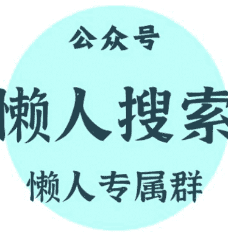

## 美国真的退关税了，但出口企业不见得多开心

260914 文/卢克文工作室嘉宾 雨巡星宿
整理：公众号懒人搜索，懒人专属群精选
懒人微信：lazyhelper1

> **小懒判断** | 适合盯中美关税、手上有出口链或相关股票的人，不适合只想要“美国服软”爽点的人——钱其实没那么好拿。最值得关注：1660 亿退税只占累计加征关税两成，且只有美国本土进口商能申请，义乌饰品厂被找茬扣钱就是先例，中小出口商大概率拿不到。坑在于别把退税当关税战终点，特朗普已换 1974 年贸易法再加 15%基准关税。

真是活久见，美国真把特朗普去年加的关税给退回来了。

最近有多家上市企业发布公告，确认收到了美国关税的退税款项。

比如动力运动装备巨头春风动力，合计收到 6.28 亿人民币的退税；零售科技公司汉朔科技，收到了 1.57 亿元。

中国对美出口企业苦关税久矣，这笔钱退回来，无疑会瞬间改善企业的利润表，炒股的朋友近期可以多关注相关板块。

虽然这是好事，但我们需要澄清一个事实：这次退的关税在美国发动的关税战中，还只占一小部分。

别忘了，特朗普从第一任期开始，就一直在折腾各种关税战。而这次退的关税，既不包括美国对大多数国家征收的基础最惠国关税，也不包括 2018 年加征的“301 关税”。

根据美国海关与边境保护局（以下简称 CBP）统计，本次退税总金额为 1660 亿美元，只占 2018 年至今累计加征关税的 20% 左右，只退两项关税：

- 一是 2025 年 2 月特朗普对中国、墨西哥和加拿大的加征芬太尼关税
- 二是 2025 年 4 月美国对全世界征收的“对等关税”

不管怎么说，能从特朗普嘴里抠出 1660 亿，过程必然特别曲折。

去年特朗普打关税战，援引的是《国际紧急经济权力法》（IEEPA），就是总统判定有“来自境外的、不寻常且特别的威胁”，就可以临时加税。

这个理由显然莫名其妙。

起轫是一家叫 Learning Resources 的玩具进口商，越想越气，因为它大量产品要从中国进口，原本一年只用交 230 万美金的关税，IEEPA 关税落地后，关税成本直接飙升到 1100 万美元，而且还在继续往上飙。

Learning Resources 养着 500 多个员工，亏钱亏得心慌，只好告到华盛顿地区法院，说特朗普实施 IEEPA 关税属于越权。

顺便说一下，华盛顿特区是民主党老巢，华盛顿地区法院的法官也是自由派居多，特朗普 2020 大选干预案（国会山骚乱）就是在华盛顿地区法院初审的，而且当时的主审法官丘特坎还是奥巴马亲自提名的。

特朗普一直怀疑华盛顿地区法院偏心，于是打算让司法部以“管辖权异议”为借口，把案子移送给国际贸易法院，说华盛顿地区法院没权力管这事。

虽然国际贸易法院也未必会偏向特朗普，但司法部的算盘是希望拖延时间，因为对方只是一个利润微薄的玩具进口商，案子来回折腾个一两年，耗不起就只有撤诉。

但华盛顿地区法院很强硬，驳回了移送案件请求，还临时叫停 IEEPA 关税继续执行。司法部毫不示弱，向上级法院申请暂停禁令生效，也就是说，“我暂停了你的暂停”！

眼见司法部欺人太甚，芝加哥一家叫自由司法中心（Liberty Justice Center）的组织，可能是为了出名，找到因关税亏钱的葡萄酒进口商老板维克多·施瓦茨，说可以推举他作为首席原告，联合多家小企业和 12 个州发起联合诉讼，全程免费，施瓦茨一口答应。

就这样，官司一路从国际贸易法院打到最高法院，连 FedEx 这类大型进口商也加入了起诉队伍。

原本美国最高法院保守派占多数，三位大法官由特朗普提名，所有人都以为特朗普会赢，但出人意料的是，今年 2 月 20 日，最高法院以 6:3 的绝对票数认定这批关税违法。

最高法院判决结果出来后，国际贸易法院安排伊顿法官负责后续退税系列案件审理。

伊顿是个老自由派，是当年克林顿提名的。3 月 4 日他裁定，所有缴纳 IEEPA 关税的登记进口商，无论规模大小，都有权获得退税和利息！

靴子落地了，特朗普只有硬着头皮掏钱了。

问题是这届政府真的缺钱，就开始琢磨拖字诀，希望采取分期付款方式，分三期付钱。

一期 4 月开放申请，二期 6 月开放申请，原本计划 7 月底开放的三期，到现在还没动静，因为司法部还在上诉，说不该走批量申请（流程快），该单独起诉海关（流程慢），然后冻结了三期对应的退税资金。

实际上，到了 7 月，美国财政部也是真没钱了，因为国库现金都要到警戒线了。

最后没办法，现金不够发债来凑，长债卖不出去就发短债。7-8 月，美国财政部硬是扛着 3.6%+ 的短债利率，比平时多发了 5000 亿美元短债（退税开支还只占一小部分）。

川普从去年到今年忙活了半天，好不容易敲诈了一笔关税，现在不但要吐出来，还要连本带利地借钱还回去。

虽然已经争取到最好的结果，但对于中国出口企业来说，这笔钱没有那么好拿。

根据 CBP 8 月最新数据，1660 亿美元中，77% 的金额已经提交了申请。但从企业数量来看，33 万余家符合资格的进口商里面，大多数中小进口商都没有提交申请，一些还在准备材料和排队，另一些压根就不打算申请了。

这里边的原因有两个。

第一，你的申报成本可能都覆盖不了退税金额。

CBP 的申报系统，原先是没有批量申请这个功能的，CBP 紧急在老系统上加了一个模块出来，让进口商自行批量上传报关单。

不知道是不是 CBP 故意搞的，这个申报系统极其难用，不但经常卡住，而且对上传的格式、内容要求特别复杂，以至于一些小进口商根本搞不懂怎么报资料，必须找专业的报关行才能申报。

另一个原因更不好说，那就是进口商主动放弃了申报。

很多人不知道，美国加征 301 关税和 IEEPA 全球关税之后，衍生出一条为避税而生的报关灰色产业链。

首先是国际货代，它们注册了大量空壳进口公司，用这些公司作为报关主体批量清关，一旦被海关稽查到，空壳公司就直接注销，货代金蝉脱壳。

然后货代和报关行联手，货代向中小进口商承诺关税全包，赚取中间差价。报关行负责制作配套的虚假商业发票、装箱单，调整 HS 编码，比如把玩具归类成普通塑料制品，就能规避高关税。而海外供应商配合开具两套发票，一张用于双方结算货款，一张交给美国海关清关用，链条就这样形成了。

这几年，这些灰色操作非常多，甚至不排除美国海关自己的官员职员，可能也都参与其中。

他们搞出来这套申报系统，就充分说明他们知道这些路数。你不是想要退税么？行啊，上传原始通关记录，我拿着放大镜查。

即便是完全合法的部分，想要拿到退税也不容易。

按照美国规定，只有符合资格的本土进口商才能申请退税，出口企业是不能直接申请的。

大型企业通常会在美国开子公司，登记为进口商，负责货物入关和申报。大家仔细看最近中国上市企业发的退税公告，都是他们的美国子公司收到了退税。

但对于大多数出口企业来说，它们根本没钱没精力开美国子公司。退的钱都在进口商手里，没有哪条美国法律规定进口商必须把税退给出口企业。

所以，进口商可以找各种理由扣减、拖延或者干脆不给，而跨国维权成本高，出口商根本打不起官司。

最近新闻就报道了一家义乌饰品厂，和进口商约定退税到手后返还，但进口商拿到退税后，临时提出要扣除高额报关律师费，甚至拿往年订单质量不好找茬，就是不想退钱。

所以这次退税，真正能拿到钱的出口企业很少，那些规模小、没有话语权的中小出口企业更是如此。

而且 IEEPA 关税被裁定违法后，特朗普又卷土重来，换个法律依据继续搞。

就在最高法院裁定必须退税的当天，特朗普马上改用《1974年贸易法》推出全球最低基准关税，最初宣布 10%，很快上调至 15%，替代被叫停的 IEEPA 关税。

所以不要盲目乐观，关税战的阴影，可能会一直贯穿整个特朗普任期。只有美国实在压不住通胀的时候，特朗普才会找台阶下，让全世界喘口气。

你看油价飙到 100 美元一桶后，9 月 10 日我们商务部发言人表示，中美双方正在就 300 亿美元对等降税框架安排进行磋商。好期待特朗普再次 TACO 的场面。

这场荒谬的关税战，轰轰烈烈打了一年多，虽然 1660 亿美元的关税陆续退回，但无数中小出口企业的利润，美国平民的物价，美国的口碑，已经再也回不到过去。

分割线

绝大多数人只盯着眼前的工资，却不知道一次远在中东的冲突、一次降息的决议，就能在一夜之间洗牌普通人的财富。

看懂宏观，是为了在周期切换时，不被当作代价。

如果你认同这种“抬头看路”的长期主义，欢迎围观我的个人情报智库：【懒人专属群】。

圈子已稳定运行 7 年。我们每天利用 Python 爬虫与大模型算力，过滤全网最顶级的政经内参和搞钱风向标，做你最冷酷的“外部大脑”。

https://lazysp.com/insider/

认同价值的。扫码加我微信，备注：【进群】

