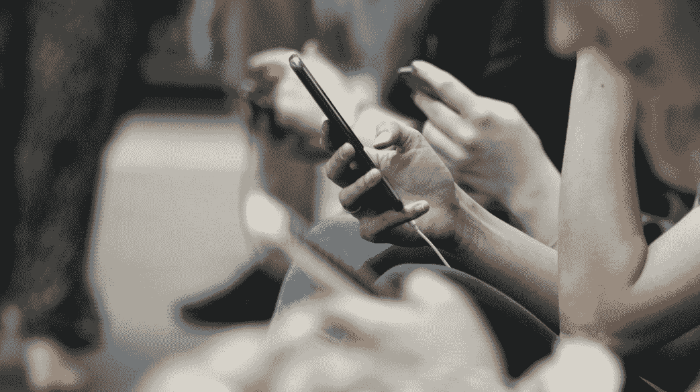

# 180 亿美元和解案

260914 新闻实验室

整理：公众号懒人搜索，懒人专属群精选

懒人微信：lazyhelper1

小懒判断｜适合关注平台监管和青少年沉迷议题的人，不适合想看“Meta 被罚惨”爽文的。最值得关注：180 亿只是最高额，117 亿十年付，另 50 亿得看 TikTok 等对手是否跟进和解；Meta 真正的胜利是保住了默认算法推荐。坑在于别把和解当终点——Meta 日后可能拿“已完成约定措施”当免责挡箭牌，最低要求变责任上限。

和解案并不是社交媒体平台在美国面临的法律麻烦的终结。

本期新闻实验室会员通讯，我们继续讨论社交媒体和青少年心理健康的问题。此前，在会员通讯 919 期当中，我介绍了美国的两项重要判决和“社交媒体大烟草时刻”的说法；在会员通讯 942 期当中，我反驳了清华大学的一份报告关于社交媒体年龄禁令的若干论述；在播客《声东击西》当中，我和徐涛对这个话题又做了进一步的深入讨论。

上个月底，这一话题有了新的发展：8月26日，围绕 Meta 是否通过产品设计诱导儿童和青少年沉迷社交媒体的一场重要审判以和解提前收场。Meta 与美国 48 个州、华盛顿特区和部分美国属地达成的相关协议，总金额最高接近 180 亿美元，款项将在十年内支付。

此外，Facebook 和 Instagram 上的美国未成年用户，将迎来时间限制、夜间使用限制、更严格的年龄核验，以及隐藏点赞数等变化。不过，Meta 没有承认过错，也避开了这场审判可能带来的更大赔偿与法律风险。

在此前的通讯和播客节目中，我反复提及“大烟草时刻”。这次和解，也很容易让人联想到美国烟草业当年的巨额和解（1998年，2060 亿美元）。不过，正如烟草问责经历了数十年的诉讼与社会动员，不是一个突然降临的时刻，Meta 的和解也只是社交媒体平台为自己造成的伤害负责的漫长过程中的一步。

## 巨额支票背后，Meta 保住了什么？

需要注意的是，和解案的 180 亿美元，是最高可能的支付额，并非全部已经无条件确定。

根据梳理，其中约 117 亿美元将在十年内支付，另有 50 亿美元取决于其他主要社交平台（TikTok、YouTube 和 Snapchat）是否接受相近的和解条件。得克萨斯州另外达成了约 10 亿美元的协议。部分州公布的口径，还计入了约 4.59 亿美元的 Cambridge Analytica 隐私案件和解款。

州立法机构和州长将有权决定资金用于何处，但根据和解协议，这笔资金将主要用于各州应对青少年社交媒体成瘾、支持心理健康项目及相关公共监督与整改成本。

唯一被排除在协议外的两个州是：新墨西哥州（该州针对 Meta 提起的诉讼已胜诉，详见**会员通讯 919 期**）以及佛罗里达州（该州总检察长表示，该和解协议对 Meta 的处罚力度不够）。

超过 100 亿的费用当然是一笔巨款。但放进 Meta 的财务规模里，冲击就没有标题看上去那么剧烈。毕竟，Meta 在 2026 年第二季度的净利润就有 158 亿美元。当然，罚款之外，平台改造、年龄核验等也会产生额外成本。

Meta 究竟躲过了多大风险，各方说法并不一致。据**报道**，本来，仅加利福尼亚、科罗拉多、肯塔基和新泽西四州的索赔要求，就可能累计超过 14000 亿美元，现在全国加起来只需要赔一百多亿，看起来是 Meta 的巨大胜利。

《大西洋月刊》**采访**的法律学者认为，和解让 Meta 买下了摆脱一项重大法律威胁的机会，同时避免接受可能真正动摇其业务的要求，也即个性化算法推荐。Facebook 和 Instagram 需要提供非个性化、按时间排序的信息流选项，但无需放弃默认的算法推荐。

州政府也有自己的现实考虑。律师 Meetalı Jain 指出，部分产品限制如果通过立法推动，可能遭遇第一修正案的挑战；诉讼本身还面临《通信规范法》第 230 条等相关争议。取得 Meta 同意的和解，可以降低继续审判和上诉带来的不确定性。

可以肯定的是：和解案并不是社交媒体平台在美国面临的法律麻烦的终结。个人、家庭和学区提出的大量诉讼仍在继续。由于避开了审判，这个案件更没有从法律角度对全部责任争议给出回答。

## 平台设计需要做出的改变

根据和解协议，18 岁以下用户将受到默认每天两小时的使用限制，关闭限制需要家长许可。两小时的时间会在 Facebook 和 Instagram 之间累计，能够识别出的多个账户也计入总量。午夜至早上 6 点将默认限制使用，学校时段的通知会被静音，连续使用每满 15 分钟则会出现休息提示。

《大西洋月刊》披露了值得注意的例外：发送消息，以及收听或观看至少 22 分钟的长内容，不计入相应的时间限制。这些细节意味着，“每天两小时”并不能直接等同于未成年人在 Meta 产品上的全部停留时间。

在未成年人用户的账号上，点赞和表情反应数量将默认隐藏，模拟整形效果的滤镜将受到限制。原告此前援引的材料显示，Meta 内部曾有人担忧这类滤镜可能加剧年轻人的身体形象问题，但相关限制建议未获扎克伯格支持。如今，部分过去未能在公司内部推动的措施进入了和解条款。

然而，个性化推荐算法仍是默认选项，关闭视频自动播放也需要用户主动操作。协议要求 Meta 每 90 天提醒青少年一次：可以选择按时间排序（而非算法排序）的信息流，但是，如果这些具体的设置需要用户自己寻找、理解并开启，实际采用率可能很低。所以，在平台功能的限制之上，仍然留下了推荐系统如何吸引注意力、持续推送内容的问题。

曾任 Meta 工程主管、并在此次审判中作证的 Arturo Béjar，表达了类似担忧。他认为，即使孩子到达时间上限后放下手机，产品设计仍可能让他们强烈渴望继续使用。限制时长固然有价值，但内容与推荐机制产生的影响不会因此自动消失。“相当于限制你每天只喝两小时的酒或者抽两小时的烟，但摄入的东西对身体的危害依然很大。”

家长控制也是争议所在，这延续了把安全责任交给家庭的偷懒做法。Mothers Against Media Addiction 创办人 Julie Scelfo 打比方说：父母有责任给孩子提供健康食物，但整个婴儿配方奶粉供应和食品体系的安全，需要系统层面的保障。

相比之下，年龄核验条款得到了 Arturo Béjar 较明确的肯定。Meta 需要使用自身及第三方工具加强年龄判断，接受独立测试，并达到特定准确率目标。如果一个账户被识别为未满 13 岁而遭移除，其好友的年龄也会受到进一步检查。

协议还包括独立审计的内容。审计员将连续五年向各州提交年度报告，但完整报告不会公开，公众能够看到的是删去知识产权和商业秘密内容的执行摘要。法律教授 Matthew Lawrence 担心，审计可能主要核实平台有没有部署时间限制、年龄门槛等功能，却没有充分衡量伤害本身。

互联网政策专家 Alissa Cooper 提出了更贴近生活的指标：青少年是否睡得更好，是否更能集中注意力，是否感到身心状态改善。她认为，协议没有明确保证这些测量一定会发生，但后续审计工作计划仍有纳入它们的空间。

Meta 还在公开说明中提到支持独立的社交媒体研究基金。不过，Alissa Cooper 表示，她尚未在和解文本中找到对应的约束性承诺。公司宣布支持研究，与研究者真正获得数据、独立评估平台之间，仍有距离。

## 一家公司谈下的条件，会成为整个行业的规则吗？

上文在提交 180 亿这个数字的计算时提到：Meta 这份和解案，还想把 TikTok 等竞争对手也“拉下水”。竞争对手是否加入类似的和解，将影响 50 亿美元的附加付款能否兑现。

律师 Joshua Wurtzel 认为，这种做法解决了 Meta 不愿“单方面解除武装”的问题：如果只有 Facebook 和 Instagram 限制青少年使用，释放出来的注意力可能转向其他平台。对州政府而言，附加付款也提供了推动更广泛行业改变的动力。

但由一家巨头参与谈定的规则，未必适合所有竞争者。法律教授 Matthew Lawrence 将这种做法比作“特洛伊木马”。他担心，如果达到一定规模的新平台也必须承担类似的核验、审计和合规成本，尝试不同商业模式的创业者可能面临更高门槛。

监督资源是否足够，同样重要。六个州总检察长办公室将轮值参与监督机制。

Matthew Lawrence 认为，要有效约束 Meta 这样的企业，需要长期稳定的技术能力、人员和资金。一个规模有限的委员会，能否持续追问数据、理解系统并执行处罚，仍有待观察。

商业影响则会沿着广告与创作者体系扩散。咨询公司 Forrester 预计，依赖年轻受众的创作者将面临互动量下降的挑战，而且受到影响的不只是儿童内容制作者。青少年也会关注年龄远高于自己的美妆、生活方式和消费类创作者，并由此形成品牌偏好。

虽然面临种种限制，和解仍可能推动更广泛的改革。Alissa Cooper 认为，它至少展示了 Meta 愿意在美国实施哪些措施，其他司法辖区可以据此继续提出要求。Meetalı Jain 则指出，世界各地的诉讼正在更多地围绕产品设计展开，相关思路也延伸到了 AI 产品。

而另一方面，Meta 未来也可能把履行和解当作自我辩护的理由：既然已经完成约定的安全措施，公司可能据此主张无需承担更多义务。原本用于推动改变的最低要求，也可能被包装成责任的上限。

这使得和解之后的工作格外重要。需要持续追问的，是哪些孩子真正减少了强迫性使用，哪些推荐路径仍在造成伤害，以及独立研究者能否获得足够的数据来回答这些问题。180亿美元足以成为醒目的新闻标题，但更安全的社交媒体，还需要在这些具体结果中得到证明。

---

在这个AI能替你写代码、写文章的时代，基础技能正在迅速贬值。绝大多数人正被淹没在海量的免费垃圾信息里，陷入低效的体力内卷。

当“努力”不再是壁垒，人与人之间唯一的护城河，只剩下“信息过滤”的效率与“认知系统”的维度。

圈子已稳定运行7年。我们每天利用Python爬虫与大模型算力，过滤全网最顶级的政经内参和搞钱风向标，做你最冷酷的“外部大脑”。

如果你认同这种“重塑认知防线”的极客主义，欢迎围观我的个人情报智库：【懒人专属群】。

https://lazvso.com/insider/

认同信息过滤价值、想省下每天3小时无效阅读时间的读者，扫码加我微信（lazyhelper1）

微信：lazyhelper1
