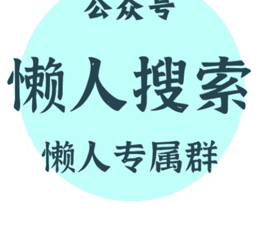
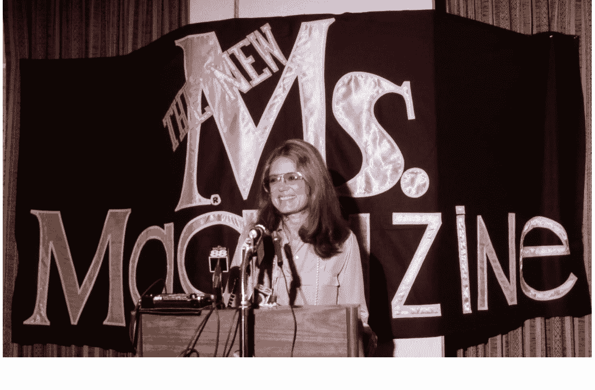
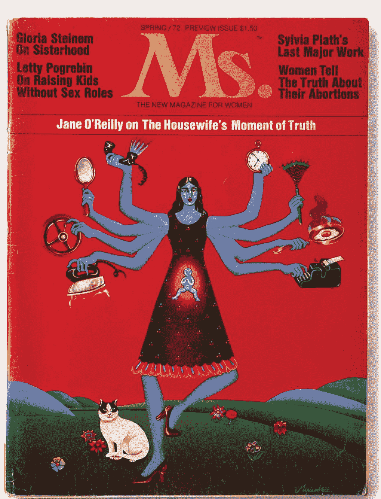
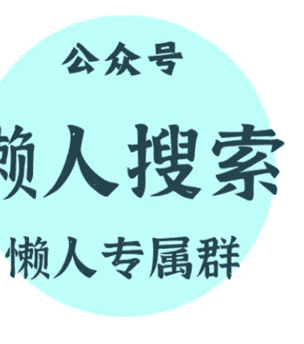

## Gloria Steinem

**260914 新闻实验室**
整理：公众号懒人搜索，懒人专属群精选
懒人微信：lazyhelper1

> 小懒判断｜适合对媒体史和女性议题好奇的人，不适合想找运动方法论的——这是人物回顾。最值得关注 Ms. 试刊号 30 万册八天售罄的细节，和那期蓝色多臂女性封面：挤满任务、身体里有婴儿、脸上一滴泪。坑在于别把她封神，1998 年为克林顿辩护、2016 年贬低年轻选民，她自己也承认看错了。

### “把女性当作人”

2026 年 9 月 2 日，Gloria Steinem 在纽约家中去世，享年 92 岁。

她是记者、作家、社会运动家，是美国现代女权运动最醒目的面孔之一。她参与创办的《Ms.》杂志，是这份事业的核心。家务、福利、堕胎、家庭暴力和性骚扰，经由这份杂志进入全国性的公共讨论。许多原以为自己只是“不够好”或“不够幸运”的女性，在阅读中发现，自己的遭遇有着广泛的社会根源。

本期新闻实验室会员通讯，我们来回顾 Gloria Steinem 的女权行动，尤其是其中以媒体为平台的那一部分。

### “母亲的命运也可能发生在自己身上”

Steinem 对女性处境的理解，最初来自母亲的人生。

她 1934 年出生于俄亥俄州城市 Toledo。父亲 Leo 经营古董生意，怀抱各种创业梦想，带着一家人住拖车、四处迁徙。Steinem 直到小学六年级才有完整学年的正规教育，但她自己从读路牌开始识字，然后从未中断自己的阅读习惯。

她的母亲 Ruth 曾是报社记者和编辑，后来长期受到精神疾病困扰。父母分开后，年仅十岁的 Gloria Steinem 与母亲住进一栋破败的房子，买菜、做饭，承担了多年的照护责任。她曾这样形容自己的母亲：“她躺在床上，双眼紧闭，嘴唇不时动着，似乎在回应只有她自己能听见的声音；我不断给她端去吐司和咖啡、香肠三明治和馅饼。”

后来，她写下一篇关于母亲的动人作品《Ruth's Song》。在其中，Gloria Steinem 问自己：“为什么过了那么多年，才开始把母亲看作一个有独立人生的人？为什么那么晚才认识到，压垮母亲的力量也是其他女性共同面对的社会模式？承认这一点十分痛苦，因为母亲的命运也可能发生在自己身上。”

她努力离开那种生活，进入著名的文理学院 Smith College 修读政治学，1956 年以优异成绩毕业。在当时，大学传递的信息充满矛盾：年轻女性被鼓励追求卓越，随后又被期待把自己放到孩子和丈夫的事业之后。

1957 年，Gloria Steinem 前往印度。在伦敦等待签证期间，她发现自己怀孕，并设法接受了当时还属于非法的堕胎。她后来解释，如果继续妊娠，自己很可能会回国、嫁给不适合的人，过上一种不属于自己的生活。在印度，她接触甘地追随者的基层组织实践，学习通过行走、交谈和倾听建立联系。这些经验后来融入了她的行动方式。

### “我们需要的是一名记者，而不是一个漂亮女孩”

回到美国从事新闻工作后，她面对的是另一套关于女性应该做什么的规定。

她在纽约找工作时，《生活》杂志的一名编辑拒绝她：“我们需要的是一名记者，而不是一个漂亮女孩”。《纽约》杂志的主编 Clay Felker 称，他给 Gloria Steinem 分配任务是因为“她的腿很棒”。

在媒体，她想写政治，却经常只能获得时尚和名人题材的约稿。那些相信女性天生懂得服装、美食和男明星的编辑，后来又怀疑女性是否有能力客观报道女权主义。

1963 年，她为《Show》杂志潜入纽约 Playboy Club，以兔女郎身份工作，揭露紧身制服和性感形象背后的恶劣劳动条件。报道令她出名，也给她带来新的轻视：一些人对她调查了什么毫无兴趣，只记得她穿过兔女郎服装。

1969 年，她采访了纽约格林威治村一场女性公开讲述非法堕胎经历的活动。这成为她投身女权运动的转折点。她在纪录片《Gloria: In Her Own Words》当中把那次觉醒称为“巨大的咔哒一声”：那些私密、羞耻、只能独自承担的经历，突然显现出共同的政治结构。

此后，她开始积极争取相关报道，却不断遭遇编辑的冷淡与拒绝。一个想法渐渐成形：既然现有媒体不愿认真对待女性的生活，那么女性能否自己办一本杂志？

### “终于，我知道自己并不孤单”

《Ms.》进入市场时，多数女性杂志仍在教读者料理家务、吸引丈夫。

Steinem 在 1973 年接受 BBC 采访时说，《Ms.》与其他杂志的根本区别，在于它“把女性当作人”。这种在今天看来很平常的姿态，在当时的出版业却足以成为一种革命。

在《纽约》杂志主编 Clay Felker（就是夸她腿很棒的那位）支持下，《Ms.》于 1971 年 12 月以插页形式出现在《纽约》杂志里面。1972 年 1 月，独立试刊号上市，封面却标着“春季”，方便销售缓慢时多摆几个月。结果，30 万册在八天内售罄。同年 7 月，杂志开始按月出版，Wonder Woman 登上首期月刊封面。

Gloria Steinem 在《*Ms.*》五十周年文集序言中回忆，为了让所有种族的女性都感到自己被包括在内，试刊号封面设计的一个早期版本曾将一张女性面孔划分为不同肤色的区域，但她觉得这种呈现不够真实。最终，她从印度经验中获得灵感，请艺术家 Miriam Wosk 画了一位蓝色、多臂的女性：手里拿着象征各种任务的物品，身体里有一个婴儿，脸上还有一滴泪。

这位疲惫的女性，与广告里轻松愉快的完美主妇形成鲜明对照。她身上挤满了家庭和社会交付的任务。

在内容方面，《*Ms.*》杂志的试刊号讨论了：

- 福利为何是女性议题
- 女性能爱女性吗
- 我们都有过堕胎经历

在刊发《Can Women Love Women?》前，有人警告，女权主义者已经被统统称作女同性恋，创刊时应该避开相关内容。编辑们却认为，这种污名恰好说明了刊登的必要。

杂志很快收到成袋的来信。Gloria Steinem 回应说，读者像对待进入家门的朋友一样，向《Ms.》倾诉生活，反复表达同一种感受：“终于，我知道自己并不孤单。”

其中一封信用蜡笔写成。小女孩抱怨，男孩占据了操场最好的地方，女孩只能挤在角落玩游戏，结尾是：“我们女孩气得像大头菜一样。”Gloria Steinem 回了信，并表示：“我敢打赌，她一定领导了一场运动，推动扩建游乐场，让所有人都能参与。”

《Yours in Sisterhood: Ms. Magazine and the Promise of Popular Feminism》作者 Amy Farrell 这样解释《Ms.》的影响：原本主要存在于小范围地下刊物中的女权议题，开始出现在杂货店的报刊架上。当主流文化还把老板追逐女秘书当作笑料，《Ms.》已经在揭露那种行为带来的伤害。

这样的革命性突破，自然会引来反对者。

据 NPR 报道，南方报刊商曾因杂志使用黑人女性封面而抵制发行。1980 年，化妆品品牌 Revlon 因封面上的苏联女性没有化妆而撤销广告合同。其他广告商要求避开堕胎、枪支管制等话题。

为了确保收入，《Ms.》增加了传统女性消费品广告，削减小说和诗歌。Gloria Steinem 后来承认，尽管编辑们不断抵抗，杂志的“棱角还是被磨平了”。

1990 年，《Ms.》转向无商业广告的出版模式。经历多次所有权变化后，2001 年由 Feminist Majority Foundation 接手。

杂志的名字“Ms.”也值得一提——它代表的也是一种反抗。

1973 年，Gloria Steinem 给《纽约时报》主编 A.M. Rosenthal 写信，要求报纸接受一种不标明女性婚姻状况的称谓：“Ms.”。她的理由很简单：“不能继续强迫女性公开婚姻状况。男性根本无须这样做。”

Rosenthal 愿意在私人信中称她为“Ms. Steinem”，却认为这一称谓尚未充分进入日常语言，不宜用于报纸。换句话说，《纽约时报》还是要继续用 Mrs. 和 Miss。于是出现了 Gloria Steinem 反复提起的荒诞场景：她被《纽约时报》称为“《Ms.》杂志的 Miss Steinem”。

直到 1986 年 6 月，《纽约时报》才改变政策，允许女性自己选择用 Ms. 还是 Mrs./Miss。Gloria Steinem 和其他女性带着鲜花前去致谢。她后来回忆，Rosenthal 竟说，如果早知道这件事对她们如此重要，他会更早行动。

### “我要留着自己的火炬”

Gloria Steinem 把女权主义带向广泛受众的能力，为她赢得了影响力，也招来了持续的质疑：为了获得主流认可，她是否过于温和？媒体对她的关注，是否遮蔽了其他女性的劳动？

一些更为激进的女权主义者认为，《Ms.》不够激进，也不够包容。她与 Betty Friedan 的冲突，既涉及个人竞争，也涉及运动应优先争取什么、代表哪些女性。

她的政治判断也有受到严厉批评的时候。1998 年，她为比尔·克林顿面对的性指控辩护，相关争论延续多年。《卫报》记述，她后来表示，基于更多已知信息，自己不会再写同样的文章。2016 年，她把部分年轻女性支持 Bernie Sanders 解释为追随男性，引发愤怒，随后道歉。

Gloria Steinem 曾说，兼任作家和活动家的讽刺之处在于：“正当你觉得自己最有话可说时，却最没有时间把它说出来。”她忙于演讲、筹款和建立联盟，一度以为自己的全集只剩下筹款信、演说提纲，以及为别人写的序言。直到朋友兼《Ms.》共同创办者 Letty Cottin Pogrebin 整理她的旧稿，她才认真考虑结集，最终出版了 1983 年的《Outrageous Acts and Everyday Rebellions》。

她始终珍视写作，也热爱组织工作中那些难以复制的时刻：一屋子人通过交谈获得新的理解，说出此前只能隐约感受到、却叫不出名字的经验。写作与行动不断争夺她的时间，她终其一生都在两者之间取舍。

她留下的遗产，将会延续写作和行动。她把自己的纽约住所纳入 Gloria’s Foundation 的信托安排，让那里能够继续用于会面、写作、组织活动和“谈话圈”。那个曾经只是供她放下行李、短暂停留的地方，逐渐成为朋友们可以相聚的家，也成为后来者能够使用的公共空间。

在《Outrageous Acts and Everyday Rebellions》那本书中，她说，经常有人问她“是否准备传递火炬”。她回答：“我要留着自己的火炬，谢谢——我要用它点燃其他人的火炬。”

这句话带着她惯有的幽默，也表达了她对女权运动的期待：每个人都能开口，每个人都能参与。当足够多的女性能够讲述自己的生活，那些曾被关在家门之内的困境，便有了共同改变的可能。

---

在这个 AI 能替你写代码、写文章的时代，基础技能正在迅速贬值。绝大多数人正被淹没在海量的免费垃圾信息里，陷入低效的体力内卷。

当“努力”不再是壁垒，人与人之间唯一的护城河，只剩下“信息过滤”的效率与“认知系统”的维度。

圈子已稳定运行 7 年。我们每天利用 Python 爬虫与大模型算力，过滤全网最顶级的政经内参和搞钱风向标，做你最冷酷的“外部大脑”。

如果你认同这种“重塑认知防线”的极客主义，欢迎围观我的个人情报智库：【懒人专属群】。

https://lazyso.com/insider/

认同信息过滤价值、想省下每天 3 小时无效阅读时间的读者，扫码加我微信 (lazyhelper1)

