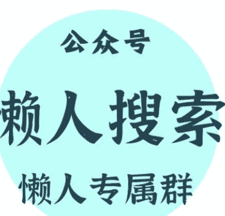
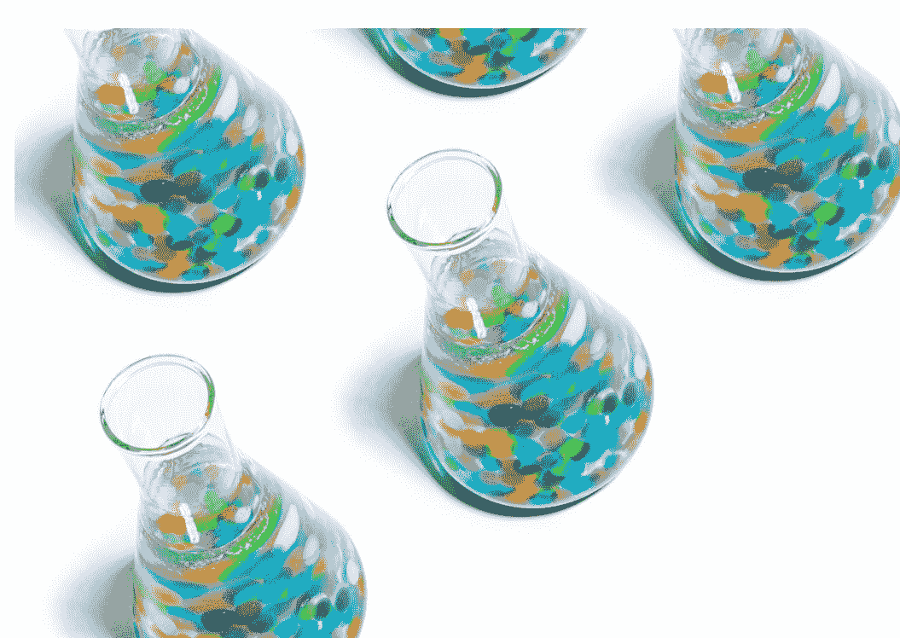

## 三则新闻实验

260914 新闻实验室

整理：公众号懒人搜索，懒人专属群精选

懒人微信：lazyhelper1

微信：lazyhelper1

> 小懒判断 | 适合做内容、做社区或关心媒体生态的人，不适合想炒流量捷径的。最值得关注日本的 OP 加密签名：它不判断内容真假，只验证网页是否真出自该机构，读卖、朝日、NHK 都已接入，是应对 AI 仿冒站的思路。坑在于 Axios+OpenAI 模式：一家收钱一家被报道，编辑独立再怎么声明也有利益冲突的观感。

这个疯狂的世界里，新闻纸、油墨和社区归属感 的意义。

本期会员通讯，回到新闻实验室的老本行：介绍三个给人带来启发的媒体项目。

这三个项目涵盖了高科技工具和低科技“手搓”，但它们要解决的问题类似：如何建立信任，如何让人们获得优质信息。

### 坚持自己送报的创始人

我们从“手搓”的案例开始。

最近，我从《纽约时报》的报道中了解到一份名为《The Chronicle》的报纸，它位于纽约州一个人口仅 1.5 万的小城 Glens Falls，是一份免费周报。时至今日，这份报纸仍然能够吸引读者，关键并不在于它拥有先进的技术，而在于创办人 Mark Frost 几十年来建立起来的人际网络和社区信任。

每周四清晨，75 岁的 Mark Frost 会驾驶一辆装满报纸的斯巴鲁森林人，亲自向各个投放点配送。《纽约时报》的报道提到，当他来到一家超市时，74 岁的 William Norton 已经开着一辆皮卡等在那里，准备取走 40 份报纸，带给住在 Stony Creek 的邻居。

虽然是免费周报，但 Mark Frost 不会任由人们随意拿走整叠报纸。有人曾告诉他，自己拿报纸是为了打包玻璃，Mark Frost 当场把报纸收了回来。对一家免费发行的报纸来说，印刷成本依然真实存在，每一份报纸都应该真正抵达读者手中。

《The Chronicle》创办于 1980 年，当时 Mark Frost 只投入了 1700 美元。他从小在 Glens Falls 长大，初中时期便开始为当地已经停刊的《Glens Falls Times》写稿。后来，他曾在当地日报《The Post-Star》工作，最终决定创办一份更贴近家乡的报纸。

这种“家乡意识”贯穿《The Chronicle》的内容。报纸长期报道学校、地方政府会议、企业开张、停车问题和社区活动，还保留着“School Views”这样的栏目，让孩子回答有关学校生活的问题。早期，一名三年级学生甚至直接写信问 Mark Frost：“Mark，你九岁的时候喜欢上学吗？”多年之后，市长 Diana Palmer 的女儿 Sadie Palmer 还记得，自己小时候的短文登报后，家人把报道剪下来贴在冰箱上。

这份报纸并不追求全国性影响力，而是坚持地方共同体的情感和利益。2013年，电影《为奴十二年》上映时，Mark Frost 曾批评影片没有充分突出 Glens Falls 与主人公 Solomon Northup 之间的联系。他认为，电影把太多赞誉给了 Saratoga Springs，而 Glens Falls 才是 Solomon Northup 人生故事的重要地点。

Mark Frost 曾写道，《The Chronicle》更关心“谁正在取得进步”，而不是“谁搞砸了事情”。这种乐观、甚至积极的报道方式并非没有争议。前《The Post-Star》编辑 Ken Tingley 认为，这份报纸与广告商过于亲近，因而损害了可信度。Mark Frost 则回应说，报纸其实曾因报道失去广告主，但企业后来决定继续投放广告，因为广告有效。

疫情曾使《The Chronicle》陷入危机。员工人数从12人降至4人，但随着广告逐渐恢复，报纸如今拥有7名员工，2026年6月的高中毕业特刊达到44版，是六年来最厚的一期。Mark Frost 的儿子也已回到家乡，负责广告、技术、编辑和报道等工作。他把父母多年来积累的经验逐渐接过来，并直言：“继承计划就是我。”

在文章的评论区，有人留言说：“多年前，我曾短暂地在一家已有数十年历史的小镇周报工作。我的老板常说：我们刊登的都是‘冰箱新闻’。他的意思是，这些报道和照片会被奶奶或妈妈剪下来，用磁铁贴在冰箱上，既供自己欣赏，也向每位来访的客人展示。我们还刊登了许多其他报道，但每一期报纸都少不了至关重要的本地体育赛事果、毕业照，以及聚焦当地生活和议题的内容。我现在居住的这个小镇也有这样一份报纸。”

留言者还说：“在这个疯狂的世界里，新闻纸、油墨和社区归属感，让人安心地意识到：并非所有的智能都是人工的，也并非都由远在另一个地方的人所操控。”

我想，这种确定性和安心的感觉，正是在填补狂飙的技术带来的精神空缺。

### 用加密技术识别李鬼

第一个案例生存至今的关键之一，是社区里的信任感。而第二个案例，试图通过技术认证的方式来增进人们对媒体内容的信任。

据 Nieman Lab 报道，2024年1月1日，日本能登半岛发生7.5级地震。灾害发生后，网络上出现了大量AI生成的灾区图片、冒充慈善机构的诈骗网站，以及声称有人被困在废墟下的虚假信息。这些信息不仅骗取捐款，还可能误导救援人员。一些社交媒体帖子甚至传播“地震是人为制造的”这样的阴谋论。

Originator Profile（简称 OP）正是在这样的背景下获得广泛关注。它利用加密数字签名，为网站建立类似“数字身份证”的凭证，说明一个网页由谁发布、发布者是否得到专业组织认可，以及该机构是否公开了编辑规范和伦理标准。

也就是说，OP 技术并不能直接判断一篇文章是真是假，不能直接鉴定一张照片是否由 AI 生成，但它可以回答：这个网页究竟是不是它声称的那个机构发布的？例如，用户看到一篇看似来自《读卖新闻》的文章时，OP 可以帮助确认该页面确实属于这家报纸，而不是由诈骗者复制出来的仿冒网站。

OP 合作创新联盟的副秘书长 Makoto Yoshiike 将其概括为“来源证明”。他说，他们不是要建立区分“好媒体”和“坏媒体”的白名单，而是要确认信息是否真的来自经过认证的发送者。

这一项目最初源自日本广告公关巨头电通在 2021 年的探索。电通当时面临恶意数字广告和广告欺诈问题，希望在程序化广告传播过程中验证广告主身份。随后，公司与庆应大学教授村井纯合作开发技术规范。村井纯被认为是“日本互联网之父”，曾参与推动日语字符在电子邮件和互联网信息中的传输标准。

日本主要新闻机构很快加入。2022 年 12 月，OP 合作创新联盟正式成立。如今，《读卖新闻》和《朝日新闻》已经把 OP 整合进内容管理系统，日本公共广播机构 NHK 也加入了这一联盟。鸟取县则成为最早在政府网站上采用 OP 的地方政府之一。

目前，用户可以通过 Chrome 和 Firefox 浏览器插件 OP Inspector 查看网站的认证信息。比如，进入《读卖新闻》文章页面后，插件会显示网站所属机构，并链接到该报的编辑标准和隐私政策。不过，这项工具目前主要面向开发者，普通用户版本仍在改进之中。

当然，OP 目前还有明显的短板。它只能在网页层面发挥作用，无法直接出现在 Facebook 等社交媒体的单条帖子中。用户必须先点击进入文章页面，才能看到认证信息。一种可能的未来是：如果 W3C 将其发展为国际网页标准，认证标识或许可以直接出现在浏览器地址栏中。

### AI 是地方新闻的救生艇？

和第一个案例一样，第三个案例也是关于地方新闻。不过，与坚持“手搓”的 Mark Frost 不同，美国媒体 Axios 选择了高科技的道路：与 AI 公司合作，尝试借助技术和资金扩大地方新闻覆盖。

Axios 首席执行官 Jim VandeHei 认为，AI 可以帮助地方新闻机构降低固定成本，自动处理新闻生产中除“记者和新闻本身”之外的大量工作。他甚至提出，能否用 AI“自动化地方市场中除记者和新闻之外的一切”。

也就是说，他提出的方向是：既然地方新闻越来越难以获得收入，那么就依靠 AI 节流吧。

具体来说，Axios 和 OpenAI 合作，在多地开启新的 newsletter。根据协议，OpenAI 将支持 13 个地方新闻 newsletter 的启动，并向 Axios 员工提供企业级 AI 工具的使用额度；Axios 则允许 OpenAI 使用其免费发布的报道训练模型。

这项合作对 OpenAI 也有价值。公司表示，截至 2026 年 2 月，美国 ChatGPT 用户每周提交约 100 万个涉及地方新闻的请求。地方媒体衰退后，AI 系统能够获取的社区信息也会减少。因此，OpenAI 需要地方记者持续报道学校、地方政府、企业和公共事务，而 Axios 希望获得资金和技术，扩大自己的地方网络。

Axios 最初在 2025 年宣布由 OpenAI 资助匹兹堡、堪萨斯城等四个地方新闻市场，之后又增加了九个。到 2026 年底，Axios 计划覆盖 43 座城市，Jim VandeHei 甚至希望未来进入 1000 个社区。不过，Axios Local 虽然拥有超过 200 万订阅者，目前仍未实现盈利。Jim VandeHei 表示，如果每个城市能在五年内实现盈利，就已经是很大的成功。

《哥伦比亚新闻评论》的报道提供了一个具体的案例：仅凭一名记者，就可以负责两个郡的地方 newsletter，这两个郡的面积加起来比罗得岛（美国的一个州）还大。有一次，在报道有关警察使用 AI 的新闻时，该记者使用 ChatGPT 协助起草公共记录查询申请，寻找正确的联系对象，并通过 Axios 开发的法律审核工具降低申请被驳回的可能性。收到文件后，他又让 ChatGPT 检查政府机构是否提供了全部材料，发现缺少三份文件，于是让 AI 协助起草补充申请，最终拿到了缺失的资料。

虽然能够提升效率、节省成本，但这种合作也引发了透明度和编辑独立问题。一些员工担心，让 OpenAI 的模型来生成内容，可能会影响新闻机构的立场。外界也质疑，Axios 一边接受 OpenAI 的资金，一边报道 OpenAI 的商业和法律争议，是否会造成利益冲突，或者至少形成利益冲突的观感。

对于这些质疑，Jim VandeHei 回应：编辑独立是双方默认的前提，读者可以自行判断报道是否偏向赞助方。他还强调，这是一笔商业交易：“如果有人愿意为你的内容付钱，你会问：愿意付多少？如果你认为价格公平，就接受。”

另外，也有人指出，单个新闻机构与 AI 公司达成协议，可能有利于这家机构，却无法解决整个行业的问题。对新闻机构来说，接受一笔直接付款往往比集体起诉或推动系统性补偿机制更现实，但这种选择也可能让 AI 公司继续以较低成本获得整个新闻生态的价值。

按照目前的趋势，地方新闻不可避免地会更加依赖人工智能，以及大型科技公司的投资，但也必须警惕由此产生的新依赖。谁为新闻付费，谁拥有新闻数据，谁决定哪些信息能够被看见，以及新闻机构如何保持编辑独立，这些问题会因为技术变得更先进而变得更加棘手。

未来的地方新闻，究竟是回归 Mark Frost 式的手搓，还是深度融合 AI 工具？两种方向都可能。关键是，在技术的表层之下，是否能建立信任。无论是手搓还是 AI，这些方法都并不会自动拯救新闻业。真正重要的仍然是有人愿意进入社区，知道哪些问题值得报道，也愿意对报道承担责任。AI 可以帮助记者撰写申请、整理文件、验证网站身份，但恐怕不能替代记者与居民之间长期建立的信任。

——分割线——

在这个 AI 能替你写代码、写文章的时代，基础技能正在迅速贬值。绝大多数人正被淹没在海量的免费垃圾信息里，陷入低效的体力内卷。

当“努力”不再是壁垒，人与人之间唯一的护城河，只剩下“信息过滤”的效率与“认知系统”的维度。

圈子已稳定运行 7 年。我们每天利用 Python 爬虫与大模型算力，过滤全网最顶级的政经内参和搞钱风向标，做你最冷酷的“外部大脑”。

如果你认同这种“重塑认知防线”的极客主义，欢迎围观我的个人情报智库：【懒人专属群】。

https://lazyso.com/insider/

认同信息过滤价值、想省下每天 3 小时无效阅读时间的读者，扫码加我微信（lazyhelper1）

微信：lazyhelper1
