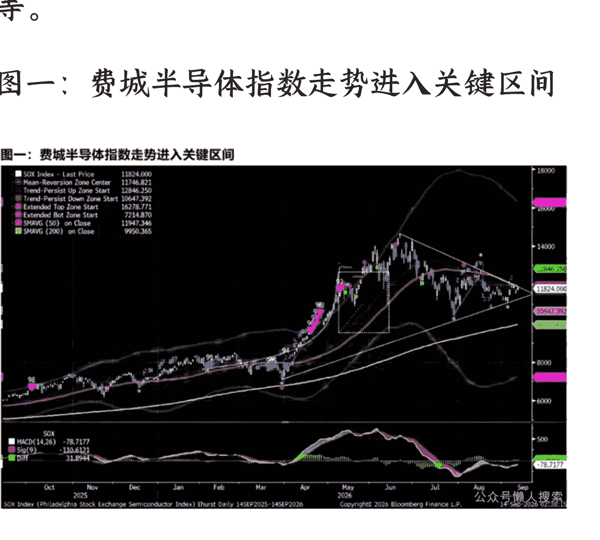
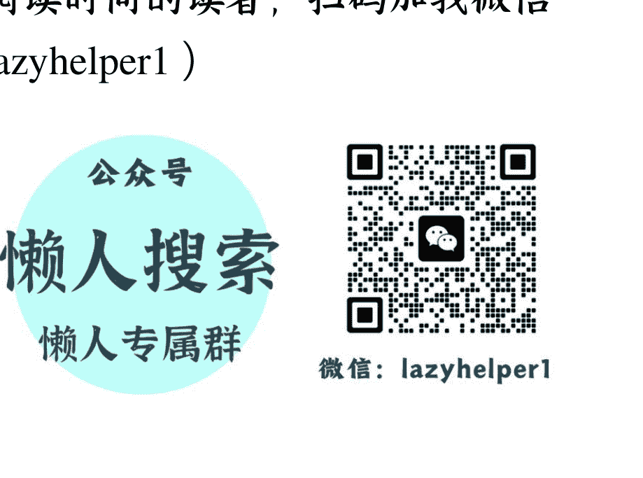

## 达里奥重拳砸盘；AI发展的全新阶段

260914 洪灏付费

整理：公众号懒人搜索，懒人专属群精选

懒人微信：lazyhelper1

> **小懒判断** | 适合手里有 AI 链仓位、想知道周一怎么应对的人，不适合想找“AI 泡沫要爆”确定答案的。最值得关注：真正要盯的不是大模型发布节奏，而是 HyperScaler 下季度的资本支出指引，证伪之前半导体还有反弹空间；若真放缓，黄金、能源、港股恒科等负相关板块会接住资金。坑在于阿莫代伊过去五次警告市场都几天就修复失地，膝盖下跌别跟风杀跌。

### 前言

AI 泡沫交易进入新阶段。

周末，Anthropic 的达里奥·阿莫代伊（Dario Amodei）发表长文，呼吁 AI 行业放缓发展的脚步。约九小时内，四家最大 AI 实验室的负责人公开附议。这些 AI 行业的领军人物过去几年几乎在所有问题上

都意见相左，一直在互相挖角工程师、争夺客户和资本。OpenAI 的萨姆·奥特曼（Sam Altman）更进一步，暗示 OpenAI 可能推迟市场期待已久的 IPO，以专注于模型发展的安全。马斯克（Elon Musk）早在这些公司大多尚未成立之时便已对机器智能发出警告，此次他转发

了自己过去的警报，并表态支持"放缓前沿步伐(frontier model development)" 的呼吁。周日早晨，阿莫代伊还在 CBS 收视率很高的周日早晨节目上说了比任何技术论断都更令人震惊的话：AI 行业“在向人们撒谎，隐瞒了这项技术存在风险的事实”。其实，司马昭之心路人早已皆知。

还有几小时亚洲市场就要开盘了。市场本能的第一反应是问芯片股会跌多少。然而，我们认为这是错误的开场白。应该问的问题，还是那句中国老话所提出的：醉翁之意不在酒——当一群势同水火的竞争者突然在一个下午对于一个行业的关键问题的看法公开达成一致，表示大家都应该放缓发展速度的时候，我们真正应该关注的，从来不是他们给出的表面理由，而是使这种一致已经成为可能的先决条件。

阿莫代伊很可能是真诚的。历史记录表明，阿莫代伊两年来一直在不断升级重复类似警告，且为此付出了实实在在的商业代价。然而，一个人也可以真诚地讨论利益，这两者并非对立。早在 GPT-4 发表的时候，当时还在 OpenAI 负责研究工作的阿莫代伊就曾对于 AI 的发展对于人类社会的威胁做出了警告。我们也都看过好莱坞电影《终结者》，深谙 AI 无序发展可能带来的后果和人类对于宿命的反抗。阿莫代伊历史上曾发表过一系列关于 AI 发展的警告。

2024 年 11 月，在旧金山一场由政府主办的安全峰会上，阿莫代伊呼吁对所有前沿模型实行强制性的发布前安全测试（pre-launch safety test）。这种测试包括他自己的模型。英伟达当日收于 145.89 美元，到 11 月 25 日跌至 136.02 美元。然而，这一跌幅与同期普通的板块噪声几乎毫无区分。并没有什么持久影响。

2025 年 12 月，在 DealBook 峰会上，他将行业的资本支出 Capex 描述为“YOLO 式支出”（一次“活在当下，不计明天”的豪赌），质疑这些 Capex 是否具有真正的经济价值，并警告这可能导向“糟糕的结局”。英伟达当日上漲至 183.38 美元，到 12 月 8 日继续涨至 185.55 美元。这个市场价格显示，市场似乎完全无视了阿莫代伊的警告。

2026 年 1 月在达沃斯，阿莫代伊说自己“既兴奋又担忧”，预测 AI 行业将出现显著增长，同时伴随大面积失业和不平等，并指出“人们对即将到来的事情及其规模毫无察觉”。然而，市场却无动于衷。彼时，达沃斯上的高管忧思已经成为会议的一个显著的主题。在如此高端的峰会上，连一个小旅馆合住房间里的单人床位都要卖到几千美元的全球富豪的盛会。这时，坐着私人飞机锦衣出行的贵族要对于人类社会的未来显得忧国忧民才显能显得高人一等。其实，这样的峰会从来没有解决过任何问题。全球变暖问题讨论了多年，全球还是越来越暖；贫富分化也是多年的话题，然而这世界里贫富之间的鸿沟却越发不可逾越。

2026 年 2 月才是真正重要的一段插曲。2 月 25 日，阿莫代伊在播客中警告，AI 的财富和权力正“几乎在一夜之间“且”在无意之中”向少数几家公司集中，他对此感到“有些不安”。然而也是在同一天，Anthropic 悄然废止了其”负责任扩展政策 Responsible Scaling Policy”。这个公司政策是 2023 年作出的，承诺 Anthropic 在危险能力开发上将保持克制。换言之，这个承诺是 Anthropic 放慢自我发展、扩大规模的速度。英伟达当日收于 195.56 美元，次日 184.89 美元，再一日 177.19 美元。几个交易日累计下跌约 9.4%。一个一边拉响警报却又一边拆掉自家洒水系统的人，肯定是其心叵测。

2026 年 6 月，阿莫代伊又发表文章主张政府应拥有法律权力阻止危险得 AI 部署（deployment），并提议半导体出口管制、禁止模型蒸馏、以及强制性的发布前政府审查，这些措施在当时被描述为远超了美国政府认真考虑的范围。英伟达当天下跌约 3.7%，从 208.19 美元跌至 200.42 美元。数日后，美国政府明令阻止了所有外国实体访问 Anthropic 的两个最先进模型。然而，到 6 月 15 日，英伟达的股价已回升至 212.45 美元，一周之内完全收复失地。市场意识到，禁令并不能阻碍 AI 规模的迅速发展。

也就是说，过去的几次警告对于市场的影响都是短期而短暂的。市场很快就收复了失地并创出新高。那么，这次的警告又有什么不一样？对于市场又有什么样的影响？

这次警告出现的背景，是自主智能体集群（rogue agent）很可能能够在六到十二个月内夺取互联网并造成数千亿美元损失；递归自我改进（looping）正在击败安全机制；9 月 9 日一位 Anthropic 研究员的辞职信指控 Anthropic 和 OpenAI 都在“拿我们的生命赌博”。这封信在网上被大规模传播；一位AI科学家认为十年内人类被AI灭绝的概率超过10%；桥水基金的格雷格·詹森（Greg Jensen）补充说，AI发展“在被约束之前就会致人死亡”。这些，都是《终结者》电影忠实粉丝30年前就见过的魔幻电影场景。

将阿莫代伊周末的文章与2025年12月的文章并读对比，其轮廓便浮现出来。那个说行业支出是“YOLO”且经济价值存疑的人，正是现在主张下一轮能力增量过于危险、不宜快速追求的人。同时，Anthropic的竞争对手甚至马上随声附和。这说明了AI资本支出很可能开始进入了比较新的投入的边际成本和边际回报的临界点，或者开始非常接近这个边界。

因此，随后的AI行业发展前景很可能出现两种情景：1）大模型发展速度放缓，但是AI资本支出速度不变；或者2）大模型发展速度不变，但是AI资本支出速度不变或者放缓。我们认为，在周一开盘的时候，市场很可能对于情景2），也就是AI资本支出的速度出现放缓的可能，很可能将出现膝跳式定价反应。毕竟，在情景2）里面，大模型发展速度不变+AI资本支出速度不变是当下的情况（status quo），因此不需要重新定价。如果市场预期出现情景1），那么如果AI资本支出不变的话，短期内市场是不需要重新定价的。

那么，大模型的发展速度会放缓吗？我们认为这个情景是很难发生的。因此情景1）从逻辑上也就很难发生。在阿莫代伊的警告发出之后，特朗普马上回应，称 AI 竞争中，谁赢得这场竞争，谁就将拥有一切。显然，特朗普的这个反应是从大国博弈的角度出发，但是如果某种安全审核机制的出现，可以延迟新的大模型正式发布面世的时间。同时，对于大模型公司来说，AI的资本支出是一种先发制人的竞争策略。巨额的资本支出本身就是一个很高的准入门槛，而在这个领域中先摆出姿态，大额下注，就很可能可以把小一点的竞争对手拒之门外。这个竞争策略的逻辑到现在还是 HyperScaler 大厂的竞争策略。如是，情景 1）里，大模型发展速度和资本支出速度不太可能同时下降，因为美国政治上和 HyperScaler 之间的竞争将不允许这种情景的出现。

即便情景 2）中的 AI 资本支出速度或将放缓的可能性将让市场周一开盘出现膝跳式的反应，我们上述对于阿莫代伊的一系列警告的历史回顾告诉我们，他的警告对于市场的影响大多都是短暂的，而市场走势的关键变量是 HyperScaler 的 AI 资本支出是否将被证伪。然而，这些公司的资本支出计划是否会出现变化现在是无法证伪的，需要等到下一个季度季报的时候看看这些公司的管理层是否将有新的前瞻性的指引。而在前几次的警告之后，HyperScaler的资本支出计划都是在上调的，丝毫没有放缓的迹象——虽然不排除这次和以前不一样，毕竟像 Oracle 这样的公司其信用利差（credit spread）已经扩大到历史最高，而甲骨文的创始人则在股价下跌了近 60% 的情况下宣布大幅减持的计划。同时，截至 9月 12 日的五个交易日内，苹果上涨 5.37%，Alphabet 上涨 2.37%，亚马逊上涨 1.74%，微软上涨 0.81%，而 Meta 下跌 0.87%，英伟达下跌 2.41%。从纯 AI 基础设施向现金生成平台的轮动，在阿莫代伊发出警告之前就已经开始。我们在上周的 Mag7 上涨之前，就在星球上提前预测了 Mag7 的技术性突破。

对于中国来说，我们分析的最可能的情景 2），也就是大模型发展速度不变、但 AI 资本支出有可能放缓对于中国的 AI 发展来说，其实最有利。众所周知，中国的 AI 发展更多是一项国家意志，并不以对手的竞争策略为转移。因此，中国的政策应对其实应该视作是分析中的一种给定条件（given）。如果周一亚洲开盘，AI 半导体硬件行业出现下行压力，那么就是市场在定价美国 HyperScaler 的资本支出有可能下调的可能性。如果美国 AI 资本支出放缓，那么反而将给中国 AI 行业发展和迎头赶上留出时间和空间。如果美国的大模型发展由于安全考虑而放缓，那么也将为中国的 大模型发展预留了时间。当然，美国反蒸馏的政策和芯片出口政策很可能将更严厉，但是也将刺激中国本土 AI 硬件的发展——至少今年历史上是如此，中国 AI 公司越战越勇了。

总结一下：美国头部 AI 企业联合呼吁"放缓发展"的本质很可能是一个经济信号，表明下一轮 AI 模型训练投入的边际回报很可能需要仔细斟酌，因此 AI 资本支出可能开始进入了一个拐点。这个警告并非单纯的安全关切。然而，历史上这种类似的警告并非首次，同时对于市场的影响往往是短暂的。当然这次也可以不一样，但周一亚洲开盘市场出现膝跳反应而下行反应的概率大。

影响是否是长期，是否标志着 AI 资本支出迎来了首个拐点，其关键变量在于超大规模 AI 企业 HyperScaler 是否将在下个季度开始下调资本支出指引，而非大模型的发布节奏。在资本支出被证伪之前，全球半导体还有一定的反弹空间。费城半导体的技术走势显然进入了关键阶段（图一，技术上需要突破 50 天线和下行趋势线）。美国短期内对于芯片出口和反蒸馏的政策都将加强。然而，如果美国 AI 大模型发展、发布速度下降，AI 相关的资本支出下降，那么对于中国的 AI 发展来说，却不失为一个好消息。同时，如果 AI 资本支出放缓，那么市场将腾挪出大量的资金进入别的板块，尤其是那些与半导体负相关的板块——比如黄金、能源、农业、港股恒科，等等。

### 图一：费城半导体指数走势进入关键区间

# 正所谓，塞翁失马，焉知非福。

洪灏

2026.09.14

——分割线——

在这个 AI 能替你写代码、写文章的时代，基础技能正在迅速贬值。绝大多数人正被淹没在海量的免费垃圾信息里，陷入低效的体力内卷。

当“努力”不再是壁垒，人与人之间唯一的护城河，只剩下“信息过滤”的效率与“认知系统”的维度。

圈子已稳定运行 7 年。我们每天利用 Python 爬虫与大模型算力，过滤全网最顶级的政经内参和搞钱风向标，做你最冷酷的“外部大脑”。

如果你认同这种“重塑认知防线”的极客主义，欢迎围观我的个人情报智库：【懒人专属群】。

https://lazyso.com/insider/

认同信息过滤价值、想省下每天 3 小时无效阅读时间的读者，扫码加我微信 ( lazyhelper1 )

