# 从 0 到 1 做出游戏攻略站：两周跑通选词、建站、收录和迭代闭环 0902

260911 副业 SC 精华
整理：公众号懒人搜索，懒人专属群精选
懒人微信：lazyhelper1

> 小懒判断 | 适合想认真做 AI+SEO 出海站、能承受两周只赚 1.37 美元的人，不适合找快速变现路子的。最值得关注一次只改一类的迭代纪律和那张从抓取到站内行为的诊断决策树——先定位问题在哪一层再动手，别看到 CTR 低就改标题。多语言选西语法语不选日语的判断逻辑也值钱：看需求、竞争和官方本地化，不是翻译难度。坑在于 AI 生成内容必须配来源矩阵复核，不然一条错误数据就能毁掉整站可信度。

大家好，我是林广恩。

参加这次「出海热词游戏站」航海前，我以为做攻略站，主要就是找热词、让 AI 写内容、把网站搭起来。真正做了两周才发现：页面上线只是开始——AI 会把游戏信息写错，Google 有展示却没人点，广告代码放上去了，后台也可能连续几天都是零。

这次我用 Fields of Mistria 做了自己的第一个攻略站 MistriaFans，从首页和十几个分类页，逐步做到四种语言、160 个页面。截至 8 月 23 日，GSC 累计有了 4.24 万次展示、778 次点击。收入还没有稳定结论，但从选词、建站到看数据、找问题、做迭代，这条路算是真正走了一遍。

我把过程中的返工、误判和具体决策整理成了这篇复盘：有展示没点击时，怎么判断该改标题还是改内容？什么时候值得新建一页？怎么避免拿自己的测试访问做决策？也附上了内容生产流程、迭代卡和运营检查清单，希望能给正在做第一站、或者上线后不知道下一步该改什么的船员一点参考。

## 一、先说结果

我以为做游戏攻略站，主要工作是生成页面。两周之后我发现，真正花时间的是另外几件事：确认一条游戏数据到底对不对、判断两个搜索词该做一页还是两页、弄清楚为什么广告代码放上去三天了后台还是零。

2026年8月，我跟着“出海热词游戏站”的航海方法，做了自己的第一个游戏攻略站。项目选的是Fields of Mistria，网站叫MistriaFans。

最初的网站只有首页和十几个分类页面。两周多以后，它扩展到四种语言、160个页面，并且不再只是文章集合：站内有宽泛攻略页、角色和物品实体页、任务页、查找器和规划工具，也接入了搜索数据、站内行为分析、用户反馈、隐私说明和广告实验。

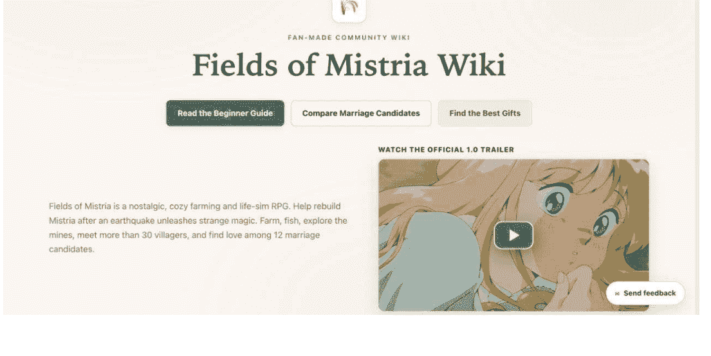

图 1：MistriaFans 首页。第一版先让用户看到站点能解决哪些具体问题。截至 2026 年 8 月 23 日，GSC 的三个月视图显示 778 次点击、4.24 万次展示、1.8% 平均点击率和 8.9 的平均排名。作为参照，上线第一天（8 月 10 日）GSC 只有 39 次展示和 0 次点击，GA4 录到 32 次自然搜索会话。这些数据说明网站已经被 Google 收录，并开始获得自然搜索流量；它们也能证明我建立的迭代流程正在产生可以观察的结果。但它们不能证明广告变现已经跑通，更不能说明网站已经有稳定收入。

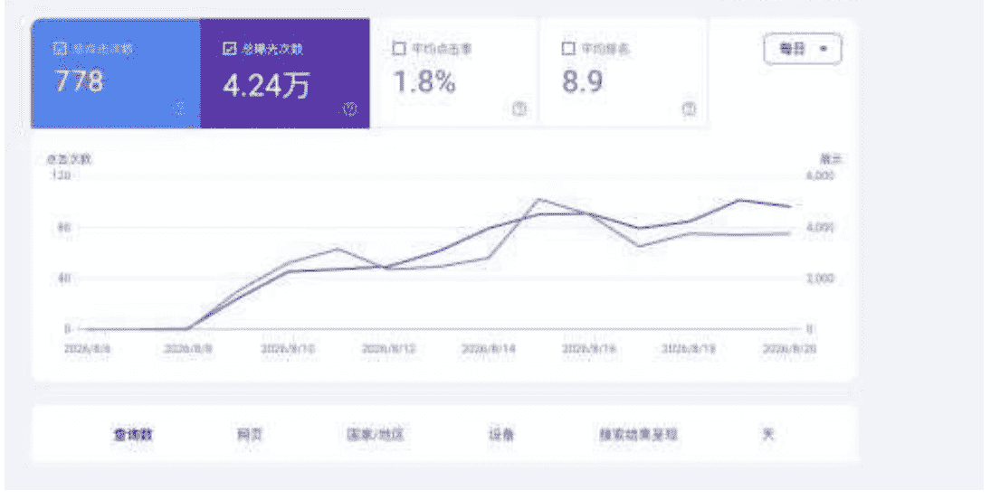

图 2：截至 2026 年 8 月 23 日的 GSC 数据。它证明网站已经从“等待收录”进入“可以用真实搜索数据判断问题”的阶段，因此我开始按查询、页面和排名拆解后续迭代。网站已经从“被 Google 收录”走到了“产生第一笔广告收入”的阶段。广告上线近 10 天后，Adsterra 后台记录了 1,082 次展示，累计收入 1.37 美元，平均 CPM 为 1.266 美元。金额不大，但它说明广告已经不只是“代码放上去了”，而是真的产生了展示和收入。如果只计算域名成本，域名买得足够便宜时，这笔收入已经可以覆盖成本。不过目前还没有广告点击，样本也很小，不能据此判断长期收益或广告位优劣。

| Date | Impressions | Clicks | CTR | CPM | Revenue |
|---|---|---|---|---|---|
| 2026/08/31 | 93 | 0 | 0% | $1.132 | $0.11 |
| 2026/08/30 | 98 | 0 | 0% | $1.164 | $0.11 |
| 2026/08/29 | 85 | 0 | 0% | $0.850 | $0.07 |
| 2026/08/28 | 132 | 0 | 0% | $0.870 | $0.11 |
| 2026/08/27 | 97 | 0 | 0% | $0.703 | $0.07 |
| 2026/08/26 | 200 | 0 | 0% | $0.980 | $0.20 |
| 2026/08/25 | 143 | 0 | 0% | $1.286 | $0.18 |
| 2026/08/24 | 146 | 0 | 0% | $2.579 | $0.39 |
| 2026/08/23 | 88 | 0 | 0% | $1.529 | $0.13 |
| Total: | 1082 | 0 | 0% | $1.266 | $1.37 |

图：2026 年 8 月 23 日至 31 日的 Adsterra 数据。9 天累计获得 1,082 次展示和 1.37 美元收入，说明广告展示和计费已经正常运行；0 次点击也提醒我，目前只能把它看作阶段性结果，不能外推长期收益。对我来说，现阶段更有价值的是，选词、建站、收录、内容迭代和广告接入都已经完整跑过一遍，我也整理出了一套可以解释的方法：为什么要改、问题出在哪里、改完看什么、什么时候应该停。

这篇文章不是在讲怎么靠一个游戏站快速赚钱。我更想分享的，是一个第一次独立做游戏攻略站的人，怎么借助 AI 和真实数据，把一批生成出来的页面，慢慢修成一个可以验证、可以迭代、也可以长期运营的网站。

后面内容很多，但主线只有三条：

1. 怎么判断一个游戏值不值得做；
2. 网站上线后，怎么根据GSC和GA4找到真正的问题；
3. AI生成的内容怎么核实，SEO数据怎么判断，第三方服务接入后又该怎么验收。

## 二、背景与选型

**我的起点：** 我是产品经理，有Web产品开发经验，过去半年深度使用AI做技术方案和产品决策。但这个项目是我第一次独立走完游戏攻略站的整条链路——从选游戏到上线、接GSC和GA4、处理收录、看数据、再迭代。

**怎么选中 Fields of Mistria：** 选游戏时我先到SteamDB的Trending Games里找带火苗标记的游戏，放进第一轮候选池。接着把候选放进Google Trends，用同一地区和时间范围比较搜索热度。Fields of Mistria的曲线明显高于其他候选。

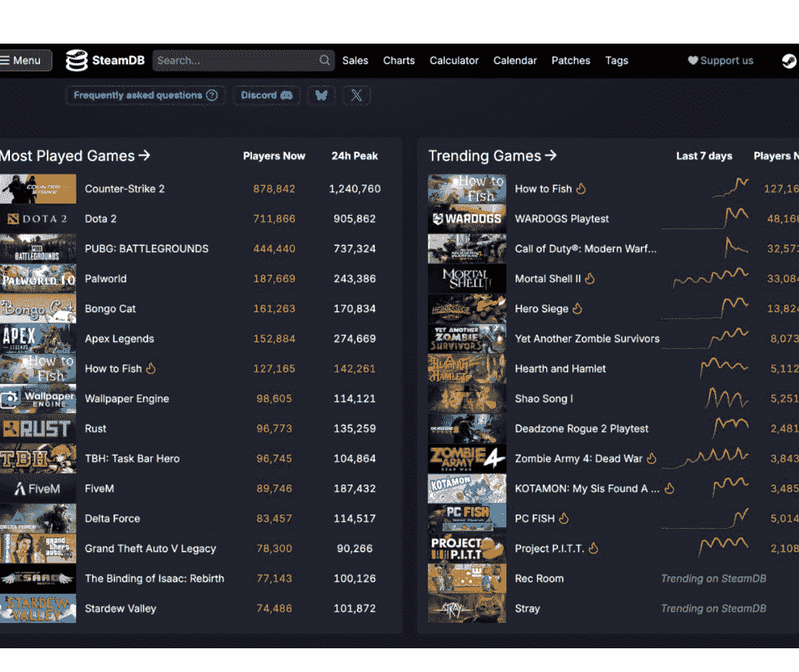

*图 3：SteamDB Trending Games 中筛选候选游戏。*

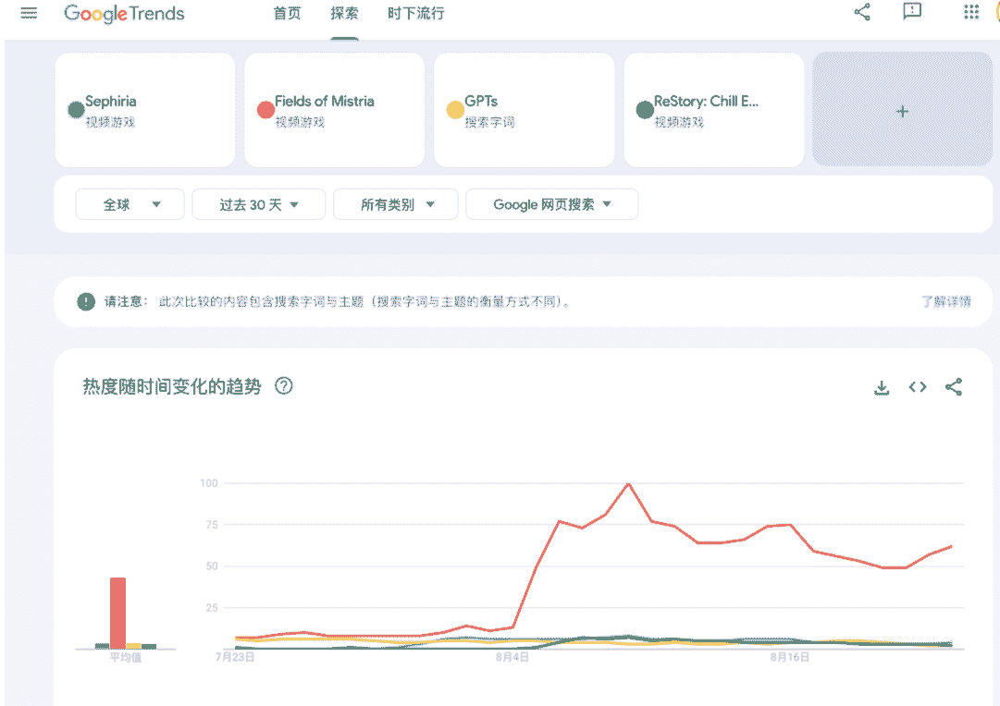

图 4：Google Trends 对比后，Fields of Mistria 搜索热度明显更高。做这个项目时，游戏刚进入 1.0 阶段，玩家集中搜索新手、角色、送礼、恋爱、作物、矿洞、平台和版本更新。中文以外的攻略内容有明显空缺。我的想法很直接：先做一个站把整条链路走通，不追求批量复制，先把质量和流程做对。

## 三、迭代过程

网站上线以后，我不是按内容、SEO、设计、广告来拆工作，而是一轮一轮诊断：先找到问题，判断它出在哪一层，这一轮只动一类东西，再用对应的数据看有没有好转。

每一轮都按同一套来写：怎么找到问题、怎么判断、怎么优化、改完看什么。

### 第一轮：先把网站变成一个可以放心迭代的版本

上线后我用程序逐页扫描了一遍，发现三类硬伤——不修掉的话，后面做任何优化都没有意义：

- 39个内页中，正文没有被正确标记为主要内容。人眼能看见正文，但代码没标出"这才是主要内容"。
- 13个法语页面里残留着西班牙语——比如图片描述还写着 "Galería de Juego"。
- 5个高风险主题（Switch、多人模式、Mods、版本更新、婚恋）缺少官方来源。有的说法看起来完整，但查下去发现是 AI 合理推测出来的，和官方口径不一致。

更严重的是工程问题：西班牙语和法语的内容文件只存在我本地，没有进入版本控制。别人拿到代码后只能重建13个英文页面和1个西班牙语页面，剩下25个多语言页面无法重建。

我把语言审查交给另一个 AI（ChatGPT Pro），让它独立检查句子是不是目标语言、有没有混进别的语言。但程序或模型标红的，只有我亲自确认过，才动手改。

这一轮不看排名有没有涨。结构、语言、来源、链接都过了，这个站才有可以比较的基线。

### 第二轮：解决 Google 抓取和网址不一致

基线有了之后，抓取问题才看得清楚。

用户访问 /farm-layout 会直接掉进 404，但 /farm-layout.html 能正常打开。同样的问题在 39 个内页上都存在。另外，网站生产环境用的是 https://www.mistriefans.com，但我的生成器把所有页面的规范网址声明成了 https://mistriafans.com （没有 www）。Google 因此发现了同一份内容的多个地址，把抓取和索引信号分散掉了。

**我在 GSC 里找到问题的路径是：** 先在"网页"报告里找到 404 和重复网页，复制示例网址，到"网址检查"里看 Google 选了哪个规范网址，再用浏览器打开原地址看跳转行为。

**修复：**

- 全站统一使用 https://www.mistriafans.com ，更新了 42 个页面的规范声明、sitemap 和 robots.txt。
- 给 39 个内页的无扩展名地址做了永久跳转到 .html 版本。
- 添加了 SEO 回归测试，防止下次更新时 origin 再次不一致。
- 未知地址保持真实 404，不把所有错误网址扔回首页。

**改完看什么：** 先确认旧地址只跳一次且是永久跳转，再到 GSC 发起验证。Google 还没重新抓这批页之前，不继续改同一批页面。

### 第三轮：不再按关键词批量建页，改为解决玩家任务

最早做内容时，我看见一个词就想做一页。后来发现这样会生出很多只有两三句的薄页面，也可能让几页去抢同一批搜索。

我改成先问：玩家此刻要完成的是哪一件事？这件事现有页面讲完了没有？

**怎么找到问题：** 打开 GSC 效果报告，按展示次数从高到低看，圈出"展示高、点击低"的搜索词。对同一个词，我会看两个周期确认它不是临时波动，然后查 Google 拿站内哪一页接这个词，再搜一遍看前排给的是短答案、表格、图片还是工具。

用当时那张表举例。我先把"展示超过 300、点击不超过 3"的行圈出来：

| 搜索词 | 展示 | 点击 |
| --- | --- | --- |
| fields of mistria house upgrade | 740 | 2 |
| seridia fields of mistria | 544 | 0 |
| house upgrade fields of mistria | 350 | 0 |
| mods of mistria installer | 303 | 0 |

再按玩家要做的事合并不写法：两个房屋升级词合计 1,090 次展示、2 次点击（0.18%）；两个 Seridia 词合计 902 次展示、3 次点击（0.33%）。作为对照，farm layout 有 431 次展示、10 次点击（2.32%），没那么急。

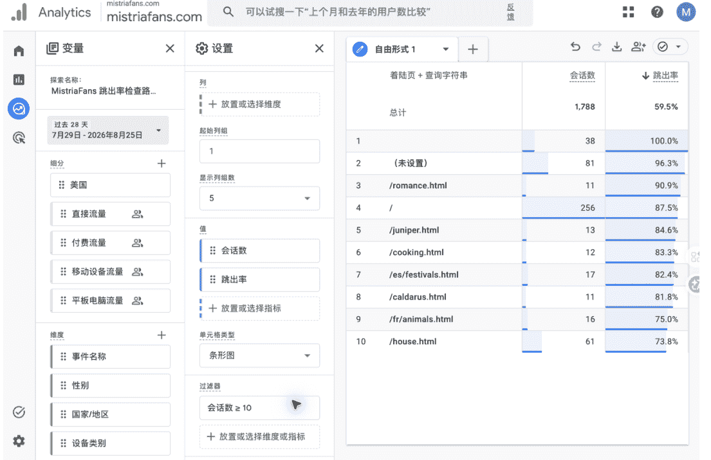

**判断标准只有三个：** 这个搜索是不是一件独立的事？现有页面能不能自然接住？新页面能不能给出比一段话更具体的答案？比如搜 Mods 的人需要下载入口、适用版本、安装步骤、备份建议和故障恢复——这件事足够独立，原页面没讲完，才值得补强。任务不独立的长尾，合并进已有页面。

后来新增赚钱、传说鱼、Hayden、Balor、Eiland 等页面时，每个都先写两行：**玩家打开这一页是要完成哪一件事？这一页有什么是别页给不了的？** 写不出来就不建新页。

### 第四轮：首页从游戏介绍改成任务入口

看用户行为时，首页跳出率 87.5%，同期全站 58.8%。这个数字只说明首页值得优先检查，不能告诉我原因。

按渠道拆：246 次来自 Direct，跳出率 87.8%；自然搜索只有 6 次（样本太小，不能写成“搜索用户看了首页就走”）。Direct 只表示 GA4 没识别出来源，也推不出这些人想干什么。

**把首屏改成任务入口是我的产品假设，不是数据推出来的。** MistriaFans 是攻略站，已经有送礼、赚钱、鱼类、矿洞、恋爱等具体内容，但当时首屏主要在介绍游戏，没把下一步说清楚。我因此选择先把常用攻略入口提前，看进了首页之后的人还犹豫不犹豫。

**改完看什么：** 我提前定了判断标准：攻略卡点击（guide_card_click）、站内链接点击（internal_link_click）、第二页访问一起增加，同时首页跳出率下降，才算"把任务入口提前"得到支持。按钮点击增加但第二页访问没增加，说明入口吸引人但后面的页没接住。都没改善，就停止继续改同一套方案。

### 第五轮：单独优化 PageSpeed

首页结构调整后，我把打开速度单独列成一轮。页面打开慢，人还没看见内容就走了；内容不对路，人看见了也不想继续。两项一起改，跳出率变了也不知道是哪一项在起作用。

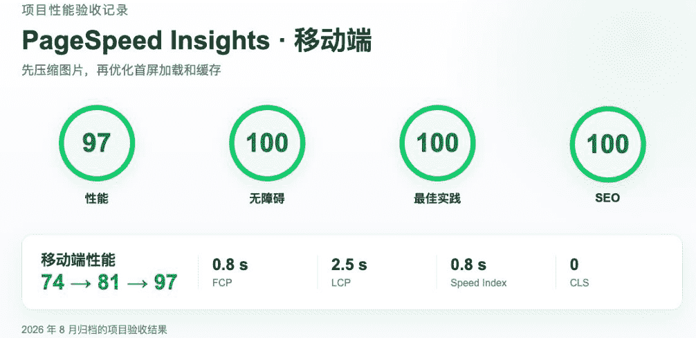

移动端最初是 74 分。诊断指向图片、首屏加载和缓存。我压缩图片、收紧首屏资源、把预告片改成点击才加载（首屏只放一张本地海报，不加载 YouTube）。

我也单独测试过"把分析脚本推迟加载"有没有收益，对照后发现没有改善，就退回官方标准写法——代码已经写了也不勉强留着。最终移动端从 74 分到 97 分。但这只说明性能优化生效了，不能证明首页内容已经帮用户找到下一步。快不快看 PageSpeed，人会不会继续往下看 GA4，这两套数不能互相替代。

### 第六轮：校准 GA4，避免用自己的测试做决策

我发现两件事缠在一起：我自己的测试访问和真实访客写在同一份报告里；scroll（滚动）事件被当成有效结果。

**修复：** 把自己的访问标成内部流量并排除；scroll 降级为辅助观察，不再当"用户做完了事"；为三个任务事件分别写清触发动作和含义。

**改完看什么：** 测试操作能在 DebugView 里按预期出现；我的测试不再混进日常报告；普通访客仍能正常触发事件。三项都成立，GA4 才能作为后面运营的依据。这一轮不判断哪一页该改。

### 第七轮：一次只改一类，并写成规矩

前面六轮做下来，我写了一条规矩：**不要把内容、首页、埋点、语言和广告塞进同一次发布。** 判断方法很简单：准备发布的改动里，如果同时出现两类以上（内容/首页/埋点/语言/广告），就先拆开。拆不开，就还没到发布的时候。

每轮开始前先写一迭代目标，写不出来说明还没想清楚。下面是我实际用过的一张迭代目标（第五轮 PageSpeed 优化）：

**改完看什么：** 看迭代目标上预先写死的那一两项有没有动。动了就留下记录，没动就按停止条件收手。

## 四、几个具体决策

### 农场布局有展示没点击，我为什么不先改标题

Farm Layout 页面，GSC 里 296 次展示、0 次点击。一开始我想改标题。但 CTR 诊断时我发现，搜这个词的 136 次展示全部落在英文页面上，没有语言错配——问题不在标题，在内容形态。

搜索结果页给的是布局图片、灵感和规划工具，我的页面写的是文字版建议加通用截图。用户想看的是能直接参考的例子，不是一段段说明文字。

我把这个页面改成布局图集+农场规划工具，目前还在观察 Google 重新抓取后的效果。

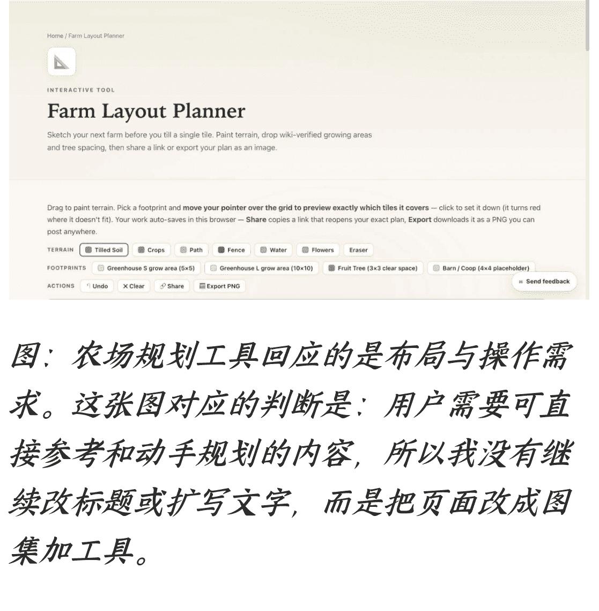

### 精确查询进入总页，我为什么做实体页

有玩家搜具体角色或物品，却进入 Characters、Fish 这类总页。我先在总页增加直接答案和锚点；查询持续出现、信息足够独立，再建实体页，双向链接。*实体页不是为了增加页面数量，而是缩短用户从搜索到答案的距离。*

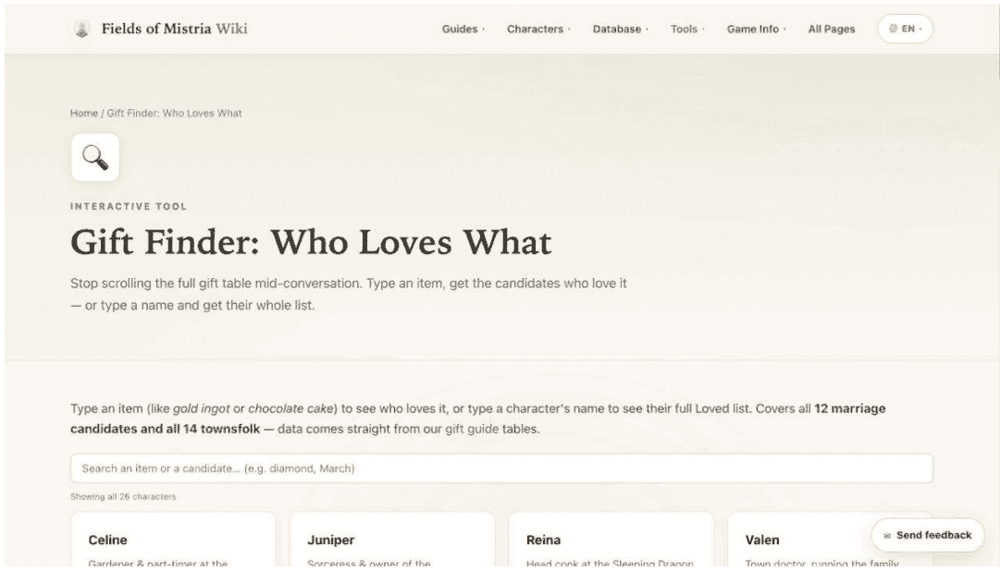

图：礼物查找器把“某个角色喜欢什么”和“手里的物品适合送谁”变成两条直接查询路径。

### 广告代码放上去了，后台为什么没数据

这个坑踩了三轮才解决。

*第一轮：同意弹窗挡住了一切。* 我为了稳妥加了同意弹窗，用户没点同意前，GA4 和广告都不加载。后来确认这个网站不需要全站弹窗，移除后才有了基本的数据流。

*第二轮：Iframe 隔离层破坏了广告运行环境。* 我不想让第三方广告脚本影响正文，就做了一个独立广告小页面，用 iframe 嵌入主站。看起来更安全，但 Adsterra 的广告代码跑在 about:srcdoc 环境下，不符合官方的静态 HTML 接入方式。两个广告位加载后 8 秒就自动收起，后台连续多天零数据。

*第三轮：同站 wrapper frame 方案，仍然收不到数据。* 我改成同站地址加载广告，但 frame 仍然 8 秒后收起为空。

**最终解决：按官方指南，把原始广告代码直接放到页面指定位置。** 跟 Adsterra 客服咨询并重新读了官方文档后，去掉了所有中间层，广告终于有了数据。

改完以后，我不再把“网页上能看到广告”当成接入成功，而是去 Adsterra 后台检查三个信号：展示量是否开始增长、不同广告位是否都有记录、收入是否按天累积。

这组数据我重点比较的是每个广告位的单位展示收益，也就是 CPM。

截至 8 月 31 日，728×90 广告位只有 189 次展示，却带来了 0.72 美元收入，CPM 为 3.798 美元。它只占总展示量的约 17%，却贡献了约 53% 的收入。相比之下，300×250 和 320×50 的展示量更多，但 CPM 都只有 0.7 美元左右。就 MistriaFans 这批数据来看，728×90 的单位展示收益明显更高。

不过，这不能直接推导出“728×90 在所有网站都最好”。我又对照了同一账户下另外两个游戏站：在 Lou’s Lagoon，Native 的 CPM 反而高于 728×90；Tiny Eden 的数据量太少，暂时无法判断。这说明广告效果还会受到页面位置、访客所在地区、设备类型，以及用户是否滚动到广告位置等因素影响。

这次复盘也暴露了一个记录方式的问题：现有后台数据主要按广告代码和尺寸统计，还不能准确区分首页、正文中段和文末等

具体位置。下次我会给不同位置分配独立的广告代码，至少观察 7~14 天，再比较 CPM、展示占比和收入占比，决定保留还是调整。

EXPORT CSV

| Placement | Impressions | Clicks | CTR | CPM | Revenue |
| :--- | :--- | :--- | :--- | :--- | :--- |
| mstrafans.com - 300x250_1 - 30833672 | 477 | 0 | 0% | $0.749 | $0.36 |
| mstrafans.com - 320x50_1 - 30833671 | 386 | 0 | 0% | $0.724 | $0.28 |
| mstrafans.com - 728x90_1 - 30833673 | 189 | 0 | 0% | $3.798 | $0.72 |
| mstrafans.com - NativeBanner_1 - 30920951 | 30 | 0 | 0% | $0.860 | $0.03 |
| Total: | 1082 | 0 | 0% | $1.266 | $1.37 |

图：截至 2026 年 8 月 31 日的广告位数据。这张图要说明的不是哪个广告位展示最多，而是展示量和单位展示收益并不是一回事：728×90 展示较少，却贡献了超过一半的收入。

### 多语言为什么选西语和法语，没做日语

我最初考虑过日语，但搜索结果里已经有成熟的日语攻略站。西语和法语的玩家需求存在，专门攻略内容更少。多语言选择不是看哪门语言最容易翻译，而是看需求、竞争和官方本地化成熟度。上线后，ChatGPT Pro 独立复核时发现西语文案出现术语和表达不准确。我后来固定了流程：Codex 生成初稿 → ChatGPT Pro 独立复核语言和事实 → 按复核结果统一术语和语气。多个 Agent 的价值不是重复写一遍，而是分别负责起草、事实核对和语言校对，用相互校验降低单一模型的盲区。

图：简体中文首页与英文站使用同一套任务结构，但文案和入口按语言分别维护。

### 修好的页面，下次更新又变回去了

这个网站的大部分页面通过统一模板批量生成。有一次我直接修改了最终页面，当时看起来已经修好，但下一次重新生成网站时，旧模板把修改覆盖了。

**正确做法是找到页面对应的源文件或模板，在源头修改，再重新生成。** 从那以后，我验收的不只是“现在页面对不对”，还会重新生成两次，确认修改不会再次消失。

# 五、我固定下来的迭代方法

上面这些轮次，最后变成了一套我会反复使用的方法。

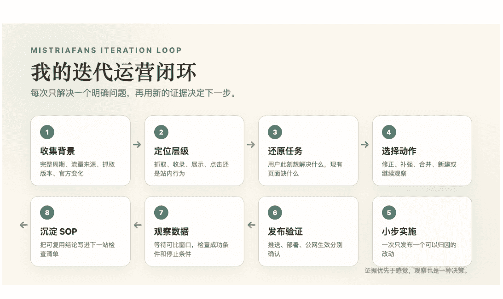

图：我用这套方法先排除数据干扰，再定位问题层、选择一种动作，并提前写下成功和停止条件。它直接决定了我不再一次性修改十项，而是让每轮改动都能解释、验证和回退。

# 第一步：排除干扰数据，确认可用基线

看到一个差指标不要立刻改页面。先确认你看到的数据本身是否可靠。

具体做什么：

1. 检查数据窗口是否结算。 GSC 的"最近 24 小时"数据是临时的，会在之后修正。MistriaFans 上线当天我看到 1,920 展示 / 38 点击，第二天重新拉数据变成了 1,260 / 30——差了三份之一。做决策时，至少用完整的 7 天窗口，不要拿最后几个小时的数据下结论。
2. 排除你自己的访问。 早期样本小，你自己的一次访问就可能让某页跳出率从 50% 变成 100%。在 GA4 → 管理 → 数据流 → 配置标签设置里建一条 Internal Traffic 过滤规则，按你的 IP 排除，记录生效日期。在生效日期之前的数据里，用户行为指标不可信。
3. 确认 Google 抓取的是哪个版本。 在 GSC 的地址检查工具里输入页面 URL，看"上次抓取时间"。如果你昨天改了标题，但 Google 抓取时间是一周前，那 CTR 反映的是旧标题的效果，不是新标题的。这时候该做的是等 Google 重新抓取，而不是再改一次标题。

这一步完成的标志：你能说出数据的时间窗口、内部流量是否已排除、Google 抓取的是改动前还是改动后的版本。三个问题都能回答，才进入下一步。

### 第二步：定位问题出在哪里

数据可靠以后，用下面这个决策树定位问题在 SEO 链路的哪一环。从上往下走，第一个命中的就是你当前要解决的层：

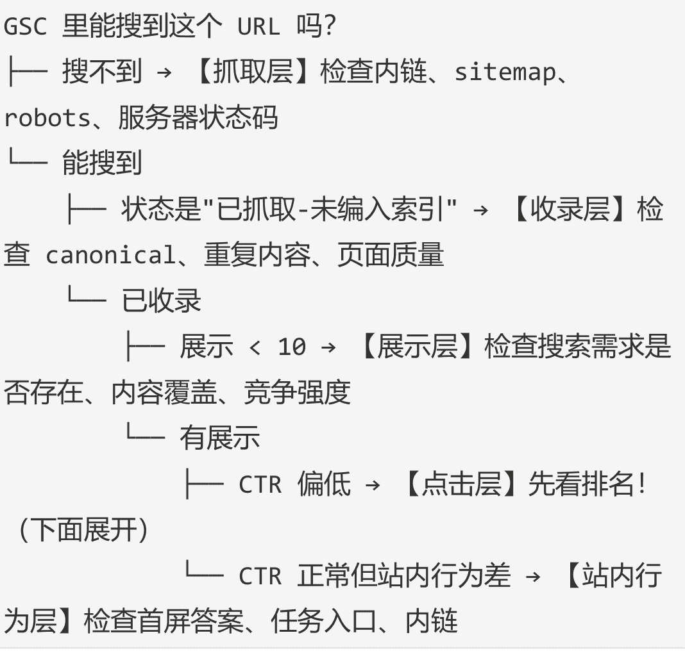

点击层的诊断不能只看 CTR 一个数字。

每次至少同时读取这些字段：查询词、对应页面、展示数、点击数、平均排名、国家和设备。然后对照下表判断动作方向：

| 现象 | 优先判断 | 动作方向 |
| :--- | :--- | :--- |
| 排名 1-6，展示高，CTR 低 | 摘要被截断？语言页错配？SERP 有精选摘要或品牌站挤压？ | 小范围测试 title/description；核对查询实际落地页 |
| 排名 7-10，CTR 低 | 排名和搜索意图共同作用 | 先搜这个词看前排结果在回答什么，再补页面独立价值和内链 |
| 排名 10 以后 | 主要是排名问题，不是标题问题 | 改善内容深度、内链结构和权威信号；不要把改标题当唯一解 |
| 精确查询进入通用页面 | 页面粒度不够 | 为这个查询增加精确章节，必要时建独立页 |
| 英语查询进入西语/法语页 | 语言页选择异常或旧抓取 | 核查 GSC 的 query->page 映射、canonical、hreflang、抓取日期 |
| 刚发布新页面或新标题 | 数据仍反映旧版本 | 少量 URL 用网址检查请求重抓，然后等待——不要连续提交 |

真实例子——Farm Layout 页面： 这个页面有 342 次展示、0 次点击。第一反应是标题不行。但看了 SERP 才发现：搜 "farm layout" 的玩家想看的是布局灵感图、真实案例和规划工具，而我的页面主要是文字建议和一张通用截图。问题不在标题，在内容和搜索意图不匹配。

真实例子——Mods 语言错配： 英语 Mods 查询有 100 次展示，但 GSC 显示 86 次落到了西语页、14 次落到法语页、0 次到英语页。这不是内容问题，是 Google 的语言页选择出了问题——要查 hreflang 配置和各语言版本的 canonical 声明，而不是改 Mods 的文案。

核心原则： 问题出在收录层就不要改首页文案；排名在十名以后就不要把低点击率归咎于标题。先定位层，再选动作。

### 先判断问题发生在哪一层

指标只是现象，不同层的问题，需要完全不同的动作。

1. **抓取**
    Google 找不到页面
    先查 URL，站点地图，robots 和服务器状态
2. **收录**
    抓取了，但没有进入索引
    检查 canonical、重复内容、页面质量和语言关系
3. **展示**
    已收录，曝光仍然很少
    回调查询表单、页面主题、内容质量和竞争
4. **点击**
    有展示，但点击率偏低
    拆开各排名、查询匹配、标题摘要和摘要形态
5. **站内行为**
    用户进来后没有继续操作
    检查推荐答案、任务入口、阅读结构和内容

判断原则：收录问题不靠重写首页解决，排名问题也不能全部归咎于标题。

# 第三步：把搜索词翻译成玩家任务

定位到问题层之后，对每个准备迭代的页面填一张任务卡。五项都写不清楚的页面，不要因为"看起来不完整"就动手改。

| 项目 | 说明 | 示例 (Farm Layout 页) |
| :--- | :--- | :--- |
| 目标查询 | 玩家实际搜的词 | fields of mistria farm layout |
| 玩家任务 | 搜这个词的人想完成什么 | 看到别人的农场布局，找到规划自己农场的参考 |
| 当前缺口 | 现有页面缺什么 | 没有真实布局图和规划工具，只有文字建议 |
| 独有价值 | 这页有什么是别处给不了的 | 按季节分区的规划逻辑 + 可交互的规划器 |
| 事实来源 | 主要信息从哪来 | Wiki 种植数据 + 社区分享的布局截图 + 游戏内验证 |

> 填卡的价值在于暴露假设。如果"独有价值"填不出来，说明这个页面可能不需要独立存在。如果"玩家任务"和"当前缺口"写出来一看就对不上，问题就很清楚了——不用看更多数据。

### 第四步：选择一种动作并写清楚范围

每次迭代只允许做一类事。下面五种动作选一种：

- **修正** — 页面有明确错误（事实错、语言残留、链接断了、canonical 指向错误）。例：法语页面残留了西语文案 "Galería de Juego"，修正方式是在来源分片里替换残留文本，再重新生成。
- **补强** — 页面主题正确但答案不够完整。例：Fish 页面收到了 "coelacanth" 的精确查询，但页面只有通用钓鱼指南，缺少这条鱼的价格、地点和季节信息。
- **合并** — 两个页面服务同一个玩家任务，关键词互相竞争。合并时选保留展示更好的那个 URL，另一个做 301。
- **新建** — 查询有独立任务，现有页面无法承接。例："coelacanth" 查询量足够大，且 Fish 页面的 H2 章节不能满足完整需求，所以建独立实体页。
- **观察** — 样本不足，或者 Google 还没重新抓取你的改动。例：修完 canonical host 配置后，等 Google 重新抓取 42 个页面再看指标变化，期间不做其他 SEO 改动。

**"观察"也是决策，而且经常是最对的那个。它能避免你在数据最不稳定的时候连续改标题、页面结构和语言配置——这些改动叠在一起，事后根本分不清哪个起了作用。**

### 第五步：动手前，先写清楚怎样算成功、什么时候该停

每次只解决一个问题。动手前，我会先写清楚：这次改什么、会影响哪些页面、怎样算有效、观察多久，以及没有效果时怎么恢复。下面是我使用的记录格式和一个真实例子。

### 改动记录模板：

| 字段 | 内容 |
| :--- | :--- |
| 改动名称 | 一句话描述这次改什么 |
| 这次怎么改 | 写清这一轮准备采取的动作 |
| 会影响哪里 | 涉及哪些网址、页面和语言 |
| 怎样算成功 | 写一个可以用数据验证的目标，不只写“变好” |
| 什么情况下停止 | 达到目标，或确认继续修改也没有效果时停手 |
| 改完观察多久 | 提前写清多久以后再看数据 |
| 改坏了怎么恢复 | 记录恢复到上一个版本的方法 |

### 真实例子——Canonical Host 修复：

| 字段 | 内容 |
| :--- | :--- |
| 改动名称 | 统一 canonical host 声明为 www 版本 |
| 这次怎么改 | 修正 |
| 会影响哪里 | 全站 42 个页面的 canonical 标签和 sitemap |
| 怎样算成功 | GSC 网址检查显示所有页面的 canonical 与生产 URL 一致；不再出现 "alternate page with proper canonical tag" 状态 |
| 什么情况下停止 | 修改后 14 天内 Google 仍未重新抓取超过一半的页面 → 检查 sitemap 提交状态 |
| 改完观察多久 | 7-14 天（等 Google 重新抓取） |
| 改坏了怎么恢复 | 生成器的 SITE_ORIGIN 配置改回原值，重新构建 |

改动记录不用写得很正式，放在项目笔记或 issue 里都可以。重点是动手之前就搞清楚“怎样算成功”和“什么时候该停”，而不是改完以后再为结果找解释。

### 第六步：一次发布只包含一类改动

把以下几类改动分开发布，不要混在一个版本里：

- **内容修正**（修错误、补信息、改语言残留）
- **测量基础设施**（GA4 事件、流量排除、GSC 验证）
- **首页和导航实验**（信息架构、入口调整）
- **多语言扩展**（新增语言、翻译修正）
- **广告和变现**（广告位、广告代码、合规弹窗）

> 为什么要分开？因为混在一起发布后，你无法判断指标变化是哪项改动造成的，也很难回滚。MistriaFans 有一次发布同时包含了内容修改、首页改版、语言提示调整和埋点事件——发布后某项指标变了，完全无法归因。从那以后我严格执行单类发布。

每次发布前回答三个问题：

1. 这次具体改了什么？（写清楚影响的 URL 列表）
2. 出了问题怎么回退？（Git revert + 重新构建，还是需要额外操作？）
3. 多久以后复盘？（定一个日期，到了就去看，不要"有空再说"）

### 第七步：确认上线、观察、记录结果

发布不等同于上线。代码推上去以后，按下面三步确认改动真的生效了：

1. **确认代码推送。** 检查 Git 的远程仓库，确认你的提交已经到了目标分支。
2. **确认生产部署。** 访问部署平台（Vercel / Netlify / 你用的任何托管），确认最新一次构建成功完成。
3. **确认公网页面。** 打开实际的页面 URL（不是本地预览），用浏览器的查看源代码确认改动已经反映在线上版本。如果改的是 canonical 或 meta 标签，在源代码里搜关键字段。

三步都通过了，才进入观察期。观察期内对照改动记录里的成功条件和观察时间来跟踪。

观察期结束后，回到改动记录里补上结果：

- 成功条件达到了吗？用实际数据回答，不用感觉。
- 如果没达到，是因为改动无效，还是因为观察窗口不够长？
- 有没有意料之外的副作用？

结论写进项目记录，下一个迭代轮次或者下一个游戏站可以直接查阅。不要只记成功的——踩过的坑和无效的尝试同样有价值，否则同一个问题很容易在新语言或新站点里重演。

# 六、内容是怎么生产的

这套流程在文章里之前没展开过，但对想复制这条路的人很关键。不是"找个AI写一篇攻略"那么简单——没有来源管理和校验环节，AI生成的内容会混入大量看起来对但实际错的信息。

### 生产流程（八步）

# 1. 素材准备：按主题收集一手来源

每个页面主题建一个素材文件夹，把以下来源收集进去：

- 游戏官方FAQ和补丁说明
- Steam商店页面（价格、平台支持、更新日志）
- 社区Wiki（物品数据、角色数据、机制说明）
- 社区帖子和Discord讨论（玩家实际遇到的问题）
- Mod平台（NexusMods、Steam Workshop——注意Cloudflare反爬可能导致部分页面无法自动抓取，标记为数据缺口）

**不要跳过这一步直接让AI写。** AI会编造看起来合理的数据——比如一条鱼的售价、一个道具的获取方式。如果你没有一手来源做对照，根本发现不了。

### 2. 来源矩阵：每条事实标注出处和确定性

把收集到的素材整理成一个表，每行是一条事实声明：

| 事实声明 | 来源URL | 适用版本 | 核查日期 | 确定性 |
| :--- | :--- | :--- | :--- | :--- |
| 腔棘鱼售价 800g | Wiki 钓鱼页面 | v0.15.2 | 2026-08-12 | 已验证（游戏内截图） |
| Switch 版本发售时间 | 官方 FAQ | — | 2026-08-10 | 官方说法："正在评估"，未确认 |
| Expanded Storage Mod 兼容 v0.15 | Nexus Mods 页面 | v0.15 | 2026-08-11 | 作者声明兼容；Cloudflare 阻断无法自动验证更新 |

关键是"确定性"那一列。标"已验证"的可以写进正文当事实；标"未确认"的必须在页面上注明。我原来写的是"支持 Switch"，但官方 FAQ 实际说的是"目前支持 Windows 和 Steam Deck，Switch 正在评估"——这种差别足以误导玩家做购买决定。

### 3. AI 生成初稿：输入是来源矩阵，不是一句话指令

给 AI（我用的是 Codex）的输入包括三样东西：

- 上一步的来源矩阵
- 这个页面的目标（对应第五章任务卡里的"玩家任务"）
- 页面应该回答的具体问题列表

不要只给一句"写一篇关于 Fields of Mistria Mods 的攻略"。这样 AI 会自己发挥，混入它"觉得合理"的信息。给它来源矩阵，它的工作是组织和表达这些已有事实，而不是创造新事实。

### 4. 独立复核：用另一个 AI 检查初稿

初稿出来后，不是直接用，而是交给另一个 AI（我用的是 ChatGPT Pro）做独立复核。复核重点：

- **事实核对：** 初稿里的数据和来源矩阵一致吗？有没有 AI 自己加的"合理推测"？
- **语言准确性：** 多语言版本的术语是否准确？社区实际用语是什么？
- **过度承诺：** 有没有把"可能"写成了"确定"？有没有把"正在评估"变成了"即将推出"？

真实例子：ChatGPT Pro 在复核西语 Mods 页面时发现，初稿在 "modificaciones" 和 "mods" 之间来回切换。查了西语游戏社区后确认，玩家普遍直接用 "mods" 这个英语借词。统一术语后整页读感明显提升。

### 5. 统一术语和语气

按复核结果批量修订：建立一个术语对照表（英语原词→各语言对应词），后续所有页面都参照这个表。术语不一致的地方不要逐个手动改——在内容分片里改一次，重新生成就全部统一了。

### 6. 生成器构建：源文件 + 分片 → 全语言静态页面

MistriaFans 的页面不是手写 HTML，而是用 Python 生成器读取内容分片（每种语言一组 JSON/Markdown 文件），按模板生成全部语言的静态页面。

**这里有一个我踩过的大坑：** 西语和法语的内容分片一度只存在我本机，没进 Git。别人拿到代码以后无法重建这两种语言的页面——甚至我自己换一台电脑也不行。**规则：所有内容源文件、语言分片和生成器脚本都必须在 Git 里。** 如果干净克隆后跑一次构建不能生成全部页面，说明有东西遗漏了。

另一个坑是语言残留。法语页面出现了西语的 "Galería de Juego"，原因是批量翻译时模板片段串了线。后来我加了一个跨语言扫描脚本，每次构建后自动检查每种语言的页面里是否包含其他语言的已知词汇。

### 7. 两次构建验证

连续运行两次完整构建，对比输出文件。如果两次结果不完全一致，说明生成器有非确定性行为（比如依赖外部 API 返回、字典遍历顺序不固定、时间戳嵌入页面）。两次构建一致，才能确信"重新构建不会把之前的修改覆盖掉"。

## 8. 浏览器验收

构建完成后打开实际页面检查，不是看本地预览截图。检查清单：

- 桌面和移动端各打开一遍
- 四种语言各抽查至少两个页面
- 每个页面检查：正文完整性、图片加载、内链可点击、canonical 和 hreflang 标签正确
- 用浏览器搜索功能在页面源码里搜其他语言的关键词（抓语言残留）
- 控制台没有 JS 报错，网络面板没有 404 资源

## 关键原则

- 不要把 AI 的 " 合理推测 " 当已确认事实。宁愿留空并标注 " 待确认 " ，也不填一个看起来对的数字。
- 高风险事实在正文就近放来源。不要只在页脚放一个泛化参考链接。读者需要在看到 " Switch 版正在评估 " 的旁边就能看到 " 来源：官方 FAQ, 2026-08-10 核查 " 。
- 先有来源矩阵，再有内容。这个顺序不能反。反过来做（先让 AI 写，再找来源验证）会导致你不自觉地只找支持 AI 说法的来源，而忽略矛盾信息。

## 七、运营 SOP

网站上线后不是"有空就看看"，而是按固定节奏检查固定内容。下面是我实际在用的频率和检查项。

### 日常检查（10 分钟）

每天只检查会立刻伤害用户的东西，不做任何优化改动。

这些检查大部分是机械性的，适合交给 AI 做定时巡检。我的做法是设一个每日哨兵任务，自动跑完以下检查项，只在发现异常时通知我：

**AI 哨兵自动检查（每天定时运行）：**

| 检查项 | 具体做什么 | 异常判定 |
| :--- | :--- | :--- |
| 网站可用性 | 请求首页和 3-5 个核心页面，检查 HTTP 状态码和响应时间 | 任何页面返回非 200，或响应时间超过 5 秒 |
| 页面完整性 | 抽查页面的 <main> 内容是否完整、关键图片是否加载 | 正文为空、图片 404、出现模版占位符 |
| 游戏更新监测 | 检查 Steam 新闻页面和官方 Discord 公告频道，是否有新补丁或公告 | 发现新补丁号或官方公告 |
| 版本信息时效 | 如果检测到游戏更新，对比站内版本页记录的补丁号和日期 | 站内版本号落后于官方最新版本 |
| SSL 和域名 | 检查证书有效期和域名解析 | 证书 30 天内过期，或解析结果异常 |
| 社区舆情 | 扫 Reddit 子版和 Discord 公告/求助频道，提取当天高频关键词和重复提问 | 同一问题被 3 人以上提到，或出现与站内攻略矛盾的信息 |
| 竞品动态 | 抓取 2-3 个竞品攻略站的 sitemap 或首页，对比昨天的页面列表 | 竞品新增页面，尤其是你还没覆盖的主题 |

哨兵把所有结果汇总到一份日报里，没有异常就一行“无变化”。社区舆情和竞品动态不需要每天细看——我一般一周翻两次日报，有异常才点进去。

哨兵只负责发现和报告，不自动修改任何页面内容。收到异常通知后，人工判断是否需要处理、怎么处理。没有异常就不动。不要为了"保持更新"随便改页面。

### 每周复盘（30-60 分钟）

固定时间坐下来看数据，输出是一份简要记录：本周发现了什么信号、下周准备做什么。

**GSC 部分（20 分钟）：**

1. 打开 GSC → 效果 → 按查询排序。看有没有新出现的查询或持续增长的查询。
2. 切到"页面"维度，找"有展示但没有点击"的页面——这些是需要进第五章诊断流程的候选。
3. 对可疑页面，点进去看查询明细：这个页面在接哪些查询？排名多少？有没有精确查询进入了通用页面？
4. 检查多语言：有没有英语查询落到非英语页面的情况？

**GA4部分（10分钟）：**

1. 看自然搜索的会话数和趋势（注意用排除内部流量的视图）。
2. 检查自定义事件：攻略卡点击（guide_card_click）、正文内链点击（internal_link_click）、外部来源点击（outbound_source_click）、反馈提交（feedback_submit_success）。
3. 如果某类事件突然归零，先检查埋点代码是否被覆盖，再看是不是真的没人点。

**决策（10分钟）：**

从本周信号里选最多 2-3 个确定性高的动作，走第五章的迭代流程。其余问题记在候选池里继续观察。不要每周都把候选池清空——大部分信号需要连续几周才能确认是趋势还是噪音。真实例子：某周发现 "fields of mistria coelacanth" 这个精确查询有稳定展示，但全部落到通用的 Fish 页面。连续两周观察确认趋势后，才决定为腔棘鱼建独立实体页。

**版本日（优先级最高）**

游戏发布更新的当天，所有常规优化暂停，按下面的清单集中处理时效内容：

这些页面过期后直接误导玩家，优先级高于新增任何普通攻略。 攻略缺一篇最多是用户找不到答案；版本信息写错了，玩家可能基于错误信息做购买或操作决定。

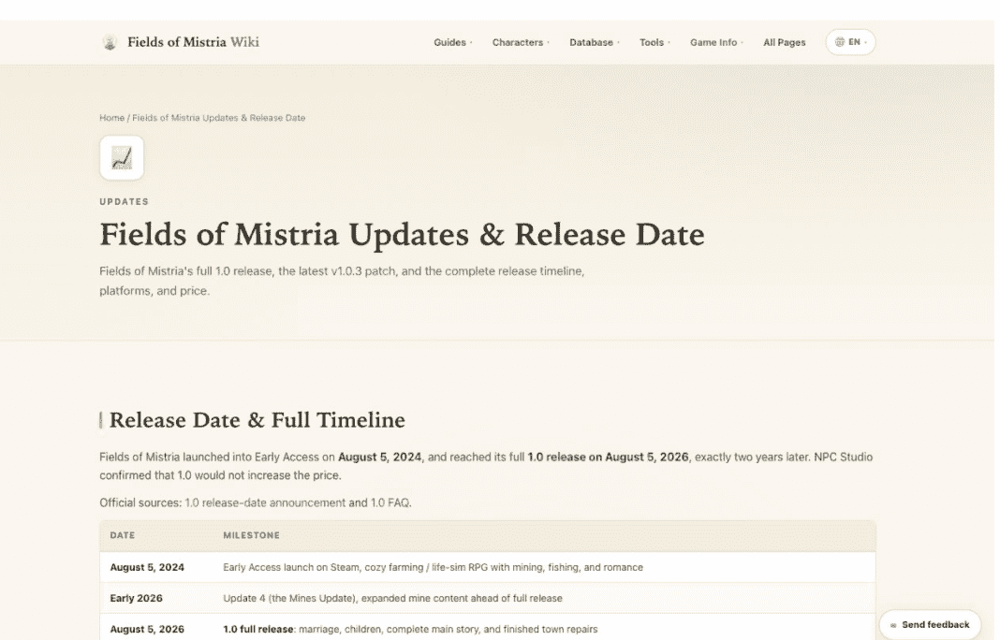

图：版本页同时记录发布日期、补丁状态和官方来源，方便版本日集中核查。

### 每月回顾（1-2小时）

月度是看全局和做清理的节奏，不适合做具体优化。

内容缺口分析： 把本月 GSC 里新增和增长的查询词导出，和现有页面列表做比对。哪些查询有展示但没有对应页面？哪些对应页面的内容跟不上查询意图？

竞品扫描： 搜几个核心查询词，看竞品攻略站这个月新增了什公么页面。不是为了抄，是为了发现你可能忽略的玩家需求。

改动复盘： 回看过全一个月的改动记录，哪些达到了预先写下的目标，哪些没有。没有效果的动作不要自动复制到下一站——它可能在这个站无效，也可能方法对了但时机不对，都需要记录清楚。

清理： 检查有没有孤页（没有任何内链指向的页面）、死链、过期数据。这些问题积累多了会拖累整站的质量信号。

## 八、实用工具

### 选游戏检查清单

| 维度 | 检查方法 | 通过标准 |
| :--- | :--- | :--- |
| 热度 | SteamDB 火苗 + Google Trends 28 天 | Trends 曲线明显高于其他候选 |
| 竞争 | 目标语言搜 "游戏名 + guide/wiki" | 前三页没有 3 个以上专门攻略站 |
| 内容空间 | 看游戏系统、角色、物品数量 | 能支撑 20+ 页独立内容 |
| 时效机会 | 是否刚发布/大版本更新 | 玩家正在集中找答案 |
| 多语言空间 | 目标语言搜索结果里的攻略覆盖 | 至少 1 个语言攻略明显空缺 |

### 多语言评估方法

决定要不要为一种语言做站，需要回答三个问题：这种语言的玩家在搜攻略吗？搜到的结果够用吗？你做了他们会来吗？

**第一步：确认搜索需求存在。** 在 Google Trends 里用目标语言搜 "游戏名 + guía / guide / ガイド"（对应语言的常用词），看 28 天内有没有稳定的搜索量。如果曲线平坦接近零，说明这个语言的玩家群体太小或者不习惯搜攻略。MistriaFans 评估时，西语和法语都有明显的搜索曲线，日语虽然也有但量级更小。

**第二步：评估竞争密度。** 在目标语言的 Google 里搜 "游戏名 + guide"，看前两页（20 条结果）里有多少专门的攻略站。这里"专门攻略站"指的是独立域名、内容围绕这个游戏的网站——Reddit 帖子、Steam 社区帖、通用 wiki（如 Fandom）的子页面不算，因为它们虽然有内容但不会像专门站那样持续更新和优化。

| 前两页专门攻略站数量 | 判断 |
| :--- | :--- |
| 0 个 | 蓝海，但要确认第一步的需求确实存在 |
| 1-2 个 | 有机会，尤其如果现有站的内容浅或更新慢 |
| 3 个以上 | 竞争激烈，除非你有明确的差异化（更深的内容、更好的工具），否则优先跳过 |

**第三步：检查官方本地化状态。** 去 Steam 商店页面和游戏官方 FAQ，看这个游戏是否已经提供该语言的界面和文本翻译。这一步决定了你的攻略能不能和玩家的游戏体验对上：

| 官方本地化 | 竞争情况 | 结论 |
| :--- | :--- | :--- |
| 已有官方本地化 | 没有专门攻略站 | **最佳切入机会**——玩家在用这种语言玩，但找不到对应语言的攻略 |
| 已有官方本地化 | 有 1-2 个攻略站 | 可以做，重点是找差异化 |
| 没有官方本地化 | 竞品少 | 谨慎——玩家可能直接看英语攻略，你的翻译价值有限 |
| 没有官方本地化 | 竞品密集 | **优先跳过**——需求不确定且竞争已经饱和 |

**真实决策：** MistriaFans 最初考虑过日语，但搜索结果里已经有成熟的日语攻略站。西语和法语的情况是：游戏有官方本地化，玩家搜索需求存在，但专门的攻略站几乎没有——这就是最佳切入点。最终选了西语、法语和简体中文。

### 什么时候该放弃或暂停一个游戏站

- 上线 4 周后，GSC 展示持续低于 100/周且没有增长趋势
- 目标查询被 3 个以上权威站（官方 wiki、大型攻略站）长期占据前三
- 游戏停更或玩家社区明显萎缩（SteamDB 在线人数持续下降）
- 你发现自己在为了"凑页面"而建页，而不是在回应真实的玩家任务
- 连续两轮迭代都没有看到任何指标变化

**暂停不等于放弃。** 游戏可能在下一次大版本更新时重新产生搜索需求。保留站点和监控，到时候再决定是否重启。

## 九、给后来船员的 4 个建议

1. **动笔之前，先建素材档案。** 把截图、数据、参考链接按游戏和页面分类存好，记录事实、版本、来源和不确定性。不然写到一半回去翻素材，会断掉思路也容易漏信息。
2. **一次只动一个变量。** 不要在一版更新里同时改内容、首页、统计代码、语言和广告。提前定义：要解决什么、做什么、怎么判断成功、什么情况下停、改坏了怎么回滚。
3. **拿到数据先判断问题出在哪里。** 是没被抓取、没被收录、有展示没点击，还是点击了但用户没继续操作？不同环节对应完全不同的解决办法。别看到 CTR 低就改标题——先看排名。
4. **信任 AI，但别接受它的第一个答案。** 让一个 Agent 负责生成，遇到重要内容让另一个 Agent 检查事实和语言。AI 是执行伙伴，但最终决定权在你手里。AI 参与的改动也要保留版本和回滚点。

## 十、最后

这次航海帮我把一个模糊的"做游戏站"拆成了可以执行的流程。过程中有不少返工和误判，但每一次问题都迫使我把模糊经验变成清单、测试和停止条件。课程框架告诉我先做什么，项目数据告诉我下一步做什么。

如果重新开始，我会更早冻结 URL 和信息架构、更早建立来源和测量基线、更克制地增加页面。

这个项目还谈不上稳定盈利，但已经出现了第一笔可以核对的广告收入。如果只计算域名成本，域名买得足够便宜时已经可以回本。对我来说，更重要的是，我已经能够独立把一个游戏词做成网站，并根据真实数据持续运营，而不是上线以后只能等。

下一阶段我会优先做三件事：根据真实查询补充独立价值明确的实体页和任务页；完善版本和兼容性时效内容的更新机制；继续观察自然搜索和广告数据，再决定扩张与变现投入。这套流程我会带到下一个游戏站，但不会直接复制 MistriaFans 的页面——可以复制的是判断方法和验收流程，具体做什么内容仍然要重新看游戏、玩家任务和搜索结果。

---

看完这篇 SOP，你觉得你懂了。但 90% 的人一到实操就会卡在第一步。

工具和教程只是最低级的壁垒，真正的壁垒是“立刻动手”和“圈层信息差”。

如果你想看全网最新的变现玩法，并且和一群执行力极强的极客一起下场拿结果，欢迎围观我的核心私域：【懒人专属群】。

我们不聊虚的，只做商业闭环的拆解与 AI 效率的压榨。系统内已沉淀 1000+ 跑通的套利实战局。

- 查阅圈子完整数字资产与上车门槛：
https://lazyso.com/insider/

认同价值、准备好下场干活的，扫码加我微信（lazyhelper1）

备注：【实操上车】，不闲聊

微信：lazyhelper1
