# 从 0 粉到接广：一个普通人的小红书好物号起号、转型与变现复盘

260912 副业 SC 精华
整理：公众号懒人搜索，懒人专属群精选
懒人微信：lazyhelperl

> **小懒判断** | 适合零基础想做小红书接广变现的女生，不适合没耐心日更一个月的。最值得关注粉丝等于消费力画像这个反推逻辑：24 到 35 岁女粉最值钱，起号就瞄准广告主目标人群爱看的内容，而不是什么火发什么。4000 粉才转型、隐藏笔记一天不超 10 条这些纪律都实在。坑在第一单 290 元还是伤账号的直发单，前期要有短时间没大钱的心理准备。

大家好，我是 Alisa，生财小红书商单号航海圈友。

在做这个项目之前，我刚毕业大半年的时间，完全没有做小红书的经验，整个账号都是从 0 粉、新注册开始做起来的。

截止到现在，我的小红书账号已经做到 6824 个粉丝，累计接过 6 个广告，累计变现 1596 元。从前期起号发的草单内容，到找准方向快速测试、第 3 篇就出现小爆款，再到第 6 篇开始稳定涨粉，4000 多粉后我转型好物分享，陆续接到置换和广告。

这篇我想复盘的，不是"怎么发帖"，而是从起号、测试、转型到接广，我到底做对了什么，又踩过哪些坑。

> PS：整个账号是完全从零粉丝、新注册开始做出来的。所以如果你现在也是 0 粉起步，别慌。我可以，你大概率也可以。感兴趣的话，往下看。

在这里非常感谢生财好物分享航海提供的圈子和交流平台。

如果只看这些数字，很容易让人觉得我一上来就选对了赛道，或者做号的过程一路顺风顺水。但真实情况并不是这样。

中间我经历过转型期连发几篇都没流量、焦虑到反复改帖差点把账号搞废，还因为粉丝偏年轻化但消费力有限，商业价值一度被压得很低，只能降价接单。

这篇分享，我想完整复盘自己从 0 粉到接广的全过程，以及这段经历里到底做对了什么、又踩过哪些坑。

## 01 核心认知：你涨的不是"粉"，是"消费力画像"

动手之前，先建立一个会贯穿你整个账号的认知：

**做小红书变现、接广，要从广告商的视角倒推。** 拿美妆护肤类品牌举例，它们的目标客群一般是 18-35 岁女性。如果你想接这类广告，前期涨粉时就要尽量瞄准这群人爱看的内容。粉丝画像一旦涨偏，商业价值就掉，而且后期纠偏很慢。

举个反面例子：如果你的粉丝全是 18-20 岁学生，大牌护肤品基本不会找你——她们没消费力。只有你的粉丝有消费能力，对应产品的广告才可能找上你。

所以在小红书里，**24-35 岁女性是价值最高的群体**，你个人人群占比越高，越容易接到广告。一个最简单的判断标准：**账号的女性比例占比越高，粉丝画像越好。** 我自己的账号就是例子：女粉比例高达 99%，但因为起号做的是美甲、人群偏年轻，18-24 岁（大学生）占比最高。这类画像的商业价值，会比 25+ 女性占比高的账号低一截——所以选赛道时，除了"女性多"，还要看"是不是有消费力的女性多"。

这条认知很重要，因为它直接决定了后面"起号发什么"——不是什么火发什么，而是"我的目标广告主的目标人群爱看什么，我就发什么"。

## 02 起号前的地基：账号包装 + 养号 + 合规红线

很多人一上来就发帖，结果被隐形限流还不知道为什么。起号前先把这三件事做对。

### 2.1 账号包装（三件套）

- **头像**：可爱表情包 / 网感美女 / 个人美照，选一个跟你人设一致的。
- **昵称**：不要选重名太多的，要有辨识度，可以加后缀（比如 xxxxbot）。
- **简介**：写清楚三件事——和账号更新内容相关的经历、账号内容分类、个人邮箱；再顺带一句你的消费主张 / 生活态度。

> 涨粉期如果走 bot 路线，头像用卡通女孩 + 纯色背景、昵称叫 xxxxbot、简介一句话说清更新主题即可。这些后期换赛道都能再改，先立住。

### 2.2 养号：先当"真人"再当"博主"

新号上来就大量发帖，很容易被判定为营销号，直接隐形限流甚至封号。正确做法是**模拟真人用户行为**：每天刷半小时到一小时，点赞、看完、正常浏览，让系统觉得这是个活人。确保账号像真人一样活动，再开始稳定发帖。

### 2.3 合规红线（设备 / 网络 / 实名 / 隐藏）

- **一机一号**：一个手机只登一个号。
- **千粉前可以不实名**，但**绝对不要频繁切换同一个手机 / 同一设备登录不同账号**。
- **不要在同一 WiFi 下开好几个小红书账号**——会批量限流、封号。多账号运行千万别挂同一个 WiFi；要开流量，到城市不同角落发帖。
- **超过千粉再实名认证更保险**。
- **大量隐藏笔记会违规**：一天隐藏笔记不要超过 10 条。

## 03 起号打法：以涨粉为唯一目标的"暴力"起号

先破除一个误区：很多人觉得把一个号做到 1000 粉很难。但**如果目标纯粹就是涨粉**，事情反而简单。

**第一步：选定一种"涨粉内容形式"**

涨粉快、低成本的形式里，常见的这么几类：

- **bot**：bot 是小红书上的一种账号形式，通过持续输出同一主题系列的内容来快速涨粉，账号非常垂直单一、内容形式和视觉风格统一、专注某个细分领域，但是需要敏锐挖掘用户的需求和近期的平台热点。

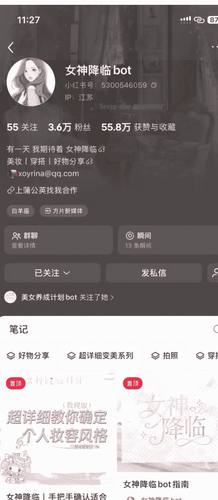

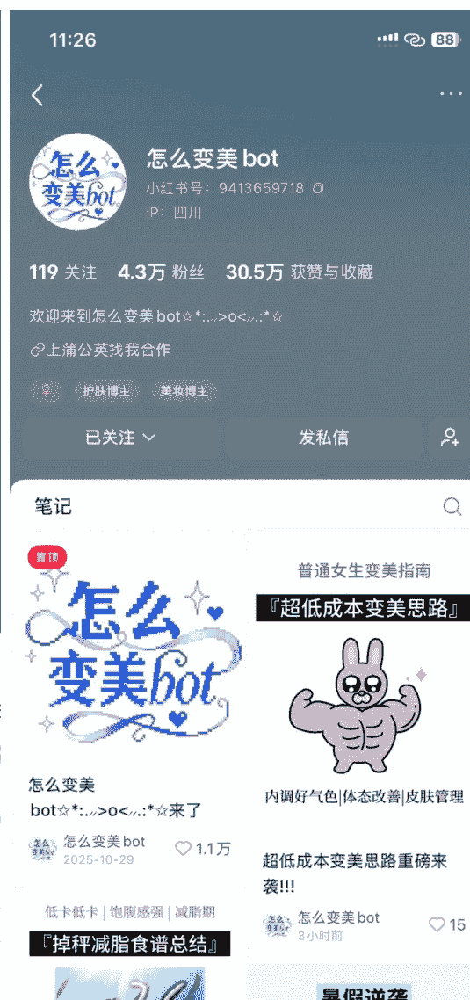

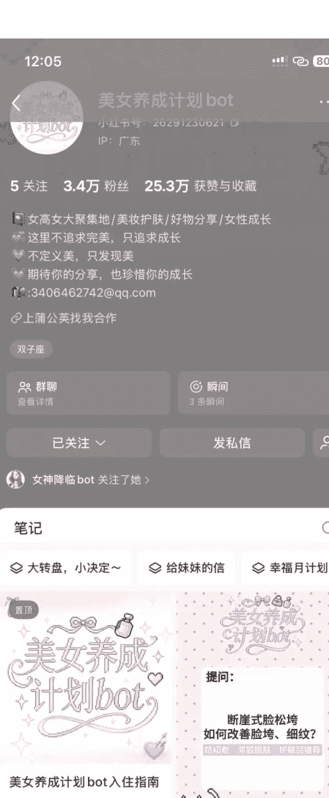

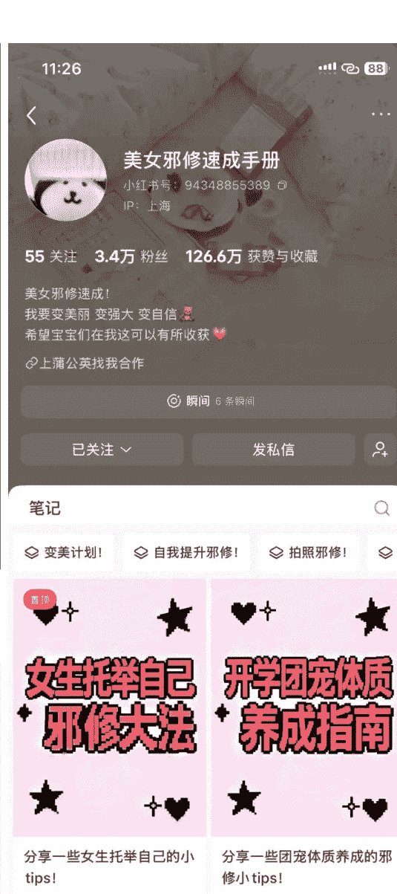

- **审美积累**：一般是从外网搬运一些高审美图片（比如 ins 或 pinterest），但是这类账号对审美品味要求比较高，没有审美的人搬运的图片可能涨粉效果会比较差。

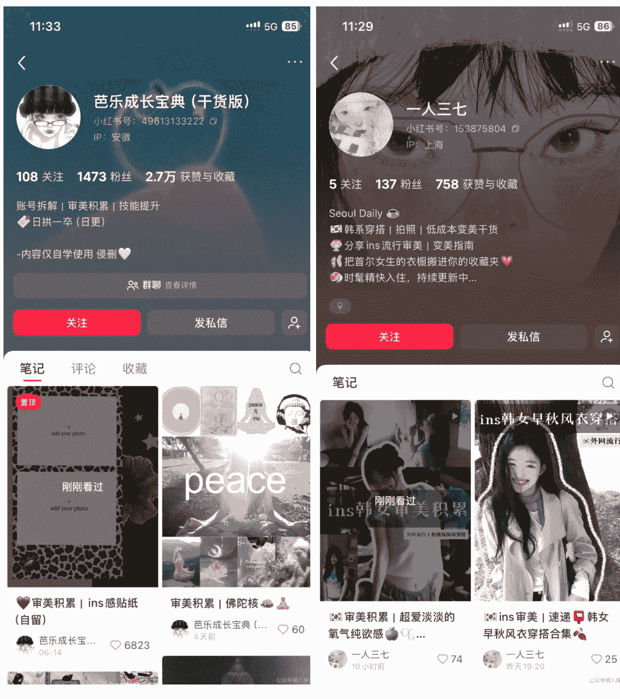

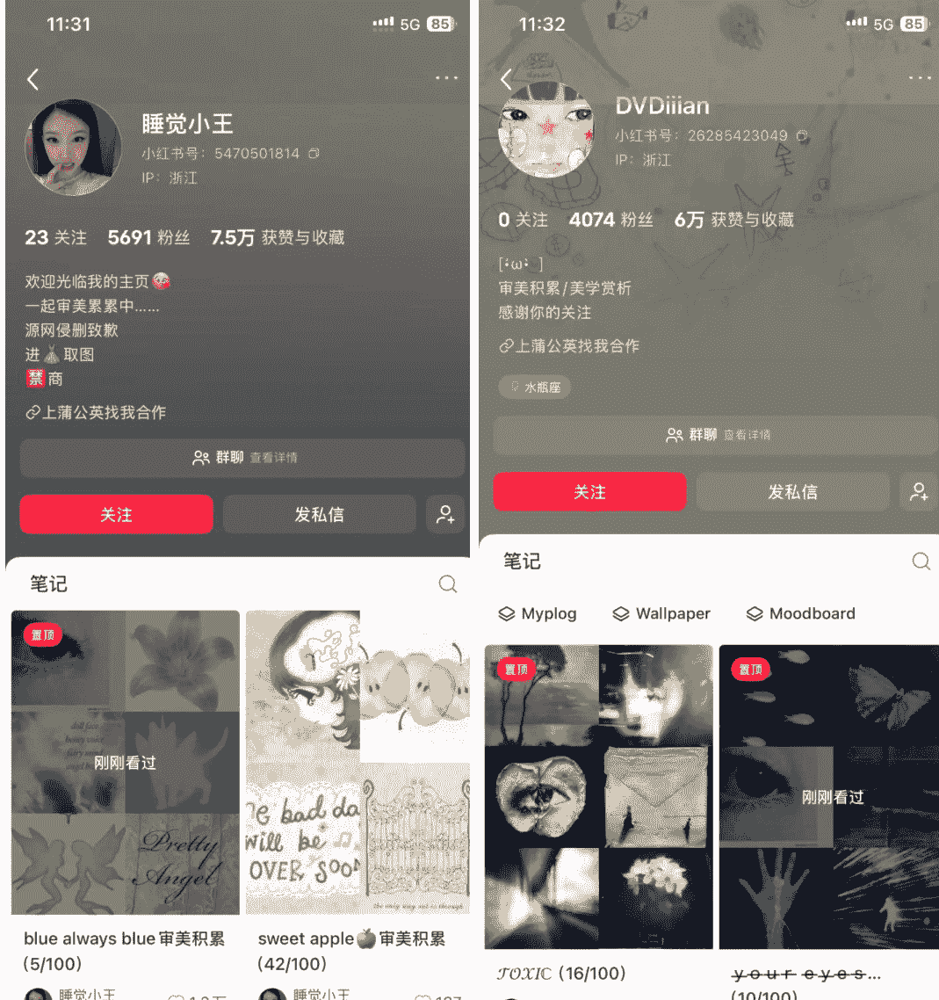

- **变美知识整理**：这类内容的细分形式比较多，有备忘录形式、有截图拼图形式、还有种草作图、表情包封面形式，可以挑选自己好上手的形式。

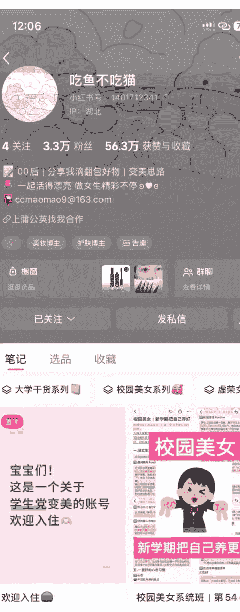

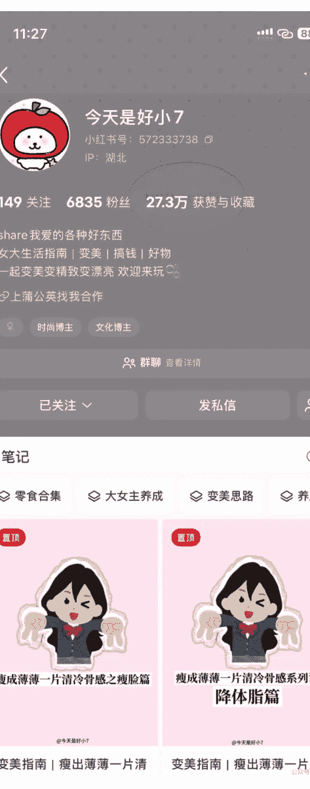

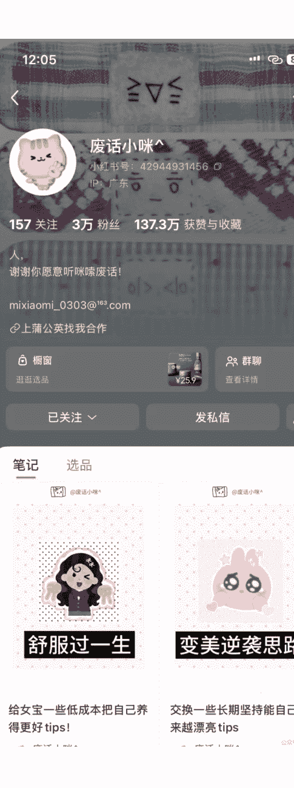

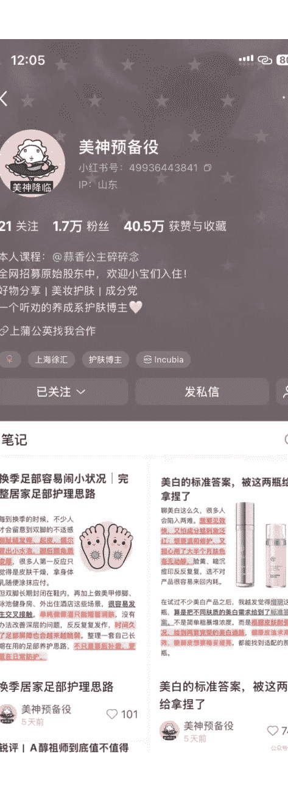

选一种你顺手的。选好后，核心动作只有一个：**疯狂找这个形式下"低粉高赞藏"的笔记去模仿。**

**第二步：建立你的"爆款数据库"**

1. 直接搜你选的形式关键词（比如搜"bot"），不断点赞、看完同类内容，系统会持续给你推同类型。
2. 专盯粉丝 5000 以内、但赞藏破 1000 的账号和笔记。
3. 大量看，攒出一个爆款数据库——你看得多了，自然建立起"什么能爆"的内容感知。

更粗暴一点的用法：把爆款标题直接丢给 AI，让它保留爆款元素、换不同说法，你再填自己的内容套进去。标题借鉴甚至套用，基本不会出问题。

**第三步：关键纪律**

- 一切只为起号：这个阶段不需要太多原创思考，无脑复制已经爆过的选题就行。
- 必须垂直：账号所有内容围绕同一类人群，形式和封面保持一致。让人点开你主页，一眼就知道你是分享什么的，才会关注你。
- 必须二次编辑：在小红书找的图文素材，一定要做二次编辑再发，否则被判低质抄袭、不给推流。

## 04 起号期的数据心法：测试 + 复盘，别做低效重复

起号不是发一篇爆一篇，而是大量测试出来的；但测试不等于无脑硬发。

### 4.1 用测试找到你的爆款方向

前期准备 **5-10 个方向**去测流量。哪个主题流量好，就顺着它做细分，直到测出一篇 **超过百赞**的笔记——然后就沿着这个已验证的方向一直写，写到没流量为止。

下面用我自己的真实经历，拆一遍"怎么从 0 测出方向、又怎么判断继续还是换":

#### 我的真实案例：从 0 测出「黄黑皮美甲」

① **选题：从"我了解谁"出发**

我一开始做美甲，逻辑是：为了接美妆广告，我的粉丝最好是爱美妆的女生，而这群人大概率也爱美甲。但为什么是"黄黑皮美甲"而不是大路子"美甲合集"？因为 **我自己就是黄黑皮**，而且我观察到"黄黑皮"这个标签下面的流量本身就比较大。

涨粉赛道怎么定，取决于三点：**你对哪类人群更了解、你的目标人群爱看什么、你有没有能力做好这块内容**。方向定了，就直接去找同类型的"低粉爆款"笔记模仿，在不断的行动中去收集一手数据，再决定这个方向要不要继续、要往哪个方向修正。

> 工具点：小红书自带的 AI 助手「点点」很懂平台生态，你可以把数据截图发给它做复盘，一般比较精准。

② **形式与封面：做"细分"，别做"大路货"**

像美甲草单这种形式本身很简单——去小红书搜"美甲草单"，把别人发过的美甲图做成拼图合集就行，排版不复杂。但 **想爆，一定要做更细的分类**：黄黑皮美甲、淡人美甲、橄榄皮美甲……而不是只发"大美甲"。不针对某一类人群或某一个细分点去做，很可能你的笔记赞藏整体都不错，但关注量很低——因为没深刻打动某一群人。

③ **标题：不仅是写给人看的，更是写给"机器"看的**

标题不是写给人"感受"的，是写给机器"识别"的。所以标题里要尽量塞进 **关键词 + 利益点**：圈人群（黄黑皮）+ 利益点（显白美甲 / 亚裔美甲）。给够关键词，让需要的人一看就知道"点进来我能得到什么"。

怎么写好标题？从你自己刷抖音、小红书的心态去反推——你会点什么、不点什么、为什么点？把你在乎的点挖出来，反向推断用户心理，再对应成关键词。或者更简单：直接把爆款标题拿过来用。

④ **真实数据：爆文 ≠ 当天涨粉**

我的第 3 篇「黄黑皮美甲」到现在累计 **18 万浏览、3785 赞藏**——数据很好。但发布后那阵子 **涨粉并不多**，因为当时主页还没积累够内容。

我持续发同类型，直到 **第 6、7 篇开始，每天稳定涨 50-100 粉**。→ 一个关键认知： **涨粉的前提，是主页有一定内容积累 + 出一篇爆文**。一篇爆文带来的粉丝，可能超过你所有笔记的总和；但如果主页只有一篇爆文、没有内容沉淀，数据再好涨粉也低。

**怎么判断一篇笔记"起不来"？**

- 发布半小时内「小眼睛」突破 200 → 数据不错；
- 两小时内还没破 200 → 初始推放的点击数据差，系统不会再推大流量池，基本就停滞了。

这时候别干等，及时复盘：把截图丢给「点点」，让它从封面、标题、内容三个角度帮你分析，并给下一篇的优化建议。

⑤ **持续做的判断：给方向足够的时间**

如果你选了一个赛道，连续发了十几篇还是没流量、没正反馈，那就赶紧换。但**在有迭代的前提下，刚开始没反馈很正常**——起码坚持日更一个月、每天至少一篇，用数据说话。别刚发两三篇不好就焦虑换赛道，那样换哪个都不会成。

⑥ **怎么过渡到好物内容**

我是直接从「美甲草单」转成「好物草单」：先分享家居收纳好物、美妆好物，再去借鉴参考其他有流量的笔记，路径是**美甲草单 → 好物草单 → 好物实拍**。

如果你的涨粉赛道和最终想做的赛道差距很大，也不用铺垫，直接每天隐藏几篇、硬转就行——隐藏完发新赛道笔记没问题，但**别一天隐藏太多篇**（记住一天别超 10 条）。只是这种情况要**做好掉粉的准备**，所以在涨粉期如果和转型赛道差距过大，一定要给自己预留一个掉粉区间。

### 4.2 连续差就复盘，不要为了发而发

当你连续发了几篇，流量都很差，就要停下来复盘改进，**不要一直做低效的重复**。

- **流量差在哪？** 如果自己复盘不出来，直接把帖子数据截图扔给 AI 分析，根据它的优化建议去创作升级。
- **数据差的帖子怎么处理？** 把整篇帖子截图，扔给不同的 AI 分别复盘：为什么差、差在哪里、需要怎么改进。综合建议做好修改和优化之后，再去改动，这样最高效。

### 4.3 一条铁律：发布 24 小时内不要改帖

我踩过最大的一个坑：一篇笔记数据不好，我就焦虑、反复改，结果**在发布 24 小时之内改动，流量直接断崖式下滑**。

所以记住：**笔记发布后的 24 小时内，尽量不要做任何改动**。真要改，也等 24 小时之后、按 5.2 的"截图给 AI 复盘→再改"流程来。

## 05 数据工具与选题库：用第三方平台 + AI 搭内容库

### 5.1 用数据工具看赛道值不值得做

常见的小红书数据收集工具有**灰豚数据、新红**。用它们观察头部账号的**收入情况**：把头部账号的收入 × 1/10，如果算下来还达不到你的预期收入，那这个赛道就尽量别做——只有头部挣得足够多，我们作为新人才可能分到钱。

也可以用这两个工具搜索最近的"低粉高赞"爆文，作为自己的参考。

### 5.2 用 AI 建选题库 + 内容库，保证不断更

把收集到的大量数据丢给 AI，建立自己的**新号起号选题库和内容库**，保证每天都有东西更新、不断更。

**发布频率：** 新注册的号刚开始，每天 1–2 篇就够了；等账号跑顺了，每天 3–4 篇也没问题。

## 06 如何找对标：不同时期找不同的对标，灵活更换

对标不是找一个就完事，要随阶段换。

### 6.1 选对标的四个标准

1. **粉丝数量不多、但近期涨粉快**（适合涨粉期参考）。
2. **内容形式是你 能驾驭的**。
3. **后台粉丝画像精准**（是你想要的人群）。
4. **变现形式很好**——不赚钱的不要对标。

### 6.2 具体方法

1. **关键词搜索定位**：从人设、内容形式、数据表现、变现模式先做初筛。
2. **垂直深挖**：
   - 博主人设能不能复制：经历背景、性格表达匹配度、价值观、专业能力。
   - 内容形式：落地成本、精力投入可行性、创作技能门槛、能不能持续生产 3 个月不枯竭。
3. **学会辨别**：
   - 赞藏没有一篇过千的，没有参考价值。
   - 每一篇都是广告投放的，没有参考价值。
   - 要分清：它报价高，到底是因为数据好，还是因为内容好？

## 07 好物分享六大赛道详解

转型发赛道笔记时，先搞清楚好物分享有哪几条路，选你能驾驭的：

- **随手po**：1–3图，文案简短，看起来像真人分享、比较粗糙。
  - 对标：sadsay、大脸公主、露露小甜甜、霸道公主、旺仔小哈哈、小□饿了、城堡里的林黛玉、蒜香公主
  - 关键点：高转化文案 + 非常真实的素人感图片。
- **精致手持**：6-8张，需要精致打光，需要维护数据。
  - 对标：Llunapool、好像吃油炸、晕晕薯条、半颗奶冻、超困困困猫、不要芋泥要淤泥
- **plog**：喜欢买买买、需要精致小物件，需要审美水平。
  - 对标：木村白、东北富婆
  - 关键点：价值传递 + 种草转化——核心是可模仿的美好生活方式，让粉丝获得审美提升、优化生活的解决方案。
  - 拍摄：搭景、构图、光线、修图；文案：塑品、精准选题；选品：审美、网感。
- **成分党**：对成分有一定了解。
  - 文案模板：痛点 + 引出产品 + 产品介绍 + 自身改变 + 使用方法。
- **静物**：审美好、有摄影基础，单量中上（适合恋物癖和白富美，否则成本太高）。
  - 对标：大眼 monica、伊万的小土豆、道道叨叨
  - 核心：高端品牌对调性传递的追求，高净值用户对美学内容的持续关注。
  - 选题：利他、不单调、调性高、数据维护技巧。
- **口播**：难度最高 / 露脸有壁垒，但信任度高。
  - 对标：吃一大口老啵、小瓜朋友圈
  - 核心：镜头表现力、画面语言调整、脚本的说服力、覆盖用户决策疑虑、人物形象调整、账号定位。

## 08 何时转型 & 如何平滑过渡不掉粉

小红书 **1000 粉就能开通蒲公英接广告**。报价一般是粉丝数的十分之一。千粉时大概能接到百元左右的单；但这时候很多商家是拿产品跟你做“置换”（免费送你东西，你帮发笔记）。

我个人觉得这个阶段硬接大量广告效率不高，所以 **具体什么时候转型发赛道笔记，看你自己情况**。我是做到 **4000 多粉** 才开始转型的。

从实操节奏看，我大概是 **写到第 6 篇赛道笔记时** 开始接到广告的。但要注意：如果你的涨粉笔记和赛道笔记差距太大，需要在把之前笔记隐藏完的基础上、再积累 **8 条过百赞的笔记**，才比较有可能接到像样的广告。

这里有个关键风险： **如果起号内容和你要发的赛道笔记差异过大，转型期会大量掉粉**。想让广告单价高，最好预留一部分掉粉空间。

但如果起号阶段和赛道笔记类型接近，就丝滑很多。比如我：从「美甲菜单」→「好物菜单」→「好物实拍」，基本没掉粉，过渡很顺。

如果你起号和赛道差异大，用这个办法平滑过渡：

- 每天**隐藏 2-3 篇**起号笔记；
- 同时稳定频率更新赛道笔记；
- 直到把涨粉笔记全部隐藏完。
- ⚠️ 千万别一次性隐藏太多（记住一天别超 10 条），否则容易触发风控。

## 09 转型后内容制作：从选题到落地再到复盘

度过起号阶段、开始发赛道笔记后，从选题到制作我有了一些小心得。

### 9.1 选题和选品：素人必须有明确的利他性

想要自然流量，选题和选品都非常重要。当你还是素人时，不能像大博主一样随意分享，必须有明确的**利他性 / 利益点**——比如针对用户某个具体痛点，或一个具体场景，给出使用推荐或解决方案。

- 例：「全身美白护理跟练教程」
- 例：「muji 好物」的真实购买分享

这些都是大家可能需要、或好奇的内容。

### 9.2 人设：别营销感太重，多讲真实感受

做内容时营销感不能太重，别说得太官方、太书面。分享一款产品时，比如厨房湿巾，擦完地踩上去不会假滑——我们不说"擦地无残留"，而是说"踩在地上很舒服"。多讲个人感受，而不是像营销话术那样直接介绍产品卖点。站在一个真实想分享好物的人的角度去发心做内容，才更可能获得比较好的自然流量。

### 9.3 布局搜索流量（比推荐页更精准）

词汇越具体，越容易被搜到，要贴近某类细分人群或某个细分场景：

- 人群词：学生党、方圆脸、梨形身材
- 痛点词（让你难受的点）：失眠、嗓子疼
- 场景词：居家、出差、上班、去见crush
- 需求词：成长、美白、赚钱

### 9.4 爆款内容力五要素

好的内容，情绪大于画面，要加入自己的真实感受：

1. 选品：吸睛、有创意、实用性强、颜值高。
2. 拍摄：美观度＋合适的种草产品；产品要放在不同场景里，起码有3-4个场景穿插拍摄。
3. 文案压字：关键信息压在图上。
4. 选题：前期起号要有利他性和实用性。
5. 标题：关键词+利益点，写给机器看。

### 9.5 转型后的三条红线

1. **发布过的内容平台有记录，不能删除重发**——流量会断崖式下跌。
2. **笔记发布 24h 之内不要修改**——会破坏推流。
3. **不要着急置顶评论**——容易被判定为商业广告。

### 9.6 发布时间

做过一段时间后，你能在后台看到自己目标人群的活跃时间。尽量在**用户活跃高峰期的前半小时左右**发布，更容易吃到第一波推流。

### 9.7 发布后的基础数据维护

发完赛道笔记，可以做一些基础数据维护，有助于提升账号权重：

- 找人帮自己点赞、收藏，点到**十几个**就行；
- 自己放几条**容易引发回复的评论**。

关键：这些互动一定要**从搜索框里进来（搜关键词点进你的帖），不要直接把笔记链接分享给别人点进去**——后台能看到流量入口来源，直接分享进来的不算搜索权重。

## 10 接广与提高商业价值

### 10.1 用品牌方视角反推

接广要从品牌方的视角反推：充值第三方数据平台，观察各大品牌最近的**投递频率和投递博主**，看什么样的博主广告收入多，仔细拆解并进行模仿。**调性、人设、审美、用户画像、笔记数据**都是重要影响因素。

选题思路也由此来：

1. 我想接的广告，在投放什么博主——他们都有什么标签、做了什么选题、做了什么 人设？
2. 平台喜欢能留住人的内容——解决问题、创造价值 + 活人感。

### 10.2 如何提高一个账号的商业价值

1. **不要看短期的钱，先提高账号调性**。不接差的产品、不能解决用户需求的产品、不能引发自己灵感的产品——这些会拉低报价，甚至让报价难提高。
2. **产出新鲜的爆款商单笔记，才能证明商业价值、提高报价**。爆款商单的影响因素：
   - 选品：小众、陌生、好用，国家/地区/品牌/热点都能蹭。
   - 选题及文案：结合人群痛点和解决方案、热点结合自己赛道。
   - 拍摄及审美：构图、打光、封面。
3. **起步阶段如何吸引优质商单**：开发账号多样性，展示广告位和可能性。PR 会找“竞品投爆出爆款”的博主再次投放，所以多参考爆款商单笔记也很重要。
4. 如何找到优质选题：参考借鉴任何领域的博主，只要他们的笔记有一点打动你，记录下来，把这个 1% 变成你的 100%。

### 10.3 报价与置换策略

- 第一单广告报价：尽量按自己粉丝数的1/10 提报。
- 我的第一单真实数据：粉丝约 4k 时接到「忆丝芸染发膏」广告，报价 290 元（按 1/10 算正常应约 400，但当时几乎没人找，只能不断降价——现在市场很卷，做号初期要做好短时间不会有大额进账的心理准备）。
  - 这单是直发（品牌给现成内容、只需用我账号发，不需要我创作）。一开始不懂，后来才知道这种模式比较仿账号，不建议大家接直发。
- 前期可以多接置换，但一定要走平台报备——这样你能积攒商单笔记的数据。注意：商单笔记数据和日常笔记数据是分开计算的。
- 想后面接到比较好的广告，前期也可以主动找一些不错的品牌做置换合作，先把商单数据养起来。

## 11 避坑清单 & 我的进阶建议

### 11.1 新人最容易踩的坑

1. 合规红线：一机一号；别同 WiFi 多账号；
2. **千粉前别频繁切设备；大量隐藏笔记（一天别超10条）。**
3. **上来就大量发帖**：不养号直接发，被判营销号、隐形限流。
4. **内容混乱**：什么都发，人群不垂直，账号没定位。
5. **不知道内容是做给谁看的**：没想清楚目标人群，自说自话。
6. **内容自嗨**：只写自己想写的，不考虑读者要不要看、要不要收藏。
7. **24h内改帖 / 删重发 / 急置顶评论**：都会破坏推流或被判广告。
8. **为了发而发**：连续几篇流量差还不复盘，一直做低效重复。

### 11.2 我的进阶小建议

1. **做好关键词布局和搜索流**：词汇越具体越易被搜到，善用人群词 / 痛点词 / 场景词 / 需求词（见9.3）。要在标题、文案、标签里都埋好搜索词，确保精准人群搜关键词时能搜到你，拿下另一部分长久曝光。
2. **挂 tag 小技巧：大话题 + 小话题组合。** 小红书能挂 **10个标签，建议尽量挂满**，可以 5 个大话题 + 5 个小话题：
   - **大话题**：变美、美白这种大人群流量词，可能有几亿播放，负责拉大曝光。
   - **小话题**：菱形脸高颧骨修容这种带很多限定条件的精准词，看的人少，但这类人群一搜
3. 如何保持选题不枯竭：参考任何领域博主，把打动你的 1% 变成自己的 100%，再用 AI 建立选题库 / 内容库，保证不断更。
4. 如何复盘迭代、找到微小正反馈：流量差就把数据截图扔给不同 AI 复盘，按建议优化再改；长期看"赞藏率、涨粉、合集连续性"这些微小正反馈，持续迭代。
5. 发布时间与数据维护：在目标人群活跃高峰前半小时左右发布，发完做基础数据维护——点赞收藏点到十几个、放易回复评论，且互动一定要从搜索框进来而非分享链接。

分割线

看完这篇 SOP，你觉得你懂了。但 90% 的人一到实操就会卡在第一步。

工具和教程只是最低级的壁垒，真正的壁垒是“立刻动手”和“圈层信息差”。

如果你想看全网最新的变现玩法，并且和一群执行力极强的极客一起下场拿结果，欢迎围观我的核心私域：【懒人专属群】。

我们不聊虚的，只做商业闭环的拆解与 AI 效率的压榨。系统内已沉淀 1000+ 跑通的套利实战局。

查阁圈子完整数字资产与上车门槛：

https://lazyso.com/insider/

认同价值、准备好下场干活的，扫码加我微信（lazyhelper1）

备注：【实操上车】，不闲聊

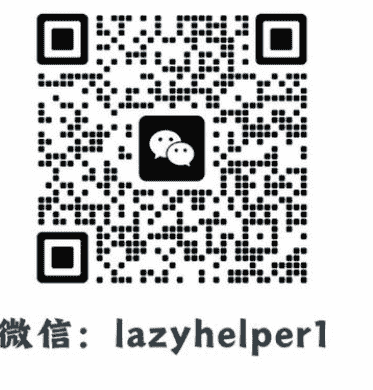
