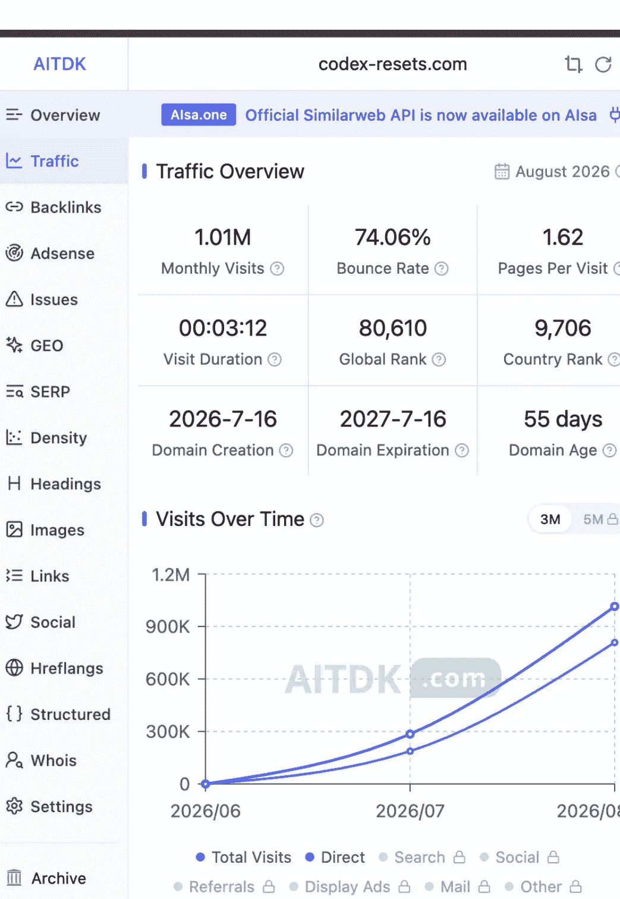
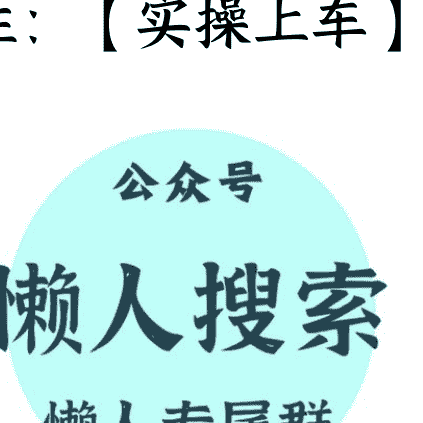

# 【超级标 18】重置 Reset 流量

260914 副业 SC 精华

整理：公众号懒人搜索，懒人专属群精选

懒人微信：lazyhelper1

> 小懒判断 | 适合追 AI 工具热点、想做轻量流量产品的人，不适合指望看一篇就月入过万的。最值得关注两个点：付费提醒这个变现切口，9.9 美金短信或进群@提醒，对月付 200 刀用户是刚需；SEO 五类页面里报错类意图最强，每条报错做一页。坑在于窗口极短，鱼头当天上线 whenreset.dev，等你慢慢做黄花菜都凉了。

作者：生财亦仁

半夜突袭，来一条新超级标。惊不惊喜？

近三个月我的微信里，约 5970 条相关讨论，几乎所有 AI 群都会聊的一个话题：

codex 什么时候重置（Reset）？

而这个，就是我今天发的超级标：重置 Reset 流量。

reset 背后是巨大的注意力。注意力就是流量，流量就是钱。

1/ 当 codex 的 tibo 把 reset 玩出营销新花样 的时候，其他玩家 claude code、grok 也在跟进，而且可以预测的是，当 grok 模型进一步升级后，马斯克大概率会大量的用 reset 玩法来抢用户，就像 codex 用这个玩法从 claude code 那抢用户一样。

2/ 国内未来几家模型能力跟上时，会不会产生重置的需求？有很大可能。

3/ 随着 gpt6 astra 模型的推出，订阅额度不够几乎成为普遍问题，群里都眼巴巴的等着重置，连我都很期待，所以围绕重置或者重置卡，延伸出大量的话题和流量。

4/ 以及，围绕重置本身大量的规则也有很多讨论，比如 重置卡什么时候发，老号开通 Pro 会不会补发过往的卡等。

5/ 目前 codex 说有 2500 万个活跃 codex+cowork 用户，这本身就是不小的高质量用户池子，而且还有非常大的持续增长空间。

6/ 我观察各种群里面已经出现的玩法：

- 重置雷达小程序：我在不少群里面看到过有人说转化，我猜你可能也看到过，估计是生财圈友做的。
- 国外有多个 codexreset 的提醒产品，月活已经到了百万流量级别，还在不断增长
- 有圈友们正在积极的开始做 reset 提醒产品，比如鱼头当天做出 [https://whenreset.dev/](https://whenreset.dev/)；悟空也 15 分钟上了第一版。
- 有圈友们也在抢域名 [whenreset.app](https://whenreset.app)，有人付款时却被买走。
- 易仁永澄用 Bark：义父 tibo 一说「重置」，手机强制最大声播报，停不下来。
- 航海家群在转发「24 小时重置概率 / 预计时间 / 蹬友预测」这种卡片。

7/ 我在群里面提示了一个很精准的流量变现方法：

流量过来后，增加一个付费功能，比如付费 9.9 美金就可以每次重置或者有重置信号的时候立刻发短信、邮件、打电话等方式提醒订阅用户。

在国内，就可以是，花 9.9 或者 19.9 等，类似的方法，就可以进群，任何时候有重置信号，会在群里 @ 提醒，或者企微发提醒。

对于花 200 刀一个月的用户，这 9.9 刀会觉得发的非常值。

8/ 我让 AI 整理了一些更具体的玩法，大家可以参考一、搜索侧 SEO 做流量：按意图分五类，每类一种页面

1. 报错类，意图最强。用户复制原文去搜，每条报错一页。不止编程：ChatGPT 的 message limit、Claude 网页版的 out of messages、Sora、Midjourney fast hours，各有各的原文。
2. 时间类。when、几点、北京时间、东京时间，按工具 × 时区程序化生成。页面上放 ICS 日历订阅按钮——订阅后进团队共享日历，自己往外传。
3. 规则类。五小时窗口怎么算、周限额怎么算、thinking 算不算、subagent 算不算、cache 算不算、web search 算不算、用卡后倒计时变不变。每个「算不算」一页。官方写得含糊，长期有人搜。
4. 数量类。Pro 每天多少、Max 多少、Plus 多少，做成限额数据表，附历史变更记录——限额百科。厂商每改一次规则就有一波人来查，Reddit 和知乎的回答会引用它
5. 操作类。怎么看剩余额度、/usage 怎么用、怎么切账号、被限后怎么换模型。教程页，长尾稳定。

国内搜索不在 Google。小红书、微信搜一搜、B 站是这群人的搜索引擎，同一份内容换成笔记和视频发过去，多占一个入口。

# 二、传播侧产品裂变：按机制分六类

1. 同步时刻。周一 reset 公共倒计时页、reset 那一分钟自动发的群公告、X 上提前一小时预告的 @codexreset 账号——可预期的有用信息会被关注。
2. 装进共享空间。群机器人、Slack 状态自动同步（「限额中，15:00 回来」，全组可见，有人会问这是什么）、README 徽章、团队日历订阅、直播画面叠加倒计时、视频会议虚拟背景。
3. 可晒的输出。周报卡片、「我被限了」状态图、「今年等 reset 花了 37 小时」成本卡、「还剩 80%」对比图。规律：数字要意外，图上带域名。
4. 竞争与身份。团队里谁先用完排行榜、「限额难民」标签、Max 用户被限的自嘲。
5. 故事与梗。烧卡投稿墙、「等 reset」表情包生成器、每日投票「今天你被限了吗」。
6. 需求触发的拉人。「我被限了，谁有额度按一下」一键求助，每条求助都是一次邀请。

## 三、平台自带分发：发到有搜索框的地方

Chrome 商店、VS Code 和 Cursor 插件市场、Raycast、Homebrew、npm、MCP 目录、GPT Store、微信小程序搜索、飞书应用市场、iOS 小组件。每个市场都有人搜 usage、limit、reset，上架即分发。同一个功能发六个市场，成本只多一点。

# 分割线

看完这篇 SOP，你觉得你懂了。但 90% 的人一到实操就会卡在第一步。

工具和教程只是最低级的壁垒，真正的壁垒是“立刻动手”和“圈层信息差”。

如果你想看全网最新的变现玩法，并且和一群执行力极强的极客一起下场拿结果，欢迎围观我的核心私域：【懒人专属群】。

我们不聊虚的，只做商业闭环的拆解与 AI 效率的压榨。系统内已沉淀 1000+ 跑通的套利实战局。

- 查阅圈子完整数字资产与上车门槛：

https://lazyso.com/insider/

认同价值、准备好下场干活的，扫码加我微信（lazyhelper1）

备注：【实操上车】，不闲聊

