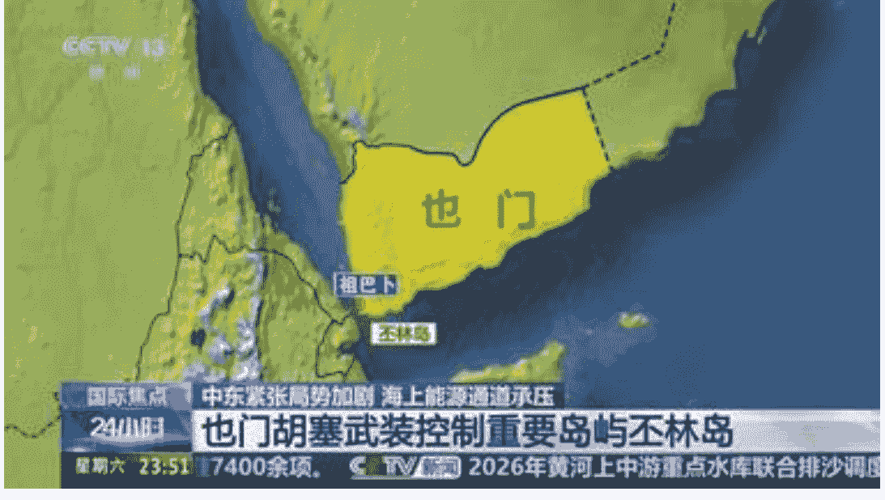
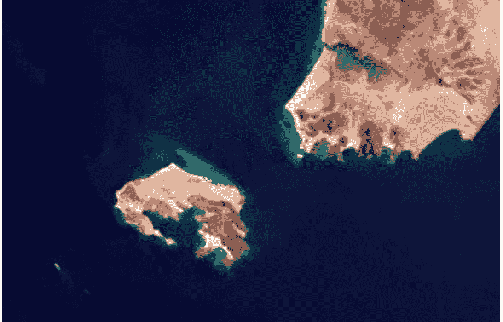
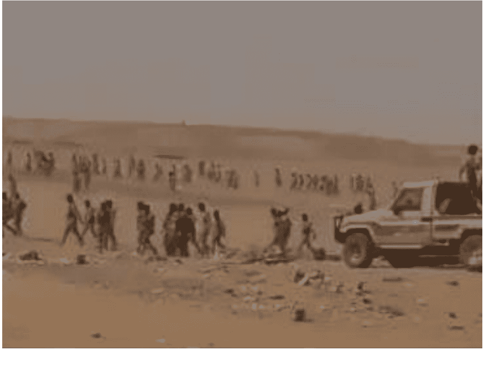
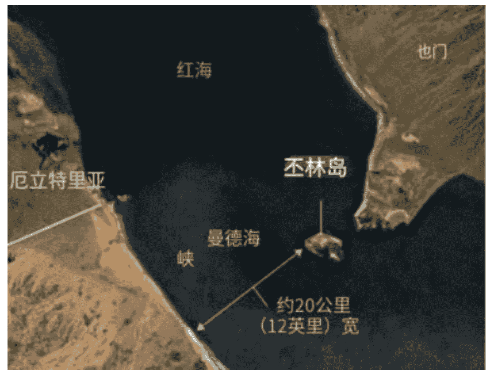
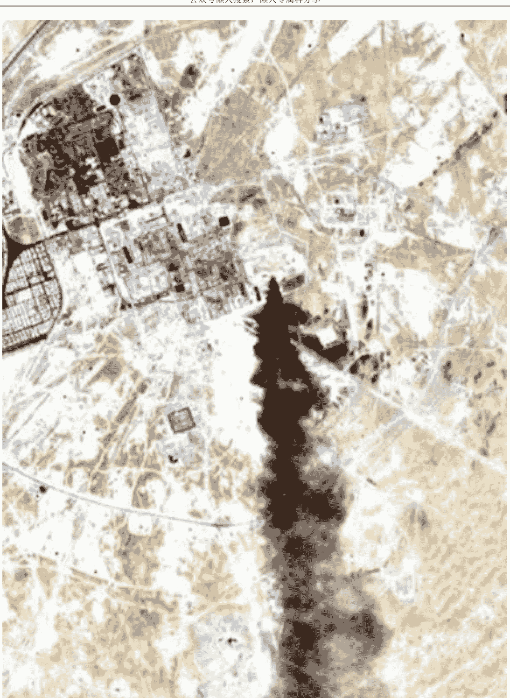
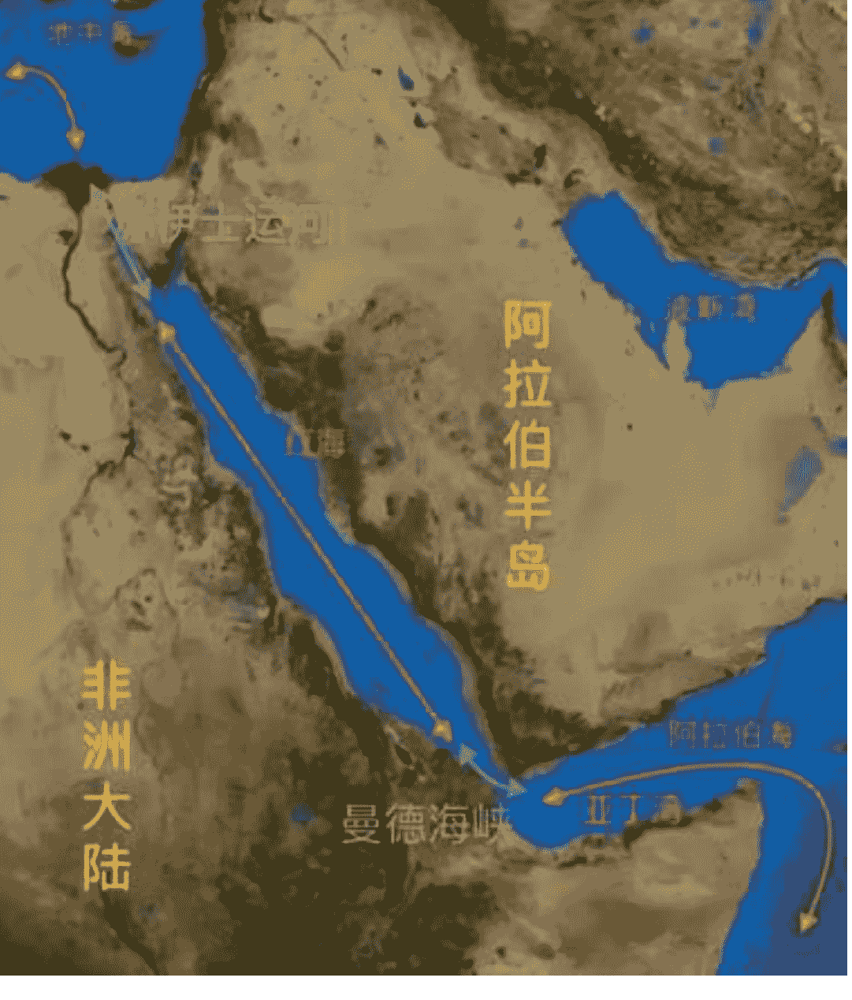

## 胡塞武装掐断沙特石油出口命脉，全球油价要绷不住了？

260915 文/卢克文工作室嘉宾 概略北方
整理：公众号懒人搜索，懒人专属群精选
懒人微信：lazyhelperl

> **小懒判断** | 适合关注中东局势、油价走向的人，不适合拿这篇当买卖股票方向抄的。最该看清组合拳本质：伊朗主导的围魏救赵，胡塞卡曼德海峡+民兵炸沙特东西管道，专挑中期选举前两个月，逼美国把加息概率推到 90%。算下来缺口约占全球日产量 15%，暗航运油也补不上 10% 缺口，油价易涨难跌。坑在管道月余修好前都不安全，但地缘推演≠个股应验，别上头。

谁能想到，胡塞武装突然支棱起来了。

从 9 月 3 日发起新一轮攻势，到 9 月 11 日发布战果，短短 9 天时间里，胡塞武装如同秋风扫落叶一般拿下了约 7000 平方公里的土地，不仅攻占了港口重镇穆哈，还顺势拿下了紧邻海峡的祖巴卜，连沙特占据的丕林岛都跨海攻克了。

沙特这次丢大了，双方实力本来很悬殊，没想到被胡塞跨级反杀。

沙特、也门、阿联酋联军在整个蒂哈迈海岸的防线的兵力，总共约2.2万人，大致可以分为三个集群：

- 北段（荷台达以南至海斯镇）是巨人旅的第2和第3旅，大约6000人，以也门南部的萨拉菲派武装为主。
- 南段（从穆哈港到曼德海峡）是也门前总统萨利赫侄子塔里克指挥的共和国卫队第4、第6两个重装旅，加上一个由苏丹雇佣兵组成的快反营，总计约1.5万人。
- 此外，还有丕林岛上驻扎的沙特海军陆战队，他们的主要任务是运营岛上的机场跑道、防空导弹和炮兵阵地，这个岛扼守曼德海峡，至关重要，所以2015年沙特干涉也门内战的时候，就伙同阿联酋登陆丕林岛，驱逐胡塞，成为沙特安插在红海的军事重镇。

在后方，还有沙特的F15战斗机和阿联酋的翼龙2无人机提供空中支援。

而胡塞武装呢？总参谋长优素福·马达尼手里，满打满算才 1.2 万人。

虽然人数上处于劣势，但很多都是新质战斗力。

比如，巴德尔无人机与导弹混编大队，专门负责拔点作战，还有侯赛因特种突击队，大约 800 人，装备夜视仪，擅长夜战。此外还有四个摩托化步兵团，全部乘坐武装皮卡机动。

9 月 3 日，胡塞开始集中火力猛轰北段的巨人旅阵地，吸引联军注意，但真正的杀招，其实在南边。

马达尼派出 3 个步兵团，总计 6000 余人乘坐几百辆皮卡，没走联军重兵把守的海岸公路，而是趁着夜色，一头扎进了干涸的河床和戈壁滩。

到了 9 月 4 日，共和国卫队第 4 旅惊恐地发现，自己的后路被抄了，于是慌忙退入联军防守重镇穆哈港。

9 月 7 日，胡塞武装就开始进攻穆哈，他们发射了数十架小摩托无人机，直接把穆哈港外围的反炮兵雷达阵地和通信中枢炸上了天。

反炮兵雷达一消灭，胡塞武装就可以肆无忌惮向港口内炮击了，与此同时，早就渗透入城内的侯赛因突击队也一起发难，直扑联军没在港口的弹药库和海水淡化厂。

结果苏丹雇佣兵一看形势不对，第一个带头跑路，然后把其他部队也给带崩了，主帅塔里克眼看大势已去，只能赶紧坐快艇连夜撤离。

就这样，仅仅 1 天时间，拥有坚固城防的穆哈港就易手了。

（投降的穆哈守军）

穆哈一丢，联军在西海岸的陆地防线彻底崩盘，败兵一路往南狂逃。胡塞用缴获来的联军装甲车开道，沿着海岸公路顺势平推，三天席卷了整个也门西南角，直接推进到了曼德海峡边的祖巴卜港。

祖巴卜港对面，就是丕林岛。

胡塞武装没有给联军喘息的机会，马上开始了渡海登岛作战，先发射了两枚波尔坎短程弹道导弹，摧毁了丕林岛的机场跑道，岛上的联军瞬间失去了空中撤退和补给的可能。

9 月 10 日凌晨 2 点，胡塞武装征用了 40 多艘当地渔民的快艇，在岸上火箭炮的掩护下，顶着海浪摸黑发起登陆作战。

沙特守军的岸防炮在夜间，根本打不中这种泥鳅一样乱窜的小艇。等胡塞的突击队员完成抢滩，沙特人打不了硬仗的毛病再次暴露，高级军官纷纷乘坐直升机溜之大吉，剩下的海军陆战队和技术人员也不敢死战，在9月11日清晨，全部向胡塞武装投降。

至此，沙特在红海安插的据点，被彻底拔除。

眼看战局糜烂，沙特在9月10日连续两个电话打给特朗普求救，让美国参战，但都被特朗普拒了。

一个伊朗都让美国满头包了，哪还有精力去打胡塞？

然后沙特又赶紧去找巴基斯坦，但巴基斯坦只说将在“时机成熟时”采取行动。

虽然沙特和巴基斯坦签了麦加协议，但麦加协议只说了沙特在遭受“武装入侵”的时候巴基斯坦出兵，现在战场都在也门，沙特一寸国土都没丢，确实不符合出兵条件，且巴基斯坦并不想蹚这个浑水。

现在，沙特只能独自面对丕林岛丢失的苦果。

丕林岛扼守曼德海峡入口，把曼德海峡分成东西两个航道，东边宽度4公里，西边宽度20多公里，也就是说，拿下这个岛，根本不用无人机和导弹，只要在岛上架设几门火炮（巧了，沙特人留下来不少），就能封锁整个曼德海峡。

过去，胡塞武装虽然说封锁曼德海峡，但因为胡塞的控制区在哈尼什群岛，离真正的曼德海峡还比较远，直射火力无法覆盖，只能发射无人机骚扰，没法完成百分百的封锁。

现在好了，丕林岛一占，曼德海峡彻底姓胡了。

胡塞武装占领曼德海峡之后，发布的第一个命令就是，海峡通航不受影响，但沙特和以色列船只除外。

沙特还没来得及伤心，另一个打击接踵而至。

9月10日上午，几架无人机突然袭击了沙特东西输油管道，伴随着剧烈的爆炸，管道黑烟满天，沙特赶紧宣布对管道预防性关闭。

这无人机是谁放的？伊拉克什叶派民兵的可能性很大。

虽然事后伊拉克赶紧把南部米桑省的指挥官给撤了，试图给沙特一个交代，但也无法让管道恢复如初了。

看明白了吗？这一套组合拳，是直奔沙特来的。

沙特全靠出口石油赚钱，但现在，它的东边，霍尔木兹海峡走不通，油运不出去；西边，曼德海峡被胡塞武装彻底控制，红海南大门也走不通了。最关键的是，东西石油管道大动脉也被炸了。

老实说，沙特不傻，他们很清楚不能把国家经济安全寄托在霍尔木兹海峡永远畅通上。

所以早在1979年，沙特就投入重金，修了一条横贯阿拉伯半岛的东西输油管道。这条管道全长1200多公里，可以把沙特东部波斯湾产油区抽出来的原油，横跨茫茫沙漠，输送到红海沿岸的延布港，装船出口。

几十年来，这条管线经过数次扩容和升级，目前最高输送能力已经提升到了700万桶/日。而沙特去年平均日出口量，也是700万桶。

所以美伊战争爆发后，虽然霍尔木兹海峡被封，但沙特的石油出口并没有受到致命影响，源源不断的原油从延布港出海，要么向北走苏伊士运河运到欧洲，要么向南走曼德海峡运到亚洲。

虽然运量可能会受点影响（管道不可能一直持续极限运力），沙特今年上半年出口量下降到 510.9 万桶/日，但好歹没断，比没有管道的科威特、卡塔尔要强多了。

虽然现在沙特能源部对外宣称管道是预防性关闭，但从卫星图上的滚滚浓烟来看，管道显然受损不轻，事实上已经不能用了。

就算沙特紧急抢修，修好起码也要一个月时间，而且就算修好了，难道能保证不会再被炸么？1200 公里的管道，难道要每 10 公里部署一个防空导弹营么？

所以，在保证防空万无一失之前，管道绝不能开，一旦输油管道在满负荷运作时被击中，引发的连环大火（沙特是轻质油，很容易发生油池火）和原油泄漏，损失根本无法估量。

本来吧，就算胡塞武装控制了曼德海峡，沙特大不了安排油轮全走苏伊士运河，穿地中海绕好望角再往亚洲运，现在管道一炸，相当于沙特在红海的石油出口能力已经彻底废了。

这样一来，全世界石油供应，马上就会迎来巨大缺口。

我们可以算笔账，沙特战前常态原油出口 700 万桶/日，现在几乎归零。伊朗是 170 万桶/日，几乎归零。科威特是 120 万桶/日，也几乎归零。伊拉克是 340 万桶/日，现在通过北部土耳其管道只能运 40 万桶/日，缺口是 300 万桶/日。阿联酋是 260 万桶/日，现在 150 万桶/日，可以走阿布扎比陆上管道直达富查伊拉港，缺口 110 万桶/日。巴林、卡塔尔加起来大概 80 万桶/日，现在也都基本归零了。

满打满算下来，两个海峡封锁+管道被炸，可能给全世界石油供应带来 1480 万桶/日的缺口，约占世界原油日产量的 15% 左右。

当然，这些产油国绝不会坐以待毙，今年美伊战争期间，波斯湾国家就普遍采用暗航运油的方式来逃避打击。

简单来说就是用小型短途油轮，在波斯湾内港口装油，过霍尔木兹海峡时关闭 AIS，沿着阿曼一侧近岸航道通行，驶出海峡到阿曼湾外海，把原油船对船过驳到大型 VLCC 油轮上，再由大船外运到全球，小船再折返波斯湾往复循环。

这种办法的好处是风险小（毕竟船小，就算被打损失也可控），能在海峡封锁的情况下保证原油供应，但缺点就是运量上限不高，高峰每日总转运量大约 400 万桶上下，远远达不到战前海湾 2000 万桶/日的正常海峡流量。

也就是说，就算采用暗航运油，全球石油市场仍然有 10% 左右的缺口。

世界大宗商品市场有句话，某样商品缺口 10%，那价格就不会是涨 10%，而是涨到 10% 的人彻底买不起为止。

所以，9 月 11 日布伦特原油狂拉 6%，甚至触及到了 107.40 美元/桶，创下今年 5 月以来的新高。

船东们的反应最能说明问题，9 月 9 日那天，还有 30 艘商船穿越曼德海峡。到了 9 月 10 日，瞬间掉到了 6 艘。

剩下的船呢？全跑了，他们宁愿绕道好望角，也不敢再去红海碰运气。

运费飙升，保险费翻倍，再加上原油供应的缺口，最后一定会反映到石油价格上。中东局势再这样恶化下去，全世界的石油危机将一触即发。

很显然，胡塞武装控制曼德海峡，和伊拉克民兵炸沙特管道，这两件事不能孤立地看，它们是伊朗主导的一次围魏救赵行动。

为什么是 9 月动手？因为现在距离美国中期选举也就两个月，对特朗普来说，他最怕的就是油价飙升，老百姓加不起油，通胀高企，那民众肯定要把怨气撒在选票上。

这就是为什么 9 月份美联储加息的概率，已经被推到了 90% 的高位。

可是，加息可以压通胀，但没法真正解决问题。加息后贷款利率上升，企业融资成本激增，股市大概率要跟着砸盘，那老百姓能满意么？

可以说，伊朗这波断油行动，直接打在了特朗普七寸上。

特朗普心心念念的中期选举，恐怕真的不容乐观。

分割线

绝大多数人只盯着眼前的工资，却不知道一次远在中东的冲突、一次降息的决议，就能在一夜之间洗牌普通人的财富。

看懂宏观，是为了在周期切换时，不被当作代价。

如果你认同这种“抬头看路”的长期主义，欢迎围观我的个人情报智库：【懒人专属群】。

圈子已稳定运行7年。我们每天利用Python爬虫与大模型算力，过滤全网最顶级的政经内参和搞钱风向标，做你最冷酷的“外部大脑”。

[https://lazyso.com/insider/](https://lazyso.com/insider/)

认同价值的。扫码加我微信，备注：【进群】

