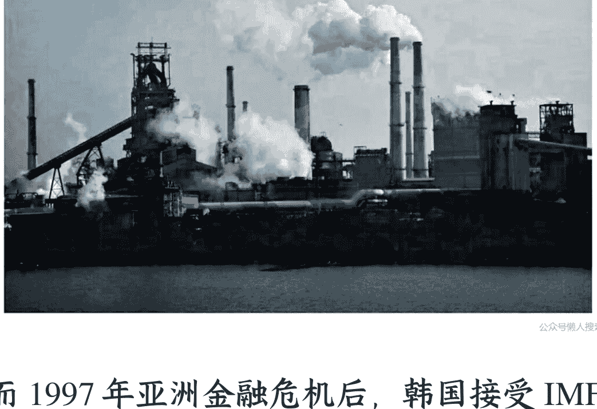
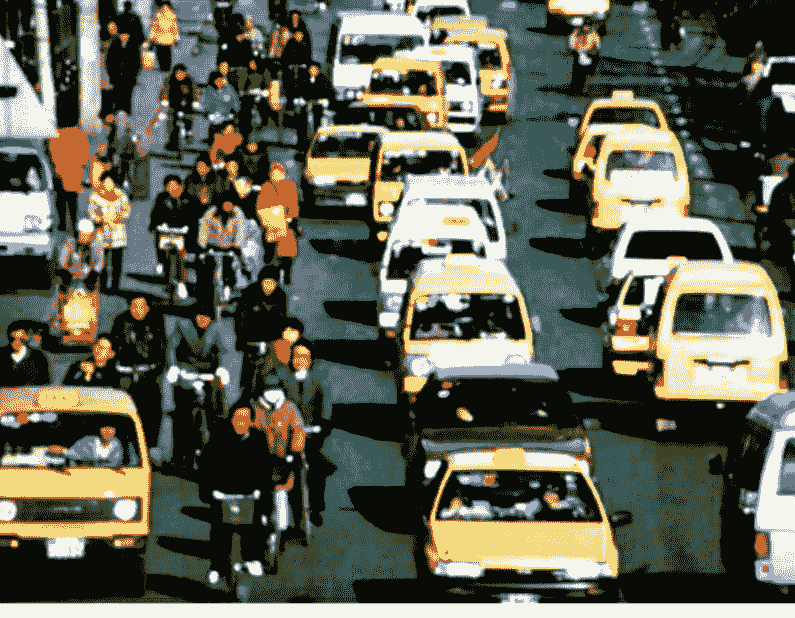
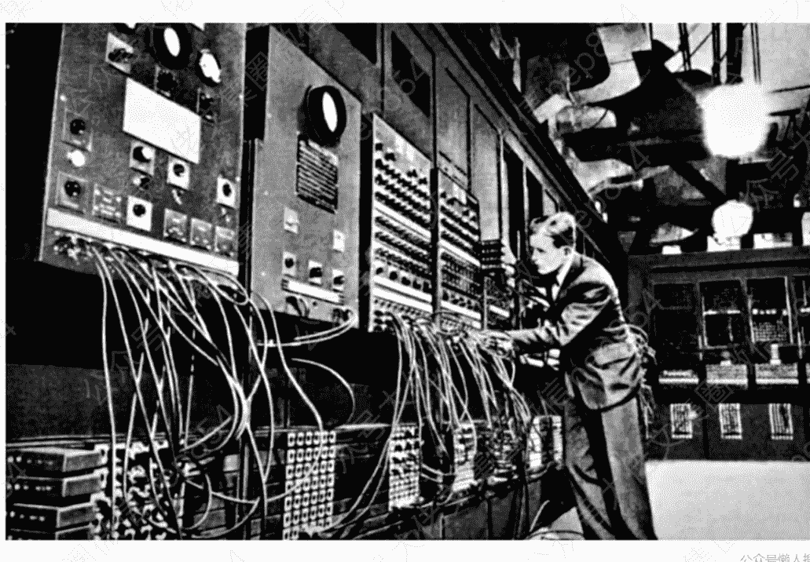
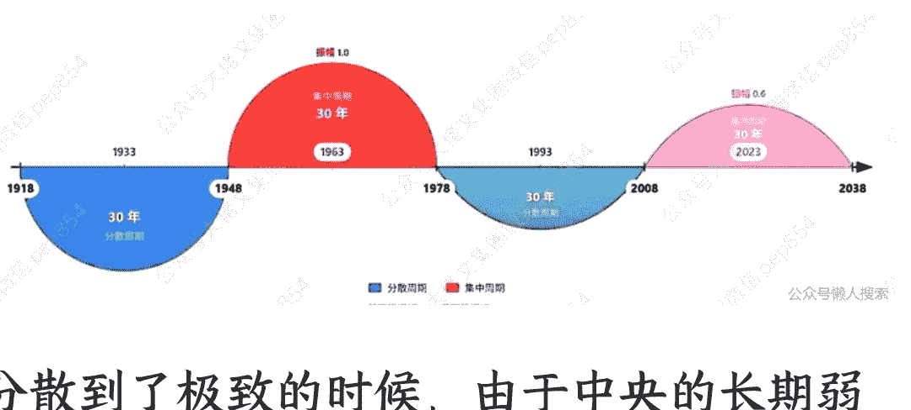

# 在 2027，请回答 1998

260908 圆方  
整理：公众号懒人搜索，[懒人专属群](懒人专属群)精选  
懒人微信：lazyhelperl

公众号  
懒人搜索  
懒人专属群

微信：lazyhelperl

> **小懒判断** ｜ 适合被 2027 焦虑裹挟、想提前两三年做准备的人，不适合想直接抄答案选股票的。最值得关注“技术周期 30 年+政治周期 15 年”双框架——分散/集中从 1918 年排到 2038 年，再叠加“今天中央家底厚但地方和居民回旋空间比 98 年更小”这个反向判断。评论区作者回复“拐点 25 年部分地区已开始、整体回暖要 29 年”值得单独记。坑在于全文是大概率推演不是预言，“三件绝对不要做”要结合自身情况用。

## 01

在 2015 年 11 月 6 日，《请回答 1988》在韩国 TVN 电视台上映，该剧在韩国本土创下现象级收视：大结局平均收视率达 19.6%，最高瞬间收视 21.6%，刷新韩国有线电视台历史最高收视纪录。

“请回答 1988”这部韩国“国民级电视剧”，讲了一个什么故事呢？彼时韩国刚经历 1987 年民主运动，威权体制松动，经济高速增长却也撕裂着传统秩序。

剧集借双门洞五户人家的日常，描绘了城市化瓦解了熟人社会，核心家庭取代大家族，邻里温情在钢筋水泥中逐渐消散的社会现实。

也折射出高考独木桥下的教育焦虑、阶层分化下的生存挣扎，重男轻女的父权结构、以及代际之间沉默的隔阂。

那为何这部片子在 2015 年的韩国爆火呢？2015 年韩国青年失业率达 9.2%，创 1999 年统计基准更改以来新高，20 至 29 岁失业人口激增至 41 万。

而 1988 年是韩国“汉江奇迹”的顶点，汉城奥运会举办、经济高速起飞、社会充满上升预期。

而 1997 年亚洲金融危机后，韩国接受 IMF 改革，劳动力市场灵活化、大规模裁员、临时用工普及，“终身雇佣”和“靠努力翻身”的旧共识彻底崩塌。

当现实无法提供安全感和意义感时，怀旧就成了最自然的出口。韩国媒体分析指出，那个年代“虽然社会也有混乱，但存在现在已经解体的邻里和家庭间的深厚情谊，以及没有背景也能靠努力成功的信念”。

这对 2015 年深陷“地狱朝鲜”叙事、感到努力不再有回报的年轻人来说，是一种强烈的情感代偿。换言之，2015 年的韩国年轻人怀念的可能不是那个时代的“物质条件”，而是一个更“精神层面”的东西：

# 希望

大家好，我是圆方，今天我们一起聊：在 2027，请回答 1998。

## 02

在九月的复盘文章《九月给自己的留言》中，圆方说：

> 如果说过去都是喊着说“海啸要来了”，那么最近可能很多敏锐的人，已经看到高高的浪头了。而这个时候，用一种什么样的判断，准备，以及能量去应对，可能比任何时候都重要。

所以预告一下，在本周我可能会写一篇大文章给到大家，关于我们每一个人如何应对即将到来的冲击。

在前两天的文章《会和 98 年很像的 2027》中，圆方说：

> 2027 年大概率也会成为类似的分水岭。外部壁垒倒逼国产替代和区域合作，内部出清倒逼资源配置效率提升，人工智能扩散倒逼劳动力技能重构。困难集中出现，意味着旧模式被快速压缩，新周期开始酝酿。低谷期做的选择，往往决定下一个十年的位置。

这两天，圆方在深圳改革开放学院上课，上课空隙有了更多的思考时间；这些天，把之前的许多思路和思考认真总结梳理了一下，今天就把这个问题和伙伴们好好聊聊。

## 03

为何在即将到来的 2027，我们需要“回答 1998”。

其实原因并不复杂，因为当你真的理解了如何“解”1998 这道题，那么你大概就知道如何去“解”2027 年这道题。1998 年就像是我们上学时候数学几何课上做的“真题”，当你真的理解了出题老师的思路，真的理解了解题要用到哪些公式，真的理解了要如何划辅助线；那么当你走向考场，面对“新题”的时候，至少不会那么慌。

可能会有伙伴有疑问：这是刻舟求剑么？1998 年与 2027 年当然存在许多不同，外部约束、技术条件、人口结构、政策工具箱都发生了很大变化。照搬那一年的具体措施，确实会陷入刻舟求剑的误区。

比如当年投身土木行业可能是很有前途的选择，现在再去投身土木，可能就只能去打灰了。

当年选择学IT，投身互联网可能都敲钟上市了，而现在学IT，在很多高校学的编程课程，可能很快都可以去申请“非遗传承”了。

所以我们需要的不是简单的复刻98年的路径，而是了解在转型期和冲击期必然遇到的问题，以及总结出应对转型和冲击期的方法论。

在正式写之前，这里需要明确三个问题。

一，所谓“1998”，指的并不仅仅单单是1998这一年，而是1997-1999，或者更延展来说是1996-2000年这样一个“变革期”。

大的变革和冲击其实从1996就开始了，只是很多人到了1998年才有了痛感。而对应的我们今天，也不仅仅是2027，而是2026-2028，或者更延展来说是2025-2029年这样一个“变革期”，大的变革和冲击其实从2025就开始了，只是很多人到了2027年才有了痛感。

二，圆方今天希望在文章中讲到，并不仅仅是一些简单的建议，而是把背后的底层逻辑一层层拆给大家看。从中央，地方，企业，个人四个维度层层梳理和分析清楚。

圆方尽可能写的通俗易懂，但受内容限制，整体读起来可能会比较复杂和晦涩，内容也比较长，读起来需要较大的耐心。

三，在这篇文章的叙述逻辑，以及四方的博弈当中，希望大家抛弃掉一个“好人”与“坏人”的视角，不要施加太多的“道德”评判，而是从一个绝对的“利弊”视角来进行思考，能更好的得出“可能正确”的结论。

因为在真实世界中，各方做决策时，很多时候不是选择“好”与“更好”，更多的其实是火车难题（一辆失控电车将碾压轨道上的五人，你拉动拉杆，可以使电车转向另一轨道，但另一轨道上有一人，你会如何做）。

好的，如果你理解了上面的内容，希望在 2027 能够回答“1998”，我们今天的学习旅行，就正式开始。全文一共 10000 字+，圆方开了“赠送”，你可以将这篇文章，送给你想要分享的小伙伴。

## 04

在开篇，我们需要先理解两个“周期”理论，一个是技术周期的理论，一个是政治周期的理论。

首先，我们先说技术周期，技术是什么？

技术本质是如何去定义资源。

技术周期往往是以三十年，也就是一代人为周期重复向前的。

我们先把时间轴拉长来看过去的两个技术周期。

- 1963年到1993年，这三十年属于计算机革命。
  上半场从六十年代到七十年代末，大型机和小型机主导，计算机是机构专属设备普通人和它距离很远，

  下半场从八十年代初开始，个人电脑普及，计算能力进入家庭和中小企业，微软和英特尔代表的软硬件标准体系在这时候成型。
- 1993年到2023年，这三十年属于互联网革命。
  上半场是PC互联网，从拨号上网到宽带普及，浏览器、门户、搜索引擎和电子商务把信息连接起来。
  下半场是移动互联网，智能手机和移动网络让连接渗透到生活每个角落，应用商店、社交平台、移动支付和短视频重塑了商业和社会习惯。
- 2023年到2053年，这三十年属于AI技术革命。
  上半场刚刚开始，大语言模型和生成式人工智能率先落地，文本、图像、代码的生产成本急剧下降。
  下半场可能围绕具身智能、科学发现和自主决策系统展开，现在尚难定论，但可以确定上半场的核心特征是模型能力扩散和算力基础设施扩张。

技术革命之所以重要，在于它重新定义了什么是资源。资源从来不是一个固定不变的概念，而是每个时代技术体系筛选出来的结果，而这些资源往往也会在这个时代攫取到最大的利润。

计算机革命时代，晶体管、存储芯片和操作系统是核心资源。到了互联网革命时代，计算机本身变成了基础设施，硬件性能继续提升但不再稀缺，用户注意力、网络节点和数据流量成为新的核心资源。

然而到了 AI 技术革命时代，算力、高质量标注数据、模型训练和推理的效率成为新的核心资源。而每个时代，我们都会发现上一个技术时代的资源，到这个时代往往会因为供给过剩而贬值，甚至因为维护成本高昂而拖累转型。

技术革命带来的生产力普惠和资源创造的扩散，往往也有明确的时间节点。

比如在互联网革命的三十年里呈现出清晰的三段节奏。1993 年到 2003 年，互联网的基础设施和早期应用集中在少数超一线城市。

那里有最好的通信网络、最多的高校和科研机构、最集中的资本和人才，第一波机会属于能接触早期技术的人。2003年到2013年，随着宽带和物流网络向二三线城市延伸，互联网的商业模式开始复制和下沉。

电商、网络游戏、本地信息服务在这些城市找到了大规模用户，资源和就业机会从少数中心向外扩散。2013年到2023年，移动互联网和智能手机普及到四五线城市和乡村，短视频、直播电商、社交拼团等形态让过去处于边缘的地区直接接入全国市场。

生产者、创作者和小商户第一次能够绕开传统中间环节获得收入，技术红利触达了最广泛的基层。

这个扩散过程并不均匀，每个阶段的先行者都会获得超额回报，后来者则需要更激烈的竞争。AI技术革命的扩散大概率也会沿着类似的路径展开，只是节奏可能更快，区域之间的时间差可能更短。

从当前算力中心和模型研发的分布看，第一波仍然集中在少数头部城市，但模型的调用成本和使用门槛正在快速下降，应用层的扩散会很快进入下一阶段。

而理解这个节奏，我们才能更好的理解我们在这个时代所处的位置。

## 05

其次，我们再说政治周期，政治是什么？政治本质是对资源的分配。

然后要明白在争夺“资源”分配这个游戏中的四个角色：

1. 掌握政权的“中央政府”
2. 实际管理的“地方政府”
3. 充满活力的“社会资本”
4. 勤奋工作的“普通群众”

（外资也算是“社会资本”的一部分）

当资源在“地方政府”以及“社会资本”掌控的时候，一般会带来社会的“活跃”度的上升，经济往往欣欣向荣。

当资源在“中央政府”以及“普通群众”掌控的时候，一般会带来社会的“活跃”度的下降，社会慢慢趋于稳定。

所以，所谓“政治”的变化。就是“资源”调动的权力是：正在从“中央政府”和“普通群众”向“地方政府”和“社会资本”转移的过程，这种我们称之为“分散”。

还是从“地方政府”和“社会资本”向“中央政府”和“普通群众”转移的过程，这种我们称之为“集中”。如果把绝对“集中“坐标轴标记为 1，把绝对“分散”坐标轴标记为-1，那么从 1918 年到 2008 年，大概可以分成以下几个阶段：

分散到了极致的时候，由于中央的长期弱化，普通群众的生活持续恶化，要么演变成地方的分离主义倾向，要么演变成贫富差距过大后的揭竿而起。

当然更重要的是，由于中央能力的衰弱，抵抗外敌入侵，争取国家利益的能力也会同步下降。集中到了极致的时候，同时由于资源能够充分被调动起来，这个时候国家的对外战斗力会处于历史高位；国内的贫富差距不会很大，地方政府也比较听命中央。

但长期发展下去，会带来经济发展的逐步固化，社会的流动性不断下降等附带的问题。如果二者保持均势，处在平衡状态，称之为“平衡”。

一个国家处在平衡期的时候，往往是最好的；不过由于万事万物是不断转化的，外部挑战和内部变化层出不穷，所以平衡期能出现的时间其实极为短暂。

## 06

当我们理解了“技术周期”和“政治周期”，我们就能够明白，今天和三十年代，我们的相同和不同，到底在哪里。

先说相同，我们现在都处于一个“技术周期”刚刚起步的时候，98 年开启创造财富，创造资源的是互联网，而今天开启创造财富和创造资源的则是 AI。

再说不同，98 年我们面对的问题是如何从“相对分散“走向“集中”；而我们今天面对的问题和挑战是如何从“相对集中”走向“分散”。

前者的难度在于外部，后者的难度在于内部。

前者的问题往往是“通胀”，而后者的问题往往是“通缩”。

理解了相同和不同，我们就可以理解一下，在 1998 年的时候，中央，地方，企业，个人都面临着哪些困难和挑战，他们当时又是如何处理和应对的。

1998 年的中央财政已经相当紧张。亚洲金融危机导致外需骤降，出口增速从 1997 年的 21% 掉到 1998 年的 0.5%。国企亏损面超过 40%，与此同时，因为国有银行账面积累了大量对亏损国有企业的贷款，银行体系的不良贷款率官方口径也到了 25% 以上。

中央可支配财力在总财力中的占比也持续走低。中央直属的大型工业企业中，纺织、煤炭、机械、冶金等行业出现全行业亏损，央企上缴利润几乎可以忽略。

为了保住金融体系不出现系统性崩溃，中央在 1998 年发行了 2700 亿元特别国债，用于补充四大国有商业银行的资本金。后一年，财政部向四家资产管理公司各拨付 100 亿元资本金，先后从银行手中收购近 1.4 万亿元不良资产。

中央同时推动这些动作的直接代价是财政赤字扩大，中央债务负担上升，相当一部分央企在随后三年里关停并转，大量职工离开原有岗位。

中央保住了银行体系和基本调控能力，但许多依赖央企产业链的中小城市和家庭承受了长期阵痛。地方政府的处境更加艰难。地方国有企业普遍规模小、设备旧、负债高，很多县的工业产值一半以上来自亏损企业。

地方财政既要承担教师和公务员的工资，又要维持企业运转，预算内收入常常不够发工资。为了保住基层政权的基本运转和地方社会面的稳定，地方政府加快了中小国有企业和集体企业的改制步伐，采取股份合作制、出售、租赁、破产等多种形式。

一部分地方把企业净资产作价极低转让给原经营者或外部投资人，以换取税收和就业承诺。

还有一些地方将自来水、公交、燃气等公用事业特许经营权出让给民营企业。短期内地方财政压力得到缓解，部分县市开始出现新的税源。

代价也很直接，国有资产在改制过程中大量流失，部分原企业职工只拿到很少的补偿金甚至没有补偿，社会保障缴费中断。地方政府的债务开始积累，土地出让收入逐渐成为财政支柱，为后来的土地财政模式埋下伏笔。

民营企业在 1997 到 1999 年遭遇了融资渠道的急剧收缩。亚洲金融危机之后，银行普遍惜贷，原先依靠信用社和民间拆借的民营企业资金链紧张，三角债蔓延。

外贸订单减少，国内市场又面临通货紧缩，产品卖不出去，库存上升。许多民营企业为了活下去，主动压缩规模，回笼现金，放弃扩张计划。

一些制造业企业转向为跨国公司做代工，换取稳定订单和外汇收入。另一些企业参与地方国企改制，收购经营困难的国有厂，获得土地和设备，也承接了原有职工的安置义务。

这个阶段能活下来的民营企业大多完成了从粗放扩张到成本控制的转变，学会了在紧缩环境里管理现金流。付出的代价是大量中小企业倒闭，民营投资增速连续下滑，

部分行业里民营企业家选择了退出或者移民；社会对民营经济的信心出现明显回落。

个人层面，最强烈的冲击来自下岗。1998年到2000年，国有企业下岗职工累计超过两千万人，加上集体企业和其他单位，实际失去原有岗位的人数更多。

过去由单位提供的住房、医疗、子女教育等福利在几年内快速削减，货币化分房政策让城市居民第一次需要面对市场价格。很多家庭依靠过去的储蓄维持日常开支，夫妻双方同时下岗的情况并不少见。

为了保住子女教育和家庭基本生活，大量下岗职工进入临时工、摊贩、家政、保安等非正规就业领域，收入不稳定，但最终保持了社会没有出大乱子。

付出的代价是一代人的职业积累在短时间内清零，心理落差和家庭矛盾集中爆发，城市贫困人口增加，部分地区社会治安压力上升。

那些年个人储蓄率开始上升，消费意愿下降，这种谨慎情绪在很长时间里影响了国内市场需求的恢复。

那一年，中央扛住了金融的底线，地方扛住了秩序的底线，民企扛住了市场的底线，个人扛住了生存的底线。每一个主体都试图把成本推给别人，但最终都留下了一部分重量压在自己身上，没有人能全身而退，也没有人完全被压垮。

那些选择谈不上体面，谈不上高尚，更多时候是带着疼痛的忍耐，是明知不完美还要往前走一步的倔强。理解这些，才算真正读懂了 1998 年的选择。

## 07

让我们回顾了 98 年所面临的情况，我们就会意识到，今天我们遇到的“外部问题”和 98 年几乎一样，但是我们“内部问题”的却有着本质的不同。

外部环境的压力与 1998 年高度相似。上一轮技术革命积累的过剩产能和存量资产正在经历被动出清，外部需求在贸易壁垒和供应链重组中出现明显收缩。

传统制造、房地产、线下零售等领域的产能利用率持续走低，存量资源价格下行，企业收入和利润同步承压。

这种外部冲击不区分所有制和地区，对所有依靠旧需求结构生存的主体形成同一方向的压力。出口订单减少、价格竞争加剧、库存周转放缓，这些问题在 1998 年同样出现过，只是当时集中在轻工业和一般贸易，现在更多集中在资本品、耐用消费品和“含金量”低的制造业。

内部条件则出现了方向性的变化。中央财政的可支配能力比 1998 年强得多，税收征管效率、国有资本收益上缴、特别国债发行空间都处在完全不同的水平。

中央直属企业里，能源、电力、通信、装备制造等领域的头部公司具备了全球竞争力，资产负债结构整体稳健，部分企业还能持续创造外汇收入。

民营企业中也出现了一批在世界范围内具备产业链话语权的公司，在新能源、消费电子、跨境电商、智能制造等方向拥有真实的规模优势和技术积累。

地方政府的处境却比 1998 年更困难。当时的困难主要来自所属企业亏损和职工安置压力，但土地资源尚未大规模透支，财政腾挪的空间仍然存在。

现在的地方政府面临存量债务本息集中到期、土地出让收入连续下滑、平台公司现金流紧张三重叠加。许多市县的可支配财力仅够维持基本运转和债务利息，新增投资能力几乎耗尽。

过去通过卖地补充收入、通过平台举债推动基建的路径已经走不通，而新的稳定税源尚未形成。地方国企的资产质量也普遍弱于央企，大量资产沉淀在收益偏低的市政项目和园区载体里，难以快速变现。

居民部门的压力同样超过 1998 年。当时的家庭负债率很低，储蓄基础相对扎实，下岗冲击集中在部分产业工人群体，城市新增就业还能吸纳部分劳动力。

现在的居民部门杠杆率处于高位，住房按揭、消费贷和经营贷叠加在家庭资产负债表上，资产价格下跌直接削弱了抵押物价值和消费信心。

## 08

就业压力从制造业蓝领扩散到白领和青年群体，服务业的收入稳定性下降，灵活就业规模扩大但社会保障覆盖不足。教育、医疗、养老等刚性支出持续上涨，居民预防性储蓄意愿上升，消费复苏的持续性受到制约。

而这种内部差异带来了完全不同的政策约束。1998 年的核心难题是中央和银行体系缺乏资源，但地方政府和居民还有一定的回旋余地。

今天的核心难题是中央和头部企业资源相对充裕，但地方政府和居民部门的回旋空间已经非常有限。当资源集中在少数主体手里，而压力集中在需要直接面对社会运行和日常生活的基层主体身上。

传导链条一旦断裂，宏观数据改善无法同步转化为地方财政修复和居民收入增长，社会预期就很难真正稳定下来。

现在，我们先理解了技术周期和政治周期；

我们也复习了在 1998 年四个方面的应对和处理；我们还理解了今天和 1998 年的不同。

我们大概就能够推断，在即将到来的 2027 年，各方基于自己的角度，又会做出怎样的选择呢？理论上，中央政府今天应该把信用空间向地方债务置换和居民社会保障倾斜，停止继续把增量资源集中投向大型基建和央企扩张。

但出于维持集中调控能力、防止地方再次无序扩张的需要，同时要解决金融系统和重点产业链不出风险的问题；大概率会选择继续由央企和国有银行承接主要资源投放，通过特别国债和结构性工具定向支持头部部门。

而代价则是资源沉淀在少数主体手中无法传导到基层，地方财政缺口继续扩大，居民收入预期难以修复，集中回调期被强行拉长，社会活跃度在低位持续更久。

理论上，地方政府应该停止新增没有现金流的项目，尽快处置闲置资产，压缩非税征收，把有限财力用于工资、利息和民生。但出于短期偿债压力和维持基本运转的需要，同时要解决存量平台债务集中到期的问题，大概率会选择继续借新还旧，把债务滚动成本向后推，同时加大对企业罚款、欠款和土地变相出让。

（当然，到了扛不动的时候，地方平台公司通过破产来“大规模化债”，也已经是工具箱的一种选择）而代价则是营商环境加速恶化，民营企业外迁或缩小经营，税基进一步萎缩，地方信用在金融市场和本地社会中同步瓦解，部分市县将进入事实上的财政枯竭状态。

理论上，社会资本应该降低杠杆，压缩重资产投入，保留现金和核心客户，进行 AI 转型，去降低成本而不是扩张规模。但出于股东回报要求和行业竞争压力，同时要解决收入增速下滑、资产价格下跌带来的估值问题；大概率会选择继续追逐政府订单和“六张网”等基建题材，用融资和垫资维持账面增长，参与地方资产盘活时承接带病项目。而代价是应收账款和存货持续堆积，坏账可能会向后拖。

与此同时，之前积累的坏账可能会在未来两年集中暴露，大量制造业和传统企业出现现金流断裂，裁员和违约从可能从中小微边缘企业向中型企业蔓延，民营经济对政策刺激的信任进一步流失。

理论上，普通群众应该减少新增负债，提高储蓄比例，优先保住现金流和社保连续缴纳，避免把储蓄投入风险资产。但出于就业不稳定和刚性生活支出上升的压力，同时要解决子女教育、住房月供和医疗养老等当期问题；大概率会选择继续压缩储蓄，部分家庭被迫动用存量存款或新增消费贷维持原有消费水平，青年群体延迟就业或进入低薪灵活岗位。

而代价是家庭资产负债表恶化速度超过资产价格下跌速度，预防性储蓄意愿与实际储蓄能力同时下降，消费对经济的拉动持续减弱，社会保障账户缺口扩大，社会层面的焦虑和保守情绪进一步固化。

## 09

所以，圆方长期看是悲观的么？

其实也不是，因为有两个额外变量，我们要看到。一个是国际局势的变化，一个是技术周期的演化。

### 我们先看回 1998 年

当时中国内部推动的国企改革、银行重组和财政整顿只是稳住了基本盘，1998 年启动国企三年脱困，向四大行注资并剥离不良贷款，当年增发 1000 亿元长期国债用于基建。

但真正把经济从通缩中拉出来的力量，来自外部需求的重新打开。外部变量的转折发生在 1999 年。1999 年 11 月 15 日，中美两国签署了关于中国加入世界贸易组织的双边市场准入协议，这是入世谈判中最关键的一步。

2001 年 12 月 11 日中国正式加入 WTO 随后几年出口和外商直接投资快速增长：2001 年至 2010 年间，中国出口从 2660.98 亿美元上升至 15777.89 亿美元，增长 493%，年均增长 21.9%；2001 年实际吸收外资达到 469 亿美元。

外汇储备从 1998 年底的 1449.59 亿美元持续攀升至充裕状态。 沿海制造业吸纳了大量从国企分流出来的劳动力，地方财政有了新的税源，居民收入预期逐步修复，消费和投资重新启动。

这个外部增量降低了内部转型的疼痛程度，给结构调整争取了时间。 互联网泡沫的破灭同样没有终结互联网本身。 纳斯达克指数于 2000 年 3 月 10 日触及 5048 点的历史高位，随后开始暴跌，从 2000 年 3 月到 2002 年 10 月，纳斯达克指数跌去了约 78%，抹去了约 5 万亿美元的市值。

下跌淘汰了大量没有收入支撑的公司，但光纤、数据中心、通信网络等基础设施留了下来（互联网泡沫期间铺设了约 8200 万英里的光纤电缆），到 2004 年带宽成本下降了 90%。

宽带接入成本下降，用户规模继续扩大。 泡沫出清之后，活下来的公司和后来进入的公司把互联网应用到贸易、零售、娱乐、制造等更多行业，为随后约二十年的互联网应用繁荣奠定了基础。

中国在这个过程中成为制造业和互联网应用的重要参与者，外部需求和技术扩散共同支撑了那一轮增长。 当我们回看今天，今天的外部条件可能沿着类似的方向演变。

美国当然不会主动救助中国，这一点不需要幻想。 但美国自身的债务利息支出、通胀压力和科技公司盈利需求会迫使它寻找缓和空间。2025 财年，美国联邦政府净利息支出达到 9700 亿美元，已超过国防预算；国会预算办公室预计 2026 年利息支出将首次突破 1 万亿美元。

美国国债总额已突破 40 万亿美元。对中国商品加征关税推高了美国国内采购成本，美国财政需要海外买家承接国债，美国企业需要中国市场维持收入，美国人民需要中国产品降低通胀。这些因素，可能推动美国在贸易和科技限制上作出阶段性让步。

这种缓和会给中国带来新的出口订单、资本流入和外部需求，对走出通缩有直接帮助。规模未必像 2001 年入世那样大，但足以改变边际预期。

与此同时，AI 领域的资本开支和估值已经包含大量乐观预期，大概率会迎来一波估值回调。

但是，当泡沫破裂之后，算力价格、模型训练成本、人才成本会回落，技术会从少数公司扩散到更多行业和地区。AI 带来的生产力提升会体现在制造业、医疗、教育、物流、能源等领域，降低运营成本，提高产出质量。

这个过程如果持续，可能带来较长时间的增长。中国在应用层和制造业结合方面有条件承接这轮扩散，特别是当算力成本下降后，大量中小企业可以用较低门槛接入模型能力，跑出属于中国的独特优势。

当然，这两个变量不能彻底改变内部结构的问题。地方政府的债务压力、居民部门的负债修复、社会资本的投资意愿，仍然取决于国内分配关系的调整。

不过外部增量和技术扩散可以降低转型的疼痛程度，给政策调整争取时间和空间。真正走出困境长期看还是要靠内部分配关系理顺，只是有了外部需求和技术扩散，调整的过程不会像 1998 年那样剧烈。

2027 年，虽然我们面对的局面比 1998 年更复杂，但我们的家底比 1998 年要更厚实，我们的保障比 1998 年更完善，我们的技术比 1998 年更先进，我们的国际环境比 1998 年更友好。

从这个角度来说，我们应该乐观，但是也要注意哪些可能同样会犯的错误，

1998 年留给普通人最深的教训，是那些曾经被当作常识的东西会在几个月内失效。当年最典型的例子，是城市家庭对国有企业稳定性的信仰。

在此之前，进厂工作、分房、子女顶替，被看作一生可以依靠的路径。1998 年下岗潮让数千万人突然发现，单位不再负责住房、医疗和子女教育，一个岗位说没有就没有了。

这种冲击，教会那一代人，组织保障可以在极短时间内消失。今天很多人依然把进入大公司或体制内看作安全选择，但当前的组织收缩和裁员说明同样的风险正在重演。

需要改变的是对单一雇主长期兜底的期待，个人必须把技能和资源掌握在自己手里。1998 年另一个被打破的观念，是住房依赖单位分配。

此前城镇居民普遍不认为住房是家庭最大的资产项，更谈不上投资。住房货币化改革之后，房子变成商品，此后二十年房价上涨塑造了新的信仰：买房一定保值增值。

现在这个信仰正在承受压力，流动性下降、价格回落、持有成本上升。参考 1998 年，当一项制度被改变，原来的分配逻辑就会作废。

人们需要重新评估房产在家庭财富中的位置，把可变现性放在更优先的位置，而不是把房产当作唯一的财富载体。1998 年还让人们看到，国家不会兜底每一个企业和每一个岗位。

当时国有企业大面积亏损，银行不良贷款率高企，中央选择保住金融系统和重点行业，大量中小企业和职工被推向市场。今天一些大型机构出现风险时，市场仍然期待政府全面救助。

参考 1998 年，政府会选择维护系统稳定，但不会保护所有参与者。个人需要放弃“只要规模大就不会倒”的假设，对自己所在的机构做独立的风险判断，而不是把外部救助当作默认选项。勤奋与方向的关系也在 1998 年被重新定义。

那批下岗工人中，很多人技术水平不低，工作时间很长，但行业整体收缩，个人再努力也改变不了结果。当时能走出来的人，大多及时转入了新的行业，比如南下打工、做小生意、学电脑。这个经验说明，在结构转型期，选择比单纯的勤奋更重要。

今天很多行业正在经历类似收缩，继续在原有轨道上加大投入，可能只是重复 1998 年那些没能及时转身的人的困境。需要更早地识别行业趋势，把学习能力投向正在扩张的领域。

## 11

1998 年最残酷的课程，是旧观念失效的速度远快于人们调整的速度。

现在回头看，那些及时改变的人后来重新站稳了脚跟。2027 年前后，同样的事情会再次发生，只是换了行业和人群。参考 1998，最重要的改变是提前放弃那些建立在旧结构上的确定性期待。有三件事在 2027 年绝对不要做。

- 第一，虽然各个地方政府调整了房地产政策，开始鼓励买房，许多房价也跌到了似乎“划算”的价位，但是不要以超过家庭年收入一半，去购买非核心城市的房产或商铺；这类资产的流动性会继续下降，变现周期会拉长到三年以上。
- 第二，不要因为看到 AI 风口就辞职去烧钱创业，尤其不要在没有付费客户的情况下租办公室、雇团队、买算力。先用兼职和副业验证收入模型，再考虑全职投入。
- 第三，不要给地方政府平台或大型国企做垫资生意，因为应收账款会拖垮现金流，坏账暴露的时间可能比想象中更晚，但一旦暴露就是致命的。

回看 1998 年的三部作品，《漫长的季节》里的人停留在旧时代的余晖里，用回忆和释怀消化伤痛。《大江大河之岁月如歌》里的人从体制缝隙里找出路，在政策变化中争取生存空间。《繁花》里的人随市场浪潮浮沉，在商业传奇和市井情义之间来回切换。

《繁花》当然好，但那大概率是属于极少数人的“都市童话”；2027 年我们最该扮演，能够扮演的角色，可能更接近《大江大河》里那些在改革向前叙事中活下来并且把事情做成的人。

他们不沉溺于回望，也不把命运完全交给市场情绪，他们清楚制度的边界，知道哪些资源能碰，哪些债务不能背。他们保住团队和现金流，对外部机会保持敏锐，在集中回调期结束后第一个站起来。

时代不需要我们做悲情的主角，也不需要我们做纯粹的投机者，它需要的是能读懂周期、管好资产负债表、在约束条件下持续行动的人。

祝好

# 精选留言

**老五**：98 年城市化率刚刚开始，房地产市场有空间；27 年，未来 30 年的居民财富已被透支，现在是产业经济向资本经济转型。唯有资本市场，拉动一场史诗级牛市，将高储蓄率进行转化，拉动消费，但前提条件必须是政策公平，量化，融券做空，大股东套现等制度必须改革，这是重中之重。

**作者回复**：不要赌任何人会救你，要去猜它会如何救自己。

**song 栊**：读完，想到 9 月 2 日《学习时报》刊发的《中国财政科学院研究员：加大扩大内需的基本逻辑和着力点》。圆方老师讲的是信用集中、基层传导受阻的风险；智库文章给出的解法是“中央加杠杆+有效投资+社保与分配改革”，打通投资-就业-收入-消费链条，一个像风险推演，一个像政策施工图。不过其“投资决定消费、消费不构成中长期增长逻辑起点”的判断也容易引发质疑：是否过度强调投资，低估了居民收入和消费需求对投资回报的反向约束？若只有投资、没有收入分配和传导修复，圆方老师的担忧可能仍会成立。圆方作者怎么看？

**作者回复**：中间其实有段内容回应了这个问题——正确的选择，基于各自的立场，未必会被选择。

**胡图图**：1.有绝对不要做，那有没有绝对要做？2.新的税源预期在哪里，时间和池子？3.能源、电力等领域的全球化企业能穿越周期吗？

**作者回复**：1.身体健康心理健康；2.精兵简政；3.垄断性质的企业可以。

**齐**：先拍，希望比上次的长文好。比上次要好，有一定新意。

**作者回复**：一万字，应该算干货满满。

**元宝**（AI 生成）：这篇文章把 1998 和 2027 放在一起对照，核心是说两个年份都处在三重叠加的转型关口：外部需求收缩、内部债务压力、新旧技术切换。1998 年靠国企改革、入世红利和互联网浪潮走出来，成就了两十年的增长；2027 年面对的是地产去金融化、地方债化解和 AI 落地难，政策思路类似——用特别国债、债务置换、以旧换新换时间。文章真正想说的不是预测，而是提醒：最坏的时候往往也是重构的开始，提前降杠杆、学新技能、进新行业的人，通常吃到下一波红利。

**作者回复**：在正确的地方用正确的方法做正确的事情。

**赵冰**：这一波的预期拐点圆方老师看到啥时间？

**作者回复**：拐点我觉得从25年在部分地区就开始了。或者你可以理解为这一波的造富，就是一种体现。而整体普遍的回暖，可能是到29年了吧。

**肖勇庆**：作为一个普通老百姓，修身养性，不乱花钱，卖房还贷，处理好家庭关系，投资子女教育。这大概是能做的事。

**作者回复**：能做到这些大概在这个时代已经不普通了。而且江浙沪整体来看会好很多。

**黄瑜 AshLSnow**：大概能看懂，理解了各股力量的预期，那就顺势而为吧。社会资本，在能退出的路径确定后，才能投入。安全很重要。先找到产品的 buyer，才能用 AI 创业。但在这种撕裂的时代，先建立自己的边界，把时间更多投入在自己擅长的、感兴趣的领域，用 AI 进行小规模试错和迭代，是最重要的。

在这个 AI 能替你写代码、写文章的时代，基础技能正在迅速贬值。绝大多数人正被淹没在海量的免费垃圾信息里，陷入低效的体力内卷。

当“努力”不再是壁垒，人与人之间唯一的护城河，只剩下“信息过滤”的效率与“认知系统”的维度。

圈子已稳定运行 7 年。我们每天利用 Python 爬虫与大模型算力，过滤全网最顶级的政经内参和搞钱风向标，做你最冷酷的“外部大脑”。

如果你认同这种“重塑认知防线”的极客主义，欢迎围观我的个人情报智库：【懒人专属群】。

https://lazyso.com/insider/

认同信息过滤价值、想省下每天 3 小时无效阅读时间的读者，扫码加我微信（lazyhelper1）

微信：lazyhelper1
