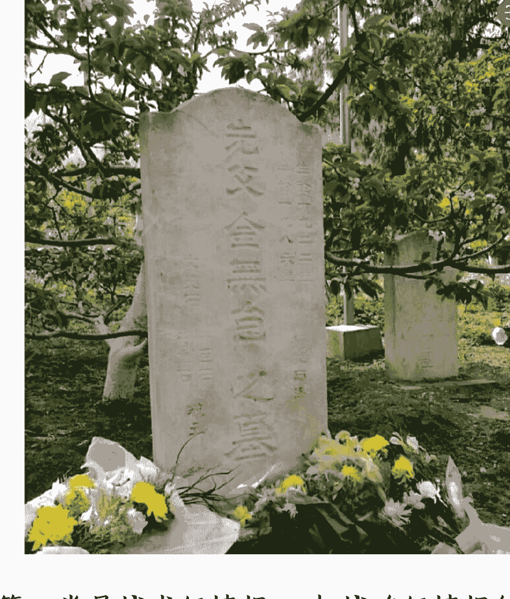
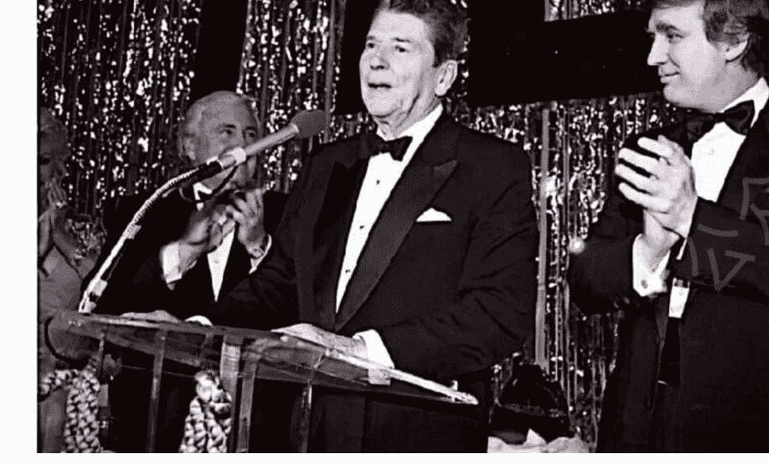
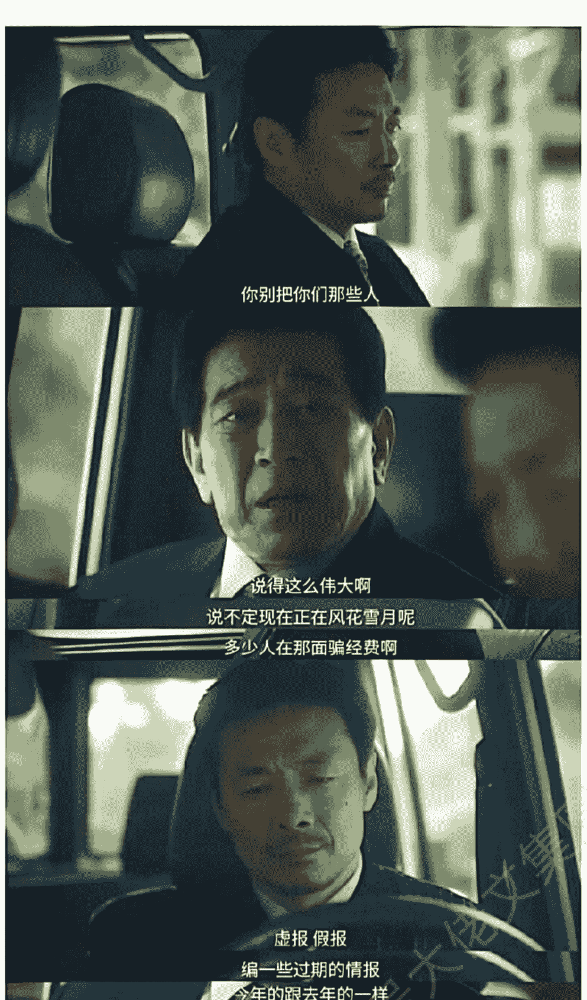

## 两岸谍战背后传递出的信息

**260912 江宁知府**

整理：公众号懒人搜索，懒人专属群精选
懒人微信：lazyhelper1

> 小懒判断 | 适合关注台海局势、想看懂《交锋》这类国安剧背后信号的人，不适合想找投资或行动指引的。最值得记情报三分法：战略级管“会不会下场”，战术级管“怎么干”，参数级支撑兵推——以及“西太军事优势是统一的前提而非结果”这句主线。坑在“渐进式弃台”只是美国一派学者的方案，别当成既定政策。

### 引子

近期，以 1996 年台海危机为背景的谍战片《交锋》在央视热播，首次以高度具体的方式描绘了两岸情报战。一般来说，这种带有“突破性尺度”的影视作品背后都有特定上级部门的意志在里面，比如《人民的名义》出品单位里有最高人民检察院影视中心，《交锋》的出品单位里则包含了国安影视中心。

《交锋》前几集聚焦在台当局情报人员对大陆导弹专家曹教授的策反工作，剧中祖峰饰演的朱应甲为台湾“军情局”上校副处长，他为了获取我军军演情报亲赴北京跟被策反的导弹专家曹教授接头。

其实台湾情报部门高层真正在意的并非导弹参数本身，而是借此判断“96联合军演”的真实目的。简单来说，因为前线试射的导弹仍处于研发过程中，未搭载真实弹头，使得台当局推测大陆军演的主要目的是施压而非实战——技术情报服务于意图判断。

值得一提的是，朱应甲这个角色有原型人物，即长期负责对大陆渗透的台“军情局”第四处副处长朱恭训（同剧里职位、军衔一样）。2015年11月两岸新加坡会晤前后，发生了海峡对峙以来的第一次换俘，其中移交给台当局的两人里就有朱恭训，换回了立下大功的“双面谍王”李志豪。

### 正文

在中美及台海两岸交锋愈发激烈的背景下，所涉及的情报实际上分为三类，其价值与影响是截然不同的：

- **第一类是战略级情报。** 战略级情报的目的是获得对方政策底线和根本战略意图，比如：极端情况下美国会不会出兵援台，会以多大力度援台；大陆究竟有没有外界渲染的“时间节点”，会在什么情况下启动统一进程等等。

这类信息的作用是判断“是”或者“否”，假如最终答案是“否”，那当事方拥有多少武器装备、性能如何、有几套排兵布阵方案，于决策而言并不重要。

战略级情报最大的问题在于可能发生误判，且误判的后果极其严重，因此需要多方面信息来交叉验证。在中美关系发展历程中，中方动用战略级情报最成功的一次案例发生在上世纪七十年代。

一般认为，在中情局工作的金无怠曾提供给中国多份关于尼克松对中美关系决策的情报，包括1970年明确获得尼克松政府希望与中国建立外交关系的文件。金由此被西方认为是整个冷战时期最具价值的情报人员之一。

这些战略级的情报使得中国能够在中美关系正常化过程中牢牢掌握外交主动权，迫使美方做出最大让步，把价杀到“底线”。2019年，《世纪》杂志第1期刊登了题为“燕京人中‘超级谜团’金无怠”的文章，可点击下方图片链接阅读。

《世纪》杂志是由中央文史研究馆、上海市文史研究馆共同主办的文史纪实类双月刊，该文章也是多年来官方媒体首次提及这段往事。

- **第二类是战术级情报。** 与战略级情报解决“想干什么”“会不会下场”的问题不同，战术级情报是为了搞清楚对方“打算怎么干”“下场以后究竟怎么玩”。

比如：美军太平洋司令部针对台海危机的作战方案有几套？会调哪些军事力量参与？航母打击群抵达战场需要花费多少时间？主要兵力从什么方向进入战区？

这些作战方案关键时刻不一定会使用——决策权在总统手里，但五角大楼和太平洋司令部的将领们会提前制定好各种预案，以备不测。

图：以房地产开发商身份参加白宫音乐会的特朗普，与里根同台，1987 年 11 月

2026 年 5 月，在结束访华回美国的专机上，特朗普曾回答过跟“六项保证”相关的问题。

所谓“六项保证”，是 1982 年由里根政府向台当局作出的，其中一条即“对台军售之前不会征询中国大陆的意见”，而特朗普在访华期间明确跟中方讨论过对台军售，因此便被记者质疑违背了“六项保证”。

怎料特朗普回答得异常坦诚，他表示“那已经是很久以前的事了”，暗示“六项保证”不再作为美国政策的刚性约束。此言一出，立刻在岛内引发轩然大波。

在上世纪七八十年代美国制定台海“战略模糊政策”的时候，华盛顿作出承诺的成本很低，因为当时美国在台湾海峡占据着军事主导地位，很难想象大陆能够在美军直接介入的情况下实现统一。

然而这些条件到现在早已不成立，美国军事干预台海的成本和风险正变得高昂且致命，甚至仅仅是“维持现状”都会带来愈发沉重的经济和军事负担。

有卸任美国官员在台北参加论坛时坦言，特朗普的话反映了美国对台政策正面临旧框架是否足以应对新局势的压力。简而言之，当前美国对台战略框架仍基本稳定，即肯定会做出反应，战术布置则在激烈重构——有哪几套方案以及触发条件都是问号，先前的各种条条框框正在逐个打破或变通。

这些信息虽然不能直接回答“是”或者“否”的问题，但对于大陆方面掌握华盛顿行动边界具有很高的价值，已属于高于一般战术情报的准战略级情报。

- **第三类是参数级情报。** 此类情报就比较具体了，例如：美军的高超音速导弹开发到什么程度、有多少库存、射程与精度如何？美军预警机的真实雷达探测距离是多少？

有句话是这样讲的：如果情报机构想要获得海滩，他们会派一大队间谍一粒一粒地取走。参数级情报对战略决策的价值在于它可以“支撑向上推演”，只有拿到这些具体信息，才能做战术级别的兵推，进而设计和评估战略选项。

情报工作的任务不仅仅是搜集情报，还有分析情报，高明的情报工作者有时能够用大量低层级信息最终拼出一个高层级的战略判断。举个最近的例子。

美军在伊朗战事中消耗的弹药数量是参数级情报，如果一一准确核对，就能由它推演出战术乃至战略级信息——因弹药缺乏，未来一段时间美国在“第一岛链”方向的作战能力将受到影响，客观上会限制白宫的战略选项，约束其对华强硬行为。

当然，正所谓“尽信书不如无书”，太过于依赖、相信情报很多时候未必是件好事，容易一叶障目，不见泰山。电视剧《潜伏》里吴站长曾经跟余则成有过这样一段对话：“则成啊，天津的得失在什么，在几个偷偷摸摸的军官吗？笑话！那么多重兵把守的大城市丢了，那么多战功卓著的整编军丢了，什么原因？我们还在这儿搜集情报抓内奸查帮派，试图保住大天津堡垒，不滑稽吗？”

情报得到的往往是一些碎片化、即时性信息，其目的应当是支撑和辅佐战略规划，切忌反过来让情报牵着走。

众所周知，俄罗斯高层有大量出身苏联情报系统的官员，克里姆林宫对情报工作的重视无与伦比，可复盘过去几十年的表现来看，战略成果平平。

如果说搞情报是为了“看清对手”，那么战略则是“看清时代”。

特朗普第一任期的总统特别助理、国家安全局网络安全主管 Robert Joyce 在 2019 年的一次发言中点评道：“俄罗斯的情报行动就像一场来得快而猛烈的飓风，中国则是气候变化。”

具体到台湾问题，当我们从大的角度去做分析时，实现在西太平洋地区的军事优势是中国完成统一的前提条件，而非结果。即并不是因为台湾所以才获得了西太平洋优势地位，而是先拥有优势地位，再顺理成章推动海峡两岸统一。

倘若中国本身不具备掌控西太平洋局势的能力，利用某份情报“抢”了一个行动窗口，那么后续面临的麻烦会有很多，招架起来将非常费力。

事实上，在台海问题上愈发感到焦虑的一方是美国。2025版《美国国家安全战略（NSS）》报告里明确承认：无法在没有盟友协助的情况下维持威慑中国沿“第一岛链”的能力。

为了解决这一问题，一派美国外交政策专家和官员认为应大幅增加军费，加大对美军现代化能力的投资，以扭转当前趋势。

这种方案其实是不可行的。一方面增加国防预算会带来加税、减少福利和承担更多债务等困难，另一方面中国也可以增加军费，结果将导致一场军备竞赛，只会加剧战争风险和潜在对抗成本，而且军备竞赛的结果很难说鹿死谁手。

另一派则提出了“渐进式弃台”方案。他们认为，美国对台策略应在接下来的时间里分阶段转向“不干涉政策”，最终目标是明确不会派遣军队进入台海地区作战，仅提供必要的情报与后勤支持，即“乌克兰模式”。

这样可以把防务重担转嫁给台湾自己身上，而在摆脱对台防御成本后，美国能够抽出相当多的战略资源转移到其他方向。之所以说要“分阶段”推进，是因为台当局增强军事能力和美国重建本土半导体产能都需要时间。

支持该观点的学者认为，美国转向“不干涉政策”后中国的紧迫感会大大降低，对于两岸和平统一更加有耐心，并不会急于立刻解决，台当局也更有可能同意启动政治谈判。

下图为2026年9月9日中国台湾地区副领导人参与跟美智库机构的“安全对话”。

有美方安全专家在对话会上表示，台北的防御努力似乎是为了向华盛顿而非北京发出信号，潜台词即批评台当局的备战具有“表演属性”，目的是向美国展示“我已经很努力了”。

文章最后，再聊几点影视剧本身所传递的信号。一些高规格的艺术作品很大程度上可以理解压“制度的自我叙事”——检察机关支持拍摄《人民的名义》是为了向社会讲述“反腐败体系如何运转”，带有国家安全背景的《交锋》则是在向民众传递以下信号：

1. 一段时间里，民众都认为情报战、反间谍属于专业机构内部的事情，跟普通人关系不大，国家也有意识地将某些敏感事件与民间舆论进行隔离。近两年通过影视剧等形式把隐蔽战线的斗争摆上桌面，这本身就是一种信号，预示着未来的安全环境将更加广泛化和社会化，普通人也需要在某些时刻承担一定的“安全成本”。或者直白点讲，政策层面正在为一个安全边界更宽、竞争周期更长的新时代进行“社会认知动员”。

2. 《交锋》剧情中出现了包括时任中国台湾地区领导人在内的大量台当局官员和情报人员，在涉及他们的对话时，整体上采用了对岸立场、叙事与用语，这同样是一个关键信号。

在传统“两岸一家亲”的框架之下，涉及台湾的一些问题往往被软化处理，转而强调亲情和交流；另一些问题则被高度原则化，极少有变通空间。可一旦放到安全背景下，所有这些就会变得严肃、现实起来。把台湾作为安全议题公开演绎，有助于大陆民众更加全面地看待两岸关系，围绕统一话题的讨论会变得愈发立体；如果未来两岸启动政治谈判，社会也能够更加务实、理性。

3. 央视官方介绍时特别强调《交锋》讲述的是两代国安卫士、二十年隐蔽战线从“守”到“攻”的变化，也就是说，过去的国家安全工作是防止外部渗透进来，现在越来越强调主动反制、主动出击。剧中第一段故事设定的 1995 年、1996 年其实是中国台湾地区综合实力的巅峰期，当时台湾已经完成了工业化和出口导向型经济转型，大陆才刚刚起步，以至于发生高级工程师和学生被轻易收买的情况。三十年后回看这段故事，其反映的内涵早已不只是一情报战，还有时代变迁中两岸力量结构的根本性改变。也许未来岛内会有越来越多像天津站吴站长那样的明白人：我们还在这儿防渗透、采军购、练民兵，不滑稽吗？

**江宁知府**

## 分割线

在这个 AI 能替你写代码、写文章的时代，基础技能正在迅速贬值。绝大多数人正被淹没在海量的免费垃圾信息里，陷入低效的体力内卷。

当“努力”不再是壁垒，人与人之间唯一的护城河，只剩下“信息过滤”的效率与“认知系统”的维度。

圈子已稳定运行 7 年。我们每天利用 Python 爬虫与大模型算力，过滤全网最顶级的政经内参和搞钱风向标，做你最冷酷的“外部大脑”。

如果你认同这种“重塑认知防线”的极客主义，欢迎围观我的个人情报智库：【懒人专属群】。

https://lazyso.com/insider/

认同信息过滤价值、想省下每天 3 小时无效阅读时间的读者，扫码加我微信（lazyhelper1）

