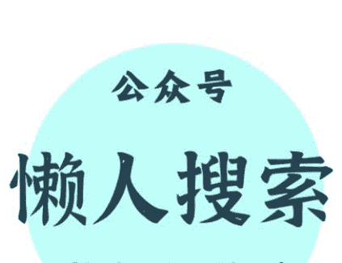
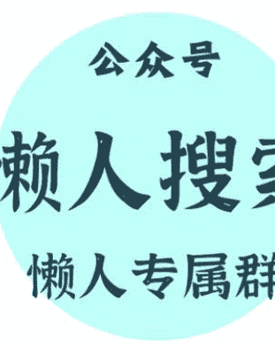

## 菲尔兹奖得主集体预警：AI 正在“摧毁”人类数学？

260916

整理：公众号懒人搜索，懒人专属群精选
懒人微信：lazyhelper1

> **小懒判断** ｜ 适合刷到“AI 又干翻人类”就焦虑的人，也适合找选题的内容创作者；不适合只关心“AI 能不能帮我干活”的纯实用党。最值得关注“意义账户”这个说法：AI 直接给答案，但做题过程长出来的能力才是你的资产，往后每件事都得先想清楚“要结果还是要能力”。坑在于别误读成数学家抵制 AI，陶哲轩他们反的是拿世纪难题当模型跑分题库。

前几天，数学界出现了罕见的一幕。9 月 11 日，包括陶哲轩、邓煜、彼得·舒尔策在内的 25 位菲尔兹奖得主，联合发表了一份公开声明，声明的标题是《人工智能在数学中的严重错位》。截止到 9 月 14 日，已经有将近 7000 名学术界人士和数学相关的从业者，表示公开支持。

很多营销号对这件事的报道大概是，AI 解决了一个困扰数学家多年的问题，然后有一群数学家破防，集体抵制 AI。但事实上，这个说法极其不准确。

首先，要知道，这批数学家，尤其是陶哲轩本人，从来不是排斥 AI 的“老派”学者。其次，这回的声明里，他们也提到，AI 确实能够加速数学研究。尤其是刚刚获得菲尔兹奖的邓煜，前不久邓煜还说，未来人类数学家可能用 AI 创造出一个数学的黄金时代。最后，假如你了解整个过程，会发现数学家们的担忧，不仅关系到数学界本身，各行各业的人或许都值得了解。

那么，这份声明里到底说了什么呢？

我们得先从一个背景信息说起。你看，有时我们在新闻上会看到，某某数学家解决了某某难题。那么，这个某某难题到底是谁出的呢？很可能并没有具体的出题人。因为在数学界，有一类问题叫“公开问题”。公开问题并不是某个权威机构设计出的变态难题，刻意留给后人挑战，不是。公开问题，大都是数学这门学科在发展的过程中，自然而然碰到的阻碍。

比如，数学家研究素数的时候，很早就发现了一个现象。3 和 5 相差 2，11 和 13 相差 2，17 和 19 还是相差 2。这样的“素数对”不断出现。于是，一个新的问题就产生了，这样的素数对是不是无穷无尽？是不是存在无穷多对相差 2 的素数？

这个问题，一个中学生都能听懂。但从 19 世纪提出到今天，170 多年过去了，数学家依然没有确切的完整论证。这就是著名的孪生素数猜想。

像这样的公开问题，数学界有很多。而到了 2000 年，有一家私人数学研究机构，叫克雷数学研究所，从这样的难题里挑选出了 7 个，并且把这 7 个问题命名为“千禧年大奖问题”，每个问题悬赏 100 万美元。

那么，哪些公开问题有资格成为“千禧年大奖问题”呢？克雷数学研究所自己的说法是，这些都是来源深刻的经典问题，多年来抵挡住了所有解决它们的尝试。而且突破它们，往往还会逼着数学家创造新的结构、新的方法。

换句话说，**解答这些问题的价值，不仅在于获得答案，更在于，在获得答案的过程中，创造出新的“解题方法”**。这就好比学校，教出一个“状元班”，意义不仅在于分数本身，更在于摸索出了新的教学方法。

而对于全世界的数学家来说，事情到这一步，已经不是钱不钱的问题了。成为“第一个解决问题”的人，为人类数学探索出新的结构，这个意义已经超过那 100 万美元奖金。

而且这些难题之所以值得尊重，某种程度上也是因为它们确实足够难。从 2000 年公布到今天，7 个问题里，只有 1 个被正式认定解决，这就是著名的庞加莱猜想。俄罗斯数学家格里戈里·佩雷尔曼，在 2002 年到 2003 年陆续公布了证明。2010 年，克雷数学研究所把 100 万美元的千禧年大奖授予他，但佩雷尔曼拒绝领取，因为他认为，“证明本身已经完成了他真正关心的事情，奖金和奖章并不能给这件事增加什么”。事实上，早在 2006 年，佩雷尔曼还拒绝过菲尔兹奖。当然，那是另一个故事了。

总之，自此之后，克雷数学研究所再也没有公开确认过，有人类数学家解决过这些千禧年大奖问题。

但是注意，只是没有“人类”数学家解决过这些问题。人类不行，不代表 AI 不行。

就在前不久，2026 年 9 月 8 日，有一个消息在数学界炸开。OpenAI 宣布，他们的一个内部模型，给出了著名的纳维-斯托克斯千禧年问题的一个解答。

纳维-斯托克斯千禧年问题是什么呢？简单说，在数学界，有个纳维-斯托克斯方程。但是，纳维-斯托克斯方程不等于纳维-斯托克斯千禧年问题。纳维-斯托克斯方程是一套早就已经明确的数学规则。用来描述水和空气这样的流体怎么运动，工程上也早就在使用这套流体力学框架。

真正困扰数学家的，是把这套规则一直持续推演，推演到极致，会发生什么。比如，一开始的水流明明很正常、很平滑，按照这套方程一直演化下去，它是不是永远都会保持平滑？还是可能在某一个时刻，出现越来越细、越来越猛烈的漩涡，最后在某个点上变化剧烈到数学意义上的“失控”？

换句话说，这套规则数学家早就知道了。但是把这套规则一路推到极端，最终会不会自己走出一个奇点，人类近 90 年来一直没能证明。千禧年七大数学难题里所谓的“纳维-斯托克斯问题”，指的就是这个。

OpenAI 这回公布的证明主张，这种有限时间内的奇点确实可以发生。为了攻克纳维-斯托克斯问题，OpenAI 启动了一套庞大的多智能体系统，有上万个智能体同时参与运算。而从第一批智能体启动，到找到解答，大约 88 个小时。随后又花了 17 个小时，用形式化数学工具完成验证。整个过程中，智能体发送了 270 万条消息，输出大约 1300 亿个 Token。

紧接着，3 天后，9 月 11 日，克雷数学研究所也专门发布声明，说这个问题“看起来已经被解决”。当然，按照千禧年大奖的规则，正式认定还需要经过公开发表、时间检验和数学共同体的接受。

而这回数学家们发布的联合声明，就跟这件事有关。这份声明到底说了什么？先念几段传播最广的原文你听听。

比如这句，“*著名的数学问题，常常充当数学世界里的地标和灯塔*。”“*我们这个职业最珍贵的资源，是学生和思想*。”还有这句，也是整份声明最核心的一句，“解决问题，只是实现概念理解和洞见这个首要目标的工具和代理指标。”“如果只追求越来越快、大规模地生产一个又一个真或假的数学结论，最后可能不是在给新思想注入生命，反而会毁掉孕育新思想的土壤。”

你看，这几句话连起来，数学家们真正在乎的，不只是“题有没有被做出来”，更是一个问题被解决的过程中，能不能继续长出新的思想、新的人，以及值得进一步探索的新问题。

25 位数学家反对的不是用 AI 解题，而是 AI 公司正在把“解决著名数学难题”，当成衡量模型能力的比赛项目。因为公开问题一旦被当成 AI 的跑分题库，它的“灯塔”价值可能会被削弱。

前面说过，**著名的数学公开问题之所以重要，不只是因为它们难。声明把它们叫作数学世界里的“地标”和“灯塔”。** 什么意思？一座山没有被登顶的时候，它会吸引很多人从不同方向往上走。有人走到半山腰，发现了一条新路。有人造出了新的装备。有人虽然没登顶，却发现旁边还有另一座更值得爬的山。围绕一个大问题，往往会自然形成一整片研究。

所以，一个公开问题在没有答案的时候，它不仅是“一道没做出来的题”，还是一个能够持续组织研究活动的枢纽。

而一旦答案已经公开，情况就变了。当然，你还是可以把答案遮住，自己重新做一遍。就像有汽车以后，你仍然可以选择走路。但这已经从“前沿研究”变成了“训练”。因为全世界已经知道这座山有人登上去了，路线也已经存在。研究经费、年轻学者的注意力、学术声望，不太可能还像以前一样，继续大规模投入到“谁能独立再完成一次攀登”上。

一个人类几百年都不知道答案的数学问题，一旦答案公布，它作为“真正未知的前沿”的价值，就发生了不可逆的变化。

所以 25 位数学家真正反感的，是 AI 公司专门挑这些最有象征意义的“灯塔问题”做能力测试。对 AI 公司来说，攻下一个名题，是模型能力最漂亮的广告。**但对数学共同体来说，同一个问题原本还承担着组织研究、催生方法、培养人的作用。** 换句话说，**在数学家看来，AI 透支了一个“意义账户”。**

年轻的数学家们，很难抱着当初的雄心壮志，怀着探索新大陆的热情，去“用人脑重新解答一遍”那些已经被 AI 解答过的问题。而且，当“做出成果”和“拥有能力”被拆开之后，数学界原来识别人才的办法也开始失效。

数学家布赖娜·克拉在 9 月 13 日还发表了一篇文章，核心内容大概是，“过去，深刻的定理既困难又稀缺，所以我们可以用它识别深刻的思考。现在，AI 把这套系统打破了。”

说白了，过去能做出一道难度 100 分的题目，说明你这个人大概率拥有 100 分的能力。而现在，这个正相关性正在变弱。

克拉自己最近就遇到了一件特别典型的事。她长期研究一个叫尼瓦猜想的数学问题，也和合作者做出过重要的阶段性成果。这个问题已经困扰数学家将近 30 年。最近，她突然收到好几份声称已经彻底解决尼瓦猜想的证明。其中一些作者，此前几乎没有在这个领域做过研究。

克拉没有直接说这些证明一定是假的。她只是邀请这些作者开一个视频会议，请他们当面讲讲自己的证明，解释里面到底发生了什么。但结果是，没有人接受邀请。

当然，你也不能说这些作者一定用了 AI，也不能证明他们的证明就是错的。克拉真正想说的是，过去，成果和能力绑在一起。现在，两者可以在某种程度上分开。

你看，说到这，这个问题就已经不只是数学界的事情了。它也是一个对几乎所有人的提醒。

以前，我们做一件事，往往同时获得两样东西。一个是结果。一个是做这件事的过程中，长在自己身上的能力。而现在，AI 可以直接提供结果。这当然是技术进步。但从此以后，我们需要多做一个过去不太需要做的判断：**眼前这件事，我到底只需要结果，还是我还需要通过做它，让某种能力留在自己身上？** 假如这件事本身也是训练，那就不能再假设“我拿到了成品”等于“我完成了训练”。就像有了汽车，我们确实不需要靠双腿通勤，但我们依然需要运动，需要刻意锻炼。

就像数学家、计算机科学先驱理查德·哈明说的，“**计算的目的，是洞见，而不是数字。**”

在这个 AI 能替你写代码、写文章的时代，基础技能正在迅速贬值。绝大多数人正被淹没在海量的免费垃圾信息里，陷入低效的体力内卷。

当“努力”不再是壁垒，人与人之间唯一的护城河，只剩下“信息过滤”的效率与“认知系统”的维度。

圈子已稳定运行 7 年。我们每天利用 Python 爬虫与大模型算力，过滤全网最顶级的政经内参和搞钱风向标，做你最冷酷的“外部大脑”。

如果你认同这种“重塑认知防线”的极客主义，欢迎围观我的个人情报智库：【懒人专属群】。

https://lazys0.com/insider/

认同信息过滤价值、想省下每天 3 小时无效阅读时间的读者，扫码加我微信（lazyhelper1）

