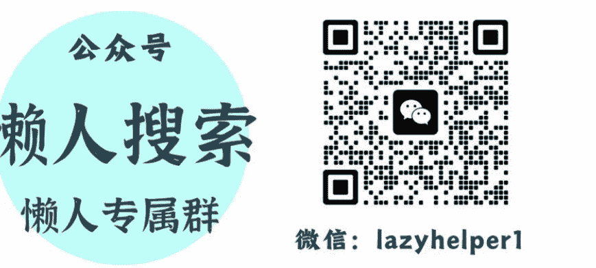
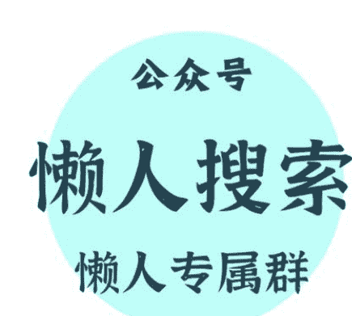

# 刘翔买断事件争议，该怪举国体制吗？

260916 文/卢克文工作室 风雨如歌

整理：公众号懒人搜索，懒人专属群 精选

懒人微信：lazyhelper1

> **小懒判断** | 适合关心举国体制之争、爱看体制内利益分配门道的人；不适合急着站队骂体育局或护刘翔的人——关键事实还没全摊开。最值得关注 2001 年那份分成文件：本人 50%、教练 15%、输送体育局 20%、单项中心 15%，刘翔 2007 年被单独调成 65%。坑在于“分广告费”那句本身模糊，凤凰体育报道说 2015 年后没再分成，结论别下太早。

最近刘翔买断一事，在网上吵得厉害。

舆论分成两边，有人觉得上海市体育局这么做不太合适，奥运冠军不该被这样对待；也有人认为上海市体育局的操作没毛病，刘翔不能一直“吃空饷”。

两边到底谁有理？这件事背后暴露了什么问题？

我们先简单回顾一下整件事。

8 月 26 日，刘翔突然发文说上海市体育局要求他二选一：要么买断人事关系，要么回去担任教练上班，想听听网友看法，消息一出迅速引爆全网。

9 月 1 日，刘翔与上海市体育局签下协议，以 49.4 万元买断，10 天后刘翔再次发文，公布了买断结果，还把退役 11 年来领到的 98 万元工资全部捐出。

公众对整件事的最大疑点，是刘翔的退役流程为什么会拖延十多年。

刘翔是 2015 年宣布退役的，问题在于，退役不是宣布就行，还得办理各种手续，就像退休要走流程一样，退役流程的重点是让运动员对身份做二选一。

奥运冠军通常会获得一个体制内身份，刘翔获得的身份是上海市体育局团委副书记，他要么选择上班，要么买断。

但刘翔从 2015 年官宣退役，到 2026 年流程还没走完，等于十一年都没有做出最终选择。

其实，退役流程拖沓的运动员不是一两个，比如郭晶晶、田亮就拖了好几年，才最终选择买断，吴敏霞更是拖了八年，最后转为上海队跳水教练。

出现这种现象的原因是奥运冠军自带巨大流量，有利于招商引资和青少年体育推广，所以体育局愿意保留编制名额，默许奥运冠军长期挂编不坐班。

然而近十年来，国家对“在编不在岗”现象查得越来越严，即便奥运冠军也无法再享受灰色地带，上海市体育局就是在这个大背景下要求刘翔二选一的。

上海市体育局给刘翔的职业选择有三个：田径中心负责人、技术总监和体育类高校岗，如果都不满意就只能买断。

刘翔 2015 年退役时亲口说过，他不想做官也不想做教练（现在网上还能搜到当年的报道），所以他最终选择以 49.4 万买断。

问题随之而来：退役流程拖延十一年，上海市体育局是不是故意拖着不给他办退役？网上流传最广的猜测，就是体育局为了继续分刘翔的代言费，才拖着不办退役手续。而按规定，只要刘翔不退役，上海市体育局可以获得刘翔代言费的 10% 作为分成。

这就导致很多网民开始猜想：体育局只要拖着不办退役，就能一直从刘翔的代言费里分成。

这种猜想的另一个依据，是刘翔在微博质问：“十年了想起来安置我了，分广告费的时候怎么不依法依规安置我。”

其实这句话说得很模糊，没说什么时候分的广告费，由此引发了两种解读：一种是刘翔控诉 2015 官宣退役之后，体育局仍然持续瓜分他后续广告收入；另一种是刘翔感慨当年在役时，商业分成执行严格，等到要办理退役安置这件事，相关手续却搁置十年无人处理。

凤凰体育记者在调研后发布了一篇报道：2015 年刘翔宣布退役后所有商业代言、综艺出场费，不用再给教练团队、田径运动管理中心和上海市体育局分成。

报道还提到，吴敏霞退役后的商业活动同样不用上缴分成。

网友怀疑有，报道却说没有，刘翔本人和上海市体育局又都没明说。

真相就卡在这里了，在更多信息浮出水面前，我们没法说到底谁对谁错。

比起争论是非，刘翔事件真正值得深挖的，是它折射出的体制矛盾。

中国传统的举国体育体制，是集合国家资源培养运动员，一旦入选专业队，训练、食宿、医疗等基础保障全部由体系承担，运动员可以专心训练比赛，不用操心生计。

举国体制的优势很明显，它能给运动员稳定的训练保障，让运动员不用为装备和日常开销发愁，中国能诞生三百多位奥运冠军，举国体制功不可没。

同时，运动员从小在体育系统内成长，个人选择应该受到体系约束，如果获得商业价值，商业收益也要和培养单位分成。

刘翔就是典型。他从小在上海体育体系培养，成名后，代言收入需要按比例分给上海市体育局等相关单位。

这其实有点类似艺人经纪逻辑，体系在前期投入资源，运动员获得收益后要反哺培养方。

按照国家体育总局 2001 年的文件，运动员代言收入基准分成方案为：运动员本人 50%、教练团队 15%、输送体育局 20%、单项运动中心 15%，刘翔早期就执行的是这套标准。

2007 年，体育局针对刘翔的情况单独调整了比例：本人 65%、教练团队 15%、上海市体育局 10%、田径中心 10%。

当年总局出台这份文件，有两个背景。

第一，培养一名顶尖运动员成本极高，一名奥运冠军的全周期投入动辄数千万，没有收益反哺，体育部门就没有积极性。

第二，体育部门财政压力巨大，需要找增收路径。

1997 年亚洲金融危机之后，国家财政收紧，体育系统经费压缩，当时甚至讨论过撤销国家体委，后来体委虽然改组为国家体育总局，但财政拨款缩减。

和很多单位一样，体育局需要自筹资金，运动员的商业开发分成就是一条重要的增收路径。

但随着时间的推移，这套收益分配机制慢慢暴露出矛盾，姚明就是当年最典型的案例。

2002 年姚明被火箭选中后，一度无法登陆 NBA，因为姚明的母队“上海东方俱乐部”提出，姚明必须支付 1800 万美元的买断费。中国篮协也提出，要从姚明的 NBA 收入中抽取一半，包括工资。

篮协的要求明显违规，因为体育总局的文件规定，只能针对广告代言费进行抽成，工资是不能抽成的。姚明气得威胁要退役，经过一轮又一轮谈判，上海队最终把姚明的买断费降低到 1000 万美元，中国篮协也同意姚明将 NBA 收入的上缴比例下调到 5%。

姚明当年的遭遇和刘翔没有本质上的不同，许多老一辈篮球迷提起这件事，依然对篮协非常不满。

不过，时代已经慢慢发生改变。

过去体育局能参与收益分成的关键，是垄断了运动员培养路径，但进入 21 世纪后，培养运动员已经不再是体育局的专利，俱乐部、专业团队、家庭自费等方式，都能培养顶尖运动员。

所以姚明之后，下一位进入 NBA 的中国首轮秀易建联，篮协就已不再抽取他的 NBA 收入，唯一硬性要求是国家队征召时，易建联必须回国参赛。

而这种转变背后，本质上是体育商业的成熟。

篮球、足球这类商业化程度高的项目，收入来源主要靠媒体转播权、商业赞助和品牌 IP 授权等等，不再需要靠抽取运动员的收入来维持系统运作。

所以，体育系统的思路也跟着变了，更看重维护好和明星运动员的关系，借助明星运动员来推广项目，体育系统的角色从过去大包大揽的管理者，慢慢转向资源提供方。

郑钦文就是新模式的代表。她和中国网球协会约定：网协提供国际赛事报名、国家队集训保障、对外协调、医疗等资源，而作为交换，郑钦文上交 11% 的赛事奖金。

注意，上交只针对比赛奖金，商业代言、广告收入不用上交。

当然，抽成消失，不代表所有收益分成都不存在。

经纪公司、俱乐部依然会按商业合同抽取相应收益，区别只是收益分配主体，从体育行政单位，变成市场化的商业机构。

资本天然追求回报，只会愿意投入篮球、网球、足球这类具备商业变现潜力的项目，而跳水、跨栏这类项目，商业化空间有限，很难吸引大额社会资本投入。

所以，举国体制不能简单一刀切废除。

如果完全取消举国体制，家境普通但天赋出众的孩子，会失去走上专业赛场的机会，全红婵就是最好的例子。

她出身普通家庭，没有举国体制提供免费的资源，很难有机会成为奥运冠军，更有可能读个中专后进入社会打工，和无数人那样一辈子默默无闻。

所以刘翔这场舆论纷争，不是简单的对错之争，而是旧体制收尾、新模式迭代留下的时代缩影，随着体育行业逐步市场化、商业化，新旧规则交替碰撞，矛盾自然集中爆发。

刘翔的十一年挂编、最终买断，既是个人与体制的切割，也是体育改革的一次真实写照。

举国体制兜底冷门运动天才，而商业体制负责把新时代运动员的商业价值拉到最大化，两者都不能偏废。

也许，这才是刘翔买断事件的带给我们的最大经验。

## 重要参考资料：

- 1. 刘翔宣布退役：不当教练不当官 赚不赚钱没关系 新闻_央视网(cctv.com)
- 2. 中国篮球运动员出国打球？难！三大中锋赴美历程_篮球-其他_竞技风暴_新浪网

绝大多数人只盯着眼前的工资，却不知道一次远在中东的冲突、一次降息的决议，就能在一夜之间洗牌普通人的财富。

看懂宏观，是为了在周期切换时，不被当作代价。

如果你认同这种“抬头看路”的长期主义，欢迎围观我的个人情报智库：【懒人专属群】。

圈子已稳定运行 7 年。我们每天利用 Python 爬虫与大模型算力，过滤全网最顶级的政经内参和搞钱风向标，做你最冷酷的“外部大脑”。

https://lazyso.com/insider/

认同价值的。扫码加我微信，备注：【进群】

微信：lazyhelper1
