# YouTube 回暖，每天一包烟钱撬动万刀收益全流程分享

+   260915 副业 SC 精华
整理：公众号懒人搜索，懒人专属群精选
懒人微信：lazyhelperl


> 小懒判断｜适合有耐心研究 AI 工作流、扛得住起号期流量波动的副业玩家，不适合追求短期暴利或纯搬运吃低保的人。最值得关注的的是用 github 开源项目 waowowao 搭自动化台子，一条 3 分钟 AI 励志视频成本压到 10 元内，全靠工作流批量跑。坑在于 Shorts 同质化封号是常态，2027 新规又加了 90 天 1000 万播放门槛，纯堆量没原创极易断流。

大家好，我是冠卓，也是生财 AI 视频深海圈的咨询教练，自 2024 年底超级风向标 YouTube 开始，一直深耕 YouTube 平台，也一直围绕 AI 相关的思维去做内容，流量从祈祷达到 1000 万播放，到一个亿，再到十亿，收益从刚开始的一月几十刀，到几百刀，再到千刀万刀，说实话增长的速度有点慢。但只要不下牌桌，我认为就有机会继续增长。

在此，也感谢 gary 和波妮的心力支持，不然，我可能在年前那一波同质化的时候就离场了。当时十几个 ypp 账号在短短一个星期全军覆没。一个不剩，收益归 0.

## 频道分析

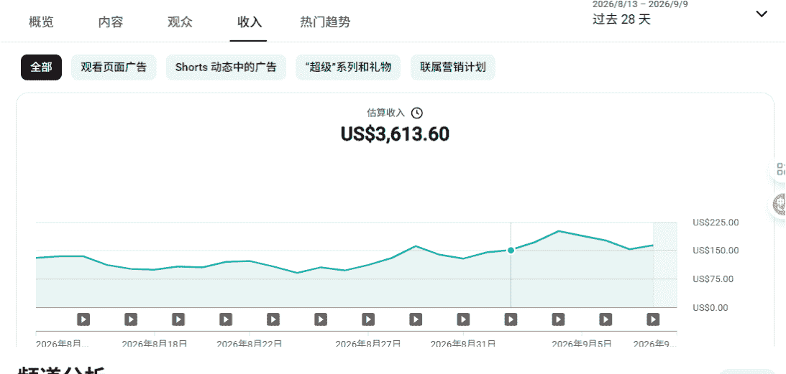

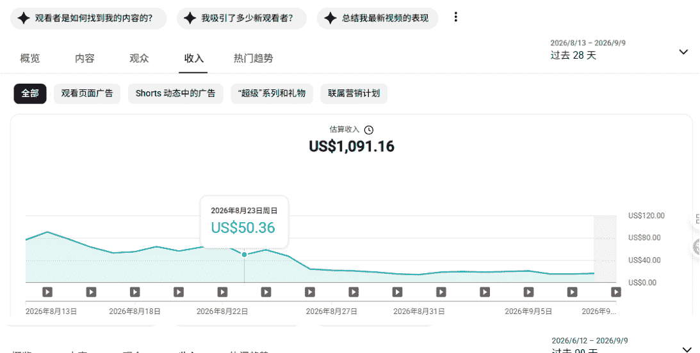

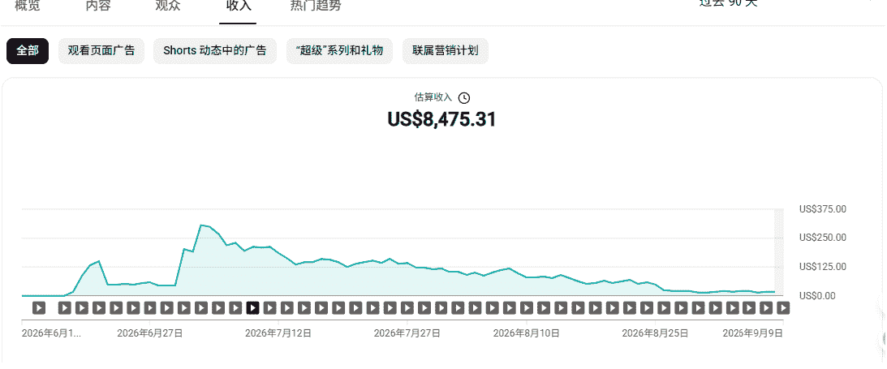

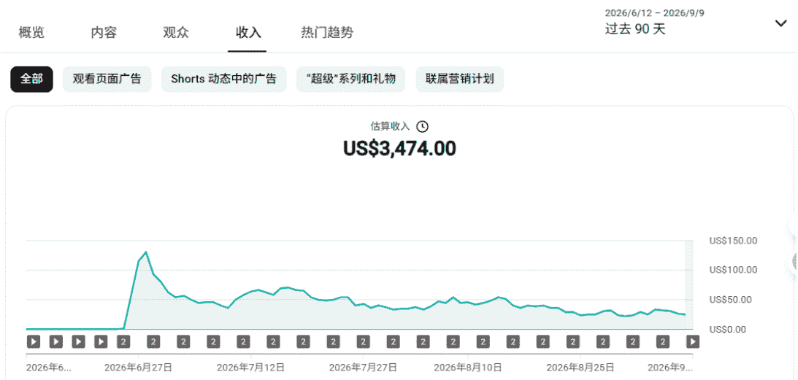

这些成绩可能在众多大佬的眼中并不亮眼，但对我而言，这些收益的性价比确实非常高，在我不用每天都花费大量时间和精力，甚至连成本都不到一盒烟钱的极致性价比前提下。对于我想做矩阵这件事而言，至少我认为时成功的。

现运营账号 40+，ypp10+，主要方向是 AI 励志教育 shorts 类、AI 励志教育故事长视频，正在探索的方向金融资产规划类、音乐类、音乐故事方向，先后被取消 ypp 数量 20+，主动删除 ypp 账号 5 个，被扣除 8000+美刀。但依旧看好，继续前行。其实早在上个月，我就想把自己上半年在油管经历的一些事分享出来，但是说实话周围做的比我好的伙伴实在太多了，大家各种各样的玩法遍地开花，但在跟波妮和 gary 教练闲聊后，还是决定写出来，既是对自己的一个交代，也希望能有更多的伙伴去再探索，再玩出新的花样。

所以，这篇分享我想把我的经历和一些思路写出来，不一定适合所有人，但对于刚入局做油管的伙伴会有一定的心力支持。

## 一、我的油管来时路

### 1. 初入油管

在做油管之前，我没有任何一个项目做超过两年时间，不论是最开始的抖音心理测试小程序，和自己搭台子跑壁纸小程序，当时一条视频的最高收益能跑到 50 多万，以及后来游戏直播的小风车刚出来那会。一个下载 60 块左右，如果是包时的话，根据流量可以达到每小时 1000-5000 不等，每一次风口回过头去想，都觉得当时跟捡钱一样，但是每当平台政策一变化，这种就立马没得玩，大部分人开始离场，我就是其中一员，但在后面跟朋友的聊天中发现，那些跑的慢的和没有跑的，依旧在偷偷赚。

有时候也就开始怀疑，是不是自己跑的太快了？这样盲目跟风到底对吗？

直到在看到亦仁的超级标之前，我甚至不知道 YouTube 就是油管，不知道原来 YouTube 可以赚钱，甚至不知道亦仁成立生财有术之前也有做油管。也苦于当时没有好的项目可以做，就抱着试一试的心态参加了油管的航海。

超级标 02：通过 AI 生成的各种视频，上传到 Youtube 和 shorts，获取广告分成
#超级标# 02


幸运的是，我在航海期间就已经做到了 5000 万播放，但是申请 ypp 第一次没通过，是在第二个月开通的。

- 概览
- 内容
- 观众
- 收入
- 热门趋势

**在过去 28 天内，你的频道获得了 41,573,204 次观看**

| 观看次数 | 观看时长 (小时) | 订账户人数 | 估算收入 |
| :--- | :--- | :--- | :--- |
| 4,157.3万 ↑ | 38.9万 ↑ | +12.4万 ↑ | — |
| *比过去 28 天多 194%* | *比过去 28 天多 199%* | *比过去 28 天多 229%* | |

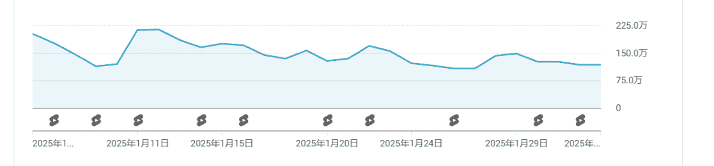

- 2025年1月... 2025年11月1日 2025年11月15日 2025年1月20日 2025年1月24日 2025年1月29日 2025年... 0 75.0万 150.0万 225.0万
- 展开

| 公开/私密 | 留存 | 画质 | 日期 | 观看次数 | 评论数 | 旗帜-不喜欢数的比率 |
| :--- | :--- | :--- | :--- | :--- | :--- | :--- |
| 公开 | S 已开启 | 无 | 2024年12月30日 | 34,712,180 | 1,512 | 90.2% |
| 公开 | S 已开启 | 无 | 2024年12月29日 | 87,919 | 12 | 93.8% |
| 公开 | S 已开启 | 无 | 2024年12月28日 | 65,850 | 9 | 93.8% |
| 公开 | S 已开启 | 无 | 2024年12月27日 | 100,876 | 8 | 96.6% |
| 公开 | S 已开启 | 无 | 2024年12月27日 | 153,222 | 10 | 91.0% |
| 公开 | S 已开启 | 无 | 2024年12月26日 | 675,803 | 26 | 93.0% |
| 公开 | S 已开启 | 无 | 2024年12月24日 | 3,941,939 | 75 | 89.9% |
| 公开 | S 已开启 | 无 | 2024年12月23日 | 2,944,798 | 78 | 91.2% |
| 公开 | S 已开启 | 无 | 2024年12月22日 | 66,270 | 3 | 92.8% |

## 你的频道目前无法启用创收功能

我们同时利用自动化系统和人工审核员审核你的频道后，发现你的频道没有遵守 YouTube 的频道创收政策。我们的审核人员发现你的频道包含以下内容：

> **再利用他人的内容**

对于此项而言，内容没有明显的原创特征，可能是改自其他来源中的内容，但未增加有意义的原创

**选项 1**

**通过发送视频提出申请**

如果你认为我们的处理有误，可以发送视频告诉我们原因。我们会审核你的申诉，然后在 14 天内告知你的决定。只有在你的频道申请被拒且未删除任何视频的情况下，你才应选择此选项。了解详情

**开始申诉**
*必须在 2025年1月25日*之前提交*

**选项 2**

**修改频道并重新申请**

查看反馈，然后对你的频道进行更改。更改可能包括修改或删除视频，以及更新视频详细信息。你可以在 2025年2月3日后重新申请，前提是你的频道满足相关要求。了解详情

重新申请

### 2. 阵痛期

在接连通过上面这种开通三个 ypp 后，我的感受并不是高兴，反而开始思考一个问题，就是我到底是做流量来的，还是做收益来的，因为这种视频虽然一旦爆发了，几千万播放确实能达到。

但是这种一个月出来一两个的概率，好像并不能赚多少钱，当时这类视频的单价是 0.01-0.03，可以想象一下。于是，我开始了转型之路，做了长视频微电影 movie，流量不是很大，能跑个几千，但因为是 无语言的且时长只有 3-5 分钟，所以千次播放单价（rpm）只有 2 刀左右，投入精力和回报相差巨大，就放弃了。随后看到猫姐做 reddit 后，发现单价还不错思考再三之后，决定去试一试，当时是 14 个 ypp 进行尝试，虽然单价可以，但是爆率很低，几乎没有 一个破百万的，但基于可以批量和号多的情况下，收益也还可以。最起码比上面的动物示警系列收益高。且花费的精力也少。

也尝试做长视频 reddit，但经验不足也没做

起来。（由于频道都删除了，所以没法贴数据图），当时还同步尝试了音乐 MV，veo3.0 模型一限制，成本拉高后，也没得做了。

直到 25 年年底，大规模的同质化封号后，我所有的 ypp *几乎全军覆没*。


你的频道目前无法启用创收功能
对你的频道综合运用自动和人工审核之后，我们发现它未遵循 YouTube 的频道创收政策。

- 我们的审核人员发现你的频道包含以下内容：

同质化内容

疑似为增加观次数而大量生成或重复呈现的内容，这些内容并未额外带来有教育意义的价值或其他价值。了解详情

注意：我们可能会依据相关规定扣暂未支付收入，包括（YouTube 合作伙伴计划条款）和适用政策

## 在 YouTube 上创收

概览  购物


重新申请后
我们将审核你的创收政策，如加入计划！
了解详情

你的频道目前无法启用创收功能
在综合运用自动化系统和人工审核流程来审核你的频道后，我们发现你的频道：

- 因关联频道而被暂停
你的频道所关联的另一个频道被暂停参与 YouTube 合作伙伴计划。了解详情

**选项 1**
如果你认为我们的处理有误，可以提出申诉
如果你认为处理有误，此频道未与任何尚未解决 YouTube 合作伙伴计划暂停或资格被暂停问题的频道相关联，则可以在 21 天内提起申诉。我们会审核你的申诉，并在 14 天内告知我们你的决定。了解详情
**开始申诉**  必须在 2026 年 4 月 20 日之前提交

**选项 2**
解决关联频道的暂停问题
如果你的关联频道重新获准加入 YouTube 合作伙伴计划，则此频道及你运营的任何其他频道，只要满足该计划的要求即可重新申请加入。了解详情

也就是说，在 25 年，我前后做过的方向已经可以用五花八门来形容了，且最后的收尾就是以 0 个 ypp 收尾。要问这一年最大的收获是什么，就是我们远远低估了油管 的潜力。不论是圈友在不同方向取得的成绩，还是自己的亲身经历，你永远可以发现让你不可思议的赛道在偷偷赚钱。完了一 来一句，这也能行？

### 3. 转型 AI 励志短故事

什么是 AI 励志短故事？下面这条就是，后面 也有更多对标参考和拆解。

[https://youtube.com/shorts/aEbKL2LOTfi](https://youtube.com/shorts/aEbKL2LOTfi)

其实，这个赛道在我 reddit 还没同质化的 时候，我就已经关注了。

但习惯了自动化后，自己变的极度懒惰， 要做这个赛道，还需要自己搭建工作流， 所以就一直拖着没行动。

真正开始做的时候，是 3 月份，我也并没 有直接拿新号前去做，因为我觉得能不能 做，得看 rpm，因为这个赛道的特点就是。

- 流量比一般的解压故事形式要好很多， 但大爆款很少，甚至几乎没有。能上一 百万都能算大爆款。这点也在后续过程

中得到了验证。

- * 制作流程必须是工作流去跑，纯手工去搓，没有任何优势和性价比，一个视频分镜基本都在 60-80 左右的分镜。如果按照传统的一张一张去生图，再一个一个生视频，那么一个人一天的产能将低到怀疑人生。

- * 白号做周期会拉很长，因为产出大爆款的概率极低，所以靠这个去过 ypp，在我看来不是最优解，最好是 ypp 账号去做。

- * 画面并不是绝对核心，核心还是文案，画面只是为了映衬文案。所以，只要不是很古老的视频模型，基本都能搞定画面部分。

在决定要做这个赛道后，我就一边直播准备 ypp 账号，一边准备快速搭个能跑视频的台子，还记得当时亦仁大哥说过一句话。大致意思就是：AI 时代，最大的宝藏库就是 github 而当时正好是 AI 漫剧/短剧套路最火热的时候，于是我在 github 找了关于 AI 短剧的项目，下载下来进行了简单的魔改后就火速投入战斗，进行流量测试。

我当时是同时发三个账号前去测试，两个直播开通的 ypp，一个还未达标，但时长也快够了的频道。为了排除可能因为频道原因导致的没流量什么的。

当时在第一条视频发完后，前两天几乎没什么水花，直到第三天才开始慢慢起量，三个号最慢的基本在 15 天后，才有了破 3

万播放的。

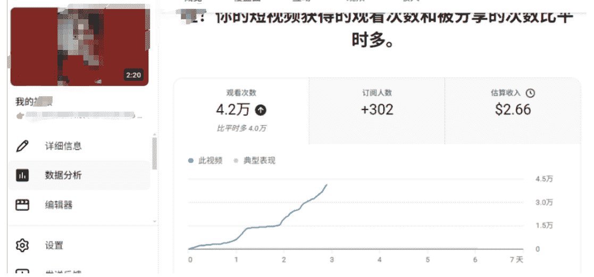

## 视频分析

- 概览
- 覆盖面
- 互动
- 观众
- 收入


此短视频发布后获得了 261,022 次观看

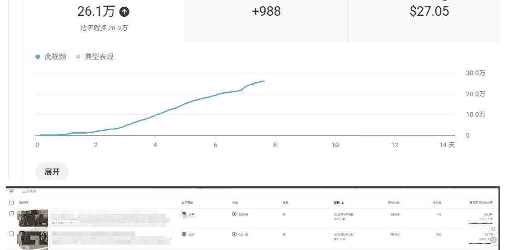

同时，我确认了这个赛道的一些关键数据：流量是有的，单价是还可以的，制作是可以批量的，教育价值是有的。

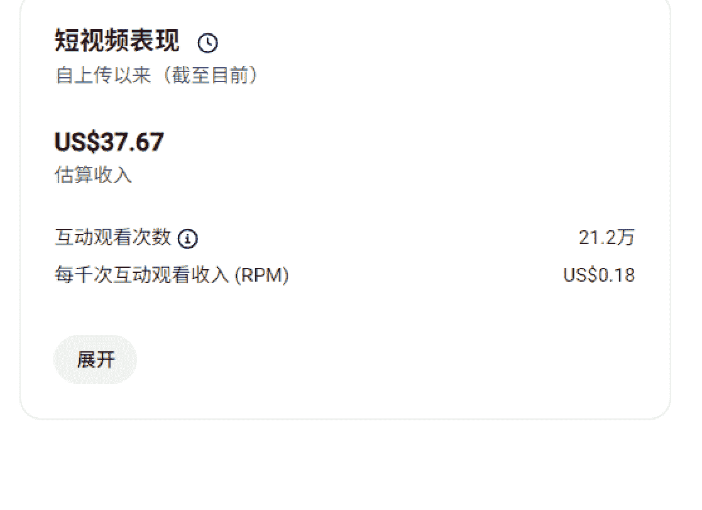

## 观看者的互动情况

自发布以来


77.9%
继续观看

22.1%
划走不看

展开

## 观众黏度

自上传以来（截至目前）

- 继续观看 77.9%
- 平均观看时长 1:14

## US$29.41

估算收入

- 互动观看次数 13.7万
- 每千次互动观看收入 (RPM) US$0.21

展开

## 观看者的互动情况

自发布以来


75.6%
继续观看

24.4%
划走不看

展开

## 观众黏度

自上传以来（截至目前）

- 继续观看 75.6%
- 平均观看时长 1:46

## US$33.82

估算收入

互动观看次数 ⓘ

14.3万

每千次互动观看收入 (RPM)

US$0.24

展开

## 观看者的互动情况

自发布以来


72.8%

继续观看

27.2%

划走不看

展开

## 观众黏度

自上传以来（截至目前）

继续观看

72.8%

平均观看时长

1:26

### 地理位置  观看次数 ↓  平均观看时长  观看时长（小时）

☑ 合计 506,309 1:14 6,838.2
☑ 美国 133,965 26.5% 1:19 1,954.2 28.6%
☑ 菲律宾 31,261 6.2% 1:30 528.8 7.7%
☑ 乌克兰 29,197 5.8% 1:11 353.3 5.2%
☑ 波兰 26,758 5.3% 1:05 265.2 3.9%
☑ 印度 24,815 4.9% 1:12 343.1 5.0%
☑ 美国 19,986 4.0% 1:15 265.1 3.9%
☑ 德国 19,110 3.8% 1:02 194.5 2.8%
☑ 加拿大 18,275 3.6% 1:15 254.9 3.7%
☑ 南非 15,123 3.0% 1:23 230.0 3.4%
☑ 俄罗斯 13,505 2.7% 1:09 175.0 2.6%
☑ 意大利 12,239 2.4% 1:00 109.9 1.6%
☑ 澳大利亚 11,630 2.3% 1:16 165.4 2.4%
☑ 马来西亚 9,764 1.9% 1:19 145.5 2.1%
☑ 印度尼西亚 8,862 1.2% 1:05 77.8 1.1%
☑ 以色列 5,821 1.2% 1:07 73.0 1.1%
☑ 法国 5,496 1.1% 0:57 55.1 0.8%
☑ 荷兰 5,239 1.0% 1:09 70.2 1.0%
☑ 哈萨克斯坦 5,329 1.0% 1:11 64.1 0.9%
☑ 西班牙 5,096 1.0% 1:05 63.0 0.9%
☑ 爱尔兰 4,698 0.9% 1:18 62.9 0.9%
☑ 巴基斯坦 4,474 0.9% 1:07 63.4 0.9%
☑ 墨西哥 4,250 0.8% 1:10 58.8 0.9%
☑ 白俄罗斯 3,729 0.7% 1:15 47.9 0.7%
☑ 特立尼达和多巴哥 3,636 0.7% 1:29 54.8 0.8%
☑ 新西兰 3,222 0.6% 1:18 47.4 0.7%
☑ 新加坡 3,206 0.6% 1:26 51.0 0.8%
☑ 乌兹别克斯坦 2,230 0.4% 1:01 24.3 0.4%

| 地理位置 | 观看次数 ↓ | 平均观看时长 | 观看时长（小时） |
| :--- | :--- | :--- | :--- |
| **合计** | **401,725** | **1:49** | **6,533.0** |
| 美国 | 118,550 29.5% | 1:59 | 2,273.6 34.8% |
| 波兰 | 40,112 10.0% | 1:32 | 456.1 7.0% |
| 德国 | 22,373 5.6% | 1:28 | 254.6 3.7% |
| 意大利 | 21,756 5.4% | 1:27 | 224.1 3.4% |
| 乌克兰 | 21,741 5.4% | 1:44 | 361.8 5.5% |
| 英国 | 17,214 4.3% | 1:48 | 292.1 4.5% |
| 菲律宾 | 14,403 3.6% | 2:12 | 304.3 4.7% |
| 加拿大 | 13,891 3.5% | 1:57 | 256.0 3.9% |
| 印度 | 11,667 2.9% | 1:48 | 198.0 3.0% |
| 南非 | 9,811 2.4% | 1:53 | 183.4 2.8% |
| 俄罗斯 | 8,339 2.1% | 1:45 | 146.9 2.3% |
| 澳大利亚 | 7,645 1.9% | 1:50 | 135.2 2.1% |
| 法国 | 6,268 1.6% | 1:24 | 54.6 0.8% |
| 荷兰 | 5,491 1.4% | 1:35 | 77.4 1.2% |
| 西班牙 | 4,390 1.1% | 1:33 | 52.7 0.8% |
| 马来西亚 | 4,101 1.0% | 1:58 | 77.7 1.2% |
| 墨西哥 | 3,378 0.8% | 1:53 | 49.0 0.8% |
| 以色列 | 3,241 0.8% | 1:39 | 46.3 0.7% |
| 爱尔兰 | 3,137 0.8% | 1:46 | 50.9 0.8% |
| 白俄罗斯 | 2,463 0.6% | 1:43 | 40.3 0.6% |
| 特立尼达和多巴哥 | 2,429 0.6% | 1:58 | 44.7 0.7% |
| 哈萨克斯坦 | 2,369 0.6% | 1:44 | 41.6 0.6% |
| 奥地利 | 1,985 0.5% | 1:22 | 19.9 0.3% |
| 瑞典 | 1,889 0.5% | 1:38 | 29.0 0.4% |
| 印度尼西亚 | 1,815 0.5% | 2:03 | 34.7 0.5% |

| 地理位置 | 观看次数 ↓ | 平均观看时长 | 观看时长（小时） |
| :--- | :--- | :--- | :--- |
| **合计** | **536,572** | **1:46** | **9,275.0** |
| 美国 | 133,429 24.9% | 1:51 | 2,463.7 26.6% |
| 菲律宾 | 44,637 8.3% | 2:06 | 865.0 9.3% |
| 乌克兰 | 41,068 7.7% | 1:38 | 712.2 7.7% |
| 波兰 | 35,539 6.6% | 1:29 | 493.4 5.3% |
| 德国 | 23,535 4.4% | 1:34 | 345.2 3.7% |
| 俄罗斯 | 18,396 3.4% | 1:37 | 324.5 3.5% |
| 意大利 | 15,930 3.0% | 1:33 | 218.7 2.4% |
| 南非 | 15,244 2.8% | 1:46 | 267.9 2.9% |
| 英国 | 15,160 2.8% | 1:44 | 265.2 2.9% |
| 加拿大 | 14,533 2.7% | 1:48 | 253.5 2.7% |
| 印度 | 10,127 1.9% | 1:46 | 171.4 1.9% |
| 澳大利亚 | 8,663 1.6% | 1:48 | 159.9 1.7% |
| 墨西哥 | 7,965 1.5% | 1:47 | 131.6 1.4% |
| 哈萨克斯坦 | 7,922 1.5% | 1:41 | 136.6 1.5% |
| 马来西亚 | 7,019 1.3% | 1:59 | 132.3 1.4% |
| 西班牙 | 6,583 1.2% | 1:37 | 99.7 1.1% |
| 印度尼西亚 | 5,303 1.0% | 1:47 | 90.2 1.0% |
| 牙买加 | 5,115 1.0% | 2:12 | 103.9 1.1% |
| 白俄罗斯 | 5,103 1.0% | 1:35 | 84.2 0.9% |
| 特立尼达和多巴哥 | 5,050 0.9% | 1:55 | 91.9 1.0% |
| 荷兰 | 4,746 0.9% | 1:42 | 81.4 0.9% |
| 法国 | 4,604 0.9% | 1:37 | 67.2 0.7% |
| 哥伦比亚 | 3,645 0.7% | 1:47 | 58.9 0.6% |
| 以色列 | 3,612 0.7% | 1:49 | 65.1 0.7% |

于是便决定深入去做一下这个赛道，但时至今日，我依然觉得这个方向我只探索了很小一部分，还有很多的可玩性需要被挖掘。

## 二、个人实操和一些思路探讨

### 1. 我对油管 AI 视频的看法

就目前来看，我所了解到的 AI 视频相关的变现形式有 AI 漫剧/短剧，AI 大电影/短片、AI 视频带货、国内创作者分成，如抖音精选计划（签约单价高）、广告商单、海外

TK 的伙伴计划、YouTube 创作者计划（YPP）。

而 YouTube 由于 2-3 月份的大规模同质化后，几乎所有人都认为 AI 视频在油管上已经玩不了了。但事实却是有人沮丧，有人窃喜。

沮丧的是，一些费劲心思做原创的 AI 视频玩家，发现自己不管是不是原创，哪怕纯原创的高质量内容也会同质化，已经逼到没招了，认为 AI 视频在油管已经走到尽头了。

窃喜的是，那些看到被同质化的不全是 AI 视频的玩家，因为当时不论你是 AI 制作的，还是 Blender 制作的，甚至是其他虚幻引擎制作的，都不同程度地遭受了同质化。所以平台可能并不是因为你的内容而给了你处罚，更像是大规模清洗平台上的非真人内容。以至于后面 AI 相关的内容在平台上非常少，甚至 Shorts 内容整体都有减少，以至于这种质量的 AI 视频都能有近千万的播放量。

但我并不建议大家去做这种形式爆款，因为同质化的概率太大了。

She Kissed the Golden Statue... Then It Moved! ▣ .mp4 【在线播放】
https://youtube.com/shorts/07iLIDZ-SjI
https://youtube.com/@tinygigglejoy-p6u

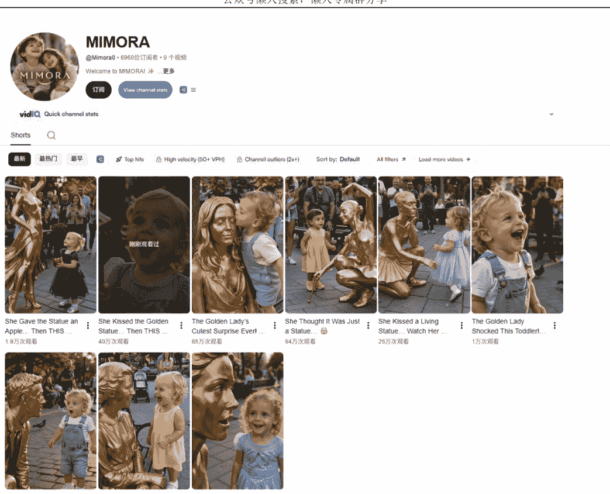

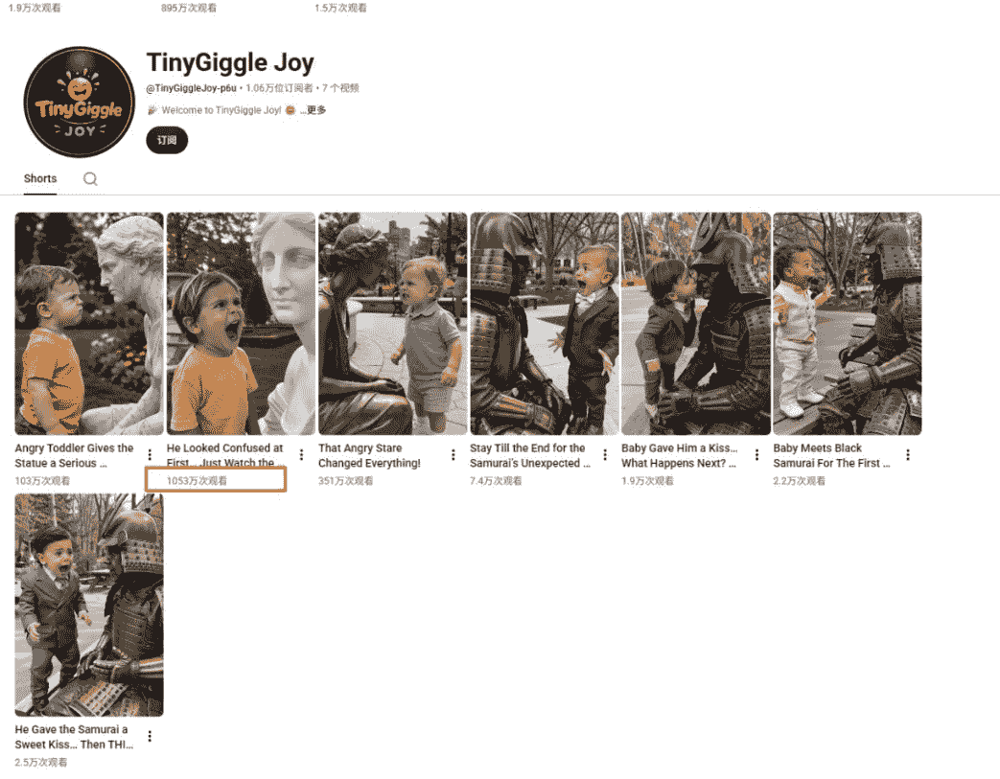

## 2. 针对个人玩家目前存在的普遍问题

- **制作端**：模型价格贵，制作成本普遍偏高、精雕细琢抽卡时间成本高。模型等待时间长。
- **变现端**：
    - 广告商单：中小博主层级的商单不稳定，遇到恶意改稿会增高成本。
    - 流量收益：不大爆基本全是赔钱。

> **个人建议**：根据自身的情况和业务点需求去选择主要平台。如果你只想吃创作者分成，那么 YouTube 依旧是目前最值得投入的平台。有自身业务和变现路径的则根据自身需求选择即可。不论是 AI 视频还是其他内容创作，请务必先规划好自己的变现和路径。先完成再完美。

- **点对点策略**：多平台分发、多收益管道，先完成收益闭环，再向上进步。

## 3. 励志/教育 AI 故事赛道拆解

**参考频道与参考视频**：
- https://youtube.com/@vitalisway
- https://youtube.com/@weke-r1rz
- https://youtube.com/@inspiring_wisdom3
- https://youtube.com/@crispytestories2
- https://youtube.com/shorts/aEbKL2LOTfl
- https://youtu.be/C0h2r5BvY-Y（长视频）

其实大家也发现了上面这些频道的视频质量参差不齐，但其实这些都是基于模型和工作流能力决定的。但重要的是，这些都不会妨碍赚美刀。

而制作方法大家都已经知晓，所以就不展开赘述了。今天主要是讲解一下，如何降低成本和提高制作效率。去油管人生教育/励志故事制作拆解演示.mp4【在线播放】

#### 3.1 赛道的优点

1. **成本低**：可以把一条 3 分钟内的视频成本压到 10 块钱以内，多账号运营，成本也可控。
2. **流程自动化**：制作流程大部分依赖工作流去跑，能够节省足够的时间和精力，AI 视频的矩阵首选。
3. **同质化风险较低**：相较于 15-30 秒的 Shorts 更不容易同质化，改编和原创的空间更大，但不可否认的是，同样也会有同质化的风险。
4. **可举一反三**：这是一种表现形式。我现在展示的是关于人生教育和高尚品德的，那么人与宠物的那种暖心故事，比如，主人对自家的狗狗总不好，平日里各种讨厌，结果野外徒步时，毫不犹豫替主人挡住了野猪的袭击。其实这种话题的流量还是非常好的。暖心人物事件，种族歧视的教育价值观等等。
5. **选题自带流量**：这类题材在流量上具备天然优势，因为它存在很久了，只是展现的形式不一样了。从最开始的图片幻灯片式的展现形式，到后面的视频/图片动画混搭，再到全面视频+旁白的演绎形式——现阶段的，对口型演绎（对话+旁白）的形式，经久不衰。

#### 3.2 赛道的缺点

1. **缺点一**：纯手工去制作的话，人力/时间成本有点高，就失去了它的优势。
2. **缺点二**：剪辑环节还是得依赖人工去精剪，哪怕全用 Seedance 2.0，对于成片整体的节奏和细节依旧需要人工去处理一下。

**个人建议**：测频道可以用低成本模型去跑，或者混搭，也就是开头前 15s/30 秒，根据自己情况和能力用 Seedance 高端模型做前端，中后段用便宜的模型去跑画面。我目前使用的是智谱做混搭，采用的方式是网页自动化的方式。

等流量跑通以后，或者是具备 YPP 能力后，再尝试逐步提高 Seedance 模型的占比。对于想一开始就追求完美的伙伴而言，可以采用主 Seedance 模型，要做非常高质量的，Seedance 必不可少。

> **旁白的作用**：控制剧情节奏，弥补画面崩坏的容忍。
> **单条总成本**：分析模型+图片+视频总成本约 5-7 元。

## 三、YouTube Shorts 全流程实操演示

这个赛道主要在我的判断来看，主要占比还是**文案（60%）+ 画面（30%）+ 音效细节（10%）**，好的文案是拉高平均观看时长的核心要素。观众主要还是听故事，加上画面同步，以及音效 BGM，会极大增强代入感。

### 1. 文案解析

这类视频我称之为励志/教育故事，其核心点，就是通过旁白+演绎的形式，或者羞辱的行为/言谈，然后引出一个关于善良、尊严、忠诚、信仰、正直、善有善报、**真正的价值不来自财富而来自品格**等富有正义感/人性/道德的观点。

https://www.downloadyoutubesubtitles.com/zh

**例如**：
- 有人对弱者做了恶事，多年后命运让他们位置互换
- 孩子做了错事，父母通过行动而不是说教让孩子亲身体会错误
- 一个在自己也很难的时候帮助了陌生人，多年后被更大方式回报
- 有权力的人伪装成穷人测试身边的人，善良的人被奖赏
- 家庭中女儿被继母/继父不公对待，真相层层揭开，正义一方站出来
- 看似弱小的人做出了比所有“体面人”都更有尊严的选择

**开头一定是**：
- 是一个具体的动作或画面，可以是恶行、不公、偏见、意外、求助被拒，要把观众直接拉进场景
- 羞辱的台词/冲突
- 能让观众立刻产生情绪反应或好奇心的东西

目的就是，3 秒内抓住注意力。因为短视频的展现方式和推流机制原因，如果一开始就不能抓住用户的吸引力，那么被划走的概率就会成倍上升。

整个剧情的节奏一定要密集，对钩子建立的冲突进行递进和加码。目的：让观众走不掉。可以是羞辱升级、善恶反差加深、新信息揭露、悬念投放——让观众的情绪和好奇心持续攀升。

通过不断地反转剧情或者揭露恶行，这一步是为了让观众产生**爽感**，让用户的情绪得到释放，也就是我们所说的恶人终于受到了处罚，好人幸亏得到了应有的回报等。

下面放了几篇示例文，可以更清晰地理解这类视频的核心点。

### Story 1

A woman saw a boy working as a street vendor and approached him. "You think I didn't recognize you?" "Hi, Mom. What would you like to order?" Just then, his school friends were passing by and started mocking him. "You think that job will make you rich like us? You will never be on our level." His mother rolled her eyes, ignoring them, and said, "Did I make you lunch to eat at school, or to sell on the street?" "Mom, I need money. You don't understand," he said with tears in his eyes. "Get to school now, or we will disown you."

Days passed, and he earned enough money to buy his first car. He parked at the school gate when two girls approached him, laughing. "You think we'll date you just because you bought this useless piece of junk? Look at what real boys drive." They mocked him and entered a luxury Range Rover SV. Suddenly, he opened his car door and helped his friend in a wheelchair get inside. The girls became curious. After following him, they saw him helping her get home safely. Some boys took a photo of him, and his ex-girlfriend mocked him again. "You finally found a girl who cannot run off on you." He ignored them and went home. His parents were shocked to see that he had bought his own car. Instead of being proud, they scolded him for coming home late. "You collected money for her. I don't want a daughter-in-law in that condition," his mother shouted. "Mom, she needed my help. She is my best friend."

One day, when his parents didn't give him lunch money, they mocked him. "Let her prepare food for you now." His father angrily shouted, "You're a weak little boy. You're too nice and soft. That girl is just using you. Grow up. Don't be whipped." "She is kind, and she is my friend. Dad, you're missing the point of life." "You will miss the place where you sleep. Get out of the house."

Nine years later, the father was unexpectedly laid off and lost his job. The mother had to start working as a street vendor. They fought every day to survive, trying not to end up on the street. One day, a woman approached their stand and said she would buy 100 meals every day. A smile appeared on their faces, and they promised to have everything ready by 8:00. When she came to pick up the food at their home, they opened the door, and it was their son standing next to his fiancée. The mother, surprised, said, "We told you not to come back. Where were you when your father was fired? We almost ended up on the street. This girl ordered so much food from us. She will make us rich again. We don't need you." The boy calmly said, "Mom, Dad, I came here to tell you that my fiancée, the same girl I helped get home safely in school, is the one who ordered your meals." The parents were shocked. His fiancée said softly, "Your son is the reason I am standing today. He was never weak. The real proof of his strength was the way he lifted others when they had fallen. He chose his friends with his heart, not with greed or money." The boy took out his restaurant card and handed it to his parents. "Mom, Dad, we will support you by ordering meals for a restaurant. I want to give you a second chance to see life differently, because you missed the point of life." Drop a heart if you believe real strength is about lifting each other up, not tearing each other down.

### 故事一（中文）

一个女人看到一个男孩在街边当小贩，便走上前去。“你以为我认不出你吗？”“嗨，妈妈。您想点些什么？”就在这时，他学校的朋友们路过，开始嘲笑他。“你以为那份工作能让你像我们一样有钱吗？你永远达不到我们的水平。”他母亲翻了个白眼，无视他们，说道：“我给你做午饭，是让你在学校吃的，还是让你拿到街上卖的？”“妈，我需要钱。你不懂。”他眼含泪水地说。“现在就去学校，否则我们就跟你断绝关系。”

日子一天天过去，他赚够了钱，买了人生第一辆车。他把车停在学校门口，两个女孩笑着走过来。“你以为就因为你买了这么一堆没用的破铜烂铁，我们就会跟你约会？看看真正的男孩开的是什么。”她们嘲笑他，然后坐进了一辆豪华的路虎揽胜 SV。突然，他打开车门，扶着坐轮椅的朋友进了车。女孩们变得好奇起来。跟在他后面之后，她们看到他把她安全地送回了家。一些男孩给他拍了照片，他的前女友又嘲笑他。“你终于找到一个跑不掉的女孩了。”他没理会他们，径直回了家。他的父母震惊地发现他买了车。他们非但不感到骄傲，反而因为他回家晚而责骂他。“你是为她攒的钱。我可不想要一个那种状况的儿媳妇。”他母亲喊道。“妈，她需要我的帮助。她是我最好的朋友。”

有一天，父母没给他午饭钱，还嘲笑他。“现在让她给你做饭吧。”他父亲愤怒地吼道：“你就是个软弱的小男孩。你太善良、太软弱了。那个女孩只是在利用你。成熟点。别被人牵着鼻子走。”“她很善良，她是我的朋友。爸，你没看懂人生的意义。”“你会怀念你现在睡觉的地方的。滚出这个家。”

九年后，父亲意外被裁员，失去了工作。母亲不得不开始做街边小贩。他们每天为生存而挣扎，努力不让自己流落街头。有一天，一个女人走到他们的摊位前，说她每天都要买一百份餐。他们脸上露出了笑容，承诺八点前把一切准备好。当她来他们家取餐时，他们打开门，站在那里竟是他们的儿子，身旁是他的未婚妻。母亲惊讶地说：“我们告诉过你别回来。你父亲被解雇的时候你在哪儿？我们差点流落街头。这个女孩从我们这儿订了这么多餐。她会让我们重新富起来。我们不需要你。”男孩平静地说：“妈，爸，我来这里是想告诉你们，我的未婚妻，就是当年在学校里我帮忙安全送回家的那个女孩，正是订你们餐的人。”父母震惊了。他的未婚妻轻声说：“你们的儿子是我今天能站在这里的原因。他从来都不软弱。他力量真正的证明，是他在别人跌倒时把他们扶起来的方式。他是用心，而不是用贪婪或金钱来选择朋友的。”男孩拿出他餐厅的名片，递给父母。“妈，爸，我们会通过为一家餐厅订餐来支持你们。我想给你们一个重新看待生活的机会，因为你们错过了人生的意义。”如果你相信真正的力量在于互相扶持，而不是互相贬低，请点个爱心。

### Story 2 (EN)

A wealthy woman saw the flight attendant closing the gate and shoved an elderly man who was struggling with his luggage. "Get out of my way. Don't delay my flight," she snapped. "People like you shouldn't be working at your age." As she rushed forward, she accidentally stepped on his glasses. "Get a new pair. Those are ridiculous." A kind flight attendant quickly approached him and asked gently, "Are you all right, sir?" "I'm fine, thank you," he replied calmly. She then allowed him to board ahead of the others. Moments later, the wealthy woman approached the attendant and handed over her passport. "I'm sorry, ma'am. You didn't check in on time. Your seat has been taken." "What did you just say? I am priority sky class. Fix this now, or you'll be fired." With fear on her face, the attendant pointed toward the gate and said, "It was my mistake, miss. You may proceed." The woman

# 故事二（中文）

一个富有的女人看到空乘正要关闭登机口，一把推开了一个正吃力地拖着行李的老人。“别挡我的路。别耽误我的航班。”她厉声说道。“像你这个年纪的人不该还在工作。”她匆匆向前冲时，不小心踩到了他的眼镜。“再买一副吧。这副难看死了。”一位善良的空乘赶紧走到他身边，温柔地问：“先生，您还好吗？”“我没事，谢谢你。”他平静地回答。她随后让他先于其他人登机。片刻之后，那个富有的女人走到空乘面前，递上了她的护照。“抱歉，女士。您没有按时办理登机。您的座位已经被占了。”“你刚才说什么？我可是优先天空舱的乘客。现在就解决，否则你将会被解雇。”空乘脸上带着恐惧，指向登机口说：“是我的失误，小姐。您可以登机了。”女人傲慢地走了进去，但当她看到那个老人坐在她的座位上时，愣住了。“又是你？你不就是个行李搬运工吗？从我的座位上滚开。”空乘赶紧过来解释：“出现了系统错误。同一个座位发了两张票。你们中有一位需要移到经济舱。”女人当着所有人的面喊道：“需要我提醒你，我丈夫是这家公司的飞行运营经理吗？”老人朝空乘凑过去，低声说：“亲爱的，我不想惹麻烦。”他默默地站起来，移到了经济舱。航班途中，空乘们开始供应食物和饮料。一位空乘走到老人身边，请他为额外的饮料付费。他温和地把卡递给她。她查了付款后轻声说：“抱歉，先生。余额不足。您有别的卡吗？”他翻找钱包，愣住了。他的其他证件不见了，很可能是刚才被那个女人推倒时弄丢的。看到他脸上的忧虑，空乘温和地说：“这样吧？这次我帮您付。等您下次飞行时，再还给我，可以吗？”“好的，谢谢你。”他回答。“我真的很感激。”她自掏腰包为他的餐食付了钱，默默地，希望自己做了正确的选择。降落后，那个富有的女人低声对空乘说：“登机口有个惊喜等着你。”当空乘的主管递给她一个信封，说“你因违反公司规定被解雇了”时，她愣住了。突然，经理看到那个老人走下飞机时僵住了。“首席执行官先生，我不知道您在这趟航班上。”他结结巴巴地说。首席执行官走上前，大声说：“你真可耻。你利用自己的职位和权力来讨好你的妻子。”他转向所有人说：“我们公司永远看重善良，而不是傲慢。”他看着那位空乘，接着说：“你是我们的新经理。这个人刚刚被解雇了。”因为在生活中，真正的领导力不在于权力，而在于当没有人注视时，你如何对待他人。如果你认为他做得对，请点个爱心。

# Story 3 (EN)

"I'm sorry, ma'am. This is a private wedding venue. You need to leave."
"I'm the groom's mother. I just wanted to see him for a moment and give them my blessing."
A few guests nearby let out cold laughs. "Her entire outfit probably doesn't cost as much as one chair at this wedding. She says she's the groom's mother. That's embarrassing."
Soft laughter spread through the entrance hall. Her name was Marion, 56 years old. She had spent most of her life working in the countryside, all to put her son through college. And today, that son, Kevin, stood beneath crystal chandeliers in a custom tuxedo, about to marry Victoria, a woman from a wealthy family.
Marion clutched the small gift box tighter. "Please, just let me go in for a minute. I'll give him this, and I'll leave." The security guard waved her off impatiently. "Ma'am, this isn't a place for you. Please go."
Just then, the commotion at the door caught Kevin's attention. He walked over and froze when he saw her. "Mom, I told you not to come. There are important guests here today. This isn't really appropriate."
Marion looked up at him with a careful, fragile smile. "I know you're busy today. I just wanted to wish you happiness." She held out the gift box. "I altered your bow tie like I used to when you were little, before you went on stage. If I've embarrassed you, I'll leave right now."
She turned to walk away. But just as she took her first step, Victoria spoke. "Kevin," she looked at him and asked only one question. "She's your mother, right?"
There was a pause. Then Victoria's voice grew colder. "If you can block the woman who gave you life from your own wedding, why should I believe the vows you're about to make to me?"
Kevin stood there, stunned. Victoria stepped closer. "If there's no seat for your mother at this wedding, then there won't be one for me at that altar."
Kevin looked down at the old gift box in his hands. Suddenly, he remembered the mornings she left before sunrise to work, the nights she stitched his clothes by hand, the sacrifices she never spoke about. In the next second, he ran toward her and dropped to his knees in front of everyone. "Mom, I'm sorry. I almost traded away the most important person in my life for appearances."
Marion's eyes filled with tears, her hand gently rested on his head. "My child, it's never too late to turn back. The Lord sees the heart."
Kevin stood up holding her hand, his voice shaking as he faced the crowd. "I almost made the biggest mistake of my life. For the sake of pride, I denied the woman who raised me." He looked at her. "Without her, there is no me."
Then he walked her into the hall and seated her in the very first row in the center. Victoria stepped forward, gently supporting Marion. "Please sit here. This is where you belonged all along."
In that moment, no one in the entire hall dared to laugh again, because they finally understood: true dignity has nothing to do with wealth. It comes from gratitude. If you agree, leave a heart and share this.

# 故事三（中文）

“抱歉，女士。这是私人婚礼场地。您需要离开。”
“我是新郎的母亲。我只想见他一会儿，给他们送上我的祝福。”
附近几位宾客发出冷笑。“她整套衣服的价值恐怕还不如这场婚礼上的一把椅子。她说她是新郎的母亲。真丢人。”
轻柔的笑声在门厅里蔓延开来。她名叫玛丽安，五十六岁。她一生的大部分时间都在乡下劳作，只为供儿子读完大学。而今天，那个儿子凯文，穿着定制的礼服，站在水晶吊灯下，即将迎娶维多利亚——一个来自富裕家庭的女子。
玛丽安把那个小礼品盒攥得更紧了。“求你们了，就让我进去一分钟。我把这个给他，然后就走。”保安不耐烦地挥手打发她。“女士，这不是您该来的地方。请走吧。”
就在这时，门口的骚动引起了凯文的注意。他走过来，看到她时僵住了。“妈，我跟你说过别来。今天这里有重要的客人。这真的不合适。”
玛丽安小心翼翼、脆弱地笑着抬头看他。“我知道你今天很忙。我只是想祝你幸福。”她递出礼品盒。“我像你小时候上台前那样，帮你改好了领结。如果我让你难堪了，我现在就走。”
她转身要离开。但就在她迈出第一步时，维多利亚开口了。“凯文。”她看着他，只问了一个问题。“她是您母亲，对吧？”
停顿了一下。然后维多利亚的声音变得更冷了。“如果你能把给了你生命的女人挡在你自己的婚礼之外，我凭什么相信你即将对我许下的誓言？”
凯文愣在原地。维多利亚走近一步。“如果这场婚礼上没有你母亲的位置，那么那个圣坛前也不会有我的位置。”
凯文低头看着手中那个旧礼品盒。突然，他想起了她天不亮就出门干活的清晨，想起了她一针一线为他缝补衣服的夜晚，想起了那些她从不诉说的牺牲。下一秒，他跑向她，当着所有人的面跪了下来。“妈，对不起。我差点为了面子而放弃我生命中最重要的。”
玛丽安眼里噙满泪水，她的手轻轻抚在他头上。“我的孩子，回头永远不晚。主看的是人心。”
凯文站起来握着她的手，面对众人，声音颤抖。“我差点犯下我一生中最大的错误。为了自尊，我否认了养育我的女人。”他看着她。“没有她，就没有我。”
然后他挽着她走进大厅，让她坐在最前排的正中央。维多利亚走上前，温柔地搀扶着玛丽安。“请坐这里。这本就是您一直属于的地方。”
在那一刻，整个大厅里再也没有人敢发笑，因为他们终于明白：真正的尊严与财富无关，它源于感恩。如果你认同，请留下一颗爱心并分享。

## 1.1 文案产出的方式

### 范文参考（推荐）

可以是直接让 gpt 或者克劳德高阶模型直接模仿对标文案和风格直出就行，或者自己写提示词产出，但需要注意的点就是需要自己过一遍，文案的节奏和剧情直接影响整个视频的观感。我目前是走的直接给文案模仿风格和特征。

- **FILE** 对标文案.txt 文件 · 点击下载

这是我整理的一些对标文案，可以直接丢到 AI 对话框里面去对话生成文案，如果生成的是中文的，可以继续要求它输出中英文对照的。

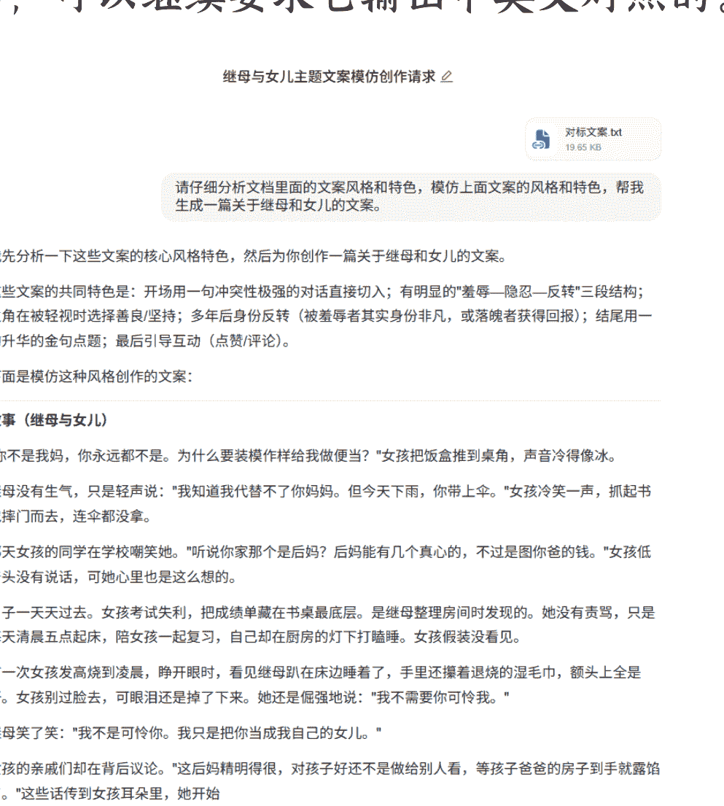

### 提示词输出

顾名思义，就还是之前的古老方法，找几篇对标的爆款文案，然后让 AI 反推提示词，根据输出的结果一遍遍打磨提示词，但我个人感觉，就目前 AI 的能力，没必要多此一举，直接模仿出来的效果反而更好一些。下面 是我之前用的一套提示词，仅做参考，我还是更推荐模仿对标的文案，直接让 AI 出，主题自己拟定一下就行。效果会更好一些。

- **FILE** 励志故事提示词.txt 文件 · 点击下载

## 2. 搭建工作台（事先搭建好）

有了文案后，可以直接在工作台上进行文案转剧本，这一步的目的是，不论你是做纯演绎形式，还是旁白形式，还是旁白+演绎形式，都是可以选择的。也能更加的方便一些。

如何搭建自己的工作台呢！在去年，这个 工作可能会难倒一大批像我编程小白，但 是现如今，**借助 codex、claude code 等工具 是完全可以实现的**。同时，我们也不用 从 0 开始造轮子，**在 github 上已经有大量的开源项目**完全可以支撑咱们使用和魔改 了。甚至部分都不需要去魔改。

我用的老版本 0.30 改的，大家可以去使用 新版本 0.5，支持画布模式，功能和拓展方 面也貌似有了更大的提升。目前 1.5 万星 了。

GitHub：
[https://github.com/wooAI/waowwaoo](https://github.com/wooAI/waowwaoo)

这个工作台其实就是 AI 短剧/漫剧的底子， 然后我们需要的就是向下改造，做可以**适配第三方的便宜 api**，做部分画面场景的混搭能力，其目的也是为了降低成本。


## 关于魔改

至于魔改，我作为一个 AI 编程小白，我就用最简单直接的办法，直接全权交给 codex 来完成。

### 我们应该在 New project 中构建什么？

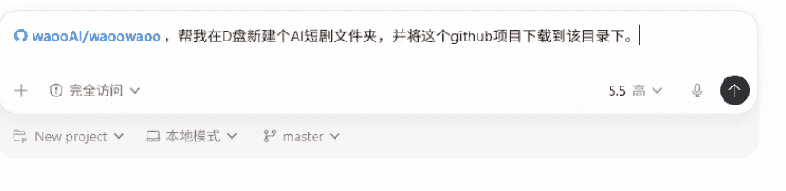

期间遇到所有的问题，我都是让 codex 来完成，因为我自己也看不懂代码，我只知道我的需求是什么，应该是什么，想要什么样的。就这样 vibe coding 出来的。所以，大家可以放心大胆地去魔改适合自己工作流程的。

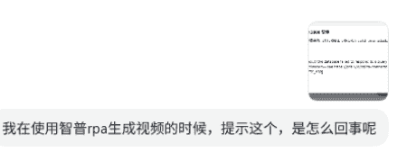

已处理 21s

这个错误的核心不是“视频生成参数出错”，而是本地数据库响应超时。

#### 截图中关键字段：

```text
prisma.task:create()
Socket timeout (the database failed to respond to a query within the configured timeout)
(HTTP 502)
```

意思是：智谱 RPA 在批量生成视频时，要往本地数据库里创建一条任务记录，但数据库查询超时了，所以接口返回了 502。

常见原因：

1. **批量任务太多**
   - 一次性生成很多视频，往数据库写入任务太频繁，SQLite 扛不住。
2. **本地数据库被锁住**
   - SQLite 同一时间写入能力有限，若后台还有任务在跑，容易出现 database locked / timeout。
3. **后台服务卡住**
   - `localhost:3000` 是本机服务，说明智谱 RPA 有个本地 Web 服务。它可能运行着，但数据库连接已经卡死。
4. **磁盘或系统性能影响**
   - 如果项目目录在机械磁盘、网络同步目录，或被杀毒软件实时扫描，也可能导致 SQLite 响应慢。

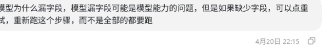

你这个判断是对的：

缺字段 -> 只重试该步骤，不应整轮重跑。

现在机制已经按这个方向处理了：

1. 调源段（如 `video_prompt`）会在合约校验阶段把该步骤标记为失败（例如 `clip_xxx_phase3_detail`） 🎛 `contracts.ts`（第 131–169 行）
2. 点击重试会调 `retryStepKey`，后端会按步骤跳过，不是全量重跑。 🎛 `route.ts`（第 223–258 行）
3. Worker 侧会执行 `atomic retry`，只对应 `clip • phase`，不是整条集合。 🎛 `script-to-storyboard.ts`（第 341–392 行）🎛 `script-to-storyboard-atomic-retries.ts`（第 469–657 行）
4. 你之前遇到“明确失败却回显非 failed 无法重试”，是状态旗标被事件流干扰；这块已修，避免失败丢步骤误判成不可重试。🎛 `pipeline-source-step-retries.ts`（第 93–157 行）

至于“模型为什么会漏段”：本质是 LLM 结构化输出不稳定（长文、上下文干扰、并发阶段噪声）都会导致字段缺失。所以工程上更靠“严格校验 + 单步重试”，而不是指望一次必过。


正如亦仁大哥所言，在 AI 时代，还是希望大家重视 github，因为这是一个巨大的宝藏库，你需要的大部分工作流、项目、想法可能都已经有人做出来了。

还有类似的开源项目：

- https://github.com/Forget-C/Jellyfish
- https://github.com/xuanyustudio/LocalMiniDrama
- https://github.com/HBAI-Ltd/Toonflow-app

深海圈圈友也可以利用深海圈创作工具进行。但是，最终的目的还是为了产出视频，所以我比较将就，能正常工作就行，并没有在这个上面去花费太多时间优化它。

## 3. 工作流程演示

在工作台中输入文案，进行剧本转换和分析，我演示的工作台未接入 Seeedance2.0，所以仅对思路和流程做讲解。对于追求完美高质量的，可以尝试接入，大部分开源的项目均已接入。也可以通过手动的方式去做替换。

因为这个除了剪辑可能需要人工干预一下，其余的我都是工作台在跑，所以也没有什么特别详细的步骤，不同的工作台流程肯定是不一样的。

比例选择：短视频就是 9:16 比例，长视频选择 16:9，风格选择真人风格。

### 公众号猎人搜索：猎人专属群分享

- 故事
- 剧本
- 分镜
- 成片
- AI剪辑
- 资产配置
- 项目配置

#### 当前正在编辑：剧集 1

以下制作流程仅针对本集，如有其他剧集请在左上角切换

字数: 1576

A young waiter named Daniel had seen everything from inside the cafe. He rushed outside, picked the bread from the bin, and ran after the old man, "Sir, please wait. Let me buy you a warm meal instead." The old man smiled softly, "You have a good heart, son. But why help a stranger?" Daniel replied, "Because my mother taught me that no one is above another. We all get hungry the same way."

The woman watched from her car and laughed. "How stupid. Wasting his tiny salary on a homeless man."

Three years later, Daniel walked into an office for a manager position at a large company. The man behind the desk sat the same old man, now in a clean suit. "You don't remember me, but I'm fine, smiling." "I'm testing how people treat those who seem to have nothing. You were the only one who stopped and listened." He slid a contract across the desk. "The job is yours."

- ☑ AI 创作中...
- streaming
- Story--Script 进行中

需要自定义角色和场景？

#### 资产库

#### 角色档案待确认

请确认以下角色档案生成外观描述

全部确认 (3)

##### 丹尼尔
(S级·核心主角) 助念少年
- 性别：男
- 年龄：约二十二岁
- 时代：现代都市
- 阶层：平民
- 职业：服务员
- 性格：善良 (高) 真诚 (中) 正派
- 原貌：★★
- 标志：清澈温和的眼神

- 编辑档案
- 使用已有形象
- 确认并生成

##### 神秘富翁
(A级·核心配角) 隐形富豪
- 性别：男
- 年龄：约六十五岁
- 时代：现代都市
- 阶层：上层精英
- 职业：集团董事长
- 性格：睿智 (高) 温和 (中) 深沉 (高)
- 原貌：★★★★
- 标志：温和的笑容与斑白鬓角

- 编辑档案
- 使用已有形象
- 确认并生成

##### 富家女
(B级·重要配角) 傲慢富家女
- 性别：女
- 年龄：约三十岁
- 时代：现代都市
- 阶层：上层精英
- 职业：无
- 性格：傲慢 (高) 刻薄 (高) 冷漠 (中)
- 原貌：★★★★

- 编辑档案
- 使用已有形象
- 确认并生成

##### 角色资产
3个角色, 0个形象

- 添加角色

#### 编辑角色档案 - 丹尼尔

建议色彩

- 白色
- 浅蓝

如：深蓝、金色

添加

主要辨识标志 (S/A级推荐)

清澈温和的眼神

视觉关键词

- 欧美面孔
- 东方面孔
- 混血感

- 阳光活力
- 干净整洁

如：精英气质、禁欲系

添加

面孔倾向

- 不指定
- 欧美面孔
- 东方面孔
- 中东/南亚面孔
- 非洲裔面孔
- 拉美面孔
- 混血感

分析模型可以自己魔改接入自己常用的第三方 api，图片模型一般用香蕉和 gpt-image2 等能力强一点的更好。视频模型开头可用 SeeDance2.0/2.5 等，其余不重要情节可以用便宜模型替代，需要自己魔改一下平台的混搭能力。或者手动替换。配音的话，SeeDance2.0 片段直出即可，其余的

片段可以通过 qwen 或自己常用的模型搭配就行。

第三方 API 我用的是生财圈友的：
https://vibecodingapi.ai/register?aff=Dr2L，

生图模型我大部分情况下使用的是：
gemini-2.5-flash-image，分析模型根据个人喜好选择个能力差不多的，稳定的就行。

视频生成我采用的是网页自动化的方式，在智谱清言上面去跑，因为之前智谱清言是会员可以无限生成，但最近平台更新了，也是使用积分生成，但依旧性价比拉满，对于质量要求不是很高的赛道，还是很顶的。

要想提升速度的话，可以通过谷歌浏览器分身多开账号，同时可以生成的视频片段数量是账号数*4，我是配备了四个账号，所以我并发数是 16 条片段。生成的参数选择 720p 就行，1080p 的话速度会慢一点。

配音模型我用的是开源的 qwen-tts 模型，github 上也有该模型，我自己做了 gui 的整合包，但由于文件太大放不下，有需要的可以私下找我

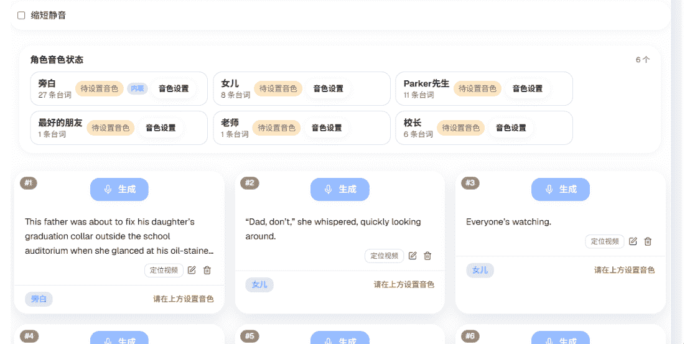

我也把我常用的一些音色包和 bgm 放到下面。

音色：如果使用自带配音的模型的话，则可以不用配置，如果是不带配音的模型，则需要自己配音。

ZIP 音色文件夹.zip 压缩包 · 点击下载

bgm: ZIPbgm.zip 压缩包 · 点击下载

## 4. 精剪成片

当所有的素材都生产完后，导出到剪映中，进行一个最后的精剪和优化。值得注意的是：大家可以根据自己所用模型生成视频进行一个倍速的微调，视频的节奏是至关重要的，相对紧凑的节奏，更容易爆。

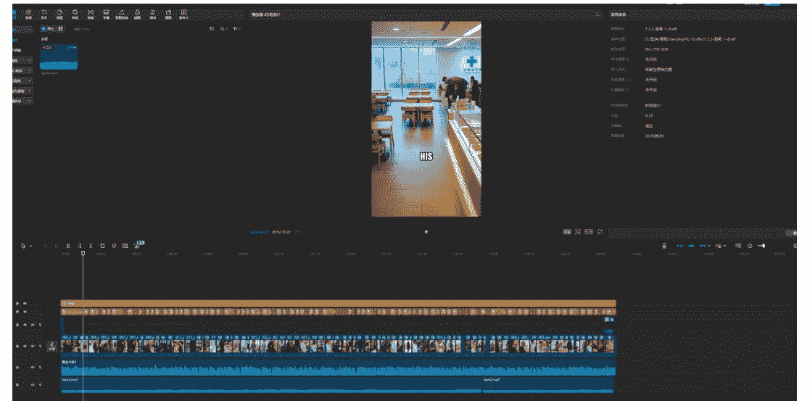

智谱生成的画面片段，我统一采用 1.5 倍速去调整。然后再根据音频去手动剪辑调整一下。剪辑这块基本没啥难度。就是简单的音画同步对齐。

## 5. 发布元数据

发布数据这块，可以直接让 gpt 去写，复制对标的标题和简介，然后让 AI 理解，再将自己的文案扔给 AI，让 AI 模仿对标的标题和简介的风格特点，再根据自己的文案输出一份就可以，也可以自己写一套提示词接入到自己的工作流当中。具体根据个人习惯去做就好。优先级不用提太高。

FILE励志发布元数据提示词.txt文件·点击下载

## 6. 发布相关

我是每个账号更新频率为一天一更，如果前期工作台不是很完善的情况下，也可以做到两天一更，最好是固定的更新频率，根据自己的能力和精力去调整即可。但单账号最好一天不要超过两更。极限测试是一天5更，整体推流会相对慢一些。短视频的封面可以不用刻意去做，让系统自行选择就行，如果是做长视频的话，就需要去好好设计一下封面和标题。

## 四、未来的油管计划和个人建议

### 1. 选择长视频还是短 shorts

省流一句话，就是长短视频都能做，还是看自己的积累和倾向。通过深海圈两年时间的学习和油管的各种折磨，我深深的体会到一个点就是，做 shorts 要快，一旦慢别人一拍，最难受的不是流量做不起来，而是流量爆炸，收益可观，但最终却没落到自己的口袋里。所以我觉得做 shorts 不要想太长远的事，因为你往往抗不到那个时候。

就拿我做的这个励志故事赛道举例，这个赛道在 1 月份的时候开始陆续爆发，但是我当时各种拖延并没有立即去做，真正等发布第一条视频的时候，已经到 3 月份了。但是紧接着，4 月头就开始同质化，收益能看到，但也就是能看到，并没有进入到自己口袋。直到 5 月底 6 月初，我发现又有账号开始更新，且还是开通 ypp 的账号，当时感觉就是可能又能做了，于是立即行动，便跟了几个号。但我感觉迟早还会同质化，倒不是因为赛道的原因。

而它更像是**平台对非真人 shorts 内容的定期清理**，跟赛道没关系。因为我自己包括周围做别的赛道的也出现这种情况，哪怕不是 AI 视频的也出现了。只要不是实拍的，貌似都在毒圈内，就看平台什么时候清洗。当然以上只是我个人见解，数据样本不够庞大，所以大家看看就好。

所以，对于做长视频还是短视频，我个人认为是这样的。

- 长期稳定去发展，能耐住性子，心态好的，可以去做长视频，包括我上面提到的这个旁白式故事的，长视频也一样能做，只需要调整一下生图比例和文案时长。且做长视频，大部分没做起来的原因，并不是做的视频不够好，而是**心态没稳住，没熬过那个煎熬的起号期**。
- 如果追求高收益爆发，我觉得还得是 shorts，流量来得快，产出效率高，但是缺点也很明显，就是被判罚的风险是远高于长视频的。

**所以，我目前是长短视频都做。长视频用来兜底，短视频拔高整体收益。**

### 2. 独立的思考和平稳的心态比能力更重要

#### 独立思考，找适合自己的方式和内容

可能这点对于在深海圈的圈友更感同身受，

作为最早一批加入的圈友，说实话，我取得的成绩还不如后面加入进来的一些优秀圈友，就我所知道的，上个月依旧有人靠 shorts 取得上万刀收益。但他们的赛道和玩法几乎都不是简单的复制和模仿爆款这么简单，而是将爆款拆开，提取核心爆点，重新组装到自己的新视频中。

所以，我觉得不论是做油管还是其他平台，爆款和赛道是可以借鉴和模仿的，但真正实操起来一定要自己去独立思考。要借鉴吃到螃蟹的人的经验去做第一个吃别人没吃过的螃蟹的人。 而不是别人做啥我做啥，别人咋做我咋做，这样的方法是只适合新手去找感觉，并不是适合持续去做下去。

#### 稳住心态，静待花开

其次，心态是很重要的，大部分伙伴还是国内平台做久了，习惯了那种及时反馈，到了油管上，反而心态稳不下来，做一段时间就开始怀疑自己的能力和思路。进而否定自己。

但在油管上，一个稳定的心态很重要，尤其是做长视频的小伙伴。可能你连续发了十几天，几乎全是几十—两百的播放，就觉得可能没戏了。但是对于新号而言，这种数据非常正常。一个长视频频道正常起量的周期在 1-2 个月左右。

也许你之前发的几十几百的视频，在半个月后会突然爆发。

所以，反馈来的慢不代表你的内容有问题。

所以，我做长视频新号，我现在几乎不会

对播放量的高低影响心态，如果连续三四条都是 0 播，那么我会选择新开频道。

而我更看重的是这两个数据，**一个是封面点击率（播放量太低，就没任何参考价值），如果大部分都是低于 5%这个数值，那么我会去想办法优化后再测试。另一个就是平均播放时长，如果播放时长太低，甚至频道内大部分视频都偏低，那么，大概率是我的内容不够吸引人。根据后面的图表去判断，到底是哪个部分的跳出率最高，找出问题，解决问题，继续测试。** 对于短视频，**一般至少要发 10 条 shorts 就可以判断出来，是哪里有问题，通过后台的数据去做针对性优化。继续观看低，还是平均播放时长低，继续观看低说明你的视频开头不够吸引人，真正留下来的的用户太少，平均播放时长低，说明你的内容要么节奏太拖拉，要么没呼应或者跟你开头的三秒钩子完全没关系，属于挂羊头卖狗肉的。**

### 3. 油管新政实施后，该何去何从，究竟还能不能做

2027 年新规提高了 ypp 的准入门槛，对于做短视频的人而言，可能门槛的确是翻了一倍，且 YouTube 还特地加了一个 “90 天滚动 1,000 万次播放”指标，如果在过去 90 天内的 Shorts 播放量不足 1,000 万，Shorts 的广告收益分账将被**暂停收益**！但 ypp 不会取消，只有当过去 90 天播放量重新回升到 1,000 万次以上时，Shorts 的广告分成收益功能才会自动恢复。

对于这个，我感觉确实是变难了许多，也有可能是跟这两年 shorts 大爆发有关系，

但真正影响的赛道，我觉得还是那些做传统的解说赛道，科普赛道，reddit故事等本身流量比较低的赛道，这些赛道本身的特征就是批量吃低保，所以很难达到或者稳定达到 90 天内 1000 万播放的指标。同时也劝退了一大批低质创作者，包括我上的励志故事赛道，如果再不优化，或者创新，可能也会在危险边缘荡秋千。

**利好真正做精致内容的 AI 创作者，AI 视频天然具备流量优势，所以，对于优质内容而言是利好的，对于想搞批量化吃低保的，就是灾难级的更新。**

**但是对于长视频的门槛，我觉得 4000 小时和 8000 小时的区别不大。** 为什么这么说，因为如果你是正常做长视频，且不通过 shua 粉去开通过 ypp 的话，那么，当你的频道达到 1000 粉丝的时候，你的时长大概率是超过 8000 小时的。

如果你的时长达到了 4000 小时，那么正常情况下，你的粉丝是在 100-300 这个区间。所以，当你达到 4000 小时的情况下，不通过邪修去开通 ypp 的话，那么你的粉丝百分百是不够的，如果你的粉丝是自然涨粉到 1000 的话，那么你的时长基本上是大于 8000 小时的。（当然这是我这边的数据，但基本上大差不差）

## 结语

不管是做任何平台的项目，**政策的每一次变化，既是风险，也是机会。**

一句话就是

## 你不做有的是人做

你的差，有人做的比你还差，永远不要低估自己，心力很重要，AI 时代，你我皆有可能。

看完这篇 SOP，你觉得你懂了。但 90% 的人一到实操就会卡在第一步。

工具和教程只是最低级的壁垒，真正的壁垒是“立刻动手”和“圈层信息差”。

如果你想看全网最新的变现玩法，并且和一群执行力极强的极客一起下场拿结果，欢迎围观我的核心私域：【懒人专属群】。

我们不聊虚的，只做商业闭环的拆解与 AI 效率的压榨。系统内已沉淀 1000+ 跑通的套利实战局。

□ 查阅圈子完整数字资产与上车门槛：

https://lazyso.com/insider/

认同价值、准备好下场干活的，扫码加我微信（lazyhelper1）

备注：【实操上车】，不闲聊

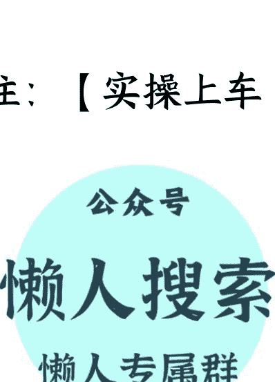


