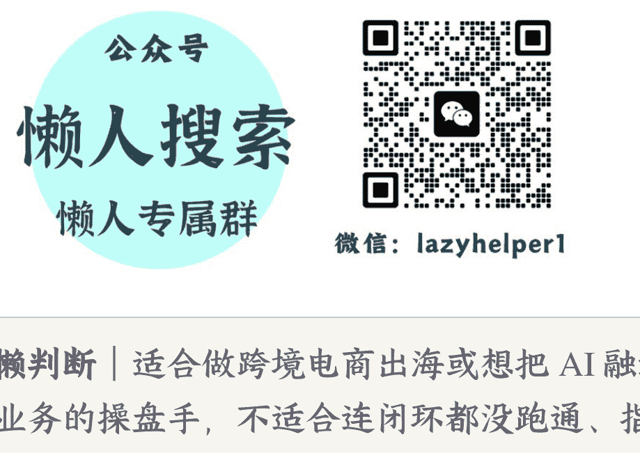
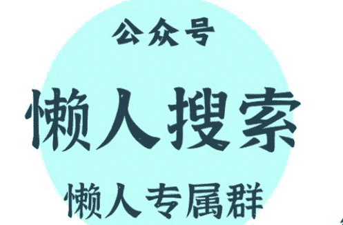

## AI+产品/运营增长的一些顶级理解,

260915 副业 SC 精华

整理：公众号懒人搜索，懒人专属群精选

懒人微信：lazyhelperl

小懒判断 | 适合做跨境电商出海或想把 AI 融进真实业务的操盘手，不适合连闭环都没跑通、指望靠 AI 无中生有搞钱的新手。里面提到花 100 多块买 3ue 替代 similar web 挖竞品数据这招很实在，值得记下。坑在于很多人抄袭流程图就觉得自己学废了，不去业务里沉淀人机协作的体感，最后反而被 AI 工具消耗。

大家好，我是杨涛，国民（Sam）老师的小迷弟，

记不得上次认真听完一整堂课是什么时候了，直到这次在深圳，我遇到了一个销魂的男子，说运营像聊江湖，讲产品像读情书，那对业务的独到理解，对业态的深刻洞察，这两天下来，信息增量满满，让人大呼过瘾，

听国民讲课，深入浅出，明白如话，平中有奇，引人入胜，他总是，用最迷人的感性，诉说着最纯粹的理性，我想，这大概就是人间第一等的智慧吧，

此致敬礼，给这位「人间疾苦我微甜」的男人，

笔记大家一起等生财发出来，先来分享一波我一边听课一边做的思考（还有很大一部分我草草写了一些关键词陆续补上完整的），纯手打，不是总结，是余温尚存的现场，

1. 第一轮和 ai 的探讨，不仅仅是让 ai 更了解你，更多的是让你自己更了解你自己，一般来说这个过程会用到 2-3 个小时，

如果你针对一个你深思熟虑后的业务，与 ai 进行了一场深度的对谈，那种体验有一种，对自己即将要做的生意理解被迫升级了的感觉，

2. 这些年的业态，其实是一个「竞争环境」的变迁，

大家都听过，一双无形的手，其实这是后半句，

完整的是，在充分竞争的环境里，有一双无形的手，

顺应环境，所谓成就事业，大部分时候，是「环境成就事业」，

3. sam 的 ai 渗透生产的过程，非常清晰的表明了， ai 必须有承载它的生产环境，而一个稳定的生产环境太难了，

如果 ai 是放大器，那么要思考的是，它放大的是秩序，还是混乱，

4. 经典的，「场景--需求--产品」的递进模型，

要仔细思考，你希望谁给你付钱，你到底想要赚谁的钱，

你能给谁提供什么价值，你能给解决什么问题，（此处配妈妈客户的那张图），

5. 品牌，多么性感的词，也是每个卖货人的终极梦想，

sam说的行业内卷经历，符合了纯流量打法的两个特征，

- a, 当你放大投放，ROI势必下滑，直到你承受不起，肉眼可见的天花板，这是放大投放的特征，
- b，流量成本整体的趋势是必然往上涨的，因为大多数情况下流量是固定的，但是抢流量的人是递增的，这是流量大势的特征，对抗的唯一出路就是打造品牌，要么就是赚一波就走，

6. 安客，就是从评论中站起来的，大家也可以去调研一下这个历程，

国内外所有生意都适用这句，「评论区有神明」，

7. 做电商有很多逻辑，有铺货逻辑，有精品逻辑，微创新的逻辑...

大部分只能称之为做项目，而品牌逻辑，能称作，做事业，

8. 刚才提到供应链，

这块提一句，ai能做到的，终究大家都能做到，你的进步甚至跟不上大模型自身的发展，

而这时候，要思考什么是ai做不到的，然后我们去专研，于是有了我们的竞争优势，供应链，肯定算是其中一个，

9. 其实刚才讲的素材，ai 能做出好图（其实不一定），就算能，更重要的也是情绪传递，而不是简单的严肃科普和产品说明，

sam 说的符合宝妈需求的真实使用场景，其实是在用图片传递一种情绪，传递一种确定性（帮用户，想清楚），

用户，在花钱买「确定性」，

10. 这里到了蓝海和红海，有一个不同的思考，

蓝海意味着波动，红海意味着稳定，

红海市场，你的胜出，只需要各方面比同行好 5%，

正如，亚马逊已经没有所谓的红利期，但是不影响它可以是一个稳定的好生意，

11. sam 说的和供应链的磨合，到线上验证，这些反馈和拉扯，到这里，完成了今天的第一个小闭环，应该也是本次的主线，

AI 负责「看见」--人负责「判断」--物理世界负责「兑现」，

伟大的词，a2r，ai to real，

克服 ai 穿越到物理世界的摩擦的能力，是核心竞争力，

12. sam 说到价格，不管什么 4p，5p 法则，

价格永远是影响成交最大的因素，

13. 这里 sam 说到用户量越来越多，于是反馈越来越接近真相，

当你没有用户的时候，你可以去竞品的评论区去找你要的，

13-1，任何领域，其实对你有价值的竞品不会超过 5 个，

不信的话，你可以放下手机，写下你购买多次的产品品牌，比如，5 个内衣品牌，5 个洗衣机品牌，5 个饮水机品牌，你是犹豫的，

14. 这里延伸一个思考，研究评论必须带上研究 ugc，

在全域内容里头找到足够多的真实 ugc，也可以让你更了解真实的需求，

15. 同样延伸，

流量，产品，运营，这是创业的黄金三角，如果运营做到位，必将有大量真实的 ugc，

而这种自来水，而 ugc 是可以运营的，这种精细化运营，必将反哺流量端（种草/舆情），反哺产品端（需求/迭代），

16. 关于组合视角，本质上也是算法视角，

买过沙滩裤的客户，将自动会被视为有可能买沙滩鞋，

17. 从大单品切入，最终变成卖一叠货，

这是一套有效的打法，

同时推荐一个公司给大家参考，是另一套逻辑，hims，后来变成了hims&hers，大单品大法，

18. 1tv，这里两个词，

流量价值和客户价值（这两个词值得重开一个贴，具体我放在平民流量手册里头了#[涛说#平民流量手册（一），谢... ] ，

19. 宝洁的案例，是一门严肃科学，

我们日常的取样，常常毫无价值，取样不足，取样偏差，取样谬误，充斥在当前的商业环境里，

如何倾听真实的声音，也就是找到干净的信息源，是我们需要一直研究的课题，

20. 以商品为单元，起点是找下一个好卖的产品，积累的是流量能力，单品利润和运营能力，

以用户为单元，起点是找同一群人的需求空白，积累的是用户理解，长期价值和供应链能力，

21. 单品的利润空间来自对手还没跟上的窗口，保护期的长短取决于别人跟进的速度，只把增长押在「再找一个爆品」，就要不断重新买流量，重新承担库存和竞争风险，

保持机动，保持敏锐，保持好奇，保持对抗，拥抱变化，

22.「不出海就出局」的口号已经喊了十多年，

只是目光所及，仿佛去全球化才是趋势，

自古以来，想去别人的国土赚钱，

都不是一件容易的事，不要有错觉和幻觉，

门已经慢慢地关上了，窗也正在收紧，

各自的监管正在追上来，

而这时候，十年一轮回，用了三十年，

从大山里走向县城，

从县城走向省城，

从省城走向北上广深杭，

将要马踏东京纽约的第四代接棒创业者，

又该何去何从，

只有一条路，品牌出海，

100万白牌出海，成功率万分之一，

大国，有100个全球认可的品牌，

最好是消费品品牌，

23. 宇宙第一大赛道，是消费品赛道，

消费品赛道里头有个零售，零售里头有个电商，电商里头有个平台电商，

经济下行不影响平台电商的增长，这就是结构性调整，

24. 看得见（卖点可视化）+ 有人信（背书）+ 反复见（饱和重复），

这是技法，讲细一些，做产品就是，

让人听见，让人看见，让人来，让人喜欢，让人买单，让人满意，让人信任，让人到处说，让人带人来…

25. 既然是 ai 主题，大胆预测一下，未来的推荐会 agentic 化（千人千面的极化版），也就是针对每个人去匹配最合适的内容，

这时候，内容会回归内容本身，真正用心去解读人群-场景-需求的人的时代来了，

26. 从性价比到高品质，重新定义「中国制造」，

27. 刚才说的，消费趋势，产业趋势，其实和 ai 没关系，ai 不在，它们也在发生，

ai 的角色是，把文化和需求那一层的翻译补上了，

28. 关于野望，关于求其上得其中，在大部分的时候是对的，但是在某些环境里是速亡之道，

在跨境这个领域，是对的，希音和天幕用几年时间证明了外头的对手并不扛打，

我们常听一句话，这个世界是草台班子，其实放在跨境领域，这句话被无限放大了，

这也是第四代企业家需要思考的事，

29. 关于投放，关于 sem 终将走向通投拉满的时代，

- a，一个计划就是一个投手，
- b，算法终将拉平你的 roi，
- c，素材定胜负，素材带来波动，

30. 野心和焦虑，是同一种能量的两个不同出口，

31. sam 说了五个维度，我在想「流量结构」，

亚马逊的流量结构由什么组成，

- a，综合搜索，b，硬广，c，活动，d，站外，

有且只有这四个，

那么 sam 做到了什么呢，全做到了，是一个正向的飞轮，

这个飞轮的起点是什么呢，也许是从需求演化出来的内容，具像化成详情或者社媒内容，带来站外的 affiliate，销量的增长，然后榜单带来的是转化的提高，资源的倾斜，硬广的成本降低，效率的提高，下拉词，综合搜索的流量增加...

而咱们要思考的是，自己的流量结构又是什么呢，缺什么，要怎么补，从哪里切入呢，

32. 数学题我们大家都要会做，这也是一种极致的决策树倒推，这套题里头少了很多节点，

但领会意思，sam 想表达的是，如果客单价多一个 0，那么一条链接每天要出的单就少一个 0，

转化率提高一倍，需要的链接就可以少一半，

大家可以把自己的整条路径的每一个节点列出来，于是就有了着力点，

33. 经济下行与否不一定，出品牌的概率不一定，

但是这个前提值得思考，消费者变理性不一定，更多的是由于社媒的发展，大家对「好东西」「优质生活的样子」，有了统一且多态的理解，看中东西本身好不好，值不值，

我们要加一层，同样的体验，谁更便宜，同样的价格，谁体验更好，

流量和渠道不一定变便宜，但是社媒是上帝给到新创业者开的一扇窗，

人才外溢是对的，不仅仅是大公司人才外溢，每年涌入人才市场的应届毕业生，让我们有了找到被低估人才的可能性，

同时，始终要记住一句话，成就事业，大部分原因是同行衬托，想办法比同行优秀 5%，就够了，

34. 数学不讲道理，数据是冰冷，残酷，真实的，

所以，关于需求和机会，我的用词一直是，我看见了一个需求，

通过观察，通过 ai 辅助下的数据收集和甄别分析，我们看见了一个需求，

这是一条很好的路径，这里给大家省 3000 美金先，比如 similar web 有个平替叫 3ue，闲鱼买只要 100 多人民币，

而其他大部分极客工具，在闲鱼上一样有解，

35. 文化的理解，太可怕了，竟然有讲这个，

ai 可以帮你翻译成中文，翻译成英文，翻不出那句话在什么场景下被说出来，

就比如我不去非洲，我就不知道非洲有很多集装箱医院，每年救百万人，不知道非洲的新生儿保温箱竟然是保温袋，

我们要不计代价地学好英语，这个世界 90% 的底层框架和运行逻辑都是由英文构成的，ai 时代 99% 的语料都是英语，很多人类文明的光，并没有翻译成中文，

如果不去理解它们的文化，你是没办法看见真正的需求的，

比如邮箱的使用频次，

比如穷人家虽然也有洋房排屋他们的门牌是有区别的，

比如欧美人是可以接受断断续续的聊天，

比如关于尺码，关于身材的认知，

比如送礼文化，

比如评论的夸张表达是习惯，还是真实反应...

文化不是装饰，不是务虚，是需求的底层操作系统，它能帮你更好的理解需求的优先级，表达方式，决策逻辑，

36. 1 个搜索流量等于 5 个推广流量等于 50 个推荐流量，流量，就是关键词的凝视，

37. 前缀+主词+后缀，构成了场景词和需求词，长尾词的流量愈发精准，愈发便宜，根据不同平台的逻辑，可以选择大词突破，也可以选择大量的长尾词包围大词，

38. 三轴这套打法可以延伸到国内的平台，商品也可以演变成产品和服务，品牌也可以替换成 ip 和影响力，

39. ai 抓到的所有信息，必须符合，真实，可追溯的证据链，阶段，场景，需求，关键词，趋势，评论原话，频次，主要竞品，进入判断，理由，工具，日期，是否二次验证，更新频次...

40. 想要有所成就，必须没有致命的短板，在这个基础上，还要有个极长板，

sam 这套逻辑有趣的地方在于，你只要自己用自己的业务跑几遍，或者用假想业务跑几遍，你就有了一技之长，可以自己业务，也可以给企业做服务，也可以封装成 web 或者工具，也可以帮忙去获取数据源然后打包成服务获取更高的溢价，

还很值钱，

41. 创造需求，啊，这个，是傲慢的啊，需求一直在那边，区别只是通过什么方式去看见它，

此时就到了第一天的夜晚，才发现 sam 讲这个课的叙事难度有多大，我在第一排都替他心疼，我也自诩是一个顶极的演讲者，感同身受，看他为了用当前理解的最大公约数尽可能的覆盖更多的人，尽力让业内老手和跨界新手都能听得更加明白，每一句措辞都在思考如何表达，脑子每一秒都在进行高速的运作，

压抑了一整个上午，然后下午渐入佳境，他站在台上，我双眼迷醉，看着他，像个藏器于身的侠客，直到夜里，终于才开始放开了抢，第一天的夜，真是精彩啊，

另外，大家有没有发现他的答疑和点评，太精髓了，云淡风轻，甚至 cover 了题者言犹未尽之意，这需要怎样的业务理解才能做到啊，瑞思拜，

好，我们继续，

42. 上这种实操课，千万不要骗自己，最容易陷入的困局是，把过程当结果，下午要开始实操了，要思考这两天自己到底要带什么「成果物」走，

比如需求地图，不是跟着走一遍，而是一份自己真的能看懂，能用来辅助决策的需求地图，（而不是把那些表格填完就算学会了），

43. 品牌需求机会的七问，

- 1. 谁买？ 从评论原话识别人群，
- 2. 搜什么？ 从人群，现有优势，生命周期延伸搜索词，
- 3. 哪里没做好？ 查看头部产品与低星评论，提取反复出现的未满足需求，
- 4. 会不会再回来？ 判断是否服务同一群人的下一阶段，
- 5. 在哪用？ 合并搜索词与评论中的使用场景，
- 6. 产品长什么样？ 结合市场与供应能力形成产品概念，
- 7. 什么时候动？ 查需求趋势与季节峰，倒推执行时间，

44. 要怎么判断自己把工作搭出来了，换一批词能不能跑，回去实操的时候，要注意一些细节，

比如数据是几月的，有时数据错了，结果全错，（同时要小心 ai 幻觉，它在编，工具没有调用痕迹，它就在编），

45. 大家有没有发现，数据源的重要性，这套逻辑虽然是为跨境电商设计的，底层是「需求发现-验证-兑现」，这是引擎，

燃料是数据源，

如果你不是做跨境的，那么你也可以沿用这套引擎，只是需要换数据源，

就是这套反复回答的同一组问题，

谁在买（人群），他们需要什么（场景-需求），现在的方案哪里没做好（未满足需求），我们能不能做得更好（供给能力匹配），什么时候该动（部分类目非必须），

能沉淀什么（资产累积），

放到任何生意里都成立，可以迁移，

46. 那么数据源要怎么获取呢，同样的逻辑，比如淘宝的评价，问大家，自掌时候的客服聊天记录，退款原因，差评原因，知识付费的各种社媒，内容的评论，舆情，学员反馈，退费理由，社群里头的高频问题，当然，还有很多，比如弹幕...

这里特别强调一下，工具+人肉，善用工具+积极人肉，

工具就是一切的工具，国内在极客工具这块非常优秀了，蝉妈妈，抖查查等一切，都可以通过闲鱼用很低廉的价格用到，

社区和社媒还有行业报告，比如 reddit，知乎，贴吧，各种 group，discord...

还有各种一手数据，比如和用户的一对一聊聊天，回访，以及亲自使用竞品，伪装成客户去和超过 10 个的竞品发生完整的交易关系，

有时候人肉部分，价值非常高，毕竟，越难获取的数据，壁垒越高，容易获取的，你的对手也容易获取，

（你甚至可以完全相信 ai 和算法和大数据的发展，会让数据获取变得越来越简单），

47. 冷水还是要有的，

sam 的优势是判断，有一种可以称之为行业直觉的东西，

都说 ai 来了, 人们负责判断, 那怎么判断呢, 这恰恰是无法短时缩的差距, 需要大量的时间和经验的沉淀,

也就是算法, 算力之外的, 「优质数据+大量训练」,

你可以理解为, 老司机听到引擎的声音就知道哪里出问题,

在这个场景里头就是, 框架给你的是去哪里看, 行业经验给你的是看到了什么, 同样一条评论, 有些朋友看到的是一句抱怨, 加上 ai 可能能看到一个需求, sam 可能看到的是一个品类机会,

因为在那一瞬间, 他脑子里运作的是从需求到供应链到履约的整条链路的试演练,

这, 是判断的基础,

ai 压缩了时间和空间, 而我们要着力的地方, 我们要投入的时间, 是 ai 无法完全压缩的那部分时间,

( 自有大于一手大于社区大于公开工具 ) ,

48. sam 说大家可以有自己更顺手的方式, 是没错的, 而且极其简单, 就一句话, 你每天使用 ai 的时间大于使用微信, 半个月你就可以做到了,

多嘴一句, ai99% 的能力在于 coding, 而不是 chat,

49. 刚才看了周边几个朋友, 发现, 和 ai 协作的时候, 人们有一个常见问题, 就是不够勇敢, ( 不敢放肆地提需求 ) ,

请尽情的使用 ai，大胆点，高估它，

50. 除了关键词，转化端也是需要深度理解的，

真实的场景，真实的需求，

是大基数胖子自重训练用什么瑜伽垫，

是关节炎用户用什么瑜伽垫，

是卷腹，平板支撑用，是拉伸适配，

而不是大比例，浓墨重彩什么材质，什么慢回弹，什么专利，什么中科院背书，什么 sci...

击中真实需求，引导购买行为，

「我的一切，与我有关」，从搜索开始，

消费者看到的一切，要与他有关，而我们尽可能的去设计这样一套逻辑，出现在与他相关的所有节点，

嗯嗯，

要情绪流淌的导购型详情，

而不是冷冰冰的产品说明，

51. 回旋镖，早上聊的文化差异，

美国人说 stroller 不说 pram，

我们这里叫抠图，欧美那边，叫 remove background，去除背景，

52. 再穷不能穷模型，再省不能省 token，

53. agent 的价值在于不知疲倦，agent 处理的是已知框架内的信息，人处理的是框架之外的判断，

你才是分析师，决策者，执行者，

如果把时间轴拉到最长，agent 在你的生产环境里扮演的角色是，组织的记忆体，一个完美的机制记忆，让经验，判断，教训可传承，可检索，可迭代，

如果能在这一步有共识，那么请投入足够的「耐心」去优化你的 agent，

（agent 永远不会也不能替你做主），

54. 有一个很有趣的角度（深刻），

可以助力大家对场景和需求有更深入的理解，

有一些类目，用户和客户是分开的，如刚才那个案例，用户是小孩，客户是父母，

这时候你要击中的点就需要考虑得更加深入，

宝宝不会说话，信号只能是睡得好不好，起疹子么，闹还是不闹，你获取的信号是经过父母翻译的，而你要读懂这层加料过的翻译，

父母关心的需求是，是否安全，材料，认证，省心，甚至心理安慰等情感需求，

如果继续延伸，其实还要击中另外两个场景，影响者，决策者，而购买者又有另一个可能性，

（送礼者），

（ 送礼要体面，不是么），

（ 宠物不是么，老年人相关的儿女买单 的…）

（ 同时解好这些题，你就能胜出同行 5%），

- 55. 不要做 sam 的 version 2，要做自己 agent 的 version1，要有自己的优势和特色，

sam 淡写轻描，但什么是 ai 拿不走的优势 和特色呢，正是我刚才说的 ai 穿越到物理 世界的摩擦，

- 供应链，你的关系（是否独家，地理位置， 产业带与否），你对工艺的理解（原材料， 微创新的基础），

- 对市场的真实理解（而不是单平台，小环 境的小规则），

- 品类的认识深度（跨品类发现异常值的能 力和跟进速度），

- 运营手感（对规则的理解，对数据波动的 敏感），

- 资金和抗风险能力（弹药深度是否可以无 视试错成本，能坚持多久不动作变形，是 否有些类目准入门槛已经淘汰了自己），

- 组织规模和组织能力（搭档，伙伴，以及 协作效率），

- 真实数据和存量用户（以及如何沉淀客户， 客户属于平台还是属于自己，可否再次触 达，触达成本），

（你有什么牌，知人者智，自知者明），

（在成年人的世界里，不自知的倔强是致命的），

- 56. 刚才 sam 反复提到，让 ai 对你做一次深度的访谈，我最长的一次做了 8 个小时，我的经验来看，有几个注意事项，

- 1. 做好充分的准备，留出充足的时间，要像婚礼一样虔诚，因为是一轮接一轮往下递进，所以一开始就要全情投入，

- 2. 前置的准备清单尽可能多给它，你的履历，资源清单，你的初步感兴趣的品类或方向，你的边界，

- 3. 要对自己诚实，要对 ai 诚实，一步错，步步错，

- 4. 聊天框有限，另开一个对话的时候，要记得和 ai 说清楚，继续访谈，然后它会从 memory 里读取到上下文才继续，

压测，残酷一些，

- 57. 在 ai 出现之前，人们甚至没法意识到自己的人生 token 的珍贵，

- 58. 不同模式下的 listing 做法完全不同，

比如，有些品完全没有决策成本，或者没有选择，那么，评分无法影响初次下单，

关于模式选择，非常值得思考，

那么，listing 远远不是详情页那么简单，它的功能属性又有哪些呢，

- 搜索入口（让人看见），

- 导购（转化，让人掏钱），

- 筛选（只卖给对的人，很多人没意识到退货率这个事情的伤害），

- 表白墙（评论区是巨大的信任资产），

- 数据采集（消费者的真实心声），

- 品牌载体（你的风格，你的品牌语言），

- 投名状（你给平台的信号，我很想在贵平台深耕，求带，轻虐）...

- 59. 你能接住ai么，你这个人，其实是ai的瓶颈，

用钱可以让ai干得更多，那你的算力，能接住更多么，

模型3个月一次跃迁，你的阅读速度，理解，判断速度甚至可能在退步，

ai一秒给你30条结果，那你十分钟理解了2条，漏掉的28条怎么办，

让它漏掉么，看起来是对的，因为数量在那边，有吃有补，

但真的这样么，这样会让你有深度的路径依赖，就是一直在自己的舒适区里头打转，

在接住能力无法变得更快的时候，你要尝试变得更准，

有策略地漏掉，不是你主观且随意地漏掉，而是一次次和ai诚实的协作，让它帮你漏掉，给你更准，更值得你接住的信息，

call back 刚才的人生 token，注意力，

- 60. 适合自己的才是最好的，你吸星大法，兴致勃勃地拿到一个流程图，有没有思考过，有些环节，在你的业务里头成立么，甚至，就算成立，你的团队能用上么，

甚至，习惯么，

你自己回忆，当初用飞书，花了多少时间让你的小伙伴习惯，

这张图有没有你不具备的条件，数据，组织，工具，预算，这张图有没有有效期....

扛不住追问的流程图，将不会被执行，

- 61. ai 可以锦上添花，甚至屎上雕花，但不能雪中送炭，更不可能无中生有，

而大部分朋友，只是想着无中生有，

用好 ai，一定是业务先行，用 ai 去放大你已经证明过的答案，而不是尝试用 ai 直接改造未成熟的业务，

- 62. 赚钱的时候，最大的敌人是「下一个貌似好机会」，

你正在赚的钱，是一系列偶然条件对齐的结果，你甚至不能完全理解自己做对了什么，不太清楚那个变量在起决定性的作用，

而这时候，看一个貌似机会显得更为简单，但如果去做的话，等于放弃了一个正在产出但你即将理解的系统，去追逐一个你完全不理解的系统，

应该在这个周期里，想办法把能赚的钱全赚了，

窗口期是有限的，这个环境下也是越来越短，分心的代价往往不是少赚一点，而是两头一场空，

- 63. sam说的ai发展历程，听到sam说他一眼就能看出那个小伙子屏幕上那些框架的价值，大家是否感同身受，

听到没用了，归零了，换代了，这些词，是否生出只要你学得慢，就可以不用学了的错觉，

「这是当下，最精致的借口」，

要思考的就是这两天反复思考的，什么是大模型拿不走的东西，什么是ai永远自己长出来的东西，

工具会归零，体感只会累积，什么是体感，是什么时候该信，什么时候该覆盖，是交叉验证，是翻译指令的能力，是踩坑之后的痛，是互动时候的直觉，判断，拆解，审美，

你不用ai，就养不出这种人机协作的体感和手感，

不要等一个稳定版，稳定版永远不会来，而你的体感，有复利撒，

花齐放，

去年的 prompt，你上个月搭的 workflow，都将被模型吞掉，你今天引以为豪的 ai 技巧，半年后就是大部分人的基操，你现在做的精良级的短剧，过半年就是粗制滥造了，

人，不要去和模型卷，要去业务层卷，

模型在进化，工具在迭代，你对业务的理解，你的独家内容，才是不会被开源，不会被降价，不会被下一代模型替代的东西，

把时间怼在那边，

（字数超了，我用图片贴上后面的，如图 1），

———————— 分割线 ————————

看完这篇 SOP，你觉得你懂了。但 90% 的人一到实操就会卡在第一跕。

工具和教程只是最低级的壁垒，真正的壁垒是“立刻动手”和“圈层信息差”。

如果你想看全网最新的变现玩法，并且和一群执行力极强的极客一起下场拿结果，欢迎围观我的核心私域：【 懒人专属群 】。

我们不聊虚的，只做商业闭环的拆解与 AI 效率的压榨。系统内已沉淀 1000+ 跑通的套利实战局。

- ☐ 查阅圈子完整数字资产与上车门槛：

https://lazyso.com/insider/

认同价值、准备好下场干活的，扫码加我微信（lazyhelper1）

备注：【实操上车】，不闲聊

