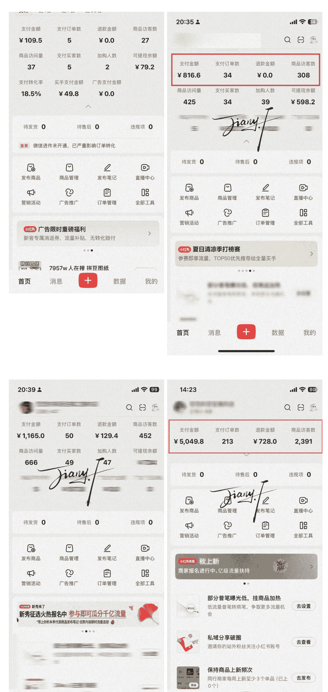
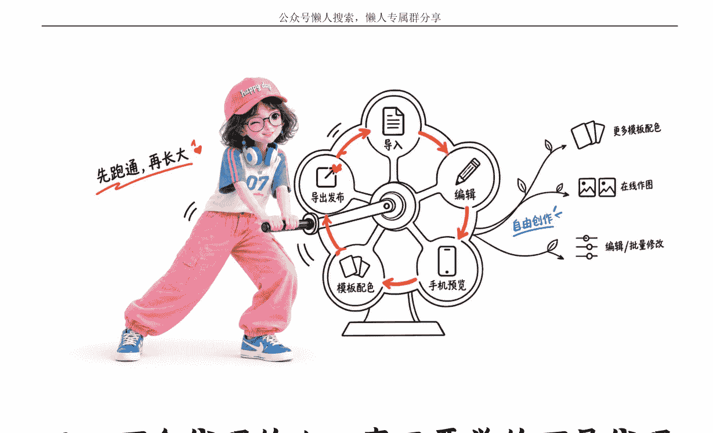
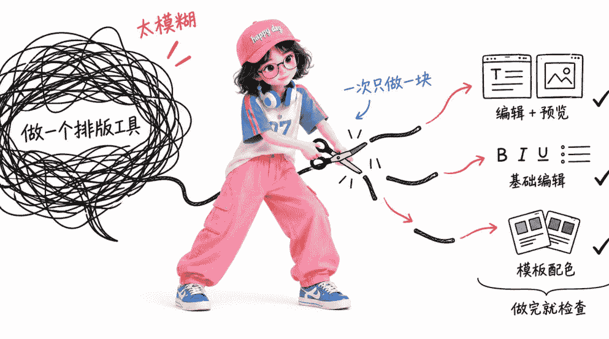
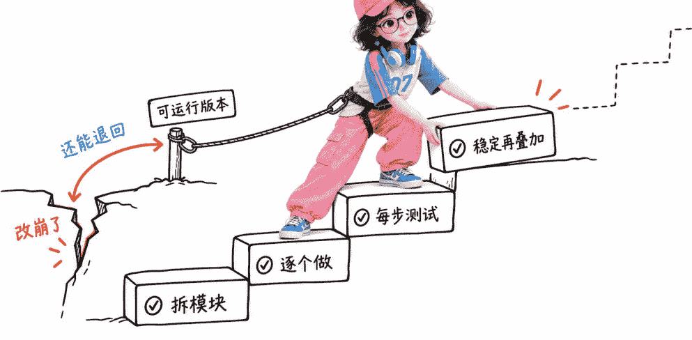
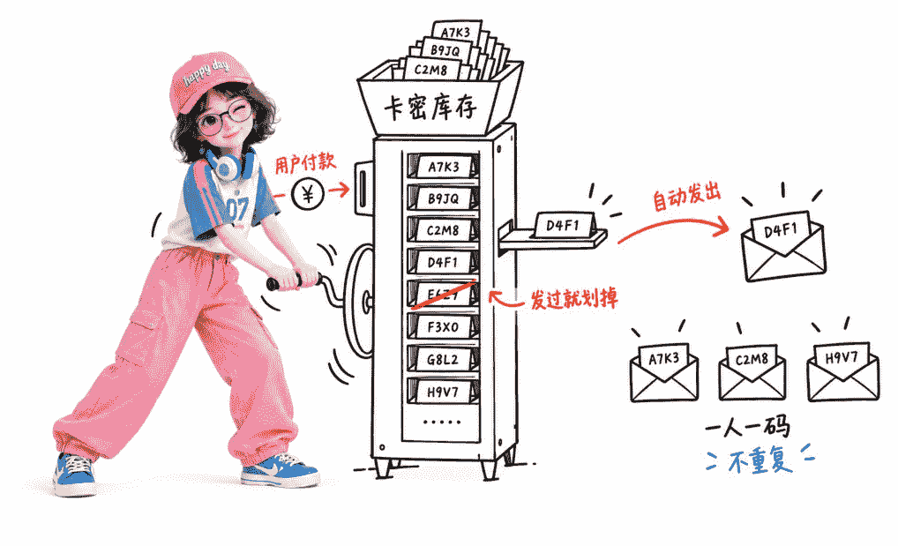

# 一个不懂代码的文科生，怎么用 AI 做出一个产品，并在小红书卖到 1 万+

260917 副业 SC 精华
整理：公众号懒人搜索，懒人专属群精选
懒人微信：lazyhelper1

> 小懒判断 | 适合想开发独立产品但缺乏技术背景的文科生或运营人员。不适合期待代码一键生成、缺乏产品逻辑推演能力的人。最值得关注的是作者利用 AI 从需求洞察到代码实现再到小红书营销的全链路实操细节。坑在于非标产品的售后维护成本高，需提前规划客诉应对机制。

哈喽，我是佳妮。

今天想分享一个我自己从 0 到 1 做出来的真实案例：**一个不懂代码、英语很差、也没有任何技术背景的人，怎么借助 AI 做出一个可以真正使用的产品，再把它放到小红书上售卖，最后累计卖到 1 万+。** 先说明一下，我并不是程序员，也没有专门学过开发。2024 年我才开始接触 AI，真正开始深度使用，大概是从 2025 年开始。最开始我会的东西也非常基础，无非就是和 ChatGPT 聊聊天、写写内容、问问题。

所以这篇不是一篇“程序员教你开发产品”的技术教程。我更想分享的是：**一个普通人没有代码基础，到底怎么从自己的需求出发，借助 AI 把一个想法变成产品，再完成上架、售卖、交付和迭代。** 如果你现在也想用 AI 做一点自己的东西，却一直卡在“我不知道做什么”“我不会代码”“我怕做不出来”，这篇应该会比较适合你。

（以下附上我的销售截图）

## 一、一开始根本没想做产品，只是被一个问题折磨得太久了

我经常写公众号。

写得多了以后，我越来越受不了公众号后台的排版。不是完全不能用，而是很多我真正想要的格式，它要么没有，要么改起来特别麻烦。

比如我想换一种颜色、调整某个强调样式、把普通下划线改成虚线，或者让整篇文章保持一种比较统一的视觉风格，后台本身能做的事情非常有限。

后来我也买过不少第三方编辑器和模板。刚开始看起来都很好看，但真正长期用的时候，又会出现新的问题：有的功能太复杂，有的好看的模板需要继续开会员，有的模板虽然好看，却不适合自己的内容。

我真正需要的，其实不是功能越来越多的编辑器，而是一个我自己用起来很顺手、打开就能直接排版的工具。这个需求在我脑子里存在了许久。

后来有了 ChatGPT 会员之后，我突然冒出一个想法：

既然现在 AI 可以帮人写代码，那我能不能不找程序员，直接让 AI 帮我把这个工具做出来？

这就是整个产品最开始的起点。

它不是我坐在电脑前想：“现在什么产品容易赚钱？”

而是因为我每天都在用公众号，我真的很被这个问题折磨过，所以我知道自己到底想解决什么。

这也是我后来做产品以后，越来越确定的一件事：

> **当你不知道该开发什么的时候，不要先想市场上还缺什么，先看你自己的生活和工作里，有什么事情让你反复觉得麻烦。** 因为真正高频发生在你身上的痛点，很可能也发生在一群和你类似的人身上。

## 二、从一个痛点，到一个真正能用的产品，中间比我想象中难很多

我大概是今年 3 月开始正式做这个工具的。

现在回头看，当时的 AI 开发能力和现在相比，其实还没有这么成熟。再加上我自己不懂代码，也不知道很多专业名词，所以最开始的开发过程非常慢。

我经常知道自己“哪里不满意”，但我不知道该怎么准确地描述。

比如我可能只会跟 AI 说：

“这里不好看。”

“这个地方为什么这么挤？”

“我希望它像手机里看到的公众号文章一样。”

“这个颜色我想单独改，但是不要影响其他地方。”

对于真正做开发的人来说，这些描述可能非常不专业，但这就是我当时真实的状态。

所以整个过程中，我 NG 了很多次，甚至有过直接推翻重来的情况。前前后后大概经历了 5 次比较大的版本调整，中间的小修改更是数不清。

刚开始我也会犯一个很典型的错误：一次性想把所有东西都做进去。我会觉得，既然都要开发了，那这里加一个功能、那里再加一个功能，好像做得越多越厉害。结果就是一个地方刚修好，另外一个地方又坏了；刚把功能做出来，整个页面又乱了。

后来我才慢慢学会：不要一开始做“完整产品”，先做“最小可用版本”。对于我这个公众号排版工具来说，最核心的事情其实很简单：

- 我可以把文章导进去；
- 我可以在里面编辑文字和基础格式；
- 我可以看到接近手机端的预览效果；
- 我可以选择我喜欢的模板和配色；
- 排好以后，可以复制到公众号后台继续发布。

先把这几个最核心的东西跑通，再去做后面的细节。

后来我又陆续加了更多模板、配色、图片并排等功能，也不断调整编辑区和预览区的体验。但这些都是建立在“最核心流程已经能跑通”的基础上。

## 三、不会代码的人，真正要学的不是代码，而是怎么给 AI 下任务

我到现在也不认为自己会传统意义上的“写代码”。

我真正学会的，是怎么把一个模糊想法，拆成 AI 可以执行的小任务。这个区别非常重要。

以前我会直接说：

帮我做一个公众号排版工具。

这种要求看起来很明确，其实对 AI 来说非常宽泛。它需要替你决定产品长什么样、有哪些功能、功能之间怎么连接、用户怎么操作。

后来我的方式会变成：

先帮我把左边做成文章编辑区，右边做成手机预览区。左边内容发生变化后，右边同步更新。暂时不要增加其他功能。

等这一块完成后，再继续下一块：

现在增加标题、加粗、高亮、删除线这些编辑能力，但不要改变原来的预览逻辑。

再往后才是：

增加模板切换、配色切换，并保证切换以后文章内容不丢失。

你会发现，我不是突然“会开发”了，而是开始懂得：不要把一个大问题整个扔给 AI，要把它拆成一块一块可以检查结果的小问题。

我现在自己做 AI 产品，大部分时候都会遵循一个很简单的流程：

先想清楚我要什么结果 → 拆成小模块 → 一个模块一个模块做 → 每做完一个就测试 → 稳定以后再继续叠加。这个习惯对没有技术背景的人特别重要。

因为我们看不懂大量代码，所以更不能一次改太多。一次改得越多，出了问题以后，你越不知道到底是哪一步导致的。

还有一个我踩过很多次的坑：一定要保留可以正常运行的版本。不要觉得这一版“差不多了”，直接在上面无限改。尤其是让 AI 大规模重构的时候，很容易出现原来好好的功能突然坏掉的情况。

所以现在我会非常重视版本。哪怕新版本改崩了，我至少还能退回到上一个能用的版本，而不是从头再来。

## 四、产品做出来以后，我第一次意识到：我的痛点可能不是我一个人的痛点

第一个真正可以使用的版本出来以后，我其实非常有成就感。

对一个以前完全不懂代码的人来说，看着一个原本只存在脑子里的东西，真的变成了网页，而且自己每天可以打开使用，这种感觉还是很奇妙的。

但做到这里，我最开始也没有马上想“我要靠它赚多少钱”。

我先想到的是另一个问题：

既然我自己这么需要这个东西，那会不会还有其他写公众号的人，也觉得排版很麻烦？写公众号的人这么多，我大概率不是唯一一个被这个问题折磨的人。

所以我决定把它放到小红书上试试看。

这也是我特别建议大家的一点：

产品做出来以后，不要先憋着做半年，也不要一开始就觉得必须做到 100 分才能卖。先拿一个可以正常使用的版本去验证，有没有人愿意为它付钱。因为“别人说这个东西不错”和“别人真的愿意掏钱”，是两件完全不同的事情。

## 五、第一篇小红书笔记，就真的有人下单了

我第一次上架的时候，价格其实非常低。

最早我有用过 9.9 元这样的价格去试水，后面又调整到 19.9 元。这个阶段我的核心目的不是利润最大化，而是想确认一件事：到底有没有人愿意为了这个需求付钱。然后我很认真地写了第一篇小红书笔记。

比较幸运的是，第一篇笔记就吸引来了一批真正有需求的人，也开始有人下单。

对我来说，这个反馈非常重要。

因为到了这一刻，这个东西才从“我自己觉得挺好用的工具”，变成了一个真正被市场验证过的产品。

后面随着产品继续迭代，我也逐渐提高了价格，从最开始几块钱的低价验证，慢慢提高到几十块，并且根据不同使用周期做了不同套餐。

这件事情也让我重新理解了“定价”。

一开始卖得便宜，是为了降低第一次验证的门槛；但产品已经被验证、功能越来越完整以后，就没有必要永远停留在最便宜的价格。

低价可以帮你验证需求，但不能成为产品永远的定位。

## 六、如果你也想在小红书卖数字产品，我建议尽早把“店铺和交付”搭起来

我最早做的是个人售卖。

那个时候个人售卖在评价、交付等方面还没有现在方便，所以我后面越来越觉得：

如果你已经确定这个产品要长期卖，店铺能早开就尽量早开。

为什么？

第一，评价是需要时间积累的。

一个刚上架、什么评价都没有的产品，和一个已经有大量真实反馈的产品，用户的信任程度是不一样的。你越早开始积累，后面越轻松。

第二，订单多起来以后，纯手动发货会非常消耗人。

一天只有一两单的时候，你觉得手动回复没什么。但如果一天十几单、几十单，每一单都要自己去复制教程、发送链接、发送邀请码，时间很快就被这些重复动作吃掉了。

所以后来我开始做自动发货。

## 七、我是怎么解决“自动发货+每个人拿到不同邀请码”的？

这里分享一个比较具体的操作思路。

我的产品不是简单地发一个网盘链接给所有人，而是用户需要注册账号以后才能使用。

所以我在产品里做了一个邀请码机制。

逻辑其实很简单：

1. 我在管理后台批量生成一批邀请码；
2. 每一个邀请码只能被使用一次；
3. 客户注册时输入邀请码，邀请码绑定到这个账号；
4. 绑定成功以后，这个账号获得对应的产品使用权限；
5. 同时限制一个账号可以登录的设备数量，比如 2~3 台；
6. 超过设备限制以后，系统会进行限制。

这样做的好处是，它比“大家共用一个账号密码”稳定很多，也能减少一个人购买以后到处分享给别人的情况。

接下来还有一个问题：订单多了，我总不能每次都自己手动挑一个没使用过的邀请码发给客户。

我自己用的解决方案是 [阿奇索自动发货](https://www.aqisuo.com)。

你可以把提前生成好的邀请码作为一批“卡密”放进去。客户每下一单，系统就自动从库存里取出一个还没发过的邀请码，再发给对应客户。

这样就能做到：

**每个人收到的码都不一样，而且一个码发出去以后不会重复发给下一个人。** 如果你的商品本身就是激活码、兑换码、序列号、邀请码这一类产品，这种方式其实非常适合。

具体怎么配置，我不建议大家死记步骤，因为平台后台会更新。直接根据阿奇索当下的官方教程去设置会更快，不懂的地方问客服就可以。

你真正需要理解的是这个逻辑：

先让自己的产品拥有“唯一授权码” → 再把授权码批量放进自动发货系统 → 用户付款以后自动发出不同的授权码。

只要想清楚这条链路，后面的工具都只是执行层。

## 八、小红书不是发一篇产品介绍就结束了，而是要围绕一个产品不断换角度写

很多人做数字产品以后，会有一个误区：

产品做出来了，就发一篇“这是我的产品，有这些功能，欢迎购买”。

发完以后没有流量，就觉得这个产品卖不动。

但我自己的经验是：**一个产品可以写很多很多篇笔记，而且每篇笔记都不需要重复**。我大概会把内容拆成几类。

## 产品介绍型

直接告诉用户这个产品是什么、解决什么问题、有哪些核心功能。

这种内容负责让已经有需求的人快速看懂产品。

## 痛点型

不要一上来讲产品，而是先讲用户正在经历的问题。

比如：

- 为什么公众号排版这么麻烦？
- 每次写完文章，还要花半小时排版怎么办？
- 为什么换一个公众号模板，整篇文章都乱了？

用户先被问题吸引进来，再发现你的产品刚好解决这个问题。

## 功能演示型

一个笔记只讲一个功能。

比如展示模板切换、配色、手机预览、图片并排，或者从文章导入到最终复制的完整过程。

有时候一个小功能，反而比一篇塞满全部功能的笔记更容易被看懂。

## 用户反馈型

真实客户的好评、使用前后的变化、客户问过的问题，都可以成为内容。

我后来会有意识地保存用户反馈，因为这些东西不只是“好评”，它其实也是最真实的市场语言。

客户为什么买、最喜欢什么、原来卡在哪里，这些内容往往比我自己凭空写卖点更有用。

## 问题和反差型

还有一种内容，不一定直接介绍产品，而是站在用户的角度提出一个他本来就想问的问题。

比如“一个完全不会代码的人，真的能自己做工具吗？”“公众号排版工具这么多，我为什么还要自己做一个？”

这样的内容更像一个真实经验分享，用户也更容易点进去。

## 九、写小红书最重要的能力，不是模仿别人，而是会复盘

这一点我特别想说。

我发现很多人写小红书，会陷入一种机械模仿：

看到别人标题这样写，自己也这样写；看到别人封面这样做，自己也这样做。

问题是，**你模仿的那篇内容本身就是一篇销售成交很差的内容。** 所以我现在更看重的是“复盘”，而不是单纯“对标”。

每发一篇笔记，我会去看几个问题：

- 用户为什么会点进来？
- 封面和标题有没有把痛点说清楚？
- 点进来以后，前几句话有没有让人继续看？
- 评论区大家在问什么？
- 有没有人因为这篇笔记直接咨询或下单？
- 哪一种表达方式带来的用户最精准？
- 哪些笔记流量不错，但根本不成交？

你慢慢会发现，真正值得复制的不是某一句标题，而是它背后的原因。

一篇能带来订单的笔记，本质上一定击中了某一类人的真实需求。而且小红书这个事情，一定不要因为发了两三篇没反应就停。

有时候你前面写了十几篇都很普通，第二十篇突然爆了，那一篇就可能持续给你带来很多订单。

所以我现在对内容的理解非常简单：先保证方向是对的，然后大量测试，持续复盘。不是每一篇都要爆，但你需要不断提高自己“写中用户”的概率。

## 十、卖产品以后，你会发现最大的挑战不一定是开发，而是售后

产品真正卖出去以后，我也经历了另外一轮教育。

你会遇到各种各样的客户。

有的人几十块钱买一个工具，希望获得几千块钱定制软件一样的服务；有的人教程已经写得很清楚了，还是会反复问同一个问题；也有人明明这个产品并不适合他的使用场景，却希望你为了他一个人重新改整个产品。

我以前会觉得，只要有人不满意，是不是就是我的问题。

现在我越来越能接受一件事：**任何产品都不可能适合所有人，不要在自己身上不断找问题。你需要做的不是让 100% 的人满意，而是明确这个产品适合谁、不适合谁。** 如果对方确实不适合，我现在一般不会花大量时间来回拉扯。能退款解决的，我宁愿直接退款，把时间留给真正适合这个产品的人。

我甚至遇到过，我明确告诉对方“这个产品可能不适合你，建议你选择其他工具”，对方反过来骂我的情况。

这种时候你更需要边界。

不是每一个差评、每一个不满意，都意味着你必须把自己和产品全部推翻。

当然，另外一种情况要分开看：**如果一个用户提出了非常好的建议，而且这个问题不是他一个人的问题，那就值得认真记录。** 我这个工具后面很多功能和细节，都是在真实用户使用以后一点点改出来的。

所以售后不是单纯“解决麻烦”。

它其实还是一个非常重要的产品调研渠道。

## 十一、我做这个产品以后，顺便沉淀了几百个精准微信用户

这个事情值得严肃重视！

如果你只在小红书完成一次交易，那客户买完以后，这段关系可能就结束了。

但如果你的产品未来还会升级，或者你之后还会做其他相关产品，那已经买过你产品的人，其实是非常精准的一批用户。

所以我会交付流程里，适当地设计一些用户愿意主动加微信的理由。

比如：

- 加微信可以领取额外赠品；
- 好评以后可以领取一个补充资料；
- 教程里明确告诉用户，如有售后问题可以联系客服；
- 某些更新、补充说明，会通过微信同步。

这里的重点不是强行把所有人往微信上拉，而是给用户一个合理的理由，让真正需要的人主动来加你。通过这产品，我前前后后已经沉淀了几百个微信用户。

这些人不是我随便从流量池里加来的，而是已经为我的产品付过钱、知道我在做什么的人。

这种用户的价值，远远不只是“一次成交”。

## 十二、如果让我重新做一次，我会把整个过程压缩成 7 步

如果你看完也想做一个自己的 AI 小产品，我不建议你一上来就学一堆代码，或者每天到处找“现在什么产品最赚钱”。

你可以直接按照下面这 7 步开始。

## 第 1 步：从自己反复遇到的问题里找需求

不要先追求“大市场”。

先找一个你自己每天真的会遇到的问题，而且你已经受够了它。

## 第 2 步：先做最小版本

想清楚这个工具如果只保留 3~5 个功能，哪些功能是“没有它就不能用”的。

先做这些。

## 第 3 步：把需求拆小以后再交给 AI

不要说“帮我做一个 XX 产品”。

改成一个模块、一个功能、一个页面地做，每做完一块就测试。

## 第 4 步：尽快拿出去收费验证

不要因为产品只有 70 分就一直不敢卖。

只要它已经可以稳定解决一个明确的问题，就可以用低门槛价格测试有没有人真正愿意付费。

## 第 5 步：根据真实用户反馈继续迭代

不要只听“这个挺好的”。

真正有价值的是：用户为什么买、哪里不会用、最喜欢什么、为什么退款。

## 第 6 步：把交付自动化

只要订单开始稳定增长，就尽量减少重复劳动。

自动发货、邀请码、教程、常见问题、设备限制，这些东西越早搭好，后面越轻松。

## 第 7 步：持续做内容，把一个产品反复卖

不要每天想着重新开发一个产品。

一个真正有需求的产品，完全可以从中不同角度持续写内容，让它不断获得新的曝光。

## 十三、这件事给我最大的启发：AI 真正降低的，是“把想法做出来”的门槛

以前一个完全不懂代码的人，突然说“我要做一个网页工具”，大概率第一反应是先去找程序员，或者先学几个月代码。

现在这条路径已经发生了很大的变化。

AI 不代表你什么都不用学，也不代表你只说一句话，它就能一次性给你做出一个成熟产品。

我这个工具中间推翻过、改坏过、报错过，也有很多次我坐在电脑前完全不知道问题出在哪里。

但它至少让我这种原本和“开发产品”几乎没有任何关系的人，有机会真正参与整个过程。

以前你可能需要先拥有技术能力，才有资格把一个想法做出来。现在你可以先拥有一个足够具体的问题，再一边做、一边补能力。这也是为什么我一直觉得，普通人学 AI 最重要的事情，不是背多少工具，不是记多少提示词，而是开始拿它解决真实问题。

做一个自己每天会用的小工具，做一个能节省两小时工作的自动化，做一个可以卖给同类用户的小产品。

只要你真正完成过一次从“我有一个问题”到“我做了一个东西”的过程，后面你看AI 的方式会完全不一样。

## 最后

这个公众号排版工具并不是一个多复杂、多高科技的产品。

但它对我来说很重要。

因为它是我第一次真正从自己的需求出发，把一个想法做成可以使用的东西，再把它放到市场里接受验证，最后有人愿意持续为它付钱。

从最开始几块钱试卖，到后面的不断迭代、提高价格、做自动发货、做邀请码、积累评价、沉淀微信用户，再到累计卖到 1 万+，整个过程没有哪一步是我一开始就全部想清楚的。

很多事情都是做了以后，才知道下一步该补什么。

所以如果你现在也想用 AI 做一个自己的产品，我最想告诉你的不是“赶紧学开发”，而是：

> 先去找到一个你自己真的很想解决的问题，然后做出第一个能用的版本。不要一开始就想做一个多伟大的产品。

先解决一个小问题。

先让第一个人愿意付钱。

先把第一条交付链路跑通。

当这些事情真的发生以后，你自然会知道下一步应该怎么走。

而且你会发现——对普通人来说，AI 最有价值的地方，可能不是帮你多写几篇文案，而是第一次让很多原本只能停留在脑子里的想法，有机会真的被做出来。

————分割线————

看完这篇 SOP，你觉得你懂了。但 90% 的人一到实操就会卡在第一歩。

工具和教程只是最低级的壁垒，真正的壁垒是“立刻动手”和“圈层信息差”。

如果你想看全网最新的变现玩法，并且和一群执行力极强的极客一起下场拿结果，欢迎围观我的核心私域：【懒人专属群】。

我们不聊虚的，只做商业闭环的拆解与 AI 效率的压榨。系统内已沉淀 1000+ 跑通的套利实战局。

- 查阅圈子完整数字资产与上车门槛：
  https://lazyso.com/insider/

认同价值、准备好下场干活的，扫码加我微信（lazyhelper1）

备注：【实操上车】，不闲聊

微信：lazyhelper1
